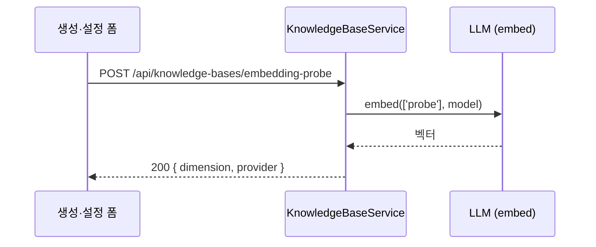

> 구현 상태: 부분 구현 (화면과 API 는 구현됨, PRD 요구사항 일부 미구현) · 원문: `spec/2-navigation/5-knowledge-base.md`, `spec/2-navigation/_product-overview.md` (§3.5), `spec/4-nodes/4-integration/_product-overview.md` (§3), `spec/4-nodes/3-ai/_product-overview.md` (§3.5, §5 NF-AI-05), `spec/data-flow/6-knowledge-base.md` (§1.6 임베딩 테스트) · 용어: [용어 사전](../CLE-GLOSSARY.md)

## 개요

지식 저장소(Knowledge Base, `KnowledgeBase`)는 문서를 올려 임베딩하고 AI 에이전트 노드가 검색하는 워크스페이스 단위 저장소다. 이 문서는 지식 저장소 메뉴의 요구사항과 지식 저장소 API 전체 목록을 정한다. 화면(목록, 생성·설정 폼, 상세 화면의 문서 관리, 업로드, 미리보기, 진행 상태, 검색 불가 경고, Graph RAG 패널)은 하위 문서 [지식 저장소 관리 — 화면](CLE-KB-MANAGE-UI.md) 에서 정한다.

요구사항은 세 PRD(내비게이션 PRD, 통합 PRD, AI PRD)에 흩어져 있었다. 두 PRD 가 같은 ID(KB-DC-01~03)를 서로 다른 문장에 썼기 때문에 요구사항 줄의 원본 표기에 PRD 이름을 함께 적어 구분한다. ID 별 대응은 [PRD 요구사항 ID 대응](#prd-요구사항-id-대응) 에 모았다. 화면의 옛 표기 "컬렉션(Collection)" 은 지식 저장소 자체를 뜻한다. 통합 PRD 의 "컬렉션(폴더)" 은 지식 저장소 안에서 문서를 묶는 문서 폴더이며 아직 구현되지 않았다.

범위 밖:

- 업로드한 문서의 파싱·청킹·임베딩·재시도는 [문서 임베딩](CLE-KB-EMBED.md) 에서 정한다.
- AI 에이전트의 검색 규칙, 리랭킹, 동적 점수 컷은 [RAG 검색](CLE-KB-SEARCH.md) 에서 정한다.
- 그래프 추출과 확장 검색의 동작은 [Graph RAG](CLE-KB-GRAPH.md) 에서 정한다.
- 테이블 컬럼, 저장 청크 차원의 정의, 재처리 잠금은 [지식 저장소 데이터와 흐름](CLE-KB-DATA.md) 에서 정한다.
- Embedding·Rerank 모델 설정의 관리 화면은 [모델 설정](../CLE-AI/CLE-AI-MODELS.md) 에서 정한다.
- AI 에이전트 노드에서 지식 저장소를 고르는 설정은 [AI 노드 공통](../CLE-NODE-AI/CLE-NODE-AI-COMMON.md) 에서 정한다.

## 요구사항

- REQ-KBUI-001 WHEN 사용자가 지식 저장소 메뉴를 열면 THE SYSTEM SHALL AI 에이전트 노드의 RAG 에 쓸 문서를 지식 저장소 단위로 관리하는 목록을 보여 준다. (원본: 내비게이션 PRD NAV-KB-01)
- REQ-KBUI-002 WHEN 편집자 이상이 지식 저장소 생성을 요청하면 THE SYSTEM SHALL 이름(필수)과 설명, 검색 모드, 임베딩 모델 설정, 청크 설정, 리랭킹 설정을 받아 지식 저장소를 만든다. (원본: 내비게이션 PRD NAV-KB-03, AI PRD KB-DC-01)
- REQ-KBUI-003 WHEN 편집자 이상이 지식 저장소 설정 수정이나 삭제를 요청하면 THE SYSTEM SHALL 설정을 고치거나 지식 저장소를 지운다. (원본: 내비게이션 PRD NAV-KB-03, AI PRD KB-DC-01)
- REQ-KBUI-004 WHEN 사용자가 지식 저장소를 만들면 THE SYSTEM SHALL 검색 모드를 `vector`(기본)와 `graph` 가운데서 고르게 한다. (원본: 통합 PRD KB-MD-01, AI PRD KB-MD-01, KB-GR-MD-01)
- REQ-KBUI-005 IF 만든 뒤 검색 모드를 바꾸려 하면 THE SYSTEM SHALL 막고 새 지식 저장소를 만들게 한다. (원본: 통합 PRD KB-MD-02, AI PRD KB-MD-01, KB-GR-MD-02)
- REQ-KBUI-006 WHEN 지식 저장소를 목록과 상세에 보여 주면 THE SYSTEM SHALL 검색 모드 배지를 표시한다. (원본: KB-GR-MD-03)
- REQ-KBUI-007 WHEN 생성 폼에서 검색 모드를 고르면 THE SYSTEM SHALL 모드별 도움말을 인라인으로 보여 준다. (원본: KB-GR-UI-01)
- REQ-KBUI-008 WHEN 사용자가 임베딩 모델을 고르면 THE SYSTEM SHALL 워크스페이스의 `kind=embedding` 모델 설정 목록에서 하나를 고르는 select 만 제공하고 자유 입력을 받지 않는다. (원본: 통합 PRD KB-VE-02, AI PRD KB-VE-02)
- REQ-KBUI-009 IF 임베딩 모델 설정 목록을 불러오지 못하면 THE SYSTEM SHALL select 를 비활성으로 두고 에러 메시지만 보여 준다.
- REQ-KBUI-010 IF 사용자가 임베딩 모델 설정을 고르지 않으면 THE SYSTEM SHALL 워크스페이스 기본 설정을 쓴다.
- REQ-KBUI-011 WHEN 임베딩 모델 목록을 보여 주면 THE SYSTEM SHALL 한국어 추천 모델(KURE, arctic-embed, bge-m3, multilingual-e5 패턴)의 옵션 라벨에 "한국어 추천" 배지를 붙이되 선택을 제한하지 않는다.
- REQ-KBUI-012 WHEN 한국어 추천 배지 대상을 정하면 THE SYSTEM SHALL `text-embedding-3` 계열을 뺀다.
- REQ-KBUI-013 WHEN 사용자가 임베딩 테스트 버튼을 누르면 THE SYSTEM SHALL 고른 모델 설정으로 `embed('probe')` 를 한 번 불러 잰 차원과 모델 프로바이더를 인라인으로 보여 준다.
- REQ-KBUI-014 WHEN 임베딩 테스트가 끝나면 THE SYSTEM SHALL 잰 차원을 지식 저장소의 저장 청크 차원(`embedding_dimension`)에 저장하지 않는다.
- REQ-KBUI-015 IF 임베딩 테스트가 실패하면 THE SYSTEM SHALL 400 `EMBEDDING_PROBE_FAILED` 로 응답하고 정리한 에러 메시지만 보여 준다.
- REQ-KBUI-016 WHILE 폼의 검색 모드가 `graph` 인 동안 THE SYSTEM SHALL 그래프 추출 LLM 과 그래프 검색 파라미터 필드를 보여 준다.
- REQ-KBUI-017 WHEN 사용자가 청크 설정을 바꾸면 THE SYSTEM SHALL 청크 크기(기본 1000 토큰)와 청크 오버랩(기본 200 토큰)을 지식 저장소 설정으로 받는다. (원본: 통합 PRD KB-VE-05, AI PRD KB-VE-05)
- REQ-KBUI-018 WHEN 사용자가 리랭킹을 사용 안 함이 아닌 값으로 고르면 THE SYSTEM SHALL 리랭커, 후보 풀, 점수 컷 임계 필드를 보여 주고 `cross_encoder_llm` 이면 그레이딩 LLM 필드도 보여 준다.
- REQ-KBUI-019 WHEN 사용자가 리랭킹 설정을 바꾸면 THE SYSTEM SHALL 재임베딩 없이 저장하고 다음 검색부터 적용한다.
- REQ-KBUI-020 WHEN 사용자가 설정 폼에서 임베딩 모델을 다른 값으로 바꾸면 THE SYSTEM SHALL 재임베딩이 필요하다는 인라인 경고를 보여 준다.
- REQ-KBUI-021 WHEN 임베딩 모델 설정 변경이 저장되면 THE SYSTEM SHALL 재임베딩을 자동으로 시작하지 않는다.
- REQ-KBUI-022 WHEN 지식 저장소 목록을 보여 주면 THE SYSTEM SHALL 카드마다 이름, 문서 수, 청크 수, 임베딩 상태를 보여 준다.
- REQ-KBUI-023 WHEN 사용자가 지식 저장소 카드를 누르면 THE SYSTEM SHALL 상세 화면으로 이동한다.
- REQ-KBUI-024 WHEN Graph 지식 저장소 카드를 보여 주면 THE SYSTEM SHALL Entity 수와 Relation 수도 보여 준다.
- REQ-KBUI-025 IF 저장 청크 차원이 NULL 이고 재처리 잠금이 `in_progress` 면 THE SYSTEM SHALL 카드에 "재임베딩 중" 을 진행색으로 보여 준다.
- REQ-KBUI-026 IF 저장 청크 차원이 NULL 이고 재처리 잠금이 `idle` 이면 THE SYSTEM SHALL 카드에 "재임베딩 필요 · 검색 불가" 를 경고색으로 보여 준다.
- REQ-KBUI-027 WHEN 문서 목록을 보여 주면 THE SYSTEM SHALL 파일 아이콘, 파일 이름, 형식(MD, PDF, TXT, CSV), 크기, 임베딩 상태를 보여 준다.
- REQ-KBUI-028 WHILE 지식 저장소가 Graph 모드인 동안 THE SYSTEM SHALL 문서마다 그래프 추출 상태를 더 보여 준다.
- REQ-KBUI-029 WHEN 재시도 횟수가 1 이상인 문서의 상태에 마우스를 올리면 THE SYSTEM SHALL 에러 메시지와 재시도 횟수를 툴팁으로 보여 준다.
- REQ-KBUI-030 WHEN 문서의 임베딩 상태를 표시하면 THE SYSTEM SHALL 대기 중, 처리 중, 준비됨, 재시도 중, 실패 다섯 상태를 구분한다. (원본: 내비게이션 PRD NAV-KB-05, 통합 PRD KB-VE-04, AI PRD KB-VE-04)
- REQ-KBUI-031 WHEN 상세 화면을 열면 THE SYSTEM SHALL 상단에 완료 수, 전체 수, 실패 수를 담은 임베딩 진행 박스를 보여 준다.
- REQ-KBUI-032 WHILE 처리 중인 문서가 있는 동안 THE SYSTEM SHALL 진행 박스를 5초마다 갱신하고 모두 끝나면 1분마다 갱신한다.
- REQ-KBUI-033 WHILE 지식 저장소가 Graph 모드인 동안 THE SYSTEM SHALL 추출 완료 수, 실패 수, Entity 수, Relation 수를 담은 그래프 추출 박스를 더 보여 준다. (원본: KB-GR-UI-02, KB-GR-UI-03)
- REQ-KBUI-034 WHEN 편집자 이상이 실패 문서 재시도 버튼을 눌러 확인하면 THE SYSTEM SHALL 실패 문서 재시도를 `embedding` 이나 `graph` 범위로 요청하고 다시 넣은 건수를 토스트로 알린다.
- REQ-KBUI-035 WHEN 문서 이벤트를 WebSocket 으로 받으면 THE SYSTEM SHALL 관련 목록과 통계 캐시를 바로 무효화한다.
- REQ-KBUI-036 IF WebSocket 연결이 끊기면 THE SYSTEM SHALL 폴링으로 상태를 갱신한다.
- REQ-KBUI-037 IF 저장 청크 차원이 NULL 이고 재처리 잠금이 `idle` 이면 THE SYSTEM SHALL 상세 상단에 검색 불가 배너를 보여 주고 편집자 이상에게 "지금 재임베딩" 버튼을 함께 보여 준다.
- REQ-KBUI-038 WHEN 편집자 이상이 "지금 재임베딩" 을 눌러 확인하면 THE SYSTEM SHALL 지식 저장소 전체 재임베딩을 시작한다.
- REQ-KBUI-039 IF 재처리 잠금이 `in_progress` 면 THE SYSTEM SHALL 배너에 "재임베딩 중" 만 보여 주고 버튼을 숨긴다.
- REQ-KBUI-040 WHEN 저장 청크 차원이 다시 채워지면 THE SYSTEM SHALL 검색 불가 배너를 자동으로 없앤다.
- REQ-KBUI-041 WHEN 사용자가 문서를 올리면 THE SYSTEM SHALL 버튼과 드래그 앤 드롭으로 여러 파일을 한 번에 받고 업로드 진행률을 보여 준다. (원본: 내비게이션 PRD NAV-KB-02, 통합 PRD KB-DC-01)
- REQ-KBUI-042 WHEN 사용자가 문서를 올리면 THE SYSTEM SHALL 텍스트(.txt), Markdown(.md), PDF(.pdf), CSV(.csv) 형식을 받는다. (원본: 통합 PRD KB-DC-02, AI PRD KB-DC-02)
- REQ-KBUI-043 WHEN 사용자가 상세 화면에서 검색어를 넣으면 THE SYSTEM SHALL 문서 목록에서 문서를 찾게 한다. (원본: AI PRD KB-DC-03, 내비게이션 PRD NAV-KB-04)
- REQ-KBUI-044 WHEN 사용자가 문서 이름을 누르면 THE SYSTEM SHALL 오른쪽 슬라이드 패널에 문서 내용과 청크 목록을 보여 준다. (원본: 통합 PRD KB-DC-04, AI PRD KB-DC-03, 내비게이션 PRD NAV-KB-04)
- REQ-KBUI-045 WHEN 사용자가 Graph 지식 저장소의 문서를 미리 보면 THE SYSTEM SHALL 청크마다 뽑힌 Entity 목록을 칩으로 보여 준다. (원본: KB-GR-UI-06)
- REQ-KBUI-046 WHEN 편집자 이상이 문서를 지우면 THE SYSTEM SHALL 문서와 그 청크와 파일 저장소의 원본 파일을 지운다. (원본: 통합 PRD KB-DC-05)
- REQ-KBUI-047 WHEN 사용자가 올린 문서의 내용을 고치면 THE SYSTEM SHALL 문서를 새 내용으로 바꾼다. (원본: 통합 PRD KB-DC-05) (미구현)
- REQ-KBUI-048 WHEN 사용자가 문서를 폴더로 묶으면 THE SYSTEM SHALL 지식 저장소 안에 문서 폴더를 만든다. (원본: 통합 PRD KB-DC-03) (미구현)
- REQ-KBUI-049 WHEN 사용자가 문서의 태그와 설명을 고치면 THE SYSTEM SHALL 문서 메타데이터로 저장한다. (원본: 통합 PRD KB-DC-06) (미구현)
- REQ-KBUI-050 WHEN 편집자 이상이 Graph 지식 저장소 상세에서 전체 재추출을 눌러 확인하면 THE SYSTEM SHALL 지식 저장소 전체 그래프 재추출을 시작한다.
- REQ-KBUI-051 WHEN 사용자가 Entity 목록을 열면 THE SYSTEM SHALL 이름, 타입, 등장 횟수 열과 검색, 정렬, 개별 삭제를 제공한다. (원본: KB-GR-UI-04)
- REQ-KBUI-052 WHEN 사용자가 Relation 목록을 열면 THE SYSTEM SHALL head, predicate, tail, weight 와 검색, 개별 삭제, 근거 청크 미리보기를 제공한다. (원본: KB-GR-UI-05)
- REQ-KBUI-053 WHEN 사용자가 그래프 시각화를 열면 THE SYSTEM SHALL 등장 횟수 상위 200개 Entity 까지 3D 그래프로 그린다. (원본: KB-GR-UI-07)
- REQ-KBUI-054 WHEN 지식 저장소 목록 API 가 불리면 THE SYSTEM SHALL `page`, `limit`, `sort`, `order`, `search` 쿼리를 받고 API 규약의 목록 응답 형식으로 돌려준다.
- REQ-KBUI-055 WHILE 사용자의 역할이 뷰어(`viewer`)인 동안 THE SYSTEM SHALL 지식 저장소를 읽기만 하게 한다.
- REQ-KBUI-056 WHEN 임베딩 테스트 API 가 불리면 THE SYSTEM SHALL 편집자 이상에게만 허용하고 분당 30번으로 제한한다.
- REQ-KBUI-057 WHEN 전체 재임베딩이나 실패 문서 재시도 API 가 불리면 THE SYSTEM SHALL 편집자 이상에게만 허용하고 분당 3번으로 제한한다.
- REQ-KBUI-058 WHEN 사용자가 문서를 올리면 THE SYSTEM SHALL 파일 하나당 50MB 까지 받는다. (원본: AI PRD NF-AI-05)

## PRD 요구사항 ID 대응

ID 하나당 한 행으로 통합 PRD 와 AI PRD 의 문장과 실린 곳을 정리했다. 다른 문서가 맡은 요구사항은 그 문서의 요구사항 줄로 옮겼다.

| ID | 통합 PRD | AI PRD | 실린 곳 |
|---|---|---|---|
| `KB-DC-01` | 지식 저장소에 문서를 올려 관리 | 지식 저장소 생성·관리 | 통합 PRD 문장은 REQ-KBUI-041, AI PRD 문장은 REQ-KBUI-002·003 |
| `KB-DC-02` | 지원 형식 txt·md·pdf·csv | 문서 업로드(txt, md, pdf, csv) | REQ-KBUI-042 |
| `KB-DC-03` | 문서를 컬렉션(폴더)으로 묶기 | 문서 검색과 미리보기 | 통합 PRD 문장은 REQ-KBUI-048(미구현), AI PRD 문장은 REQ-KBUI-043·044 |
| `KB-DC-04` | 문서 내용 미리보기 | 없음 | REQ-KBUI-044 |
| `KB-DC-05` | 문서 추가·수정·삭제 | 없음 | REQ-KBUI-041·046, 수정은 REQ-KBUI-047(미구현). [미결 사항](#미결-사항) 참조 |
| `KB-DC-06` | 문서 메타데이터(태그, 설명) 관리 | 없음 | REQ-KBUI-049(미구현) |
| `KB-MD-01` | 생성할 때 검색 모드 `vector`(기본)·`graph` 선택 | 검색 모드 선택, 생성할 때만 정함 | REQ-KBUI-004·005 |
| `KB-MD-02` | 생성 뒤 검색 모드 변경 불가 | AI PRD 는 `KB-MD-01` 에 함께 적음 | REQ-KBUI-005 |
| `KB-MD-03` | `graph` 모드의 Hybrid 흐름 | 없음 | [Graph RAG](CLE-KB-GRAPH.md) |
| `KB-VE-01` | 업로드하면 자동 임베딩 | 같음 | [문서 임베딩](CLE-KB-EMBED.md) 의 REQ-EMBED-001 |
| `KB-VE-02` | 임베딩 모델 선택(모델 설정 연동) | 같음 | REQ-KBUI-008 |
| `KB-VE-03` | 문서를 고치면 자동 재임베딩 | 같음 | [문서 임베딩](CLE-KB-EMBED.md) 의 REQ-EMBED-002(미구현). 현재 재임베딩은 문서 하나·전체 모두 수동이다. [미결 사항](#미결-사항) 참조 |
| `KB-VE-04` | 상태 표시(대기·처리 중·완료·오류) | 상태 표시(`pending`·`processing`·`completed`·`error`) | REQ-KBUI-030. 두 PRD 는 네 상태를 적었지만 현재는 `failed` 를 더한 다섯 상태다 |
| `KB-VE-05` | 청크 분할(크기, 오버랩) | 같음 | REQ-KBUI-017 |
| `KB-AG-01` | AI 에이전트 노드에서 지식 저장소 선택, 검색 모드와 무관하게 같은 방식 | AI 에이전트 노드에서 지식 저장소 선택 | [RAG 검색](CLE-KB-SEARCH.md) 의 REQ-RAG-001 |
| `KB-AG-02` | 유사도 임계값 설정 | 같음 | [RAG 검색](CLE-KB-SEARCH.md) 의 REQ-RAG-008 |
| `KB-AG-03` | 검색 결과 수(Top-K) 설정 | 같음 | [RAG 검색](CLE-KB-SEARCH.md) 의 REQ-RAG-009. Top-K 는 노드마다 고르는 주입 상한이다 |
| `KB-AG-04` | 그래프 검색 파라미터는 지식 저장소 단위, 노드는 `ragTopK`·`ragThreshold` 만 노출 | 없음 | [RAG 검색](CLE-KB-SEARCH.md) 의 REQ-RAG-009·010, [Graph RAG](CLE-KB-GRAPH.md) |
| `NF-AI-05` | 없음 | 문서 업로드 50MB/파일 | REQ-KBUI-058 |

## 하위 문서

- [지식 저장소 관리 — 화면](CLE-KB-MANAGE-UI.md): 목록 카드와 검색 불가 경고, 생성·설정 폼, 상세 화면(문서 항목, 상태 표시, 진행 박스, 검색 불가 배너), 문서 업로드, 문서 미리보기, 그래프 패널, 그리고 화면 결정의 Rationale(임베딩 모델 select, 검색 불가 경고 · 배너, 3D 시각화). 화면이 구현하는 요구사항: REQ-KBUI-001~053, REQ-KBUI-058(요구사항 줄은 이 문서의 [요구사항](#요구사항) 절에 있다)

API 와 권한 · 속도 제한(REQ-KBUI-054~057), 임베딩 테스트 API(REQ-KBUI-013~015 의 서버 쪽)는 이 문서의 [API](#api) 절에서 정한다.

## API

지식 저장소 API 전체 목록이다. 자세한 규칙은 각 행에 링크한 문서에 있다.

| 메서드 | 경로 | 설명 |
|---|---|---|
| GET | `/api/knowledge-bases` | 지식 저장소 목록. 쿼리 `page`, `limit`, `sort`, `order`, `search`. 목록 응답 형식은 [HTTP API 규약](../CLE-API/CLE-API-CONV.md) 을 따른다 |
| POST | `/api/knowledge-bases` | 지식 저장소 생성. 201 |
| POST | `/api/knowledge-bases/embedding-probe` | 임베딩 테스트. 편집자 이상, 분당 30번. 실패하면 400 `EMBEDDING_PROBE_FAILED`([임베딩 테스트](#임베딩-테스트)) |
| GET | `/api/knowledge-bases/:id` | 지식 저장소 상세 |
| PATCH | `/api/knowledge-bases/:id` | 설정 수정. 임베딩 모델 설정이 실제로 바뀌면 저장 청크 차원을 NULL 로 되돌린다([지식 저장소 데이터와 흐름](CLE-KB-DATA.md)) |
| DELETE | `/api/knowledge-bases/:id` | 지식 저장소 삭제 |
| GET | `/api/knowledge-bases/:id/documents` | 문서 목록 |
| POST | `/api/knowledge-bases/:id/documents` | 문서 업로드(multipart). 업로드한 파일 메타데이터(id, 상태 등)로 응답한다. 따로 속도 제한이 없어 전역 한도(분당 100번)를 따른다 |
| GET | `/api/knowledge-bases/:id/documents/:docId` | 문서 상세와 미리보기 |
| DELETE | `/api/knowledge-bases/:id/documents/:docId` | 문서 삭제 |
| POST | `/api/knowledge-bases/:id/documents/:docId/re-embed` | 문서 하나 재임베딩. 202([문서 임베딩](CLE-KB-EMBED.md)) |
| POST | `/api/knowledge-bases/:id/re-embed` | 지식 저장소 전체 재임베딩. 모든 문서의 청크를 지우고 다시 처리한다. 잠금이 `idle` 일 때만 진입하고 진행 중이면 409 `KB_REEMBED_IN_PROGRESS`. 편집자 이상, 분당 3번. 202 `{ documentCount }` |
| GET | `/api/knowledge-bases/:id/embedding-stats` | 임베딩 진행 통계(완료·실패·진행 수, Vector·Graph 공통). 진행 박스 폴링 소스 |
| POST | `/api/knowledge-bases/:id/retry-failed` | 실패 문서 일괄 재시도. 본문 `{ scope: 'embedding' \| 'graph' \| 'all' }`. 편집자 이상, 분당 3번([문서 임베딩](CLE-KB-EMBED.md)) |
| POST | `/api/knowledge-bases/search` | RAG 검색 디버그(`query`, `knowledgeBaseIds`, `topK`, `threshold`). 디버깅과 테스트용이다. 실제 워크플로우 실행은 노드가 검색 서비스를 직접 부른다([RAG 검색](CLE-KB-SEARCH.md)) |
| POST | `/api/knowledge-bases/:id/documents/:docId/re-extract` | (Graph) 문서 하나 그래프 재추출 |
| POST | `/api/knowledge-bases/:id/re-extract` | (Graph) 지식 저장소 전체 그래프 재추출. 재처리 잠금(`reextract_status`), 진행 중이면 409 `KB_REEXTRACT_IN_PROGRESS` |
| GET | `/api/knowledge-bases/:id/graph/stats` | (Graph) Entity·Relation 수와 추출 진행 요약 |
| GET | `/api/knowledge-bases/:id/graph/visualization` | (Graph, P2) 등장 횟수 상위 Entity 와 Relation. 시각화 페이로드 |
| GET | `/api/knowledge-bases/:id/entities` | (Graph, P1) Entity 목록(페이지네이션, 검색, 타입 필터) |
| GET | `/api/knowledge-bases/:id/entities/:entityId` | (Graph, P1) Entity 상세와 등장 청크 목록 |
| DELETE | `/api/knowledge-bases/:id/entities/:entityId` | (Graph, P1) Entity 삭제. 관련 Relation 과 청크-Entity 매핑이 함께 지워진다 |
| GET | `/api/knowledge-bases/:id/relations` | (Graph, P1) Relation 목록 |
| DELETE | `/api/knowledge-bases/:id/relations/:relationId` | (Graph, P1) Relation 삭제 |

- 응답 필드는 camelCase 다. 저장 청크 차원은 `embeddingDimension`, 재처리 잠금은 `reembedStatus`(DB `reembed_status`), 유효 임베딩 모델은 읽기 전용 파생 값 `embeddingModel`(모델 설정의 `defaultModel`)이다.
- 생성·수정 본문 필드와 컬럼은 [지식 저장소 데이터와 흐름](CLE-KB-DATA.md) 에 있다.
- 생성·수정 본문의 모델 설정 참조(`embeddingModelConfigId`·`extractionLlmConfigId`·`rerankConfigId`·`rerankLlmConfigId`)는 같은 워크스페이스에서 필드마다 정한 `kind` 의 모델 설정만 받는다. 아니면 404 `MODEL_CONFIG_NOT_FOUND` 다([데이터 모델 개요 §참조의 소속](../CLE-PLAT/CLE-PLAT-DATA.md#참조의-소속)).
- 워크스페이스 기본 Embedding 설정이 없는데 임베딩을 쓰려 하면 404 `MODEL_CONFIG_NOT_FOUND` 다. Chat 기본 설정이 없을 때의 400 `MODEL_CONFIG_DEFAULT_MISSING` 과는 다른 코드다. 코드 목록은 [에러 코드 규약과 카탈로그](../CLE-API/CLE-API-ERRCODES.md) 에 있다.
- 권한: 소유자, 관리자, 편집자는 지식 저장소를 만들고 읽고 고치고 지울 수 있다. 뷰어는 읽기만 한다. 역할별 권한 매트릭스는 [워크스페이스와 멤버](../CLE-ACCT/CLE-ACCT-WS.md) 에서 정한다.

### 임베딩 테스트

- 요청 본문은 `{ embeddingModelConfigId?, llmConfigId?, embeddingModel }` 다. `embeddingModelConfigId` 가 있으면 그 `kind=embedding` 모델 설정을 쓴다. 없으면 옛 필드 `llmConfigId` 나 워크스페이스 기본 설정을 쓴다.
- 응답의 `dimension` 은 잰 벡터 길이이고 `provider` 는 모델 프로바이더다.
- 지식 저장소를 저장하기 전에 실제 벡터 차원을 재어 보여 주려는 기능이다. 버튼을 눌렀을 때만 부르고 자동으로 부르지 않는다.
- 실패하면 400 `EMBEDDING_PROBE_FAILED` 와 정리한 메시지로 응답한다. 내부 URL 이나 API 키가 새지 않게 한다.

## 미결 사항

- **문서 수정, 자동 재임베딩, 문서 메타데이터 관리**: 통합 PRD 는 문서 수정(KB-DC-05)과 문서 태그·설명 관리(KB-DC-06)를, 두 PRD 는 문서를 고치면 임베딩을 자동으로 다시 만드는 것(KB-VE-03, [문서 임베딩](CLE-KB-EMBED.md))을 요구한다. 반면 지식 저장소 API 에는 문서를 고치는 엔드포인트가 없고 재임베딩은 문서 하나·전체 모두 수동이다. 문서의 `tags`, `metadata` 컬럼은 있지만 고치는 화면과 API 가 없다. 요구사항을 현재 동작에 맞게 줄일지, 문서 수정 기능을 만들지 결정 필요.
- **임베딩 테스트의 옛 `llmConfigId` 필드**: Chat 설정을 빌려 쓰던 임베딩 해석 단계는 V094 에서 없앴다([문서 임베딩](CLE-KB-EMBED.md)). 그런데 임베딩 테스트 API 는 아직 `llmConfigId` 를 받는다(DTO 에도 남아 있다). 이 필드를 지울지, 남기는 이유를 적을지 결정 필요.

## 구현 위치

화면 쪽 프런트엔드 파일은 [지식 저장소 관리 — 화면](CLE-KB-MANAGE-UI.md#구현-위치) 에 있다.

- `codebase/frontend/src/lib/api/knowledge-bases.ts`
- `codebase/backend/src/modules/knowledge-base/knowledge-base.controller.ts`
- `codebase/backend/src/modules/knowledge-base/knowledge-base.service.ts`
- `codebase/backend/src/modules/knowledge-base/graph.controller.ts`
- `codebase/backend/src/modules/knowledge-base/dto/**`

## Rationale

화면 결정의 Rationale 은 [지식 저장소 관리 — 화면](CLE-KB-MANAGE-UI.md#rationale) 에 있다.
