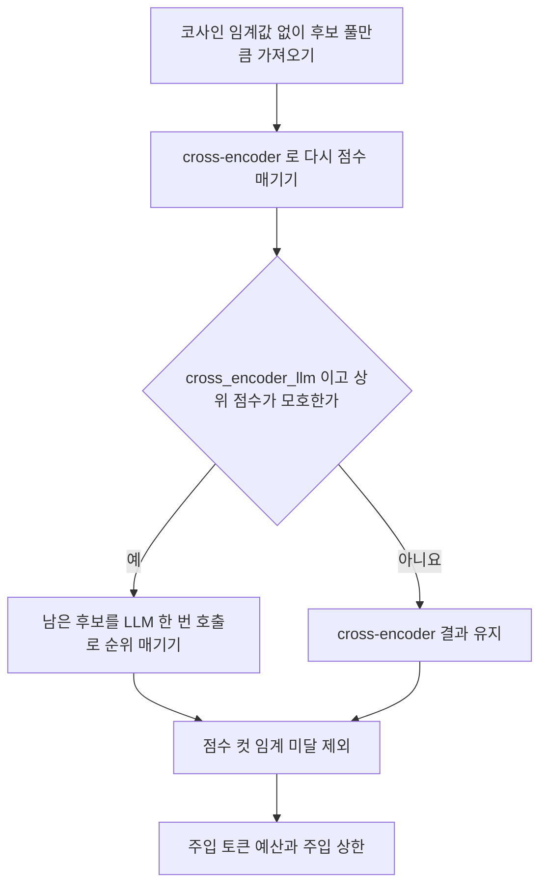
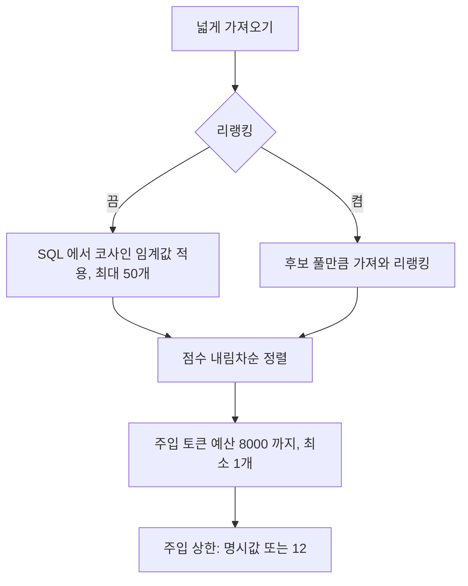

## 개요

이 문서는 [RAG 검색](CLE-KB-SEARCH.md) 의 하위 문서로 유사도 검색 쿼리, 리랭킹, 동적 점수 컷, 질의 임베딩의 모델 일관성을 정한다. 도구 결과 형식 · 진단 필드 · 에러 처리 표는 [RAG 검색 — 도구 결과 · 출력 메타 · 에러](CLE-KB-SEARCH-TOOL.md) 에서 정한다.

## 유사도 검색

### 쿼리

```sql
SELECT
  dc.id AS chunk_id,
  dc.document_id,
  dc.content,
  dc.metadata,
  d.name AS document_name,
  1 - (dc.embedding::vector(<dim>) <=> $1::vector(<dim>)) AS score
FROM document_chunk dc
JOIN document d ON d.id = dc.document_id
JOIN knowledge_base kb ON kb.id = d.knowledge_base_id AND kb.workspace_id = $5
WHERE vector_dims(dc.embedding) = <dim>
  AND d.embedding_status = 'completed'
  AND dc.embedding IS NOT NULL
  AND 1 - (dc.embedding::vector(<dim>) <=> $1::vector(<dim>)) >= $3
ORDER BY score DESC
LIMIT $4;
```

| 파라미터 | 뜻 | 기본값 |
|---|---|---|
| `$1` | 질의 임베딩 벡터 | 없음 |
| `$2` | 지식 저장소 ID 배열 (도구 호출은 하나) | 없음 |
| `$3` | 유사도 임계값(θ). 관련성 게이트 | LLM 인자 또는 0.7 |
| `$4` | 후보를 가져오는 폭(recall LIMIT) | 리랭킹 끔: 내부 상수 `RAG_RECALL_K`(50). 리랭킹 켬: `rerank_candidate_k`(기본 50) |
| `$5` | 워크스페이스 ID (멀티테넌시 격리) | 없음 |

`$4` 는 가져오는 폭이지 LLM 에 넣는 청크 수가 아니다. 넣는 수는 [동적 점수 컷](#동적-점수-컷) 이 정한다.

위 SQL 은 점수 계산을 보여 주는 개념 축약본이다. 실제 쿼리는 다음과 같다.

- 차원 `<dim>` 으로 양쪽에 `::vector(<dim>)` 캐스트를 건다. 3072 차원은 `halfvec` 캐스트를 쓴다. 캐스트 식은 차원별 부분 HNSW 인덱스 정의와 같다.
- `vector_dims(dc.embedding) = <dim>` 으로 차원이 다른 청크를 뺀다.
- `knowledge_base` 조인의 `workspace_id` 로 테넌트를 격리한다.
- 같은 차원의 지식 저장소를 묶은 뒤 묶음 단위로 ID 를 넣는다(`searchVectorGroup`, `rag-search.service.ts`).

### 후보 폭과 컷

두 경로 모두 넓게 가져온 뒤 동적 점수 컷으로 자른다.

- 리랭킹 끔(`rerank_mode='off'`, 기본): 코사인 임계값(`$3`) 게이트는 유지한다. `LIMIT` 만 `RAG_RECALL_K`(50)로 넓힌다.
- 리랭킹 켬: 코사인 임계값 없이 `rerank_candidate_k` 만큼 가져와 리랭킹한다. 이때 `kb_*` 의 `threshold` 인자와 노드 `ragThreshold` 는 리랭킹 점수 임계값으로 해석한다. 지식 저장소의 점수 컷 임계와의 관계는 [점수 컷 임계](#점수-컷-임계) 에서 정한다.

### 검색 불가 지식 저장소의 사전 차단

위 SQL 은 `<dim>` 을 알아야 실행된다. 그래서 저장 청크 차원이 NULL 인 지식 저장소(모델 변경 뒤 재임베딩 전, 재임베딩 진행 중)는 지식 저장소 메타를 읽는 단계에서 막고 벡터 쿼리를 실행하지 않는다. 저장된 청크가 옛 차원·벡터 공간이라 새 질의와 비교하면 오답이 나오기 때문이다. 쿼리가 우연히 0행을 돌려주는 것이 아니라 명시적인 차단이다. 차단 사실은 도구 결과 `status:"not_searchable"` 와 진단 `skipReason="kb_unsearchable"` 로 알린다. 지원 차원(부분 HNSW 인덱스가 있는 차원) 밖의 지식 저장소도 검색에서 빠지고 에러 로그를 남긴다. Graph RAG 의 seed 쿼리도 차원이 NULL 이면 똑같이 막는다.

### 거리 함수

- 코사인 유사도: `1 - (embedding <=> query_vector)`
- pgvector `<=>` 연산자는 코사인 거리다.
- 점수 범위는 0.0(무관)부터 1.0(동일)까지다.

### 여러 지식 저장소 검색

`searchWithMeta(query, knowledgeBaseIds[], workspaceId, { topK?, threshold? })` 는 여러 지식 저장소를 받는 시그니처다. 지식 저장소 메타를 한 번에 읽은 뒤 다음과 같이 나눈다.

- 저장 청크 차원이 NULL 이거나 지원 차원 밖인 지식 저장소는 뺀다(`groupVectorKbs` 의 skip, `isGraphKbSearchable` false).
- Vector 지식 저장소는 `(embedding_model_config_id, embedding_dimension)` 묶음으로 나눠 묶음마다 질의를 한 번 임베딩하고 병렬로 검색한다. 모델 설정이 같으면 모델, 모델 프로바이더, 차원이 같아 질의 임베딩을 함께 쓸 수 있다. 다르면 엔드포인트 호환을 보장할 수 없어 묶음을 나눈다.
- Graph 지식 저장소는 `max_hops`, `vector_seed_top_k` 가 저장소마다 달라 저장소 단위로 병렬 처리한다.
- 합친 결과 전체를 점수 내림차순으로 정렬한 뒤 동적 점수 컷을 적용한다.
- Graph 지식 저장소가 하나라도 끼면 그래프 순회 요약(`graphTraversal`)을 함께 돌려준다.

AI 에이전트 노드는 이 병합 경로를 쓰지 않는다([RAG 검색](CLE-KB-SEARCH.md#개요)).

## 리랭킹

리랭킹은 가져온 후보를 LLM 에 넣기 전에 지식 저장소의 `rerank_mode` 에 따라 한 번 더 정밀하게 정렬하는 선택 단계다. `kb_*` 도구 인터페이스(`query`, `top_k`, `threshold`)는 그대로이고 후처리는 `RagSearchService` 안에서 일어난다. `cross_encoder` 와 `cross_encoder_llm` 모두 구현됐다. 리랭커 모델 프로바이더는 `tei` 와 `cohere` 다(V081 리랭커 설정, V082 지식 저장소 `rerank_*` 컬럼). 리랭킹은 검색 모드와 독립이다. Graph RAG 의 중심성 가중치([Graph RAG](CLE-KB-GRAPH.md))는 그래프 안의 1차 정렬이다. 리랭킹은 벡터·그래프 어느 쪽 결과에나 적용하는 2차 후처리다.

### 모드

| `rerank_mode` | 동작 |
|---|---|
| `off` (기본) | 다시 점수 매기지 않는다. 넓게 가져오고(코사인 임계값 게이트) 동적 점수 컷을 적용한다. 리랭커 인프라가 필요 없다 |
| `cross_encoder` | 넓게 가져오고 cross-encoder 로 다시 점수 매긴 뒤 동적 점수 컷을 적용한다 |
| `cross_encoder_llm` | `cross_encoder` 뒤에 조건부로 LLM 그레이딩을 한 번 더한다. cross-encoder 상위 점수가 평탄하거나 모호할 때만 한다. 정책·지시 판단이 필요한 지식 저장소용이며 이 모드를 고르는 것 자체가 표시다. 별도 플래그는 없다 |

### 흐름 (`rerank_mode ≠ off`)



1. 코사인 임계값 없이 `rerank_candidate_k`(기본 50, 최대 200)만큼 가져온다. Vector 지식 저장소는 `searchVectorGroup` 으로, Graph 지식 저장소는 seed 와 확장 뒤 상위 후보 풀만큼 잘라 넘긴다.
2. `(query, chunk.content)` 쌍을 리랭커(`kind=rerank` 모델 설정) 엔드포인트로 점수 매긴다(`RerankClient.rerank()`, [LLM 클라이언트](../CLE-AI/CLE-AI-LLM.md)). 리랭커는 `rerank_config_id` 가 있으면 그 설정, 없으면 워크스페이스 기본 리랭커다.
3. `cross_encoder_llm` 만: 상위 점수가 평탄하거나 모호하면 LLM 그레이딩으로 넘어간다. 아니면 cross-encoder 결과를 그대로 쓴다. 넘어가지 않는 것도 정상이다.
4. 점수 컷 임계에 못 미치는 후보를 빼고 주입 토큰 예산으로 자른다.
5. 주입 상한: 명시한 `top_k`(노드 `ragTopK` 나 LLM 인자)가 있으면 그 값, 없으면 내부 상한까지 넣는다.

컷 기준이 코사인에서 리랭킹 점수로 옮겨 간다. 한국어 권장 cross-encoder 모델은 `dragonkue/bge-reranker-v2-m3-ko`(자가호스팅 `tei`)다.

### LLM 그레이딩

- listwise 방식으로 한 번만 부른다. 후보마다 따로 묻는 pointwise 방식은 쓰지 않는다. 응답은 ID 순위와 1~10 점수다.
- 그레이딩 LLM 은 `rerank_llm_config_id` 가 있으면 그 Chat 모델 설정, 없으면 워크스페이스 기본 Chat 설정이다.
- 현재 구현의 넘어가는 조건은 cross-encoder 최고 점수가 0.6 미만이거나 1위와 2위의 상대 격차가 0.05 미만일 때다. 남은 후보(survivor) 15개를 후보마다 본문 500자로 잘라 넘긴다. 이 수치는 합리적 기본값으로 시작한 값이며 골든셋 기반 A/B 로 확정하는 일은 [남은 과제](CLE-KB-SEARCH.md#남은-과제) 다.
- 결과는 셋이다. 적용되면 그 순위로 다시 정렬하고 점수는 10 으로 나눠 쓴다. 모든 후보가 무관하면 결과를 비우고 근거 없음 신호를 낸다. 실패하면 cross-encoder 결과를 유지한다.
- 모든 후보를 무관으로 판정한 사실은 도구 결과 `grounding:"none"` 으로 알려 에이전트가 "관련 근거 없음" 을 밝히게 한다([도구 결과 형식](CLE-KB-SEARCH-TOOL.md#도구-결과-형식)). 환각을 줄이고 인용 정밀도를 높이려는 장치다.

### 점수 컷 임계

지식 저장소에 점수 컷 임계(`rerank_score_threshold`)가 있으면 그 값으로 리랭킹 점수를 자른다. 런타임 임계값(노드 `ragThreshold` 나 LLM 인자)보다 먼저 쓴다. 값을 비워 둔 경우의 동작은 정의가 갈린다. [미결 사항](CLE-KB-SEARCH.md#미결-사항) 참조.

### 적용 범위

리랭킹은 `RagSearchService` 가 지식 저장소 하나로 불린 경로(지식 저장소 도구 `KbToolProvider`)에만 적용한다. 여러 지식 저장소를 인자로 받는 디버그 경로는 코사인 점수로 병합한 뒤 동적 점수 컷만 적용하고 리랭킹은 하지 않는다. 지식 저장소 하나가 RAG 의 정상 경로라서 이 범위로 충분하다고 봤다. 여러 지식 저장소 리랭킹은 [남은 과제](CLE-KB-SEARCH.md#남은-과제) 다.

### 실패 처리

리랭킹 경로는 어떤 실패에도 예외를 던지지 않는다. 설정 해석 실패, 엔드포인트 실패, 유효 결과 없음이면 원래 코사인 점수 순으로 강등한 뒤 같은 동적 점수 컷을 적용한다. 진단 `rerank.error` 에 코드를 남긴다. 그레이딩만 실패하면 cross-encoder 결과를 유지한다. 코드별 처리는 [에러 처리](CLE-KB-SEARCH-TOOL.md#에러-처리) 표에 있다.

## 동적 점수 컷

가져오기와 리랭킹 직후 LLM 컨텍스트에 넣기 직전에 모든 모드에 공통으로 적용하는 `RagSearchService` 안의 후처리다. 예전 고정 개수 컷(`LIMIT topK=5`)을 대신한다([동적 점수 컷을 도입한 이유 (D1)](#동적-점수-컷을-도입한-이유-d1)).



1. 넓게 가져오기: 리랭킹 끔이면 코사인 임계값 게이트와 `LIMIT RAG_RECALL_K`(50). 리랭킹 켬이면 후보 풀만큼 가져와 리랭킹하고 조건부 LLM 그레이딩을 한다.
2. 점수 내림차순으로 정렬한 후보 위에서 자른다.
   - 임계값 게이트: 리랭킹 끔은 SQL 단계에서 이미 적용했다. 리랭킹 켬은 점수 컷 임계로 자른다.
   - 주입 토큰 예산: 누적 토큰 추정이 `RAG_INJECT_TOKEN_BUDGET`(8000)을 넘으면 멈춘다. 최소 1개는 넣는다.
   - 주입 상한: 명시한 `top_k` 가 있으면 그 값, 없으면 `RAG_MAX_INJECT_COUNT`(12)다.

상수(모듈 상수, 환경변수로 노출하지 않음):

| 상수 | 값 | 뜻 |
|---|---|---|
| `RAG_RECALL_K` | 50 | 리랭킹 끔 경로의 가져오는 폭. `rerank_candidate_k` 기본값과 수치만 같고 따로 도는 코드 경로다. 지식 저장소 필드가 아니다 |
| `RAG_INJECT_TOKEN_BUDGET` | 8000 | 주입 토큰 예산. 작업 메모리 압축 예산 `DEFAULT_MEMORY_TOKEN_BUDGET`(8000)과 값은 같지만 쓰임새가 다른 별개 상수다 |
| `RAG_MAX_INJECT_COUNT` | 12 | 주입 상한의 기본값 |

- 새 지식 저장소·노드 설정 필드는 없다. 사용자와 LLM 에 노출하는 값은 임계값(`ragThreshold`)과 `top_k`(`ragTopK` 나 LLM 인자)뿐이다.
- 토큰 추정은 청킹 경로의 `chunking/text-chunker.estimateTokens`(글자 수 / 3, 동기, 의존성 없음)를 쓴다. 청크 도메인과 같은 추정이다. AI 에이전트 작업 메모리의 언어별 추정과는 일부러 분리했다.
- 적용 경로: 지식 저장소 하나의 벡터 검색, 디버그 API 의 여러 지식 저장소 병합, 그래프 통합 결과 모두 마지막 단계에서 똑같이 적용한다(`applyDynamicCut`).
- 실패 처리: 프로세스 안의 순수 후처리(필터와 합산)라 따로 실패하는 경우가 없다. 그 앞의 예외는 기존 검색 예외 처리(빈 결과, `search_failed`)가 맡는다.

### pgvector `ef_search`

넓게 가져오는 폭(리랭킹 끔 50, 리랭킹 켬 최대 200)은 HNSW 기본 `ef_search=40` 보다 크다. 그대로 두면 `ef_search < LIMIT` 이 돼 재현율이 떨어진다. 그래서 벡터 회수 쿼리(`searchVectorGroup`)는 `SET LOCAL hnsw.ef_search = clamp(LIMIT×2, 40, 1000)`(`hnswEfSearchFor`)을 트랜잭션 범위로 적용한다. `SET LOCAL` 이라 커넥션 풀을 오염시키지 않는다. pgvector 표준 GUC 라 관리형 DB 어디서나 같게 동작하고 확장이 따로 필요 없다. Graph RAG seed(기본 5개)는 40 보다 작아 올리지 않는다. `ivfflat` 인덱스는 쓰지 않는다. 운영 부하에 맞춘 정밀 조정은 [남은 과제](CLE-KB-SEARCH.md#남은-과제) 다.

## 임베딩 모델 일관성

- 검색 질의 임베딩은 지식 저장소의 임베딩 모델 설정(`embedding_model_config_id`, `kind=embedding`)과 같은 엔드포인트를 쓴다. 해석 규칙은 [문서 임베딩](CLE-KB-EMBED.md) 과 같다.
- 도구 호출 하나는 지식 저장소 하나를 검색하므로 그 저장소의 모델과 엔드포인트로 임베딩한다.
- LLM 이 한 응답에서 여러 지식 저장소 도구를 부르면 저장소마다 자기 임베딩 엔드포인트를 따로 쓴다.
- 질의는 입력 유형 `query` 로 임베딩한다(`LlmService.embed(..., inputType:'query')`). 적재 청크는 `document` 다. e5·Gemini 계열에서 질의와 문서를 구분해 회수 품질 저하를 막는다.
- 저장 청크 차원(`embedding_dimension`)은 모델이 내는 차원이 아니라 지금 저장된 청크 벡터의 실제 차원이다. 정의와 채우는 규칙은 [지식 저장소 데이터와 흐름](CLE-KB-DATA.md) 에서 정한다. 이 값이 NULL 이면 저장된 청크가 현재 모델과 같은 차원·공간이라는 보장이 없어 검색에서 미리 막는다.

## 구현 위치

- `codebase/backend/src/modules/knowledge-base/search/rerank.service.ts`
- `codebase/backend/src/modules/knowledge-base/search/dynamic-cut.util.ts` (`RAG_RECALL_K`, `applyDynamicCut`, `hnswEfSearchFor`)
- 검색 쿼리와 리랭킹 호출 흐름이 있는 `rag-search.service.ts` · `kb-tool-provider.ts` 는 [RAG 검색](CLE-KB-SEARCH.md#구현-위치) 에 적었다.

## Rationale

### 리랭킹을 선택 기능(기본 끔)으로 둔 이유

셀프 호스팅에서 리랭커 인프라(GPU, 외부 API)를 강제하면 진입 장벽과 운영비가 오른다. 기본 끔이면 리랭커 인프라 없이 동작하고 필요할 때 켤 수 있다. 리랭킹은 품질을 더하는 단계이지 필수 경로가 아니다.

예전의 "끔이면 현행과 바이트 단위로 같다" 는 하위 호환 조항은 동적 점수 컷(D1, 2026-06-06)을 도입하면서 버렸다. 끔 경로도 넓게 가져오기와 동적 점수 컷을 거친다. 새 하위 호환의 뜻은 "리랭커 인프라 없이 동작하고 조금씩 도입할 수 있다" 다. 동적 점수 컷은 코사인 점수 위의 순수 후처리라 새 인프라가 필요 없다.

### 리랭킹을 지식 저장소 단위로 둔 이유

검색 파이프라인을 지식 저장소가 소유한다는 기존 결정(`rag_mode`, `embedding_model_config_id`, 그래프 검색 파라미터)과 맞춘다. 저장소마다 도메인과 문서 성격이 달라 리랭킹 전략도 저장소 단위가 자연스럽다. 노드 단위로 두면 같은 저장소를 여러 노드가 쓸 때 설정이 흩어진다.

### 검색 모드는 불변인데 리랭킹 모드는 바꿀 수 있는 이유

검색 모드는 임베딩과 그래프 추출 같은 적재 결과물의 형태를 정한다. 나중에 바꾸면 재임베딩과 재추출이 필요하다. 리랭킹 모드는 검색할 때만 적용하는 후처리라 재임베딩이나 마이그레이션 없이 켜고 끌 수 있다. 그래서 둘을 다르게 다뤄도 된다.

### 유사도 임계값의 뜻을 다시 해석한 이유

새 필드를 더하지 않고 기존 `ragThreshold` 를 리랭킹 모드에 따라 나눠 해석한다. 끔이면 코사인 임계값, 켬이면 리랭킹 점수 임계의 기본값이다. 노드 설정 필드가 늘어나는 것을 피하려는 선택이다. 또 "최소 관련도 컷" 이라는 사용자 의도가 두 경로에서 같기 때문이다.

### cross-encoder 를 기본으로, LLM 그레이딩은 조건부로 둔 이유

조사한 범위에서 cross-encoder 는 넓은 벤치마크에서 LLM 리랭커와 비슷하거나 낫고 지연과 비용은 한두 자릿수 낮았다. 고객지원 도메인 A/B 에서 listwise LLM 은 해결률 이점이 없고 40% 느렸다. LLM 의 실익은 정책·지시 판단과 근거 인용에 있으므로 `cross_encoder_llm` 의 조건부 단계로만 쓴다.

### 동적 점수 컷을 도입한 이유 (D1)

고정 개수 컷(`LIMIT topK=5`)은 질의마다 다른 최적 개수를 무시해 의미 있는 청크를 빠뜨리고 lost-in-the-middle 을 부른다. 고칠 대상은 개수로 먼저 자르는 것이지 관련성 게이트(θ)가 아니다. θ 는 끔이면 SQL 의 코사인 게이트, 켬이면 리랭킹 점수 게이트로 그대로 둔다. 대신 가져오는 폭을 50 으로 넓힌 뒤 주입 토큰 예산과 주입 상한(12)으로 넣을 수를 정한다. 근거는 CAR(토큰 −60%, 지연 −22%, 환각 −10%)다. 모든 모드의 마지막 단계에 공통으로 적용한다.

- θ 를 SQL·리랭킹 게이트에 둔 이유: θ 를 후처리로 옮기면 가중 점수가 낮은 그래프 확장 청크를 지나치게 버리는 등 의미가 바뀔 위험이 있다. 가져오는 폭 확대와 후처리 예산·상한만으로 목표(의미 청크 누락 해소)를 이루므로 회귀 범위를 줄였다.
- 끔 경로의 코사인 θ 유지는 기각한 대안 "코사인 임계값을 유지한 채 리랭킹"(넓은 후보를 코사인으로 미리 줄여 리랭커 효과가 반감)과 다르다. 끔에는 리랭커가 없어 코사인 θ 가 유일한 관련성 게이트다.

### 가져오는 폭, 예산, 상한을 내부 상수로 둔 이유

`ragThreshold` 재해석과 같은 "노드 설정 필드를 늘리지 않는다" 원칙을 따른다. 처음에는 모듈 상수로 시작하고 조정 수요가 측정되면 지식 저장소 필드로 올린다. 사용자와 LLM 에는 θ 와 `top_k` 만 노출한다.

### `ragTopK` 기본값(5)을 없앤 이유

동적 점수 컷을 도입하면서 "고정 기본 주입 수" 라는 개념 자체가 사라졌다. 예전 리랭킹 설계가 기본값 5 를 유지한 것은 리랭킹 뒤 마지막으로 자르는 뜻을 보강하는 데 그쳤다. D1 이 그 자르기를 동적 점수 컷으로 대신하므로 기본값을 없앴다. `ragTopK` 는 이제 선택적 상한이다. 비우면 동적 점수 컷(상한 12)이 정하고 주면 그 값이 상한이다. `ragThreshold` 는 기본 0.7 을 그대로 둔다.

### LLM 그레이딩을 조건부로 바꾼 이유 (D2)

처음 결정은 "`cross_encoder_llm` 은 늘 그레이딩한다" 였고 LLM 호출 비용을 지키려는 단순화였다(2026-06-04 확정). 2026-06-06 에 이를 뒤집어 조건부로 바꿨다. 조건부 구조는 데이터와 상관없이 안전하다. 넘어가지 않으면 cross-encoder 결과를 그대로 쓰므로 예전 동작의 부분집합이다. 그래서 구조는 바로 도입했다. 넘어가는 정량 기준은 합리적 기본값(상위 N 점수의 평탄도, 최고점과의 차이나 표준편차)으로 시작해 골든셋 A/B 로 확정하는 일은 뒤로 미뤘다. "정책 판단 지식 저장소" 는 별도 컬럼이나 휴리스틱 없이 `rerank_mode = cross_encoder_llm` 선택으로 표현한다.

### 토큰 추정에 글자 수 / 3 을 쓰는 이유

청크 도메인과 같은 추정 함수(`chunking/text-chunker.estimateTokens`)를 쓴다. 빠르고 균일한 근사라 주입 컷에 충분하다. 작업 메모리의 언어별 추정과는 도메인이 달라 일부러 나눴다. `RAG_INJECT_TOKEN_BUDGET`(8000)은 `DEFAULT_MEMORY_TOKEN_BUDGET`(8000)과 값만 같은 별개 상수라 혼동을 막으려고 `RAG` 접두를 붙였다.

### 설정 테이블을 합친 뒤에도 `RerankClient` 를 따로 두는 이유

리랭커 설정은 모델 설정(`kind=rerank`)으로 합쳤다. 하지만 검색 후처리 호출은 입력과 출력의 모양이 달라 `RerankClient`·`RerankClientFactory` 를 따로 둔다([LLM 클라이언트](../CLE-AI/CLE-AI-LLM.md)).

### 기각한 대안

- 노드 단위 리랭킹 설정: 지식 저장소 소유 원칙을 어기고 설정이 흩어진다.
- 늘 리랭킹(끔 없음): 셀프 호스팅에 리랭커 의존을 강제한다.
- 코사인 임계값을 유지한 채 리랭킹: 넓은 후보를 코사인으로 미리 줄여 리랭커 효과가 반감된다. 그래서 리랭킹 경로는 코사인 임계값 없이 가져온다.
- VectorChord·ColBERT 같은 DB 안 리랭킹: 한국어 토크나이저가 없고 인프라가 복잡하다. cross-encoder API·TEI 로 충분하다.
