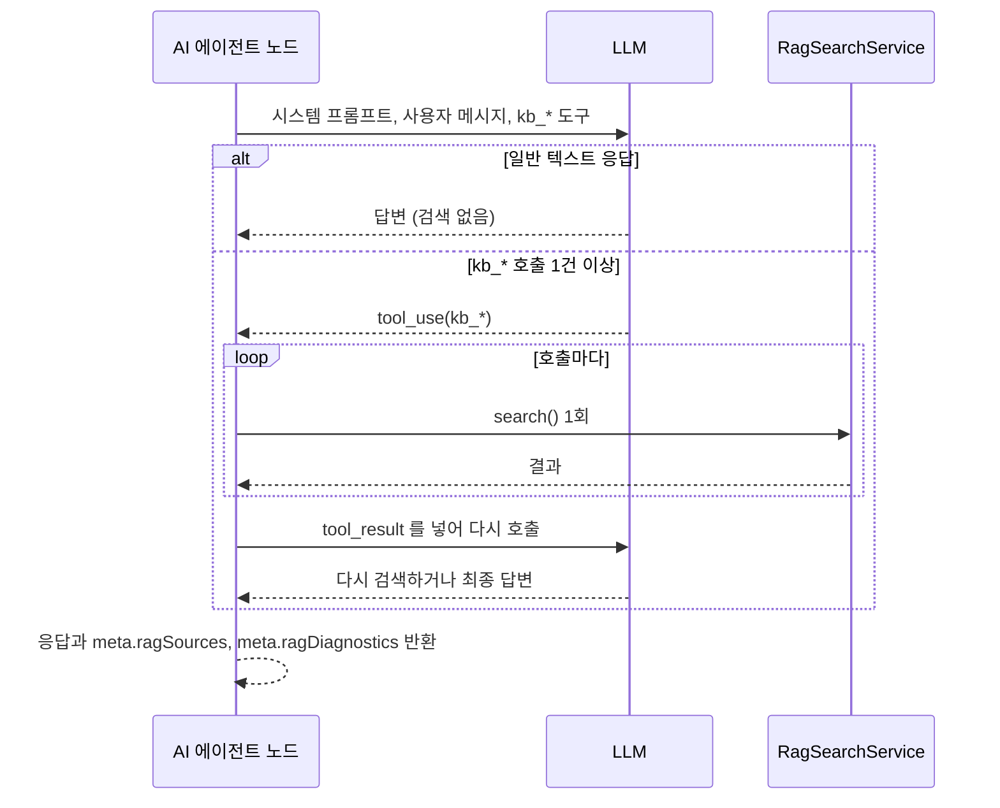

> 구현 상태: 부분 구현 · 원문: `spec/5-system/9-rag-search.md`, `spec/data-flow/6-knowledge-base.md` (§1.3·§1.4), `spec/4-nodes/3-ai/_product-overview.md` (§3.5 KB-AG, §5 NF-AI-03), `spec/4-nodes/4-integration/_product-overview.md` (§3.4 KB-AG), `spec/2-navigation/_product-overview.md` (§3.5 NAV-KB-06) · 용어: [용어 사전](../CLE-GLOSSARY.md)

## 개요

RAG 검색은 AI 에이전트 노드가 지식 저장소(Knowledge Base, `KnowledgeBase`)를 LLM 도구로 검색해 답변 근거를 가져오는 검색 엔진이다. 사용자는 설정 없이 기본 벡터 검색을 쓴다. 지식 저장소마다 리랭킹(reranking, `rerank_mode`)을 켜 검색 정밀도를 더 높일 수 있다.

검색 흐름은 지식 저장소의 검색 모드(`rag_mode`)에 따라 갈린다.

- Vector RAG(`rag_mode=vector`, 기본): 이 문서에서 정하는 유사도 검색이다.
- Graph RAG(`rag_mode=graph`): 벡터 seed, 그래프 확장, 중심성 가중치로 이어지는 흐름이다. [Graph RAG](CLE-KB-GRAPH.md) 에서 정한다. 이 문서의 리랭킹과 동적 점수 컷은 두 모드에 모두 적용된다.

검색은 AI 에이전트 노드가 지식 저장소를 지식 저장소 도구(`kb_*`)로 LLM 에 노출하는 능동 tool calling 방식이다. LLM 이 사용자 의도를 보고 호출 여부, 질의, 지식 저장소, 결과 수를 정한다. 여러 도구를 한 번에 불러 병렬로 검색하거나 결과가 모자라면 다른 질의로 다시 부르는 것도 LLM 이 정한다.

에이전트는 사용자 문장을 그대로 질의로 쓰지 않고 답에 필요한 지식 단위로 나눠 검색한다(agentic RAG). 별개의 정보가 필요하면 같은 턴에 `kb_*` 를 여러 번 부른다. 같은 지식 저장소라도 따로 부른다. 예를 들어 "교환과 반품 정책 알려줘" 는 `query="교환정책"` 과 `query="반품정책"` 두 번이 된다. 임베딩 검색은 주제가 하나일수록 정확하다. 나눌지는 에이전트가 판단하며 시스템 프롬프트와 도구 설명으로 유도한다.

각 호출 결과는 따로 유지한다. `kb_*` 호출 하나는 지식 저장소 하나만 검색하고 결과는 호출별 tool_result 메시지로 LLM 에 간다. 호출 사이의 점수 병합이나 재정렬은 하지 않는다. 에이전트가 각 결과를 인용하고 종합한다. 노드 메타(`meta.ragSources`)를 쌓을 때만 `chunkId` 로 중복을 빼서 References 화면의 중복 표시를 막는다.

`RagSearchService.search()` 는 여러 지식 저장소를 인자로 받으면 점수로 병합한 뒤 동적 점수 컷을 적용한다. 이 경로는 디버그 API(`POST /api/knowledge-bases/search`)의 여러 지식 저장소 검색에서만 쓴다. AI 에이전트 노드의 `KbToolProvider` 는 늘 지식 저장소 하나로 부르므로 병합 로직이 돌지 않는다.

범위 밖:

- 노드 설정 필드(`knowledgeBases`, `ragTopK`, `ragThreshold`)의 정의는 [AI 노드 공통](../CLE-NODE-AI/CLE-NODE-AI-COMMON.md), 도구 호출 한도와 도구 분류는 [AI 에이전트 노드](../CLE-NODE-AI/CLE-NODE-AGENT.md) 에서 정한다.
- 문서 적재와 질의 임베딩 모델 해석은 [문서 임베딩](CLE-KB-EMBED.md), 저장 청크 차원의 정의는 [지식 저장소 데이터와 흐름](CLE-KB-DATA.md) 에서 정한다.
- 리랭커 설정 화면은 [모델 설정](../CLE-AI/CLE-AI-MODELS.md), 리랭커 호출 계약(`RerankClient`)은 [LLM 클라이언트](../CLE-AI/CLE-AI-LLM.md) 에서 정한다.
- 검색 결과를 대화 미리보기에 그리는 규칙은 [대화 미리보기](../CLE-EXEC/CLE-EXEC-PREVIEW.md) 와 [대화 스레드](../CLE-IX/CLE-IX-THREAD.md) 에서 정한다.
- 검색 품질을 재는 방법은 [RAG 품질 평가](CLE-KB-EVAL.md) 에서 정한다.

## 요구사항

- REQ-RAG-001 WHEN 사용자가 AI 에이전트 노드에서 지식 저장소를 고르면 THE SYSTEM SHALL 검색 모드와 상관없이 같은 방식으로 그 지식 저장소를 검색 대상으로 쓴다. (원본: 통합 PRD KB-AG-01, AI PRD KB-AG-01, 내비게이션 PRD NAV-KB-06)
- REQ-RAG-002 WHEN AI 에이전트 노드가 실행되면 THE SYSTEM SHALL 고른 지식 저장소마다 `kb_<sanitizedKbId>` 이름의 지식 저장소 도구를 LLM 에 노출한다.
- REQ-RAG-003 WHEN 지식 저장소에 설명이 있으면 THE SYSTEM SHALL 그 설명을 도구 설명에 넣는다.
- REQ-RAG-004 WHEN LLM 이 한 응답에서 지식 저장소 도구를 여러 번 부르면 THE SYSTEM SHALL 호출마다 검색을 한 번씩 실행한다.
- REQ-RAG-005 WHEN 지식 저장소 도구 호출을 처리하면 THE SYSTEM SHALL 지식 저장소 하나만 검색하고 결과를 호출별 tool_result 로 따로 돌려준다.
- REQ-RAG-006 WHEN 여러 호출의 결과가 모이면 THE SYSTEM SHALL 호출 사이의 점수 병합이나 재정렬을 하지 않는다.
- REQ-RAG-007 WHEN 검색 인용 메타를 쌓으면 THE SYSTEM SHALL `chunkId` 가 같은 항목의 중복만 뺀다.
- REQ-RAG-008 WHEN LLM 이 도구 인자로 `threshold` 를 주지 않으면 THE SYSTEM SHALL 노드의 유사도 임계값(`ragThreshold`, 기본 0.7)을 쓴다. (원본: 통합 PRD KB-AG-02, AI PRD KB-AG-02)
- REQ-RAG-009 WHEN 노드 `ragTopK` 나 도구 인자 `top_k` 가 주어지면 THE SYSTEM SHALL 그 값을 LLM 에 넣을 청크 수의 상한으로 쓴다. (원본: 통합 PRD KB-AG-03·KB-AG-04, AI PRD KB-AG-03)
- REQ-RAG-010 IF 주입 상한이 주어지지 않으면 THE SYSTEM SHALL 동적 점수 컷으로 넣을 청크 수를 정한다. (원본: 통합 PRD KB-AG-04)
- REQ-RAG-011 IF 임베딩 API 나 pgvector 쿼리가 실패하면 THE SYSTEM SHALL `error: "search_failed"` 결과를 LLM 에 돌려주고 노드를 실패시키지 않는다.
- REQ-RAG-012 IF 지식 저장소의 저장 청크 차원이 NULL 이면 THE SYSTEM SHALL 벡터 쿼리를 실행하지 않고 `status: "not_searchable"` 결과를 돌려준다.
- REQ-RAG-013 WHEN 검색 불가 결과를 돌려주면 THE SYSTEM SHALL 사유를 재임베딩 진행 중이면 `reembedding_in_progress`, 재임베딩 전이면 `reembedding_required` 로 싣는다.
- REQ-RAG-014 IF LLM 그레이딩이 모든 후보를 근거 없음으로 판정하면 THE SYSTEM SHALL 결과를 비우고 `grounding: "none"` 결과를 돌려준다.
- REQ-RAG-015 WHEN 도구 결과를 만들면 THE SYSTEM SHALL `error`, `status`, `grounding` 판별 키 가운데 하나만 싣는다.
- REQ-RAG-016 WHEN 지식 저장소 도구가 불리면 THE SYSTEM SHALL 호출 한 번을 도구 호출 한도(`maxToolCalls`)의 1회로 센다.
- REQ-RAG-017 WHEN 벡터 검색을 실행하면 THE SYSTEM SHALL 워크스페이스로 격리하고 준비됨 문서의 같은 차원 청크만 비교한다.
- REQ-RAG-018 WHILE 리랭킹이 꺼져 있는 동안 THE SYSTEM SHALL 코사인 유사도 임계값을 SQL 에서 적용하고 후보를 `RAG_RECALL_K`(50)개까지 가져온다.
- REQ-RAG-019 WHILE 리랭킹이 켜져 있는 동안 THE SYSTEM SHALL 코사인 임계값 없이 후보 풀(`rerank_candidate_k`, 기본 50)만큼 가져온다.
- REQ-RAG-020 WHILE 리랭킹이 켜져 있는 동안 THE SYSTEM SHALL `threshold` 인자와 `ragThreshold` 를 리랭킹 점수 기준으로 해석한다.
- REQ-RAG-021 WHEN 지식 저장소에 점수 컷 임계(`rerank_score_threshold`)가 설정돼 있으면 THE SYSTEM SHALL 런타임 임계값보다 그 값을 먼저 리랭킹 점수 컷에 쓴다.
- REQ-RAG-022 WHEN 리랭킹 모드가 `cross_encoder` 나 `cross_encoder_llm` 이면 THE SYSTEM SHALL 모든 후보를 리랭커로 다시 점수 매긴다.
- REQ-RAG-023 WHEN 리랭킹 모드가 `cross_encoder_llm` 이고 cross-encoder 상위 점수가 평탄하거나 모호하면 THE SYSTEM SHALL 남은 후보를 LLM 한 번 호출로 순위를 다시 매긴다.
- REQ-RAG-024 IF LLM 그레이딩 조건에 해당하지 않으면 THE SYSTEM SHALL cross-encoder 결과를 그대로 쓴다.
- REQ-RAG-025 WHEN 리랭킹을 적용하면 THE SYSTEM SHALL 지식 저장소 하나를 검색하는 호출에만 적용한다.
- REQ-RAG-026 IF 리랭커 엔드포인트가 실패하거나 시간을 넘기면 THE SYSTEM SHALL 코사인 점수 순으로 강등하고 진단에 `RERANK_ENDPOINT_FAILED` 를 남긴다.
- REQ-RAG-027 IF 리랭커가 유효한 결과를 하나도 돌려주지 않으면 THE SYSTEM SHALL 코사인 점수 순으로 강등하고 진단에 `RERANK_NO_VALID_RESULTS` 를 남긴다.
- REQ-RAG-028 IF 리랭커 모델 설정이 없거나 프로바이더를 지원하지 않으면 THE SYSTEM SHALL 그 지식 저장소를 리랭킹 끔으로 강등하고 진단에 `RERANK_CONFIG_INVALID` 를 남긴다.
- REQ-RAG-029 IF LLM 그레이딩이 실패하면 THE SYSTEM SHALL cross-encoder 결과를 유지하고 진단에 `RERANK_LLM_GRADING_FAILED` 를 남긴다.
- REQ-RAG-030 WHEN 후보를 LLM 에 넣기 직전이면 THE SYSTEM SHALL 모든 검색 모드에 동적 점수 컷을 적용한다.
- REQ-RAG-031 WHEN 동적 점수 컷을 적용하면 THE SYSTEM SHALL 누적 추정 토큰이 8000 을 넘기 전까지만 넣되 최소 1개는 넣는다.
- REQ-RAG-032 WHEN 동적 점수 컷을 적용하면 THE SYSTEM SHALL 주입 수를 주입 상한이나 기본 상한 12 로 자른다.
- REQ-RAG-033 WHEN 벡터 회수 쿼리를 실행하면 THE SYSTEM SHALL 트랜잭션 범위에서 `hnsw.ef_search` 를 `LIMIT×2` 를 40~1000 으로 자른 값으로 올린다.
- REQ-RAG-034 WHEN AI 노드 실행이 끝나면 THE SYSTEM SHALL 검색 인용 메타(`meta.ragSources`)와 검색 진단(`meta.ragDiagnostics`)을 노드 출력에 싣는다.
- REQ-RAG-035 WHEN 멀티턴 노드가 검색하면 THE SYSTEM SHALL 턴별 인용과 진단을 `meta.turnDebug[]` 에도 싣는다.
- REQ-RAG-036 WHEN 모든 호출의 결과가 0건이면 THE SYSTEM SHALL `skipReason` 을 `empty_kb_list`, `kb_unsearchable`, `no_results` 순서로 가장 구체적인 하나만 채운다.
- REQ-RAG-037 WHEN 리랭킹이 켜진 호출이면 THE SYSTEM SHALL 검색 진단에 `rerank` 하위 객체를 싣는다.
- REQ-RAG-038 WHEN 검색 질의를 임베딩하면 THE SYSTEM SHALL 그 지식 저장소의 임베딩 모델 설정과 같은 엔드포인트로 입력 유형 `query` 를 넘겨 임베딩한다.
- REQ-RAG-039 IF 지식 저장소 메타 조회가 실패하면 THE SYSTEM SHALL 그 지식 저장소만 도구 노출에서 빼고 경고 로그를 남긴다.
- REQ-RAG-040 WHEN AI 노드가 지식 저장소 도구를 한 번이라도 불렀거나 인용이 있으면 THE SYSTEM SHALL 실행 결과 화면에 References 탭을 보여 준다.
- REQ-RAG-041 WHEN 디버그 API 로 여러 지식 저장소를 한 번에 검색하면 THE SYSTEM SHALL 임베딩 모델 설정과 저장 청크 차원이 같은 지식 저장소끼리 묶어 묶음마다 질의를 한 번 임베딩한다.
- REQ-RAG-042 WHEN 청크 1만 개 규모의 지식 저장소를 검색하면 THE SYSTEM SHALL 500ms 안에 검색 결과를 돌려준다. (원본: AI PRD NF-AI-03)

## 하위 문서

- [RAG 검색 — 도구 결과 · 출력 메타 · 에러](CLE-KB-SEARCH-TOOL.md): 지식 저장소 도구 정의, 도구 결과 형식(정상 · `search_failed` · `grounding:"none"` · `not_searchable`), 출력 메타데이터(`ragSources` · `ragDiagnostics`)와 화면 표시, 에러 처리. 요구사항: REQ-RAG-002, REQ-RAG-003, REQ-RAG-008, REQ-RAG-009, REQ-RAG-011, REQ-RAG-012, REQ-RAG-013, REQ-RAG-014, REQ-RAG-015, REQ-RAG-026, REQ-RAG-027, REQ-RAG-028, REQ-RAG-029(진단 코드와 처리 표), REQ-RAG-034, REQ-RAG-035, REQ-RAG-036, REQ-RAG-037, REQ-RAG-039, REQ-RAG-040.
- [RAG 검색 — 유사도 검색 · 리랭킹 · 점수 컷](CLE-KB-SEARCH-RANK.md): 유사도 검색 쿼리와 후보 폭, 검색 불가 사전 차단, 여러 지식 저장소 검색, 리랭킹(모드 · 흐름 · LLM 그레이딩 · 점수 컷 임계 · 적용 범위 · 실패 처리), 동적 점수 컷과 `ef_search`, 임베딩 모델 일관성. 요구사항: REQ-RAG-010, REQ-RAG-012(사전 차단 동작. 도구 결과 형식은 도구 문서), REQ-RAG-017, REQ-RAG-018, REQ-RAG-019, REQ-RAG-020, REQ-RAG-021, REQ-RAG-022, REQ-RAG-023, REQ-RAG-024, REQ-RAG-025, REQ-RAG-026~029(실패 강등 동작), REQ-RAG-030, REQ-RAG-031, REQ-RAG-032, REQ-RAG-033, REQ-RAG-038, REQ-RAG-041, REQ-RAG-042.

이 문서에 남는 것: 검색 호출 흐름(REQ-RAG-001, REQ-RAG-004, REQ-RAG-005, REQ-RAG-006, REQ-RAG-007), 호출 한도(REQ-RAG-016), 확장 지점, 남은 과제, 미결 사항.

## 검색 호출 흐름

AI 에이전트 노드는 고른 지식 저장소를 도구로 노출하고 LLM 을 부른다. LLM 이 도구를 부르면 호출마다 검색을 한 번 실행하고 결과를 다음 LLM 호출에 넣는다. LLM 이 충분하다고 판단해 일반 텍스트로 답하면 끝난다.

엔진은 LLM 호출 전에 지식 저장소를 미리 검색(prefill)하지 않는다. 검색은 LLM 이 `kb_*` 를 부를 때만 일어난다. 워크플로우 실행 중에 검색 서비스를 부르는 곳은 지식 저장소 도구 경로뿐이다. 그 밖에는 디버그 API 와 오프라인 평가 스크립트([RAG 품질 평가](CLE-KB-EVAL.md))가 부른다([LLM 호출 전 자동 검색을 두지 않는다](#llm-호출-전-자동-검색을-두지-않는다-2026-10-10)).

도구 정의와 결과 형식은 [RAG 검색 — 도구 결과 · 출력 메타 · 에러](CLE-KB-SEARCH-TOOL.md) 에서 정한다.

### 호출 한도

지식 저장소 도구 호출은 한 번이 1회로 도구 호출 한도(`maxToolCalls`)에 합산된다. 한도의 기본값, 한도에 닿았을 때의 처리, 한 응답의 도구 호출 수가 남은 한도를 넘을 때의 처리는 [AI 에이전트 노드](../CLE-NODE-AI/CLE-NODE-AGENT.md) 에서 정한다.

## 동적 점수 컷

모든 검색 모드에서 LLM 에 넣기 직전에 넓게 가져온 후보를 주입 토큰 예산과 주입 상한으로 자르는 후처리다.

→ [RAG 검색 — 유사도 검색 · 리랭킹 · 점수 컷](CLE-KB-SEARCH-RANK.md#동적-점수-컷)

## 확장 지점

지식 저장소 검색은 도구 프로바이더(`AgentToolProvider`) 추상화의 첫 구현체(`KbToolProvider`)다. 같은 인터페이스로 핸들러 안에서 실행하는 다른 도구(워크스페이스 변수 조회, MCP 서버, 외부 벡터 저장소 등)를 더할 수 있다. 인터페이스 정의는 `codebase/backend/src/nodes/ai/ai-agent/tool-providers/agent-tool-provider.interface.ts` 다. MCP 도구는 [MCP 클라이언트](../CLE-INT/CLE-INT-MCP.md) 에서 정한다. 캔버스의 다른 노드를 도구로 연결하던 일반 도구(`tool_*`) 경로는 지금 제거된 상태다([AI 에이전트 노드](../CLE-NODE-AI/CLE-NODE-AGENT.md)).

## 남은 과제

이 문서는 부분 구현 상태다. 아래 네 가지가 아직 구현되지 않았고 RAG 품질 개선 계획(`rag-quality-improvement`)에서 추적한다. 네 가지가 모두 닫히면 구현됨으로 올린다.

1. 여러 지식 저장소를 합친 검색의 리랭킹.
2. 임베딩 모델을 바꿀 때 재임베딩을 자동으로 시작하는 것. 지금은 경고와 수동 재임베딩만 있다([지식 저장소 관리](CLE-KB-MANAGE.md)).
3. LLM 그레이딩으로 넘어가는 정량 기준을 골든셋 A/B 로 확정하는 것.
4. `ef_search` 값의 운영 부하 기반 조정과 지식 저장소 설정으로의 노출.

## 미결 사항

- **점수 컷 임계를 비웠을 때 컷을 하는가**: 데이터 모델 원문과 지식 저장소 화면은 `rerank_score_threshold` 가 NULL 이면 점수 컷 없이 점수순 정렬 뒤 동적 점수 컷만 적용한다고 적는다. 화면 도움말도 "비워 두면 컷 없이 점수순 정렬 후 top-k 를 반환해요." 다. 반면 이 문서의 원문은 리랭킹이 켜지면 `ragThreshold` 와 `threshold` 인자를 리랭킹 점수 임계로 해석한다고 적는다. 데이터 흐름 원문과 [RAG 품질 평가](CLE-KB-EVAL.md) 는 `kb.rerankScoreThreshold ?? threshold` 로 NULL 이면 런타임 임계값(기본 0.7 또는 LLM 인자)을 쓴다고 적는다. `ragThreshold` 에는 늘 기본값 0.7 이 있으므로 두 서술은 결과가 다르다(관련: [지식 저장소 관리](CLE-KB-MANAGE.md), [지식 저장소 데이터와 흐름](CLE-KB-DATA.md)). 현재 구현(`rag-search.service.ts`)은 런타임 임계값으로 돌아간다. 화면 문구를 고칠지 동작을 고칠지 결정 필요.

## 구현 위치

- `codebase/backend/src/modules/knowledge-base/search/rag-search.service.ts`
- `codebase/backend/src/nodes/ai/ai-agent/tool-providers/kb-tool-provider.ts`
- 리랭킹 · 동적 점수 컷 모듈은 [RAG 검색 — 유사도 검색 · 리랭킹 · 점수 컷](CLE-KB-SEARCH-RANK.md#구현-위치)

## Rationale

### 부분 구현 상태를 유지하는 이유 (2026-07-16)

동적 점수 컷 계획이 끝났어도 [남은 과제](#남은-과제) 네 가지가 실제로 남아 있어 구현됨으로 올리지 않는다. 그 계획은 D1 동적 점수 컷과 D2 조건부 그레이딩 구조만 맡았으므로 추적 계획을 RAG 품질 개선 계획으로 바꿨다. 상태는 구현 현실의 진술이다.

### LLM 호출 전 자동 검색을 두지 않는다 (2026-10-10)

대화 미리보기의 🔎 `rag` 행은 "엔진이 LLM 호출 전에 자동으로 한 검색" 으로 정의돼 있었다. 이 문서의 검색 흐름과 AI 노드 문서, 구현은 검색을 `kb_*` 도구 호출로만 한다. 2026-10-10 에 사람이 정해 문서를 구현에 맞춰 `rag` 행을 `kb_*` 도구 호출이 가져온 청크의 타임라인 표시로 고쳤다.

- **기각: LLM 호출 전 자동 검색(prefill)을 새로 만드는 안.** 이 문서의 개요가 고른 능동 tool calling 과 맞지 않는다. 검색할지, 무엇을 몇 개 찾을지는 LLM 이 정한다. prefill 을 더하면 검색이 필요 없는 턴에도 매번 검색한다. 그러면 토큰과 지연이 늘고, LLM 이 같은 주제로 `kb_*` 를 다시 부를 때 같은 청크가 두 번 들어갈 수 있다(예상 비용이고 측정한 값은 아니다). 그 정의를 받칠 코드도 없었다. 검색 서비스의 `buildContext` 는 운영 호출부가 없다.
- `rag` 행과 🔧 도구 행이 같은 호출을 두 번 보여 주는 것은 받아들인다. 도구 행은 호출 하나와 그 결과를, `rag` 행은 그 턴에 모인 청크를 `chunkId` 중복 없이 References 탭과 같은 목록으로 보여 준다. 시각 구분과 배치는 [대화 미리보기](../CLE-EXEC/CLE-EXEC-PREVIEW.md) 가 정한다.
