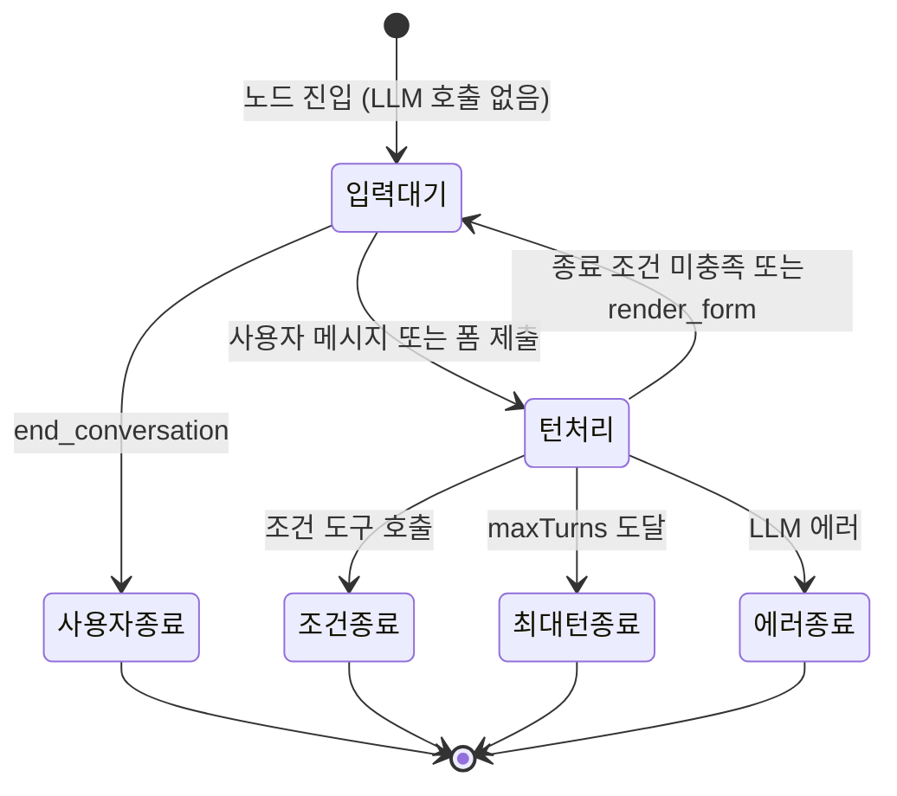

## 개요

이 문서는 [AI 에이전트 노드](CLE-NODE-AGENT.md) 의 하위 문서로 단일 턴과 멀티턴의 실행 순서, 메모리 전략 적용, `render_form` 대기·제출 처리, dry-run 재실행의 도구 처리를 정한다. 도구 분류와 조건 처리 규칙은 [도구와 조건](CLE-NODE-AGENT-TOOLS.md), LLM 호출 타임아웃과 에러 분류는 [에러와 타임아웃](CLE-NODE-AGENT-ERROR.md) 이 정한다.

## 실행 로직

핸들러 `AiAgentHandler` 는 facade 다. 턴 반복은 `AiTurnExecutor`(`executeSingleTurn`·`executeMultiTurn`·`processMultiTurnMessage`), 조건 분류는 `AiConditionEvaluator`, 자동 메모리 전략은 `AiMemoryManager` 에 맡긴다. 멀티턴 park·재개 수명 주기는 엔진 `AiTurnOrchestrator` 가 구동한다.

응답 스트리밍은 미구현이다. 모든 LLM 호출은 `LlmService.chat` 을 쓴다. `stream()` 은 [워크플로우 AI 어시스턴트](../CLE-WF/CLE-WF-ASSIST.md) 전용이다([LLM 클라이언트 §스트리밍](../CLE-AI/CLE-AI-LLM.md#스트리밍)).

### 단일 턴

1. **시스템 컨텍스트 접두**: `includeSystemContext !== false` 면 접두를 시스템 프롬프트 앞에 붙인다. 시간대는 [AI 노드 공통](CLE-NODE-AI-COMMON.md) 의 결정 순서를 따른다.
2. **도구 준비**: 지식 저장소 도구와 MCP 도구(메타도구 포함)를 조건 도구와 함께 노출한다([RAG 검색](../CLE-KB/CLE-KB-SEARCH.md), [MCP 클라이언트](../CLE-INT/CLE-INT-MCP.md)). 지식 저장소 검색은 LLM 이 도구를 부를 때만 실행한다. LLM 호출 전에 미리 검색하지 않는다.
3. **에이전트 메모리 회수**(`persistent`, LLM 호출 전 동기): 메모리 범위 키 `(workspace_id, memoryKey ?? execution_id)` 로 `agent_memory` 에서 top-k 의미 검색(`memoryTopK`·`memoryThreshold`)을 해 결과를 시스템 프롬프트 안정 프리픽스에 넣는다. 회수 수는 `meta.memory.recalledCount` 다. 구현은 `AiMemoryManager.injectMemoryContext`, 단일 기준은 [에이전트 메모리](../CLE-AI/CLE-AI-MEMORY.md) 다.
4. **대화 맥락 주입**(LLM 호출 전)
    - `manual`: `contextScope ≠ 'none'` 이면 `ConversationThreadService.getThreadExcludingNode(context, this.nodeId)` 로 자기 턴을 뺀 스레드를 가져와 `messages` 모드면 messages 앞에, `system_text` 모드면 시스템 프롬프트 끝에(`thread-renderer`) 붙인다([대화 스레드](../CLE-IX/CLE-IX-THREAD.md)). 길이 상한으로 버린 턴 수는 `meta.contextInjection.droppedTurns` 다. 대화 맥락 설정은 이 분기에서만 적용한다.
    - `summary_buffer`·`persistent`: working-memory(자기 이력 + 주입 스레드) 추정 토큰이 `memoryTokenBudget` 을 넘으면 오래된 턴부터 롤링 요약으로 줄인다. 추정은 언어 인식 휴리스틱이다(토큰당 문자 수: 라틴·ASCII 약 4, 한·중·일 약 1.7, 그 밖 약 3). provider tokenizer 정확 카운트가 아닌 근사이며, 지식 저장소 청킹의 `char/3`(`text-chunker`)과 다른 경로다. 요약 블록은 회수 블록과 같은 안정 프리픽스에, 압축하지 않은 최근 원문 턴은 휘발성 꼬리에 둔다. 요약은 임계치에 닿을 때만 갱신한다(매 턴 재요약 금지). 요약 LLM 호출은 `summaryModelConfigId` 설정을, 비어 있으면 노드 main LLM 을 쓴다. 요약은 `ConversationThread.runningSummary`·`summarizedUpToSeq` 에 둔다. `meta.memory.summarized`·`tokenBudgetUsed` 로 결과를 보인다.
5. **`ai_user` 턴 누적**: `userPrompt` 를 풀어낸 직후 LLM 호출 전에 한 번 넣는다.
6. **LLM 호출**: 시스템 프롬프트와 `userPrompt` 로 부르고 `tools` 에 위 도구를 싣는다. 진입점은 `executeSingleTurn` 이다.
7. **`ai_assistant` 턴 누적**: 정상 종료면 최종 `output.result.response`(json 모드는 `JSON.stringify`)를, 조건으로 나갈 때도 분기 직전 마지막 응답을 넣는다. 도구 반복 중 assistant·tool 결과는 `includeToolTurns: true` 일 때만 넣는다.
8. **에이전트 메모리 추출**(`persistent`, 턴 경계 비동기): 직전 턴에서 사실·선호를 background 로 추출해 `agent_memory` 에 저장한다. 응답 지연에 얹지 않는다. enqueue 는 `AiMemoryManager.scheduleMemoryExtraction`, background 격리는 `scheduleBackgroundBody` 의 턴 스냅샷 얕은 복사 불변식을 따른다. 멀티턴은 추출 기준점(`lastExtractionTurnSeq`) 뒤의 턴만 넣고 기준점을 옮긴다(새 턴이 없으면 건너뜀). 기준점의 저장 키 경로(`_resumeState.memoryState.lastExtractionTurnSeq` 와 평면 키 `_resumeState.lastExtractionTurnSeq`)는 정의가 갈린다([에이전트 메모리 미결 사항](../CLE-AI/CLE-AI-MEMORY.md#미결-사항)). 현재 구현은 `memoryState` 아래에 쓰고, 읽을 때 평면 키로 폴백한다. 추출 LLM 은 `extractionModelConfigId`, 비어 있으면 노드 `llmConfigId` → 기본 모델이다. 추출 항목 `{content, kind}`(fact·preference·entity), TTL, 의미 기반 중복 제거는 [에이전트 메모리](../CLE-AI/CLE-AI-MEMORY.md) 가 정한다. `summary_buffer` 는 이 단계가 없다.
9. **도구 호출 처리**
    - a. 호출을 분류한다([도구 호출 분류](CLE-NODE-AGENT-TOOLS.md#도구-호출-분류)).
    - b. 조건 도구만 있으면 그 조건 포트로 바로 보낸다.
    - c. 조건 도구와 비조건 도구가 섞였으면 비조건 도구를 먼저 실행하고 LLM 이 다시 판단하게 한다.
    - d. 비조건 도구만 있으면 각 프로바이더가 실행한다(지식 저장소 검색, MCP RPC, 표시 도구, 일반 도구 stub). 결과는 호출마다 따로 된 tool_result 로 넘기고 점수 병합·재정렬은 하지 않는다.
    - d.i. 표시 전용 도구: 페이로드를 검증·정규화한다([Presentation 노드 공통 §스키마 위반 처리와 정규화](../CLE-NODE-PRES/CLE-NODE-PRES-COMMON.md#스키마-위반-처리와-정규화)). 그 결과를 현재 턴 `ai_assistant` 항목의 최상위 `presentations[]` 에 넣고 `{ok: true, rendered: true, …}` 를 회신한다. LLM 은 같은 턴에서 계속 쓰거나 다른 도구를 부를 수 있다.
    - d.ii. `render_form`: 현재 턴을 보류하고 `status: 'waiting_for_input'`, `meta.interactionType: 'ai_form_render'` 로 멈춘다. `'ai_conversation'` 과 다른 값이며 클라이언트가 `execution.submit_form` 을 쓸 근거다([WebSocket 이벤트와 명령](../CLE-API/CLE-API-WS-EVENTS.md)). 폼 페이로드(`type: 'form'`)를 `presentations[]` 에 넣고 `_resumeState.pendingFormToolCall = {toolCallId, formConfig}` 를 저장한다. 단일 턴에서 부르면 스키마 위반과 같이 한 번 재시도 후 버린다. 폼 입력이 필요하면 멀티턴을 써야 한다.
    - d.iii. **dry-run 재실행**: dry-run 재실행에서는 LLM 이 부수효과 도구를 부르면 그 호출을 외부로 보내지 않고 모의 응답을 받는다. 읽기 도구는 실제로 호출된다. Cafe24 · MakeShop 내부 MCP 브리지 도구는 operation 의 HTTP 메서드와 상태를 바꾸는 GET 예외 목록으로 판정하고, 외부 MCP 서버의 일반 도구(`tools/call`)는 늘 부수효과로 본다. MCP 메타 도구와 `kb_*` · `render_*` · `cond_*` 는 그대로 실행한다. 판정 기준은 [재실행 §부수효과 판정](../CLE-EXEC/CLE-EXEC-RERUN.md#부수효과-판정), 대상 · 예외 · 값의 출처는 [재실행 §LLM 호출](../CLE-EXEC/CLE-EXEC-RERUN.md#llm-호출) 이 정한다. 결과 형식은 [MCP 클라이언트 §dry-run 재실행](../CLE-INT/CLE-INT-MCP.md#dry-run-재실행) 이 정한다.
        - 부수효과 판정은 도구 실행(`execute`) 단계에만 있다. 도구 목록 구성(`buildTools`)은 dry-run 에서도 평소처럼 돈다. 이 단계의 외부 호출은 [MCP 클라이언트 미결 사항](../CLE-INT/CLE-INT-MCP.md#미결-사항) 에서 다룬다.
        - 부수효과 도구에는 도구 프로바이더가 실행하지 않았다는 성공 결과(`_dryRun: true`, `executed: false`)를 tool_result 로 돌려준다. LLM 은 이 결과를 성공으로 보고 다음 판단을 한다. 모의 응답으로 대신한 호출도 `maxToolCalls` 에 센다.
        - 모의 응답의 `_dryRun` 마커는 도구 결과 본문(LLM 에 돌려주는 문자열) 안에만 실린다. dry-run 배지 판정에 쓰는 노드 출력의 `output._dryRun` 과 다르다.
        - 한 노드 안에서 모의 응답과 실제 호출이 섞여도 `turnDebug[].toolCalls` 는 둘 다 `success` 다. 둘을 가르는 값은 도구 결과 본문의 `executed: false` 다.
    - e. 한 서버나 지식 저장소의 실패는 격리해 `meta.mcpDiagnostics.errors`·`meta.ragDiagnostics` 에 기록하고 대화를 계속한다.
    - f. 지식 저장소·MCP 도구와 표시 전용 도구는 같은 턴 안에서 `Promise.all` 로 병렬 실행해 지연을 가장 긴 호출만큼으로 줄인다. `render_form` 은 차단형이라 직렬로 들어간다. tool_result 는 결과 순서대로 직렬로 넣어 누적이 결정적이다.
    - g. `maxToolCalls` 전까지 반복한다. 배치에 들어갈 때 남은 한도를 넘는 호출은 앞쪽부터 잘라내고 잘린 호출에 `tool_call_budget_exceeded` 를 돌려준다. Anthropic 의 tool_use ↔ tool_result 짝 요건 때문이다.
10. **응답 변환**: `responseFormat=json` 이면 `JSON.parse` 하고, 실패하면 원문 문자열을 둔다.
11. **출력**: 정상이면 `out`, 조건이 매칭되면 `{condition.id}`, LLM 오류면 `error` 포트다. LLM 호출이 실패하면 최종 `ai_assistant` 항목을 쌓지 않고 에이전트 메모리 추출도 예약하지 않는다. 5단계에서 쌓은 `ai_user` 항목은 남는다. 도구 기록(`includeToolTurns`)을 켰으면 실패 전 도구 반복의 assistant 항목과 도구 결과 항목도 남는다. 5단계 뒤에 노드가 취소되면 현재 구현도 같은 항목을 남긴다. 취소된 단일 턴의 항목을 어떻게 다룰지는 정하지 않았다([미결 사항](CLE-NODE-AGENT.md#미결-사항)). 출력 구조는 [AI 에이전트 노드 출력과 디버그](CLE-NODE-AGENT-OUTPUT.md) 가 정한다.

### 멀티턴

멀티턴은 Form 노드의 입력 대기 메커니즘을 넓혀 구현한다. 첫 진입 턴은 `executeMultiTurn`, 후속 턴은 `processMultiTurnMessage` 가 처리한다.

1. **첫 턴**: 시스템 프롬프트와 도구를 준비하고 접두를 맨 앞에 붙인다(후속 턴에도 유지, `$now` 고정이라 값이 같다). 첫 LLM 호출은 미루고 바로 `waiting_for_input` 으로 들어간다. `output` 에는 빈 `messages` 와 `_resumeState` 를 싣는다. 클라이언트 채팅 화면이 입력 칸을 켠다.
2. **사용자 메시지를 받으면**
    - a. 클라이언트가 `execution.submit_message`(채팅)나 `execution.submit_form`(`render_form` 응답)을 보낸다. `submit_form` 은 `pendingFormToolCall` 이 있을 때만 유효하고 맞는 `toolCallId` 가 없으면 거부한다(c.fallback 과의 관계는 [미결 사항](CLE-NODE-AGENT.md#미결-사항)).
    - b. 엔진이 `status: 'resumed'` 스냅샷을 한 번 낸다. 채팅은 `output.interaction.{type:'message_received', data:{content, role:'user'}, receivedAt}`, 폼은 `{type:'form_submitted', data:{<field>:value}, receivedAt}` 이다. 엔진이 LLM 을 부르기 전에 이 스냅샷을 노드 출력 캐시에 싣는다. 노드 실행 행의 `outputData` 에도 저장한다(형식은 [AI 에이전트 노드 출력과 디버그](CLE-NODE-AGENT-OUTPUT.md) 의 재개 절). 채팅이면 엔진은 같은 시점에 WS `execution.user_message` 를 보내 사용자 발화를 AI 응답보다 먼저 보여 준다(구현됨).
    - c. 메시지를 대화 이력에 더하고 스레드에 `ai_user`(채팅) 또는 `presentation_user`(폼) 턴을 넣는다. 폼이면 `data.via: 'ai_render'` 표지를 박아 그래프 Form 노드 출처(`data.via` 없음)와 나누고, 화면은 `<AI 에이전트 라벨> · form via AI render` 카드로 그린다. tool_result 는 `{ok:true, type:'form_submitted', data:{…}, message:'<재호출 금지 안내문>'}` 로 채운다. 제출 데이터가 10KB 를 넘으면 문자열 필드를 고르게 잘라 `...<truncated>` 를 붙이고(비문자열은 그대로) `formDataTruncation: { originalBytes, bytesAfterCap, truncatedFields }` 를 붙인다. 이후 `pendingFormToolCall` 을 지운다.
    - c.bypass. **폼 우회**: `pendingFormToolCall` 이 있는데 `submit_message` 가 오면 폼 호출 tool_result 를 `{type:'cancelled', reason:'user_sent_message_instead'}` 로 채워 짝 요건을 맞추고, `pendingFormToolCall` 을 지우고, 텍스트를 일반 `ai_user` 턴으로 넣어 다음 LLM 을 부른다. LLM 은 취소를 알고 다음 행동을 스스로 정한다. 메시지 입력 칸은 늘 켜져 있어 폼 대신 텍스트를 보낼 수 있다.
    - c.fallback. **대기 중인 폼 호출이 없을 때(불변식 예외)**: 폼 제출 경로로 들어왔는데 `pendingFormToolCall` 이 없으면(직접 보낸 `submit_form`, 경합으로 늦게 온 제출 등) 버리지 않는다. 폼 JSON 을 일반 `ai_user` 메시지로 넣어 LLM 이 자연어로 답하게 하고 `logger.warn('[processMultiTurnMessage] form submission without pendingFormToolCall — fallback to plain user message', { executionId, nodeId, formData })` 를 남긴다. "`ai_form_render` 진입과 `pendingFormToolCall` 존재는 1:1" 불변식의 예외 경로다.
    - d. 지식 저장소가 있으면 LLM 이 부를 때 다시 검색한다.
    - d.5. **매 턴 맥락 재주입**: `manual` 은 `contextScope ≠ 'none'` 이면 messages 를 `[system, ...injectedThread, ...selfHistory]` 로 다시 만든다(`injectedThread` 는 자기 턴 제외). `summary_buffer` 는 단일 턴 4단계의 롤링 요약만 적용하고 회수·추출은 하지 않는다. `persistent` 는 회수(3단계)와 요약(4단계)을 매 턴 적용하고 턴 경계에서 추출(8단계)도 한다.
    - d.6. **누적 messages 물리 압축**(`summary_buffer`·`persistent`): 요약이 오래된 턴을 새로 덮으면(`summarizedUpToSeq` 전진) 다음 턴 `messages` 에서 그 교환을 지운다. `user` 메시지 경계에서만 잘라 tool_use ↔ tool_result 짝을 지킨다. 남는 것은 `system`(요약 포함)과 휘발성 꼬리다. 지운 수는 `meta.memory.compactedMessages` 다. `manual` 은 누적 messages 를 바꾸지 않는다.
    - e. LLM 을 부르고 도구·조건을 단일 턴 9단계와 같이 처리한다.
    - f. 조건을 채우면 그 포트로 보내고 끝낸다. 채우지 못하면 AI 응답을 WebSocket 으로 보낸다.
    - g. 종료 조건을 채우지 못하면 `output.result.messages` 를 누적 상태로 갱신하고 다시 `waiting_for_input` 으로 들어간다.
3. **종료 조건**(하나라도 채우면 끝냄): 조건 도구 호출 → `{condition.id}`, `execution.end_conversation` → `user_ended`, `maxTurns` 도달(`0` 무제한) → `max_turns`, LLM 오류·rate limit·LLM 호출 타임아웃 → `error`. 사용자 응답은 타임아웃 없이 기다린다.
4. **종료 시** 사유의 포트로 출력하고 워크플로우 실행을 이어 간다.

**활성 폼의 화면**: `render_form` 이 활성인 동안 폼 입력 화면은 별도 표면이 아니라 assistant 턴 `presentations[*]` 의 `type: 'form'` 자리에 인라인으로 그린다. `toolCallId` 로 활성 폼과 제출된 폼을 가르는 규칙은 [Presentation 노드 공통 §입력 대기 여부](../CLE-NODE-PRES/CLE-NODE-PRES-COMMON.md#입력-대기-여부), 화면은 [대화 미리보기](../CLE-EXEC/CLE-EXEC-PREVIEW.md) 가 정한다.

## Rationale

### 활성 폼을 타임라인 안에 인라인으로 그리는 이유

**문제**: `render_form` 출시 뒤 세 회귀가 있었다. 제출 직후 store `resumeFromForm` 이 대기 상태 필드를 한꺼번에 지워 화면이 깜빡였다. `isWaitingConversation` 분기가 `DynamicFormUI` 를 그리지 않아 제출 뒤에도 `FormSubmittedContent` 가 폼처럼 남았다. `result-detail.tsx` 가 폼을 입력 칸 아래에 쌓았다. 원인은 모두 "활성 폼이 타임라인 밖 별도 표면" 이라는 것이었다.

**결정**: assistant 턴 `presentations[*].form` 을 활성 폼 화면의 단일 기준으로 삼고 `toolCallId` 대조로 활성과 제출 완료를 나눈다. 새 store 액션 `resumeFromAiRenderForm` 은 `pendingFormToolCall` 만 지운다. 폼이 활성인 동안 입력 칸을 켜 두어 폼 우회를 허용한다. 활성 폼을 별도 대화 기록 출처로 나누는 안은 출처 enum 확장 영향이 커서 뺐다.

- `pendingFormToolCall` 은 `{ toolCallId, formConfig }` 로 통일해 프런트엔드가 한 곳에서 읽게 했다.
- 폼 우회를 cancelled tool_result 로 처리한 이유: tool_result 를 채우지 않으면 Anthropic·OpenAI 다음 호출에서 짝 에러가 난다. 백엔드가 강제 프롬프트를 넣지 않는 것은 LLM 추론 자율성을 지키기 위해서다.
- 출발점은 "submit 후 timeline 이 사라지고, form 이 안 사라지고, 입력창 아래에 form 이 떠 있어 부자연스럽다" 는 보고였다.

### `render_form` 제출 뒤 같은 폼 재호출을 막은 방법

**문제**: 폼 제출 직후 LLM 이 같은 `render_form` 을 다시 내 폼이 또 떴다(예: "샘플상품 1 → 문의하기" 폼 제출 직후 같은 폼 재렌더링). 예전 stub `{ok:true, pending:'form_submission'}` 의 `ok:true` 신호가 제출 뒤 `{type:'form_submitted', data:{…}}` 로 바꾸면서 사라졌다. 여기에 두 원인이 겹쳤다. `PRESENTATION_TOOLS_GUIDANCE` 의 재호출 금지 안내가 표시 전용 결과만 다뤘다. 핸들러가 `user` 메시지를 넣지 않아 tool_result 안 `data` 가 새 사용자 입력처럼 읽혔다.

**결정**: 기존 `{type, data}` 에 가드 필드 `ok:true` 와 `message`(재호출 금지 + 후속 행동 안내)를 더하고 `PRESENTATION_TOOLS_GUIDANCE` 에 `form_submitted` 안내를 더한다. [Presentation 노드 공통](../CLE-NODE-PRES/CLE-NODE-PRES-COMMON.md) 의 네 층(WS wire, 내부 bus 표지, NodeOutput `interaction.type`, LLM tool_result) 중 마지막 층만 바꿔 다른 층 영향이 없다. 안내문은 상태 신호이지 행동 강제가 아니라 다음 행동은 LLM 이 정한다.

- `rendered: false` 는 기각했다. 표시 전용의 `rendered: true` 와 같은 키라 LLM 이 "표시 실패" 로 읽고 다시 부를 수 있다.
- `status: 'form_submitted'` 는 기각했다. `type` 과 같은 값을 두 번 실어 권위 신호가 모호해진다.

### 폼 제출 데이터 10KB 상한

**문제**: 제출 `data` 에 크기 제한이 없어 긴 텍스트가 전부 LLM 맥락으로 들어가 토큰 비용과 rate limit·context window 초과 위험이 생겼다.

**결정**: `FORM_SUBMITTED_MAX_BYTES = 10 * 1024` 를 제출 tool_result 의 `data` 에만 적용한다. 필드 이름과 구조를 모두 남겨 LLM 이 어느 필드가 잘렸는지 알게 하고, `message` 는 잘려도 유지한다.

- `formDataTruncation` 은 `PresentationPayload.truncation` 과, `bytesAfterCap` 은 `render-tool-provider.ts` 지역 변수 `cappedBytes` 와 이름을 나눴다.
- 넘을 때만 붙는 선택 메타라 본문의 tool_result 표기(`{ok, type, data, message}`)에는 더하지 않는다.
- 전체 거부는 폼 제출이 사용자 행위라 재시도가 의미 없고 UX 가 끊겨 기각했다. 꼬리 자르기는 순서에 뜻이 없는 폼 필드를 무작위로 버리는 효과라 기각했다.
- 표시 전용의 `PRESENTATION_MAX_BYTES = 1MB` 는 같은 스키마 배열(`items`·`rows`)을 이분 탐색으로 꼬리 자르기한다. 알고리즘은 다르지만 "LLM 입력 상한 + 명시 잘림 메타" 라는 의도는 같고, 값은 크기 분포 차이로 다르다.

### dry-run 재실행의 MCP 도구 임시 가드 (2026-10-10)

임시 가드를 둔 근거와 막는 범위는 [재실행 Rationale](../CLE-EXEC/CLE-EXEC-RERUN.md#dry-run-에서-ai-에이전트의-mcp-도구를-막는다-2026-10-10) 에 있다. 이 절은 이 노드 몫의 근거만 적는다.

dry-run 여부는 도구 프로바이더 실행 문맥의 `ProviderExecCtx.dryRun` 으로 도구 프로바이더에 넘긴다. 외부 호출을 하는 곳이 도구 프로바이더라서 외부로 보내기 바로 앞에서 도구 프로바이더가 이 값을 확인한다([MCP 클라이언트 §dry-run 재실행](../CLE-INT/CLE-INT-MCP.md#dry-run-재실행)).

가드는 실행을 거부하지 않고 `success` 결과로 흐름을 잇는다. dry-run 을 완전하게 구현한다는 방향(부수효과 도구만 모의 응답, [재실행](../CLE-EXEC/CLE-EXEC-RERUN.md) Rationale)은 그대로다. 도구 단위 분류가 들어갈 때까지 AI 에이전트의 MCP 도구는 읽기 operation 까지 모두 막았다. 2026-10-23 에 부수효과 판정이 들어가 이 차단을 풀었다([아래 절](#dry-run-재실행의-도구-모의-응답-2026-10-23)).

### dry-run 재실행의 도구 모의 응답 (2026-10-23)

판정 기준과 그 근거는 [재실행 Rationale](../CLE-EXEC/CLE-EXEC-RERUN.md#dry-run-에서-부수효과-도구만-모의-응답으로-대신한다-2026-10-23) 에 있다. 이 절은 이 노드 몫의 근거만 적는다.

- **판정은 도구 프로바이더가 한다.** AI 에이전트 노드 핸들러는 `ProviderExecCtx.dryRun` 만 넘기고 어떤 도구가 부수효과인지 따지지 않는다. 판정에 쓰는 operation 메타데이터와 외부 서버 정보가 도구 프로바이더에 있기 때문이다. 2026-10-10 에 만든 전달 경로를 그대로 쓴다.
- **도구 프로바이더는 인자 검증을 dry-run 판정보다 먼저 한다.** LLM 이 고칠 수 있는 인자 에러는 dry-run 재실행에서도 평소와 같은 에러로 돌려준다. Cafe24 · MakeShop 노드 핸들러는 dry-run 확인을 필수 필드 검증보다 먼저 하므로 순서가 다르다. 두 순서는 일부러 다르게 뒀다([재실행 §LLM 호출](../CLE-EXEC/CLE-EXEC-RERUN.md#llm-호출)).
- **모의 응답에는 성공한 것으로 보고 이어 가라는 안내를 싣는다.** LLM 이 모의 응답을 실패로 읽고 같은 쓰기를 다시 부르거나 흐름을 멈추지 않게 하려는 것이다. [render_form 제출 뒤 같은 폼 재호출을 막은 방법](#render_form-제출-뒤-같은-폼-재호출을-막은-방법) 과 같은 이유로 status 를 `success` 로 두고 `message` 로 안내한다. 선례의 `ok: true` 는 싣지 않는다. 본문의 `executed: false` 는 실패 표시가 아니라 호출이 외부로 나가지 않았다는 사실을 남기는 값이다([재실행 Rationale](../CLE-EXEC/CLE-EXEC-RERUN.md#dry-run-에서-ai-에이전트의-mcp-도구를-막는다-2026-10-10) 「에러가 아닌 `success` 로 돌려준다」).

### 롤링 요약과 에이전트 메모리를 들인 근거

[대화 스레드](../CLE-IX/CLE-IX-THREAD.md) 로드맵은 토큰 인식 상한과 DB 컬럼을 다음 버전으로 미뤘다. 이 작업은 겉보기에 그 유보를 뒤집지만 근거는 다음과 같다.

- 로드맵의 "토큰 인식 상한" 방향과 같아 번복이 아니라 부분 실현이다. 토큰 예산 근사이고 provider tokenizer 정확 카운트는 다음 로드맵에 남는다.
- 정확한 tokenizer(js-tiktoken 등)를 들이지 않았다. 주력 Claude 모델의 로컬 tokenizer 가 없어 정확 카운트는 네트워크 호출이 필요한데 추정은 매 턴 동기 hot path 다. 새 의존성을 들이지 않는다. 경량 휴리스틱은 혼합 스크립트의 치우침만 줄이는 근사이며, 적용 범위는 메모리 예산 경로(`agent-memory-injection`)뿐이다.
- 계기는 턴 수가 아니라 토큰 예산이다(LangChain `ConversationSummaryBufferMemory` 의 max_token_limit, Anthropic compaction). 턴 크기 편차가 커 턴 수로는 예산을 통제하지 못한다.
- "요약이 prompt cache 를 깨서 손해" 라는 우려는 기각됐다. 압축 절감이 캐시 재구축보다 크다. 안정 프리픽스와 휘발성 꼬리를 나누고 임계치 갱신으로 캐시를 지킨다.
- 요약만으로는 장기 대화 정확도가 떨어져(LongMemEval, arXiv 2410.10813) `persistent` 는 의미 검색 회수를 함께 쓴다.
- `agent_memory`(실행을 넘는 사실 회수, [에이전트 메모리](../CLE-AI/CLE-AI-MEMORY.md))와 `Execution.conversation_thread`(한 실행 안 스레드의 무손실 재개)는 목적과 저장소가 다르다.

### 요약·추출 전용 모델 필드

현재 규칙은 마지막 단계다.

1. **처음(v1)**: 요약·추출이 노드 `model`·`llmConfigId` 를 재사용했다. 근거는 (a) 설정 표면 최소화, (b) provider 회계·rate limit·credential 경로 재사용, (c) main 과 같은 품질이었다.
2. **번복**: `summaryModel`·`extractionModel` 선택 필드를 들였다. 보조 호출에 저가 모델을 쓰면 멀티턴 누적 비용이 준다. 요약·추출은 품질 요구가 달라 (c) 는 요구가 아닌 제약이었다. 비우면 기존 모델로 돌아간다.
3. **후속**: 자유 입력을 노드 provider 의 등록 모델 select 로 바꿔 오타나 없는 모델명 저장을 막았다. embedding 은 차원 불일치로 회수가 조용히 실패했다([지식 저장소 관리](../CLE-KB/CLE-KB-MANAGE.md) 의 select 전용 원칙). 대가로 `{{ }}` 동적 모델명은 없어졌다.
4. **현재(재번복)**: `/models` 에 등록한 모델 설정 하나를 `config.id` 로 고른다(`embeddingModelConfigId`·`summaryModelConfigId`·`extractionModelConfigId`, 위젯 `embedding-config-selector`·`chat-config-selector`). "노드 provider 안의 모델만" 제약을 번복했다. main provider 에 가두면 다른 provider 의 더 싼 모델을 못 써 비용 동기를 스스로 막기 때문이다. 지식 저장소의 `embeddingModelConfigId` + `resolveEmbedding` 선례를 재사용해 저장·회수 차원 일치를 같은 코드 경로로 보장한다. 등록 설정 select 라 잘못된 ID 차단도 유지되고, 설정이 지워지면 stale 경고를 보인다.

대가: `config.id` 저장이라 옛 모델명 값과 호환되지 않아, 옛 값은 폐기되고 미설정 폴백으로 물러난다(보조 호출이라 대화 무결성 영향 없음). 보조 호출은 그 설정 자신의 회계 경로로 집계되므로 누락이 아니라 분리다.

### 롤링 요약이 유실됐을 때

`runningSummary`·`summarizedUpToSeq` 는 park 때 `Execution.conversation_thread` 에 스레드와 함께 영속해 재시작·다른 인스턴스 재개에서 복원된다. 다만 park 사이 진행 중에는 메모리 `ExecutionContext` 에만 있어, 컨텍스트가 사라지고 직전 park 스냅샷도 없으면(예: 첫 park 전) 요약이 사라질 수 있다. 이때 재요약하지 않고 원문 스레드로 맥락을 다시 만든다. 요약은 파생물이라 대화 자체(`output.result.messages`)는 남고, 예산을 넘으면 다시 임계치에서 요약을 시작한다. 요약 손실은 토큰 효율 저하일 뿐 대화 무결성 손상이 아니다.

### 멀티턴 누적 messages 물리 압축

처음에는 멀티턴 요약을 system 프리픽스에 더하기만 하고 누적 `messages` 는 지우지 않았다(짝이 깨질 걱정). 그러면 누적 messages 가 계속 늘어 절감이 프리픽스에 그쳤다. 모든 tool_use 의 tool_result 는 다음 `user` 메시지 전에 끝나므로, `user` 경계에서만 자르면 짝을 가르지 않고 오래된 교환을 지울 수 있다. `manual` 은 대상이 아니다.
