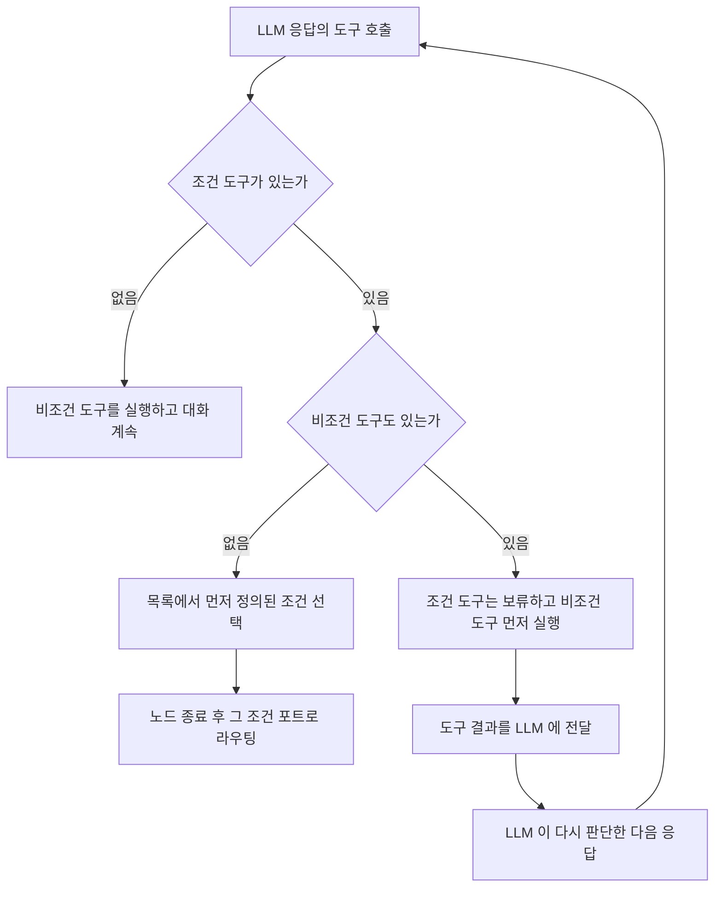

## 개요

이 문서는 [AI 에이전트 노드](CLE-NODE-AGENT.md) 의 하위 문서로 LLM 에 노출하는 도구의 이름 규칙, 도구 호출 분류, 표시 도구, 도구 정의 크기 예산, 조건 도구를 정한다. 도구 호출을 턴 안에서 처리하는 순서는 [실행 로직](CLE-NODE-AGENT-EXEC.md#단일-턴) 이 정한다.

## 도구

### 도구 이름 규칙

| 분류 | 이름 형식 | 자세한 규칙 |
|------|-----------|-------------|
| 조건 도구 | `cond_` + 정제한 조건 id (예: `cond_def9012_3456_...`) | "조건" 절 |
| 지식 저장소 도구 | `kb_` + 정제한 지식 저장소 id | [RAG 검색](../CLE-KB/CLE-KB-SEARCH.md) |
| MCP 도구 | `mcp_<sid>__<toolName>`. `<sid>` 는 통합 UUID 를 정제한 8자. 메타도구는 `mcp_<sid>__list_resources`·`__read_resource`·`__list_prompts`·`__get_prompt` | [MCP 클라이언트](../CLE-INT/CLE-INT-MCP.md) |
| 표시 도구 | `render_` + Presentation type(`render_table`·`render_chart`·`render_carousel`·`render_template`·`render_form`) | "표시 도구" 절 |

- 정제는 UUID 의 `-` 같은 영숫자가 아닌 문자를 `_` 로 바꿔 LLM API 호환을 보장한다.
- 접두사로 분류를 나눠 이름 충돌을 막는다.
- LLM 은 이름이 아니라 description 으로 도구를 고르도록 설계했다.

### 도구 호출 분류

LLM 응답의 `toolCalls` 를 조건·지식 저장소·MCP·표시·일반 도구로 나눈다.

1. 등록된 도구 프로바이더 중 `matches(tc.name)` 가 참인 첫 프로바이더를 찾는다(등록 순서: 지식 저장소 → MCP → 표시).
2. 없으면 조건 이름 집합과 대조한다.
3. 그래도 없으면 일반 도구로 분류한다.

접두사(`kb_`·`mcp_`·`render_`·`cond_`)가 서로 겹치지 않아 결과는 결정적이다. 접두사가 같아도 프로바이더가 등록되지 않았으면 매칭되지 않는다. 예를 들어 `presentationTools` 가 비었는데 LLM 이 환각으로 `render_xxx` 를 부르면 일반 도구다.

일반 도구 입력 경로가 없는 지금, 일반 도구 호출에는 가짜 성공 stub `{result: "Tool <name> executed", arguments: {...}}` 을 돌려준다. `tool_call_not_implemented` 회신은 미구현이며 입력 경로를 다시 만들 때 들인다. 구현은 `AiConditionEvaluator.classifyToolCalls` 다.

### 표시 도구

표시 도구(`render_*`)는 응답 표면을 텍스트에서 표·차트·캐러셀·템플릿·폼으로 넓힌다. LLM 이 알맞은 표현을 판단해 만든다. 다른 노드로 연결하는 방식이 아니라 AI 세션 안의 도구다. `presentationTools[]` 에 등록할 때만 노출하며(기본 꺼짐) 비어 있으면 동작이 바뀌지 않는다.

| 도구 | 종류 | 동작 | tool_result | 턴 종료 |
|---|---|---|---|---|
| `render_table`·`render_chart`·`render_carousel`·`render_template` | 표시 전용 | 페이로드 하나를 내보내고 바로 결과를 돌려준다 | `{ok: true, rendered: true, …}` | 텍스트·다른 도구·조건 도구가 정한다. 표시 도구는 종료 계기가 아니다 |
| `render_form` | 대화형 | `waiting_for_input` 으로 턴을 보류한다. 제출되면 스레드에 `presentation_user` 로 누적하고 제출 값을 tool_result 로 넘겨 LLM 을 다시 부른다 | `{ok: true, type: 'form_submitted', data: { … }, message: '<재호출 금지 안내문>'}` | LLM 의 다음 응답이 정한다 |

- **파라미터·description·`defaults`**: 각 Presentation 노드 입력 스키마(zod)를 그대로 노출해 스키마를 한 곳에서만 관리한다. description 은 LLM 이 언제 부를지 판단하는 1차 신호다. 스키마 변환, 기본 description, `defaults` 병합의 단일 기준은 [Presentation 노드 공통 §표시 도구 모드](../CLE-NODE-PRES/CLE-NODE-PRES-COMMON.md#표시-도구-모드) 다.
- **호출 회계**: 표시 도구 호출도 `maxToolCalls` 에 들어간다. 텍스트 뒤 한두 번 부르는 흔한 패턴에서는 기본 10 으로 충분하지만, 표시 도구 여러 개와 다른 도구를 섞으면 한도를 넘어 잘릴 수 있다.
- **스키마 위반**(필수 필드 누락, 타입 불일치, 1MB 상한 초과 등): 한 번 재시도한 뒤 조용히 버리고 `meta.presentationSchemaViolations[]` 에 쌓는다. `error` 포트로 가지 않고 텍스트 응답이 있으면 그것만 보여 준다. 턴은 정상으로 끝난다. 처리 단계(검증, `defaults` 병합, 크기 한도, 버튼 ID·폼 옵션 값 채우기)는 [Presentation 노드 공통 §스키마 위반 처리와 정규화](../CLE-NODE-PRES/CLE-NODE-PRES-COMMON.md#스키마-위반-처리와-정규화) 가 정한다.
- **역할 분리**: 표시 도구는 표현만, 그래프 분기는 조건 도구가 맡는다. Presentation 노드 버튼의 "클릭 → 다른 포트" 기능은 없다. `defaults` 에 `buttons` 를 넣어도 클릭은 다음 LLM 턴의 사용자 메시지가 되며(합성 규칙은 [Presentation 노드 공통](../CLE-NODE-PRES/CLE-NODE-PRES-COMMON.md)) 포트 분기에 영향이 없다.
- **공존**: 조건 도구와 함께 불리면 조건 절의 우선순위를 따른다(표시 도구는 비조건). 지식 저장소·MCP 도구와 함께 불리면 모두 병렬 실행에 들어간다.
- **스레드 운반**: 호출이 성공한 턴은 `ai_assistant` 대화 기록 항목의 최상위 `presentations[]` 에 페이로드를 쌓는다(`data?` 안이 아니다). 텍스트(`turn.text`)와 `presentations[]` 는 한 턴에 함께 있을 수 있다. 운반 규칙은 [Presentation 노드 공통 §대화 스레드 운반](../CLE-NODE-PRES/CLE-NODE-PRES-COMMON.md#대화-스레드-운반), 페이로드 타입과 WebSocket `execution.ai_message` 스냅샷은 [AI 에이전트 노드 출력과 디버그 §표시물 페이로드 운반](CLE-NODE-AGENT-OUTPUT.md#표시물-페이로드-운반) 이 정한다.

`render_form` 의 대기·제출·우회 처리는 [실행 로직 §멀티턴](CLE-NODE-AGENT-EXEC.md#멀티턴) 이 정한다.

### 도구 정의 크기 예산

LLM 요청에 싣는 도구 정의(스키마) 전체의 직렬화 크기를 예산으로 관리한다. 도구 호출 한도(`maxToolCalls`), 메모리 토큰 예산(`memoryTokenBudget`)과 다른 자원이다. 1차 지표는 개수가 아니라 bytes 다. 대형 카탈로그는 operation 개수가 같아도 필드 단위 스키마로 도구당 크기가 몇 배 커질 수 있고, 그 크기가 프롬프트를 provider transport 타임아웃 너머로 밀면 provider 와 무관하게 "응답 없음" 이나 SDK 재시도의 "무한 반복" 이 된다.

**추정 함수(단일 기준)**: `estimateAgentToolPayload(tools) → { bytes, approxTokens, toolCount, perProvider?: [{ key, bytes, toolCount }] }`. `bytes = Buffer.byteLength(JSON.stringify(tools))`, `approxTokens` 는 언어 인식 휴리스틱(`shared/agent-memory-injection.ts`, 근사), `perProvider` 는 원인 프로바이더 지목용이다. 실행 판정·저장 경고·관측 로깅이 모두 이 함수를 쓴다.

| 변수 | 기본값 | 동작 |
|------|--------|------|
| `AI_AGENT_TOOL_PAYLOAD_SOFT_BYTES` | 98304 (96 KB) | 넘으면 `logger.warn` 만 남기고 계속한다 |
| `AI_AGENT_TOOL_PAYLOAD_HARD_BYTES` | 262144 (256 KB) | 넘으면 바로 실패(`TOOL_DEFINITION_PAYLOAD_EXCEEDED`) |
| `AI_AGENT_TOOL_COUNT_MAX` | 128 | 2차 점검. 넘으면 hard 와 같게 다룬다 |
| `AI_AGENT_TOOL_BUDGET_STRICT_SAVE` | false | 저장 시 hard 초과를 `error` 로 올려 `GRAPH_VALIDATION_FAILED` 로 막는 opt-in |

**대형 카탈로그는 노출 도구 목록이 사실상 필수다 (2026-07-17)**: 내부 MCP 브리지 카탈로그는 기본값 128 을 늘 넘는다. 2026-07-17 실측으로 Cafe24 는 485 operation, MakeShop 은 161 REST operation 이다. 전체 수의 단일 기준은 저장소 `codebase/api-catalogs/cafe24/_overview.md` 와 `codebase/api-catalogs/makeshop/_overview.md` 의 §5 다. NERV 사본은 [Cafe24 API 카탈로그 §5 Coverage Matrix](CLE-C24-CATALOG#5-coverage-matrix) 와 [MakeShop API 카탈로그 §5 Coverage Matrix](CLE-MKS-CATALOG#5-coverage-matrix) 다. `mcpServers[].enabledTools`([MCP 클라이언트](../CLE-INT/CLE-INT-MCP.md)) 없이 연결하면 정상 설정처럼 보여도 개수 상한과 bytes hard 예산 양쪽에서 실패한다. 필요한 operation 만 노출하는 것이 정상 사용법이며, 도구 수백 개를 한 번에 주는 것은 도구 선택 정확도에도 좋지 않다. 기본값 128 은 bytes 팽창 사고의 2차 점검 값이고 대형 카탈로그 전량 노출을 상정하지 않았다. 기본값의 타당성은 별건이다.

**실행 판정**: `AiTurnExecutor.buildTools` 직후(단일 턴·멀티턴 재개 공통 헬퍼)에 판정한다. hard 나 개수 상한을 넘으면 LLM 을 부르기 전에 `TOOL_DEFINITION_PAYLOAD_EXCEEDED` 를 던져 `error` 포트로 보낸다(`details` 구조화, [에러 코드](CLE-NODE-AGENT-ERROR.md#에러-코드)). soft 초과는 로그만 남긴다. 멀티턴은 이 예외를 오케스트레이터까지 올려 `extractAiTurnErrorPayload` 가 `output.error` 를 만든다. 단일 턴은 `buildSingleTurnToolsOrError` 가 try/catch 로 받아 에러 출력을 직접 돌려준다. 이 return·throw 차이는 `AiTurnExecutor` JSDoc 에 적혀 있고 통일은 후속이다.

**저장 시점 경고**: `mcpServers`·`presentationTools` 로 다시 만든 추정치가 예산을 넘으면 그래프 경고(rule id `ai_agent:tool-payload-budget`, 기본 severity `warning`)로 알린다([그래프 경고 규칙](../CLE-WF/CLE-WF-WARN.md)).

- 경고는 `GET /workflows/:id/graph-warnings`(`getGraphWarnings`)가 결과 배열에 덧붙인다. 새 응답 필드는 없고 `saveCanvas` 응답은 그래프 경고를 싣지 않는다.
- 저장(`POST /workflows/:id/save`)은 기본이면 통과하고, strict 옵션이면 hard 초과를 `GRAPH_VALIDATION_FAILED`(400)로 막는다.
- 연결된 cafe24·makeshop 정적 카탈로그와 표시 도구만 센다. 외부 MCP 와 연결되지 않은 통합은 실시간 연결 없이 재현할 수 없어 건너뛴다. 개인 통합은 실행 시점과 같은 [개인 통합 사용 판정](../CLE-INT/CLE-INT-MANAGE.md#개인-통합-사용-판정)을 통과한 것만 센다(`WorkflowsService.loadIntegrationsForBudget`). 실행이 건너뛸 서버를 예산에 넣지 않으려는 것이다.
- 통합 허용 scope 를 비동기로 조회해야 해 공유 동기 규칙 패키지(`@workflow/graph-warning-rules`)로 표현할 수 없다. 그래서 백엔드(`WorkflowsService`)에서만 평가하고 프런트엔드 캔버스 가드는 이 규칙을 계산하지 않는다. 실질 안전망은 실행 시점 실패와 저장 가드다.

## 조건

조건은 AI 에이전트가 대화 중 특정 상황을 알아차리면 그 조건의 출력 포트로 실행을 나눈다. 텍스트 분류기가 입력 하나를 정적으로 분류한다면, 조건은 대화 맥락 전체를 보고 동적으로 분류한다. 조건 필드 구조는 [설정과 포트 §설정](CLE-NODE-AGENT-CONFIG.md#설정) 의 ConditionDef 다.

### 조건 도구 등록

| 도구 속성 | 값 |
|-----------|-----|
| name | `cond_{sanitizeId(condition.id)}` |
| description | `condition.prompt` |
| parameters | `{ type: "object", properties: { reason: { type: "string", description: "이 조건을 선택한 이유" } }, required: [] }` |

- 조건 개수 · `id` · `label` · `prompt` 의 검증 규칙과 메시지는 [에러와 타임아웃 §실행 전 설정 검증](CLE-NODE-AGENT-ERROR.md#실행-전-설정-검증) 이 정한다.
- LLM 이 보낸 `reason` 은 500자로 자른다.
- 조건이 있으면 시스템 프롬프트에 다음 지시를 넣는다. "다음 조건 중 상황이 충족되면 해당 도구를 호출하세요. 조건이 충족되지 않으면 대화를 계속하세요."

### 조건 도구 호출 처리

1. 조건 도구만 불렸으면 `conditions` 배열에서 인덱스가 가장 작은 조건을 골라 노드를 끝내고 그 포트로 보낸다.
2. 비조건 도구와 섞였으면 조건 도구는 보류하고 비조건 도구를 먼저 실행한다. 결과를 LLM 에 넘기고, 조건 도구 호출에는 "확인되었습니다. 도구 실행 결과를 참고하여 최종 판단해주세요." 를 tool result 로 돌려준다. 다음 응답에서 조건을 다시 확인하며, 이 과정은 도구 호출 반복 안에서 이어진다.
3. 조건 도구가 없으면 도구를 실행하고 대화를 계속한다.

## Rationale

### 표시 도구를 들인 이유

**문제**: 응답 표면이 텍스트 하나라 LLM 이 표·차트가 알맞다고 판단해도 만들 경로가 없었다. 사용자는 Presentation 노드를 따로 연결하고 매핑 표현식을 써야 했다. 그래프 분기와 표현 표면이 한 층에 묶여 응답 형식 선택을 LLM 에 맡길 수 없었다.

**결정**: 노드별 opt-in `presentationTools[]`, `render_*` 접두사, 5종 동시 출시, 표시 전용·대화형 구분, 스키마 위반 조용한 fallback 을 채택한다.

- 노드별 정책이라 과금 추적·권한·예측 가능성이 자연스럽다. 워크스페이스 전역 토글은 한 노드만 쓰고 싶을 때 막는다.
- 스키마 단일 기준을 재사용하고 조건 도구와 직교해 기존 워크플로우 영향이 없다. `render_*` 는 프런트엔드 모듈명(`presentation-renderers.tsx`)과 이어져 추적 비용이 가장 낮다. 5개가 같은 패턴이라 함께 출시한다.
- 렌더 결과로 그래프 분기를 흉내 내는 기능은 조건 도구와 책임이 겹쳐 뺐다. 역할은 "AI 세션 안 표현(`render_*`)" 과 "그래프 분기(`cond_*`)" 로 나눈다.
- 스키마 위반을 `error` 포트로 보내면 사용자에게 "AI 가 가끔 멈춘다" 처럼 보인다. 텍스트는 유지하고 표현 시도만 버린 뒤 메타로 알려 프롬프트를 다듬게 한다. 지식 저장소·MCP 의 graceful degradation 과 같은 원칙이다.
- 재작성을 기다리는 일반 도구 자리와 직교한다. 의도(외부 노드 부수 효과 대 응답 표면), 스키마 출처(연결 노드 대 Presentation 입력 스키마), 결과 라우팅(다운스트림 대 AI 세션 스레드)이 다르다. dispatcher 5분류(cond·kb·mcp·render·tool)가 유지된다.
- 처음 경계(v1)는 노드별 opt-in, 5종 동시 출시, 조용한 버림, 페이로드는 대화 기록 항목 최상위 `presentations[]`, 다운스트림은 스레드 접근이다. 예정(v2)은 페이로드를 별도 출력 포트로 보내는 opt-in, `defaults` 표현식 지원, Presentation 노드 추가 시 자동 노출이다.
- 출발점은 멀티턴 AI 노드가 LLM 판단으로 알맞은 표시 노드를 tool calling 방식으로 불러 응답을 표현하려는 요구였다.

### 도구 정의 크기 예산을 들인 근거

**사고**: 2026-07-06 커밋(#828, "Cafe24 field-set docs 전량 미러")이 operation 개수는 그대로 둔 채 스키마를 필드 단위로 부풀렸다(`order.ts` 1,353→5,742줄, 메타데이터 +18,879줄). 노출 도구 목록 없이 연결한 AI 에이전트는 383개 operation 을 모두 노출해 도구 정의가 약 118k 토큰이 됐고, Gemini·Ollama(로컬 gemma-4-26b) 모두 transport 타임아웃으로 실패했다(로컬 120초×3 재시도 = 6분 "무한 반복", Gemini 연결 종료). 사용자 설정과 턴 코드는 그대로였다.

- 개수 상한으로는 이 사고를 못 잡아 bytes 를 1차 지표로 두고 개수는 값싼 2차 점검으로 둔다.
- 전에는 provider SDK 타임아웃에만 기대 몇 분 멈춘 뒤 정체불명으로 끝났다. `buildTools` 직후 점검으로 원인 provider 를 지목하며 바로 실패시킨다.
- 저장 시 추정은 근사라 hard 차단을 기본으로 두면 정상 설정을 잘못 막는다. 저장은 경고가 기본이고 엄격 차단은 opt-in 이다.
- 새 응답 필드 대신 [그래프 경고 규칙](../CLE-WF/CLE-WF-WARN.md) 계약을 재사용한다. 비동기 scope 조회가 필요해 백엔드 전용으로 두고 프런트엔드 가드만 예외로 생략한다.
- 같은 코드에 호출 횟수 축의 "budget" 이 이미 있고 사고가 축 혼동으로 늦게 밝혀졌으므로, 이름(`TOOL_DEFINITION_PAYLOAD_EXCEEDED`)만 봐도 정의 크기 축임을 알게 했다.
