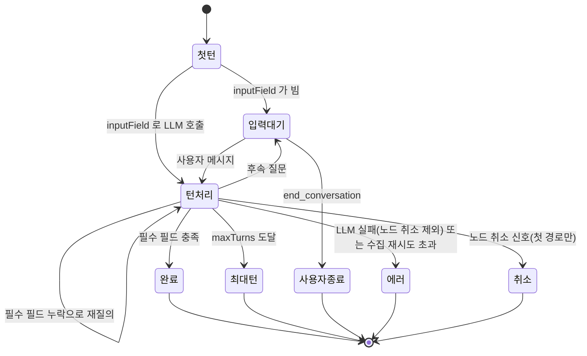

## 개요

이 문서는 [정보 추출기 노드](CLE-NODE-EXTRACTOR.md) 의 하위 문서로 단일 턴 · 멀티턴 실행 로직, 노드 취소 신호 처리, 에이전트 메모리 사용 방식을 정한다. 출력 형태는 [출력 구조와 에러](CLE-NODE-EXTRACTOR-OUTPUT.md) 가 정한다.

## 실행 로직

### 단일 턴

1. **시스템 컨텍스트 접두**: `includeSystemContext !== false` 면 접두를 시스템 프롬프트 앞에 붙인다([AI 노드 공통](CLE-NODE-AI-COMMON.md)).
2. **JSON Schema 변환**: `outputSchema` 를 `buildJsonSchema(schema, multiTurn=false)` 로 바꾼다. 각 필드는 `[type, 'null']` 유니온이라 LLM 이 미수집 필드를 `null` 로 나타낼 수 있다.
3. **시스템 프롬프트 구성**: 스키마 설명, `instructions`, `examples`, "JSON 으로만 응답" 지시를 넣는다.
4. **대화 맥락 주입**: `contextScope ≠ none` 이면 `injectConversationContext()` 로 자기 노드 턴을 뺀 스레드를 messages 앞이나 시스템 프롬프트 뒤에 붙인다.
5. **에이전트 메모리 회수**: `memoryStrategy === 'persistent'` 면 LLM 호출 직전 회수해 시스템 메시지 뒤 안정 프리픽스(회수 블록)에 넣는다. 호출 · 쿼리 · 범위 키 · 실패 처리는 [회수 (소비자)](#회수-소비자) 절을 따른다. `manual` 이면 부르지 않는다.
6. **LLM 호출**: 평가된 `inputField` 를 사용자 메시지로, `responseFormat: 'json'` 과 `jsonSchema` 옵션을 붙여 `LlmService.chat` 을 부른다. `context.abortSignal` 을 `signal` 로 넘긴다. 예외가 나면 먼저 노드 취소인지 가른다. 노드 취소 신호가 켜졌으면 `AbortError` 로 엔진에 다시 던진다([노드 취소 신호 처리](#노드-취소-신호-처리)). 그 밖의 예외는 바로 `error` 포트와 `LLM_CALL_FAILED` 다.
7. **파싱과 출력**: 응답을 `JSON.parse` 한다. 성공하면 결과를 `output.result.extracted` 에 담아 `out` 포트로 보낸다. 스레드에 `ai_assistant` 턴(`JSON.stringify(extracted)`)을 누적한 직후 `persistent` 면 `AgentMemoryService.scheduleExtraction(...)` 으로 메모리 추출을 비동기로 넣는다.
8. **파싱 재시도**: 파싱에 실패하면 최대 2번 다시 시도한다(모두 3회). 모두 실패하면 `error` 포트와 `LLM_RESPONSE_INVALID` 다.

### 멀티턴

`finalize_extraction` 도구를 LLM 에 노출하고, LLM 이 모든 필드를 모았다고 판단해 이 도구를 부르면 끝낸다. 사용자 응답은 무제한으로 기다린다. 외부 취소 말고는 타임아웃이 없다. 시스템 프롬프트 정책은 핸들러의 `buildMultiTurnSystemPrompt` 를 따른다. 시스템 컨텍스트 접두는 매 턴 시스템 프롬프트 맨 앞에 유지한다. `$now` 가 실행 단위로 고정이라 턴마다 다시 계산해도 값이 같다.

`취소` 는 노드 취소 신호가 켜진 뒤 LLM 호출이 실패한 경우다. 노드는 출력을 내지 않고 엔진이 노드 실행을 `cancelled` 로 기록한다. 신호는 첫 경로(`executeMultiTurn`)에만 전파되므로 재개 뒤에는 이 전이가 없다([노드 취소 신호 처리](#노드-취소-신호-처리)).

1. **첫 턴**
    - `inputField` 가 비면 LLM 호출을 건너뛰고 `turnCount: 0` 으로 바로 `waiting_for_input` 을 돌려준다. 사용자가 첫 메시지를 보낼 때까지 기다린다.
    - `inputField` 에 값이 있으면 그 값을 첫 사용자 메시지로 LLM 을 부른다. 그 직전에 대화 맥락을 한 번 주입한다(`contextScope ≠ none` 일 때). 주입한 턴은 `_resumeState.messages` 로 운반해 후속 턴은 다시 주입하지 않는다.
    - `persistent` 면 위 주입 직후, 첫 LLM 호출 직전에 한 번 회수해 시스템 메시지에 회수 블록을 붙인다. 시스템 메시지가 `_resumeState.messages` 로 운반되므로 후속 턴은 다시 회수하지 않는다. 스레드 참조·`executionId`·평가된 메모리 설정·추출 기준점(`memoryState.lastExtractionTurnSeq`, 옛 평면 키 `lastExtractionTurnSeq` 도 읽어 진행 중 실행과 호환)·`memoryStrategy` 를 멀티턴 상태에 실어 턴 사이 유실을 막는다.
2. **턴 처리** (`runTurnWithCollectionRetries`)
    - LLM 응답에 `finalize_extraction` 호출이 있으면 인자를 파싱해 `partialResult` 에 병합한다(`null`·`undefined` 는 기존 값 유지). 필수 필드가 모두 채워지면 `completed` 다. 부족하면 `tool` 역할 메시지로 누락 필드를 알리고 `collectionRetryCount += 1` 한 뒤 같은 턴에서 다시 부른다.
    - `collectionRetryCount > maxCollectionRetries`(0 제외)면 `forcedEnd: 'max_retries'` 로 끝낸다(`error` 포트, `MAX_COLLECTION_RETRIES_EXCEEDED`).
    - 도구 호출 없이 텍스트만 있으면 후속 질문으로 보고 `waiting_for_input` 을 돌려준다.
    - LLM 호출이 실패하면 catch 첫 줄에서 노드 취소를 먼저 가른다. 노드 취소면 부분 결과(`kind: 'error'`)를 돌려주기 전에 `AbortError` 를 던진다. 아니면 `kind: 'error'` 로 돌려주고 호출한 쪽이 `LLM_CALL_FAILED` 로 `error` 포트에 보낸다.
3. **종결 판정** (각 턴 끝)
    - `forcedEnd` 가 있으면 그 사유로 끝낸다.
    - 필수 필드를 모두 채우면 `completed` 포트(`endReason: 'completed'`)다.
    - `turnCount >= maxTurns`(`maxTurns > 0`)면 `max_turns` 포트다.
    - **종결 누적과 메모리 추출**: `buildMultiTurnFinalOutput` 종결 경로(`completed`·`max_turns`·`user_ended`)에서 최종 추출 스냅샷을 `ai_assistant` 턴(`JSON.stringify(extracted)`)으로 한 번 누적한다(단일 턴과 같음, [대화 스레드](../CLE-IX/CLE-IX-THREAD.md)). 입력 대기 중에는 누적하지 않는다. `error`(LLM 호출 실패)는 불완전한 결과를 쌓지 않으려 누적하지 않는다. 노드 취소도 누적하지 않는다. 누적 직후 `persistent` 면 그 스레드를 소스로 메모리 추출을 비동기로 넣는다. 이 누적이 추출 소스와 다운스트림의 대화 맥락 가시성을 준다.
4. **`processMultiTurnMessage(userMessage, _resumeState)`**: 엔진이 사용자 메시지를 받으면 부른다. 메시지를 대화에 더하고 2~3을 반복한다. 이 경로에는 전파할 노드 취소 신호가 없다([노드 취소 신호 처리](#노드-취소-신호-처리)).
5. **`endMultiTurnConversation(_resumeState, endReason)`**: 사용자가 `execution.end_conversation` 을 보내면 엔진이 부른다. `endReason` 에 따라 `user_ended`·`max_turns`·`error` 포트로 보낸다.
6. **재개 스냅샷**: 사용자 메시지로 재개하면 엔진이 4의 LLM 호출 전에 `status: 'resumed'` 와 `output.interaction.{type, data, receivedAt}` 스냅샷을 한 번 낸다([출력 구조와 에러](CLE-NODE-EXTRACTOR-OUTPUT.md#멀티턴-재개-status-resumed)). 핸들러는 이 스냅샷을 만들지 않는다.

단일 기준은 `information-extractor.handler.ts` 다. 시스템 프롬프트와 도구 정의는 같은 파일의 `buildMultiTurnSystemPrompt`·`buildFinalizationTool` 이다.

### 노드 취소 신호 처리

노드 취소 신호(`context.abortSignal`)는 지금 Parallel 노드의 cancel-others-on-fail 만 켠다([노드 취소](../CLE-EXEC/CLE-EXEC-CANCEL.md#노드-핸들러-의무)). 정보 추출기는 이 신호를 LLM 호출에 `signal` 로 넘긴다. 호출이 실패하면 catch 첫 줄에서 `rethrowIfNodeCancelled`(`shared/llm-cancellation.ts`)로 노드 취소인지 먼저 가른다.

- **판정**: 신호가 켜져 있으면 에러 이름과 상관없이 노드 취소로 본다. 에러 이름이 `AbortError` 면 그대로 던진다. 아니면 이름이 `AbortError` 인 새 에러로 감싸 원래 에러를 `cause` 로 남기고 던진다. Anthropic·OpenAI SDK 가 끊긴 요청에 던지는 `APIUserAbortError` 는 `name` 이 `'Error'` 라서 그대로 두면 엔진이 취소로 분류하지 못한다.
- **결과**: 엔진이 노드 실행을 `cancelled` 로 기록하고 `output_data` 를 쓰지 않는다([노드 취소](../CLE-EXEC/CLE-EXEC-CANCEL.md#취소-에러-분류) 규칙 19). 노드는 어느 출력 포트로도 보내지 않는다.
- **노드 자신의 실패**: 신호가 없거나 열려 있으면 기존 에러 매핑(`LLM_CALL_FAILED`·`LLM_RATE_LIMIT`, `retryable`)을 그대로 쓴다. 프로바이더 SDK 요청 타임아웃은 노드 취소 신호를 켜지 않으므로 `LLM_CALL_FAILED` 다.

경로마다 판정하는 곳은 다음과 같다.

| 경로 | 판정하는 곳 | 취소 때 |
|------|-------------|---------|
| 단일 턴 | LLM 호출 catch(파싱 재시도의 호출 포함) | `AbortError` 를 던진다. 스레드 누적과 메모리 추출에 닿지 않는다 |
| 멀티턴 첫 경로(`executeMultiTurn`) | `runTurnWithCollectionRetries` 의 catch. 부분 결과(`kind: 'error'`)를 돌려주기 전이다. 수집 재시도로 다시 부른 호출도 같다 | `AbortError` 를 던진다. 부분 결과(`output.result`)·대화 스레드 누적·메모리 추출을 만들지 않는다 |
| 멀티턴 재개(`processMultiTurnMessage`) | 없음. 전파할 신호가 없다(`ResumableMessageOptions.signal` 이 늘 `undefined`) | 사용자 실행 중지는 엔진이 턴 경계에서 실행 행을 다시 읽어 알아챈다([노드 취소](../CLE-EXEC/CLE-EXEC-CANCEL.md#db-관측-취소-가드) 규칙 10·12) |

사용자 실행 중지는 어느 경로에서도 신호를 만들지 않는다([노드 취소](../CLE-EXEC/CLE-EXEC-CANCEL.md#신호를-만드는-쪽) 규칙 9). 그래서 이 절의 판정은 Parallel 분기 취소에만 걸린다.

## 에이전트 메모리 사용

`memoryStrategy = persistent` 면 정보 추출기는 에이전트 메모리의 소비자(회수)이자 생산자(추출)다([에이전트 메모리](../CLE-AI/CLE-AI-MEMORY.md)). AI 에이전트의 패턴 중 회수와 추출만 쓰고 롤링 요약(`summary_buffer`)은 뺐다. AI 에이전트와 다른 점은 회수 쿼리와 시점이다.

### 회수 (소비자)

- 추출 LLM 호출 직전 한 번 `AgentMemoryService.recall(workspaceId, scopeKey, queryText, { topK: memoryTopK, threshold: memoryThreshold, embeddingModelConfigId })` 를 부른다. 단일 턴과 멀티턴 첫 진입 모두 적용한다. 멀티턴 후속 턴은 다시 회수하지 않는다(AI 에이전트 `persistent` 는 매 턴 회수한다).
- 회수 쿼리는 `inputField` 이고 비면 시스템 프롬프트로 대신한다(AI 에이전트는 사용자 메시지).
- 쿼리를 입력 유형 `inputType:'query'` 로 임베딩한다. 범위 메모리는 저장 때 `'document'` 로 임베딩되므로 비대칭 모델(e5·Gemini)에서 인코딩이 어긋나지 않게 검색 쪽만 query 로 보낸다([에이전트 메모리](../CLE-AI/CLE-AI-MEMORY.md)).
- `scopeKey = resolveScopeKey(memoryKey, executionId)` 는 AI 에이전트와 같은 범위 키 규칙이다. 같은 키면 AI 에이전트와 정보 추출기가 같은 메모리를 공유한다. 비우면 `executionId` 로 격리한다.
- 결과는 안정 프리픽스(회수 블록, `[memory]…[/memory]` data-fence)로 시스템 메시지 뒤에 붙인다. `manual` 이면 부르지 않는다.
- 회수 실패는 빈 회수로 처리해 hot path 를 깨지 않는다.

### 추출 (생산자)

- 턴 경계(스레드 누적 직후)에 `AgentMemoryService.scheduleExtraction({ workspaceId, scopeKey, llmConfigId, model, extractionModelConfigId, embeddingModelConfigId, turns, ttlDays })` 로 비동기 enqueue 한다. 큐 추가까지만 기다리고 추출 LLM 호출은 워커가 한다.
- 단일 턴은 최종 응답 누적 뒤 한 번, 멀티턴은 종결 누적 뒤 한 번이다. 누적이 종결 때 한 번뿐이라 매 턴 추출하지 않는다.
- `turns` 는 스레드 스냅샷의 얕은 복사다(격리 불변식). 추출 기준점(`memoryState.lastExtractionTurnSeq`, 옛 평면 키 폴백)은 멀티턴 상태로 운반하지만, 멀티턴 추출이 종결 1회라 실제로는 스레드 전체를 스냅샷한다. 기준점의 저장 키 경로는 문서마다 정의가 갈린다. [에이전트 메모리 미결 사항](../CLE-AI/CLE-AI-MEMORY.md#미결-사항) 참조.
- enqueue 실패는 서비스 안에서 삼켜 대화를 계속한다.

### `manual` 회귀 불변식

`memoryStrategy = manual`(기본)이면 회수와 추출을 모두 부르지 않고 messages·출력이 기존과 같다(회귀 고정 테스트로 강제). `AgentMemoryService` 가 주입되지 않은 경우(테스트 fixture, 옛 구성)도 아무 일 없이 넘어간다.

## Rationale

### 에이전트 메모리는 쓰고 롤링 요약은 쓰지 않는 이유

추출 노드의 가치는 실행을 넘는 사실 누적(이전 추출 결과를 다음 실행이 쓰는 것)에 있다. 회수로 과거 사실을 가져오고 추출로 새 사실을 저장하는 `persistent` 주기와 정확히 맞는다. 반면 `summary_buffer` 는 한 실행 안의 긴 대화에서 working-memory 토큰을 줄이는 장치인데, 추출은 출력 스키마로 범위가 한정된 짧은 수집 대화라 압축 이득이 거의 없다. 그래서 `summary_buffer` 값을 두지 않아 설정 표면을 단순하게 둔다.

### 텍스트 분류기를 메모리 대상에서 뺀 이유

텍스트 분류기는 단일 턴이고 상태가 없어 회수할 이전 실행 사실도, 저장할 추출 사실도 정의되지 않는다. 그래서 에이전트 메모리 대상에서 빼고 대화 맥락 설정만 둔다.

### 멀티턴 종결 누적을 함께 들인 이유

전에는 멀티턴 종결 경로가 대화 스레드에 누적하지 않는 한계가 있었다(단일 턴만 누적). 메모리 추출은 누적된 스레드 턴을 소스로 삼으므로 종결 누적이 먼저 있어야 추출할 소스가 생긴다. 이 누적은 다운스트림 노드의 대화 맥락 가시성도 준다(추출 결과를 스레드에서 읽을 수 있음). 그래서 같은 작업에서 종결 1회 누적을 들였다. 입력 대기 중에는 누적하지 않아 미완성 결과가 스레드와 메모리에 쌓이지 않는다.

### 메모리 모델 필드를 등록 모델 설정 선택으로 둔 이유

`embeddingModelConfigId`·`extractionModelConfigId` 는 AI 에이전트와 같이 `/models` 에 등록한 모델 설정을 `config.id` 로 고른다(위젯 `embedding-config-selector`·`chat-config-selector`, 노드 `llmConfigId` 와 독립). 채택 근거와 번복 이력의 단일 기준은 [AI 에이전트 노드](CLE-NODE-AGENT.md) 의 요약·추출 전용 모델 필드 결정이며, 이 노드는 그 결정을 그대로 따른다. 이 노드는 롤링 요약 경로가 없어 요약 LLM 호출이 없으므로 `summaryModelConfigId` 를 갖지 않는다. 옛 모델명 필드(`embeddingModel`·`extractionModel`) 값은 새 필드와 키가 달라 폐기되고, 미설정 폴백(워크스페이스 기본 embedding, 노드 `llmConfigId`)으로 물러난다. 보조 호출이라 추출 무결성에는 영향이 없다.

### 노드 취소는 `error` 포트로 보내지 않는다 (2026-10-31)

[노드 취소](../CLE-EXEC/CLE-EXEC-CANCEL.md#노드-핸들러-의무) 규칙 3 은 노드 취소 신호로 생긴 취소를 노드가 `AbortError` 로 엔진에 던진다고 정한다. 전에는 LLM 호출의 모든 예외를 `error` 포트의 `LLM_CALL_FAILED` 로 보냈다(단일 턴 · 멀티턴 첫 경로). 그래서 Parallel 의 cancel-others-on-fail 로 멈춘 분기가 `cancelled` 로 끝나지 않고 에러 포트로 라우팅돼 하류 노드를 실행했다.

`error` 포트 원칙은 노드 자신의 실패를 한 경로로 모으는 규칙이다. 노드 취소는 [노드 취소](../CLE-EXEC/CLE-EXEC-CANCEL.md#취소-에러-분류) 규칙 19 의 중단이라 이 원칙의 범위 밖이다. [노드 에러 처리 정책](../CLE-NODE/CLE-NODE-ERROR.md#1-에러-처리-정책-다섯-가지) 도 노드 취소에는 에러 처리 정책을 적용하지 않고 엔진이 `AbortError` 를 실패로 보지 않는다고 정한다.

- 채택: 노드 취소 신호가 켜진 뒤 실패한 호출은 `AbortError` 로 엔진에 다시 던진다. 엔진이 노드 실행을 `cancelled` 로 기록하고 출력을 쓰지 않는다.
- 기각: 취소도 `LLM_CALL_FAILED` 로 보낸다. 취소된 분기가 에러 포트로 라우팅돼 하류 노드를 실행하므로 취소된 분기의 일이 계속된다. 2026-10-31 까지 이 문서와 핸들러가 이 방식이었다.

멀티턴도 같다. 취소된 멀티턴은 부분 결과(`output.result`)를 내지 않고 대화 스레드와 메모리에 누적하지 않는다. 입력 대기 중에는 누적하지 않아 미완성 결과가 스레드와 메모리에 쌓이지 않게 한 결정([멀티턴 종결 누적을 함께 들인 이유](#멀티턴-종결-누적을-함께-들인-이유))과 같은 이유다. 취소된 대화는 끝나지 않았으므로 그때까지의 추출 결과도 미완성이다. 취소에도 부분 결과를 남기는 대안은 기각했다. [노드 취소](../CLE-EXEC/CLE-EXEC-CANCEL.md#취소-에러-분류) 규칙 19 에 따라 엔진은 취소된 노드 실행의 `output_data` 를 쓰지 않는다. 쓰게 하더라도 하류 노드가 미완성 결과를 읽게 된다.

취소 판정은 에러 이름이 아니라 노드 취소 신호로 한다. provider SDK 마다 끊긴 요청에 던지는 에러의 이름이 다르기 때문이다. 판정 기준의 근거는 [노드 취소](../CLE-EXEC/CLE-EXEC-CANCEL.md#rationale) Rationale 의 2026-10-31 항목에 있다. 프로바이더 SDK 요청 타임아웃은 노드 취소 신호를 켜지 않으므로 지금처럼 노드 자신의 실패(`LLM_CALL_FAILED`, `retryable: true`)다. 멀티턴 재개 경로에는 전파할 신호가 없어 이 판정이 걸리지 않는다. 그 경로의 사용자 실행 중지는 턴 경계 DB 관측이 맡는다([노드 취소 신호 처리](#노드-취소-신호-처리)).
