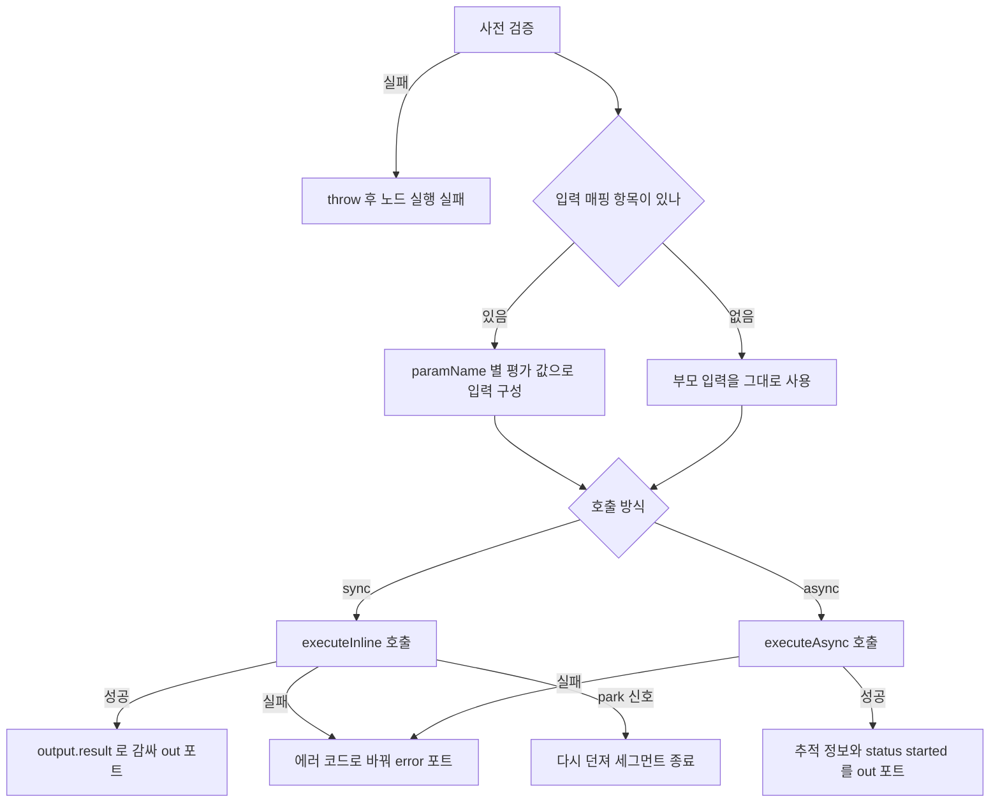

> 구현 상태: 구현됨(메타 노출 일부 미구현) · 원문: `spec/4-nodes/2-flow/1-workflow.md`, `spec/4-nodes/_product-overview.md` (§5.1) · 용어: [용어 사전](../CLE-GLOSSARY.md)

## 개요

워크플로우 호출 노드(Workflow node, `workflow`)는 다른 워크플로우를 서브 워크플로우(sub-workflow)로 불러 재사용과 모듈화를 돕는 Flow 노드다. 캔버스 표시 이름은 "Workflow" 다.

호출 방식은 동기(`sync`, 부모 실행 안에서 인라인으로 돌려 최종 출력을 받는다)와 비동기(`async`, 별도 실행으로 큐에 등록하고 추적 ID 를 바로 받는 fire-and-forget) 두 가지다.

Flow 공통 규약은 [Flow 노드 공통](CLE-NODE-FLOW-COMMON.md), 노드 출력 필드 규칙은 [노드 출력 규약](../CLE-NODE/CLE-NODE-OUTPUT.md), 에러 처리 정책은 [노드 에러 처리 정책](../CLE-NODE/CLE-NODE-ERROR.md)이 정한다. 서브 워크플로우 안 입력 대기의 재개 방법은 [실행 상태 머신과 대기·재개](../CLE-EXEC/CLE-EXEC-STATE.md)와 [장애 복구와 안전 종료](../CLE-EXEC/CLE-EXEC-RECOVERY.md)에 있다.

## 요구사항

- REQ-SUBWF-001 WHEN 워크플로우 호출 노드가 실행되면 THE SYSTEM SHALL `workflowId` 가 가리키는 다른 워크플로우를 서브 워크플로우로 호출한다. (원본: ND-WF-01)
- REQ-SUBWF-002 WHEN 사용자가 대상 워크플로우 셀렉터를 열면 THE SYSTEM SHALL 같은 워크스페이스의 워크플로우를 후보로 보여 주고 지금 편집 중인 워크플로우는 뺀다. (원본: ND-WF-02)
- REQ-SUBWF-003 WHEN 사용자가 셀렉터에서 워크플로우를 고르면 THE SYSTEM SHALL `workflowId` 와 `workflowName` 을 함께 저장한다.
- REQ-SUBWF-004 WHEN 사용자가 `workflowId` 를 직접 입력하면 THE SYSTEM SHALL `workflowName` 을 비운다.
- REQ-SUBWF-005 WHEN `inputMapping` 에 항목이 하나 이상 있으면 THE SYSTEM SHALL 항목마다 `paramName` 을 키로, 평가한 `expression` 을 값으로 한 객체를 서브 워크플로우 입력으로 넘긴다. (원본: ND-WF-03)
- REQ-SUBWF-006 WHEN `inputMapping` 이 비어 있으면 THE SYSTEM SHALL 부모 입력을 그대로 서브 워크플로우에 넘긴다.
- REQ-SUBWF-007 WHEN `mode` 가 `sync` 이면 THE SYSTEM SHALL 서브 워크플로우를 부모 실행 안에서 인라인으로 실행하고 끝날 때까지 기다린다. (원본: ND-WF-05)
- REQ-SUBWF-008 WHEN 동기 호출이 성공하면 THE SYSTEM SHALL 서브 워크플로우의 최종 노드 출력을 `output.result` 에 한 겹 감싸 `out` 포트로 내보낸다. (원본: ND-WF-04)
- REQ-SUBWF-009 WHEN `mode` 가 `async` 이면 THE SYSTEM SHALL 서브 워크플로우를 별도 실행으로 큐에 등록하고 `output: { executionId, workflowId, status: 'started' }` 를 바로 돌려준다. (원본: ND-WF-05)
- REQ-SUBWF-010 IF 비동기 호출로 등록한 서브 워크플로우가 실행 중에 실패하면 THE SYSTEM SHALL 그 에러를 부모 실행에 전파하지 않고 서브 실행의 로그와 상태에만 남긴다.
- REQ-SUBWF-011 WHEN 서브 워크플로우를 호출하면 THE SYSTEM SHALL 서브 실행 상태를 `parentExecutionId` 로 조회해 지켜볼 수 있게 한다. (원본: ND-WF-06)
- REQ-SUBWF-012 WHILE `mode` 가 `sync` 인 동안 THE SYSTEM SHALL `timeout`(기본 300초, `0` 은 무제한)을 넘긴 호출을 `SUB_WORKFLOW_TIMEOUT` 으로 에러 포트에 보낸다.
- REQ-SUBWF-013 WHILE `mode` 가 `async` 인 동안 THE SYSTEM SHALL `timeout` 설정을 무시한다.
- REQ-SUBWF-014 IF 재귀 깊이(`context.recursionDepth`)가 10 이상이면 THE SYSTEM SHALL `Maximum recursion depth exceeded (limit: 10)` 를 throw 해 노드 실행을 실패로 끝낸다.
- REQ-SUBWF-015 WHEN 서브 워크플로우를 호출하면 THE SYSTEM SHALL 재귀 깊이를 1 늘려 넘기고, 동기 호출은 실행 컨텍스트에, 비동기 호출은 실행 행(`Execution`)에 누적한다.
- REQ-SUBWF-016 WHEN 워크플로우가 자기 자신을 직접 호출하면 THE SYSTEM SHALL 재귀 깊이 한도 안에서 허용한다.
- REQ-SUBWF-017 IF 대상 워크플로우가 호출자와 다른 워크스페이스에 있거나 호출자 워크스페이스 ID 가 없으면 THE SYSTEM SHALL 호출을 막고 `WORKFLOW_FORBIDDEN_WORKSPACE` 로 에러 포트에 보낸다.
- REQ-SUBWF-018 IF 동기·비동기 호출이 실행 중에 실패하면 THE SYSTEM SHALL `output.error.{code, message, details: {workflowId, mode}}` 와 `port: 'error'` 를 돌려준다.
- REQ-SUBWF-019 IF 대상 워크플로우 정의가 없으면 THE SYSTEM SHALL `SUB_WORKFLOW_NOT_FOUND` 로 에러 포트에 보낸다.
- REQ-SUBWF-020 IF 서브 워크플로우 안의 블로킹 노드가 park 신호(`ParkReleaseSignal`)를 보내면 THE SYSTEM SHALL 이를 에러 포트로 보내지 않고 다시 던진다.
- REQ-SUBWF-021 WHEN 동기 호출한 서브 워크플로우 안의 블로킹 노드가 park 하면 THE SYSTEM SHALL 이 노드의 ID(`invokerNodeId`)를 호출 스택(`resume_call_stack`) 프레임 키로 저장해 재개 때 이 노드로 다시 들어오게 한다.
- REQ-SUBWF-022 IF 동기 호출한 서브 워크플로우에 `manual_trigger` 가 아닌 트리거 카테고리 노드가 있으면 THE SYSTEM SHALL 조용히 건너뛰지 않고 실행을 실패시킨다.
- REQ-SUBWF-023 IF `workflowId` 가 비어 있으면 THE SYSTEM SHALL 캔버스에 경고 `Target workflow must be selected.` 를 보이고 실행 때 사전 검증 에러로 throw 한다.
- REQ-SUBWF-024 IF `workflowId`·`mode`·`timeout`·`inputMapping` 값이 형식에 맞지 않으면 THE SYSTEM SHALL 사전 검증 에러로 throw 한다.
- REQ-SUBWF-025 WHEN 노드가 출력을 돌려주면 THE SYSTEM SHALL 설정 에코에 `workflowId`, `workflowName`, `mode`, `inputMapping`, `timeout` 원본을 싣는다.
- REQ-SUBWF-026 WHEN 동기 호출이 끝나면 THE SYSTEM SHALL `meta.durationMs` 에 인라인 실행 소요 시간을 싣는다.
- REQ-SUBWF-027 WHEN 서브 워크플로우를 호출하면 THE SYSTEM SHALL `meta` 에 `recursionDepth`, `subExecutionId`, `mode` 를 싣는다. (미구현)
- REQ-SUBWF-028 WHEN 캔버스에 노드를 그리면 THE SYSTEM SHALL `{{workflowName|fallback:workflowId}} · {{mode|default:sync}}` 형식의 설정 요약을 보인다.
- REQ-SUBWF-029 IF `workflowId` 는 있는데 `workflowName` 이 비었으면 THE SYSTEM SHALL 캔버스에 `⚠ Missing workflow` 배지를 보인다.
- REQ-SUBWF-030 IF `error` 포트에 연결선이 없는 상태에서 서브 워크플로우가 실패하면 THE SYSTEM SHALL [노드 에러 처리 정책](../CLE-NODE/CLE-NODE-ERROR.md)의 일반 규칙대로 워크플로우 중단으로 대신 처리한다.
- REQ-SUBWF-031 WHEN 동기 호출한 서브 워크플로우 안에서 Parallel 노드가 실행되면 THE SYSTEM SHALL 호출한 쪽 Parallel 의 중첩 깊이를 이어받지 않고 서브 워크플로우 안에서 깊이를 1부터 센다.

## 설정

| 필드 | 타입 | 필수 | 기본값 | 설명 |
| --- | --- | --- | --- | --- |
| `workflowId` | UUID(string) | ✓ | `''` | 호출할 워크플로우 정의 ID. 셀렉터나 표현식(`{{ }}`)으로 넣는다. |
| `workflowName` | string | | `undefined` | 설정 요약에 보일 이름. 셀렉터가 자동으로 채우고, UUID 를 직접 넣으면 비운다. |
| `mode` | `sync` / `async` | ✓ | `sync` | 호출 방식 |
| `inputMapping` | MappingDef[] | | `[]` | 서브 워크플로우 입력 매핑 |
| `timeout` | Integer | | `300` | 동기 호출 타임아웃(초). `0` 은 무제한이다. |

`MappingDef` 는 다음과 같다.

| 필드 | 타입 | 설명 |
| --- | --- | --- |
| `paramName` | string | 서브 워크플로우 입력 키 이름. 핸들러가 이 키로 읽는다. |
| `expression` | string | 넘길 값의 표현식 또는 리터럴. 스키마(zod)는 `z.string()` 으로 저장하고, 엔진이 평가한 값(런타임 `unknown`)을 핸들러에 넘긴다. |

설정 스키마의 기준은 `workflow.schema.ts` 의 `workflowNodeConfigSchema` 다. 스키마와 핸들러 모두 `paramName`·`expression` 을 쓴다.

## 설정 화면

설정 스키마의 `widget: 'workflow-selector'` 는 프론트엔드 `WIDGET_REGISTRY`(`widget-registry.ts`)에서 `WorkflowSelectorWidget` 으로 그려진다.

| 영역 | 위치 | 들어가는 요소 | 동작 |
| --- | --- | --- | --- |
| Target Workflow | 맨 위 | "Select a workflow..." 드롭다운 | 같은 워크스페이스의 워크플로우(편집 중인 것 제외)를 후보로 보이고, 고르면 `workflowId`·`workflowName` 을 저장한다. |
| Workflow ID | 셀렉터 아래 | 텍스트 입력(UUID 또는 표현식) | 직접 넣으면 `workflowName` 을 비운다. |
| Mode | Workflow ID 아래 | `Sync`·`Async` 드롭다운 | `mode` 를 정한다. |
| Input Mapping | Mode 아래 | `paramName ← expression` 행 목록, "+ Add Parameter" 버튼 | 행마다 `MappingDef` 하나(예: `param1 ← {{ $input.data }}`) |
| Timeout | 맨 아래 | 숫자 입력(초, 0 은 무제한) | 동기 호출에서만 보인다. |

런타임 호출(`executeInline`·`executeAsync`)은 [워크플로우 활성 관문](../CLE-TRIG/CLE-TRIG-DATA.md#워크플로우-활성-관문)을 거치지 않아 대상이 비활성이어도 실행된다. `⚠ Missing workflow` 배지([설정 요약](#설정-요약))는 화면 안내일 뿐이다.

셀렉터의 후보 거르기와 별개로 엔진은 실행 때 워크스페이스 격리를 강제한다(W-6).

1. 핸들러가 부모 워크스페이스 ID(`parentWorkspaceId`, `context.variables.__workspaceId`)를 `executeInline`·`executeAsync` 에 넘긴다.
2. 엔진(`execution-engine.service.ts`)의 `assertSameWorkspace` 가 대상이 다른 워크스페이스이거나 호출자 워크스페이스 ID(`callerWorkspaceId`)가 없으면(fail-closed) typed `WorkflowForbiddenWorkspaceError`(메시지 접두사 `WORKFLOW_FORBIDDEN_WORKSPACE:`)를 던진다.
3. 핸들러의 `mapSubWorkflowError` 가 이를 `ErrorCode.WORKFLOW_FORBIDDEN_WORKSPACE` 로 바꿔 `output.error.code` 에 싣는다.

## 포트

입력 포트는 다음과 같다.

| id | label | type | dynamic | 설명 |
| --- | --- | --- | --- | --- |
| `in` | Input | data | false | 부모에게서 받는 입력(1개 필수) |

출력 포트는 다음과 같다.

| id | label | type | dynamic | 설명 |
| --- | --- | --- | --- | --- |
| `out` | Output | data | false | 동기: `output.result`, 비동기: `output.{executionId, workflowId, status}` 와 최상위 `status: 'started'` |
| `error` | Error | error | false | 런타임 실패. `port: 'error'` 와 `output.error`([노드 출력 규약 Principle 3](../CLE-NODE/CLE-NODE-OUTPUT.md#principle-3-에러-계약)) |

동적 포트는 없고 `error` 포트는 항상 보인다.

## 실행 로직



1. 사전 검증(throw, [노드 출력 규약 Principle 3](../CLE-NODE/CLE-NODE-OUTPUT.md#principle-3-에러-계약)의 3.1). 조건과 메시지는 [사전 검증 throw](#사전-검증-throw-포트-라우팅-없음) 표가 정한다. 경고 규칙 `workflow:no-workflow-selected` 의 캔버스 배지는 i18n 으로 한국어를 보인다.
2. 서브 워크플로우 입력을 만든다. `inputMapping` 이 있으면 `{ [paramName]: 평가한 expression }`, 비어 있으면 부모 `input` 이다.
3. 호출 방식에 따라 나뉜다.
   - 동기: `executionEngine.executeInline(workflowId, effectiveInput, { executionId, context, executedNodes, recursionDepth: depth+1, parentNodeExecutionId, invokerNodeId })` 를 부른다. 반환값([최종 노드 출력](#최종-노드-출력))을 `output: { result: <inlineResult> }` 로 한 겹 감싼다([동기 호출 성공](#동기-호출-성공-port-out)). `invokerNodeId` 는 이 노드의 `Node.id` 이고 park 때 호출 스택 프레임 키가 된다. rehydration 은 부모 그래프에서 이 노드까지 나아간 뒤 다시 들어온다([장애 복구와 안전 종료](../CLE-EXEC/CLE-EXEC-RECOVERY.md)). 동기 호출은 부모 실행 컨텍스트를 같이 쓰므로 부모가 dry-run 이면 서브 워크플로우도 dry-run 이다.
   - 비동기: `executionEngine.executeAsync(workflowId, effectiveInput, { parentExecutionId, recursionDepth: depth+1, dryRun })` 를 부른다. 추적 정보와 최상위 `status: 'started'` 를 바로 돌려준다([비동기 호출 성공](#비동기-호출-성공-port-out)). `dryRun` 은 `isDryRun(context)` 이고, 엔진은 이를 서브 실행 행의 `dry_run` 에 남겨 서브 실행도 dry-run 으로 돌린다. 기준 규칙은 [재실행](../CLE-EXEC/CLE-EXEC-RERUN.md#서브-워크플로우와-background-본문)에 있다.
4. 런타임 에러를 처리한다.
   - `executeInline`·`executeAsync` 가 throw 하면 [런타임 에러](#런타임-에러-port-error) 출력으로 에러 포트에 보낸다. `code` 는 실행기 에러(typed error 또는 메시지)로 정한다([에러 코드](#에러-코드)).
   - 예외: `ParkReleaseSignal` 은 런타임 실패가 아니라서 그대로 다시 던진다. 엔진이 세그먼트를 끝내고 rehydration 으로 재개한다.
5. 재귀 깊이(`recursionDepth`)는 자식을 부를 때 1 을 더해 넘긴다(동기는 실행 컨텍스트, 비동기는 `Execution` 행). 최대 깊이는 10 이고 자기 호출(A→A)도 한도 안에서 허용한다.
6. 동기 호출한 서브 워크플로우의 진입점 트리거는 `manual_trigger` 만 허용한다. 다른 트리거 카테고리 노드를 만나면 엔진이 `INVALID_SUB_WORKFLOW_TRIGGER:` 로 시작하는 메시지를 throw 한다(`execution-engine.service.ts`). 지금 트리거 카테고리 노드는 `manual_trigger` 뿐이다.
7. 동기 호출한 서브 워크플로우 안의 Parallel 도 엔진의 Parallel 실행 경로를 탄다(`PARALLEL_ENGINE=v1`, 코드 기본값). 병렬 분기를 동시에 실행하고 완료 시점 엔진 덮어쓰기(`{ branches, count, skipped? }`, `port: 'done'`)를 받는다. 실행 규칙은 [Parallel 노드](../CLE-NODE-LOGIC/CLE-NODE-PARALLEL.md#컨테이너-본문과-서브-워크플로우의-parallel-도-parallel-실행-경로로-넘긴다-2026-11-06) 가 정한다.
   - 서브 워크플로우는 Parallel 중첩 깊이를 1부터 새로 센다(REQ-SUBWF-031). 병렬 분기 안에서 불러도 맨 바깥 Parallel 은 깊이 1 이다(근거와 대가는 [Rationale](#서브-워크플로우의-parallel-은-깊이를-새로-센다-2026-11-06)). `executeInline` 은 실행하는 동안 `parentParallelConcurrency` 를 떼었다가 끝나면(실패해도) 되돌린다.
   - 서브 워크플로우 안 Parallel 의 깊이 위반(`PARALLEL_NESTED_DEPTH_EXCEEDED:`)·병렬 분기 안 블로킹 노드(`PARALLEL_INVALID_CHILD:`) 에러는 `executeInline` 이 던지고 이 노드가 `error` 포트로 보낸다(REQ-SUBWF-018, `code` 는 `SUB_WORKFLOW_FAILED`).
   - `PARALLEL_ENGINE=off` 되돌림 경로에서는 병렬 분기 노드를 서브 워크플로우 루프가 차례로 실행한다.

### 최종 노드 출력

동기 호출이 돌려받는 최종 노드 출력(`executeInline` 반환값)은 엔진이 서브 워크플로우에서 마지막으로 실행한 노드의 출력이다.

- 엔진은 노드를 실행할 때마다 이 값을 그 출력으로 바꾼다. 끝나는 노드가 둘 이상이면 실행 순서에서 마지막 노드의 출력이다.
- 비활성 노드는 실행하지 않으므로 이 값을 바꾸지 않는다.
- `skip_node` 로 건너뛴 노드가 마지막이면 값은 `undefined` 다. 같은 실행에서 그 노드가 앞서 쓴 출력이 있으면 그 값이다([노드 에러 처리 정책](../CLE-NODE/CLE-NODE-ERROR.md#1-에러-처리-정책-다섯-가지)).
- 실행한 노드가 진입점 트리거뿐이면 서브 워크플로우 입력이다.
- 컨테이너 노드가 마지막이면 컨테이너의 완료 출력이다.
- 서브 워크플로우가 Parallel 로 끝나면(`done` 뒤에 노드가 없으면) Parallel 의 완료 출력이다. 병렬 분기 노드가 Parallel 안에서 실행된 뒤 완료 출력이 쓰이기 때문이다. `done` 뒤에 노드가 있으면 그 노드의 출력이다. `PARALLEL_ENGINE=off` 경로에는 완료 출력이 없어 앞 규칙대로 마지막으로 실행한 노드의 출력이다.

[Parallel 노드](../CLE-NODE-LOGIC/CLE-NODE-PARALLEL.md#병렬-분기의-노드-집합과-위상-순서) 의 병렬 분기 결과는 출력을 쓴 노드 가운데서 고르므로 이 규칙과 다르다. 건너뛴 노드는 Parallel 결과 노드가 될 수 없지만 여기서는 마지막이면 빈 값이 최종 노드 출력이 된다.

## 출력 구조

[노드 출력 규약 Principle 11](../CLE-NODE/CLE-NODE-OUTPUT.md#principle-11-출력-예시-작성-규칙) 형식을 따른다. 호출 방식에 따라 `output` 형태가 다르므로 네 경우로 나눈다.

### 동기 호출 성공 (port `out`)

```json
{
  "config": {
    "workflowId": "wf_uuid_1234",
    "workflowName": "Data Processing Pipeline",
    "mode": "sync",
    "inputMapping": [
      { "paramName": "userId", "expression": "{{ $input.user.id }}" }
    ],
    "timeout": 300
  },
  "output": {
    "result": {
      "result": "success",
      "data": [1, 2, 3]
    }
  },
  "meta": {
    "durationMs": 0
  }
}
```

| 필드 | 타입 | 출처 | 설명 |
| --- | --- | --- | --- |
| `config.*` | [설정](#설정) 필드 | 설정 에코 | `workflowId`(모든 실행에서 같다)·`workflowName?`(설정 요약·디버깅용)·`mode`(기본 `'sync'`)·`inputMapping`(`{{ }}` 템플릿 그대로)·`timeout` 원본 |
| `output.result` | 서브 워크플로우 출력 | 런타임, `executeInline` 반환값 | [최종 노드 출력](#최종-노드-출력)을 한 겹 감싼다. 키 구조는 호출한 워크플로우에 달려 있고 `workflowNodeOutputSchema` 는 Tier 3 unknown 으로 표시한다. |
| `meta.durationMs` | number | 핸들러가 채움 | `executeInline` 호출 직전부터 반환까지의 실제 시간(ms) |
| `port` | 생략(= `'out'`) | 핸들러 반환 | 단일 성공 출력 |

표현식 접근 예: `$node["X"].output.result.data` → `[1, 2, 3]`, `$node["X"].output.result` → 최종 노드 출력 전체, `$node["X"].port` → `undefined`(= 기본 `'out'`).

최종 노드 출력에 `result` 키가 있으면 경로가 `output.result.result` 가 된다(위 예시는 `'success'`). 늘 한 겹 감싼 의도된 결과다.

### 비동기 호출 성공 (port `out`)

```json
{
  "config": {
    "workflowId": "wf_uuid_1234",
    "workflowName": "Email Notification Flow",
    "mode": "async",
    "inputMapping": [],
    "timeout": 300
  },
  "output": {
    "executionId": "sub-exec-async-1",
    "workflowId": "wf_uuid_1234",
    "status": "started"
  },
  "status": "started"
}
```

| 필드 | 타입 | 출처 | 설명 |
| --- | --- | --- | --- |
| `config.*` | 동기 호출과 같음 | 설정 에코 | `mode: 'async'` |
| `output.executionId` | string | 런타임, `executeAsync` 반환값 | 이번 호출로 큐에 등록한 서브 실행의 추적 ID. 호출마다 다르고 `config.workflowId` 와 뜻이 다르다. |
| `output.workflowId` | string | 런타임 | 대상 워크플로우 정의 ID. 편의상 다시 싣고 늘 `config.workflowId` 와 같다. |
| `output.status` | `'started'` | 런타임 | 큐 등록 완료 |
| `status` | `'started'` | 핸들러 반환 | 큐 등록 완료를 최상위에도 알린다. 허용 여부는 [미결 사항](#미결-사항) |
| `port` | 생략(= `'out'`) | 핸들러 반환 | 단일 성공 출력 |

비동기 호출은 `meta` 를 돌려주지 않는다. 표현식 접근 예: `$node["X"].status` → `"started"`.

### 런타임 에러 (port `error`)

`executeInline`·`executeAsync` 가 throw 한 모든 경우다(서브 워크플로우 안 노드 실패 · Parallel 깊이 위반, `Workflow not found`, 표현식 평가 에러, 큐 등록 실패 등). park 신호는 들어가지 않는다([실행 로직](#실행-로직) 4번).

```json
{
  "config": {
    "workflowId": "wf_uuid_9999",
    "mode": "sync",
    "inputMapping": [],
    "timeout": 300
  },
  "output": {
    "error": {
      "code": "SUB_WORKFLOW_NOT_FOUND",
      "message": "Workflow not found: wf_uuid_9999",
      "details": {
        "workflowId": "wf_uuid_9999",
        "mode": "sync"
      }
    }
  },
  "port": "error"
}
```

| 필드 | 타입 | 출처 | 설명 |
| --- | --- | --- | --- |
| `config.*` | 동기 호출과 같음 | 설정 에코 | 에러일 때도 싣는다. |
| `output.error.code` | `ErrorCodeValue` | 핸들러 반환 | [에러 코드](#에러-코드) 표 |
| `output.error.message` | string | 핸들러 반환 | `err.message` 원문(현지화하지 않음) |
| `output.error.details.workflowId` | string | 핸들러 반환 | 실패한 서브 워크플로우 정의 ID. 에러 맥락은 자유 스키마라 [Principle 1.1](../CLE-NODE/CLE-NODE-OUTPUT.md#principle-11-설정과-출력-값은-겹치지-않는다)의 겹침 금지 예외다. |
| `output.error.details.mode` | `'sync'` / `'async'` | 핸들러 반환 | 실패한 호출 방식 |
| `port` | `'error'` | 핸들러 반환 | 에러 분기 |

표현식 접근 예: `$node["X"].port === "error"` 로 에러 분기에 들어왔는지 판단한다.

### 사전 검증 throw (포트 라우팅 없음)

아래 조건이면 핸들러가 throw 하고 엔진이 노드 실행을 `failed` 로 표시한다. `output`·`port` 가 없어 다음 노드로 넘어가지 않는다.

| 조건 | 메시지 | 시점 |
| --- | --- | --- |
| `workflowId` 가 없거나 빈 문자열 | `Target workflow must be selected.` | 경고 규칙(캔버스 배지)과 `handler.validate` |
| `workflowId` 가 문자열이 아님 | `workflowId is required and must be a string` | `handler.validate` |
| `mode` 가 `sync`·`async` 밖 | `mode must be "sync" or "async"` | `handler.validate` |
| `timeout` 이 음수이거나 숫자가 아님 | `timeout must be a non-negative number (0 = no timeout)` | `validateConfig`(스키마) |
| `inputMapping` 이 배열이 아님 | `inputMapping must be an array` | `validateConfig` |
| `inputMapping[i].paramName` 이 없거나 문자열이 아니거나 빈 문자열 | `inputMapping[i].paramName is required and must be a string` | `validateConfig` |
| `context.recursionDepth >= 10` | `Maximum recursion depth exceeded (limit: 10)` | 실행 중 |
| 동기 호출에서 `context._executedNodes` 가 없음 | `Inline execution requires _executedNodes in context` | 실행 중(내부 불변식 방어) |

## 에러 코드

| 코드 | 분류 | 뜻 |
| --- | --- | --- |
| `SUB_WORKFLOW_NOT_FOUND` | 런타임(port `error`) | 대상 워크플로우 정의가 없다. 실행기의 `Workflow not found: <id>` 를 이 코드로 바꾼다. |
| `SUB_WORKFLOW_TIMEOUT` | 런타임(port `error`) | 동기 호출 타임아웃을 넘겼다. 실행기의 `timed out`·`timeout` 메시지를 이 코드로 바꾼다. |
| `SUB_WORKFLOW_QUEUE_FAILED` | 런타임(port `error`) | 비동기 호출의 큐 등록 실패. 메시지에 `queue` 와 실패 표시(`failed`·`enqueue`·`reject`)가 모두 있을 때다. |
| `WORKFLOW_FORBIDDEN_WORKSPACE` | 런타임(port `error`) | 워크스페이스 격리(W-6, fail-closed). typed `WorkflowForbiddenWorkspaceError` 를 이 코드로 바꾼다. |
| `SUB_WORKFLOW_FAILED` | 런타임(port `error`) | 위 넷에 맞지 않는 모든 런타임 실패(서브 워크플로우 안 노드 실패, 표현식 평가 에러 등의 일반 fallback) |
| (throw) 재귀 깊이 · 내부 불변식 · 스키마 검증 메시지 | 사전 검증 | [사전 검증 throw](#사전-검증-throw-포트-라우팅-없음) 표 |

에러 코드 전체 카탈로그는 [에러 코드 규약과 카탈로그](../CLE-API/CLE-API-ERRCODES.md)에 있다.

## 설정 요약

`workflowNodeMetadata.summaryTemplate` 은 `{{workflowName|fallback:workflowId}} · {{mode|default:sync}}` 이고 `node-config-summary.ts` 가 `renderSummaryTemplate` 으로 그린다. 예: `Data Pipeline · sync`

1. 대상 워크플로우가 삭제·비활성화되어 `workflowName` 이 비면 `⚠ Missing workflow` 배지를 보인다(`warnWhen: 'workflowId && !workflowName'`).
2. `workflowId` 가 비어 있으면 blocking 경고 규칙 `workflow:no-workflow-selected` 가 먼저 나서 `⚠ Target workflow must be selected.` 를 보인다.

템플릿 문법은 [노드 시스템 구조와 카탈로그](../CLE-NODE/CLE-NODE-ARCH.md#템플릿-문법)에 있다.

## 미결 사항

- **비동기 호출의 최상위 `status: 'started'`**: [노드 출력 규약](../CLE-NODE/CLE-NODE-OUTPUT.md#principle-0-노드-출력의-다섯-필드)은 `status` 를 흐름 지시 상태(`waiting_for_input`, `resumed`, `ended` 등)로 정의하고, Flow 노드 공통 규약의 옛 서술은 Flow 노드 `status` 를 `undefined` 로 적었다. 엔진이 모르는 값을 받는 셈이다. 결정 필요: `output.status` 만 남기고 최상위 `status` 를 없앨지, `started` 를 허용 값으로 규약에 더할지.
- **재귀 깊이 초과의 에러 코드**: [에러 코드 카탈로그](../CLE-API/CLE-API-ERRCODES.md)에는 `RECURSION_DEPTH_EXCEEDED` 가 있지만 이 문서와 구현은 코드 없이 메시지만 throw 한다. 결정 필요: throw 에 코드를 붙일지, 카탈로그에서 뺄지.

## 구현 위치

- `codebase/backend/src/nodes/flow/workflow/workflow.handler.ts`: 핸들러, `mapSubWorkflowError`
- `codebase/backend/src/nodes/flow/workflow/workflow.schema.ts`: 설정 스키마, `summaryTemplate`, 경고 규칙
- `codebase/backend/src/nodes/flow/workflow/workflow.component.ts`: 컴포넌트
- `codebase/backend/src/modules/execution-engine/execution-engine.service.ts`: 동기 호출 실행 `executeInline`(최종 노드 출력, Parallel 넘기기, Parallel 깊이 새로 세기)

## Rationale

### 재귀 깊이 초과를 사전 검증 에러로 분류한 이유

실행 중에 발견되지만 사용자 입력으로 회복할 비즈니스 실패가 아니라 실행 환경의 불변식 위반이다. 그래서 에러 포트로 보내지 않고 throw 한다.

### 동기 호출의 진입점을 수동 트리거 노드로 제한한 이유

웹훅·스케줄 트리거에는 외부 이벤트(HTTP, cron)와 묶인 실행 출처 의미가 있다. 동기 호출은 부모 실행 안에서 돌므로 이런 트리거를 허용하면 부모 실행의 출처를 몰래 덮어쓴다. 그래서 조용히 건너뛰지 않고 바로 실패시킨다.

### 동기 호출 결과를 늘 한 겹 감싸는 이유

서브 워크플로우 출력의 키 구조는 워크플로우마다 다르다. 감싸기를 조건에 따라 바꾸면 표현식 경로가 워크플로우마다 달라진다. 그래서 늘 `output.result` 한 겹을 적용하고 `output.result.result` 같은 이중 중첩도 의도된 동작으로 둔다.

### 워크스페이스 격리를 fail-closed 로 바꾼 이유 (PR #637)

예전에는 호출자 워크스페이스 ID 가 없으면 로그만 남기고 통과시켰다(fail-open). 운영 호출처 세 곳(`executeInline` 두 곳, `executeAsync` 한 곳)이 늘 워크스페이스 ID 를 넘긴다는 것을 확인한 뒤 값이 없어도 막도록 바꿨다. 경위는 [실행 엔진 개요와 그래프 순회](../CLE-EXEC/CLE-EXEC-ENGINE.md)의 Rationale "C-1" 에 있다.

### 최종 노드 출력은 마지막으로 실행한 노드의 출력이다 (2026-11-06)

Parallel 노드가 병렬 분기 결과를 「출력을 쓴 노드 가운데 위상 순서가 가장 늦은 노드」 로 정하면서 두 문서의 "마지막 노드" 가 다르게 읽힐 수 있게 됐다. 그래서 지금 엔진 동작(`executeInline` 이 노드를 실행할 때마다 반환값을 바꾼다)을 정의로 적었다.

기각한 대안은 Parallel 처럼 출력을 쓴 노드로 좁히는 안이다. 반환값이 바뀌어 기존 워크플로우 동작이 달라지고 엔진 코드를 바꿔야 한다. 기존 워크플로우 영향은 없다.

### 서브 워크플로우의 Parallel 은 깊이를 새로 센다 (2026-11-06)

전에는 서브 워크플로우 루프(`executeInline`)가 Parallel 의 핸들러만 부르고 병렬 분기 노드를 차례로 실행했으며 완료 출력이 없었다. 이제 이 루프도 Parallel 을 엔진의 Parallel 실행 경로(`runParallel`)로 넘긴다. 실행 경로의 규칙은 [Parallel 노드](../CLE-NODE-LOGIC/CLE-NODE-PARALLEL.md) 가 정하고 컨테이너 본문 쪽은 [컨테이너 실행](../CLE-EXEC/CLE-EXEC-CONTAINER.md#컨테이너-본문의-parallel-도-덮어쓰기를-받는다-2026-11-06) 이 정한다.

**중첩 깊이**: 병렬 분기 안에서 이 노드를 부르면 바깥 병렬 분기의 `parentParallelConcurrency` 가 따라와 서브 워크플로우의 맨 바깥 Parallel 이 깊이 2 로 판정된다. 사람의 결정에 따라 동기 서브 워크플로우는 깊이를 새로 센다. 이유는 두 가지다.

- 사전 검사의 범위가 저장 규칙과 같아진다. 저장 규칙 `parallel:nested-depth-exceeded` 와 실행 시점 사전 검사 모두 그래프 하나만 보므로, 저장을 통과한 서브 워크플로우가 부르는 위치에 따라 실패하지 않는다.
- 바깥 `continue` 가 흡수하는 예외를 만들지 않는다. 바깥 Parallel 의 사전 검사는 다른 그래프로 내려가지 않고, `workflowId` 가 표현식이면 대상도 모른다. 깊이를 이어받으면 서브 워크플로우 안 위반이 실행 때에야 바깥 병렬 분기 하나의 실패로 드러나고 바깥 `errorPolicy='continue'` 가 흡수한다. 깊이 위반이 실행을 실패시킨다는 [Parallel 노드 요구사항](../CLE-NODE-LOGIC/CLE-NODE-PARALLEL.md#요구사항) 에 예외가 생긴다.

대가로 호출한 쪽의 동시 실행 수 곱 상한 32 가 걸리지 않아, 바깥 Parallel 과 서브 워크플로우 맨 바깥 Parallel 의 곱은 최대 16×16 이다.

기각한 대안은 서브 워크플로우도 호출한 쪽 깊이를 이어받는 안이다. 곱 상한은 지키지만 위 두 문제가 생긴다.

**최종 노드 출력**: 위 절의 정의는 바꾸지 않았고 그 절이 기각한 안도 고르지 않았다. 실행 방식이 바뀌어 Parallel 이 마지막으로 출력을 쓰는 노드가 되었으므로 Parallel 로 끝나면 완료 출력이 최종 노드 출력이다.

**기존 워크플로우 영향**:

- 서브 워크플로우 안 Parallel 의 병렬 분기가 동시에 실행되고 항목 에러 정책을 따른다. `done` 뒤 노드는 시작 출력 대신 완료 출력을 받는다.
- Parallel 로 끝나는 서브 워크플로우의 `output.result` 가 위상 순서가 가장 늦은 병렬 분기 노드의 출력에서 `{ branches, count, skipped? }` 로 바뀐다. `output.result.<필드>` 로 읽던 표현식은 `output.result.branches` 에서 읽도록 고쳐야 한다.
- 서브 워크플로우 안에서 깊이 3 이 되는 그래프는 실행 때 이 노드의 `error` 포트로 간다. 저장 규칙이 깊이 3 을 거부하므로 그 규칙 전에 저장된 워크플로우만 해당한다.
- `PARALLEL_ENGINE=off` 되돌림 경로는 바뀌지 않는다.
