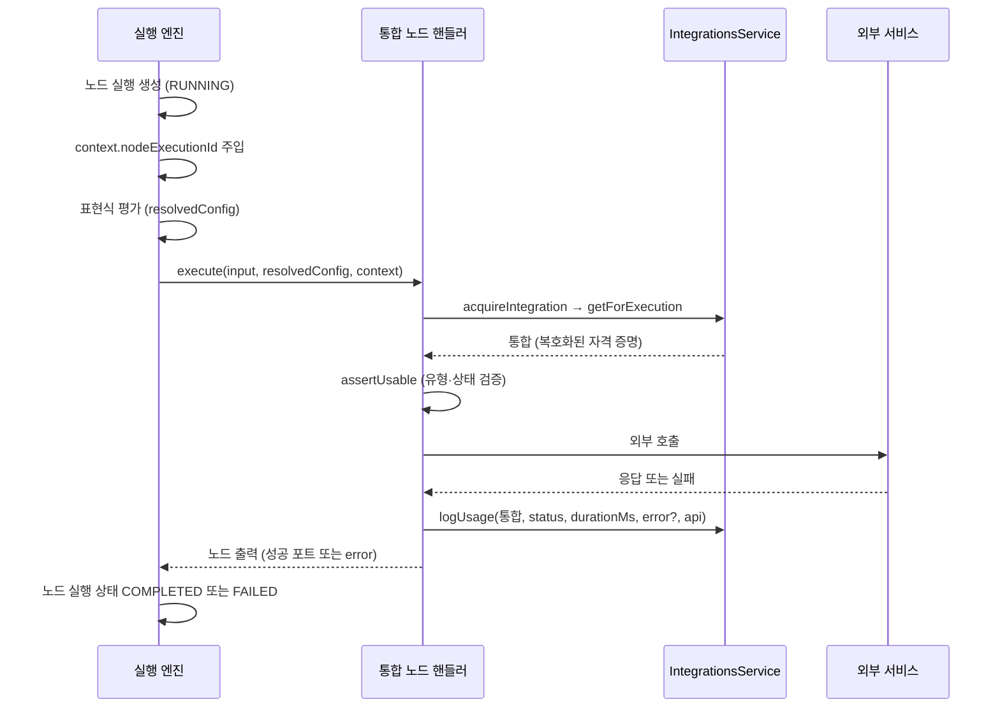

## 개요

이 문서는 [통합 노드 공통](CLE-NODE-INT-COMMON.md) 의 하위 문서로 통합 노드 핸들러의 실행 계약을 정한다. 6단계 계약, 실행 엔진용 `IntegrationsService` API(개인 통합 판정에 넘기는 `use` 인자 포함), 공통 베이스 `IntegrationHandlerBase`, 호출 순서, 서비스 미주입과 워크스페이스 누락의 노드별 동작이 여기에 속한다. 에러 코드와 활동 로그를 남기지 않는 실패 목록은 [통합 노드 공통 — 에러 코드와 사설망 차단](CLE-NODE-INT-COMMON-ERROR.md) 이 정한다.

## 핸들러 실행 계약

통합 노드의 외부 호출은 실행 엔진이 부르는 노드 핸들러가 맡는다. 모든 통합 핸들러는 공통 베이스(`IntegrationHandlerBase`)로 자격 증명을 해소하고 호출 기록을 남긴다. 베이스를 상속하지 않는 핸들러도 같은 동작을 해야 한다.

### 6단계 계약

| 단계 | 책임 |
|------|------|
| 1. 워크스페이스 확인 | `ExecutionContext.variables.__workspaceId` 를 읽는다. 없으면 에러로 끝낸다(처리 방식은 아래 "서비스 미주입과 워크스페이스 누락") |
| 2. 통합 조회 | `IntegrationsService.getForExecution` 을 부른다. 개인 통합이면 [개인 통합 사용 판정](../CLE-INT/CLE-INT-MANAGE.md#개인-통합-사용-판정)을 거친다. 인자는 아래 「IntegrationsService API」 가 정한다. 자격 증명은 AES-256-GCM 컬럼 transformer 가 자동으로 복호화한다 |
| 3. 유형·상태 검증 | `serviceType` 이 노드 기대값과 같은지, `status === 'connected'` 인지 확인한다 |
| 4. 자격 증명 충족 검증 | 서비스별 필수 필드가 빠지면 `INTEGRATION_INCOMPLETE` |
| 5. 외부 호출 | 노드마다 정해진 클라이언트로 부른다. HTTP Request 는 `fetch`, Database Query 는 DB 드라이버(`pg`·`mysql2`), Send Email 은 SMTP 라이브러리(`nodemailer`), Cafe24·MakeShop 은 서비스별 API 클라이언트(`Cafe24ApiClient`·`MakeshopApiClient`)를 쓴다 |
| 6. 활동 로그 기록 | 통합을 얻은 뒤에는 성공·실패와 관계없이 `IntegrationsService.logUsage` 에 얻은 통합과 `{nodeExecutionId, workflowId, status, durationMs, error?, api?}` 를 넘긴다. 1·2단계에서 끝난 실패(조회 거절, 조회 중 일시 에러, 자격 증명 읽기 실패 포함)는 얻은 통합이 없어 기록하지 않는다. 전체 목록은 [공통 에러 코드](CLE-NODE-INT-COMMON-ERROR.md#공통-에러-코드) 에 있다 |

6단계의 `api` 식별 정보(`{ label?, method?, path? }`)는 동반이 의무다. 이 값은 `integration_usage_log.api_label`·`api_method`·`api_path`(`varchar(128)`·`varchar(8)`·`varchar(256)`)에 저장된다. 통합별로 무엇을 채우는지는 [통합 데이터와 흐름 「호출 API 식별 채우기 규칙」](../CLE-INT/CLE-INT-DATA.md#호출-api-식별-채우기-규칙) 이 정하고, 각 노드 문서는 자기 노드의 값만 적는다. 값이 길면 백엔드(`logUsage` 내부)가 컬럼 한도로 자르고 끝에 `…` 를 붙인다(`clampMessage` 패턴). 호출하는 쪽이 직접 자를 필요는 없다.

### IntegrationsService API (실행 엔진용)

```ts
class IntegrationsService {
  /**
   * 실행 경로(통합 노드 핸들러 · 도구 프로바이더) 전용 내부 조회. credentials 는 AES-256-GCM transformer 가
   * 복호화한 평문으로 반환된다. 결과는 시크릿으로 취급한다. use 는 아래 글머리가 정한다.
   */
  getForExecution(
    id: UUID,
    workspaceId: UUID,
    use: { nodeId: UUID | null; fromExpression: boolean },
  ): Promise<Integration>;

  /**
   * 노드 실행이 끝나면 부른다. 성공·실패 여부와 durationMs 를 기록하고
   * integration.last_used_at / last_error 를 갱신한다.
   * integration 은 getForExecution 이 돌려준 통합이다.
   */
  logUsage(
    integration: Integration,
    params: {
      nodeExecutionId: UUID;
      workflowId: UUID;
      status: "success" | "failed";
      durationMs: number;
      error?: { code?: string; message?: string } | null;
      api?: { label?: string | null; method?: string | null; path?: string | null };
    },
  ): Promise<void>;
}
```

개인 통합의 판정에는 노드가 속한 워크플로우의 작성자와 참조 값이 표현식이었는지가 필요하다. 부르는 쪽은 노드 ID 와 표현식 여부를 `use` 인자로 넘기고 워크플로우 작성자는 통합 서비스가 구한다. 판정 기준은 [통합 관리 「개인 통합 사용 판정」](../CLE-INT/CLE-INT-MANAGE.md#개인-통합-사용-판정) 이 정한다.

- `use.nodeId` 는 지금 실행 중인 노드의 ID 다. 통합 서비스는 조회한 통합이 개인 통합일 때만 그 노드 행과 노드가 속한 워크플로우 행을 읽어 `created_by` 를 구한다. 그 워크플로우는 실행의 워크스페이스(`workspaceId` 인자)에 있어야 한다. 조직 통합은 노드를 읽지 않는다.
- `use.nodeId` 가 `null` 이거나, 노드 행이 없거나, 그 워크플로우가 실행의 워크스페이스에 없으면 워크플로우 작성자를 알 수 없다. 이때는 개인 통합을 거절하고 응답은 워크플로우 작성자가 통합 소유자가 아닐 때와 같다([통합 관리](../CLE-INT/CLE-INT-MANAGE.md) 의 «작성자를 알 수 없으면 통합 소유자가 아닌 것으로 본다» 요구사항).
- 워크플로우 작성자는 노드마다 그 노드가 속한 워크플로우의 것이다. 동기 호출 서브 워크플로우는 부모 실행 안에서 인라인으로 돌고([워크플로우 호출 노드](../CLE-NODE-FLOW/CLE-NODE-SUBWF.md)) `context.workflowId` 는 실행 시작 때 고정된다([실행 컨텍스트](../CLE-EXEC/CLE-EXEC-CONTEXT.md)). 그래서 `context.workflowId` 로는 구하지 않는다. 서브 워크플로우의 노드 행은 서브 워크플로우에 속하므로 서브 워크플로우 작성자로 판정된다. 비동기 호출도 같다.
- 통합 노드는 공통 베이스의 `acquireIntegration` 이 `context.nodeId` 를 넘긴다. 엔진은 노드 실행마다 한 번 만드는 실행 컨텍스트 복사본에 `nodeId` 를 이미 넣는다([실행 컨텍스트](../CLE-EXEC/CLE-EXEC-CONTEXT.md), [노드 핸들러 계약 「핸들러용 실행 컨텍스트는 노드 실행마다 하나다」](../CLE-EXEC/CLE-EXEC-HANDLER.md#핸들러용-실행-컨텍스트는-노드-실행마다-하나다)). 핸들러 시그니처와 실행 컨텍스트 필드는 바꾸지 않는다.
- AI 에이전트 노드는 핸들러가 도구 목록 구성 문맥(`ProviderBuildCtx`)에 `nodeId` 를 싣고, 통합을 쓰는 도구 프로바이더(외부 MCP 서버용 · Cafe24 · MakeShop)가 그 값을 넘긴다. 첫 턴은 `context.nodeId` 를 싣는다. 멀티턴 재개·재시도 턴은 재구성 결과의 `nodeId` 를 싣는다([실행 상태 머신과 대기·재개 「보존 예외 `_resumeCheckpoint`」](../CLE-EXEC/CLE-EXEC-STATE.md#보존-예외-_resumecheckpoint)).
- 도구 프로바이더는 도구 목록을 만들 때만 통합을 조회한다. 내부 MCP 브리지가 토큰 갱신 뒤 통합을 다시 읽는 조회도 이 단계 안에서 일어난다([MCP 클라이언트 「통합 조회 기준」](../CLE-INT/CLE-INT-MCP.md#통합-조회-기준)). 도구를 실행할 때는 도구 목록을 만들 때 얻은 통합을 쓴다(외부 MCP 서버는 그때 연 MCP 세션). 그래서 도구 프로바이더 실행 문맥(`ProviderExecCtx`)에는 노드 ID 를 더하지 않는다. 도구 실행은 서버의 표현식 여부도 읽지 않는다.
- 참조 값이 표현식이었는지(`fromExpression`)는 부르는 쪽이 평가 전 원본 설정의 같은 위치를 보고 정한다. 통합 노드는 `context.rawConfig.integrationId` 를 본다. AI 에이전트 노드는 첫 턴에 평가 전 `mcpServers` 의 같은 위치를 보고 서버마다 표현식 여부를 정한다. 결과는 서버 항목 안이 아니라 목록과 길이가 같은 평행 배열 `mcpServerFromExpression` 에 담아 도구 목록 구성 문맥(`ProviderBuildCtx`)에 싣는다. 도구 프로바이더는 이 배열에서 같은 위치의 값을 읽고 서버 항목의 키는 읽지 않는다. 배열이 없거나 길이가 서버 목록과 다르면 모든 서버를 표현식으로 본다. `execute` 가 받는 `config` 는 평가가 끝난 값이라 이것으로는 알 수 없다([노드 핸들러](../CLE-EXEC/CLE-EXEC-HANDLER.md)). 표현식이었고 조회한 통합이 개인 통합이면 거절한다([통합 관리](../CLE-INT/CLE-INT-MANAGE.md) 의 «표현식으로 정한 개인 통합 참조는 거절한다» 요구사항).
- 리터럴로 보는 것은 원본 값이 문자열이고 평가한 값과 같을 때뿐이다. 나머지는 모두 표현식으로 본다. 원본 값이 표현식 엔진이 평가하는 템플릿(`{{ }}` 를 담은 문자열)이면 평가한 값과 달라지므로 표현식이다. 이스케이프한 `\{\{` 가 든 값도 표현식으로 본다. [표현식 언어](../CLE-WF/CLE-WF-EXPR.md) 의 이스케이프 규칙은 그 자리를 리터럴 `{{` 로 평가하지만 평가한 값이 원본과 달라진다. 이 판정은 원본과 평가한 값이 같은지만 본다.
  - 통합 노드: `context.rawConfig` 가 없거나 `rawConfig.integrationId` 가 문자열이 아니면 표현식이다.
  - AI 에이전트 노드: 평가 전 `mcpServers` 가 배열이 아니거나(`mcpServers` 자체가 표현식인 경우 포함) 평가 뒤와 길이가 다르면 모든 항목이 표현식이다. 길이가 같으면 같은 순서의 항목끼리 비교한다. 원본 항목이 객체가 아니면 그 항목은 표현식이다.
- 재개·재시도 턴의 서버별 표현식 여부는 첫 턴에 저장한 배열 `mcpServerFromExpression` 을 쓴다. 저장 규칙과 배열이 없는 옛 체크포인트의 처리는 [실행 상태 머신과 대기·재개 「보존 예외 `_resumeCheckpoint`」](../CLE-EXEC/CLE-EXEC-STATE.md#보존-예외-_resumecheckpoint) 가 정한다.
- 노드 ID 와 표현식 여부는 `variables` 에서 읽지 않는다. Code 노드가 `__*` 를 포함한 `context.variables` 를 덮어쓸 수 있어서다([실행 컨텍스트](../CLE-EXEC/CLE-EXEC-CONTEXT.md) 규칙 5).

`logUsage` 는 best-effort 다. 내부 예외를 삼키므로 실행 흐름을 멈추지 않는다. `logUsage` 가 갱신하는 통합 컬럼은 `last_used_at` 과 `last_error` 다. MCP `AUTH_FAILED` 로 실패하면 `status`·`status_reason` 도 `error(auth_failed)` 로 바꾸고, 행이 바뀐 호출만 조치 필요 알림을 보낸다([통합 데이터와 흐름 — 데이터 흐름 「노드 실행의 통합 사용」](../CLE-INT/CLE-INT-DATA-RUN.md#노드-실행의-통합-사용), [MCP 클라이언트 — 에러 처리 「인증 실패 상태 전환」](../CLE-INT/CLE-INT-MCP-ERROR.md#인증-실패-상태-전환)). 받은 통합에서는 `id` 만 읽어 활동 로그 행의 `integration_id` 와 통합 행 UPDATE 의 조건으로 쓴다. 통합 행은 필요한 컬럼만 고치는 UPDATE 한 번으로 고치고 받은 엔티티를 저장하지 않는다. 노드 실행 결과로 통합 상태가 바뀌는 범위는 [통합 상태와 만료 알림](../CLE-INT/CLE-INT-STATUS.md)에서 정한다.

### IntegrationHandlerBase

```ts
class IntegrationHandlerBase {
  constructor(protected readonly integrationsService?: IntegrationsService) {}

  protected acquireIntegration(integrationId: UUID, context: ExecutionContext): Promise<Integration>; // 1·2단계
  protected assertUsable(integration: Integration, expectedServiceType: string): void; // 3단계

  // integration 은 acquireIntegration 이 돌려준 통합이다(6단계).
  protected logUsage(
    integration: Integration,
    context: ExecutionContext,
    params: IntegrationUsageParams, // api 식별 정보 포함
  ): Promise<void>;
}

interface IntegrationUsageParams {
  status: "success" | "failed";
  durationMs: number;
  error?: { code?: string; message?: string } | null;
  api?: { label?: string | null; method?: string | null; path?: string | null };
}
```

공통 베이스는 통합을 얻는 `acquireIntegration` 과 검증하는 `assertUsable` 을 따로 둔다. 다섯 통합 노드는 두 메서드를 따로 부른다.

- `acquireIntegration` 은 1·2단계를 맡는다. `context.nodeId` 와 `context.rawConfig` 로 `use` 인자를 만들어 `getForExecution` 을 부르고 얻은 통합을 돌려준다. 실패하면 예외를 던진다. 워크스페이스 누락이 지금 일반 `Error` 로 나가는 것은 아래 "서비스 미주입과 워크스페이스 누락" 에 있다.
- `assertUsable` 은 3단계를 맡는다. 실패하면 `IntegrationError(code, message)` 를 던진다. `code` 는 [공통 에러 코드](CLE-NODE-INT-COMMON-ERROR.md#공통-에러-코드) 의 값이다. 핸들러는 이 예외를 잡아 에러 포트로 내보낸다.
- `logUsage` 는 `acquireIntegration` 이 돌려준 통합을 받는다. 핸들러는 얻은 통합을 지역 변수(`integration: Integration | undefined`)로 들고 있다가 3단계 이후에 실패해도 그 통합으로 활동 로그를 남긴다. 바깥 catch 도 통합을 얻었을 때만 기록한다. 통합을 얻기 전에 끝난 실패는 넘길 통합이 없어 기록하지 않는다.
- `IntegrationError` 에는 코드와 메시지만 싣는다. 통합을 싣지 않는다. 통합의 `credentials` 는 복호화된 평문이라 예외에 실으면 예외를 잡거나 로그로 남기는 모든 곳으로 퍼진다.

### 호출 순서

실행 엔진은 노드 실행을 만들고 `context.nodeExecutionId` 를 주입한 다음 표현식을 평가해 핸들러를 부른다. 핸들러는 통합을 해소하고 외부 서비스를 부른 뒤 활동 로그를 남긴다. 엔진은 핸들러가 돌려준 노드 출력으로 노드 실행 상태를 마감한다.



- `context.nodeExecutionId` 는 엔진이 노드 실행마다 한 번 만드는 실행 컨텍스트 복사본에 담기므로 다른 노드 실행이나 병렬 분기의 값과 섞이지 않는다. 노드 재시도 정책이면 재시도도 같은 복사본으로 핸들러를 부른다([노드 핸들러 계약 「핸들러용 실행 컨텍스트는 노드 실행마다 하나다」](../CLE-EXEC/CLE-EXEC-HANDLER.md#핸들러용-실행-컨텍스트는-노드-실행마다-하나다)). 개인 통합 판정에 쓰는 `context.nodeId` 도 같은 곳에 담긴다.
- 멀티턴 AI 노드의 재개·재시도 턴은 노드를 새로 dispatch 하지 않고 `resumeState` 로 다시 들어온다. 이때 `context.nodeExecutionId`·`workflowId`·`nodeId` 는 새로 배정되지 않는다. `buildRetryReentryState` 가 입력 대기·재시도 중인 노드 실행 행과 그 노드 행에서 다시 유도한다. 이 유도가 빠지면 활동 로그의 귀속이 누락된다. 불변식은 [실행 상태 머신과 대기·재개](../CLE-EXEC/CLE-EXEC-STATE.md) 의 «사용량 귀속 불변식» 이 정하고, 귀속이 빠졌던 회귀의 경위는 같은 문서 Rationale 「재개·재시도 턴의 식별 필드를 다시 넣는다」 에 있다.

### 서비스 미주입과 워크스페이스 누락

`IntegrationsService` 가 핸들러에 주입되지 않았거나 `__workspaceId` 가 없는 경우는 배포 구성 에러다. 프로덕션 경로에서는 서비스가 반드시 주입돼야 한다. 노드별 동작은 다음과 같다.

| 노드 | 서비스 미주입 | `__workspaceId` 누락 |
|------|---------------|----------------------|
| HTTP Request (통합 인증일 때) | 에러 포트, `INTEGRATION_SERVICE_UNAVAILABLE` | 에러 포트, `INTEGRATION_SERVICE_UNAVAILABLE` |
| Database Query | 에러 포트, `INTEGRATION_SERVICE_UNAVAILABLE` | 에러 포트, `INTEGRATION_SERVICE_UNAVAILABLE` |
| Cafe24 | 에러 포트, `INTEGRATION_SERVICE_UNAVAILABLE` (`Cafe24ApiClient` 미주입 포함) | 에러 포트, `INTEGRATION_SERVICE_UNAVAILABLE` |
| MakeShop | 에러 포트, `INTEGRATION_SERVICE_UNAVAILABLE` (`MakeshopApiClient` 미주입 포함) | 에러 포트, `INTEGRATION_SERVICE_UNAVAILABLE` |
| Send Email | 정규화한 수신자(`to`)가 있으면 외부 호출 없이 `status: 'requires_integration'` 을 돌려준다(포트·메트릭 없음). 수신자 확인이 먼저라 수신자가 없으면 에러 포트, `EMAIL_NO_RECIPIENTS` | 정규화한 수신자(`to`)가 있으면 에러 포트, `EMAIL_SEND_FAILED` (IntegrationError 가 아니어서 흡수됨). 수신자 확인이 먼저라 수신자가 없으면 에러 포트, `EMAIL_NO_RECIPIENTS` |

HTTP Request 노드가 `none`·`custom` 인증이면 통합을 조회하지 않으므로 이 표의 대상이 아니다. Send Email 노드의 두 예외는 [Send Email 노드](CLE-NODE-EMAIL.md)에서 자세히 정한다.

워크스페이스 누락 열은 부분 구현이다. 현재 구현의 공통 베이스 `acquireIntegration` 은 `__workspaceId` 가 없으면 `IntegrationError` 가 아닌 일반 `Error('Missing workspace context …')` 를 던진다. 그래서 HTTP Request·Cafe24·MakeShop 노드는 기본 규칙대로 `INTEGRATION_CALL_FAILED` 를, Database Query 노드는 드라이버 에러 분류기(`mapDbError`)의 결과를 내보내는 것으로 보인다. Send Email 노드의 칸은 지금 동작이다. 같은 일반 `Error` 가 `IntegrationError` 가 아니어서 `EMAIL_SEND_FAILED` 로 끝난다([Send Email 노드 「에러 코드」](CLE-NODE-EMAIL.md#에러-코드)). [미결 사항](CLE-NODE-INT-COMMON.md#미결-사항) 참조.

## 구현 위치

- `codebase/backend/src/nodes/integration/_base/integration-handler-base.ts` (공통 베이스, `acquireIntegration`·`assertUsable`·`logUsage`·`toLogError`)
- `codebase/backend/src/nodes/integration/*/*.handler.ts` (노드별 핸들러)
- `codebase/backend/src/modules/integrations/integrations.service.ts` (`getForExecution`·`logUsage`·`requireEntity`)
- `codebase/backend/src/modules/integrations/personal-integration-use.ts` (`judgePersonalIntegrationUse`·`isLiteralReference`. 개인 통합 사용 판정과 리터럴 판정)
- `codebase/backend/src/modules/integrations/personal-integration-use-facts.ts` (`loadExecutionUseFacts`. 노드 ID 로 워크플로우 작성자와 통합 소유자의 멤버십을 읽는다)
- `codebase/backend/src/nodes/ai/ai-agent/mcp-server-ref-use.ts` (AI 에이전트 서버마다의 표현식 여부 배열 `mcpServerFromExpression` 과 `use` 인자)

## Rationale

### 남의 개인 통합 조회는 없는 통합과 같게 실패한다 (2026-10-24)

NERV Task `CLE-T-MG0EQZ` 에서 개인 통합은 노드가 속한 워크플로우의 작성자가 통합 소유자일 때만 쓰도록 사용자가 정했다(2026-10-24). 실행 시점에 거절할 때의 노드 에러는 «통합이 없을 때와 같은 경로» 로 정했다. 워크플로우 작성자를 구하는 방법은 2026-10-25 에 고쳤다(아래 «워크플로우 작성자는 통합 서비스가 노드 ID 로 구한다»).

- 전용 코드를 두면 노드 출력만 보고 그 ID 가 남의 개인 통합이라는 것을 알 수 있다. 관리 API 가 남의 개인 통합을 404 로 숨기는 것(2026-09-25)과 같은 원칙이다.
- 거절된 조회를 기록하지 않는 근거와 `logUsage` 가 얻은 통합을 받게 한 이유는 [통합 관리](../CLE-INT/CLE-INT-MANAGE.md) Rationale 「개인 통합의 역할 하한과 노드 사용 기준을 정한다」 의 [「실행 시점 거절도 없는 통합과 같은 노드 에러다」](../CLE-INT/CLE-INT-MANAGE.md#실행-시점-거절도-없는-통합과-같은-노드-에러다) 와 [「활동 로그는 얻은 통합에만 쓴다」](../CLE-INT/CLE-INT-MANAGE.md#활동-로그는-얻은-통합에만-쓴다) 에 있다.
- 조회 앞 단계에서 끝난 실패도 기록하지 않는다. 설정의 `integrationId` 만으로는 그 통합을 이 실행에서 쓸 수 있는지 모른다. 그 값으로 기록하면 거절된 조회를 기록하지 않는 목적이 같은 방식으로 깨진다. 다섯 통합 노드 문서는 이 규칙에 맞춰 «매 호출 활동 로그» 요구사항을 통합을 얻은 뒤의 호출로 좁혔다.
- 통합을 얻은 뒤 외부 호출 전에 끝난 실패(3단계 유형 · 상태 검증 등)는 기록한다. 그 통합으로 실행하려다 실패한 시도이고 지금 코드의 바깥 catch 도 이 실패를 기록한다. [Cafe24 노드](CLE-NODE-CAFE24.md) Rationale 의 «실제로 나간 외부 호출의 기록» 은 dry-run 모의 출력을 빼려고 쓴 말이라 이 경우와 부딪치지 않는다.
- 재개 턴의 서버별 표현식 여부를 저장하는 이유와 값이 없는 옛 항목을 표현식으로 보는 이유는 [실행 상태 머신과 대기·재개](../CLE-EXEC/CLE-EXEC-STATE.md) Rationale 「MCP 서버 항목에 표현식 여부를 저장하고 스키마 버전을 올리지 않는다」 에 있다. 2026-11-07 에 저장 위치를 서버 항목 밖 배열로 옮긴 이유는 같은 문서의 「[표현식 여부를 서버 항목 밖 배열로 옮긴다](../CLE-EXEC/CLE-EXEC-STATE.md#표현식-여부를-서버-항목-밖-배열로-옮긴다-2026-11-07)」 에 있다.
- **워크플로우 작성자는 통합 서비스가 노드 ID 로 구한다(2026-10-25).** 2026-10-24 승인본은 엔진이 노드가 속한 워크플로우의 `created_by` 를 읽어 실행 컨텍스트의 새 선택 필드 `workflowAuthorId` 로 넣는다고 적었다. 근거는 «통합 모듈이 워크플로우 저장소를 읽지 않으므로 의존 방향이 실행 엔진에서 통합 모듈 쪽 하나로 남는다» 였다. 코드는 그렇지 않았다. 통합 모듈은 사용처 조회에서 이미 노드 저장소로 워크플로우를 join 한다(`integrations.service.ts` 의 사용처 조회, `integrations.module.ts` 의 `Node` 등록). 노드 ID 는 엔진이 이미 노드마다 실행 컨텍스트에 넣고 멀티턴 재구성기도 이미 다시 넣는다. 그래서 새 필드 없이 같은 판정을 할 수 있다. 새 필드로 두면 [실행 컨텍스트](../CLE-EXEC/CLE-EXEC-CONTEXT.md) 규칙 3 의 예외를 따로 승인받아야 했고, 동기 함수인 재구성기 안에서 워크플로우 행을 읽을 자리도 정해야 했다.
  - 기각: 엔진이 워크플로우 작성자를 실행 컨텍스트 선택 필드 `workflowAuthorId` 로 넣는 안(2026-10-24 승인본). 위 이유로 뺐다. 확장 타입이나 필수 필드로 두는 변형도 같이 뺐다.
  - 기각: 엔진이 노드가 속한 워크플로우 ID(`nodeWorkflowId`)를 새 필드로 싣고 통합 서비스가 그 워크플로우의 작성자를 구하는 안(2026-10-25 리뷰 제안). 노드 ID 로 같은 워크플로우 행에 닿으므로 새 필드가 필요 없다.
  - 기각: 서브 워크플로우에 들어갈 때 공유 실행 컨텍스트의 워크플로우 작성자를 바꾸고 나올 때 되돌리는 안(앞선 승인본). 서브 워크플로우를 나오는 모든 경로(정상 종료, 예외, park 뒤 rehydration 으로 프레임을 다시 들어가는 재개)에서 값을 되돌려야 한다. 하나라도 빠지면 부모 워크플로우의 다음 노드가 잘못 판정된다.
  - 비용: 개인 통합을 조회할 때마다 노드 행 · 워크플로우 행과 통합 소유자의 멤버십을 더 읽는다. 조직 통합은 읽지 않는다. 세 가지를 쿼리 한 번으로 읽고(`personal-integration-use-facts.ts` 의 `loadExecutionUseFacts`, 구현 Task `CLE-T-1BQZ10`) 한 노드 실행 안에서 결과를 다시 쓰지 않는다.
- 도구 프로바이더는 도구 목록을 만들 때만 통합을 조회한다. 그래서 노드 ID 와 표현식 여부를 도구 목록 구성 문맥(`ProviderBuildCtx`)의 필드로 싣는다. 표현식 여부는 처음에 그 문맥의 `config` 안 서버 항목에 실었고 2026-11-07 에 평행 배열 `mcpServerFromExpression` 으로 옮겼다([실행 상태 머신과 대기·재개 Rationale](../CLE-EXEC/CLE-EXEC-STATE.md#표현식-여부를-서버-항목-밖-배열로-옮긴다-2026-11-07)). 도구 프로바이더 실행 문맥(`ProviderExecCtx`)에는 노드 ID 를 더하지 않고 도구 실행은 표현식 여부를 읽지 않는다. 도구 실행마다 다시 조회하면 도구 목록을 만들 때 얻은 통합과 MCP 세션을 쓰는 지금 방식이 바뀌고 호출마다 조회 비용이 든다.
- 워크플로우 작성자를 알 수 없으면 거절한다. 통과시키면 노드 ID 가 빠지기 쉬운 경로(멀티턴 재개 턴)가 우회로가 된다. 판정할 수 없으면 거부한다는 원칙은 [큐 워커와 동시 실행 제한](../CLE-EXEC/CLE-EXEC-WORKER.md) 의 대기 표면 판정과 같다.
- 비용: 워크플로우 작성자는 노드 출력으로 «지워진 통합» 과 «쓸 수 없는 통합» 을 구분하지 못한다. 저장 검사가 남의 개인 통합 참조가 새로 들어오는 것을 막으므로 이 상태는 검사 전 데이터와 공개 범위 전환에서 주로 생긴다.

### 표현식 여부를 확인하지 못하면 표현식으로 본다 (2026-10-25)

원본 설정을 확인하지 못할 때 `fromExpression` 을 무엇으로 볼지 정했다. 리터럴로 보는 것은 원본 값이 문자열이고 평가한 값과 같을 때뿐이다.

- 엔진은 핸들러를 부를 때마다 표현식이 있는지와 관계없이 노드 설정의 얕은 고정 사본(`Object.freeze`)을 `rawConfig` 로 넣는다(`execution-engine.service.ts`). [노드 핸들러 계약 「원본 설정 노출 요구」](../CLE-EXEC/CLE-EXEC-HANDLER.md#원본-설정-노출-요구) 는 표현식이 있을 때 원본을 노출하라고 정하고, 지금 코드는 그보다 넓게 모든 호출에 넣는다. 타입에서 선택 필드인 것은 핸들러를 엔진 없이 단위 테스트하는 fixture 때문이다(`node-handler.interface.ts`).
- 고정 사본이라 최상위 필드(`integrationId`·`mcpServers`)는 평가나 핸들러가 바꾸지 못한다. `mcpServers` 항목 같은 중첩 값은 핸들러가 `rawConfig` 를 읽기 전용으로 다룬다는 규약에 기댄다(`node-handler.interface.ts`).
- 그래도 기본값을 리터럴로 두지 않는다. 프로덕션 핸들러는 `context.rawConfig ?? config` 로 폴백한다. 이 폴백으로 원본 자리를 읽으면 평가가 끝난 값을 원본으로 읽어 표현식 참조가 리터럴로 통과한다.
- 잘못 보았을 때 잃는 것이 적은 쪽을 골랐다. 표현식으로 잘못 보면 개인 통합을 쓰는 노드 한 번이 실패한다. 리터럴로 잘못 보면 [통합 관리](../CLE-INT/CLE-INT-MANAGE.md) 의 «표현식으로 정한 개인 통합 참조는 거절한다» 요구사항이 막으려는 우회로가 열린다.
- `mcpServers` 의 길이가 평가 전후로 다르면 항목의 짝을 맞출 수 없어서 모든 항목을 표현식으로 본다.
- 2026-10-25 승인본은 이스케이프한 `\{\{` 만 있는 값을 리터럴로 봤다. 규칙을 «원본과 평가한 값이 같을 때만 리터럴» 하나로 두려고 이 예외를 없앴다. 이스케이프가 든 값은 평가해도 `{{` 가 남아 통합 ID(UUID)가 될 수 없으므로 거절해서 잃는 참조가 없다.

### 통합을 얻는 단계와 검증하는 단계를 나눈다 (2026-10-25)

2026-10-24 승인본은 유형·상태 검증(3단계)에서 실패하면 `IntegrationError` 에 얻은 통합을 실어 핸들러가 그 통합으로 활동 로그를 남기게 했다. 이 예외가 복호화된 자격 증명을 싣는다는 지적이 나와 얻기와 검증을 나눴다.

- 통합 엔티티의 `credentials` 는 컬럼 transformer 가 복호화한 평문이다(`integration.entity.ts` 의 `encryptedJsonTransformer`). 예외 객체는 잡는 곳마다 넘어가고 로그로 직렬화될 수 있다. 예외에 엔티티를 실으면 평문 자격 증명이 퍼지는 길이 하나 늘어난다.
- 지금 `IntegrationError` 는 코드와 메시지만 싣는다. 얻기와 검증을 나누면 핸들러가 얻은 통합을 지역 변수로 들고 있으므로 예외를 넓히지 않아도 된다.
- 기각: 예외에 통합 ID 만 싣는 안. 그 ID 로 기록하려면 `logUsage` 가 ID 를 받아야 한다. 그러면 얻지 않은 통합에도 기록할 수 있게 되어 [통합 관리](../CLE-INT/CLE-INT-MANAGE.md) Rationale 「개인 통합의 역할 하한과 노드 사용 기준을 정한다」 의 «활동 로그는 얻은 통합에만 쓴다» 를 서명으로 지킬 수 없다.
