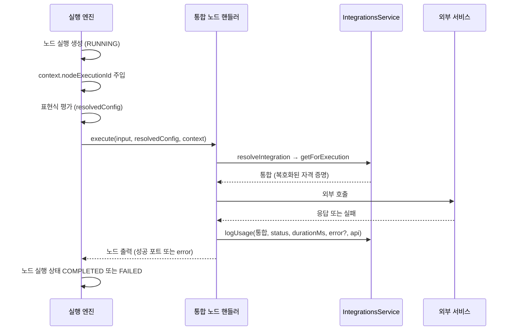

> 구현 상태: 부분 구현 (`logUsage` 의 목표 서명, 통합을 얻기 전 실패 가운데 조회 거절이 아닌 실패의 활동 로그 생략, 워크스페이스 누락의 출력 코드는 미구현) · 원문: `spec/4-nodes/4-integration/0-common.md`, `spec/5-system/4-execution-engine.md` (§10 Integration Handler 계약), `spec/4-nodes/_product-overview.md` (§7 머리말) · 용어: [용어 사전](../CLE-GLOSSARY.md)

## 개요

통합 노드(integration nodes)는 통합(Integration)에 저장된 자격 증명을 써서 외부 서비스를 부르는 노드다. 다섯 종류가 있다. 범용 노드는 [HTTP Request 노드](CLE-NODE-HTTP.md)와 [Database Query 노드](CLE-NODE-DBQUERY.md)이고, 서비스 특화 노드는 [Send Email 노드](CLE-NODE-EMAIL.md), [Cafe24 노드](CLE-NODE-CAFE24.md), [MakeShop 노드](CLE-NODE-MAKESHOP.md)다. 서비스 특화 노드는 언제나 통합을 참조하고, HTTP Request 노드는 인증 방식을 `integration` 으로 골랐을 때만 참조한다.

이 문서는 다섯 노드가 함께 따르는 규약을 정한다. 통합 참조와 통합 선택기, 노드 출력의 카테고리별 사용 방식, 핸들러 실행 계약(실행 엔진이 통합 핸들러를 부르는 순서 포함), 공통 에러 코드, 사설망 차단(SSRF guard), 캔버스 요약과 삭제된 통합 표시가 여기에 속한다. 노드별 설정·동작·출력은 각 노드 문서가 정한다.

다음은 이 문서의 범위 밖이다.

- 통합 엔티티와 서비스별 자격 증명 스키마: [서비스별 인증 방식과 자격 증명](../CLE-INT/CLE-INT-AUTH.md), [통합 데이터와 흐름](../CLE-INT/CLE-INT-DATA.md)
- 노드 실행 결과가 통합 상태(`connected`·`error` 등)를 바꾸는 범위: [통합 상태와 만료 알림](../CLE-INT/CLE-INT-STATUS.md)
- 활동 로그의 API 식별 정보를 통합별로 채우는 정책(INT-US-05): [통합 관리](../CLE-INT/CLE-INT-MANAGE.md)
- 외부 MCP 서버 통합(`service_type='mcp'`): 워크플로우 노드로 노출되지 않고 AI 에이전트 노드의 `mcpServers` 설정에서만 쓴다. [MCP 클라이언트](../CLE-INT/CLE-INT-MCP.md)와 [AI 에이전트 노드](../CLE-NODE-AI/CLE-NODE-AGENT.md)에서 정한다. 즉 통합 엔티티는 이 문서의 노드와 AI 에이전트 MCP 도구 프로바이더, 두 곳에서 쓰인다.
- 노드 출력 다섯 필드의 일반 규약: [노드 출력 규약](../CLE-NODE/CLE-NODE-OUTPUT.md). 노드 핸들러 일반 계약: [노드 핸들러 계약](../CLE-EXEC/CLE-EXEC-HANDLER.md)

## 규칙

1. 서비스 특화 통합 노드는 통합 참조(`config.integrationId`)로 통합을 가리킨다. HTTP Request 노드는 `authentication='integration'` 일 때만 이 값을 쓴다.
2. 설정 에코에는 자격 증명을 싣지 않는다. 통합에 관해서는 `integrationId` 만 싣는다.
3. 시간 메트릭은 모든 통합 노드에서 `meta.durationMs`(단위 ms) 하나로 쓴다.
4. 통합 노드는 블로킹 노드가 아니다. 흐름 지시 상태(`status`)는 비워 둔다. 예외는 [Send Email 노드](CLE-NODE-EMAIL.md)의 DI 미주입 식별값 하나다(아래 "서비스 미주입과 워크스페이스 누락").
5. 모든 통합 핸들러는 아래 "핸들러 실행 계약" 의 6단계를 따른다.
6. 사전 검증 에러(`handler.validate()` 실패)만 throw 로 실행을 실패시킨다. `execute()` 안에서 난 실패는 모두 에러 포트(`port: 'error'`)와 `output.error.{code, message, details?}` 로 내보낸다(D4 결정).
7. 통합을 얻은 뒤의 외부 호출마다 성공·실패와 관계없이 활동 로그를 1건 남긴다. 이때 API 식별 정보(`api`)를 함께 넘긴다. HTTP Request 노드는 통합 인증일 때만 활동 로그를 남긴다. 통합을 얻기 전에 끝난 실행은 활동 로그를 남기지 않는다. 조회 거절과 조회 앞 단계의 실패가 모두 해당한다. 이 규칙을 서명으로 지키는 `logUsage` 는 목표 서명이고 미구현이다(NERV Task `CLE-T-PTC4SF`). 지금 구현이 지키는 범위는 [공통 에러 코드](#공통-에러-코드) 에 있다.
8. HTTP Request·Database Query·Send Email 노드는 사설망 차단을 기본으로 켠다. 끄는 방법은 `ALLOW_PRIVATE_HOST_TARGETS=true` 하나뿐이다.
9. 차단 코드(`HTTP_BLOCKED`·`DB_HOST_BLOCKED`·`EMAIL_HOST_BLOCKED`)는 차단 판정에만 쓴다. 클라이언트에 나가는 차단 메시지에는 차단된 호스트나 IP 를 넣지 않는다.
10. 캔버스 요약은 노드 스키마의 `summaryTemplate` 으로 렌더하고, 렌더된 한 줄을 40자에서 자른다.
11. 삭제된 통합 표시는 캔버스 렌더러가 판정한다. 노드 스키마의 경고 규칙(`warningRules`)으로 판정하지 않는다.

## 통합 참조

| 설정 필드 | 타입 | 설명 |
|-----------|------|------|
| `integrationId` | UUID | 통합(`Integration`)을 가리키는 FK. 설정 패널의 통합 선택기에서 고른다. 통합 엔티티 정의는 [통합 데이터와 흐름](../CLE-INT/CLE-INT-DATA.md) |

## 통합 선택기

통합 선택기(`IntegrationSelector`)는 노드 설정 패널 위쪽에 놓이는 드롭다운이다.

- 현재 워크스페이스에 등록된 통합 가운데 노드가 기대하는 서비스 유형만 보여 준다. HTTP Request 노드는 `http`, Database Query 노드는 `database`, Send Email 노드는 `email`, Cafe24 노드는 `cafe24`, MakeShop 노드는 `makeshop` 으로 거른다.
- 개인 통합과 조직 통합을 구분해 표시한다.
- 개인 통합을 고를 수 있는 조건과 고를 수 없는 항목의 표시는 [통합 관리 「워크플로우 에디터」](../CLE-INT/CLE-INT-MANAGE.md#워크플로우-에디터) 가 정한다. 남의 개인 통합은 처음부터 목록에 없다.
- 붙여넣거나 복제한 노드의 통합 참조는 [에디터](../CLE-WF/CLE-WF-EDITOR.md#노드-조작) 가 정한다.
- 연결 상태 배지(`connected`·`expired`·`error`)를 함께 보인다.
- "새 Integration 추가" 링크를 누르면 [통합 관리](../CLE-INT/CLE-INT-MANAGE.md) 화면으로 간다.

## 노드 출력

통합 노드의 노드 출력은 [노드 출력 규약](../CLE-NODE/CLE-NODE-OUTPUT.md)의 다섯 필드(`config`, `output`, `meta?`, `port?`, `status?`)를 따른다. 정확한 필드 목록은 각 노드 문서의 "출력 구조" 절이 정한다.

```json
{
  "config": { /* 노드별 원본 설정 에코 */ },
  "output": { /* 노드별 결과 */ },
  "meta": { "statusCode": 200, "durationMs": 150 },
  "port": "success"
}
```

| 필드 | 통합 노드에서의 사용 방식 |
|------|---------------------------|
| `config` | 사용자가 입력한 원본 설정을 에코한다(노드 출력 규약 Principle 7). HTTP Request 의 `headers`·`body`, Database Query 의 `query`, Send Email 의 `subject`·`body` 에 든 표현식 템플릿을 평가 전 모습 그대로 남긴다. 자격 증명은 싣지 않고 `integrationId` 만 싣는다 |
| `output` | 외부 호출 결과의 도메인 데이터. HTTP Request 는 `output.response`·`output.responseHeaders`, Database Query 는 `output.rows`·`output.rowCount`·`output.insertId?`, Send Email 은 `output.messageId`, Cafe24·MakeShop 은 `output.response`. 실패하면 `output.error.{code, message, details?}` (Principle 3.2) |
| `meta` | 실행 메트릭만 둔다(Principle 2). 공통은 `meta.durationMs`. HTTP Request·Cafe24·MakeShop 은 `meta.statusCode` 도 둔다. Database Query 의 `rowCount` 는 `output` 에만 두고 `meta` 에 복제하지 않는다 |
| `port` | 성공 포트 또는 `'error'`. 성공 포트 이름은 노드마다 다르다. HTTP Request·Database Query·Cafe24·MakeShop 은 `success`, Send Email 은 `out` 이다 |
| `status` | 비워 둔다(비블로킹). 예외: Send Email 노드는 서비스가 주입되지 않은 환경에서 `requires_integration` 을 돌려준다 |

## 핸들러 실행 계약

통합 노드의 외부 호출은 실행 엔진이 부르는 노드 핸들러가 맡는다. 모든 통합 핸들러는 공통 베이스(`IntegrationHandlerBase`)로 자격 증명을 해소하고 호출 기록을 남긴다. 베이스를 상속하지 않는 핸들러도 같은 동작을 해야 한다.

### 6단계 계약

| 단계 | 책임 |
|------|------|
| 1. 워크스페이스 확인 | `ExecutionContext.variables.__workspaceId` 를 읽는다. 없으면 에러로 끝낸다(처리 방식은 아래 "서비스 미주입과 워크스페이스 누락") |
| 2. 통합 조회 | `IntegrationsService.getForExecution` 을 부른다. 개인 통합이면 [개인 통합 사용 판정](../CLE-INT/CLE-INT-MANAGE.md#개인-통합-사용-판정)을 거친다. 인자는 아래 「IntegrationsService API」 가 정한다. 자격 증명은 AES-256-GCM 컬럼 transformer 가 자동으로 복호화한다 |
| 3. 유형·상태 검증 | `serviceType` 이 노드 기대값과 같은지, `status === 'connected'` 인지 확인한다 |
| 4. 자격 증명 충족 검증 | 서비스별 필수 필드가 빠지면 `INTEGRATION_INCOMPLETE` |
| 5. 외부 호출 | 서비스별 SDK 나 드라이버로 부른다 |
| 6. 활동 로그 기록 | 통합을 얻은 뒤에는 성공·실패와 관계없이 `IntegrationsService.logUsage` 에 얻은 통합과 `{nodeExecutionId, workflowId, status, durationMs, error?, api?}` 를 넘긴다. 1단계에서 끝난 실패와 2단계의 조회 거절은 얻은 통합이 없어 기록하지 않는다(REQ-INTMGMT-053). 얻은 통합을 넘기는 서명은 목표 서명이고 미구현이다(NERV Task `CLE-T-PTC4SF`). 지금 구현은 [공통 에러 코드](#공통-에러-코드) 를 본다 |

6단계의 `api` 식별 정보(`{ label?, method?, path? }`)는 동반이 의무다. 이 값은 `integration_usage_log.api_label`·`api_method`·`api_path` 에 저장된다. 통합별로 무엇을 채우는지는 [통합 관리](../CLE-INT/CLE-INT-MANAGE.md)의 INT-US-05 표가 정하고, 각 노드 문서는 자기 노드의 값만 적는다. 값이 길면 백엔드(`logUsage` 내부)가 `varchar(128)`·`varchar(8)`·`varchar(256)` 한도로 자르고 끝에 `…` 를 붙인다(`clampMessage` 패턴). 호출하는 쪽이 직접 자를 필요는 없다.

### IntegrationsService API (실행 엔진용)

```ts
class IntegrationsService {
  /**
   * 실행 경로(통합 노드 핸들러 · 도구 프로바이더) 전용 내부 조회. credentials 는 AES-256-GCM transformer 가
   * 복호화한 평문으로 반환된다. 결과는 시크릿으로 취급한다. use 는 아래 글머리가 정한다.
   */
  getForExecution(
    id: UUID,
    workspaceId: UUID,
    use: { nodeId: UUID | null; fromExpression: boolean },
  ): Promise<Integration>;

  /**
   * 노드 실행이 끝나면 부른다. 성공·실패 여부와 durationMs 를 기록하고
   * integration.last_used_at / last_error 를 갱신한다.
   */
  logUsage(params: {
    integrationId: UUID;
    nodeExecutionId: UUID;
    workflowId: UUID;
    status: "success" | "failed";
    durationMs: number;
    error?: { code?: string; message?: string } | null;
    api?: { label?: string; method?: string; path?: string };
  }): Promise<void>;
  // 목표 서명(미구현, NERV Task CLE-T-PTC4SF). integration 은 getForExecution 이 돌려준 통합이다.
  // 그 전의 동작은 「공통 에러 코드」 의 «통합을 얻기 전에 끝난 실행의 기록» 이 정한다.
  // logUsage(integration: Integration,
  //   params: { nodeExecutionId; workflowId; status; durationMs; error?; api? }): Promise<void>;
}
```

개인 통합의 판정에는 노드가 속한 워크플로우의 작성자와 참조 값이 표현식이었는지가 필요하다. 부르는 쪽은 노드 ID 와 표현식 여부를 `use` 인자로 넘기고 워크플로우 작성자는 통합 서비스가 구한다. 판정 기준은 [통합 관리 「개인 통합 사용 판정」](../CLE-INT/CLE-INT-MANAGE.md#개인-통합-사용-판정) 이 정한다.

- `use.nodeId` 는 지금 실행 중인 노드의 ID 다. 통합 서비스는 조회한 통합이 개인 통합일 때만 그 노드 행과 노드가 속한 워크플로우 행을 읽어 `created_by` 를 구한다. 그 워크플로우는 실행의 워크스페이스(`workspaceId` 인자)에 있어야 한다. 조직 통합은 노드를 읽지 않는다.
- `use.nodeId` 가 `null` 이거나, 노드 행이 없거나, 그 워크플로우가 실행의 워크스페이스에 없으면 워크플로우 작성자를 알 수 없다. 이때는 개인 통합을 거절하고 응답은 워크플로우 작성자가 통합 소유자가 아닐 때와 같다(REQ-INTMGMT-055).
- 워크플로우 작성자는 노드마다 그 노드가 속한 워크플로우의 것이다. 동기 호출 서브 워크플로우는 부모 실행 안에서 인라인으로 돌고([워크플로우 호출 노드](../CLE-NODE-FLOW/CLE-NODE-SUBWF.md)) `context.workflowId` 는 실행 시작 때 고정된다([실행 컨텍스트](../CLE-EXEC/CLE-EXEC-CONTEXT.md)). 그래서 `context.workflowId` 로는 구하지 않는다. 서브 워크플로우의 노드 행은 서브 워크플로우에 속하므로 서브 워크플로우 작성자로 판정된다. 비동기 호출도 같다.
- 통합 노드는 공통 베이스의 `acquireIntegration`(`resolveIntegration` 이 부른다)이 `context.nodeId` 를 넘긴다. 엔진은 노드 실행마다 한 번 만드는 실행 컨텍스트 복사본에 `nodeId` 를 이미 넣는다([실행 컨텍스트](../CLE-EXEC/CLE-EXEC-CONTEXT.md), [노드 핸들러 계약 「핸들러용 실행 컨텍스트는 노드 실행마다 하나다」](../CLE-EXEC/CLE-EXEC-HANDLER.md#핸들러용-실행-컨텍스트는-노드-실행마다-하나다)). 핸들러 시그니처와 실행 컨텍스트 필드는 바꾸지 않는다.
- AI 에이전트 노드는 핸들러가 도구 목록 구성 문맥(`ProviderBuildCtx`)에 `nodeId` 를 싣고, 통합을 쓰는 도구 프로바이더(외부 MCP 서버용 · Cafe24 · MakeShop)가 그 값을 넘긴다. 첫 턴은 `context.nodeId` 를 싣는다. 멀티턴 재개·재시도 턴은 재구성 결과의 `nodeId` 를 싣는다([실행 상태 머신과 대기·재개 「보존 예외 `_resumeCheckpoint`」](../CLE-EXEC/CLE-EXEC-STATE.md#보존-예외-_resumecheckpoint)).
- 도구 프로바이더는 도구 목록을 만들 때만 통합을 조회한다. 내부 MCP 브리지가 토큰 갱신 뒤 통합을 다시 읽는 조회도 이 단계 안에서 일어난다([MCP 클라이언트 「통합 조회 기준」](../CLE-INT/CLE-INT-MCP.md#통합-조회-기준)). 도구를 실행할 때는 도구 목록을 만들 때 얻은 통합을 쓴다(외부 MCP 서버는 그때 연 MCP 세션). 그래서 도구 프로바이더 실행 문맥(`ProviderExecCtx`)에는 노드 ID 를 더하지 않는다. 도구 실행은 서버 항목의 `fromExpression` 도 읽지 않는다.
- 참조 값이 표현식이었는지(`fromExpression`)는 부르는 쪽이 평가 전 원본 설정의 같은 위치를 보고 정한다. 통합 노드는 `context.rawConfig.integrationId` 를 본다. AI 에이전트 노드는 첫 턴에 평가 전 `mcpServers` 의 같은 위치를 보고 서버 항목마다 `fromExpression` 을 정해 그 항목에 싣는다. 도구 프로바이더는 도구 목록 구성 문맥의 `config` 로 받은 서버 항목에서 이 값을 읽는다. `execute` 가 받는 `config` 는 평가가 끝난 값이라 이것으로는 알 수 없다([노드 핸들러](../CLE-EXEC/CLE-EXEC-HANDLER.md)). 표현식이었고 조회한 통합이 개인 통합이면 거절한다(REQ-INTMGMT-059).
- 리터럴로 보는 것은 원본 값이 문자열이고 평가한 값과 같을 때뿐이다. 나머지는 모두 표현식으로 본다. 원본 값이 표현식 엔진이 평가하는 템플릿(`{{ }}` 를 담은 문자열)이면 평가한 값과 달라지므로 표현식이다. 이스케이프한 `\{\{` 가 든 값도 표현식으로 본다. [표현식 언어](../CLE-WF/CLE-WF-EXPR.md) REQ-EXPR-008 은 그 자리를 리터럴 `{{` 로 평가하지만 평가한 값이 원본과 달라진다. 이 판정은 원본과 평가한 값이 같은지만 본다.
  - 통합 노드: `context.rawConfig` 가 없거나 `rawConfig.integrationId` 가 문자열이 아니면 표현식이다.
  - AI 에이전트 노드: 평가 전 `mcpServers` 가 배열이 아니거나(`mcpServers` 자체가 표현식인 경우 포함) 평가 뒤와 길이가 다르면 모든 항목이 표현식이다. 길이가 같으면 같은 순서의 항목끼리 비교한다. 원본 항목이 객체가 아니면 그 항목은 표현식이다.
- 재개·재시도 턴의 서버별 `fromExpression` 은 첫 턴에 저장한 값을 쓴다. 저장 규칙과 값이 없는 옛 항목의 기본값은 [실행 상태 머신과 대기·재개 「보존 예외 `_resumeCheckpoint`」](../CLE-EXEC/CLE-EXEC-STATE.md#보존-예외-_resumecheckpoint) 가 정한다.
- 노드 ID 와 표현식 여부는 `variables` 에서 읽지 않는다. Code 노드가 `__*` 를 포함한 `context.variables` 를 덮어쓸 수 있어서다([실행 컨텍스트](../CLE-EXEC/CLE-EXEC-CONTEXT.md) 규칙 5).

`logUsage` 는 best-effort 다. 내부 예외를 삼키므로 실행 흐름을 멈추지 않는다. `logUsage` 가 갱신하는 통합 컬럼은 `last_used_at` 과 `last_error` 다. MCP `AUTH_FAILED` 로 실패하면 `status`·`status_reason` 도 바꾼다([통합 데이터와 흐름 「노드 실행의 통합 사용」](../CLE-INT/CLE-INT-DATA.md#노드-실행의-통합-사용)). 목표 서명에서 통합을 받아도 필요한 컬럼만 고치는 UPDATE 한 번으로 쓰고 받은 엔티티를 저장하지 않는다. 노드 실행 결과로 통합 상태가 바뀌는 범위는 [통합 상태와 만료 알림](../CLE-INT/CLE-INT-STATUS.md)에서 정한다.

### IntegrationHandlerBase

```ts
class IntegrationHandlerBase {
  constructor(protected readonly integrationsService?: IntegrationsService) {}

  protected resolveIntegration(
    integrationId: UUID,
    context: ExecutionContext,
    expectedServiceType: string,
  ): Promise<Integration>; // acquireIntegration 과 assertUsable 을 이어 부른다
  protected acquireIntegration(integrationId: UUID, context: ExecutionContext): Promise<Integration>; // 1·2단계
  protected assertUsable(integration: Integration, expectedServiceType: string): void; // 3단계

  protected logUsage(
    context: ExecutionContext,
    params: IntegrationUsageParams, // api 식별 정보 포함
  ): Promise<void>;
  // 목표 서명(미구현, NERV Task CLE-T-PTC4SF). integration 은 acquireIntegration 이 돌려준 통합이다.
  // 그 전의 동작은 「공통 에러 코드」 의 «통합을 얻기 전에 끝난 실행의 기록» 이 정한다.
  // protected logUsage(integration: Integration, context: ExecutionContext,
  //   params: Omit<IntegrationUsageParams, "integrationId">): Promise<void>;
}
```

`resolveIntegration` 은 검증에 실패하면 `IntegrationError(code, message)` 를 던진다. `code` 는 아래 "공통 에러 코드" 의 값이다. 핸들러는 이 예외를 잡아 에러 포트로 내보낸다.

공통 베이스는 통합을 얻는 `acquireIntegration` 과 검증하는 `assertUsable` 을 따로 둔다. `resolveIntegration` 은 둘을 이어 부르는 얇은 합성이다. 이 문서의 다른 절이 말하는 `resolveIntegration` 은 이 합성이다. 다섯 통합 노드는 지금 모두 `resolveIntegration` 을 부른다.

- `acquireIntegration` 은 1·2단계를 맡는다. `context.nodeId` 와 `context.rawConfig` 로 `use` 인자를 만들어 `getForExecution` 을 부르고 얻은 통합을 돌려준다. 실패하면 예외를 던진다. 워크스페이스 누락이 지금 일반 `Error` 로 나가는 것은 아래 "서비스 미주입과 워크스페이스 누락" 에 있다.
- `assertUsable` 은 3단계를 맡는다. 실패하면 `IntegrationError` 를 던진다.
- 목표 서명의 `logUsage` 가 들어오면 핸들러는 `acquireIntegration` 이 돌려준 통합을 들고 있다가 3단계 이후에 실패해도 그 통합으로 활동 로그를 남긴다(미구현). 지금은 실패하면 설정의 `integrationId` 로 남긴다.
- `IntegrationError` 에는 코드와 메시지만 싣는다. 통합을 싣지 않는다. 통합의 `credentials` 는 복호화된 평문이라 예외에 실으면 예외를 잡거나 로그로 남기는 모든 곳으로 퍼진다.

### 호출 순서

실행 엔진은 노드 실행을 만들고 `context.nodeExecutionId` 를 주입한 다음 표현식을 평가해 핸들러를 부른다. 핸들러는 통합을 해소하고 외부 서비스를 부른 뒤 활동 로그를 남긴다. 엔진은 핸들러가 돌려준 노드 출력으로 노드 실행 상태를 마감한다. 그림의 `logUsage(통합, …)` 는 목표 서명이고 미구현이다(NERV Task `CLE-T-PTC4SF`). 지금 구현은 [공통 에러 코드](#공통-에러-코드) 를 본다.



- `context.nodeExecutionId` 는 엔진이 노드 실행마다 한 번 만드는 실행 컨텍스트 복사본에 담기므로 다른 노드 실행이나 병렬 분기의 값과 섞이지 않는다. 노드 재시도 정책이면 재시도도 같은 복사본으로 핸들러를 부른다([노드 핸들러 계약 「핸들러용 실행 컨텍스트는 노드 실행마다 하나다」](../CLE-EXEC/CLE-EXEC-HANDLER.md#핸들러용-실행-컨텍스트는-노드-실행마다-하나다)). 개인 통합 판정에 쓰는 `context.nodeId` 도 같은 곳에 담긴다.
- 멀티턴 AI 노드의 재개·재시도 턴은 노드를 새로 dispatch 하지 않고 `resumeState` 로 다시 들어온다. 이때 `context.nodeExecutionId`·`workflowId`·`nodeId` 는 새로 배정되지 않는다. `buildRetryReentryState` 가 입력 대기·재시도 중인 노드 실행 행과 그 노드 행에서 다시 유도한다. 이 유도가 빠지면 활동 로그의 귀속이 누락된다. 불변식은 [실행 상태 머신과 대기·재개](../CLE-EXEC/CLE-EXEC-STATE.md)에서 정한다(#501).

### 서비스 미주입과 워크스페이스 누락

`IntegrationsService` 가 핸들러에 주입되지 않았거나 `__workspaceId` 가 없는 경우는 배포 구성 에러다. 프로덕션 경로에서는 서비스가 반드시 주입돼야 한다. D4 이후 노드별 동작은 다음과 같다.

| 노드 | 서비스 미주입 | `__workspaceId` 누락 |
|------|---------------|----------------------|
| HTTP Request (통합 인증일 때) | 에러 포트, `INTEGRATION_SERVICE_UNAVAILABLE` | 에러 포트, `INTEGRATION_SERVICE_UNAVAILABLE` |
| Database Query | 에러 포트, `INTEGRATION_SERVICE_UNAVAILABLE` | 에러 포트, `INTEGRATION_SERVICE_UNAVAILABLE` |
| Cafe24 | 에러 포트, `INTEGRATION_SERVICE_UNAVAILABLE` (`Cafe24ApiClient` 미주입 포함) | 에러 포트, `INTEGRATION_SERVICE_UNAVAILABLE` |
| MakeShop | 에러 포트, `INTEGRATION_SERVICE_UNAVAILABLE` (`MakeshopApiClient` 미주입 포함) | 에러 포트, `INTEGRATION_SERVICE_UNAVAILABLE` |
| Send Email | 외부 호출 없이 `status: 'requires_integration'` 을 돌려준다(포트·메트릭 없음) | 에러 포트, `EMAIL_SEND_FAILED` (IntegrationError 가 아니어서 흡수됨) |

HTTP Request 노드가 `none`·`custom` 인증이면 통합을 조회하지 않으므로 이 표의 대상이 아니다. Send Email 노드의 두 예외는 [Send Email 노드](CLE-NODE-EMAIL.md)에서 자세히 정한다.

워크스페이스 누락 열은 부분 구현이다. 현재 구현의 공통 베이스 `acquireIntegration`(`resolveIntegration` 이 부른다)은 `__workspaceId` 가 없으면 `IntegrationError` 가 아닌 일반 `Error('Missing workspace context …')` 를 던진다. 그래서 HTTP Request·Cafe24·MakeShop 노드는 기본 규칙대로 `INTEGRATION_CALL_FAILED` 를, Database Query 노드는 드라이버 에러 분류기(`mapDbError`)의 결과를 내보내는 것으로 보인다. [미결 사항](#미결-사항) 참조.

## 공통 에러 코드

| 코드 | 의미 |
|------|------|
| `INTEGRATION_TYPE_MISMATCH` | 참조한 통합의 `serviceType` 이 노드 기대 유형과 다르다. `resolveIntegration` 이 `IntegrationError` 를 던진다 |
| `INTEGRATION_NOT_CONNECTED` | 통합 상태가 `connected` 가 아니다(`expired`, `error`, `pending_install`). `resolveIntegration` 이 `IntegrationError` 를 던진다 |
| `INTEGRATION_INCOMPLETE` | credentials JSONB 에 서비스별 필수 필드가 없다. 각 핸들러가 자격 증명을 검증할 때 `IntegrationError` 를 던진다 |
| `INTEGRATION_CALL_FAILED` | 분류되지 않은 그 밖의 실패. `IntegrationError` 가 아닌 예외의 기본 코드다(`toLogError` fallback). 사설망 차단 가드가 차단 판정(`SsrfBlockedError`)이 아닌 오류를 던진 경우(가드 자체의 고장)도 이 코드로 나온다. 노드마다 시점 차이가 있다(HTTP Request 는 preflight 와 리다이렉트 홉이 다르다) |
| `INTEGRATION_SERVICE_UNAVAILABLE` | `IntegrationsService` 미주입 또는 workspace context 누락(배포 구성 에러). 에러 포트로 내보낸다 |

- **통합이 없거나 다른 워크스페이스 소속일 때**: `IntegrationsService.getForExecution` 안의 `requireEntity` 가 `NotFoundException({ code: 'RESOURCE_NOT_FOUND' })` 를 던진다. 이 예외는 `IntegrationError` 가 아니므로 전용 코드로 보존되지 않는다. 대부분의 노드는 `INTEGRATION_CALL_FAILED` 로, Send Email 노드는 `EMAIL_SEND_FAILED` 로 내보낸다. 별도의 `INTEGRATION_NOT_FOUND` 코드는 현재 코드에 없다(`integrations.service.ts` `requireEntity`, `_base/integration-handler-base.ts` `toLogError`).
- **[개인 통합 사용 판정](../CLE-INT/CLE-INT-MANAGE.md#개인-통합-사용-판정)을 통과하지 못한 개인 통합일 때**: 위와 같은 코드와 같은 문구로 실패한다. 노드 출력만 보고는 없는 통합, 다른 워크스페이스 통합, 남의 개인 통합을 구분할 수 없다.
- **통합을 얻기 전에 끝난 실행의 기록**: 위 세 경우와 워크스페이스 확인(1단계) 실패는 통합을 얻지 못한 실패다. 활동 로그를 남기지 않고 설정의 `integrationId` 가 가리키는 통합의 `last_used_at`·`last_error` 도 바꾸지 않는다(REQ-INTMGMT-053). 노드별 문서의 «매 호출 활동 로그» 서술은 통합을 얻은 뒤의 호출을 말한다. 유형 불일치·미연결·자격 증명 부족은 통합을 얻은 뒤의 실패라 활동 로그를 남긴다.
  - 지금 구현은 이 규칙의 일부만 지킨다. 조회가 거절된 위 세 경우만 기록하지 않는다. 그 임시 장치의 동작과 걷는 시점은 [Rationale 「거절된 조회는 임시 장치로 건너뛴다」](#거절된-조회는-임시-장치로-건너뛴다-2026-10-25) 에 있다.
  - 워크스페이스 확인 실패와 조회 중 일시 에러(DB 연결 에러 등)는 아직 설정의 `integrationId` 로 기록한다(미구현). 서비스가 주입되지 않은 경우는 기록할 서비스가 없어 남지 않는다.
  - 자격 증명을 읽지 못한 경우(`IntegrationCredentialsUnreadableError`)는 조회가 통합을 찾은 경우라 지금처럼 기록한다. 이 경우를 얻은 통합으로 볼지는 NERV Task `CLE-T-PTC4SF` 가 정한다.
- **기록할 통합은 얻은 통합뿐이다**: `logUsage` 는 통합 ID 대신 `getForExecution` 이 돌려준 통합을 받는다(REQ-INTMGMT-062, 미구현). 얻지 못한 통합은 넘길 수 없으므로 위 규칙을 핸들러와 도구 프로바이더가 따로 지키지 않아도 된다. 다른 워크스페이스 통합도 `getForExecution` 이 돌려주지 않으므로 기록되지 않는다. 이 서명으로 바꾸는 일은 `CLE-T-PTC4SF` 가 맡고 그때 임시 장치를 지운다.
- **에러 포트 라우팅(D4)**: 위 코드가 생기는 모든 경우는 핸들러 안에서 잡혀 `port: 'error'` 와 `output.error.{code, message, details?}` 로 나간다. 다섯 노드 모두 Send Email 노드의 catch 패턴으로 통일했다. `IntegrationError` 를 throw 해서 노드 실행이 실패하는 경로는 없다. 모든 `IntegrationError.code` 는 `output.error.code` 로 나온다. 통합을 얻은 뒤의 실패는 활동 로그에 `status: 'failed'` 와 `error: {code, message}` 로 기록한다. 통합을 얻기 전의 실패는 위 «통합을 얻기 전에 끝난 실행의 기록» 대로 남기지 않는다.
- 노드별 코드(`HTTP_*`, `DB_*`, `EMAIL_*`, `CAFE24_*`, `MAKESHOP_*`)와 `INTEGRATION_AUTH_UNSUPPORTED`(HTTP 전용)는 각 노드 문서가 정한다. 어느 코드가 어느 문서에 있는지는 아래 "노드별 코드 색인" 에 모았다.
- 자격 증명을 복호화할 수 없을 때(`IntegrationCredentialsUnreadableError`)의 출력 코드는 정해지지 않았다. [미결 사항](#미결-사항) 참조.

### 노드별 코드 색인

공통 코드 밖의 `output.error.code` 는 노드마다 다르다. 코드마다 발생 조건, 출력 모양, 활동 로그 기록은 각 노드 문서의 에러 코드 절이 단일 기준이다. 이 표에는 코드가 어느 문서에 있는지만 적는다.

| 노드 | 노드 고유 코드 |
|------|----------------|
| [HTTP Request](CLE-NODE-HTTP.md#에러-코드) | `HTTP_4XX`·`HTTP_5XX`(활동 로그에는 `HTTP_{status}`), `HTTP_TRANSPORT_FAILED`, `HTTP_BLOCKED`, `INTEGRATION_AUTH_UNSUPPORTED` |
| [Database Query](CLE-NODE-DBQUERY.md#에러-코드) | `DB_QUERY_FAILED`, `DB_CONNECTION_ERROR`, `DB_CONSTRAINT_VIOLATION`, `DB_PERMISSION_DENIED`, `DB_HOST_BLOCKED`, `INVALID_PARAMETERS` |
| [Send Email](CLE-NODE-EMAIL.md#에러-코드) | `EMAIL_SEND_FAILED`, `EMAIL_HOST_BLOCKED` |
| [Cafe24](CLE-NODE-CAFE24.md#에러-코드) | `CAFE24_4XX`·`CAFE24_404`·`CAFE24_422`·`CAFE24_5XX`, `CAFE24_AUTH_FAILED`, `CAFE24_RATE_LIMITED`, `CAFE24_TRANSPORT_FAILED`, `CAFE24_UNKNOWN_OPERATION`, `CAFE24_MISSING_FIELDS`, `CAFE24_INVALID_MALL_ID` |
| [MakeShop](CLE-NODE-MAKESHOP.md#에러-코드) | `MAKESHOP_4XX`·`MAKESHOP_404`·`MAKESHOP_422`·`MAKESHOP_5XX`, `MAKESHOP_AUTH_FAILED`, `MAKESHOP_RATE_LIMITED`, `MAKESHOP_TRANSPORT_FAILED`, `MAKESHOP_UNKNOWN_OPERATION`, `MAKESHOP_MISSING_FIELDS`, `MAKESHOP_INVALID_SHOP_UID` |

- Cafe24 노드가 403 에 어떤 코드를 내는지는 정의가 갈린다. [Cafe24 노드 미결 사항](CLE-NODE-CAFE24.md#미결-사항) 참조.
- 통합 연결 테스트만 쓰는 코드(`EMAIL_CONNECT_FAILED`·`DB_AUTH_FAILED`·`DB_CONNECT_FAILED`·`HTTP_AUTH_FAILED`·`HTTP_SERVER_ERROR`·`HTTP_CONNECT_FAILED`)는 노드 출력에 나오지 않는다. [서비스별 인증 방식과 자격 증명](../CLE-INT/CLE-INT-AUTH.md)에서 정한다. 사설망 차단 코드(`HTTP_BLOCKED`·`DB_HOST_BLOCKED`·`EMAIL_HOST_BLOCKED`)는 노드와 연결 테스트가 같이 쓴다.

## 사설망 차단

사설망 차단(SSRF guard)은 통합 노드가 사설·loopback·클라우드 메타데이터 주소로 연결하지 못하게 막는 검사다.

| 노드 | 검사 대상 | 검사 시점 | 차단 코드 |
|------|-----------|-----------|-----------|
| HTTP Request | 요청 URL 의 호스트. 모든 인증 방식(`none`·`integration`·`custom`) | 요청 전 preflight, 그리고 통합 인증에서 따라가는 리다이렉트 홉마다 | `HTTP_BLOCKED` |
| Database Query | `credentials.host` | 자격 증명 충족 검증 직후, 풀 연결 전 | `DB_HOST_BLOCKED` |
| Send Email | `credentials.host` (SMTP 호스트) | 통합 조회 직후, SMTP 발송 전 | `EMAIL_HOST_BLOCKED` |

- 막는 대역은 loopback, RFC1918 사설 대역, link-local, CGNAT, IPv6 link-local·ULA 다. 호스트 이름은 DNS 로 해석한 뒤 IP 를 다시 검사한다(DNS rebinding 방어, `assertSafeOutboundHostResolved`). HTTP Request 는 그 전에 호스트 리터럴도 검사한다(`assertSafeOutboundUrl`).
- 기본은 차단이다(secure-by-default). 셀프 호스팅에서 내부 DB·on-prem API·내부 SMTP relay 같은 사설망 대상을 정당하게 불러야 할 때만 사설망 허용 플래그 `ALLOW_PRIVATE_HOST_TARGETS=true` 를 켠다. 외부 egress 방화벽이 있다는 전제다.
- 세 노드는 이 플래그 하나를 함께 쓴다. AI 에이전트의 외부 MCP 서버는 별도 정책(`MCP_ALLOW_INSECURE_URL`)을 따른다. [MCP 클라이언트](../CLE-INT/CLE-INT-MCP.md)에서 정한다.
- MakeShop 노드는 호출 호스트가 `connect.makeshop.co.kr` 하나로 고정돼 사용자 입력이 호스트를 정하지 않는다. 그래서 이 가드를 쓰지 않고 `shop_uid` 형식 검증으로 경로 주입을 막는다([MakeShop 노드](CLE-NODE-MAKESHOP.md)).
- 차단 코드는 차단 판정(`SsrfBlockedError`)에만 쓴다. 가드가 판정이 아닌 오류를 던지면(예: DNS 해석기가 낸 예기치 않은 예외) `INTEGRATION_CALL_FAILED` 로 내보낸다. HTTP Request 의 리다이렉트 홉에서 같은 고장이 나면 `HTTP_TRANSPORT_FAILED` 가 된다. 두 시점의 코드를 통일할지는 [HTTP Request 노드](CLE-NODE-HTTP.md)의 미결 사항이다. Send Email 노드는 `IntegrationError` 가 아닌 실패를 모두 `EMAIL_SEND_FAILED` 로 흡수하므로 `INTEGRATION_CALL_FAILED` 를 출력하지 않는다.
- 클라이언트에 나가는 `output.error.message` 에는 차단된 호스트나 IP 를 넣지 않는다. 일반화된 문구만 쓴다(내부망 정찰 방지, CWE-209). 원본 상세를 어디에 남기는지는 정의가 갈린다. [미결 사항](#미결-사항) 참조.

## 캔버스 요약

캔버스 요약은 노드 스키마의 `summaryTemplate`(백엔드 단일 기준)을 프론트엔드가 `renderSummaryTemplate` 으로 렌더한 한 줄이다. `truncateSummary` 가 렌더된 줄 전체를 **40자**로 자르고, 넘치면 마지막 1자를 `…` 로 바꾼다. 노드별 부분 필드를 따로 자르지 않는다(`codebase/frontend/src/lib/utils/node-config-summary.ts`). 잘림 규칙 자체는 [노드 시스템 구조와 카탈로그](../CLE-NODE/CLE-NODE-ARCH.md)와 같다.

| 노드 | 요약 포맷 | 예시 | 상태 |
|------|-----------|------|------|
| HTTP Request | `{{method\|default:GET}} {{url}}` | `GET https://api.example.com/v1/users…` | 구현됨 (`http-request.schema.ts`) |
| Cafe24 | `{{resource}} · {{operation}}` | `product · product_list` | 구현됨 (`cafe24.schema.ts`) |
| MakeShop | `{{resource}} · {{operation}}` | `product · get-product` | 구현됨 (`makeshop.schema.ts`) |
| Database Query | `{{queryType\|upper}} · {{query}}` | `SELECT · SELECT * FROM us…` | 구현됨 (`database-query.schema.ts`) |
| Send Email | `{{to.length}} recipients · {{subject}}` | `2 recipients · Welcome` | 구현됨 (`send-email.schema.ts`) |

예시 끝의 `…` 는 잘린 모양을 보이려는 표시다. 예시의 글자 수는 실제와 다르다. 실제로는 렌더된 줄이 40자를 넘으면 앞 39자 뒤에 `…` 를 붙여 40자로 만든다.

### 삭제된 통합 표시

통합 노드(`category: integration`)의 `config.integrationId` 가 현재 워크스페이스 통합 목록에 없으면(참조하던 통합이 삭제됨) 캔버스 노드 헤더에 앰버색 `⚠ Missing integration` 배지를 붙인다.

- 캔버스(`workflow-canvas.tsx`)가 워크스페이스 통합 목록을 React Query 로 한 번 조회한다. 키는 캔버스 전용 `["integrations","list"]` 로, 서비스 유형 필터 없이 전체 목록을 받는다. 설정 패널 선택기의 `["integrations","list",{serviceTypes}]` 키와 다르다.
- 캔버스는 실재하는 id 집합을 Context 로 내려 준다. 각 노드 렌더러(`custom-node.tsx`)가 자기 `config.integrationId` 가 집합에 있는지(`Set.has(id)`) 확인한다.
- 목록이 아직 확정되지 않았으면(로딩 중이거나 페이지네이션 한도로 전체를 받지 못함) 배지를 억제한다. 위양성을 막기 위해서다.
- 목록이 확정되지 않았으면 에디터의 붙여넣기와 복제도 통합 참조를 비우지 않는다([에디터 §노드 조작](../CLE-WF/CLE-WF-EDITOR.md#노드-조작)). 남은 참조가 쓸 수 없는 통합이면 저장 검사가 400 으로 막는다.
- `integrationId` 가 비어 있으면(미선택) 이 배지 대신 각 노드 스키마의 `warningRules`(필드 미선택 경고)가 표시된다. 복제·가져오기·버전 복원·붙여넣기가 비운 참조도 미선택이라 이 배지가 아니라 필드 미선택 경고가 붙는다.
- 워크플로우 작성자가 아닌 사용자에게는 워크플로우 작성자의 개인 통합이 통합 목록에 없다. 그래서 그 노드에도 이 배지가 붙는다. 통합이 지워진 것은 아니고 노드는 실행된다. 워크플로우 작성자에게는 배지가 붙지 않는다. 이 화면 차이는 받아들인 잔여다([통합 관리](../CLE-INT/CLE-INT-MANAGE.md) Rationale 「개인 통합의 역할 하한과 노드 사용 기준을 정한다」).
- 멤버가 나가거나 제거되면 그 사람의 개인 통합은 사용처와 관계없이 지워진다([통합 관리](../CLE-INT/CLE-INT-MANAGE.md#나간-멤버의-개인-통합은-나갈-때-지운다-2026-10-29), REQ-INTMGMT-065). 그 통합을 참조하던 노드에는 이 배지가 붙는다. 실제로 지워진 통합이라 모든 사용자에게 같다(삭제는 미구현, NERV Task `CLE-T-PS7JQY`).
- HTTP Request 노드의 `integrationId` 는 `authentication === "integration"` 일 때만 유효하다. 다른 인증 방식에 남은 값에는 배지를 붙이지 않는다. 나머지 통합 노드에는 조건 없이 적용한다.
- 시각적으로는 캔버스의 `⚠ Missing workflow` 배지와 같은 앰버 계열이다. 그래프 경고 배지(`AlertTriangle`)와 겹쳐 보이지 않도록 연결 끊김 아이콘(`Unplug`)과 별도 슬롯에 렌더한다.
- 백엔드와 `warningRules` DSL 은 바꾸지 않았다.

## 출력 구조 색인

다섯 노드 모두 에러 경로는 하나(`port: 'error'` + `output.error.*`)다.

| 노드 | 정상 케이스 | 에러 케이스 |
|------|-------------|-------------|
| [HTTP Request](CLE-NODE-HTTP.md) | 2xx 성공 (`success`) | 4xx·5xx, 전송 실패, 통합 해소 실패, 사설망 차단 (`error`) |
| [Database Query](CLE-NODE-DBQUERY.md) | 정상 실행 (`success`) | 드라이버 에러, 통합 해소 실패, 자격 증명 누락, 잘못된 파라미터 (`error`) |
| [Send Email](CLE-NODE-EMAIL.md) | 발송 성공 (`out`) | 전송 실패, 통합 해소 실패, 사설망 차단 (`error`) |
| [Cafe24](CLE-NODE-CAFE24.md) | 2xx 성공 (`success`) | API 호출 실패, 리소스·operation 검증, `mall_id` 누락, 통합 해소 실패 (`error`) |
| [MakeShop](CLE-NODE-MAKESHOP.md) | 2xx 성공 (`success`) | API 호출 실패, 리소스·operation 검증, `shop_uid` 누락·형식 위반, 통합 해소 실패 (`error`) |

## 미결 사항

- **워크스페이스 누락 시 출력 코드**: 이 문서와 [HTTP Request 노드](CLE-NODE-HTTP.md)·[Cafe24 노드](CLE-NODE-CAFE24.md)·[MakeShop 노드](CLE-NODE-MAKESHOP.md) 원문은 `__workspaceId` 누락을 `INTEGRATION_SERVICE_UNAVAILABLE` 로 내보낸다고 적는다. [Send Email 노드](CLE-NODE-EMAIL.md) 원문은 이 경우를 `EMAIL_SEND_FAILED` 로 흡수한다고 적고 전용 코드 노출을 Planned 로 둔다. 현재 구현은 공통 베이스가 일반 `Error` 를 던져 다른 노드에서도 `INTEGRATION_CALL_FAILED`(Database Query 는 드라이버 에러 분류 결과)가 나오는 것으로 보인다. 구현을 규칙에 맞출지, 규칙을 현재 동작에 맞출지 결정 필요.
- **사설망 차단 원본 상세를 남기는 위치**: [Database Query 노드](CLE-NODE-DBQUERY.md) 원문은 차단 상세(원본 호스트)가 활동 로그(`logUsage`)에만 남는다고 적고, 이를 "서버 활동 로그" 라고 부른다. [HTTP Request 노드](CLE-NODE-HTTP.md) 원문은 활동 로그가 `GET /integrations/:id/activity` 로 워크스페이스 사용자에게 그대로 나가므로 활동 로그에도 일반화 문구만 남기고 원본은 서버 로그(`logger.warn`)에만 둔다고 적는다. 같은 정찰 방지 원칙을 두 노드가 반대로 적용한다. 현재 구현은 Database Query 핸들러가 일반화 문구만 담은 `IntegrationError('DB_HOST_BLOCKED')` 를 만들고 원본을 `cause` 로도 싣지 않는 것으로 보인다(활동 로그에 원본이 남는지는 미확인). 어느 쪽을 규칙으로 삼을지 결정 필요.
- **자격 증명 복호화 실패의 출력 코드**: 암호화 키 교체 등으로 자격 증명을 복호화할 수 없으면 `getForExecution` 이 `IntegrationCredentialsUnreadableError` 를 던진다([통합 데이터와 흐름](../CLE-INT/CLE-INT-DATA.md)). 이 경로가 어떤 `output.error.code` 로 나오는지 원문에 없다. 현재 구현의 이 예외는 `BadRequestException` 계열이라 `IntegrationError` 가 아니므로 기본 규칙대로 `INTEGRATION_CALL_FAILED`(Send Email 은 `EMAIL_SEND_FAILED`)로 나올 것으로 보이나 확인되지 않았다. 공통 에러 코드 표에 행을 둘지 결정 필요.
- **통합 자격 증명 암호화와 시크릿 저장소의 관계**: 통합 노드는 자격 증명을 컬럼 transformer 로 직접 복호화한다. [시크릿 저장소](../CLE-INT/CLE-INT-SECRET.md)는 모든 도메인 모듈이 `SecretResolver` 를 거친다고 정하면서 예외 목록에 `Integration.credentials` 를 두지 않았다. 예외로 등재할지 이관할지 결정 필요(관련: [시크릿 저장소](../CLE-INT/CLE-INT-SECRET.md)).
- **워크플로우 작성자가 아닌 사용자에게 보이는 배지 문구**: 캔버스는 워크플로우 작성자의 개인 통합과 지워진 통합을 구분하지 못해 둘 다 `⚠ Missing integration` 으로 보인다. 지금 사용자가 워크플로우 작성자가 아닐 때는 «확인할 수 없는 통합» 처럼 삭제로 읽히지 않는 문구를 쓸지 정해야 한다(2026-10-24).

## 구현 위치

- `codebase/backend/src/nodes/integration/_base/integration-handler-base.ts` (공통 베이스, `resolveIntegration`·`acquireIntegration`·`assertUsable`·`logUsage`·`toLogError`, 거절된 조회의 기록을 건너뛰는 임시 장치 `rejectedLookups`)
- `codebase/backend/src/nodes/integration/*/*.handler.ts` (노드별 핸들러)
- `codebase/backend/src/modules/integrations/integrations.service.ts` (`getForExecution`·`logUsage`·`requireEntity`)
- `codebase/backend/src/modules/integrations/personal-integration-use.ts` (`judgePersonalIntegrationUse`·`isLiteralReference`. 개인 통합 사용 판정과 리터럴 판정)
- `codebase/backend/src/modules/integrations/personal-integration-use-facts.ts` (`loadExecutionUseFacts`. 노드 ID 로 워크플로우 작성자와 통합 소유자의 멤버십을 읽는다)
- `codebase/backend/src/nodes/ai/ai-agent/mcp-server-ref-use.ts` (AI 에이전트 서버 항목의 `fromExpression` 과 `use` 인자)
- `codebase/frontend/src/lib/utils/node-config-summary.ts` (캔버스 요약 렌더·잘림)
- `codebase/frontend/src/components/editor/canvas/custom-node.tsx` (삭제된 통합 배지 판정)
- `codebase/frontend/src/components/editor/canvas/workflow-canvas.tsx` (통합 목록 단일 조회)
- `codebase/frontend/src/components/editor/canvas/integration-list-context.ts` (실재 id 집합 Context)

## Rationale

### 핸들러 실패를 에러 포트로 통일 (D4, 2026-05-17)

D4 이전에는 `resolveIntegration` 의 `IntegrationError` 와 환경 에러가 throw 돼 노드 실행 자체가 실패했다. 서비스 미주입도 throw 였다. D4 에서 이 경로를 폐기하고, `execute()` 안의 모든 실패를 Send Email 노드가 먼저 쓰던 catch 패턴(에러 포트 + `output.error`)으로 모았다. 설정 형식 자체가 잘못된 경우(`handler.validate()` 실패)만 throw 로 남는다. 실행 엔진 문서에 남아 있던 "workspace 누락 시 `Missing workspace context` throw", "모든 핸들러가 미주입 시 `requires_integration` stub 반환" 서술은 D4 이전 상태라서 이 문서의 현행 규칙으로 대체했다.

### 시간 메트릭을 `meta.durationMs` 로 통일

HTTP Request 노드만 `meta.duration` 을 쓰고 나머지 노드와 시스템 문서는 `meta.durationMs` 를 썼다. 단위(ms)가 이름에 드러나는 `meta.durationMs` 로 통일했다. `http_request` 의 `meta.duration` 은 폐지했고, `$node["X"].meta.duration` 을 참조하던 워크플로우는 고쳐야 하는 breaking change 였다.

### 삭제된 통합 표시를 렌더러 전용 판정으로 둔 이유

노드 스키마 경고 규칙의 `when` DSL 평가기(`node-summary` 의 `evaluateWhen(expr, config)`)는 노드 자신의 config 만 받는다. 그래서 통합이 실재하는지 같은 교차 엔티티 검증을 할 수 없다. 기존 통합 노드 규칙의 `!integrationId` 는 "필드 미선택" 만 본다. 그래서 이 판정은 캔버스 렌더러가 맡는다.

목록 조회를 캔버스 한 곳으로 올린 것은 노드마다 `useQuery` 를 구독하면 N개 노드에 N개 구독과 리렌더가 생기기 때문이다. AI 노드의 `hasDefaultLlmConfig` Context 와 같은 패턴이다. 판정 로직(`Set.has(id)`)은 설정 패널의 `integration-selector`·`mcp-server-selector` 가 쓰는 것과 같다. 다만 선택기는 패널이 열린 노드 하나에만 마운트되고 이 배지는 캔버스의 모든 통합 노드에 동시에 붙으므로, 개수 차이 때문에 Context 로 올렸다. 교차 엔티티 경고가 앞으로 많아지면 DSL 조회 기능을 일반화하는 방안(plan `spec-sync-integration-common-gaps` 옵션 C)을 다시 검토한다.

이 배지는 방어용 표시다. 정상 UI 삭제 경로는 사용처가 있는 통합의 삭제를 막는다(409 `INTEGRATION_IN_USE`, [통합 관리](../CLE-INT/CLE-INT-MANAGE.md)). 그래서 "캔버스의 라이브 노드가 참조하는데 통합이 없는" 상태는 평소에 생기지 않는다. 삭제 차단의 사용처 조회(`queryUsageNodes`)는 라이브 `Node` 테이블만 보고 과거 버전 스냅샷, 워크스페이스 이동, 레거시·직접 DB 조작은 보지 않는다. 배지는 이 틈으로 남은 잔존 참조(dangling reference)를 드러낸다.

2026-10-24 부터는 정상 경로에서도 배지가 붙는 경우가 하나 생겼다. 워크플로우 작성자가 아닌 사용자에게는 워크플로우 작성자의 개인 통합이 통합 목록에 없어서 그 노드에도 배지가 붙는다(NERV Task `CLE-T-MG0EQZ`). 남의 개인 통합이 있다는 것을 드러내지 않으려고 받아들인 위양성이다. 근거는 [통합 관리](../CLE-INT/CLE-INT-MANAGE.md) Rationale 「개인 통합의 역할 하한과 노드 사용 기준을 정한다」 에 있다. 이 경우의 배지 문구를 따로 둘지는 [미결 사항](#미결-사항) 에 있다.

2026-10-29 부터는 두 번째 경우가 생겼다. 멤버가 나가거나 제거되면 그 사람의 개인 통합을 사용처와 관계없이 지운다(NERV Task `CLE-T-TGZGM9`). 사용처 때문에 남기면 아무도 정리할 수 없는 행이 남아서다. 그 노드는 그 전부터 실행에서 실패했으므로 배지가 실행 결과와 맞는다. 근거는 [통합 관리](../CLE-INT/CLE-INT-MANAGE.md#나간-멤버의-개인-통합은-나갈-때-지운다-2026-10-29) 에 있다.

### 캔버스 요약을 줄인 이유

Database Query 의 "쿼리 첫 줄" 과 Send Email 의 "to: {수신자} +N" 은 `summaryTemplate` DSL 이 개행 분리·배열 슬라이스·조건 카운트를 지원하지 않아 표현할 수 없다. 그래서 각각 전체 쿼리를 잘라 보이는 `{{query}}` 와 수신자 수 + 제목(`{{to.length}} recipients · {{subject}}`)으로 줄였다([노드 시스템 구조와 카탈로그](../CLE-NODE/CLE-NODE-ARCH.md) 템플릿 문법).

### 사설망 허용 플래그 하나를 세 노드가 공유

HTTP Request·Database Query·Send Email 노드는 노드별 플래그를 새로 만들지 않고 `ALLOW_PRIVATE_HOST_TARGETS` 하나를 쓴다. 통합 노드 전체의 보안 자세(기본 차단, 셀프 호스팅만 해제)를 한 가지로 유지하기 위해서다. HTTP Request 노드가 모든 인증 방식에 가드를 적용하게 된 배경은 [HTTP Request 노드](CLE-NODE-HTTP.md) Rationale 에 있다. Database Query 노드의 전용 차단 코드 배경은 [Database Query 노드](CLE-NODE-DBQUERY.md) Rationale 에 있다.

### 차단 코드를 판정에만 쓰는 이유

막힌 적 없는 요청을 "막혔다" 고 보고하면 없는 사실을 사용자에게 알리고 활동 로그에도 남기게 된다. 그래서 가드 자체의 고장은 차단 코드가 아니라 분류되지 않은 실패(`INTEGRATION_CALL_FAILED`)로 내보낸다.

### 남의 개인 통합 조회는 없는 통합과 같게 실패한다 (2026-10-24)

NERV Task `CLE-T-MG0EQZ` 에서 개인 통합은 노드가 속한 워크플로우의 작성자가 통합 소유자일 때만 쓰도록 사용자가 정했다(2026-10-24). 실행 시점에 거절할 때의 노드 에러는 «통합이 없을 때와 같은 경로» 를 권하고 초안에서 확정하기로 했다. 이 초안에서 그대로 정했다. 워크플로우 작성자를 구하는 방법은 2026-10-25 에 고쳤다(아래 «워크플로우 작성자는 통합 서비스가 노드 ID 로 구한다»).

- 전용 코드를 두면 노드 출력만 보고 그 ID 가 남의 개인 통합이라는 것을 알 수 있다. 관리 API 가 남의 개인 통합을 404 로 숨기는 것(2026-09-25)과 같은 원칙이다.
- 거절된 조회를 기록하지 않는 근거와 `logUsage` 가 얻은 통합을 받게 한 이유는 [통합 관리](../CLE-INT/CLE-INT-MANAGE.md) Rationale 「개인 통합의 역할 하한과 노드 사용 기준을 정한다」 의 결정 4(실행 시점 거절도 없는 통합과 같은 노드 에러다)와 결정 17(활동 로그는 얻은 통합에만 쓴다)에 있다.
- 조회 앞 단계에서 끝난 실패도 기록하지 않는다. 설정의 `integrationId` 만으로는 그 통합을 이 실행에서 쓸 수 있는지 모른다. 그 값으로 기록하면 거절된 조회를 기록하지 않는 목적이 같은 방식으로 깨진다. 다섯 통합 노드 문서는 이 규칙에 맞춰 «매 호출 활동 로그» 요구사항을 통합을 얻은 뒤의 호출로 좁혔다(REQ-CAFENODE-031 · REQ-DBQ-027 · REQ-EMAIL-024 · REQ-HTTP-029 · REQ-MKSNODE-029, finding 01a1705c-04aa-72ee-8cf6-f35f7537c46c · 01a17059-b864-7572-a6d2-505b00427454).
- 통합을 얻은 뒤 외부 호출 전에 끝난 실패(3단계 유형 · 상태 검증 등)는 기록한다. 그 통합으로 실행하려다 실패한 시도이고 지금 코드의 바깥 catch 도 이 실패를 기록한다. [Cafe24 노드](CLE-NODE-CAFE24.md) Rationale 의 «실제로 나간 외부 호출의 기록» 은 dry-run 모의 출력을 빼려고 쓴 말이라 이 경우와 부딪치지 않는다.
- 재개 턴의 서버별 표현식 여부를 서버 항목에 저장하는 이유와 값이 없는 옛 항목을 표현식으로 보는 이유는 [실행 상태 머신과 대기·재개](../CLE-EXEC/CLE-EXEC-STATE.md) Rationale 「MCP 서버 항목에 표현식 여부를 저장하고 스키마 버전을 올리지 않는다」 에 있다.
- **워크플로우 작성자는 통합 서비스가 노드 ID 로 구한다(2026-10-25).** 2026-10-24 승인본은 엔진이 노드가 속한 워크플로우의 `created_by` 를 읽어 실행 컨텍스트의 새 선택 필드 `workflowAuthorId` 로 넣는다고 적었다. 근거는 «통합 모듈이 워크플로우 저장소를 읽지 않으므로 의존 방향이 실행 엔진에서 통합 모듈 쪽 하나로 남는다» 였다. 코드는 그렇지 않았다. 통합 모듈은 사용처 조회에서 이미 노드 저장소로 워크플로우를 join 한다(`integrations.service.ts` 의 사용처 조회, `integrations.module.ts` 의 `Node` 등록). 노드 ID 는 엔진이 이미 노드마다 실행 컨텍스트에 넣고 멀티턴 재구성기도 이미 다시 넣는다. 그래서 새 필드 없이 같은 판정을 할 수 있다. 새 필드로 두면 [실행 컨텍스트](../CLE-EXEC/CLE-EXEC-CONTEXT.md) 규칙 3 의 예외를 따로 승인받아야 했고, 동기 함수인 재구성기 안에서 워크플로우 행을 읽을 자리도 정해야 했다(finding 01a17059-b861-7577-a9f0-ed2fcfd71aef · 01a17053-eeb5-71bd-b490-3e9f53bf530c · 01a17052-f9a3-77c3-8fb1-8c06cb38d696 · 01a17052-87d3-72bf-b816-51dd41946e83).
  - 기각: 엔진이 워크플로우 작성자를 실행 컨텍스트 선택 필드 `workflowAuthorId` 로 넣는 안(2026-10-24 승인본). 위 이유로 뺐다. 확장 타입이나 필수 필드로 두는 변형도 같이 뺐다(finding 01a16e9b-c596-72ae-9843-264c1656ab1b · 01a16e9c-174d-775e-94f8-6d617121cff9 · 01a16e9d-4967-7444-88ee-ba2d14d4ef64 · 01a16eab-5cae-77ef-8407-586fd4d91d56 · 01a16eaa-f324-77a6-9413-894d42d16960).
  - 기각: 엔진이 노드가 속한 워크플로우 ID(`nodeWorkflowId`)를 새 필드로 싣고 통합 서비스가 그 워크플로우의 작성자를 구하는 안(2026-10-25 리뷰 제안). 노드 ID 로 같은 워크플로우 행에 닿으므로 새 필드가 필요 없다.
  - 기각: 서브 워크플로우에 들어갈 때 공유 실행 컨텍스트의 워크플로우 작성자를 바꾸고 나올 때 되돌리는 안(앞선 승인본). 서브 워크플로우를 나오는 모든 경로(정상 종료, 예외, park 뒤 rehydration 으로 프레임을 다시 들어가는 재개)에서 값을 되돌려야 한다. 하나라도 빠지면 부모 워크플로우의 다음 노드가 잘못 판정된다(finding 01a16e29-19e0-7648-ae02-e99178f8127a).
  - 비용: 개인 통합을 조회할 때마다 노드 행 · 워크플로우 행과 통합 소유자의 멤버십을 더 읽는다. 조직 통합은 읽지 않는다. 읽는 방법은 구현 Task `CLE-T-1BQZ10` 에서 정했다. 세 가지를 쿼리 한 번으로 읽고(`personal-integration-use-facts.ts` 의 `loadExecutionUseFacts`) 한 노드 실행 안에서 결과를 다시 쓰지 않는다.
- 도구 프로바이더는 도구 목록을 만들 때만 통합을 조회한다. 그래서 노드 ID 는 도구 목록 구성 문맥(`ProviderBuildCtx`)의 필드로, 표현식 여부는 그 문맥의 `config` 안 서버 항목에 싣는다. 도구 프로바이더 실행 문맥(`ProviderExecCtx`)에는 노드 ID 를 더하지 않고 도구 실행은 `fromExpression` 을 읽지 않는다. 도구 실행마다 다시 조회하면 도구 목록을 만들 때 얻은 통합과 MCP 세션을 쓰는 지금 방식이 바뀌고 호출마다 조회 비용이 든다(finding 01a16eab-5cad-71fd-b051-4509c842398e).
- 워크플로우 작성자를 알 수 없으면 거절한다. 통과시키면 노드 ID 가 빠지기 쉬운 경로(멀티턴 재개 턴)가 우회로가 된다. 판정할 수 없으면 거부한다는 원칙은 [큐 워커와 동시 실행 제한](../CLE-EXEC/CLE-EXEC-WORKER.md) 의 대기 표면 판정과 같다.
- 비운 참조에 «삭제된 통합 표시» 를 쓰지 않는다. 값이 비었으니 미선택과 같고 사용자가 다시 골라야 한다는 점도 같다. 배지는 값이 남아 있는데 목록에 없는 경우만 뜻한다.
- 비용: 워크플로우 작성자는 노드 출력으로 «지워진 통합» 과 «쓸 수 없는 통합» 을 구분하지 못한다. 저장 검사가 남의 개인 통합 참조가 새로 들어오는 것을 막으므로 이 상태는 검사 전 데이터와 공개 범위 전환에서 주로 생긴다.

### 표현식 여부를 확인하지 못하면 표현식으로 본다 (2026-10-25)

2026-10-25 코드 리뷰에서 원본 설정을 확인하지 못할 때 `fromExpression` 을 무엇으로 볼지 정해지지 않았다는 지적이 나왔다(finding 01a170cf-b46b-73f6-b668-fef3c9948516). 리터럴로 보는 것은 원본 값이 문자열이고 평가한 값과 같을 때뿐이라고 정했다.

- 엔진은 핸들러를 부를 때마다 표현식이 있는지와 관계없이 노드 설정의 얕은 고정 사본(`Object.freeze`)을 `rawConfig` 로 넣는다(`execution-engine.service.ts`). [노드 핸들러 계약](../CLE-EXEC/CLE-EXEC-HANDLER.md#원본-설정-노출-요구) ENG-RC-01 은 표현식이 있을 때 원본을 노출하라고 정하고, 지금 코드는 그보다 넓게 모든 호출에 넣는다. 타입에서 선택 필드인 것은 핸들러를 엔진 없이 단위 테스트하는 fixture 때문이다(`node-handler.interface.ts`).
- 고정 사본이라 최상위 필드(`integrationId`·`mcpServers`)는 평가나 핸들러가 바꾸지 못한다. `mcpServers` 항목 같은 중첩 값은 핸들러가 `rawConfig` 를 읽기 전용으로 다룬다는 규약에 기댄다(`node-handler.interface.ts`).
- 그래도 기본값을 리터럴로 두지 않는다. 프로덕션 핸들러는 `context.rawConfig ?? config` 로 폴백한다. 이 폴백으로 원본 자리를 읽으면 평가가 끝난 값을 원본으로 읽어 표현식 참조가 리터럴로 통과한다.
- 잘못 보았을 때 잃는 것이 적은 쪽을 골랐다. 표현식으로 잘못 보면 개인 통합을 쓰는 노드 한 번이 실패한다. 리터럴로 잘못 보면 REQ-INTMGMT-059 가 막으려는 우회로가 열린다.
- `mcpServers` 는 평가 전후의 같은 순서 항목끼리 비교한다. 길이가 다르면 짝을 맞출 수 없어서 모든 항목을 표현식으로 본다.
- 2026-10-25 승인본은 이스케이프한 `\{\{` 만 있는 값을 리터럴로 봤다. 규칙을 «원본과 평가한 값이 같을 때만 리터럴» 하나로 두려고 이 예외를 없앴다. 이스케이프가 든 값은 평가해도 `{{` 가 남아 통합 ID(UUID)가 될 수 없으므로 거절해서 잃는 참조가 없다.

### 통합을 얻는 단계와 검증하는 단계를 나눈다 (2026-10-25)

2026-10-24 승인본은 유형·상태 검증(3단계)에서 실패하면 `IntegrationError` 에 얻은 통합을 실어 핸들러가 그 통합으로 활동 로그를 남기게 했다. 2026-10-25 코드 리뷰에서 이 예외가 복호화된 자격 증명을 싣는다는 지적이 나와 얻기와 검증을 나눴다(finding 01a170cc-1bb4-7420-be31-d7cb18d3b7c3).

- 통합 엔티티의 `credentials` 는 컬럼 transformer 가 복호화한 평문이다(`integration.entity.ts` 의 `encryptedJsonTransformer`). 예외 객체는 잡는 곳마다 넘어가고 로그로 직렬화될 수 있다. 예외에 엔티티를 실으면 평문 자격 증명이 퍼지는 길이 하나 늘어난다.
- 지금 `IntegrationError` 는 코드와 메시지만 싣는다. 얻기와 검증을 나누면 핸들러가 얻은 통합을 지역 변수로 들고 있으므로 예외를 넓히지 않아도 된다.
- 기각: 예외에 통합 ID 만 싣는 안. 그 ID 로 기록하려면 `logUsage` 가 ID 를 받아야 한다. 그러면 얻지 않은 통합에도 기록할 수 있게 되어 [통합 관리](../CLE-INT/CLE-INT-MANAGE.md) Rationale 「개인 통합의 역할 하한과 노드 사용 기준을 정한다」 의 «활동 로그는 얻은 통합에만 쓴다» 를 서명으로 지킬 수 없다.

### 거절된 조회는 임시 장치로 건너뛴다 (2026-10-25)

`CLE-T-1BQZ10` 은 얻기와 검증을 나눴지만 `logUsage` 의 서명은 바꾸지 않았다. 다섯 핸들러는 실패하면 여전히 설정의 `integrationId` 로 기록한다. 그대로 두면 개인 통합 사용 판정에서 거절된 통합의 활동 탭과 `last_error` 에 남의 워크플로우 실행이 남는다(REQ-INTMGMT-052 · 053). 그래서 서명을 바꾸기 전까지 임시 장치를 둔다. 어디까지 기록하지 않는지는 [공통 에러 코드](#공통-에러-코드) 의 «통합을 얻기 전에 끝난 실행의 기록» 이 정하고 이 절은 장치의 동작과 근거만 적는다.

- **동작**: 공통 베이스의 `rejectedLookups` 가 노드 실행마다 만드는 실행 컨텍스트 복사본마다 404(`NotFoundException`)로 거절된 조회의 통합 ID 를 담는다. 공통 베이스의 `logUsage` 는 담긴 ID 의 기록을 건너뛴다. 이 복사본은 노드 실행마다 하나라서([노드 핸들러 계약 「핸들러용 실행 컨텍스트는 노드 실행마다 하나다」](../CLE-EXEC/CLE-EXEC-HANDLER.md#핸들러용-실행-컨텍스트는-노드-실행마다-하나다)) 다른 노드 실행이나 병렬 분기의 거절과 섞이지 않는다.
- **담는 기준은 «없는 통합과 같은 거절이 확정됐는가» 다.** 404 는 통합이 없거나 다른 워크스페이스 소속이거나 개인 통합 사용 판정을 통과하지 못한 경우다. 셋 모두 이 실행에서 쓸 수 없는 통합으로 확정된 경우다. DB 연결 에러 같은 일시 에러는 통합이 있는지 모르는 경우라 담지 않는다. 자격 증명을 읽지 못한 경우(`IntegrationCredentialsUnreadableError`)는 조회가 통합을 찾은 경우라 담지 않는다. 이 경우를 어떻게 분류할지는 `CLE-T-PTC4SF` 가 정한다.
- **조회가 성공하면 그 ID 를 지운다.** 노드 재시도 정책이면 `ExecutionEngineService.executeWithRetry` 가 같은 복사본으로 핸들러를 다시 부른다. 앞 시도의 조회가 거절됐어도 같은 노드 실행의 다음 시도가 통합을 얻었다면 그 시도는 얻은 통합으로 실행한 것이라 기록해야 한다. 지움은 그 시도의 기록을 살리려는 것이다. 담는 기준은 한 번의 조회 결과를 보고 지움은 같은 노드 실행의 다음 조회 결과를 보므로 두 규칙은 부딪치지 않는다.
- **남는 경로**: 워크스페이스 확인 실패, 일시 에러, 자격 증명 읽기 실패의 기록은 이 장치가 막지 않는다. 이 경로에서는 설정의 `integrationId` 가 가리키는 통합에 기록이 남는다. 이 경로를 받아들인 근거는 [통합 관리](../CLE-INT/CLE-INT-MANAGE.md) Rationale 「개인 통합의 역할 하한과 노드 사용 기준을 정한다」 이행의 «활동 로그 규칙(REQ-INTMGMT-053·062)은 노드 사용 기준보다 늦게 내지 않는다» 항목에 있다.
- **걷는 시점**: NERV Task `CLE-T-PTC4SF` 가 `logUsage` 를 얻은 통합만 받는 서명으로 바꾸면 얻지 못한 통합은 넘길 값이 없다. 그때 이 장치와 `acquireIntegration` 의 기록 코드를 지운다.
