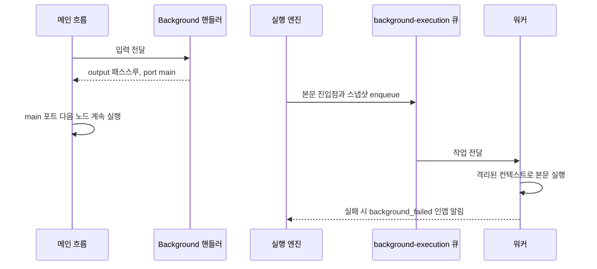

> 구현 상태: 부분 구현 (REQ-BGRUN-026 AI 어시스턴트 조회 도구는 미구현) · 원문: `spec/4-nodes/1-logic/12-background.md`, `spec/4-nodes/_product-overview.md` (§4.12) · 용어: [용어 사전](../CLE-GLOSSARY.md)

## 개요

Background 노드(Background, `background`)는 `background` 출력 포트에 연결된 노드 묶음을 BullMQ 큐로 떼어 내 비동기로 실행하고 메인 흐름은 `main` 포트로 곧바로 넘기는 fire-and-forget 노드다. Background 본문(background body)의 결과와 실패는 메인 흐름에 영향을 주지 않는다(격리).

Background 노드는 컨테이너가 아니다. `containerId` 멤버십을 쓰지 않고 `background` 출력 포트의 연결선으로 이어진 노드를 본문 진입점으로 본다. 그 진입점에서 앞으로 도달할 수 있는 노드 전체가 Background 본문이다([Logic 노드 공통](CLE-NODE-LOGIC-COMMON.md#컨테이너-패턴)). 컨테이너 본문 안에 둔 Background 라면 본문 노드에도 `containerId` 가 있다. 이 값은 에디터 연결선 체인 규칙이 준 위치 속성이고 Background 가 놓인 컨테이너를 가리킬 뿐이다. 본문 범위는 `background` 포트에서 연결선으로 닿는 노드로 정하고 워커는 그 컨테이너 단계의 노드로 그래프를 만든다([컨테이너 실행](../CLE-EXEC/CLE-EXEC-CONTAINER.md#컨테이너-본문-안-background)). 핸들러는 패스스루이고 큐를 모른다. 본문 enqueue 는 엔진이 따로 한다([실행 로직](#실행-로직)).

**구현 상태**: 노드 정의·핸들러·BullMQ 큐(`background-execution`)·워커가 모두 `ExecutionEngineService` 에 들어가 있다.

이 문서는 Background 노드의 설정, 포트, 실행 로직, 격리 계약, 출력 구조, 에러, 설정 요약을 정한다. Background 본문 실행(background run, `backgroundRunId`) 모니터링 API 와 구독 채널은 하위 문서 [본문 실행 모니터링](CLE-NODE-BACKGROUND-RUNS.md) 이 정한다. 본문 실행 결과를 보여 주는 화면은 [에디터 실행과 디버깅](../CLE-EXEC/CLE-EXEC-RUN.md), 엔진의 큐·컨텍스트 키 격리는 [컨테이너 실행](../CLE-EXEC/CLE-EXEC-CONTAINER.md), 알림 속성은 [알림](../CLE-OBS/CLE-OBS-NOTIFY.md), WebSocket 이벤트 카탈로그는 [WebSocket 이벤트와 명령](../CLE-API/CLE-API-WS-EVENTS.md) 이 정한다.

## 요구사항

- REQ-BGRUN-001 WHEN Background 노드가 실행되면 THE SYSTEM SHALL Background 본문을 메인 흐름을 막지 않고 백그라운드에서 실행한다. (원본: ND-BG-01)
- REQ-BGRUN-002 WHEN Background 노드가 실행되면 THE SYSTEM SHALL 메인 흐름을 곧바로 `main` 포트의 다음 노드로 진행한다. (원본: ND-BG-02)
- REQ-BGRUN-003 IF Background 본문이 실패하고 `notifyOnFailure` 가 `true` 면 THE SYSTEM SHALL 워크스페이스 관리자에게 `background_failed` 인앱 알림을 보낸다. (원본: ND-BG-03)
- REQ-BGRUN-004 WHEN Background 본문 노드가 실행되면 THE SYSTEM SHALL 노드 실행 기록에 `parentNodeExecutionId` 로 Background 노드의 노드 실행 ID 를 남겨 타임라인에서 묶어 보이게 한다. (원본: ND-BG-04)
- REQ-BGRUN-005 WHEN Background 노드를 캔버스에 그리면 THE SYSTEM SHALL 컨테이너 박스로 감싸지 않고 일반 다중 출력 포트 노드로 그린다. (원본: ND-BG-05, 대안 구현)
- REQ-BGRUN-006 WHEN 핸들러가 실행되면 THE SYSTEM SHALL 입력을 바꾸지 않고 `output` 에 복사하고 `port: 'main'` 만 반환한다.
- REQ-BGRUN-007 WHEN 핸들러가 끝나면 THE SYSTEM SHALL 본문 진입점 ID, 컨텍스트 스냅샷, Background 노드가 받은 입력의 스냅샷, `notifyOnFailure`, `maxDurationMs` 를 `background-execution` 큐에 넣는다.
- REQ-BGRUN-008 WHEN 워커가 작업을 꺼내면 THE SYSTEM SHALL 새 실행 컨텍스트를 스냅샷으로 채우고 진입점에서 앞으로 도달할 수 있는 노드만 실행한다.
- REQ-BGRUN-009 IF `maxDurationMs` 가 0보다 크고 본문이 그 시간을 넘으면 THE SYSTEM SHALL 본문 실행을 강제로 끝내고 실패로 처리한다.
- REQ-BGRUN-010 IF Background 본문 안의 블로킹 노드가 입력 대기로 멈추면 THE SYSTEM SHALL 본문을 그 지점에서 에러 없이 끝내고 실패로 세지 않으며 알림도 보내지 않는다.
- REQ-BGRUN-011 WHEN Background 본문이 실행되면 THE SYSTEM SHALL 메인의 변수·캐시 변경을 본문에 반영하지 않고 본문의 변경도 메인으로 돌려보내지 않는다.
- REQ-BGRUN-012 WHEN Background 본문 컨텍스트를 만들면 THE SYSTEM SHALL 메모리 안 실행 컨텍스트를 `bg:<executionId>:<backgroundRunId>` 키로 따로 등록하고 본문이 끝나면 자체 finally 에서 지운다.
- REQ-BGRUN-013 IF Background 본문이 실패하면 THE SYSTEM SHALL 메인 실행 상태를 바꾸지 않는다.
- REQ-BGRUN-014 WHEN 메인 흐름의 노드가 표현식을 평가하면 THE SYSTEM SHALL Background 본문 노드의 출력을 참조할 수 없게 한다.
- REQ-BGRUN-015 WHEN 핸들러가 실행되면 THE SYSTEM SHALL UUID v4 `meta.backgroundRunId` 와 분기 시각 `meta.forkedAt` 을 발급한다.
- REQ-BGRUN-016 IF `notes` 가 문자열이 아니거나 `notifyOnFailure` 가 불리언이 아니거나 `maxDurationMs` 가 음수·정수 아님이면 THE SYSTEM SHALL `handler.validate` 에서 거부한다.
- REQ-BGRUN-017 WHEN 사용자가 `GET /api/executions/:executionId/background-runs/:backgroundRunId` 를 호출하면 THE SYSTEM SHALL 본문 실행의 집계 상태, 시각, 노드 실행 기록 페이지 관련 알림을 반환한다.
- REQ-BGRUN-018 WHEN 모니터링 API 가 노드 실행 기록을 반환하면 THE SYSTEM SHALL `startedAt ASC, id ASC` 순서의 cursor 페이지네이션(기본 50, 최대 200)을 적용한다.
- REQ-BGRUN-019 WHEN 모니터링 API 가 노드 실행 기록을 반환하면 THE SYSTEM SHALL `error` · `outputData` · `inputData` 에 응답 값 마스킹을 적용한다.
- REQ-BGRUN-020 IF 호출자가 실행의 워크스페이스 멤버가 아니거나 `executionId` 가 없으면 THE SYSTEM SHALL 403 이 아니라 404 `EXECUTION_NOT_FOUND` 로 응답한다.
- REQ-BGRUN-021 IF `backgroundRunId` 가 그 실행 안에 없으면 THE SYSTEM SHALL 404 `BACKGROUND_RUN_NOT_FOUND` 로 응답한다.
- REQ-BGRUN-022 IF `cursor` 를 해석하지 못하거나 `limit` 이 1~200 밖이면 THE SYSTEM SHALL 400 `INVALID_CURSOR` / `INVALID_LIMIT` 로 응답한다.
- REQ-BGRUN-023 WHEN Background 본문 실행이 시작하거나 끝나면 THE SYSTEM SHALL `background:run:<backgroundRunId>` 구독 채널에 `execution.background_run.started` / `execution.background_run.completed` 이벤트를 보낸다.
- REQ-BGRUN-024 WHEN Background 본문 노드가 실행되면 THE SYSTEM SHALL 노드 이벤트를 메인 `execution:<id>` 구독 채널에 보낸다.
- REQ-BGRUN-025 WHEN 사용자가 `background:run:<id>` 채널을 구독하면 THE SYSTEM SHALL 모니터링 API 와 같은 권한 규칙으로 확인한다.
- REQ-BGRUN-026 WHEN AI 어시스턴트가 실행을 조회하면 THE SYSTEM SHALL `get_background_run` · `list_background_runs` 읽기 전용 도구로 Background 본문 실행을 조회할 수 있게 한다. (미구현)
- REQ-BGRUN-027 WHEN Background 가 Loop · ForEach · Map 본문 안에서 실행되면 THE SYSTEM SHALL 회차마다 본문을 큐에 넣고 작업에 그 컨테이너 ID 를 실어 워커가 그 컨테이너의 본문 노드로 그래프를 만들게 한다.
- REQ-BGRUN-028 WHEN Background 가 컨테이너 본문 안이나 그 안의 병렬 분기에서 본문을 큐에 넣으면 THE SYSTEM SHALL 그 회차의 반복 변수(`itemContext` · `loopContext`)를 작업 스냅샷에 복사해 싣고 워커가 본문 실행 컨텍스트에 되살려 본문 노드가 그 회차의 `$item` · `$itemIndex` · `$itemIsFirst` · `$itemIsLast` · `$loop` 를 읽게 한다.

## 하위 문서

- [Background 노드 — 본문 실행 모니터링](CLE-NODE-BACKGROUND-RUNS.md): `backgroundRunId` 조회 API(응답 · 페이지네이션 · 권한 · 에러 코드), `background:run:<id>` 구독 채널, AI 어시스턴트 도구 노출 계획. 맡는 요구사항: REQ-BGRUN-017, REQ-BGRUN-018, REQ-BGRUN-019, REQ-BGRUN-020, REQ-BGRUN-021, REQ-BGRUN-022, REQ-BGRUN-023, REQ-BGRUN-024, REQ-BGRUN-025, REQ-BGRUN-026

요구사항 줄의 정본은 모두 이 문서 「요구사항」에 있다. 하위 문서는 위 요구사항의 상세 설계를 정하고 요구사항 줄을 다시 적지 않는다. 그 밖의 요구사항은 이 문서가 맡는다.

## 설정

| 필드 | 타입 | 필수 | 기본값 | 설명 |
|------|------|------|--------|------|
| notes | String | | `""` | 본문 작업의 목적·주의 사항 메모. 동작에 영향이 없다(협업용 textarea) |
| notifyOnFailure | Boolean | | `false` | 본문이 실패하면 워크스페이스 관리자에게 인앱 알림을 보낸다(`type: background_failed`, 알림 유형 enum 값) |
| maxDurationMs | Integer | | `300000` | 본문 최대 실행 시간(ms). `0` 은 제한 없음. 기본 5분. `Promise.race` 로 시간 제한을 건다 |

표현식(`{{ }}`)은 쓰지 않는다. 모든 필드는 워크플로우를 정의할 때의 리터럴이다.

코드 기준: `codebase/backend/src/nodes/logic/background/background.schema.ts` (export `backgroundNodeConfigSchema`)

## 설정 화면

| 영역 | 위치 | 들어가는 요소 | 동작 |
|------|------|--------------|------|
| 메모 | 맨 위 | `Notes` 여러 줄 입력(예 "Fan out analytics event after user signup") | `notes` 를 편집한다 |
| 실패 알림 | 가운데 | `Notify on failure` 체크박스 | `notifyOnFailure` 를 켜고 끈다 |
| 최대 시간 | 맨 아래 | `Max duration (ms)` 입력(예 `300000`), 안내 "0 = 무제한" | `maxDurationMs` 를 편집한다 |

## 포트

| 방향 | id | label | type | dynamic | 설명 |
|------|------|-------|------|---------|------|
| 입력 | `in` | Input | data | false | 메인 흐름 데이터(1개 필수). 본문 enqueue 때 스냅샷으로 남긴다 |
| 출력 | `main` | Main | data | false | 입력을 그대로 넘긴다. 핸들러가 곧바로 활성화한다 |
| 출력 | `background` | Background | data | false | 본문 진입점. **핸들러가 활성화하지 않는다**. `ExecutionEngineService` 가 enqueue 한 뒤 별도 실행 컨텍스트에서 활성화한다 |

1. `background` 포트는 `main` 과 비대칭이다. 핸들러는 `port: 'main'` 만 반환하고 `background` 결과는 메인 흐름에 절대 합류하지 않는다(fire-and-forget).
2. 캔버스에서는 컨테이너 박스로 그리지 않고 일반 다중 출력 포트 노드로 그린다. 본문이 `background` 포트 연결선으로 이어져 갈림이 분명하고, 본문이 메인과 같은 캔버스 그래프 안에 평평하게 있다는 뜻이 드러난다.

## 실행 로직

1. 핸들러는 입력을 바꾸지 않고 `output` 에 복사하고 `port: 'main'` 으로 반환한다([Logic 노드 공통](CLE-NODE-LOGIC-COMMON.md#패스스루-규약)).
2. 핸들러가 끝난 직후 `ExecutionEngineService.scheduleBackgroundBody()` 가 BullMQ `background-execution` 큐에 다음을 넣는다.
   - `background` 포트 연결선의 도착 노드 ID 배열(본문 진입점)
   - `context.variables`, `context.nodeOutputCache`, `context.expressionContext` 의 얕은 복사 스냅샷
   - 대화 스레드 스냅샷. `turns` 배열까지 새로 복사해 본문과 메인이 서로의 턴 목록을 건드리지 못하게 한다([대화 스레드](../CLE-IX/CLE-IX-THREAD.md))
   - Background 노드가 받은 입력의 스냅샷. `main` 포트로 나가는 값과 같고 본문 진입 노드가 이 값을 입력으로 받는다. 맨 바깥 실행 · 입력 대기 뒤 재개 · 서브 워크플로우 · Background 본문 · 병렬 분기 · 컨테이너 본문 어디에 놓여도 같다
   - Background 가 컨테이너 본문 안에 있으면 그 컨테이너 ID(`containerScopeId`). 맨 바깥 Background 는 넣지 않는다
   - 컨테이너 본문 안(또는 그 안 병렬 분기)에서 큐에 넣으면 그 회차의 반복 변수(`itemContext` · `loopContext`) 복사본. 맨 바깥 Background 는 넣지 않는다
   - `notifyOnFailure`, `maxDurationMs`
3. `BackgroundExecutionProcessor` 워커가 작업을 꺼내면 `executeBackgroundSubgraph(job)` 이 다음을 한다.
   - 새 `ExecutionContext` 를 만들고 스냅샷으로 채운다.
   - 작업에 반복 변수가 있으면 본문 실행 컨텍스트에 되살린다. 본문 노드의 식은 큐에 넣은 회차의 `$item` · `$itemIndex` · `$itemIsFirst` · `$itemIsLast` · `$loop` 를 읽는다. 반복 변수가 없는 작업(맨 바깥 Background, 필드를 넣기 전에 큐에 들어간 작업)은 본문에서 반복 변수가 비어 있다.
   - `executeInline(workflowId, input, { entryNodeIds, containerScopeId, ... })` 으로 진입점에서 앞으로 도달할 수 있는 노드만 실행한다. `containerScopeId` 가 있으면 그 컨테이너의 본문 노드만으로 그래프를 만든다([컨테이너 실행](../CLE-EXEC/CLE-EXEC-CONTAINER.md#컨테이너-본문-안-background)). 큐에 넣은 뒤 그 컨테이너가 워크플로우에서 지워졌으면 워커가 만든 그래프가 비어 본문을 실행하지 않고 오류 없이 끝난다.
   - `maxDurationMs > 0` 이면 `Promise.race` 로 시간 제한을 건다.
   - 본문 안의 블로킹 노드(form / buttons / ai_conversation)가 입력 대기로 멈추면 `executeInline` 이 `ParkReleaseSignal` 을 던지고 `executeBackgroundSubgraph` 가 이를 잡아 본문을 그 지점에서 곧바로 조용히 끝낸다. 실패로 세지 않고 `notifyOnFailure` 알림도 보내지 않는다([에러](#에러), [Rationale](#본문의-블로킹-노드가-입력-대기로-멈추면-곧바로-조용히-끝낸다)).
4. 본문 노드의 노드 실행 기록은 정상으로 만들고 `parentNodeExecutionId` 에 Background 노드 자신의 노드 실행 ID 를 넣는다. 타임라인에서 Background 묶음 아래에 모여 보인다.
5. 본문 실패는 메인 실행 상태에 영향이 없다. `notifyOnFailure: true` 면 관리자에게 인앱 알림을 보낸다.
6. 서버가 다시 시작되면 큐에 남은 작업은 BullMQ 기본 정책으로 재시도한다. 컨텍스트가 사라져 본문이 실패할 수 있으므로 본문을 멱등하게 만들기를 권한다.



### 격리 계약

1. **변수·캐시 분리**: enqueue 뒤 메인이 `context.variables` 를 바꿔도 본문에는 반영되지 않는다(스냅샷 참조). 본문의 변수 변화도 메인으로 돌아오지 않는다.
2. **컨텍스트 Map 키 격리**: 본문은 노드 실행 묶음과 WebSocket 구독 채널에 쓰려고 메인과 같은 `executionId` 를 쓴다. 메모리 안 `ExecutionContext` 는 별도 키 `bg:<executionId>:<backgroundRunId>` 로 Map 에 등록해 메인 컨텍스트와 격리한다. `executeBackgroundSubgraph` 가 자체 finally 에서 그 키의 컨텍스트를 지우고 이는 메인 `runExecution` finally 의 `deleteContext(executionId)` 와 무관하다. 필드 분류 기준은 [실행 컨텍스트](../CLE-EXEC/CLE-EXEC-CONTEXT.md) 가 정한다.
3. **에러 격리**: 본문 실패는 메인 상태에 영향이 없다.
4. **결과를 돌려주지 않는다**: 본문 마지막 노드의 출력은 메인 흐름의 어떤 노드도 참조할 수 없다. 결과를 기다려야 하면 [Parallel 노드](CLE-NODE-PARALLEL.md) 를 쓴다.

## 출력 구조

출력 포트는 두 개지만 핸들러는 `main` 만 반환한다. 메인 흐름의 `$node["X"]` 로 본문 진입점 결과를 볼 수 없다. JSON 예시는 `undefined` 필드를 생략했고 5필드 밖의 최상위 키는 쓰지 않는다.

### 메인 통과 (`port: 'main'`, 패스스루)

핸들러가 항상 반환하는 케이스다. 메인 흐름의 다음 노드로 입력을 그대로 넘긴다.

```json
{
  "config": {
    "notes": "Fan out analytics event after user signup",
    "notifyOnFailure": true,
    "maxDurationMs": 300000
  },
  "output": { "event": "user_signup", "userId": "u_1" },
  "meta": {
    "durationMs": 0,
    "backgroundRunId": "8f3c6b1a-0d2e-4a7e-9c1d-2f0e5a8b1234",
    "forkedAt": "2026-05-10T05:04:37.123Z"
  },
  "port": "main"
}
```

| 필드 | 타입 | 출처 | 설명 |
|------|------|------|------|
| `config.notes` | string | 설정 에코 | 메모. 핸들러가 `rawConfig.notes` 를 명시적으로 싣는다(spread 로 통째로 싣지 않는다) |
| `config.notifyOnFailure` | boolean | 설정 에코 | 본문 실패 알림 여부(기본 `false`) |
| `config.maxDurationMs` | number | 설정 에코 | 본문 최대 실행 시간 ms(기본 `300000`, `0` 은 제한 없음) |
| `output` | 입력 전체 | 런타임, 패스스루 | 입력 데이터 그대로(변형 없음) |
| `meta.durationMs` | number | 런타임, 핸들러 측정 | 핸들러 자체의 처리 시간(ms). fire-and-forget 이라 보통 0~수 ms. 본문 실행 시간이 아니다 |
| `meta.backgroundRunId` | string (UUID v4) | 런타임, 핸들러 발급 | 실행 안에서 Background 본문 실행을 구별하는 값. [모니터링 API](CLE-NODE-BACKGROUND-RUNS.md) 의 조회 키 |
| `meta.forkedAt` | ISO8601 string | 런타임, 핸들러 측정 | 갈라진 시각(핸들러 진입 시각). enqueue 직후와 거의 같다 |
| `port` | `'main'` | 핸들러 반환 | 항상 `main` (핸들러는 `background` 포트를 활성화하지 않는다) |

`meta.jobId` (BullMQ job ID)는 핸들러가 큐를 모르므로 출력에 없다. `scheduleBackgroundBody()` 가 큐에 넣은 뒤 노드 실행 기록의 `outputData` 에 기록하는 것은 앞으로 넓힐 지점이다.

표현식 접근 예:

- `$node["X"].output.event` → `"user_signup"` (패스스루)
- `$node["X"].port` → `"main"`
- `$node["X"].config.maxDurationMs` → `300000`
- `$node["X"].meta.backgroundRunId` → `"8f3c6b1a-..."` (모니터링 API 키)
- `$node["X"].meta.forkedAt` → `"2026-05-10T05:04:37.123Z"`
- `$node["X"].meta.durationMs` → `0` (핸들러 쪽 처리 시간)

### 본문 진입 (`background` 포트, fire-and-forget)

엔진이 별도 실행 컨텍스트에서 `background` 포트 연결선을 따라 본문 진입점 노드를 활성화한다. 메인 흐름에 `port: 'background'` 인 노드 출력은 없다.

본문 컨텍스트에서 진입점 노드의 입력은 다음과 같다.

```json
{
  "input": { "event": "user_signup", "userId": "u_1" }
}
```

| 항목 | 출처 | 설명 |
|------|------|------|
| 입력 데이터 | enqueue 시점 스냅샷 | Background 노드의 입력 그대로 |
| `context.variables` | enqueue 시점 스냅샷(얕은 복사) | 메인의 이후 변경은 반영되지 않는다 |
| `context.nodeOutputCache` | enqueue 시점 스냅샷 | 본문에서는 enqueue 시점까지의 메인 노드 출력을 참조할 수 있다 |
| `context.expressionContext` | enqueue 시점 스냅샷 | 표현식 평가용 |
| `context.conversationThread` | enqueue 시점 스냅샷(`turns` 배열까지 새로 복사) | 본문에서 쌓인 턴은 메인 스레드에 들어가지 않고 반대도 같다. 필드가 없는 옛 큐 작업은 빈 스레드로 시작한다([대화 스레드](../CLE-IX/CLE-IX-THREAD.md), [컨테이너 실행](../CLE-EXEC/CLE-EXEC-CONTAINER.md#background-본문-실행)) |
| 반복 변수 | enqueue 시점 스냅샷(`itemContext` · `loopContext` 복사본) | 컨테이너 본문 안(또는 그 안 병렬 분기)에서 큐에 넣은 작업만 있다. 되살리는 규칙은 [실행 로직](#실행-로직) 3 |
| `parentNodeExecutionId` | Background 노드의 노드 실행 ID | 본문 노드 실행 기록에 넣는다 |

메인 흐름에서는 본문 결과를 읽을 수 없다([격리 계약](#격리-계약) 4). `$node["X"].output` 은 `main` 케이스의 입력 패스스루이고 `$node["<본문 노드>"].output` 은 참조할 수 없다. 메인의 뒤 노드에서 본문 상태를 보려면 `meta.backgroundRunId` 를 키로 [모니터링 API](CLE-NODE-BACKGROUND-RUNS.md) 를 따로 부른다.

Background 는 fire-and-forget 전용이다. 결과를 기다려 메인 흐름에 합쳐야 하면 [Parallel 노드](CLE-NODE-PARALLEL.md) 의 `branches` 를 쓴다.

## 에러

Background 핸들러는 런타임 에러 포트가 없다. 설정 검증은 스키마가 모두 맡고(모든 필드에 zod 기본값이 있다) 사전 검증 에러 말고는 에러 케이스가 없다.

| 발생 조건 | 메시지 | 시점 |
|-----------|--------|------|
| `notes` 가 문자열 아님 | `notes must be a string` | `handler.validate` (`evaluateMetadataBlockingErrors`) |
| `notifyOnFailure` 가 불리언 아님 | `notifyOnFailure must be a boolean` | `handler.validate` |
| `maxDurationMs` 가 음수 | `maxDurationMs must be >= 0` | `handler.validate` |
| `maxDurationMs` 가 정수 아님 | `maxDurationMs must be an integer` | `handler.validate` |

Background 본문 실패는 메인의 에러 코드가 되지 않는다. 본문 노드 실행 기록(`parentNodeExecutionId` 표시)과 `notifyOnFailure: true` 의 관리자 인앱 알림으로만 드러난다.

| 본문 실패 유형 | 처리 |
|-------------------|------|
| 본문 노드가 에러를 던짐 | 해당 노드 실행 실패. `notifyOnFailure: true` 면 관리자 알림 |
| `maxDurationMs` 초과 | `Promise.race` 시간 제한으로 본문 실행 강제 종료. `notifyOnFailure: true` 면 알림 |
| 본문에 블로킹 노드(form / buttons / ai_conversation)가 있어 입력 대기 발생 | `ParkReleaseSignal` 로 본문을 곧바로 조용히 끝낸다. 실패가 아니라 `notifyOnFailure` 알림을 보내지 않는다. 바깥에서 `continueExecution` 으로 재개할 수 없다. 이 경우 위 `maxDurationMs` 행은 발동하지 않는다 |
| 서버 재시작 | BullMQ 기본 큐 재시도 적용. 컨텍스트가 사라지면 본문이 실패할 수 있어 본문 멱등성을 권한다 |

## 설정 요약

- 형식: `notifyOnFailure` / `maxDurationMs` 요약. 알림이 꺼져 있으면 시간만 표시한다.
- 예: `notify on fail · 5m`
- 현재 구현은 `background.schema.ts` 에 `summaryTemplate` 이 없어 캔버스에 이 요약을 표시하지 않는다. [Logic 노드 공통](CLE-NODE-LOGIC-COMMON.md#미결-사항) 참조.
- 이 노드에는 알림 채널 설정이 없고 인앱 알림만 보낸다. 알림 채널을 보이는 다른 형식(예 `notify: in_app, email`)과는 정의가 갈린다([Logic 노드 공통 미결 사항](CLE-NODE-LOGIC-COMMON.md#미결-사항)).

## 모니터링 API

`meta.backgroundRunId` 를 키로 Background 본문 실행 상태를 조회하는 읽기 전용 API 와 `background:run:<backgroundRunId>` 구독 채널은 하위 문서가 정한다.

### API 에러 코드

모니터링 API 는 400 `INVALID_CURSOR` · `INVALID_LIMIT`, 404 `EXECUTION_NOT_FOUND` · `BACKGROUND_RUN_NOT_FOUND` 를 낸다. 발생 조건은 [본문 실행 모니터링 §API 에러 코드](CLE-NODE-BACKGROUND-RUNS.md#api-에러-코드) 의 표가 정한다.

## 미결 사항

두 항목의 본문은 [본문 실행 모니터링 §미결 사항](CLE-NODE-BACKGROUND-RUNS.md#미결-사항) 에 있다.

- **AI 어시스턴트 조회 도구의 도입 여부** (warning): `get_background_run` · `list_background_runs` 는 어시스턴트 도구 목록 · 에디터 PRD · 현재 구현 어디에도 없다. 이 문서는 REQ-BGRUN-026 을 미구현으로 둔다. 결정은 [AI 어시스턴트 도구 미결 사항](../CLE-WF/CLE-WF-ASSIST-TOOLS.md#미결-사항) 에서 한다.
- **본문 취소를 종결 상태로 표시할지** (warning): 메인 실행 중지로 멈춘 본문의 종결 상태 문제다.

## 구현 위치

- `codebase/backend/src/nodes/logic/background/background.*.ts`
- 모니터링 API · 구독 채널: [하위 문서 구현 위치](CLE-NODE-BACKGROUND-RUNS.md#구현-위치)
- `codebase/backend/src/modules/execution-engine/**` (`scheduleBackgroundBody`, 노드 종류별 디스패치 `dispatchByNodeKind`, `executeBackgroundSubgraph`, `BackgroundExecutionProcessor`)

## Rationale

### 실행 컨텍스트 Map 키를 나눈다

Background 본문은 BullMQ 워커에서 fire-and-forget 으로 비동기 실행된다. 예전에는 부모와 같은 `executionId` 를 메모리 안 컨텍스트 Map 키로 함께 썼다. 부모 실행이 (보통 본문보다 먼저) 끝나며 `deleteContext(executionId)` 를 부르면 본문이 쓰던 컨텍스트가 같은 키로 지워졌고 뒤이은 `setNodeOutput` 이 "Execution context not found" 로 실패했다.

그래서 본문은 별도 Map 키 `bg:<executionId>:<backgroundRunId>` 를 쓰고 `executeBackgroundSubgraph` 의 자체 finally 로 정리한다. `executionId` 는 노드 실행 묶음·WebSocket 구독 채널(`execution:<id>`)·권한의 1차 키라서 그대로 두고 메모리 안 Map 키만 나눴다. 기존 격리 계약(변수·캐시 스냅샷 격리)을 키 수준으로 넓힌 것이다. 필드 분류와 `_contextKey` 결정의 기준은 [실행 컨텍스트](../CLE-EXEC/CLE-EXEC-CONTEXT.md) 에 있다.

### 본문의 블로킹 노드가 입력 대기로 멈추면 곧바로 조용히 끝낸다

예전에는 본문 안의 블로킹 노드(form / buttons / ai_conversation)가 입력 대기로 멈추면 `pendingContinuations` 에 등록된 채 `maxDurationMs` 까지 매달려 있다가 시간 초과 실패로 끝났다(`notifyOnFailure` 알림이 갈 수 있었다). 입력 대기를 DB 에 보존하는 방식(durable park)을 도입한 뒤로는 `executeInline` 이 멈추는 순간 `ParkReleaseSignal` 을 던지고 `executeBackgroundSubgraph` 가 이를 잡아 본문을 곧바로 조용히 끝낸다. Background 는 fire-and-forget 이라 바깥에서 `continueExecution` 으로 재개할 경로가 없어 입력 대기를 보존할 뜻이 없기 때문이다.

사용자에게 보이는 동작이 바뀌었다. 전에는 시간 초과 실패로 보였지만 지금은 에러 없이 그 지점에서 조용히 끝난다(실패로 세지 않고 알림도 보내지 않는다). 본문에 블로킹 노드를 두는 구성 자체를 권하지 않는다. 사용자 입력을 기다려야 하면 메인 흐름에 둔다.

### 컨테이너 본문 안 Background 는 컨테이너 단계 그래프로 실행한다 (2026-11-12)

컨테이너 본문 안 Background 는 회차마다 본문을 큐에 넣는다. 본문 노드는 에디터 규칙에 따라 Background 와 같은 컨테이너 소속을 받는다. 그런데 워커가 맨 바깥 노드로만 그래프를 만들어 이 노드를 실행하지 못했다. 그래서 작업에 컨테이너 ID 를 싣고 워커가 그 단계의 그래프를 만든다. 본문은 계속 `background` 포트 연결선으로 찾는다.

반복 변수는 큐에 넣는 회차의 `itemContext` · `loopContext` 를 작업 스냅샷에 복사해 싣고 워커가 본문 실행 컨텍스트에 되살린다(NERV 질문 `01a1cd70-d2c0-74dd-9078-f6f0b3492ff3`, 답 A). 그래서 본문 노드는 그 회차의 `$item` · `$itemIndex` · `$itemIsFirst` · `$itemIsLast` · `$loop` 를 읽는다. 병렬 분기가 바깥 반복 변수를 이어받는 규칙([Parallel 노드 요구사항](CLE-NODE-PARALLEL.md#요구사항))과 같다.

반복 변수를 정할 때 기각한 대안은 다음과 같다.

- **반복 변수를 비우는 안**: 본문에서 `$item` · `$loop` 같은 반복 변수가 비어 회차별 처리를 할 수 없다.

결정 경위와 나머지 기각 대안은 [컨테이너 실행](../CLE-EXEC/CLE-EXEC-CONTAINER.md#본문-안-컨테이너와-background-도-실행-경로로-넘긴다-2026-11-12) 의 Rationale 에 있다(NERV Task `CLE-T-MR6ZH3`).

### 본문 진입 노드는 Background 노드가 받은 입력을 받는다 (2026-11-12)

예전에는 `scheduleBackgroundBody` 를 부르는 다섯 곳이 본문 진입 노드에 서로 다른 값을 넘겼다. 맨 바깥 실행은 실행 원본 입력을, 입력 대기 뒤 재개 경로는 빈 객체(`{}`)를, `executeInline`(서브 워크플로우 · Background 워커)은 그 실행의 원본 입력을, 병렬 분기는 Parallel 이 받은 입력을 넘겼다. 컨테이너 본문만 그 회차에 Background 노드가 받은 입력을 넘겼다. 스펙도 「본문 진입」 표는 "Background 노드의 입력 그대로", 실행 로직 2 와 REQ-BGRUN-007 은 "메인 입력(`input` 스냅샷)"이라 두 가지로 읽혔다.

**(A) Background 노드가 받은 입력으로 맞추는 안** (채택): 다섯 곳 모두 Background 노드가 받은 입력을 넘긴다(NERV 질문 `01a1cef7-c693-7166-bc43-78e1436e1783`, 답 A). 「본문 진입」 표와 컨테이너 경로와 같고 `main` 포트로 나가는 값과도 같아서 본문과 메인의 다음 노드가 같은 값에서 출발한다. 노드 종류별 디스패치를 `dispatchByNodeKind` 하나로 합쳐 위치마다 값이 다시 갈라지지 않게 했다(NERV Task `CLE-T-TDAV1G`).

저장된 워크플로우의 동작이 바뀐다. 본문 진입 노드가 `{{ $json… }}` 처럼 입력을 직접 읽는 워크플로우만 영향을 받고 `$node["…"]` 로 읽는 식은 그대로다.

- 트리거 바로 뒤 Background: 전에는 실행 원본 입력(웹훅이면 method · headers · body 가 맨 위에 있는 값)이 들어갔고 이제는 트리거 출력(`{ parameters, request? }`)이 들어간다.
- 앞에 다른 노드가 있는 Background: 전에는 실행 원본 입력이 들어갔고 이제는 바로 앞 노드의 출력이 들어간다.
- 입력 대기 뒤 재개하고 나서 실행한 Background: 전에는 빈 객체가 들어갔고 이제는 바로 앞 노드의 출력이 들어간다.
- 병렬 분기 안 Background: 전에는 Parallel 이 받은 입력이 들어갔고 이제는 분기 안에서 Background 바로 앞 노드의 출력이 들어간다.
- 서브 워크플로우 · Background 본문 안 Background(`executeInline` 경로): 전에는 그 실행의 원본 입력이 들어갔고 이제는 바로 앞 노드의 출력이 들어간다.

기각한 대안은 다음과 같다.

- **(B) 범위 입력으로 통일하는 안**: 맨 바깥 · 재개 · 서브 워크플로우는 실행 원본 입력, 병렬 분기는 Parallel 이 받은 입력으로 스펙에 적고 컨테이너 본문도 회차 입력으로 되돌린다. 본문이 받는 값이 `main` 포트로 나가는 값과 달라지고 「본문 진입」 표도 고쳐야 한다. 컨테이너 본문 경로는 NERV Task `CLE-T-MR6ZH3` 구현부터 그 회차에 Background 노드가 받은 입력을 넘기는데 이를 되돌리게 된다.
- **(C) 위치별 동작을 그대로 적는 안**: 코드는 디스패치 정리만 하고 위치마다 다른 값을 스펙에 적는다. 같은 노드가 놓인 위치에 따라 본문에 다른 값을 넘겨 사용자가 본문 입력을 예측하기 어렵다.
