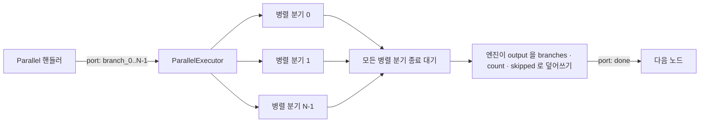

## 개요

이 문서는 [Parallel 노드](CLE-NODE-PARALLEL.md) 의 하위 문서로 병렬 분기의 노드 집합과 실행 순서, 결과 노드, 실행 로직, 병렬 분기 격리, 항목 에러 정책의 동작을 정한다. 완료 출력의 모양은 [출력 구조](CLE-NODE-PARALLEL-OUTPUT.md), 놓인 위치별 실행과 중첩 깊이는 [놓인 위치와 중첩](CLE-NODE-PARALLEL-NEST.md) 이 정한다.

## 병렬 분기의 노드 집합과 위상 순서

이 절은 병렬 분기마다 어떤 노드를 어떤 순서로 실행하고 어느 노드의 출력을 결과로 쓰는지 정한다. 엔진의 `planParallelBody` 와 `executeParallelBranchBody` 가 이 규칙을 구현한다. [컨테이너 실행](../CLE-EXEC/CLE-EXEC-CONTAINER.md) 은 컨테이너 본문만 정하고 병렬 분기 본문은 이 문서가 정한다.

1. **소속**: `branch_i` 포트에 직접 연결된 노드가 그 병렬 분기의 진입점이다. 진입점에서 앞으로 가는 연결선을 따라 닿는 노드가 그 병렬 분기 본문의 후보다. 되돌아가는 연결선은 따라가지 않는다.
2. **합류 노드**: 둘 이상의 병렬 분기에서 닿는 노드는 합류 노드다(대개 Merge). 합류 노드는 어느 병렬 분기 본문에도 넣지 않고 모든 병렬 분기가 끝난 뒤 메인 루프가 실행한다. 그래서 병렬 분기 본문의 노드 집합은 서로 겹치지 않는다. 겹침은 에러로 다루지 않고 합류 노드로 처리한다.
3. **위상 순서**: 병렬 분기 본문 노드와 그 사이 연결선만으로 Kahn 알고리즘을 돈다(`topologicalSort`). 처음에는 진입 차수가 0 인 노드를 노드 ID 문자열 순서로 큐에 넣는다. 노드를 하나 꺼낼 때마다 새로 진입 차수가 0 이 된 이웃을 노드 ID 문자열 순서로 정렬해 큐 뒤에 붙인다. 예를 들어 `A → B`, `A → C` 면 순서는 `A`, `B`, `C` 다.
4. **실행**: 병렬 분기 루프는 이 순서대로 노드를 하나씩 실행한다. 진입점에서 닿는 노드만 실행하고 If · Switch 가 고르지 않은 포트 뒤의 노드는 실행하지 않는다. 노드 출력은 그 병렬 분기의 캐시 사본에도 옮기므로 같은 병렬 분기의 다음 노드 입력과 포트 라우팅이 그 출력을 본다. 병렬 분기 안 컨테이너(Loop · ForEach · Map)는 자기 본문을 반복 회차마다 직접 실행한다. 그 본문에 둔 Parallel 도 엔진의 Parallel 실행 경로로 실행한다([놓인 위치별 실행과 중첩 깊이](CLE-NODE-PARALLEL-NEST.md#놓인-위치별-실행과-중첩-깊이)). 병렬 분기 안 Background 는 본문을 큐에 넣고 기다리지 않는다. 병렬 분기 안 Parallel(안쪽 Parallel)은 엔진의 Parallel 실행 경로로 자기 병렬 분기를 실행하고 완료 출력을 쓴다. 안쪽 병렬 분기가 쓴 출력은 바깥 병렬 분기의 캐시 사본에도 옮기므로 안쪽 합류 노드와 안쪽 `done` 뒤 노드가 그 출력을 읽는다.
5. **결과 노드**: 병렬 분기 루프가 이번 Parallel 실행에서 출력을 쓴 노드 가운데 3번 순서가 가장 늦은 노드가 결과 노드다. 경계는 다음과 같다.
   - 비활성 노드와 에러 처리 정책 `skip_node` 로 건너뛴 노드는 후보가 아니다. 엔진이 두 노드의 출력을 캐시에 쓰지 않기 때문이다. `skip_node` 의 이 동작은 [노드 에러 처리 정책](../CLE-NODE/CLE-NODE-ERROR.md#1-에러-처리-정책-다섯-가지) 의 「노드 건너뛰기」 가 정한다. `use_default_output` 과 `route_to_error_port` 로 처리한 노드는 출력을 쓰므로 후보다.
   - 병렬 분기 안 컨테이너의 본문 노드와 안쪽 Parallel 의 병렬 분기 본문 노드는 후보가 아니다. 컨테이너 노드와 안쪽 Parallel 노드 자신은 후보이고 그 결과는 각자의 완료 출력(예: ForEach 의 `{ items, count }`, 안쪽 Parallel 의 `{ branches, count, skipped? }`)이다.
   - 합류 노드는 병렬 분기 본문이 아니므로 후보가 아니다.
   - 같은 실행에서 Parallel 이 다시 실행될 때 앞 실행이 남긴 출력은 후보가 아니다. 엔진은 값을 비교하지 않고 이번에 출력을 쓴 노드 ID 를 기록해 판정한다.
   - 끝나는 노드가 둘 이상이면 3번 순서가 결과를 정한다. 이 순서는 노드 ID 로 갈리므로 그래프를 고치면 바뀔 수 있다. 결과를 하나로 정하려면 끝나는 노드들을 Merge 로 모은다.
   - 결과 노드 출력에서 `_selectedPort` 같은 엔진 제어 필드를 뺀다. 결과 노드가 없거나 그 출력이 `undefined` 면 `null` 이다. 실패한 병렬 분기도 `null` 이다.

`PARALLEL_ENGINE=off` 되돌림 경로는 이 절을 쓰지 않는다([`off` 되돌림 경로](CLE-NODE-PARALLEL-OUTPUT.md#off-되돌림-경로는-완료-출력을-만들지-않는다-2026-11-02)).

## 실행 로직

1. `branchCount` 를 정수로 바꾸고 `[2, 16]` 범위로 맞춘다(핸들러와 실행기 양쪽에서 방어).
2. 핸들러는 `branch_0` ~ `branch_{N-1}` 포트를 모두 활성화하는 [시작 시점](CLE-NODE-PARALLEL-OUTPUT.md#시작-시점-핸들러-반환) 형태를 반환한다(`port: string[]`, [노드 출력 규약](../CLE-NODE/CLE-NODE-OUTPUT.md) 의 fan-out 형태).
3. 엔진의 `ParallelExecutor` 가 `p-limit(effectiveConcurrency)` 로 동시 실행 슬롯을 제한하면서 `Promise.allSettled` 로 모든 병렬 분기를 동시에 실행한다. `effectiveConcurrency` 는 `maxConcurrency > 0 ? maxConcurrency : branchCount` 다. `PARALLEL_ENGINE=off` 면 엔진이 위상 순서로 차례로 실행하고 완료 출력을 만들지 않는다(되돌림 경로).
4. 병렬 분기마다 `ExecutionContext` 의 얕은 복사본을 받는다. `variables` 는 `structuredClone` 으로 깊게 복사한다. `itemContext` · `loopContext` 는 부모 컨텍스트 값을 그대로 둔다. 그래서 컨테이너 본문의 Parallel 에서도 병렬 분기 안 표현식이 바깥 반복 변수(`$item` · `$itemIndex` · `$loop`)를 읽는다. 병렬 분기마다 컨텍스트 객체가 따로라서 병렬 분기 안 ForEach · Loop 가 반복 변수를 바꿔도 다른 병렬 분기에 새지 않는다. 엔진은 노드 출력을 등록된 루트 컨텍스트에 쓰고 같은 항목을 그 병렬 분기의 캐시 사본에도 옮긴다. 병렬 분기 안의 노드 실행 순서는 [병렬 분기의 노드 집합과 위상 순서](#병렬-분기의-노드-집합과-위상-순서) 가 정한다.
5. 항목 에러 정책을 적용한다.
   - `stop` (기본): 모든 병렬 분기가 끝나기를 기다린다. 실패한 병렬 분기가 있으면 번호가 가장 작은 병렬 분기의 에러를 던지고 Parallel 노드가 실패로 전이한다. 실패 뒤에도 다른 병렬 분기를 멈추지 않으므로 동시 실행 슬롯을 기다리던 병렬 분기도 시작한다. 실패 뒤 다른 병렬 분기를 멈추려면 `cancel-others-on-fail` 을 쓴다.
   - `continue`: 모든 병렬 분기가 끝나기를 기다린다. 실패한 병렬 분기 자리는 `null` 이고 실패 정보는 `output.skipped` 에 모인다([완료 시점](CLE-NODE-PARALLEL-OUTPUT.md#완료-시점-done-포트)). Parallel 노드는 `done` 포트로 끝난다. 실패한 노드의 실행 기록은 실패 상태로 남는다. Parallel 노드의 실행 기록은 완료 출력으로 갱신되지 않으므로 `skipped` 를 담지 않는다([Logic 노드 공통](CLE-NODE-LOGIC-COMMON.md#미결-사항)).
   - `cancel-others-on-fail`: 자기 그룹용 `AbortController` 를 만들어 병렬 분기 컨텍스트의 `abortSignal` 에 넣는다. 첫 병렬 분기가 실패하면 `controller.abort()` 를 부른다. 다른 병렬 분기의 외부 I/O 노드 가운데 취소 규칙을 따르는 노드(HTTP · DB · AI · Cafe24 · MakeShop)가 best-effort 로 정리한다. Email 은 보내기 전 abort 확인만 하고 이미 진행 중인 SMTP 전송은 끊지 않는다. 모든 병렬 분기가 끝나면 원인 에러를 Parallel 노드의 에러로 다시 던진다(Parallel 노드 실패). 상위 `context.abortSignal` 이 있으면 그 abort 도 이어서 전파한다. 노드별 신호 처리 규칙은 [노드 취소 §노드 핸들러 의무](../CLE-EXEC/CLE-EXEC-CANCEL.md#노드-핸들러-의무) 가 정한다.
   - 사용자 취소: 사용자가 실행을 취소하면 정책과 상관없이 취소 에러(`ExecutionCancelledError`)를 다시 던진다. 취소는 `output.skipped` 에 들어가지 않는다.
6. 모든 병렬 분기가 끝나면 엔진이 `output` 을 덮어쓰고 `done` 포트(`port: 'done'`, 단일 문자열)로 보낸다. 형태는 [완료 시점](CLE-NODE-PARALLEL-OUTPUT.md#완료-시점-done-포트) 이 정하고 `branches[i]` 를 고르는 규칙은 위 결과 노드 규칙이 정한다.

## Rationale

### 병렬 분기 캐시 격리: 얕은 복사와 개발·테스트 환경 동결 (2026-06-10)

병렬 분기는 `ExecutionContext` 의 얕은 복사본을 받고 `variables` 만 `structuredClone` 으로 깊게 복사한다. `nodeOutputCache` / `structuredOutputCache` 도 얕게 복사하고 값 객체는 부모와 함께 쓴다(깊은 복사 비용을 피한다). 엔진 쓰기는 루트 컨텍스트와 병렬 분기 사본에 함께 간다([2026-11-02 절](#병렬-분기-사본에-엔진-쓰기를-옮긴다-2026-11-02)). 병렬 분기 본문의 노드 집합은 서로 겹치지 않으므로 두 병렬 분기가 같은 키에 쓰지 않는다. 겹침을 막는 장치는 에러가 아니라 `planParallelBody` 의 합류 노드 판정이다([병렬 분기의 노드 집합과 위상 순서](#병렬-분기의-노드-집합과-위상-순서)). `CONTAINER_INVALID_CHILD` 는 컨테이너 본문에 트리거 노드를 둘 때 던지는 에러라 이 근거가 아니다.

이 설계의 불변식은 "병렬 분기는 공유 캐시 값 객체의 안쪽을 바꾸지 않는다" 이다. 얕은 복사 결정을 대신하지 않는 보조 강제 장치로, 개발·테스트 환경(`NODE_ENV ∈ {development, test}`)에서는 병렬 분기 복제 직후 공유 값 객체를 깊게 `Object.freeze` 한다. 동결은 병렬 분기 컨텍스트를 복제하는 시점에 캐시에 있던 값 객체에만 건다. 복제 뒤에 쓴 출력은 그 병렬 분기 컨텍스트의 동결 대상이 아니다. 불변식을 어기면(값 안쪽을 바꾸면) 곧바로 `TypeError` 로 드러난다. 운영 환경에는 적용하지 않는다(동결 비용을 피하고 동작을 바꾸지 않는다). 그래서 운영 동작은 얕은 복사 격리 그대로다.

기각한 대안은 병렬 분기마다 캐시를 깊게 복사하는 안이다. 병렬 분기 수만큼 캐시 전체를 복사하는 비용이 들어 얕은 복사를 택하고 개발·테스트 환경 동결로 불변식을 지킨다.

### `cancel-others-on-fail` 항목 에러 정책 (2026-05-30, 결정 A · H)

**뜻**: 첫 병렬 분기가 실패하면 다른 병렬 분기의 긴 외부 I/O (HTTP · DB · AI 등)를 곧바로 중단해 워커 자원 낭비를 막는다. `stop` 의 뜻(Parallel 실패로 전이)은 유지하면서 실패 뒤 다른 병렬 분기를 `continue` 처럼 끝까지 기다리지 않고 abort 한다.

**기각한 대안**: `errorPolicy=stop` 의 동작을 바꿔 항상 abort 하게 하는 방안. 옛 워크플로우의 뜻을 깨므로 별도 옵션으로 나눴다.

**방식**: 자기 그룹용 `AbortController` 를 만들어 병렬 분기 컨텍스트의 `abortSignal` 에 넣는다. 첫 실패한 병렬 분기의 `runBranch` 가 거부된 직후 `controller.abort()` 를 부르고 다른 병렬 분기의 외부 I/O 노드가 그 signal 을 받아 정리한다. 상위 `context.abortSignal` 이 있으면 상위 취소도 이 그룹에 전파한다.

**best-effort 계약** ([노드 취소](../CLE-EXEC/CLE-EXEC-CANCEL.md)): signal 을 지원하지 않는 노드(CPU 작업, 곧바로 끝나는 노드)는 자기 작업을 끝낼 때까지 계속한다. 2026-07-26 기준 signal 을 받는 노드는 HTTP · DB · AI · 이커머스 통합 Cafe24 · MakeShop 이다. Email 은 보내기 전 abort 확인만 하고 이미 보내는 중인 SMTP 는 일부러 중단하지 않는다. 채팅 채널은 노드가 아니라 `webhook` 트리거의 발신 어댑터라서 처음부터 대상이 아니다. 그래서 `cancel-others-on-fail` 의 효과는 노드별로 차츰 강해진다.

**에러 분류**: 모든 병렬 분기가 끝나면 원인 에러(`error.name !== 'AbortError'` 인 첫 실패)를 Parallel 노드의 에러로 다시 던진다. `AbortError` 는 뒤따른 병렬 분기 정리의 결과라서 사용자 메시지의 신호 대 잡음비를 위해 드러내지 않는다.

### `stop` 은 모든 병렬 분기를 기다린 뒤 실패를 던진다 (2026-11-06)

옛 요구사항 문장은 "처음 실패하면 곧바로 에러를 던진다" 고 적었지만 실행기는 `Promise.allSettled` 로 모든 병렬 분기가 끝나기를 기다린 뒤 실패한 병렬 분기 가운데 번호가 가장 작은 것의 에러를 던진다. 실패 뒤에도 다른 병렬 분기를 멈추지 않으므로 동시 실행 슬롯을 기다리던 병렬 분기도 시작한다. 요구사항 문장을 실행기 동작에 맞췄다.

동작을 바꾸지 않은 이유는 2026-05-30 「`cancel-others-on-fail` 항목 에러 정책」 결정이 `stop` 은 `continue` 처럼 끝까지 기다린다는 전제로 쓰였기 때문이다. 그 결정은 `stop` 을 항상 abort 하게 바꾸는 안을 옛 워크플로우의 뜻을 깬다는 이유로 기각하고 `cancel-others-on-fail` 을 따로 두었다. 실패 뒤 다른 병렬 분기를 멈추고 싶으면 그 정책을 쓴다.

기각한 대안은 `stop` 이 첫 실패에서 다른 병렬 분기를 기다리지 않고 곧바로 던지게 바꾸는 안이다. 끝나지 않은 병렬 분기는 계속 돌면서 루트 컨텍스트에 출력을 쓰는데 Parallel 노드는 이미 실패로 끝나 실행 상태와 출력이 어긋난다. 멈추기까지 하려면 `cancel-others-on-fail` 과 같은 abort 가 필요해 두 정책의 차이가 사라진다.

**기존 워크플로우 영향**: 없다. 문서만 실행기 동작에 맞췄다.

### 병렬 분기 사본에 엔진 쓰기를 옮긴다 (2026-11-02)

병렬 분기 컨텍스트는 캐시의 얕은 복사본을 들고 있고 엔진의 노드 출력 쓰기는 등록된 루트 컨텍스트로 간다. 이 어긋남 때문에 이 변경 전에는 병렬 분기 안 둘째 노드부터 입력이 `undefined` 였다. 병렬 분기 안 If · Switch 도 고른 포트를 사본에서 읽지 못해 연결된 경로를 모두 실행했다. 동기화를 끈 뮤턴트로 두 동작을 확인했다.

그래서 엔진이 노드 출력을 쓰는 지점을 `commitNodeOutput` 하나로 모았다. 이 메서드는 병렬 분기 전용이 아니고 엔진 공통 쓰기 지점이다(정상 완료, 기본 출력 사용, 에러 포트로 라우팅, 컨테이너 완료). 루트 컨텍스트에 쓴 뒤 `syncParallelBranchCacheEntry` 가 같은 항목을 병렬 분기 사본에 옮긴다. 병렬 분기 밖에서는 루트와 사본이 같은 객체라 옮길 것이 없다. 사본에 옮길 때 출력을 쓴 노드 ID 도 기록하고 결과 노드 판정이 이 기록을 쓴다.

출력은 루트에도 남긴다. 합류 노드와 `done` 뒤 노드가 루트 컨텍스트에서 병렬 분기 노드의 출력을 읽기 때문이다.

기각한 대안은 세 가지다.

- **병렬 분기 사본에만 쓰는 안**: 합류 노드와 `done` 뒤 노드가 루트에서 병렬 분기 노드의 출력을 읽지 못한다.
- **사본 반영을 병렬 분기 루프가 따로 부르는 안**: 출력을 쓰는 지점이 여럿이라 하나라도 빠뜨리면 예외 없이 입력이 비거나 결과가 `null` 이 된다. 그래서 쓰기와 사본 반영을 한 메서드에 묶었다.
- **병렬 분기 컨텍스트가 루트 캐시를 그대로 쓰는 안**: 사본 동기화가 필요 없어진다. 그러나 2026-06-10 의 얕은 복사 결정을 뒤집는다. 이번 변경은 결함 수정이라 그 결정은 그대로 두었다.

**기존 워크플로우 영향**: 병렬 분기 안 둘째 노드부터 앞 노드의 출력을 입력으로 받는다. 병렬 분기 안 If · Switch 는 고른 경로만 실행한다.

### 병렬 분기 결과는 실제로 실행된 마지막 노드의 출력이다 (2026-11-01)

엔진은 병렬 분기 안 노드 전체의 위상 순서 마지막 노드를 읽어서 If · Switch 가 그 노드를 고르지 않으면 성공한 병렬 분기도 결과가 비었다. 그래서 실제로 실행된 노드 가운데 위상 순서가 가장 늦은 노드를 고른다. 실행된 노드가 없으면 `null` 이다. 후보는 2026-11-02 에 「이번 Parallel 실행에서 출력을 쓴 노드」 로 좁혀졌다([다음 절](#결과-노드의-동률은-엔진-위상-순서로-가른다-2026-11-02)).

### 결과 노드의 동률은 엔진 위상 순서로 가른다 (2026-11-02)

병렬 분기 안에서 끝나는 노드가 둘 이상이면 "위상 순서가 가장 늦은 노드" 가 그래프 모양만으로는 하나로 정해지지 않는다. 사람 결정(NERV 질문 `01a199f6-8f33-745b-9839-0284f9770a3b`)으로 엔진 위상 정렬 순서를 그대로 쓰기로 했다. 병렬 분기 루프는 이 순서대로 노드를 하나씩 실행하므로 마지막으로 출력을 쓴 노드가 결과다. 동률은 노드 ID 순서로 갈리고 그래프를 고치면 바뀔 수 있다. 결과를 하나로 정하려면 Merge 를 둔다. 하위 워크플로우를 동기로 부르는 [워크플로우 호출 노드](../CLE-NODE-FLOW/CLE-NODE-SUBWF.md) 도 순서로 결과를 정한다. 엔진의 `executeInline` 이 하위 워크플로우 노드를 위상 순서로 실행하고 마지막으로 실행한 노드의 출력을 결과로 돌려준다. 정렬 규칙은 [병렬 분기의 노드 집합과 위상 순서](#병렬-분기의-노드-집합과-위상-순서) 3번에 적었다.

이 결정에 맞춰 후보를 "실제로 실행된 노드" 에서 "이번 Parallel 실행에서 출력을 쓴 노드" 로 좁혔다. 비활성 노드와 `skip_node` 로 건너뛴 노드는 출력이 없어 결과가 될 수 없다. 엔진은 출력을 쓴 노드 ID 를 기록해 판정하므로 같은 실행에서 앞서 남은 출력을 결과로 고르지 않는다.

이 규칙은 컨테이너의 결과 지점 규칙과 다르다. 컨테이너(Loop · ForEach · Map)는 결과 지점을 `emit` 포트 하나로 강제하고 어기면 `CONTAINER_MISSING_EMIT` · `CONTAINER_MULTIPLE_EMIT` 접두사 에러로 실패한다. Parallel 은 `emit` 포트와 컨테이너 멤버십이 없어 같은 모델을 쓰지 않는다([Logic 노드 공통](CLE-NODE-LOGIC-COMMON.md#컨테이너의-범위) 의 Rationale 「컨테이너의 범위」). 다음 안은 쓰지 않는다.

- **`emit` 같은 수집 지점 하나를 강제하는 안**: 병렬 분기 안의 If · Switch 로 갈라지는 그래프는 끝나는 노드가 둘 이상인 것이 정상이다. 하나를 강제하면 이런 병렬 분기가 실행 전에 막히고 기존 워크플로우도 실행이 막힌다.
- **끝나는 노드가 둘 이상이면 에러로 하는 안**: 위와 같은 이유로 정상 그래프를 거부한다.
- **끝나는 노드의 출력을 모두 모아 `branches[i]` 를 배열로 하는 안**: `branches[i].<필드>` 로 읽던 표현식이 깨진다. 2026-11-01 에 `branches[i]` 모양을 지킨 이유와 같다.

### 병렬 분기 안 입력 대기는 실행 중에도 병렬 분기 실패로 다룬다 (2026-11-02)

새 동작이 아니다. 병렬 분기 루프(`executeParallelBranchBody`)는 이 개정 전부터 노드 출력의 `status` 가 `waiting_for_input` 이면 메시지가 `PARALLEL_INVALID_CHILD:` 로 시작하는 에러를 던졌다. 이 개정은 그 가드를 요구사항으로 옮겼다.

이 가드는 블로킹 노드 정적 금지의 실행 시점 안전망이다. 정적 검사는 노드 종류로 블로킹 노드를 거른다. 버튼이 있는 Presentation 노드와 멀티턴 AI 노드는 입력 대기 여부를 핸들러가 실행 중에 정하므로 노드 종류만으로 거를 수 없다.

병렬 분기는 따로 멈췄다가 이어 갈 수 없다. 메인 흐름은 모든 병렬 분기가 끝나야 다음 노드로 나아가고 중첩 park 의 호출 스택은 서브 워크플로우 호출 체인만 담는다([컨테이너 실행](../CLE-EXEC/CLE-EXEC-CONTAINER.md#본문에-입력-대기-노드를-두지-않는다)). 그래서 입력을 기다리지 않고 그 병렬 분기를 실패로 다루며 처리는 항목 에러 정책에 맡긴다.

[Background 노드](CLE-NODE-BACKGROUND.md#본문의-블로킹-노드가-입력-대기로-멈추면-곧바로-조용히-끝낸다) 는 같은 상황에서 본문을 에러 없이 끝낸다. Background 본문의 결과는 메인 흐름으로 돌아오지 않으므로 조용히 끝내도 메인 흐름이 잃는 값이 없다. Parallel 에서는 메인 흐름이 모든 병렬 분기의 결과를 `done` 으로 합친다. 병렬 분기를 조용히 끝내면 끝나지 않은 병렬 분기가 성공처럼 보이므로 실패로 드러낸다.

기존 가드를 문서로 옮겼으므로 기각한 대안은 없다. 입력 대기를 낸 자식 노드의 실행 기록이 어느 상태로 끝나는지는 [미결 사항](CLE-NODE-PARALLEL.md#미결-사항) 에 남겼다.
