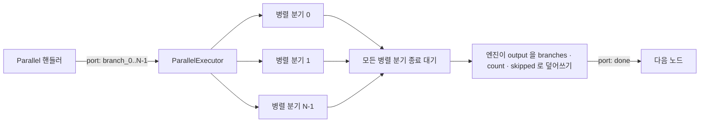

> 구현 상태: 부분 구현 · 원문: `spec/4-nodes/1-logic/10-parallel.md`, `spec/4-nodes/_product-overview.md` (§4.10) · 용어: [용어 사전](../CLE-GLOSSARY.md)

## 개요

Parallel 노드(Parallel, `parallel`)는 같은 입력을 받는 병렬 분기(branch) N개를 동시에 실행하는 노드다(`executionMetadata.kind = 'parallel'`). 컨테이너는 아니지만 엔진 덮어쓰기를 받는 노드다. 핸들러는 `branch_0` ~ `branch_{N-1}` 동적 출력 포트를 한꺼번에 활성화한다. 모든 병렬 분기가 끝나면 엔진이 `done` 포트로 `{ branches, count, skipped? }` 결과를 내보낸다. `branches[i]` 는 `branch_i` 병렬 분기의 결과 노드 출력이다. 결과 노드를 고르는 규칙은 [병렬 분기의 노드 집합과 위상 순서](#병렬-분기의-노드-집합과-위상-순서) 가 정한다. `errorPolicy='continue'` 에서 실패한 병렬 분기는 `branches[i]` 를 `null` 로 두고 실패 정보를 `output.skipped` 에 따로 모은다. 이 형태는 [ForEach 노드](CLE-NODE-FOREACH.md) 와 같고 `meta.skippedCount` 는 싣지 않는다. 출력의 자세한 모양은 [완료 시점](#완료-시점-done-포트) 이 정한다.

**구현 상태**: `ParallelExecutor` 가 `p-limit` 과 `Promise.allSettled` 로 병렬 분기를 동시에 실행한다. 코드 기본값이 `PARALLEL_ENGINE=v1` 이라 기본으로 켜져 있다. k8s 기본 매니페스트는 `off` 다([미결 사항](#미결-사항)). `PARALLEL_ENGINE=off` 로 명시하면 엔진이 위상 순서로 차례로 실행하는 되돌림 경로를 쓰고 완료 출력을 만들지 않는다(REQ-PARALLEL-027). 이 환경 변수는 모듈을 불러올 때 한 번 읽으므로 바꾸면 인스턴스를 다시 시작해야 반영된다. `branchCount` 2~16, `maxConcurrency` 0(제한 없음)·1~16 을 지원한다. 병렬 분기 안에 블로킹 노드와 되돌아가는 연결선은 둘 수 없다. 중첩 Parallel 은 깊이 2까지 허용한다. `waitAll` 은 항상 `true` 로 동작하고 `false` 는 지원하지 않는다. fire-and-forget 이 필요하면 [Background 노드](CLE-NODE-BACKGROUND.md) 를 쓴다. 2026-11-01 에 정한 완료 출력과 `branchCount` 범위 문구 합치기는 NERV Task `CLE-T-2HD471` 이 구현했다(2026-11-02). 병렬 분기 안에 둔 안쪽 Parallel 은 2026-11-06 부터 엔진의 Parallel 실행 경로를 탄다(NERV Task `CLE-T-GGZSC2`, REQ-PARALLEL-024 · 025). 남은 구현 갭은 두 가지다. 재개 · 재구동 뒤에는 완료 출력 대신 시작 시점 출력이 보인다([Logic 노드 공통](CLE-NODE-LOGIC-COMMON.md#미결-사항)). 컨테이너(Loop · ForEach · Map) 본문, 동기 서브 워크플로우, Background 본문에 둔 Parallel 은 엔진의 Parallel 실행 경로를 타지 않는다([미결 사항](#미결-사항)).

이 문서는 Parallel 노드의 설정, 포트, 병렬 분기의 노드 집합과 실행 순서, 실행 로직, 병렬 분기 격리, 출력 구조, 에러, 중첩 Parallel 제한을 정한다. 항목 에러 정책의 값 비교와 엔진 덮어쓰기 계약은 [Logic 노드 공통](CLE-NODE-LOGIC-COMMON.md) 이 정한다. 엔진 덮어쓰기의 실행 흐름은 [컨테이너 실행](../CLE-EXEC/CLE-EXEC-CONTAINER.md), `abortSignal` 전파 규칙은 [노드 취소](../CLE-EXEC/CLE-EXEC-CANCEL.md), 실행 컨텍스트 필드 분류는 [실행 컨텍스트](../CLE-EXEC/CLE-EXEC-CONTEXT.md), 저장·캔버스 단계의 중첩 경고 규칙은 [그래프 경고 규칙](../CLE-WF/CLE-WF-WARN.md) 이 정한다.

## 요구사항

- REQ-PARALLEL-001 WHEN Parallel 노드가 실행되면 THE SYSTEM SHALL 여러 병렬 분기를 동시에 실행한다. (원본: ND-PL-01)
- REQ-PARALLEL-002 WHEN 사용자가 `branchCount` 를 바꾸면 THE SYSTEM SHALL 병렬 분기 출력 포트(`branch_<index>`)를 그 수만큼 동적으로 만들거나 없앤다. (원본: ND-PL-02)
- REQ-PARALLEL-003 WHEN `PARALLEL_ENGINE` 이 `off` 가 아닐 때 모든 병렬 분기가 끝나면 THE SYSTEM SHALL `done` 포트로 `{ branches, count, skipped? }` 결과를 한 번에 합쳐 보낸다. (원본: ND-PL-03, Merge `wait_all` 로 우회하는 구성은 선택 사항)
- REQ-PARALLEL-004 WHEN 사용자가 `maxConcurrency` 를 설정하면 THE SYSTEM SHALL 동시에 실행하는 병렬 분기 수를 그 값으로 제한한다. (원본: ND-PL-04)
- REQ-PARALLEL-005 WHEN `maxConcurrency` 가 `0` 이면 THE SYSTEM SHALL 동시 실행 수를 `branchCount` 와 같게 둔다.
- REQ-PARALLEL-006 WHEN 핸들러가 시작 시점 출력을 반환하면 THE SYSTEM SHALL `output: null` 과 `port: string[]` (`branch_0` ~ `branch_{N-1}`)을 반환해 모든 병렬 분기를 활성화한다.
- REQ-PARALLEL-007 WHEN 병렬 분기를 시작하면 THE SYSTEM SHALL 모든 병렬 분기에 같은 입력을 복제해 넘긴다.
- REQ-PARALLEL-008 WHEN 병렬 분기 컨텍스트를 만들면 THE SYSTEM SHALL `ExecutionContext` 를 얕게 복사하고 `variables` 는 `structuredClone` 으로 깊게 복사한다.
- REQ-PARALLEL-009 WHEN 병렬 분기 컨텍스트를 만들면 THE SYSTEM SHALL `nodeOutputCache` · `structuredOutputCache` 를 얕게 복사하고 `itemContext` · `loopContext` 를 비운다.
- REQ-PARALLEL-010 WHILE 실행 환경이 `development` 나 `test` 인 동안 THE SYSTEM SHALL 병렬 분기 복제 직후 공유 캐시 값 객체를 깊게 얼려 값 내부 변경을 `TypeError` 로 드러낸다.
- REQ-PARALLEL-011 IF 항목 에러 정책이 `stop` 이고 병렬 분기가 실패하면 THE SYSTEM SHALL 모든 병렬 분기가 끝나기를 기다린 뒤 실패한 병렬 분기 가운데 번호(`branch_i` 의 `i`)가 가장 작은 것의 에러를 던져 Parallel 노드를 실패로 전이한다.
- REQ-PARALLEL-012 IF 항목 에러 정책이 `continue` 고 병렬 분기가 실패하면 THE SYSTEM SHALL 모든 병렬 분기가 끝나기를 기다린 뒤 그 병렬 분기의 `output.branches[i]` 를 `null` 로 두고 실패 정보를 `output.skipped` 에 `{ index, error: { code, message } }` 로 모은다.
- REQ-PARALLEL-013 IF 항목 에러 정책이 `cancel-others-on-fail` 이고 병렬 분기가 처음 실패하면 THE SYSTEM SHALL 자기 그룹의 `AbortController` 를 abort 해 다른 병렬 분기의 외부 I/O 를 중단하고 모든 병렬 분기가 끝난 뒤 첫 원인 에러를 Parallel 노드의 에러로 던진다.
- REQ-PARALLEL-014 WHEN `cancel-others-on-fail` 로 원인 에러를 고르면 THE SYSTEM SHALL `AbortError` 가 아닌 첫 실패를 원인으로 쓰고 `AbortError` 는 사용자에게 드러내지 않는다.
- REQ-PARALLEL-015 WHEN 상위 `context.abortSignal` 이 abort 되면 THE SYSTEM SHALL 그 abort 를 Parallel 그룹의 병렬 분기에도 전파한다.
- REQ-PARALLEL-016 IF `config.errorPolicy` 가 설정되지 않았으면 THE SYSTEM SHALL 공통 `errorHandling.policy` 가 `skip_node` / `use_default_output` / `route_to_error_port` 일 때 `continue`, 그 밖이면 `stop` 을 쓴다.
- REQ-PARALLEL-017 WHEN `PARALLEL_ENGINE` 이 `off` 가 아닐 때 모든 병렬 분기가 끝나면 THE SYSTEM SHALL 노드 `output` 을 `{ branches, count, skipped? }` 로 덮어쓰고 `port: 'done'`(단일 문자열)을 싣는다.
- REQ-PARALLEL-018 IF `waitAll` 이 `false` 면 THE SYSTEM SHALL `handler.validate` 에서 거부하고 Background 노드를 쓰라고 안내한다.
- REQ-PARALLEL-019 IF `branchCount` 가 정수가 아니거나 2~16 밖이면 THE SYSTEM SHALL 캔버스에 경고 배지를 표시하고 `handler.validate` 에서 거부한다.
- REQ-PARALLEL-020 IF `maxConcurrency` 가 숫자가 아니거나 정수가 아니거나 0~16 밖이면 THE SYSTEM SHALL `handler.validate` 에서 거부한다.
- REQ-PARALLEL-021 IF 검증을 거치지 않은 `branchCount` 가 2~16 밖이면 THE SYSTEM SHALL 핸들러와 실행기 양쪽에서 그 범위로 줄여 방어한다.
- REQ-PARALLEL-022 IF 병렬 분기 안에 블로킹 노드가 있으면 THE SYSTEM SHALL 병렬 분기를 실행하기 전 엔진 그래프 검증에서 메시지가 `PARALLEL_INVALID_CHILD:` 로 시작하는 에러로 실행을 실패시킨다.
- REQ-PARALLEL-023 IF 병렬 분기 안에 되돌아가는 연결선이 있으면 THE SYSTEM SHALL 엔진 그래프 검증에서 메시지가 `PARALLEL_BACK_EDGE:` 로 시작하는 에러로 실행을 실패시킨다.
- REQ-PARALLEL-024 IF 중첩 Parallel 깊이가 2를 넘으면 THE SYSTEM SHALL 엔진 그래프 검증에서 메시지가 `PARALLEL_NESTED_DEPTH_EXCEEDED:` 로 시작하는 에러로 실행을 실패시킨다.
- REQ-PARALLEL-025 IF 중첩 Parallel 의 바깥 × 안쪽 동시 실행 수 곱이 32를 넘으면 THE SYSTEM SHALL 안쪽 동시 실행 수를 `max(1, floor(32 / parentEffective))` 로 줄이고 `meta.clampedConcurrency` 에 기록한다.
- REQ-PARALLEL-026 WHEN 워크플로우를 저장하거나 캔버스를 편집하면 THE SYSTEM SHALL 중첩 깊이 위반은 저장을 거부하고 동시 실행 수 곱 초과는 경고 배지로 먼저 알린다.
- REQ-PARALLEL-027 WHEN `PARALLEL_ENGINE=off` 로 설정하면 THE SYSTEM SHALL 병렬 분기를 위상 순서로 차례로 실행하고 완료 출력(`branches` · `count` · `skipped`)을 만들지 않으며 Parallel 노드 출력을 핸들러의 시작 시점 출력(`output: null`, `port: ['branch_0', …]`)으로 둔다.
- REQ-PARALLEL-028 WHEN Parallel 노드를 정의하면 THE SYSTEM SHALL 런타임 에러 포트를 두지 않는다.
- REQ-PARALLEL-029 IF 실패한 병렬 분기가 없으면 THE SYSTEM SHALL 완료 출력에 `output.skipped` 를 싣지 않는다.
- REQ-PARALLEL-030 WHEN 병렬 분기의 결과를 정하면 THE SYSTEM SHALL 이번 Parallel 실행에서 그 병렬 분기가 출력을 쓴 노드 가운데 [위상 순서](#병렬-분기의-노드-집합과-위상-순서)가 가장 늦은 노드의 출력을 엔진 제어 필드(`_selectedPort` 등)를 빼고 `output.branches[i]` 에 담고 그런 노드가 없거나 그 출력이 `undefined` 면 `null` 을 담는다.
- REQ-PARALLEL-031 WHEN 병렬 분기 안의 노드가 출력을 쓰면 THE SYSTEM SHALL 그 출력을 병렬 분기의 캐시 사본에도 옮겨 같은 병렬 분기의 다음 노드 입력과 포트 라우팅이 그 출력을 쓰게 한다.
- REQ-PARALLEL-032 IF 병렬 분기 안의 노드가 실행 중에 `waiting_for_input` 상태를 내면 THE SYSTEM SHALL 메시지가 `PARALLEL_INVALID_CHILD:` 로 시작하는 에러로 그 병렬 분기를 실패시키고 항목 에러 정책대로 처리한다.
- REQ-PARALLEL-033 WHEN 실패한 병렬 분기를 `output.skipped` 에 더하면 THE SYSTEM SHALL `error.code` 를 ForEach · Map 과 같은 규칙으로 고른다. 백엔드가 직접 싣는 카탈로그 코드는 그대로 두고 `name` 이 `AbortError` 인 에러는 `AbortError` 로, 그 밖은 `UNKNOWN_ERROR` 로 둔다.

## 설정

| 필드 | 타입 | 필수 | 기본값 | 설명 |
|------|------|------|--------|------|
| branchCount | Integer | ✓ | `2` | 병렬 분기 수(출력 포트 수). `2` ~ `16`. 정상 경로에서는 `handler.validate` 가 범위 밖 값을 거부한다. 핸들러와 실행기의 범위 맞추기(2 미만·16 초과를 줄임)는 검증을 거치지 않은 값에 대한 방어다 |
| maxConcurrency | Integer | | `0` | 동시 실행 수. `0` 은 `branchCount` 와 같다(제한 없음). `1`~`16` 은 동시 실행 슬롯 수. [Logic 노드 공통](CLE-NODE-LOGIC-COMMON.md#리소스-제한) |
| waitAll | Boolean | | `true` | 모든 병렬 분기가 끝난 뒤 `done` 으로 나아간다. `false` 는 `handler.validate` 가 거부한다(아래 3번). 설정 화면에 표시하지 않는다 |
| errorPolicy | `stop` / `continue` / `cancel-others-on-fail` | | `stop` | 병렬 분기의 항목 에러 정책. [Logic 노드 공통](CLE-NODE-LOGIC-COMMON.md#항목-에러-정책). `stop` 은 모든 병렬 분기가 끝나기를 기다린 뒤 실패한 병렬 분기 가운데 번호가 가장 작은 것의 에러를 던진다. `continue` 는 모든 병렬 분기가 끝나기를 기다린 뒤 실패 정보를 모은다. `cancel-others-on-fail` 은 첫 실패에서 자기 그룹의 `ExecutionContext.abortSignal` 을 abort 해 다른 병렬 분기의 외부 I/O 를 곧바로 중단하고(signal 을 받는 노드의 best-effort 정리), 원인 에러를 Parallel 노드의 에러로 다시 던진다. 취소 규칙은 [노드 취소](../CLE-EXEC/CLE-EXEC-CANCEL.md) |

코드 기준: `codebase/backend/src/nodes/logic/parallel/parallel.schema.ts` (export `parallelNodeConfigSchema`)

1. `errorPolicy` 는 `parallelNodeConfigSchema` 에 직접 드러난 Parallel 전용 필드다. 공통 에러 처리 정책(`errorHandling.policy`)과 별개다.
2. 엔진은 `config.errorPolicy` 가 있으면 그 값을 그대로 쓴다. 없으면 공통 `errorHandling.policy` 를 대응시켜 쓴다. `skip_node` / `use_default_output` / `route_to_error_port` 는 `continue`, 그 밖은 `stop` 이다(옛 동선 호환).
3. `waitAll: false` 는 지원하지 않는다. `validateParallelConfig` 가 `waitAll === false` 를 거부한다. Parallel 은 항상 모든 병렬 분기가 끝난 뒤 `done` 포트로 결과를 합쳐 보낸다. `PARALLEL_ENGINE=off` 되돌림 경로는 완료 출력을 만들지 않는다(REQ-PARALLEL-027). 병렬 분기가 끝나는 대로 다음 노드로 나아가는 fire-and-forget 이 필요하면 [Background 노드](CLE-NODE-BACKGROUND.md) 를 쓴다. 옛 워크플로우의 `config.waitAll: false` 는 스키마 검증에서 거부되므로 사용자가 워크플로우 에디터에서 고쳐야 한다. 근거는 Rationale 「[`waitAll=false` 를 지원하지 않는다](#waitallfalse-를-지원하지-않는다-2026-05-30-결정-k)」.

## 설정 화면

| 영역 | 위치 | 들어가는 요소 | 동작 |
|------|------|--------------|------|
| 병렬 분기 수 | 맨 위 | `Branch Count` 입력(예 `3`), 안내 "병렬 실행할 분기 수 (2~16)" | `branchCount` 를 편집한다 |
| 동시 실행 수 | 가운데 | `Max Concurrency` 입력(예 `0`), 안내 "0 = 제한 없음 (branchCount 와 동일)" | `maxConcurrency` 를 편집한다 |
| 에러 정책 | 맨 아래 | `Error Policy` 드롭다운(`stop` / `continue` / `cancel-others-on-fail`) | `errorPolicy` 를 바꾼다 |

## 포트

| 방향 | id | label | type | dynamic | 설명 |
|------|------|-------|------|---------|------|
| 입력 | `in` | Input | data | false | 외부 데이터 진입. 모든 병렬 분기에 같은 입력을 복제해 넘긴다 |
| 출력 | `branch_0` ~ `branch_{N-1}` | Branch i | data | true | `branchCount` 에 따라 동적으로 만든다(`dynamicPorts.kind = 'parallel-branches'`). 병렬 분기마다의 진입점 |
| 출력 | `done` | Done | data | false | 모든 병렬 분기가 끝난 뒤 `{ branches, count }` 를 넘긴다. 실패한 병렬 분기가 있으면 `skipped` 도 넘긴다 |

동적 포트 ID 는 `branch_<index>` 형식이다([노드 출력 규약](../CLE-NODE/CLE-NODE-OUTPUT.md) 의 `<prefix>_<index>` 규칙). 동적 포트도 [Logic 노드 공통](CLE-NODE-LOGIC-COMMON.md#동적-포트-id-불변성) 의 ID 불변성을 따른다. `branchCount` 를 바꿔 포트를 다시 구성해도 기존 인덱스의 포트 ID 는 유지된다.

## 병렬 분기의 노드 집합과 위상 순서

이 절은 병렬 분기마다 어떤 노드를 어떤 순서로 실행하고 어느 노드의 출력을 결과로 쓰는지 정한다. 엔진의 `planParallelBody` 와 `executeParallelBranchBody` 가 이 규칙을 구현한다. [컨테이너 실행](../CLE-EXEC/CLE-EXEC-CONTAINER.md) 은 컨테이너 본문만 정하고 병렬 분기 본문은 이 문서가 정한다.

1. **소속**: `branch_i` 포트에 직접 연결된 노드가 그 병렬 분기의 진입점이다. 진입점에서 앞으로 가는 연결선을 따라 닿는 노드가 그 병렬 분기 본문의 후보다. 되돌아가는 연결선은 따라가지 않는다.
2. **합류 노드**: 둘 이상의 병렬 분기에서 닿는 노드는 합류 노드다(대개 Merge). 합류 노드는 어느 병렬 분기 본문에도 넣지 않고 모든 병렬 분기가 끝난 뒤 메인 루프가 실행한다. 그래서 병렬 분기 본문의 노드 집합은 서로 겹치지 않는다. 겹침은 에러로 다루지 않고 합류 노드로 처리한다.
3. **위상 순서**: 병렬 분기 본문 노드와 그 사이 연결선만으로 Kahn 알고리즘을 돈다(`topologicalSort`). 처음에는 진입 차수가 0 인 노드를 노드 ID 문자열 순서로 큐에 넣는다. 노드를 하나 꺼낼 때마다 새로 진입 차수가 0 이 된 이웃을 노드 ID 문자열 순서로 정렬해 큐 뒤에 붙인다. 예를 들어 `A → B`, `A → C` 면 순서는 `A`, `B`, `C` 다.
4. **실행**: 병렬 분기 루프는 이 순서대로 노드를 하나씩 실행한다. 진입점에서 닿는 노드만 실행하고 If · Switch 가 고르지 않은 포트 뒤의 노드는 실행하지 않는다. 노드 출력은 그 병렬 분기의 캐시 사본에도 옮기므로 같은 병렬 분기의 다음 노드 입력과 포트 라우팅이 그 출력을 본다(REQ-PARALLEL-031). 병렬 분기 안 컨테이너(Loop · ForEach · Map)는 자기 본문을 반복 회차마다 직접 실행한다. 병렬 분기 안 Background 는 본문을 큐에 넣고 기다리지 않는다. 병렬 분기 안 Parallel(안쪽 Parallel)은 엔진의 Parallel 실행 경로로 자기 병렬 분기를 실행하고 완료 출력을 쓴다. 안쪽 병렬 분기가 쓴 출력은 바깥 병렬 분기의 캐시 사본에도 옮기므로 안쪽 합류 노드와 안쪽 `done` 뒤 노드가 그 출력을 읽는다.
5. **결과 노드**: 병렬 분기 루프가 이번 Parallel 실행에서 출력을 쓴 노드 가운데 3번 순서가 가장 늦은 노드가 결과 노드다(REQ-PARALLEL-030). 경계는 다음과 같다.
   - 비활성 노드와 에러 처리 정책 `skip_node` 로 건너뛴 노드는 후보가 아니다. 엔진이 두 노드의 출력을 캐시에 쓰지 않기 때문이다. `skip_node` 의 이 동작은 [노드 에러 처리 정책](../CLE-NODE/CLE-NODE-ERROR.md#1-에러-처리-정책-다섯-가지) 의 「노드 건너뛰기」 가 정한다. `use_default_output` 과 `route_to_error_port` 로 처리한 노드는 출력을 쓰므로 후보다.
   - 병렬 분기 안 컨테이너의 본문 노드와 안쪽 Parallel 의 병렬 분기 본문 노드는 후보가 아니다. 컨테이너 노드와 안쪽 Parallel 노드 자신은 후보이고 그 결과는 각자의 완료 출력(예: ForEach 의 `{ items, count }`, 안쪽 Parallel 의 `{ branches, count, skipped? }`)이다.
   - 합류 노드는 병렬 분기 본문이 아니므로 후보가 아니다.
   - 같은 실행에서 Parallel 이 다시 실행될 때 앞 실행이 남긴 출력은 후보가 아니다. 엔진은 값을 비교하지 않고 이번에 출력을 쓴 노드 ID 를 기록해 판정한다.
   - 끝나는 노드가 둘 이상이면 3번 순서가 결과를 정한다. 이 순서는 노드 ID 로 갈리므로 그래프를 고치면 바뀔 수 있다. 결과를 하나로 정하려면 끝나는 노드들을 Merge 로 모은다.
   - 결과 노드 출력에서 `_selectedPort` 같은 엔진 제어 필드를 뺀다. 결과 노드가 없거나 그 출력이 `undefined` 면 `null` 이다. 실패한 병렬 분기도 `null` 이다.

`PARALLEL_ENGINE=off` 되돌림 경로는 이 절을 쓰지 않는다(REQ-PARALLEL-027).

## 실행 로직

1. `branchCount` 를 정수로 바꾸고 `[2, 16]` 범위로 맞춘다(핸들러와 실행기 양쪽에서 방어).
2. 핸들러는 `branch_0` ~ `branch_{N-1}` 포트를 모두 활성화하는 [시작 시점](#시작-시점-핸들러-반환) 형태를 반환한다(`port: string[]`, [노드 출력 규약](../CLE-NODE/CLE-NODE-OUTPUT.md) 의 fan-out 형태).
3. 엔진의 `ParallelExecutor` 가 `p-limit(effectiveConcurrency)` 로 동시 실행 슬롯을 제한하면서 `Promise.allSettled` 로 모든 병렬 분기를 동시에 실행한다. `effectiveConcurrency` 는 `maxConcurrency > 0 ? maxConcurrency : branchCount` 다. `PARALLEL_ENGINE=off` 면 엔진이 위상 순서로 차례로 실행하고 완료 출력을 만들지 않는다(되돌림 경로, REQ-PARALLEL-027).
4. 병렬 분기마다 `ExecutionContext` 의 얕은 복사본을 받는다. `variables` 는 `structuredClone` 으로 깊게 복사하고 `itemContext` / `loopContext` 는 병렬 분기에 들어갈 때 `undefined` 로 비운다(중첩 ForEach · Loop 상태가 새지 않게). 엔진은 노드 출력을 등록된 루트 컨텍스트에 쓰고 같은 항목을 그 병렬 분기의 캐시 사본에도 옮긴다(REQ-PARALLEL-031). 병렬 분기 안의 노드 실행 순서는 [병렬 분기의 노드 집합과 위상 순서](#병렬-분기의-노드-집합과-위상-순서) 가 정한다.
5. 항목 에러 정책을 적용한다.
   - `stop` (기본): 모든 병렬 분기가 끝나기를 기다린다. 실패한 병렬 분기가 있으면 번호가 가장 작은 병렬 분기의 에러를 던지고 Parallel 노드가 실패로 전이한다. 실패 뒤에도 다른 병렬 분기를 멈추지 않으므로 동시 실행 슬롯을 기다리던 병렬 분기도 시작한다. 실패 뒤 다른 병렬 분기를 멈추려면 `cancel-others-on-fail` 을 쓴다.
   - `continue`: 모든 병렬 분기가 끝나기를 기다린다. 실패한 병렬 분기 자리는 `null` 이고 실패 정보는 `output.skipped` 에 모인다([완료 시점](#완료-시점-done-포트)). Parallel 노드는 `done` 포트로 끝난다. 실패한 노드의 실행 기록은 실패 상태로 남는다. Parallel 노드의 실행 기록은 완료 출력으로 갱신되지 않으므로 `skipped` 를 담지 않는다([Logic 노드 공통](CLE-NODE-LOGIC-COMMON.md#미결-사항)).
   - `cancel-others-on-fail`: 자기 그룹용 `AbortController` 를 만들어 병렬 분기 컨텍스트의 `abortSignal` 에 넣는다. 첫 병렬 분기가 실패하면 `controller.abort()` 를 부른다. 다른 병렬 분기의 외부 I/O 노드 가운데 취소 규칙을 따르는 노드(HTTP · DB · AI · Cafe24 · MakeShop)가 best-effort 로 정리한다. Email 은 보내기 전 abort 확인만 하고 이미 진행 중인 SMTP 전송은 끊지 않는다. 모든 병렬 분기가 끝나면 원인 에러를 Parallel 노드의 에러로 다시 던진다(Parallel 노드 실패). 상위 `context.abortSignal` 이 있으면 그 abort 도 이어서 전파한다. 노드별 신호 처리 규칙은 [노드 취소 §노드 핸들러 의무](../CLE-EXEC/CLE-EXEC-CANCEL.md#노드-핸들러-의무) 가 정한다.
   - 사용자 취소: 사용자가 실행을 취소하면 정책과 상관없이 취소 에러(`ExecutionCancelledError`)를 다시 던진다. 취소는 `output.skipped` 에 들어가지 않는다.
6. 모든 병렬 분기가 끝나면 엔진이 `output` 을 덮어쓰고 `done` 포트(`port: 'done'`, 단일 문자열)로 보낸다. 형태는 [완료 시점](#완료-시점-done-포트) 이 정하고 `branches[i]` 를 고르는 규칙은 REQ-PARALLEL-030 이 정한다.



## 출력 구조

Parallel 은 엔진 덮어쓰기 대상 노드라서 시작 시점(병렬 분기 N개 fan-out)과 완료 시점(`done` 포트) 두 형태로 나눈다. JSON 예시는 `undefined` 필드를 생략했고 5필드 밖의 최상위 키는 쓰지 않는다.

### 시작 시점 (핸들러 반환)

```json
{
  "config": { "branchCount": 3, "maxConcurrency": 0, "waitAll": true, "errorPolicy": "continue" },
  "output": null,
  "port": ["branch_0", "branch_1", "branch_2"]
}
```

| 필드 | 타입 | 출처 | 설명 |
|------|------|------|------|
| `config.branchCount` | Integer (원래 값) | 설정 에코 | 사용자가 설정한 원래 값(범위 맞추기 전). 핸들러의 출력 포트 수는 맞춘 뒤 길이지만 설정 에코는 원래 값을 지킨다 |
| `config.maxConcurrency` | Integer (원래 값) | 설정 에코 | 사용자 설정 원래 값. 음수·16 초과 같은 잘못된 값도 그대로 싣고 실제 동작은 실행기가 맞춘다 |
| `config.waitAll` | Boolean (원래 값) | 설정 에코 | 사용자 설정 원래 값. 설정하지 않았으면 `undefined` 라 JSON 에서 빠진다. 검증을 통과한 값은 `true` 다 |
| `config.errorPolicy` | String (원래 값) | 설정 에코 | 사용자 설정 원래 값. 설정하지 않았으면 `undefined` 라 JSON 에서 빠지고 엔진은 REQ-PARALLEL-016 대로 정책을 고른다 |
| `output` | `null` | 핸들러 반환 | 엔진 덮어쓰기 대상 노드의 핸들러 계약(Loop · ForEach · Map 과 같은 계열). 엔진 안에서만 쓰는 중간 형태다. park · 재구동 없이 이어진 실행에서 다음 노드가 `$node["X"].output.*` 로 보는 값은 완료 시점 형태다. rehydration 뒤에는 이 `null` 을 본다(미구현, [Logic 노드 공통](CLE-NODE-LOGIC-COMMON.md#미결-사항)) |
| `port` | `string[]` | 핸들러 반환 | `branch_0` ~ `branch_{N-1}` 을 모두 활성화한다(fan-out). 병렬 분기 진입점을 여는 신호 |

### 완료 시점 (`done` 포트)

`errorPolicy='continue'` 에서 `branch_2` 가 실패한 예다.

```json
{
  "config": { "branchCount": 3, "maxConcurrency": 0, "waitAll": true, "errorPolicy": "continue" },
  "output": {
    "branches": [
      { "userId": "u-1", "step": "validate", "ok": true },
      { "userId": "u-1", "step": "enrich", "ok": true },
      null
    ],
    "count": 3,
    "skipped": [
      { "index": 2, "error": { "code": "UNKNOWN_ERROR", "message": "notify failed" } }
    ]
  },
  "port": "done"
}
```

예시의 `"UNKNOWN_ERROR"` 는 `code` 가 없는 평범한 Error 를 던졌을 때의 값이다. 실패한 병렬 분기가 없으면 `output.skipped` 필드 자체가 없다(REQ-PARALLEL-029).

| 필드 | 타입 | 출처 | 설명 |
|------|------|------|------|
| `config.*` | 원래 값 | 설정 에코 | 시작 시점과 같음 |
| `output.branches` | `Array<unknown \| null>` | 엔진 덮어쓰기 | 병렬 분기마다의 결과. `branches[i]` 는 `branch_i` 병렬 분기의 결과 노드 출력이고 고르는 규칙은 REQ-PARALLEL-030 과 [병렬 분기의 노드 집합과 위상 순서](#병렬-분기의-노드-집합과-위상-순서) 가 정한다. 실패한 병렬 분기는 `null` 이다. 컬렉션 키는 `branches` ([Logic 노드 공통](CLE-NODE-LOGIC-COMMON.md#반복-결과-출력-구조)) |
| `output.count` | Integer | 엔진 덮어쓰기 | 병렬 분기 수(`branches.length`). 실패한 병렬 분기도 자리를 지키므로 함께 센다. 컬렉션 키와 `count` 를 함께 내는 공통 규칙을 따른다 |
| `output.skipped?` | `Array<{ index, error: { code, message } }>` | 엔진 덮어쓰기 | `errorPolicy='continue'` 에서 실패한 병렬 분기 목록이고 `index` 오름차순이다. `index` 는 병렬 분기 번호(`branch_<index>` 의 index)다. `error.code` 와 `error.message` 는 ForEach · Map 과 같은 규칙으로 고른다([Logic 노드 공통](CLE-NODE-LOGIC-COMMON.md#반복-결과-출력-구조) 4 · 5번). `error.code` 는 카탈로그 코드 · `AbortError` · `UNKNOWN_ERROR` 가운데 하나다. 실패가 0건이면 필드 자체를 뺀다. 사용자 취소는 여기에 들어가지 않는다. 실행 상태 `skipped`(실행하지 않고 건너뜀)와는 다른 뜻이다 |
| `port` | `'done'` | 엔진 | 단일 문자열. 모든 병렬 분기 완료 경로 |

완료 출력의 `meta` 는 중첩 Parallel 에서 동시 실행 수를 줄였을 때만 `{ clampedConcurrency }` 로 싣고 그 밖에는 싣지 않는다(REQ-PARALLEL-025). 병렬 분기 수와 실패 수는 `meta` 에 따로 두지 않는다. 다음 노드는 병렬 분기 수를 `output.count` 로, 실패는 `output.skipped` 로 읽는다(실패 수는 `output.skipped.length`). `meta.durationMs` 도 없다. 노드 실행 기록과 `execution.node.completed` 이벤트의 실행 시간은 핸들러 실행 시간이고 병렬 분기 시간은 들어 있지 않다([노드 출력 규약](../CLE-NODE/CLE-NODE-OUTPUT.md#미결-사항)).

`errorPolicy` 가 `stop` 이나 `cancel-others-on-fail` 이면 병렬 분기가 실패할 때 Parallel 노드가 실패로 전이하고 `done` 포트를 거치지 않는다. 그래서 실패 자리의 `null` 과 `output.skipped` 는 `errorPolicy='continue'` 에서만 보인다.

표현식 접근 예:

- `$node["Parallel"].output.branches[0]` → `branch_0` 병렬 분기의 결과(실패했으면 `null`)
- `$node["Parallel"].output.branches[0].ok` → `branch_0` 결과의 필드
- `$node["Parallel"].output.skipped[0].error.message` → 첫 번째로 모인 실패의 에러 메시지(실패가 있을 때)
- `$node["Parallel"].output.skipped[0].index` → 그 실패가 난 병렬 분기 번호
- `$node["Parallel"].output.branches.length` → 병렬 분기 수(`output.count` 와 같은 값)
- `$node["Parallel"].output.count` → 병렬 분기 수(실패한 병렬 분기 포함)
- `$node["Parallel"].port` → `"done"`
- `$node["Parallel"].port[0]` → `"d"`. `port` 가 문자열이라 첫 글자가 나온다

병렬 분기가 실패했는지는 `output.skipped` 의 `index` 로 확인한다. 성공한 병렬 분기도 결과 노드가 없거나 결과 노드 출력이 `null` 이면 `branches[i]` 가 `null` 이므로 `branches[i]` 만으로는 실패를 가리지 못한다.

### 엔진 덮어쓰기 계약

| 시점 | `output` 형태 | `port` | 출처 |
|------|-------------|------|------|
| 시작(병렬 분기 fan-out 직전) | `output: null` | `string[]` (`branch_0` ~ `branch_{N-1}`) | 핸들러 반환. 병렬 분기 포트를 여는 용도 |
| 완료(모든 병렬 분기 종료 뒤) | `output: { branches: Array<unknown \| null>, count, skipped? }` | `'done'` (단일 문자열) | **엔진 덮어쓰기** |

1. park · 재구동 없이 이어진 실행에서 다음 노드가 `$node["Parallel"].output.*` 로 보는 값은 완료 시점 형태다. rehydration 뒤에는 시작 시점의 `output: null` 을 본다(미구현, [Logic 노드 공통](CLE-NODE-LOGIC-COMMON.md#미결-사항)).
2. 핸들러가 시작 시점에 반환한 `output: null` 은 엔진이 덮어쓰기 전의 중간 단계다(Loop · ForEach · Map 과 같은 방식). 밖의 표현식에 드러나지 않는 범위는 1번과 같다.
3. `port` 는 시작 시점에 `string[]` (fan-out)이고 완료 시점에 `'done'` 문자열(단일 포트)이다. 엔진 덮어쓰기 대상 노드 가운데 노드 출력에 `port` 를 직접 싣는 것은 Parallel 뿐이다. 엔진이 연결선을 고르려고 내부 캐시에 두는 `_selectedPort` 도 노드 출력 `port` 와 같은 모양이라([실행 엔진](../CLE-EXEC/CLE-EXEC-ENGINE.md) 의 `_selectedPort` 처리) 완료 시점에 `'done'` 이다.
4. 병렬 분기 입력은 `ParallelExecutor` 가 `ExecutionContext` 얕은 복사본(`variables` 는 깊은 복사)으로 나눠 준다. 핸들러의 시작 시점 `output` 에 기대지 않는다.
5. `PARALLEL_ENGINE=off` 되돌림 경로에서는 완료 시점 덮어쓰기가 없다. 노드 출력은 시작 시점 형태(`output: null`, `port: string[]`)로 남는다(REQ-PARALLEL-027, [`off` 되돌림 경로는 완료 출력을 만들지 않는다](#off-되돌림-경로는-완료-출력을-만들지-않는다-2026-11-02)).

## 에러

Parallel 은 런타임 에러 포트가 없다. 설정 검증 실패는 사전 검증 에러로 던지고 병렬 분기 실행 중의 에러는 항목 에러 정책으로 처리한다. 메시지는 영문 원문이 기준이고 캔버스는 프론트엔드 i18n 으로 한국어를 렌더링한다.

`branchCount` 범위 검사는 노드 경고 규칙 한 곳에만 둔다. `handler.validate` 는 경고 규칙과 `validateConfig` 의 결과를 합쳐 돌려주므로 같은 문구가 캔버스 배지와 검증 결과에 한 번씩 보인다. `validateConfig`(`validateParallelConfig`)는 경고 규칙의 표현식으로 쓸 수 없는 정수 검사만 맡는다.

표의 `PARALLEL_INVALID_CHILD` · `PARALLEL_BACK_EDGE` · `PARALLEL_NESTED_DEPTH_EXCEEDED` 는 에러 메시지 앞에 붙는 접두사다. `ErrorCode` enum 값이 아니고 `output.skipped[].error.code` 값도 아니다. [Logic 노드 공통](CLE-NODE-LOGIC-COMMON.md#컨테이너-패턴) 규칙 1 의 `CONTAINER_*` 와 같은 방식이다. 그래서 `errorPolicy='continue'` 에서 실행 중 대기로 실패한 병렬 분기는 `error.code` 가 `'UNKNOWN_ERROR'` 이고 접두사는 `error.message` 앞에 붙는다. 접두사는 진단용이며 클라이언트가 분기 근거로 쓰지 않는다([에러 코드 규약과 카탈로그](../CLE-API/CLE-API-ERRCODES.md#규칙) 규칙 4). 접두사는 안정된 코드로 올리지 않는다(2026-11-05, [Logic 노드 공통](CLE-NODE-LOGIC-COMMON.md#실패한-회차와-병렬-분기의-errorcode-2026-11-05)).

| 발생 조건 | 메시지 · 처리 | 시점 |
|-----------|--------------|------|
| `branchCount` 가 `[2, 16]` 밖 | `branchCount must be a value between 2 and 16.` | 노드 경고 규칙(캔버스 배지와 `handler.validate`) |
| `branchCount` 가 정수 아님 | `branchCount must be an integer.` | `handler.validate` |
| `maxConcurrency` 가 숫자 아님 | `maxConcurrency must be a number.` | `handler.validate` |
| `maxConcurrency` 가 정수 아님 | `maxConcurrency must be an integer.` | `handler.validate` |
| `maxConcurrency` 가 `[0, 16]` 밖 | `maxConcurrency must be a value between 0 and 16 (0 = unlimited).` | `handler.validate` |
| `waitAll` 이 불리언 아님 | `waitAll must be a boolean.` | `handler.validate` |
| `waitAll === false` | `waitAll=false is not supported. Use waitAll=true (default) or the Background node for fire-and-forget semantics.` | `handler.validate` |
| `errorPolicy` 가 세 값 밖 | `errorPolicy must be 'stop', 'continue', or 'cancel-others-on-fail'.` | `handler.validate` |
| 병렬 분기 에러(`errorPolicy=stop`) | 모든 병렬 분기가 끝난 뒤 실패한 병렬 분기 가운데 번호가 가장 작은 것의 에러를 던짐. Parallel 노드 실패 | 엔진 런타임([Logic 노드 공통](CLE-NODE-LOGIC-COMMON.md#항목-에러-정책)) |
| 병렬 분기 에러(`errorPolicy=continue`) | 실패 자리는 `null`, 실패 정보는 `output.skipped`([완료 시점](#완료-시점-done-포트)). Parallel 노드는 `done` 으로 끝남 | 엔진 런타임 |
| 병렬 분기 에러(`errorPolicy=cancel-others-on-fail`) | 자기 그룹 `AbortController.abort()` → 다른 병렬 분기 외부 I/O 중단 + 원인 에러를 던짐 → Parallel 실패. 규칙: [노드 취소](../CLE-EXEC/CLE-EXEC-CANCEL.md) | 런타임(`ParallelExecutor`) |
| 사용자가 실행을 취소함 | 항목 에러 정책과 상관없이 `ExecutionCancelledError` 를 다시 던짐. `output.skipped` 에 넣지 않음 | 런타임(`ParallelExecutor`) |
| 병렬 분기 안에 블로킹 노드(form / buttons / ai_conversation) | `PARALLEL_INVALID_CHILD: …` | 엔진 그래프 검증(`planParallelBody`, 병렬 분기 실행 전) |
| 병렬 분기 안 노드가 실행 중에 `waiting_for_input` 을 냄 | `PARALLEL_INVALID_CHILD: …` 로 그 병렬 분기 실패. 처리는 항목 에러 정책을 따름(REQ-PARALLEL-032) | 엔진 런타임(병렬 분기 루프) |
| 병렬 분기 안에 되돌아가는 연결선 | `PARALLEL_BACK_EDGE: …` | 엔진 그래프 검증(`planParallelBody`) |
| 중첩 Parallel 깊이 > 2 (깊이 2 의 병렬 분기에 또 Parallel) | `PARALLEL_NESTED_DEPTH_EXCEEDED: …` | 엔진 그래프 검증(바깥 Parallel 의 `planParallelBody`, 병렬 분기 실행 전) |
| 중첩 Parallel 동시 실행 수 곱이 32 초과 | 조용히 줄임 + 안쪽 Parallel 의 `meta.clampedConcurrency` 기록 + debug 로그 | 런타임(`ParallelExecutor`) |

## 설정 요약

- 형식: `{N} branches`
- 예: `3 branches`
- 구현: `parallel.schema.ts` 의 `summaryTemplate` (`'{{branchCount}} branches'`).

## 미결 사항

- **컨테이너 · 서브 워크플로우 · Background 본문의 Parallel** (warning): 컨테이너(Loop · ForEach · Map) 본문, 동기 서브 워크플로우, Background 본문에 둔 Parallel 은 엔진의 Parallel 실행 경로를 타지 않는다. 컨테이너 본문 루프(`executeContainerBody`)와 동기 서브 워크플로우 · Background 본문 루프(`executeInline`)가 Parallel 을 따로 실행하지 않기 때문이다. 그래서 이 Parallel 은 핸들러가 연 `branch_N` 포트로 본문 노드를 차례로 실행하고 `done` 포트를 열지 않는다. 완료 출력이 없고 동시 실행 · 항목 에러 정책 · REQ-PARALLEL-024 · 025 의 실행 시점 검사도 적용되지 않는다. NERV Task `CLE-T-0DGHGF` 가 다룬다.
- **정수가 아닌 `branchCount` 의 캔버스 배지** (info): 노드 경고 규칙은 범위만 보므로 REQ-PARALLEL-019 의 정수 아님 배지는 표시되지 않는다. `handler.validate` 는 거부한다. 배지를 더할지 요구사항을 고칠지 결정 필요.
- **`PARALLEL_ENGINE=off` 에서 `done` 뒤 노드의 실행 시점** (info): 되돌림 경로에서 `done` 연결선 뒤 노드가 병렬 분기 완료를 기다리는지 정하지 않았다. 동작 확인과 결정 필요.
- **k8s 기본 매니페스트의 `PARALLEL_ENGINE`** (warning): 코드 기본값과 `.env.example` 은 `v1` 이다. k8s 기본 매니페스트(`k8s/base/configmap.yaml`)는 `PARALLEL_ENGINE: "off"` 다. 그래서 지금 k8s 기본 매니페스트로 배포하면 되돌림 경로(REQ-PARALLEL-027)로 실행되고 완료 출력(`branches` · `count` · `skipped`)이 나오지 않는다. 매니페스트를 `v1` 로 바꿀지 결정 필요.
- **입력 대기로 실패한 자식 노드의 실행 기록 상태** (info): REQ-PARALLEL-032 로 병렬 분기가 실패할 때 `waiting_for_input` 을 낸 자식 노드의 실행 기록이 어느 상태로 끝나는지 정하지 않았다. 지금 테스트도 이 상태를 확인하지 않는다. 종결 상태를 정하고 [실행 상태 머신과 대기·재개](../CLE-EXEC/CLE-EXEC-STATE.md) 의 전이 표에 넣을지 결정 필요.

## 구현 위치

- `codebase/backend/src/nodes/logic/parallel/parallel.*.ts`
- `codebase/backend/src/modules/execution-engine/containers/parallel-executor.ts` (`ParallelExecutor`, `ParallelBranchContext`)
- `codebase/backend/src/modules/execution-engine/execution-engine.service.ts` (`planParallelBody` · `executeParallelBranchBody` · `runParallel` 완료 시점 덮어쓰기, 엔진 공통 출력 쓰기 지점 `commitNodeOutput`, 병렬 분기 사본 반영 `syncParallelBranchCacheEntry`, 안쪽 병렬 분기 출력을 바깥 병렬 분기 사본에 옮기는 `publishBranchOutputsToParent`)
- `codebase/backend/src/modules/execution-engine/graph/topological-sort.ts` (위상 순서)

## Rationale

### 병렬 분기 캐시 격리: 얕은 복사와 개발·테스트 환경 동결 (2026-06-10)

병렬 분기는 `ExecutionContext` 의 얕은 복사본을 받고 `variables` 만 `structuredClone` 으로 깊게 복사한다. `nodeOutputCache` / `structuredOutputCache` 도 얕게 복사하고 값 객체는 부모와 함께 쓴다(깊은 복사 비용을 피한다). 엔진은 병렬 분기 안 노드의 출력을 등록된 루트 컨텍스트에 쓰고 같은 항목을 그 병렬 분기의 사본에도 옮긴다([2026-11-02 절](#병렬-분기-사본에-엔진-쓰기를-옮긴다-2026-11-02)). 출력이 루트에 남는 것은 합류 노드와 `done` 뒤 노드가 루트 컨텍스트에서 병렬 분기 노드의 출력을 읽기 때문이다. 병렬 분기 본문의 노드 집합은 서로 겹치지 않으므로 두 병렬 분기가 같은 키에 쓰지 않는다. 둘 이상의 병렬 분기에서 닿는 노드는 `planParallelBody` 가 합류 노드로 빼내 어느 병렬 분기 본문에도 넣지 않는다([병렬 분기의 노드 집합과 위상 순서](#병렬-분기의-노드-집합과-위상-순서)).

이 설계의 불변식은 "병렬 분기는 공유 캐시 값 객체의 안쪽을 바꾸지 않는다" 이다. 얕은 복사 결정을 대신하지 않는 보조 강제 장치로, 개발·테스트 환경(`NODE_ENV ∈ {development, test}`)에서는 병렬 분기 복제 직후 공유 값 객체를 깊게 `Object.freeze` 한다. 동결은 병렬 분기 컨텍스트를 복제하는 시점에 캐시에 있던 값 객체에만 건다. 복제 뒤에 쓴 출력은 그 병렬 분기 컨텍스트의 동결 대상이 아니다. 불변식을 어기면(값 안쪽을 바꾸면) 곧바로 `TypeError` 로 드러난다. 운영 환경에는 적용하지 않는다(동결 비용을 피하고 동작을 바꾸지 않는다). 그래서 운영 동작은 얕은 복사 격리 그대로다.

기각한 대안은 병렬 분기마다 캐시를 깊게 복사하는 안이다. 병렬 분기 수만큼 캐시 전체를 복사하는 비용이 들어 얕은 복사를 택하고 개발·테스트 환경 동결로 불변식을 지킨다.

이 절은 한때 병렬 분기가 더한 최상위 키는 병렬 분기 안에만 남는다고 적었다. 겹치지 않는 근거로는 `CONTAINER_INVALID_CHILD` 검증을 들었다. 두 서술 모두 사실과 달라 2026-11-02 에 고쳤다. 엔진 쓰기는 루트 컨텍스트로 갔고 `CONTAINER_INVALID_CHILD` 는 컨테이너 본문에 트리거 노드를 둘 때 던지는 에러다. 겹침을 막는 장치는 에러가 아니라 `planParallelBody` 의 합류 노드 판정이다.

### `done` 출력에 `count` 를 싣는다 (2026-06-03 결정 B)

한때 이 문서에 "`count` 필드는 제거됨(`branches.length` 가 단일 기준)" 이라는 서술이 있었다. 이는 컨테이너 공통 출력 규칙과 실제 엔진 구현에 어긋나는 서술이었다. 공통 규칙은 엔진 덮어쓰기 대상 노드가 모두 `{ <컬렉션 키>, count }` 를 낸다고 정하고 `ExecutionEngineService` 의 Parallel `done` 덮어쓰기도 `{ branches, count: branchResults.length }` 를 싣는다.

어긋남을 풀 때 두 방향을 검토했다.

- **(A) 공통 규칙과 코드에서 Parallel 만 `count` 예외로 둔다**: Parallel 은 포트로 나뉘는 병렬 분기라 `count` 의 뜻이 약하다는 논거였다. 그러나 공통 규칙 세 곳, 코드, 다른 엔진 덮어쓰기 대상 노드 셋을 모두 바꿔야 하고 `output.count` 를 쓰는 워크플로우가 깨진다.
- **(B) 이 문서에 `count` 를 되살린다** (채택): 코드·공통 규칙·다른 노드와 곧바로 맞고 변경이 이 문서에 그친다. `branches.length` 와 겹치지만 출력의 균일성(`{ <컬렉션 키>, count }`)을 겹침 제거보다 앞에 둔다. 다음 노드는 노드 종류와 상관없이 `output.count` 로 항목 수를 읽을 수 있다.

### `waitAll=false` 를 지원하지 않는다 (2026-05-30 결정 K)

`waitAll: false` 는 처음에 스키마에 드러나 있었지만 엔진이 무시하는 죽은 필드였다. 다음 단계에서 활성화와 제거를 검토했고 지원하지 않기로 했다.

**`waitAll=false` 가 뜻하려던 동작**: 병렬 분기(`branch_i`)가 끝나는 즉시 그 병렬 분기의 바깥 다음 노드를 시작한다. 예를 들어 branch 0 이 1초, branch 1 이 5초 걸리면 branch 0 의 다음 노드가 1초 시점에 시작한다.

**기각 근거는 엔진 구조다**: 현재 `ExecutionEngineService` 는 Node.js 단일 스레드 메인 루프로 노드를 dispatch 한다. `runParallel` 은 메인 루프가 `await` 로 기다리는 함수이고 메인 루프는 `runParallel` 이 반환된 뒤에야 다음 노드로 나아간다. 그래서 병렬 분기 완료 콜백 안에서 `propagateReachability` 를 불러도 바깥 노드는 모든 병렬 분기가 끝난 뒤에야 dispatch 된다.

이 동작을 살리려면 병렬 분기가 끝날 때마다 바깥 다음 노드를 별도 하위 루프로 dispatch 해야 한다. 그러면 다음 위험이 따른다.

- 메인 dispatch 루프와 별도 하위 루프가 동시에 돈다. 경쟁 상태와 `executedNodes` 집합 동시 변경이 생긴다.
- Loop · ForEach · Map 같은 컨테이너의 fan-out 경로(`runContainer`)와 서로 영향을 준다.
- 병렬 분기 안에 ForEach · Loop · Map 이 들어가는 시나리오가 회귀할 수 있다.

**대안은 Background 노드다**: fire-and-forget 은 [Background 노드](CLE-NODE-BACKGROUND.md) 가 명시적으로 지원한다. BullMQ enqueue 모델로 워커 단에서 이미 분리돼 있어 더 안전하다.

**결정**: Parallel 은 항상 `waitAll=true` (기본)로 동작한다. 모든 병렬 분기가 끝난 뒤 `done` 포트로 결과를 합쳐 보낸다. `PARALLEL_ENGINE=off` 되돌림 경로는 완료 출력을 만들지 않는다([아래 절](#off-되돌림-경로는-완료-출력을-만들지-않는다-2026-11-02)). `waitAll=false` 를 명시한 워크플로우는 스키마 검증에서 거부한다([에러](#에러) 표).

**옛 워크플로우 호환: 데이터 마이그레이션은 하지 않는다 (2026-07-16 확정)**. DB 에 `config.waitAll: false` 가 저장된 경우 실행 시점에 스키마 검증이 거부하고 사용자가 워크플로우 에디터에서 고친다. 이것이 완결된 처리 경로이고 저장된 값을 한꺼번에 고치는 데이터 마이그레이션은 하지 않는다.

- 근거: 결정 K 는 `waitAll=false` 를 스키마에는 남기고 검증에서 거부하는 형태로 정했다. 잘못된 값이 다른 뜻으로 조용히 실행되지 않고 명확한 에러 메시지로 바로 드러나며 그 메시지가 대안(Background 노드)까지 안내한다.
- 데이터 마이그레이션이 더 얻는 것은 "에디터에서 한 번 고치는 수고" 를 없애는 것뿐이다. 그 대가로 사용자 워크플로우 설정을 소급해 고치는 쓰기 마이그레이션을 치러야 한다. `false` 를 `true` 로 바꾸면 뜻이 달라지고 Background 노드로 옮기는 것은 그래프 구조 변경이라 자동화할 수 없다.
- 뜻이 바뀌는 자동 변환은 사용자 의도를 대신 정하는 일이라 거부하고 안내하는 쪽이 더 안전하다.
- 이력: 이 처리는 한때 별도 후속 작업으로 넘긴다고 적혀 있었다. 그 후속 항목이 작업 계획을 나누는 과정에서 사라져 아무도 추적하지 않는 상태가 됐고 2026-07-16 정리에서 이를 확인해 위와 같이 확정했다.

### 중첩 Parallel 을 제한적으로 허용한다 (깊이 2, 동시 실행 수 곱 상한 32, 2026-05-30 결정 #3 · G · D)

처음 단계에서는 `PARALLEL_NESTED_NOT_SUPPORTED` 로 모든 중첩을 거부했다. 다음 단계에서 아래 결정으로 제한적 중첩 허용으로 바꿨다.

**깊이 2 까지만**: 바깥 Parallel 의 병렬 분기 안에 안쪽 Parallel 한 단계만 허용하고 3중부터(`PARALLEL_NESTED_DEPTH_EXCEEDED`) 거부한다. 워크플로우를 나누기 어려운 경우가 있어 부분 허용은 가치가 있다. 하지만 깊이를 제한하지 않으면 동시 워커 수가 폭발하고 그래프 구조가 사용자가 머릿속에 그릴 수 있는 범위를 넘는다. 두 단계면 "분기 안에서 또 분기" 라는 가장 흔한 요구를 담는다.

**동시 실행 수 곱 상한 32**: 바깥 `maxConcurrency` 16 × 안쪽 16 이면 최대 256 워커가 동시에 돌 수 있다. 운영 환경에서 메모리 부족이나 이벤트 루프 지연 위험이 있다. 32 는 바깥 4 × 안쪽 8, 바깥 8 × 안쪽 4, 바깥 16 × 안쪽 2 같은 합리적 조합을 모두 허용하면서 워커 수 상한을 보수적으로 지킨다.

**거부하지 않고 조용히 줄인다**: 상한을 넘으면 거부하지 않고 `effectiveConcurrency = max(1, floor(32 / parentEffective))` 로 자동으로 줄인다. `max(1, …)` 하한은 `parentEffective > 32` 인 경계에서 `floor` 가 0 이 돼 슬롯이 0 이 되고 모든 병렬 분기가 실행되지 않는 교착을 막는다(최소 1개 병렬 분기는 항상 실행한다). 워크플로우 작성자가 바깥·안쪽 `maxConcurrency` 곱을 늘 정확히 계산하기를 기대하기 어렵다. 의도와 실제의 차이는 두 경로로 보인다.

1. **런타임**: `ParallelExecutor` 가 값을 줄이면 결과에 `clampedConcurrency` 를 넣고 엔진이 그 값을 Parallel 노드의 `meta.clampedConcurrency = { intended, actual, parentEffective, cap }` 에 기록한다. 다음 노드는 `$node["Parallel"].meta.clampedConcurrency` 로 볼 수 있고 사용자는 실행 결과 타임라인에서 바로 확인한다. 운영 로그에는 `Logger.debug` 로 남긴다.
2. **저장·캔버스 사전 경고**: 그래프 경고 규칙 `parallel:nested-concurrency-cap` (warning)이 곱이 32를 넘으면 캔버스 배지로 먼저 알린다. 저장은 통과한다(런타임 줄이기가 안전망). 규칙 정의는 [그래프 경고 규칙 §등록된 규칙](../CLE-WF/CLE-WF-WARN.md#등록된-규칙) 이 정한다.

**3중 가드 (결정 E)**: 깊이 검증은 세 곳에서 한다. 런타임 `planParallelBody` 가 거부하고 워크플로우 저장이 그래프 경고 규칙 `parallel:nested-depth-exceeded` (error)로 거부(400 `GRAPH_VALIDATION_FAILED`)하고 캔버스가 같은 규칙을 로컬에서 평가해 먼저 알린다. 저장·캔버스 가드는 구현돼 있고 [그래프 경고 규칙 §평가 시점과 3중 가드](../CLE-WF/CLE-WF-WARN.md#평가-시점과-3중-가드) 가 정한다.

**전파 방식 (결정 G)**: `parentParallelConcurrency: number` 필드를 `ParallelBranchContext extends ExecutionContext` 에 둔다. 바깥 Parallel 의 `ParallelExecutor` 가 병렬 분기 컨텍스트를 복제할 때 자기 `effectiveConcurrency` 를 이 필드에 넣는다. 안쪽 Parallel 은 자기 `effectiveConcurrency` 를 계산할 때 이 값을 읽어 상한을 적용한다. 깊이 2 가드 아래에서 한 단계만 쌓인다. 값이 없으면(가장 바깥 Parallel) 줄이지 않고 자기 값을 그대로 쓴다.

초안 결정 G 는 이 필드를 `ExecutionContext` 의 선택 필드(`parentParallelConcurrency?`)로 바로 넣었다. 그러나 `ExecutionContext` 가 모든 것을 떠안는 객체가 된다는 우려에 따라 Parallel 전용 필드를 `ParallelBranchContext` 로 떼어 내도록 바꿨다(2026-05-31). 분류 근거와 결정 규칙은 [실행 컨텍스트](../CLE-EXEC/CLE-EXEC-CONTEXT.md) 가 정한다.

**구현 현황 (2026-11-06)**: 병렬 분기 루프가 안쪽 Parallel 을 엔진의 Parallel 실행 경로로 넘기므로 런타임 줄이기와 런타임 깊이 검사가 안쪽 Parallel 에도 적용된다([병렬 분기 안의 안쪽 Parallel 을 Parallel 실행 경로로 넘긴다](#병렬-분기-안의-안쪽-parallel-을-parallel-실행-경로로-넘긴다-2026-11-06)). 2026-11-02 에는 이 경로가 없어 두 검사가 안쪽 Parallel 에 적용되지 않았다. 저장·캔버스 가드는 그 전부터 동작했다. 컨테이너 · 서브 워크플로우 · Background 본문의 Parallel 은 아직 이 경로를 타지 않는다([미결 사항](#미결-사항)).

### `cancel-others-on-fail` 항목 에러 정책 (2026-05-30, 결정 A · H)

**뜻**: 첫 병렬 분기가 실패하면 다른 병렬 분기의 긴 외부 I/O (HTTP · DB · AI 등)를 곧바로 중단해 워커 자원 낭비를 막는다. `stop` 의 뜻(Parallel 실패로 전이)은 유지하면서 실패 뒤 다른 병렬 분기를 `continue` 처럼 끝까지 기다리지 않고 abort 한다.

**기각한 대안**: `errorPolicy=stop` 의 동작을 바꿔 항상 abort 하게 하는 방안. 옛 워크플로우의 뜻을 깨므로 별도 옵션으로 나눴다.

**방식**: 자기 그룹용 `AbortController` 를 만들어 병렬 분기 컨텍스트의 `abortSignal` 에 넣는다. 첫 실패한 병렬 분기의 `runBranch` 가 거부된 직후 `controller.abort()` 를 부르고 다른 병렬 분기의 외부 I/O 노드가 그 signal 을 받아 정리한다. 상위 `context.abortSignal` 이 있으면 상위 취소도 이 그룹에 전파한다.

**best-effort 계약** ([노드 취소](../CLE-EXEC/CLE-EXEC-CANCEL.md)): signal 을 지원하지 않는 노드(CPU 작업, 곧바로 끝나는 노드)는 자기 작업을 끝낼 때까지 계속한다. 2026-07-26 기준 signal 을 받는 노드는 HTTP · DB · AI · 이커머스 통합 Cafe24 · MakeShop 이다. Email 은 보내기 전 abort 확인만 하고 이미 보내는 중인 SMTP 는 일부러 중단하지 않는다. 채팅 채널은 노드가 아니라 `webhook` 트리거의 발신 어댑터라서 처음부터 대상이 아니다. 그래서 `cancel-others-on-fail` 의 효과는 노드별로 차츰 강해진다.

**에러 분류**: 모든 병렬 분기가 끝나면 원인 에러(`error.name !== 'AbortError'` 인 첫 실패)를 Parallel 노드의 에러로 다시 던진다. `AbortError` 는 뒤따른 병렬 분기 정리의 결과라서 사용자 메시지의 신호 대 잡음비를 위해 드러내지 않는다.

### 완료 `meta` 에 병렬 분기 수와 실패 수를 따로 싣지 않는다 (2026-10-24)

옛 [노드 출력 규약](../CLE-NODE/CLE-NODE-OUTPUT.md#principle-2-실행-메트릭에는-관측-값만-둔다) 의 컨테이너 행은 `meta.branches?` 를 적었지만 엔진은 `meta.clampedConcurrency` 만 싣는다. 병렬 분기 수는 `output.count` 로, 성공과 실패는 `output.branches[i].status` 로 알 수 있다고 보고 지금 동작을 계약으로 정했다(NERV Task `CLE-T-3HJ8MM`). 당시 문서는 `branches[i]` 를 allSettled 모양으로 적었지만 엔진에는 그 모양이 없었다. 2026-11-01 에 완료 출력 형태를 바꿔 실패는 `output.skipped` 로 읽는다([아래 절](#완료-출력은-병렬-분기-결과를-그대로-두고-실패를-따로-모은다-2026-11-01)). 실패 수를 `meta` 에 두지 않는다는 판단은 그대로다. 실패 수는 `output.skipped.length` 로 셀 수 있다.

기각한 대안은 완료 `meta` 에 `branches` · `fulfilledCount` · `rejectedCount` 를 더하는 안이다. 엔진 코드를 바꿔야 하고 지금 이 값을 요구하는 화면 · 요구사항이 없다. `meta.durationMs` 는 이 판단에 넣지 않았다. 노드 전체 실행 시간을 둘 곳은 [노드 출력 규약](../CLE-NODE/CLE-NODE-OUTPUT.md#미결-사항) 의 미결 사항 「컨테이너 · Parallel 노드의 실행 시간」 에서 정한다.

출력 균일성을 겹침 제거보다 앞에 둔 2026-06-03 결정 B([`done` 출력에 `count` 를 싣는다](#done-출력에-count-를-싣는다-2026-06-03-결정-b))는 `output` 필드에 대한 결정이다. 그래서 이 판단과 부딪치지 않는다. [Map 노드](CLE-NODE-MAP.md#배열이-아닌-입력을-빈-배열로-바꾸고-meta-로-알린다-2026-10-24) 가 완료 `meta` 에 `iterations` · `skippedCount` 를 더한 것은 같은 실행기를 쓰는 ForEach 와 `meta` 를 맞추려는 것이라 이 경우와 다르다.

병렬 분기 수나 실패 수를 `meta` 로 읽어야 하는 화면이나 요구사항이 생기면 다시 본다.

### 완료 출력은 병렬 분기 결과를 그대로 두고 실패를 따로 모은다 (2026-11-01)

이 문서는 한때 `branches[i]` 를 `Promise.allSettled` 모양(`{ status: 'fulfilled', value }` / `{ status: 'rejected', error }`)으로 적었다. 엔진은 처음부터 병렬 분기 마지막 노드의 출력을 그대로 `branches[i]` 에 넣었고 그렇게 감싸는 코드는 없었다(2026-06-25 재검증에서 찾은 어긋남, NERV Task `CLE-T-VTYPA1`). `errorPolicy='continue'` 에서 실행기가 모은 실패 목록도 엔진이 읽지 않아 실패한 병렬 분기가 출력에 드러나지 않았다. 사용자 가이드는 지금 구현 모양(`{{ $input.branches[0].data }}`)으로 설명해 왔다.

두 방향을 사람에게 올려 정했다(NERV 질문 `01a19678-6efb`).

- **(A) 스펙대로 allSettled 모양으로 감싼다** (기각): 스펙 수정은 가장 적다. 그러나 `branches[i].<필드>` 로 읽던 기존 워크플로우의 표현식이 에러 없이 `undefined` 가 되고 가이드도 바뀐다. `stop` · `cancel-others-on-fail` 은 병렬 분기가 실패하면 노드가 실패하므로 `done` 에는 성공만 오는데도 모든 읽기에 `.value` 한 단계가 늘어난다.
- **(B) 지금 모양을 지키고 실패를 따로 모은다** (채택): 기존 워크플로우와 가이드가 그대로 동작한다. 병렬 분기는 서로 독립이라 ForEach 의 "독립 항목 반복" 계약과 같다. 그래서 ForEach 와 같은 형태(실패 자리 `null` + 실패 목록 `output.skipped`)를 쓴다. ForEach 와 Map 이 실패를 다르게 적는 이유는 [Logic 노드 공통](CLE-NODE-LOGIC-COMMON.md#foreach-와-map-의-실패-표현을-다르게-둔다) 에 있다. ForEach 는 실패 수를 `meta.skippedCount` 로도 싣지만 Parallel 은 2026-10-24 결정대로 `meta` 에 실패 수를 두지 않는다. 요구하는 화면이나 요구사항이 생기면 ForEach 와 같은 값으로 더한다.

같은 질문에서 정한 필드 이름, 결과 노드, 완료 `port`, `branchCount` 범위 문구, `error.code` 값은 아래 절에 따로 적었다.

**기존 워크플로우 영향**: 성공한 병렬 분기를 `branches[i].<필드>` 로 읽던 워크플로우는 그대로 동작한다. `errorPolicy='continue'` 에서는 실패 자리가 `null` 이 되고 `output.skipped` 가 생긴다. 결과 노드와 `port` 가 바뀌는 영향은 해당 절에 적었다. 구현은 NERV Task `CLE-T-2HD471` 이 했다(2026-11-02).

### 실패 목록 필드 이름은 `skipped` 다 (2026-11-01)

ForEach 와 같은 이름을 쓰면 사용자는 "실패한 항목은 `output.skipped` 에 따로 모인다" 하나만 익히면 된다. 질문에서는 Parallel 에 `skip` 정책이 없으니 `failed` 를 쓰는 안도 함께 올렸지만 ForEach 와 이름이 갈려 기각했다. 실행 상태 `skipped`(실행하지 않고 건너뜀)와 철자가 같아서 출력 표에 다른 뜻이라고 적었다.

### 병렬 분기 결과는 실제로 실행된 마지막 노드의 출력이다 (2026-11-01)

이 규칙의 후보는 2026-11-02 에 「이번 Parallel 실행에서 출력을 쓴 노드」 로 좁혀졌다([결과 노드의 동률은 엔진 위상 순서로 가른다](#결과-노드의-동률은-엔진-위상-순서로-가른다-2026-11-02)). 엔진은 병렬 분기 안의 노드 전체를 위상 순서로 놓고 마지막 노드를 읽었다. 병렬 분기 안의 If · Switch 가 그 노드를 고르지 않으면 성공한 병렬 분기도 결과가 비었다. 그래서 실제로 실행된 노드 가운데 위상 순서가 가장 늦은 노드를 고른다고 정했다(REQ-PARALLEL-030). 실행된 노드가 없으면 `null` 이다.

### 완료 출력 `port` 는 `'done'` 문자열이다 (2026-11-01)

문서는 `'done'`, 엔진의 구조화 출력은 `['done']` 이었다. [노드 출력 규약](../CLE-NODE/CLE-NODE-OUTPUT.md) Principle 5 에서 배열은 여러 포트를 동시에 여는 fan-out 이다. 완료 시점은 `done` 하나만 열므로 문자열로 정했다. `['done']` 으로 문서를 맞추는 안은 fan-out 이 아닌 값에 배열을 쓰게 되어 기각했다. 엔진 내부 `_selectedPort` 도 노드 출력 `port` 와 같은 모양이라([실행 엔진](../CLE-EXEC/CLE-EXEC-ENGINE.md)) 함께 `'done'` 이 된다. 연결선 활성화는 문자열과 배열을 모두 받으므로 `done` 연결선만 여는 동작은 그대로다.

**기존 워크플로우 영향**: `$node["Parallel"].port` 가 `["done"]` 에서 `"done"` 으로 바뀌었다. 그래서 `$node["Parallel"].port[0]` 은 첫 글자 `"d"` 를 돌려준다. `port[0]` 으로 완료 경로를 확인하던 표현식은 `port` 로 고쳐야 한다.

### `branchCount` 범위 검사는 경고 규칙 한 곳에 둔다 (2026-11-01)

노드 경고 규칙(`branchCount must be 2 to 16.`)과 `validateParallelConfig`(`branchCount must be a value between 2 and 16.`)가 같은 범위를 따로 검사했다. `handler.validate` 는 두 결과를 합치므로 `branchCount=1` 이면 같은 뜻의 문구가 두 번 나왔다. 범위 검사는 경고 규칙 한 곳에만 두고 문구는 `maxConcurrency` 문구와 같은 모양으로 정했다. 두 문구를 그대로 두고 이 문서의 에러 표만 실제에 맞추는 안은 같은 뜻의 문구가 계속 두 번 보여 기각했다.

### `error.code` 의 값 (2026-11-01)

**2026-11-05 정리**: NERV Task `CLE-T-REC4X3` 이 ForEach · Map 과 함께 규칙을 하나로 모으고 이 임시 예외를 닫았다. 아래 문단은 그 전의 기록이다. 지금 규칙은 [Logic 노드 공통](CLE-NODE-LOGIC-COMMON.md#반복-결과-출력-구조) 4 · 5번이 정한다. 근거와 기각한 대안은 그 문서의 Rationale [실패한 회차와 병렬 분기의 `error.code`](CLE-NODE-LOGIC-COMMON.md#실패한-회차와-병렬-분기의-errorcode-2026-11-05) 에 있다.

그때 `skipped[].error.code` 는 던진 값이 Error 면 그 `name` 이었고 Error 가 아니면 `'UNKNOWN_ERROR'` 였다. ForEach 의 `skipped[].error.code` 도 같은 규칙으로 만들었다(`foreach-executor.ts`). 두 노드의 구현에는 차이가 하나 있었다. `name` 이 빈 문자열이면 Parallel 은 `'UNKNOWN_ERROR'` 를 냈고 ForEach 는 빈 문자열을 그대로 냈다.

이 값은 [에러 코드 규약과 카탈로그](../CLE-API/CLE-API-ERRCODES.md#규칙) 규칙 2 의 `UPPER_SNAKE_CASE` 표기를 따르지 않았고 `'UNKNOWN_ERROR'` 도 카탈로그에 없었다(2026-11-01 consistency 검토, 2026-11-02 코드 리뷰). 그때는 임시 예외로 두었다. 그 예외의 정본 서술이 이 절이었고 [노드 출력 규약](../CLE-NODE/CLE-NODE-OUTPUT.md#92-노드별-최종-출력-값) 9.2 와 [Logic 노드 공통](CLE-NODE-LOGIC-COMMON.md#반복-결과-출력-구조) 이 이 절을 가리켰다.

정리는 NERV Task `CLE-T-REC4X3` 에 ForEach 와 함께 맡겼다. 두 노드의 규칙 통일, 안정된 코드로 바꿀지, `UNKNOWN_ERROR` 를 카탈로그에 넣을지, [에러 코드 규약과 카탈로그](../CLE-API/CLE-API-ERRCODES.md#3-예외-등록-코드) §3 예외 등록부에 올릴지를 그 Task 가 정하기로 했다.

기각한 대안은 그때 Parallel 만 `UPPER_SNAKE_CASE` 코드로 바꾸는 안이었다. ForEach 가 같은 값을 내고 있어 Parallel 만 고치면 같은 형태의 `skipped` 에서 `code` 값이 노드마다 갈린다. 그래서 ForEach 와 함께 고치도록 미뤘다.


### 병렬 분기 사본에 엔진 쓰기를 옮긴다 (2026-11-02)

병렬 분기 컨텍스트는 캐시의 얕은 복사본을 들고 있고 엔진의 노드 출력 쓰기는 등록된 루트 컨텍스트로 간다. 이 어긋남 때문에 이 변경 전에는 병렬 분기 안 둘째 노드부터 입력이 `undefined` 였다. 병렬 분기 안 If · Switch 도 고른 포트를 사본에서 읽지 못해 연결된 경로를 모두 실행했다. 동기화를 끈 뮤턴트로 두 동작을 확인했다(NERV Task `CLE-T-2HD471`). 2026-11-01 절의 "If · Switch 가 고르지 않은 경로 때문에 결과가 비었다" 는 병렬 분기 안 라우팅이 동작한다고 보고 쓴 서술이다.

그래서 엔진이 노드 출력을 쓰는 지점을 `commitNodeOutput` 하나로 모았다. 이 메서드는 병렬 분기 전용이 아니고 엔진 공통 쓰기 지점이다(정상 완료, 기본 출력 사용, 에러 포트로 라우팅, 컨테이너 완료). 루트 컨텍스트에 쓴 뒤 `syncParallelBranchCacheEntry` 가 같은 항목을 병렬 분기 사본에 옮긴다(REQ-PARALLEL-031). 병렬 분기 밖에서는 루트와 사본이 같은 객체라 옮길 것이 없다. 사본에 옮길 때 출력을 쓴 노드 ID 도 기록하고 결과 노드 판정이 이 기록을 쓴다.

출력은 루트에도 남긴다. 합류 노드와 `done` 뒤 노드가 루트 컨텍스트에서 병렬 분기 노드의 출력을 읽기 때문이다.

기각한 대안은 세 가지다.

- **병렬 분기 사본에만 쓰는 안**: 합류 노드와 `done` 뒤 노드가 루트에서 병렬 분기 노드의 출력을 읽지 못한다.
- **사본 반영을 병렬 분기 루프가 따로 부르는 안**: 출력을 쓰는 지점이 여럿이라 하나라도 빠뜨리면 예외 없이 입력이 비거나 결과가 `null` 이 된다. 그래서 쓰기와 사본 반영을 한 메서드에 묶었다.
- **병렬 분기 컨텍스트가 루트 캐시를 그대로 쓰는 안**: 사본 동기화가 필요 없어진다. 그러나 2026-06-10 의 얕은 복사 결정을 뒤집는다. 이번 변경은 결함 수정이라 그 결정은 그대로 두었다.

**기존 워크플로우 영향**: 병렬 분기 안 둘째 노드부터 앞 노드의 출력을 입력으로 받는다. 병렬 분기 안 If · Switch 는 고른 경로만 실행한다.

### 결과 노드의 동률은 엔진 위상 순서로 가른다 (2026-11-02)

병렬 분기 안에서 끝나는 노드가 둘 이상이면 "위상 순서가 가장 늦은 노드" 가 그래프 모양만으로는 하나로 정해지지 않는다. 사람 결정(NERV 질문 `01a199f6-8f33-745b-9839-0284f9770a3b`)으로 엔진 위상 정렬 순서를 그대로 쓰기로 했다. 병렬 분기 루프는 이 순서대로 노드를 하나씩 실행하므로 마지막으로 출력을 쓴 노드가 결과다. 동률은 노드 ID 순서로 갈리고 그래프를 고치면 바뀔 수 있다. 결과를 하나로 정하려면 Merge 를 둔다. 하위 워크플로우를 동기로 부르는 [워크플로우 호출 노드](../CLE-NODE-FLOW/CLE-NODE-SUBWF.md) 도 순서로 결과를 정한다. 엔진의 `executeInline` 이 하위 워크플로우 노드를 위상 순서로 실행하고 마지막으로 실행한 노드의 출력을 결과로 돌려준다. 정렬 규칙은 [병렬 분기의 노드 집합과 위상 순서](#병렬-분기의-노드-집합과-위상-순서) 3번에 적었다.

이 결정에 맞춰 후보를 "실제로 실행된 노드" 에서 "이번 Parallel 실행에서 출력을 쓴 노드" 로 좁혔다. 비활성 노드와 `skip_node` 로 건너뛴 노드는 출력이 없어 결과가 될 수 없다. 엔진은 출력을 쓴 노드 ID 를 기록해 판정하므로 같은 실행에서 앞서 남은 출력을 결과로 고르지 않는다.

같은 날 코드 리뷰(`finding 01a199ff-8bb4-713e-ad4c-957a7dc0892b`)는 이 규칙이 컨테이너의 결과 지점 규칙과 다른데 기각한 대안이 없다고 짚었다. 컨테이너(Loop · ForEach · Map)는 결과 지점을 `emit` 포트 하나로 강제하고 어기면 `CONTAINER_MISSING_EMIT` · `CONTAINER_MULTIPLE_EMIT` 접두사 에러로 실패한다. Parallel 은 `emit` 포트와 컨테이너 멤버십이 없어 같은 모델을 쓰지 않는다([Logic 노드 공통](CLE-NODE-LOGIC-COMMON.md#컨테이너의-범위) 의 Rationale 「컨테이너의 범위」). 리뷰 제안이 든 다른 안은 다음 이유로 쓰지 않는다.

- **`emit` 같은 수집 지점 하나를 강제하는 안**: 병렬 분기 안의 If · Switch 로 갈라지는 그래프는 끝나는 노드가 둘 이상인 것이 정상이다. 하나를 강제하면 이런 병렬 분기가 실행 전에 막히고 기존 워크플로우도 실행이 막힌다.
- **끝나는 노드가 둘 이상이면 에러로 하는 안**: 위와 같은 이유로 정상 그래프를 거부한다.
- **끝나는 노드의 출력을 모두 모아 `branches[i]` 를 배열로 하는 안**: `branches[i].<필드>` 로 읽던 표현식이 깨진다. 2026-11-01 에 `branches[i]` 모양을 지킨 이유와 같다.

### `off` 되돌림 경로는 완료 출력을 만들지 않는다 (2026-11-02)

`PARALLEL_ENGINE=off` 는 v1 엔진(`ParallelExecutor` 와 완료 시점 덮어쓰기)을 끄는 스위치다. 되돌림 경로는 v1 이전의 순차 실행을 그대로 둔다. 병렬 분기를 위상 순서로 차례로 실행하고 Parallel 노드 출력은 핸들러의 시작 시점 출력(`output: null`, `port: ['branch_0', …]`)으로 남는다(REQ-PARALLEL-027). 그래서 REQ-PARALLEL-003 · 017 과 [노드 출력 규약](../CLE-NODE/CLE-NODE-OUTPUT.md#91-계약) 9.1 · [Logic 노드 공통](CLE-NODE-LOGIC-COMMON.md#엔진-덮어쓰기-계약) · [컨테이너 실행](../CLE-EXEC/CLE-EXEC-CONTAINER.md#엔진-덮어쓰기) 의 덮어쓰기 계약은 이 경로를 예외로 둔다. 「[`waitAll=false` 를 지원하지 않는다](#waitallfalse-를-지원하지-않는다-2026-05-30-결정-k)」 의 "`done` 포트로 결과를 합쳐 보낸다" 도 v1 엔진에서의 동작이다.

기각한 대안은 되돌림 경로에도 완료 출력을 만드는 안이다. 되돌림 경로에 새 동작을 넣으면 v1 엔진을 끄고 예전 동작으로 돌아간다는 스위치의 뜻이 흐려진다. 되돌림 경로에서 `done` 뒤 노드가 언제 실행되는지와 k8s 기본 매니페스트가 `off` 인 현황은 [미결 사항](#미결-사항) 에 남겼다.

### 병렬 분기 안 입력 대기는 실행 중에도 병렬 분기 실패로 다룬다 (2026-11-02)

이 절의 요구사항(REQ-PARALLEL-032)은 새 동작이 아니다. 병렬 분기 루프(`executeParallelBranchBody`)는 이 개정 전부터 노드 출력의 `status` 가 `waiting_for_input` 이면 메시지가 `PARALLEL_INVALID_CHILD:` 로 시작하는 에러를 던졌다. 이 개정은 그 가드를 요구사항으로 옮겼다.

이 가드는 REQ-PARALLEL-022 정적 금지의 실행 시점 안전망이다. 정적 검사는 노드 종류로 블로킹 노드를 거른다. 버튼이 있는 Presentation 노드와 멀티턴 AI 노드는 입력 대기 여부를 핸들러가 실행 중에 정하므로 노드 종류만으로 거를 수 없다.

병렬 분기는 따로 멈췄다가 이어 갈 수 없다. 메인 흐름은 모든 병렬 분기가 끝나야 다음 노드로 나아가고 중첩 park 의 호출 스택은 서브 워크플로우 호출 체인만 담는다([컨테이너 실행](../CLE-EXEC/CLE-EXEC-CONTAINER.md#본문에-입력-대기-노드를-두지-않는다)). 그래서 입력을 기다리지 않고 그 병렬 분기를 실패로 다루며 처리는 항목 에러 정책에 맡긴다.

[Background 노드](CLE-NODE-BACKGROUND.md#본문의-블로킹-노드가-입력-대기로-멈추면-곧바로-조용히-끝낸다) 는 같은 상황에서 본문을 에러 없이 끝낸다. Background 본문의 결과는 메인 흐름으로 돌아오지 않으므로 조용히 끝내도 메인 흐름이 잃는 값이 없다. Parallel 에서는 메인 흐름이 모든 병렬 분기의 결과를 `done` 으로 합친다. 병렬 분기를 조용히 끝내면 끝나지 않은 병렬 분기가 성공처럼 보이므로 실패로 드러낸다.

이 개정은 기존 가드를 문서로 옮겼으므로 기각한 대안은 없다. 입력 대기를 낸 자식 노드의 실행 기록이 어느 상태로 끝나는지는 [미결 사항](#미결-사항) 에 남겼다.

### 병렬 분기 안의 안쪽 Parallel 을 Parallel 실행 경로로 넘긴다 (2026-11-06)

이 개정 전에는 병렬 분기 루프(`executeParallelBranchBody`)가 컨테이너와 Background 만 따로 실행하고 안쪽 Parallel 은 다른 노드처럼 핸들러만 불렀다. 안쪽 Parallel 은 핸들러가 연 `branch_N` 포트로만 라우팅되어 안쪽 병렬 분기 노드를 바깥 병렬 분기 루프가 차례로 실행했고 `done` 포트 뒤 노드는 실행되지 않았다. 완료 출력이 없었고 REQ-PARALLEL-024 · 025 의 실행 시점 검사도 돌지 않았다(NERV Task `CLE-T-GGZSC2`).

이제 병렬 분기 루프는 Parallel 노드를 만나면 엔진의 Parallel 실행 경로(`runParallel`)로 넘긴다. 정한 내용은 다음과 같다.

- **동시 실행 수 상한**: 안쪽 Parallel 은 바깥 병렬 분기 컨텍스트를 받으므로 `parentParallelConcurrency` 로 곱 상한 32 를 적용한다. 값을 줄였으면 안쪽 Parallel 의 `meta.clampedConcurrency` 에 남긴다(REQ-PARALLEL-025).
- **깊이 검사 시점**: 바깥 Parallel 이 병렬 분기 본문을 계획할 때(`planParallelBody`) 안쪽 Parallel 의 본문까지 함께 검사한다. 안쪽 Parallel 이 실행될 때 검사하면 깊이 위반이 바깥 병렬 분기 하나의 실패가 되어 바깥 `errorPolicy='continue'` 가 흡수한다. REQ-PARALLEL-024 는 실행을 실패시키므로 바깥 병렬 분기가 시작되기 전에 검사한다. 안쪽 `branchCount` 는 표현식일 수 있어 이 시점에는 값을 모른다. 그래서 최댓값 16 으로 보고 모든 `branch_N` 연결선을 따라간다. 저장 단계 규칙 `parallel:nested-depth-exceeded` 도 병렬 분기 수와 상관없이 모든 `branch_N` 연결선을 따라가므로 이 검사가 저장 단계보다 넓게 거부하지 않는다.
- **출력 범위**: 안쪽 병렬 분기도 자기 캐시 사본을 쓴다. 안쪽 병렬 분기가 끝나면 성공 여부와 상관없이 그 사본에 쓴 출력을 바깥 병렬 분기 사본에도 옮긴다(`publishBranchOutputsToParent`). 안쪽 합류 노드와 안쪽 `done` 뒤 노드는 바깥 병렬 분기 루프가 실행하고 바깥 사본에서 입력을 읽기 때문이다. 가장 바깥 Parallel 에서는 부모가 루트 컨텍스트라 옮길 것이 없다. 안쪽 완료 출력은 엔진 공통 쓰기 지점 `commitNodeOutput` 으로 루트와 바깥 사본에 함께 쓴다.
- **결과 노드**: 결과 노드 규칙(REQ-PARALLEL-030)은 바꾸지 않았다. 안쪽 병렬 분기 본문 노드는 바깥 병렬 분기 루프가 실행하지 않으므로 바깥 결과 노드 후보가 아니다. 안쪽 Parallel 노드 자신은 후보이고 그 결과는 안쪽 완료 출력이다.
- **출구 전파**: Parallel 이 끝나면 `done` 포트 뒤 노드와 병렬 분기 출구 노드의 다음 노드를 도달 가능으로 표시한다. 이때 병렬 분기 본문 안의 노드는 표시하지 않는다. 이 개정 전에는 출구 노드가 같은 병렬 분기 본문 노드로도 이어지면 메인 루프가 그 노드를 한 번 더 실행했다. 이 수정은 가장 바깥 Parallel 에도 적용된다.
- **`PARALLEL_ENGINE=off`**: 병렬 분기 루프는 `v1` 에서만 쓰므로 되돌림 경로는 바뀌지 않는다(REQ-PARALLEL-027).

기각한 대안은 세 가지다.

- **안쪽 Parallel 이 실행될 때 깊이를 검사하는 안**: 깊이 위반이 바깥 `continue` 에 흡수되어 실행이 성공으로 끝날 수 있다. REQ-PARALLEL-024 와 어긋난다.
- **안쪽 병렬 분기 출력을 안쪽 사본에만 두는 안**: 안쪽 합류 노드는 바깥 병렬 분기 루프가 실행하므로 입력이 빈다. 2026-11-02 「병렬 분기 사본에 엔진 쓰기를 옮긴다」 가 고친 결함이 한 단계 안에서 다시 생긴다.
- **[그래프 경고 규칙](../CLE-WF/CLE-WF-WARN.md#평가-시점과-3중-가드) 의 실행 시점 가드에 안쪽 Parallel 예외를 적는 안**: 동시 실행 수 곱 초과는 저장 단계에서 경고만 하고 저장을 통과시킨다(REQ-PARALLEL-026). 실행 시점에 줄이지 않으면 그 안전망이 없어진다.

**기존 워크플로우 영향**: 병렬 분기 안 안쪽 Parallel 의 병렬 분기가 동시에 실행되고 안쪽 Parallel 이 `done` 포트로 완료 출력을 낸다. 안쪽 `done` 뒤 노드가 실행된다. 바깥 × 안쪽 동시 실행 수 곱이 32를 넘으면 안쪽 동시 실행 수가 줄어든다. 깊이 3 이상인 그래프는 병렬 분기가 시작되기 전에 실행이 실패한다.

### `stop` 은 모든 병렬 분기를 기다린 뒤 실패를 던진다 (2026-11-06)

옛 요구사항 문장(REQ-PARALLEL-011)은 "처음 실패하면 곧바로 에러를 던진다" 고 적었지만 실행기는 `Promise.allSettled` 로 모든 병렬 분기가 끝나기를 기다린 뒤 실패한 병렬 분기 가운데 번호가 가장 작은 것의 에러를 던진다. 실패 뒤에도 다른 병렬 분기를 멈추지 않으므로 동시 실행 슬롯을 기다리던 병렬 분기도 시작한다. 요구사항 문장을 실행기 동작에 맞췄다(NERV Task `CLE-T-HW2GKD`).

동작을 바꾸지 않은 이유는 2026-05-30 「`cancel-others-on-fail` 항목 에러 정책」 결정이 `stop` 은 `continue` 처럼 끝까지 기다린다는 전제로 쓰였기 때문이다. 그 결정은 `stop` 을 항상 abort 하게 바꾸는 안을 옛 워크플로우의 뜻을 깬다는 이유로 기각하고 `cancel-others-on-fail` 을 따로 두었다. 실패 뒤 다른 병렬 분기를 멈추고 싶으면 그 정책을 쓴다.

기각한 대안은 `stop` 이 첫 실패에서 다른 병렬 분기를 기다리지 않고 곧바로 던지게 바꾸는 안이다. 끝나지 않은 병렬 분기는 계속 돌면서 루트 컨텍스트에 출력을 쓰는데 Parallel 노드는 이미 실패로 끝나 실행 상태와 출력이 어긋난다. 멈추기까지 하려면 `cancel-others-on-fail` 과 같은 abort 가 필요해 두 정책의 차이가 사라진다.

**기존 워크플로우 영향**: 없다. 문서만 실행기 동작에 맞췄다.
