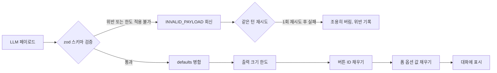

## 개요

이 문서는 [Presentation 노드 공통](CLE-NODE-PRES-COMMON.md) 의 하위 문서로 AI 에이전트 노드가 쓰는 표시 도구(presentation tools, `render_*`) 모드를 정한다. 스키마 단일 기준, 도구 카탈로그, defaults 덮어쓰기, 출력 크기 한도, 스키마 위반 처리와 정규화, 입력 대기 여부, 대화 스레드 운반, 버튼 클릭 사용자 메시지 합성을 다룬다. 폼 제출이 엔진 안에서 지나는 층은 [폼 제출 wire format](CLE-NODE-PRES-COMMON-FORMWIRE.md) 이 정한다.

## 표시 도구 모드

AI 에이전트 노드의 `presentationTools[]` 설정을 켜면 LLM 이 이 카테고리 다섯 노드의 렌더링 페이로드를 **도구 호출로 직접 만든다**. 워크플로우 그래프의 다른 노드로 잇는 방식이 아니다. AI 세션 안의 도구로 동작하고 다섯 노드의 입력 스키마(zod)를 LLM 도구 파라미터 JSON Schema 의 단일 기준으로 다시 쓴다.

이 문서는 다섯 노드의 스키마, 렌더 정책, 출력 크기 한도를 표시 도구 모드에 그대로 적용하는 규약이다. 도구 등록, 호출 횟수 회계, 대화 턴 종료 시맨틱, 멀티턴 대기 흐름은 [AI 에이전트 노드](../CLE-NODE-AI/CLE-NODE-AGENT.md) 가 정한다.

### 스키마 단일 기준

| 도구 이름 | 대상 노드 | 파라미터 JSON Schema 출처 |
|---|---|---|
| `render_table` | [Table](CLE-NODE-TABLE.md) | `tableNodeConfigSchema`(zod) → JSON Schema |
| `render_chart` | [Chart](CLE-NODE-CHART.md) | `chartConfigSchema`(zod) → JSON Schema |
| `render_carousel` | [Carousel](CLE-NODE-CAROUSEL.md) | `carouselNodeConfigSchema`(zod) → JSON Schema. 동적 모드 스키마 우선 |
| `render_template` | [Template](CLE-NODE-TEMPLATE.md) | `templateNodeConfigSchema`(zod) → JSON Schema |
| `render_form` | [Form](CLE-NODE-FORM.md) | `formNodeConfigSchema`(zod) → JSON Schema |

zod 를 JSON Schema 로 바꾸는 일은 단일 유틸(`zodToToolParams`)이 맡는다. 다섯 노드 스키마를 고치면 LLM 도구 정의에 자동으로 반영되므로 구조적으로 어긋날 수 없다. 백엔드 `_shared/button.types.ts` 의 `MAX_BUTTONS_PER_NODE` 같은 공통 규약의 상수도 같은 변환에 자동으로 반영된다.

**예외는 `render_chart` 의 `data` 다.** 차트 포인트 배열 `data` 는 `chartConfigSchema` 에 없다. 그래서 LLM 에 주는 `data` 모양의 계약은 도구 설명 문구(`DEFAULT_DESCRIPTIONS.chart`) 하나뿐이고 시스템 안내가 같은 표기를 한 번 더 싣는다([도구 카탈로그](#도구-카탈로그)). `chartConfigSchema` 는 Chart 노드의 설정 스키마이면서 도구 파라미터 스키마다. 여기에 런타임 값인 `data` 를 넣으면 설정에 출력 값이 들어가 [노드 출력 규약](../CLE-NODE/CLE-NODE-OUTPUT.md#principle-11-설정과-출력-값은-겹치지-않는다) Principle 1.1 과 부딪친다. 스키마가 `data` 를 검사하지 않으므로 `data` 의 최소 의미 검사는 [Chart 노드](CLE-NODE-CHART.md#표시-도구-페이로드) 가 정하고 [스키마 위반 처리와 정규화](#스키마-위반-처리와-정규화) 2단계의 도구 의미 검사로 한다.

### 도구 카탈로그

| 도구 이름 | 모드 | 기본 description(바꿀 수 있음) |
|---|---|---|
| `render_table` | 표시 전용 | "표 형태로 정형 데이터를 표시. rows/columns 정의 필요. 비교·집계 결과 공유에 적합." |
| `render_chart` | 표시 전용 | "차트 (bar/line/area/pie/donut) 로 데이터를 시각화. **chartType + data 가 필수**. data 는 `{ x, y?, series? }[]` 배열 — 포인트마다 x(카테고리)·y(값)를 넣고, 여러 시리즈는 포인트마다 series(시리즈 이름 문자열)로 구분한다(pie/donut 은 series 없이). 시계열·분포·비율 표현에 적합." |
| `render_carousel` | 표시 전용 | "카드·이미지·미니멀 레이아웃의 슬라이드 모음. 추천 항목 목록·상품 카드 등 시각 카탈로그에 적합." |
| `render_template` | 표시 전용 | "사용자 정의 HTML/Markdown/Text 템플릿 렌더링. 정형화된 안내문·요약 카드 작성에 적합." |
| `render_form` | **입력 대기(interactive)** | "사용자에게 입력 폼을 표시하고 제출을 대기. 추가 정보 수집·승인 요청 등 사용자 응답이 필요한 경우." |

사용자가 `PresentationToolDef.description` 에 값을 넣으면 위 기본 문구 대신 그 값을 LLM 에 보여 준다. 워크플로우 도메인(예: "전자상거래 상품 카드 표시")에 맞춘 안내를 줄 수 있다.

`render_chart` 기본 문구는 차트 유형 다섯 가지를 적는다. Chart 노드 실행도 같은 다섯 유형(`bar`·`line`·`area`·`pie`·`donut`)을 받는다([Chart 노드](CLE-NODE-CHART.md#차트-유형은-다섯-가지가-정본이고-실행-검증이-스키마-목록을-그대로-쓴다)).

`render_chart` 기본 문구의 `data` 모양 표기 `{ x, y?, series? }[]` 는 `chart.schema.ts` 의 상수 `CHART_DATA_SHAPE` 다. 도구 설명(`DEFAULT_DESCRIPTIONS.chart`)과 AI 에이전트 시스템 안내(`ai-turn-executor.ts` 의 `PRESENTATION_TOOLS_GUIDANCE`)가 이 상수 하나를 함께 쓰므로 두 곳의 표기가 어긋나지 않는다. 시스템 안내는 `presentationTools` 가 비어 있지 않으면 늘 붙는다. 그래서 사용자가 `description` 을 바꿔 도구 설명에서 표기가 빠져도 시스템 안내에는 남는다. 포인트 모양의 기준은 [Chart 노드](CLE-NODE-CHART.md#표시-도구-페이로드) 다.

### defaults 덮어쓰기 규칙

`PresentationToolDef.defaults?: Partial<Config>` 는 해당 노드 설정 일부를 미리 고정하는 브랜드·스타일 값이다. LLM 페이로드와 깊은 병합(deep merge)할 때 **defaults 가 LLM 입력을 덮어쓴다**(defaults 를 나중에 병합). 사용자가 정한 브랜드 톤·버튼 라벨·레이아웃이 LLM 의 임의 변경에 흔들리지 않게 하려는 것이다.

| 병합 대상 | 동작 |
|---|---|
| Object | 깊은 병합. 같은 키면 defaults 가 이긴다 |
| Array | defaults 가 비어 있지 않으면 defaults 로 **통째로 바꾼다**. 이어 붙이지 않는다. LLM 이 브랜드 밖 버튼을 임의로 더하지 못하게 하려는 것이다 |
| Primitive | defaults 에 값이 있으면 defaults 가 이긴다 |

예를 들어 `presentationTools: [{ type: 'table', defaults: { columns: [...brand columns], pagination: { enabled: true, pageSize: 20 } } }]` 로 두면 LLM 은 `rows` 만 채우면 되고 columns 와 pagination 은 늘 사용자 정의가 적용된다.

### 도구 모드의 출력 크기 한도

[출력 크기 한도](CLE-NODE-PRES-COMMON.md#출력-크기-한도)의 `PRESENTATION_MAX_BYTES = 1024 × 1024` 를 똑같이 적용한다. LLM 이 한도를 넘는 페이로드를 내면 [스키마 위반 처리와 정규화](#스키마-위반-처리와-정규화) 흐름을 따른다. Carousel·Table 의 뒤에서부터 잘라 내는 정책도 **그대로 적용**한다. 잘린 결과는 `output.{itemsTruncated|rowsTruncated}: true`, `output.{itemsTotalCount|rowsTotalCount}` 와 같은 메타를 대화 기록 항목(`ConversationTurn`)의 최상위 `presentations[i].truncation` 에 싣는다. `data?` 와는 별개 필드다.

### 스키마 위반 처리와 정규화

LLM 페이로드는 검증, defaults 병합, 출력 크기 한도, 값 채우기 순서로 처리한다.

1. LLM 페이로드를 해당 노드의 zod 스키마로 검증한다.
2. 필수 필드 누락, 타입 불일치, 정합성 위배처럼 스키마를 어기거나 1MB 한도를 넘으면 도구 결과로 `{error: 'INVALID_PAYLOAD', issues: [...]}` 를 돌려준다. 한도 초과는 Carousel·Table 을 뒤에서 잘라도 원소가 하나도 들어가지 않는 경우처럼 한도를 적용할 수 없는 때를 말한다. 스키마 검증을 통과해도 도구 의미 검사(`checkRenderToolSemanticIssues`)에 걸리면 같은 `INVALID_PAYLOAD` 를 돌려준다. 의미 검사는 스키마가 잡지 못하는 조건을 본다. `render_chart` 의 `data` 최소 모양 검사가 그 예이고 [Chart 노드](CLE-NODE-CHART.md#표시-도구-페이로드) 가 정한다. 의미 검사에 걸린 호출은 스키마 위반과 똑같이 다룬다. 아래 5번의 재시도 · 버림과 위반 기록이 그대로 적용되고, [AI 에이전트 노드](../CLE-NODE-AI/CLE-NODE-AGENT.md) 가 말하는 스키마 위반에도 이 경우가 들어간다.
3. **`button.id` UUID v4 채우기**: defaults 병합과 출력 크기 한도를 적용한 뒤 남은 버튼 가운데 `id` 가 없는 것에만 UUID v4 를 채운다. 대상은 carousel `buttons`·`itemButtons`·`items[].buttons` 와 table·chart·template `buttons` 다. `id` 가 있는 버튼은 그대로 둔다. [버튼 정의](CLE-NODE-PRES-COMMON.md#버튼-정의)의 "id 는 자동 생성하고 바꾸지 않는다" 원칙을 표시 도구 모드에도 적용한다. 워크플로우 에디터가 `crypto.randomUUID()` 로 id 를 넣는 것과 같은 의미를 백엔드 `render-tool-provider` 가 보장한다. 한도 적용 뒤에 하므로 잘려 나간 원소 안의 버튼은 처리하지 않는다. 프런트엔드에 닿지 않는 버튼이라 의도한 최적화다. 이 단계의 함수는 `backfillButtonUuids` 처럼 알아볼 수 있는 이름을 쓴다. 그래프 노드용 `normalizeNodeButtonIds`(label 을 slug 로 바꿈)와 섞이지 않게 하려는 것이다.
4. **폼 `option.value` 결정적 채우기**: `render_form` 에만 적용한다. defaults 병합과 출력 크기 한도를 적용한 뒤 `fields[].options[]` 가운데 `value` 가 빈 문자열 `""`·`null`·`undefined` 인 항목에 결정적 값 `opt-{fieldIdx}-{optIdx}` 를 채운다. 형식은 인덱스 하나뿐이다. label 로 slug 를 만드는 방식은 한글 같은 다국어 label 에서 빈 slug 가 나와 다시 충돌하므로 쓰지 않는다. LLM 이 옵션의 `value` 를 빠뜨리면 zod 기본값이 모든 옵션 value 를 똑같이 `""` 로 만든다. 그러면 프런트엔드 `<select>` 의 placeholder(`value=""`)와 모든 옵션이 DOM 에서 같아져 골라도 placeholder 가 남는다. 3단계 버튼 ID 채우기와 같은 문제이므로 같은 층에서 푼다. UUID 대신 결정적 값을 쓰는 이유는 [Rationale](#폼-옵션-값-채우기) 에 적는다. 한도 적용 뒤에 하므로 잘려 나간 옵션은 처리하지 않는다. 이 단계의 함수는 3단계와 나란히 `backfillFormOptionValues` 처럼 이름 붙인다.
5. LLM 은 같은 턴 안에서 다시 시도할 수 있다. 한 번 다시 시도해도 실패하면 조용히 버리고 `meta.presentationSchemaViolations[]` 에 쌓는다([AI 에이전트 노드](../CLE-NODE-AI/CLE-NODE-AGENT.md)).
6. AI 에이전트 노드의 `error` 포트는 내보내지 않는다. 표시 방법을 넓히는 기능이므로 텍스트 응답으로 대신한다.

### 입력 대기 여부

| 도구 | 입력 대기 | 흐름 |
|---|---|---|
| `render_table` / `render_chart` / `render_carousel` / `render_template` | 표시 전용 | 도구 결과 스텁 `{ok:true}` 를 바로 돌려준다. LLM 은 같은 턴 안에서 텍스트, 다른 도구 호출, 종료 가운데 하나를 고른다. 페이로드는 대화 기록 항목의 **최상위 `presentations[]`** 에 넣는다 |
| `render_form` | **입력 대기** | AI 에이전트 멀티턴의 `waiting_for_input` 흐름으로 들어가고 대기 표면은 `meta.interactionType: 'ai_form_render'` 다. `'ai_conversation'` 과 다른 값이고 클라이언트는 이 값으로 `execution.submit_form` 명령을 고른다([WebSocket 이벤트와 명령](../CLE-API/CLE-API-WS-EVENTS.md)). `_resumeState.pendingFormToolCall: { toolCallId, formConfig }` 를 기록한다. 사용자가 폼을 제출(`execution.submit_form`)하면 대화 스레드에 `presentation_user` 출처 항목을 쌓는다. 이 항목에는 `data.via: 'ai_render'` 표시가 붙는다([노드 출력 규약](../CLE-NODE/CLE-NODE-OUTPUT.md)). 제출 데이터는 도구 결과 content 에 직렬화한 뒤 LLM 을 다시 부른다 |

**입력 중인 폼은 어시스턴트 턴 타임라인 안에 그린다.** `render_form` 이 입력을 기다리는 동안 폼 입력 UI 는 MessageInput 아래 같은 별도 영역에 두지 않는다. 어시스턴트 턴의 `presentations[*]` 가운데 `type: 'form'` 페이로드 자리에 **인라인으로** 그린다. 프런트엔드 `AssistantPresentationsBlock` 의 `"form"` 분기는 다음 조건으로 나뉜다.

- `waitingConversationConfig.pendingFormToolCall.toolCallId === payload.toolCallId` 이면 입력 가능한 `DynamicFormUI` 를 그린다.
- 그 밖(이미 제출됐거나 다른 도구 호출)이면 표시 전용 `FormSubmittedContent` 를 그린다.

캐러셀·차트·표가 타임라인 안에 인라인으로 들어가는 방식과 같다([Rationale](#입력-중인-폼의-타임라인-인라인-표시)).

**폼 입력 중 사용자가 일반 텍스트를 보내면**: 백엔드 처리는 [AI 에이전트 노드](../CLE-NODE-AI/CLE-NODE-AGENT.md) 가 정한다. 프런트엔드 MessageInput 은 `ai_form_render` 대기 중에도 늘 켜 둔다. 사용자는 폼 대신 텍스트로 답할 수 있다.

`render_form` 은 AI 에이전트가 단일 턴(`single_turn`)이면 의미가 없다. 단일 턴은 사용자 입력을 기다리지 않으므로 스키마 위반과 똑같이 조용히 버린다([AI 에이전트 노드](../CLE-NODE-AI/CLE-NODE-AGENT.md)).

[블로킹 모드 실행 흐름](CLE-NODE-PRES-COMMON.md#블로킹-모드-실행-흐름)의 버튼 기반 대기와 이 절의 도구 모드 대기는 다른 층이다. 앞의 것은 그래프의 노드로 실행될 때다. 뒤의 것은 AI 에이전트의 도구로 불릴 때다. 사용자가 연결한 Form 노드와 AI 에이전트의 `render_form` 이 함께 있어도 그래프 실행 순서대로 처리되므로 충돌하지 않는다.

### 대화 스레드 운반

`render_*` 호출이 성공한 턴의 페이로드는 `source: 'ai_assistant'` 대화 기록 항목의 **최상위 `presentations[]`** 한 곳에 저장한다([대화 스레드](../CLE-IX/CLE-IX-THREAD.md)). `data?` 안에 넣지 않는다. `data?` 는 `output.interaction.data` 스냅샷의 단일 기준이라 다른 의미의 데이터를 넣지 않는다. 그래프의 Presentation 노드가 내는 `output.interaction`([재개 출력](CLE-NODE-PRES-COMMON.md#재개-출력))과도 구분한다. `output.interaction` 은 그래프 노드가 사용자 클릭이나 제출을 받았을 때 생기고 `turn.presentations[]` 는 AI 에이전트가 LLM 도구 호출 결과로 채운다.

`render_form` 을 사용자가 제출하면 `source: 'presentation_user'` 항목을 쌓는다. 모양은 [재개 출력](CLE-NODE-PRES-COMMON.md#재개-출력)의 `interaction.type='form_submitted'` 와 같고 **`data.via: 'ai_render'` 표시**가 더 붙는다. 그래프 Form 노드에서 온 항목은 `data.via` 가 없으므로 UI 와 LLM 페이로드 빌더가 두 출처를 가를 수 있다. UI 는 두 경우를 다른 카드 제목으로 그린다.

- 그래프 Form 노드 출처: `<form 노드 레이블> · form submitted`
- AI `render_form` 출처: `<AI Agent 레이블> · form via AI render`

이 표시의 단일 정의는 [AI 에이전트 노드](../CLE-NODE-AI/CLE-NODE-AGENT.md) 와 [노드 출력 규약](../CLE-NODE/CLE-NODE-OUTPUT.md) 에 있다.

### 버튼 클릭 사용자 메시지 합성

표시 도구가 만든 표·차트·캐러셀·템플릿 안의 버튼에는 그래프 포트 라우팅이 없다. 버튼 클릭은 다음 LLM 턴의 사용자 메시지로 들어간다([AI 에이전트 노드](../CLE-NODE-AI/CLE-NODE-AGENT.md)). 이 절은 그 사용자 메시지를 어떻게 만드는지의 단일 기준이다. 그래프 노드 자체의 포트 분기와는 완전히 다른 층이다. 그래프 노드는 [블로킹 모드 실행 흐름](CLE-NODE-PRES-COMMON.md#블로킹-모드-실행-흐름)의 `buttonConfig` 와 WebSocket 재개 흐름을 따른다.

**합성 우선순위**(포트 버튼만 해당한다. 링크 버튼은 외부 URL 로 이동하고 사용자 메시지를 보내지 않는다):

| 순위 | 출처 | 합성 결과 |
|---|---|---|
| 1 | `button.userMessage`(LLM 이 [버튼 정의](CLE-NODE-PRES-COMMON.md#버튼-정의)의 선택 필드로 적은 값) | 그 문자열 그대로 |
| 2 | 항목 버튼(carousel `items[].buttons` 또는 동적 `itemButtons` 의 런타임 ID `{btn.id}__item_{idx}`) + `userMessage` 없음 | `"{item.title} → {button.label}"`. 구분자 ` → ` 는 U+2192 화살표 그대로이고 로캘과 무관하다 |
| 3 | 전역 버튼(carousel `buttons`, table·chart·template `buttons`) + `userMessage` 없음 | `"{button.label}"` |
| 4 | 매칭 실패(id 를 못 찾음, 회귀 방어용) | `buttonId` 그대로 |

**경로**: 프런트엔드 `AssistantPresentationsBlock.handlePortButtonClick` 이 위 우선순위로 사용자 메시지를 만들어 채팅 입력의 `onSendMessage` 로 넘긴다. 이 값은 백엔드 `ai-agent.handler.processMultiTurnMessage(userMessage)` 의 `userMessage` 인자로 들어가 `ai_user` 메시지로 다음 LLM 턴에 쓰인다. 이 경로는 [대화 스레드](../CLE-IX/CLE-IX-THREAD.md) 의 `[user-input]…[/user-input]` 보안 마커로 **감싸지 않는다**. 마커는 그래프 노드에서 온 `presentation_user` 출처에만 쓴다. 표시 도구 클릭은 채팅 입력과 같은 `ai_user` 출처이고 `ai_user` 에는 마커를 쓰지 않는다.

**라우팅하지 않는다**: 표시 도구의 버튼 클릭은 AI 에이전트의 출력 포트 분기에 영향을 주지 않는다. 그래프 분기는 조건 도구(`cond_*`)가 맡는다. 이 합성 규칙은 그래프 노드 자체에는 적용하지 않는다.

## 구현 위치

- `codebase/backend/src/nodes/ai/ai-agent/tool-providers/render-tool-provider.ts` (표시 도구 zod 검증, `userMessage: z.string().optional()`, `backfillButtonUuids`, `backfillFormOptionValues`)
- `codebase/backend/src/nodes/presentation/chart/chart.schema.ts` (`render_chart` `data` 모양 표기 `CHART_DATA_SHAPE`. `render-tool-provider.ts` 의 `DEFAULT_DESCRIPTIONS.chart` 와 함께 쓴다)
- `codebase/backend/src/nodes/ai/ai-agent/ai-turn-executor.ts` (표시 도구 시스템 안내 `PRESENTATION_TOOLS_GUIDANCE`)
- 버튼 ID 채우기 방어: 프런트엔드 `presentation-renderers.tsx` 의 `isSelected = selectedButtonId != null && selectedButtonId === btn.id`.
- 사용자 메시지 합성: 프런트엔드 `AssistantPresentationsBlock.handlePortButtonClick` 이 `findButtonContext` 로 `{button, item?}` 를 찾아 `userMessage ?? 항목 대체값 ?? 전역 대체값 ?? buttonId` 순으로 보낸다. 백엔드 zod 의 `userMessage` 는 carousel `buttons`·`itemButtons`·`items[].buttons`, table·chart·template `buttons` 모두에 있다.
- 폼 옵션 값 방어: 프런트엔드 `dynamic-form-ui.tsx` 가 placeholder `<option value="">` 와 옵션 value 를 `String(value) === String(opt.value)` 로 비교한다.

## Rationale

### 버튼 ID 채우기

[스키마 위반 처리와 정규화](#스키마-위반-처리와-정규화) 3단계에 `button.id` UUID v4 채우기를 둔다.

**배경**: 프런트엔드 `presentation-renderers.tsx` 의 `selectedButtonId === btn.id` 비교는 두 값이 모두 `undefined` 이면 `isSelected = true` 가 되어 `if (isSelected) return;` 에서 onClick 이 바로 끝났다. zod `buttonDefSchema.id` 가 선택 필드라 LLM 은 거의 늘 id 없이 버튼을 만들었다. 이것이 `render_carousel` 페이로드 안 버튼이 눌리지 않던 회귀의 원인이었다.

**결정**: "id 는 자동 생성하고 바꾸지 않는다" 원칙은 워크플로우 에디터 UI 에서만 지켜지고 있었다. 이를 표시 도구 모드까지 넓힌다. 백엔드 `render-tool-provider.execute()` 가 zod 검증 → defaults 병합 → 출력 크기 한도 뒤에 빠진 id 를 UUID v4 로 채운다. 백엔드 채우기와 프런트엔드 방어(`selectedButtonId != null` 비교)를 함께 둬 LLM 의 자유를 지키면서 기준을 일관되게 하고 회귀를 바로 막는다. zod 스키마의 id 를 필수 + 기본값으로 바꾸는 안은 쓰지 않았다. 스키마 위반 → 재시도 1회 → 조용히 버림 흐름이 LLM 의 자연스러운 출력을 막아 UX 가 나빠진다.

**한도 뒤에 채우는 이유**: 한도 전에 채우면 잘려 나갈 원소 안 버튼에 헛일을 한다. 한도 뒤에 채우면 프런트엔드에 닿는 버튼만 처리한다. defaults 병합 전에 채우면 사용자가 `defaults.buttons[].id` 로 뜻한 값이 흐려진다. 그래서 **검증 → 병합 → 한도 → 채우기** 순서만 맞는다.

**함수 이름을 가른다**: `backfillButtonUuids` 는 그래프 노드용 `normalizeNodeButtonIds()`(label 을 slug 로 바꿈)와 뜻이 다르므로 구현자가 엉뚱한 함수를 다시 쓰지 않게 이름을 가른다.

### 사용자 메시지 하이브리드 합성

[버튼 정의](CLE-NODE-PRES-COMMON.md#버튼-정의)에 선택 필드 `userMessage` 를 두고 [버튼 클릭 사용자 메시지 합성](#버튼-클릭-사용자-메시지-합성)에 합성 우선순위를 정한다.

**배경**: `render_carousel` 항목 버튼("샘플상품 1 / 문의하기")을 눌렀을 때 대화로 가는 사용자 메시지가 `btn.label`("문의하기")뿐이면 LLM 은 어느 항목을 누른 것인지 알 수 없다. 사용자는 "1번 상품 문의" 를 뜻했는데 LLM 은 항목 맥락 없이 일반 답을 한다.

**하이브리드 합성**: LLM 이 `button.userMessage` 를 적었으면 그 값을 그대로 보내고 없으면 프런트엔드가 만든다. LLM 우선 + 프런트엔드 대체 방식은 도메인별 말투(예: "전자상거래 상품 문의", "예약 변경 요청")를 LLM 에게 맡기면서 항목 맥락이 빠지는 것은 프런트엔드가 막는다. `userMessage` 를 필수로 두는 안은 스키마 위반 → 재시도 1회 → 조용히 버림(5단계) 흐름이 자연스러운 응답을 막는다. AI 에이전트의 "스키마 위반은 조용히 대신한다" 결정과도 맞지 않아 쓰지 않았다. 버튼 ID 채우기와 같은 방향이다. 스키마 층에서 LLM 출력의 자유를 지키고 프런트엔드가 회귀를 막는다.

**구분자로 ` → `(U+2192)를 쓰는 이유**: 로캘과 무관하다. `:`, ` - `, ` › ` 는 영문과 한국어에서 읽히는 흐름이 일관되지 않다. U+2192 화살표는 "항목 → 행동" 인과 흐름이 눈에 분명하다. 이 문자열은 채팅 입력을 거쳐 `ai_user` 메시지 본문에 평문으로 들어가므로 다국어 처리 대상이 아니다. 화면 라벨이 아니다.

**포트 버튼에만 적용하는 이유**: 링크 버튼은 외부 URL 이동이 우선이다. `LinkButtonClick` 흐름은 `window.open` 으로 새 탭을 열 뿐 대화로 메시지를 보내지 않는다. `userMessage` 를 넣어도 보낼 일이 없으니 무시한다. 다만 `validateButtons` 가 저장을 막지 않는 안내 메시지(`"… ignored for link type buttons"`)를 내 LLM 페이로드의 어긋남을 캔버스에 드러낸다. 그래프 노드 자체도 무시한다. 그래프 노드는 `output.interaction.{type, data}` 가 기준이고 사용자 메시지 표현은 백엔드 `renderInteractionText` 가 `clicked: <buttonLabel>` 텍스트로 따로 만든다([대화 스레드](../CLE-IX/CLE-IX-THREAD.md)).

**선택 필드이고 채우기 대상이 아닌 이유**: `userMessage` 가 없는 것이 정상이다. 프런트엔드 대체값이 합리적 기본값이기 때문이다. `id` 와 달리 임의 값을 채우면 LLM 의 뜻(예: 일부러 빈 문자열을 낸 경우)이 흐려진다. 그래서 3단계 `backfillButtonUuids` 의 대상이 아니고 스키마 검증에서 선택 값 그대로 통과한다.

### 폼 옵션 값 채우기

[스키마 위반 처리와 정규화](#스키마-위반-처리와-정규화) 4단계에 `render_form` 전용 `option.value` 결정적 채우기를 둔다.

**배경**: 백엔드 `presentation/form/form.schema.ts` 는 `optionSchema.value: z.unknown().default('')` 다. LLM 이 옵션의 `value` 를 빠뜨리면 zod 기본값이 **모든 옵션 value 를 같은 빈 문자열 `""`** 로 만든다. 그러면 프런트엔드 `<option value="">Select...</option>` placeholder 와 모든 옵션의 DOM value 가 같아져 골라도 placeholder 가 남는다. 표시 도구 모드의 zod 기본값이 조용한 충돌을 만드는 버튼 ID 와 같은 형태다.

**결정**: 3단계와 같은 층에서 `render_form` 분기에 `backfillFormOptionValues` 를 둔다. `render-tool-provider.execute()` 는 zod 검증 → defaults 병합 → 출력 크기 한도 → `backfillButtonUuids` → (폼 분기) `backfillFormOptionValues` 순서로 부른다. 백엔드 채우기와 프런트엔드 방어(`String(v) === String(opt.value)` 비교)를 함께 둔다. 이렇게 LLM 의 자유를 지키고 기준을 일관되게 하며 회귀를 막고 뒤 턴에서 LLM 이 제출 값의 뜻을 알아보게 한다. zod `optionSchema.value` 를 필수로 두는 안은 스키마 위반 → 재시도 1회 → 조용히 버림 흐름이 자연스러운 응답을 막아 쓰지 않았다.

**UUID v4 대신 결정적 값을 쓰는 이유**:

- `button.id` 는 워크플로우 에디터 UI 가 `crypto.randomUUID()` 로 넣는 값이 기준이라 UUID 가 맞다.
- `option.value` 는 사용자가 폼을 제출한 뒤 LLM 이 다음 턴에서 `output.interaction.data.<fieldName>` 의 제출 값을 뜻으로 알아봐야 한다. UUID(`550e8400-e29b-...`)는 뜻이 없어 LLM 이 "Approve" 인지 "Reject" 인지 가릴 수 없다.
- 결정적 인덱스 형식 `opt-{fieldIdx}-{optIdx}` 는 제출 값이 LLM 페이로드 안에서 옵션 label 과 함께 돌아오므로 최소한의 맥락을 남긴다. label 은 LLM 도구 페이로드의 `options[].label` 에 이미 있으므로 `value` 는 키만 되살리면 된다.
- label 로 slug 를 만드는 방식(`opt-{fieldIdx}-{slug(label)}`)은 쓰지 않는다. 한글처럼 ASCII 밖 문자가 든 label 은 slug 가 빈 문자열이 되어 결국 인덱스 대체값과 같아진다. slug 경로와 빈 slug 경로 두 갈래를 둘 이유 없이 결정성·테스트·유지보수 부담만 커지므로 인덱스 한 경로로 모은다.

**한도 뒤에 채우는 이유**: 한도 전에 채우면 잘려 나갈 옵션에 헛일을 한다. 다만 폼 옵션 배열은 Carousel·Table 의 원소 단위 자르기 대상이 아니다. 옵션이 1MB 를 넘는 극단적인 경우는 2단계 한도 초과 `INVALID_PAYLOAD` 에서 막힌다. 그래서 폼은 사실상 늘 모든 옵션이 채우기 대상이다. 병합 전에 채우면 사용자 `defaults.fields[].options[].value` 의 뜻이 흐려진다. 그래서 버튼 ID 와 같은 **검증 → 병합 → 한도 → 채우기** 순서를 쓴다. 그래프 Form 노드에는 원래 채우기 단계가 없으므로 충돌하지 않는다.

### 입력 중인 폼의 타임라인 인라인 표시

[입력 대기 여부](#입력-대기-여부)에서 `render_form` 입력 단계의 UI 를 별도 영역이 아니라 **어시스턴트 턴의 `presentations[*].form` 페이로드 자리에 인라인으로** 그린다.

**배경**: 입력 중인 폼의 UI 가 별도 영역에 있을 때 제출 뒤 타임라인 깜빡임, 폼 잔존, MessageInput 아래 쌓임 같은 UX 회귀가 났다. 세 문제의 공통 원인은 입력 중인 폼이 타임라인 메시지가 아니라 별도 영역이었다는 점이다.

**결정 근거**: 결정의 단일 기준은 [AI 에이전트 노드](../CLE-NODE-AI/CLE-NODE-AGENT.md) 에 있다. 본질이 AI 에이전트 멀티턴의 화면 통합이고 그래프 Form 노드의 단독 동작은 바뀌지 않는다.

**`pendingFormToolCall.toolCallId` 매칭 조건 하나로 가른다**: `AssistantPresentationsBlock` 의 `"form"` 분기가 조건 하나로 입력 중과 제출됨을 가른다. store selector 로 `waitingConversationConfig.pendingFormToolCall.toolCallId` 를 가져와 `payload.toolCallId` 와 비교한다. 두 화면(SummaryView, SelectedItemDetail)이 같은 selector 를 쓴다. 두 화면이 한 결정 함수의 결과를 쓰는 대화 미리보기 불변식과 같은 모양이다([대화 미리보기](../CLE-EXEC/CLE-EXEC-PREVIEW.md)).

**MessageInput 은 늘 켜 둔다**: 폼 입력 중에도 MessageInput 을 끄거나 숨기지 않는다. 폼을 건너뛴 입력의 백엔드 처리는 [AI 에이전트 노드](../CLE-NODE-AI/CLE-NODE-AGENT.md) 가 정한다. 취소된 도구 결과로 대신해 LLM 이 다음 추론을 자유롭게 할 수 있게 한다.
