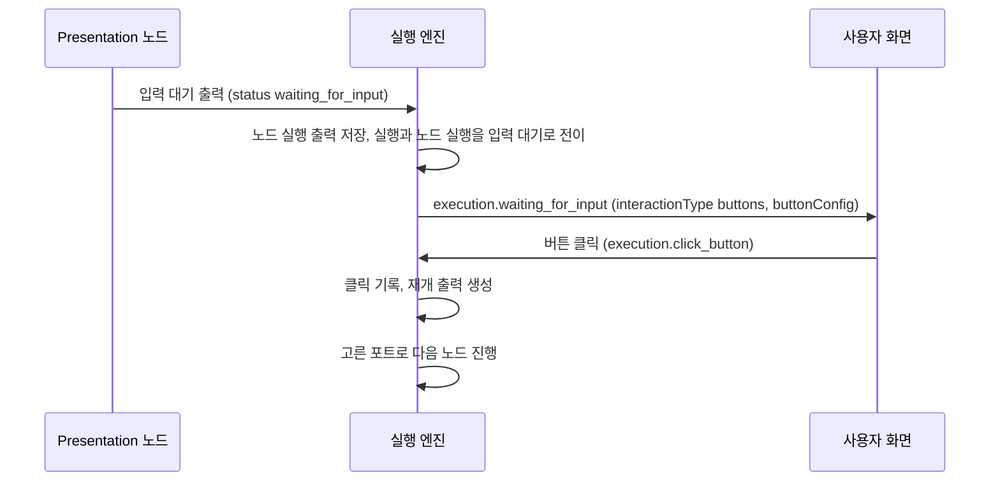

> 구현 상태: 부분 구현 (미구현: 대화 스레드 opt-out 필드의 스키마 선언·설정 UI 노출, 드로어 Chart 축 라벨) · 원문: `spec/4-nodes/6-presentation/0-common.md`, `spec/4-nodes/_product-overview.md` (§9 머리글) · 용어: [용어 사전](../CLE-GLOSSARY.md)

## 개요

이 문서는 Presentation 노드(presentation nodes) 다섯 종이 함께 따르는 규약을 정한다. 다섯 종은 [Carousel 노드](CLE-NODE-CAROUSEL.md), [Table 노드](CLE-NODE-TABLE.md), [Chart 노드](CLE-NODE-CHART.md), [Form 노드](CLE-NODE-FORM.md), [Template 노드](CLE-NODE-TEMPLATE.md) 다. 노드별 설정·실행 로직·출력 예시는 각 노드 문서가 정한다.

Presentation 노드는 두 가지 목적으로 쓴다. 하나는 다운스트림 노드에 구조화된 결과를 넘기는 것이다. 다른 하나는 실행 결과 화면에서 사람이 결과를 확인하는 것이다. 버튼이나 폼이 있으면 노드는 실행을 멈추고 사용자 입력을 기다린다.

이 문서가 다루는 것은 다음과 같다.

- 버튼 정의(`ButtonDef`)와 버튼 편집기
- 버튼 유무에 따른 포트 구성과 블로킹 모드(Blocking Mode) 실행 흐름
- 출력 포맷, 출력 크기 한도(output size cap), 입력 대기 출력과 재개 출력
- 대화 스레드(ConversationThread) opt-out
- 실행 결과 드로어(Run Results drawer)의 노드별 표시와 Template 본문 정화 책임
- AI 에이전트 노드가 쓰는 표시 도구(presentation tools, `render_*`) 모드. 이 부분은 이 문서와 [하위 문서](#하위-문서)가 단일 기준이고 [AI 에이전트 노드](../CLE-NODE-AI/CLE-NODE-AGENT.md)는 이 문서를 링크한다.

범위 밖은 다음 문서가 정한다.

- 노드 출력(`NodeHandlerOutput`) 다섯 필드의 의미, 사용자 입력 기록(`output.interaction`) 규격, 폐기 필드: [노드 출력 규약](../CLE-NODE/CLE-NODE-OUTPUT.md)
- 입력 대기 진입, park, 재개(resume) 메커니즘: [실행 상태 머신과 대기·재개](../CLE-EXEC/CLE-EXEC-STATE.md)
- 재개 큐와 publisher 사전 검증: [장애 복구와 안전 종료](../CLE-EXEC/CLE-EXEC-RECOVERY.md)
- 동적 포트 ID 의 형식 검증: [노드 시스템 구조와 카탈로그](../CLE-NODE/CLE-NODE-ARCH.md)
- 실행 결과 드로어의 레이아웃·탭 구성: [에디터 실행과 디버깅](../CLE-EXEC/CLE-EXEC-RUN.md)
- 표시 도구를 부르는 AI 쪽 동작(도구 등록, 호출 횟수 회계, 대화 턴 종료 시맨틱): [AI 에이전트 노드](../CLE-NODE-AI/CLE-NODE-AGENT.md). 표시물 페이로드(`PresentationPayload`) 형식: [AI 에이전트 노드 출력과 디버그](../CLE-NODE-AI/CLE-NODE-AGENT-OUTPUT.md)
- 버튼 없는 노드 결과를 웹채팅에 알리는 표시 메시지 이벤트(`execution.message`): [EIA 수신 API와 SSE](../CLE-IX/CLE-EIA-INBOUND.md). 채팅 채널이 노드 결과를 메시지로 바꾸는 규칙: [채팅 채널 어댑터 규약](../CLE-CHAT/CLE-CHAT-ADAPTER.md)

## 규칙

1. 버튼 정의는 Carousel·Table·Chart·Template 이 쓴다. Form 노드는 버튼 대신 폼 필드(`FormField`)를 쓴다.
2. 전역 버튼(global button)은 노드당 5개까지 둔다. Carousel 항목 버튼(item button)도 항목마다 5개까지 둔다.
3. 버튼이 하나라도 있으면 노드는 블로킹 모드로 들어가 입력 대기(`waiting_for_input`)로 멈춘다. 버튼이 없으면 표시 전용(display-only)으로 `out` 포트에 결과를 낸다.
4. 버튼이 있으면 `out` 포트를 없앤다. 포트 버튼마다 동적 포트를 만들고 링크 버튼만 있으면 계속 포트(`continue`)를 만든다.
5. 출력 값(`output`)에는 런타임에 만든 값만 담는다. 리터럴 설정값은 설정 에코(config echo, `config` 필드)에만 둔다. 노드를 가리는 `type` 판별자는 쓰지 않는다.
6. Carousel `output.items` 와 Table `output.rows` 가 직렬화 후 1MB 를 넘으면 뒤에서부터 원소 단위로 잘라 낸다. 잘렸다는 사실은 `*Truncated`·`*TotalCount` 로 알린다.
7. 재개 출력(resumed output)은 입력 대기 시점의 출력 값을 그대로 두고 사용자 입력 기록을 더한다.
8. 사용자 입력은 대화 스레드에 자동으로 쌓는다. `excludeFromConversationThread: true` 인 노드의 입력은 쌓지 않는다.
9. 표시 도구 모드는 다섯 노드의 설정 스키마(zod)를 LLM 도구 파라미터의 단일 기준으로 다시 쓴다. 표시 도구의 버튼은 그래프 포트로 라우팅하지 않고 다음 LLM 대화 턴의 사용자 메시지가 된다.
10. 입력 대기에는 기한이 없다. 노드는 사용자가 입력하거나 사용자 취소 · 공개 웹채팅 유휴 실행 회수처럼 외부에서 실행을 끝낼 때까지 `waiting_for_input` 으로 기다린다([실행 상태 머신과 대기·재개](../CLE-EXEC/CLE-EXEC-STATE.md)). 다섯 노드 설정에 타임아웃 필드는 없고 옛 `buttonTimeout` 입력은 무시한다. 실행 시간 한도는 입력 대기 시간을 세지 않는다([큐 워커와 동시 실행 제한](../CLE-EXEC/CLE-EXEC-WORKER.md)). 이 규칙은 메인 흐름 기준이다. Background 본문은 예외다. 본문의 블로킹 노드가 입력 대기에 들어가면 기다리지 않고 본문이 그 지점에서 조용히 끝난다([Background 노드](../CLE-NODE-LOGIC/CLE-NODE-BACKGROUND.md#본문의-블로킹-노드가-입력-대기로-멈추면-곧바로-조용히-끝낸다)). 컨테이너 본문의 제약은 [컨테이너 실행](../CLE-EXEC/CLE-EXEC-CONTAINER.md) 을 따른다.
11. Template 본문(`output.rendered`, 표시 도구 `render_template` 의 `content`)은 정화하지 않은 데이터다. 본문을 HTML 로 해석해 그리는 표면은 그리기 전에 허용 목록으로 정화한다([Template 본문 정화 책임](#template-본문-정화-책임)).

## 하위 문서

이 문서에는 요구사항 줄이 없어 하위 문서가 맡는 요구사항 번호도 없다.

| 문서 | 맡는 내용 |
|---|---|
| [Presentation 노드 공통 — 표시 표면](CLE-NODE-PRES-COMMON-DISPLAY.md) | 실행 결과 드로어의 노드별 표시, 웹채팅·채팅 채널 전달, Template 본문 정화 책임, Form 파일 필드 제출 형식의 근거 |
| [Presentation 노드 공통 — 표시 도구 모드](CLE-NODE-PRES-COMMON-TOOLS.md) | `render_*` 도구의 스키마 단일 기준, 도구 카탈로그, defaults 덮어쓰기, 출력 크기 한도, 스키마 위반 처리와 정규화(버튼 ID · 폼 옵션 값 채우기), 입력 대기 여부, 대화 스레드 운반, 버튼 클릭 사용자 메시지 합성 |
| [Presentation 노드 공통 — 폼 제출 wire format](CLE-NODE-PRES-COMMON-FORMWIRE.md) | 폼 제출이 지나는 네 층, 내부 재개 큐 payload 의 표시 값 감싸기, `processAiResumeTurn` 분기 |

## 버튼 정의

Carousel·Table·Chart·Template 노드가 함께 쓰는 버튼 정의(`ButtonDef`) 구조다. 포트로 보내는 포트 버튼(`port`)과 URL 을 여는 링크 버튼(`link`)이 있다.

| 필드 | 타입 | 필수 | 설명 |
|------|------|------|------|
| `id` | String | 자동 생성 | 바뀌지 않는 버튼 식별자. 포트 버튼이면 동적 출력 포트 ID 로 쓴다. 에디터는 버튼을 추가할 때 UUID v4 를 발급한다. 포트 ID 는 slug 정규식(`^[a-zA-Z0-9_-]{1,64}$`)만 만족하면 되므로 `approve` 같은 slug 도 유효하다. 형식 검증은 [노드 시스템 구조와 카탈로그](../CLE-NODE/CLE-NODE-ARCH.md) 가 정한다 |
| `label` | String | ✓ | 버튼 텍스트. 표현식(`{{ }}`)을 쓸 수 있다 |
| `type` | Enum | ✓ | `link`(외부 URL) / `port`(노드 포트 연결) |
| `url` | String | `type=link` 일 때 ✓ | 외부 URL. 표현식을 쓸 수 있다 |
| `style` | Enum | ✗ | `primary` / `secondary` / `outline` / `danger`. 기본값 `secondary` |
| `userMessage` | String | ✗ | 포트 버튼을 눌렀을 때 대화에 보낼 사용자 메시지. 표시 도구 모드에서 LLM 이 직접 적을 수 있다. 없으면 클라이언트가 합성한다. 항목 버튼은 `"{item.title} → {label}"`, 전역 버튼은 `"{label}"` 이다([버튼 클릭 사용자 메시지 합성](CLE-NODE-PRES-COMMON-TOOLS.md#버튼-클릭-사용자-메시지-합성)). 그래프 노드 자체의 포트 분기와 링크 버튼에서는 무시한다. 링크 버튼은 외부 URL 이동이 우선이다 |

### 유효성 검증

| 규칙 | 설명 |
|------|------|
| 버튼 라벨 필수 | 각 버튼의 `label` 은 비어 있을 수 없다 |
| 링크 URL 필수 | `type: "link"` 는 `url` 이 있어야 한다 |
| 포트 버튼 URL 금지 | `type: "port"` 에는 `url` 을 둘 수 없다 |
| 최대 버튼 수 | 노드당 전역 버튼(`buttons`) **5개**. Carousel 항목 버튼(`itemButtons`, `items[].buttons`)도 항목마다 5개. 한 항목 화면에는 전역 5 + 항목 5 = 최대 10개가 보인다([Rationale](#버튼-수-한도)) |
| 버튼 ID 고유 | 노드 안의 모든 버튼 ID 는 서로 달라야 한다 |
| 연결 안 된 포트 버튼 | 포트 버튼의 동적 포트에 연결선이 없으면 경고한다. 에러는 아니다 |
| `userMessage` 는 포트 버튼 전용 | 링크 버튼에 `userMessage` 를 넣으면 클릭 동작은 바뀌지 않고 값은 무시한다. 이때 `validateButtons` 가 저장을 막지 않는 안내 메시지 `"buttons[i].userMessage is ignored for link type buttons …"` 를 함께 낸다. LLM 페이로드의 어긋남을 캔버스 사용자에게 알린다 |

### 버튼 편집기

Carousel·Table·Chart·Template 의 설정 패널은 같은 버튼 편집기를 쓴다.

| 영역 | 위치 | 들어가는 요소 | 동작 |
|------|------|---------------|------|
| Buttons 섹션 | 설정 패널 아래쪽, 접이식 | 버튼 카드 목록, `[+ Add Button]` | 펼쳐서 버튼을 추가하고 편집한다 |
| 버튼 카드 | Buttons 섹션 안 | Label, Type(`port` / `link`), URL(링크 버튼일 때만), Style, 삭제 `[✕]`, 순서 `[↕]` | 드래그로 순서를 바꾸고 `[✕]` 로 지운다 |

- Type 을 `link` 로 고르면 URL 입력란이 보이고 `port` 로 고르면 숨는다.
- 버튼을 추가하면 UUID v4 ID 를 발급한다. ID 는 이후 바뀌지 않는다.
- 전역 버튼은 5개까지 추가할 수 있다. Carousel 항목 버튼은 정적 모드에서 항목마다 5개, 동적 모드 `itemButtons` 는 5개까지다.

## 포트 구성

버튼 정의를 쓰는 노드는 `buttons` 배열의 유무에 따라 포트 구성이 달라진다. Form 노드의 포트는 [Form 노드](CLE-NODE-FORM.md) 가 정한다.

**버튼이 없을 때(표시 전용, 기본):**

| 포트 | 방향 | 식별자 | 설명 |
|------|------|--------|------|
| Input | 입력 | `in` | 입력 데이터 |
| Output | 출력 | `out` | 노드 결과 출력 |

**버튼이 있을 때(블로킹 모드):**

| 포트 | 방향 | 식별자 | 설명 |
|------|------|--------|------|
| Input | 입력 | `in` | 입력 데이터 |
| 전역 버튼 포트 | 출력 | `{button.id}` | 전역 포트 버튼마다 동적으로 만든다 |
| 항목 버튼 포트(정적 모드) | 출력 | `{button.id}` | Carousel 정적 모드에서 각 항목의 포트 버튼마다 포트를 따로 만든다. 포트 라벨은 `"아이템 제목 › 버튼 라벨"` |
| 항목 버튼 포트(동적 모드) | 출력 | `{itemButton.id}` | Carousel 동적 모드에서 `itemButtons` 의 포트 버튼마다 포트를 만든다. 런타임에는 항목별 ID `{id}__item_{idx}` 가 생기지만 포트 라우팅은 원래 정의 ID 로 한다 |
| 계속 포트 | 출력 | `continue` | 링크 버튼만 있을 때 자동으로 만든다 |

버튼이 있으면 포트 버튼의 동적 포트, 링크 버튼만 있으면 계속 포트가 `out` 을 대신한다([규칙](#규칙) 4).

## 블로킹 모드 실행 흐름

버튼 정의를 쓰는 노드는 `buttons` 나 Carousel 항목 버튼이 하나라도 있으면 블로킹 모드로 들어간다.



1. 전역 버튼과 모든 항목 버튼을 합쳐 `buttonConfig.buttons` 에 넣는다.
2. Carousel 동적 모드는 항목 버튼 ID 에서 항목 인덱스로 가는 매핑을 `buttonConfig.buttonItemMap` 에 저장한다.
3. 출력을 `NodeExecution.output_data` 에 저장한다.
4. 노드 실행(`NodeExecution`)과 실행(`Execution`)의 상태를 모두 `waiting_for_input` 으로 바꾼다.
5. WebSocket 이벤트 `execution.waiting_for_input` 을 보낸다. 대기 표면은 `interactionType: "buttons"` 이고 `buttonConfig` 를 함께 싣는다.
6. 사용자 입력을 기한 없이 기다린다([규칙](#규칙) 10).
   - **전역 포트 버튼 클릭**: 그 버튼의 동적 포트(`{button.id}`)로 데이터를 보낸다.
   - **항목 포트 버튼 클릭**: 그 포트로 데이터를 보내고 `selectedItem` 에 항목 데이터를 넣는다. 동적 모드는 런타임 ID(`{id}__item_{idx}`)에서 원래 정의 ID 를 뽑아 포트 라우팅에 쓴다.
   - **Continue 클릭**(링크 버튼만 있을 때): 계속 포트(`continue`)로 출력을 보낸다.
7. 클릭 정보를 `NodeExecution.interaction_data` 에 기록한다.
8. 실행 내역 화면이 모든 버튼을 다시 보여 줄 수 있게 `buttonConfig` 를 실행 결과에 남긴다.

**포트 라우팅 메타데이터**: 버튼을 누르면 출력에 `_selectedPort` 가 붙고 엔진은 이 값으로 연결선 기반 라우팅을 한다. 다운스트림 노드 입력으로 넘길 때 이 값을 자동으로 지우므로 변수 수정 노드 같은 패스스루 노드를 거쳐도 뒤 노드가 잘못 건너뛰어지지 않는다.

**버튼 대기 중에 다른 재개 명령이 오면**: 버튼 대기 표면은 `click_button` 만 받는다. `submit_form`·`submit_message`·`end_conversation` 이 오면 publisher 사전 검증이 publish 전에 상태 불일치 에러(`INVALID_EXECUTION_STATE`, EIA 는 409 `STATE_MISMATCH`)로 거부한다. 폼 대기 중 다른 종류의 명령도 똑같이 거부한다. `resolveButtonInteraction` 의 `continue` 대체 분기는 대기 표면을 판정할 수 없는 옛 행에만 남아 있다. 표면 매트릭스는 [장애 복구와 안전 종료](../CLE-EXEC/CLE-EXEC-RECOVERY.md) 가 정한다.

## 출력 포맷

Presentation 노드 출력은 [노드 출력 규약](../CLE-NODE/CLE-NODE-OUTPUT.md) 을 따르고 다음 규칙을 더한다.

- 출력 값에는 런타임에 만든 값(`items`, `rows`, `data`, `rendered` 등)만 담는다. `layout`·`mode`·`titleField`·`pageSize`·`chartType` 같은 리터럴 설정값은 출력 값에 되풀이하지 않는다. 다음 노드와 화면은 `$node["X"].config.*` 에서 읽는다.
- 노드를 가리는 `type: 'carousel' | 'table' | 'chart' | 'form' | 'template'` 판별자는 쓰지 않는다([규칙](#규칙) 5).
- Carousel·Table·Chart 는 백엔드에서 HTML·SVG 스냅샷을 만들지 않는다. 화면은 출력 값과 설정 에코로 직접 그린다. 백엔드가 만든 문자열을 출력 값에 싣는 노드는 Template(`rendered`)뿐이다.
- `output.type`, `output.submittedData`, `output.format`, `output.content` 같은 옛 필드는 쓰지 않는다.

### 출력 크기 한도

- 한도는 `PRESENTATION_MAX_BYTES = 1024 × 1024`(1MB)다.
- Carousel `output.items` 와 Table `output.rows` 는 각각 직렬화해서 1MB 를 넘으면 **뒤에서부터 원소 단위로** 잘라 낸다.
- 잘라 내면 `output.itemsTruncated` 또는 `output.rowsTruncated` 를 `true` 로 싣고 잘리기 전 원소 수를 `output.itemsTotalCount` 또는 `output.rowsTotalCount` 로 함께 싣는다.
- 잘린 결과도 **배열 형태를 유지**한다. 다운스트림의 ForEach·Map·`output.items[i]` 접근은 그대로 동작하고 `length` 만 짧아진다.
- 통합 노드의 256KB 한도(`truncateBodyForOutput`)보다 4배 크다. 사용자가 보는 결과라 정상 사용에서도 커질 수 있고, 1MB 를 넘으면 폭주 데이터 신호로 본다.
- Table 은 한도 적용 전 크기를 `totalRows` 로도 싣는다. 두 신호의 관계는 [Table 노드](CLE-NODE-TABLE.md) 가 정한다.

### 입력 대기 출력

`status: 'waiting_for_input'` 을 돌려주고 위 출력 값은 그대로 둔다. Form 노드의 출력 값은 빈 객체(`{}`)다.

### 재개 출력

사용자가 버튼을 누르거나 폼을 제출하면 엔진이 재개 출력을 만든다. 입력 대기 시점의 출력 값을 그대로 두고 사용자 입력 기록(`output.interaction`)을 더한다. 규격은 [노드 출력 규약](../CLE-NODE/CLE-NODE-OUTPUT.md) 이 정한다.

```json
{
  "output": {
    "interaction": {
      "type": "button_click",
      "data": { "buttonId": "approve", "buttonLabel": "Approve" },
      "receivedAt": "2026-04-06T10:30:00Z"
    }
  },
  "status": "resumed",
  "port": "approve"
}
```

위 예시는 사용자 입력 기록만 보인다. 실제로는 입력 대기 시점의 런타임 필드가 함께 있다.

| `interaction.type` | 트리거 | `data` 예시 |
|---------------------|--------|-------------|
| `button_click` | 포트 버튼 클릭 | `{ buttonId, buttonLabel, selectedItem? }` |
| `button_continue` | 링크 버튼만 있을 때 Continue 클릭 | `{ buttonId, buttonLabel, url?, selectedItem? }`. `url` 은 링크 버튼 URL 이 있을 때, `selectedItem` 은 Carousel 항목 버튼이 있을 때 싣는다 |
| `form_submitted` | Form 제출 | `{ <field>: <value>, ... }` |

`interaction.type` 과 `data` 형태의 기준은 [노드 출력 규약 §4.5](../CLE-NODE/CLE-NODE-OUTPUT.md#45-interactiondata-형태) 다. 그 표의 네 번째 값 `message_received` 는 멀티턴 AI 노드가 쓴다.

`selectedItem` 은 항목 버튼을 눌렀을 때만 `data` 에 들어간다. 엔진은 항목 버튼 ID 를 `${buttonId}__item_${index}` 형태로 만들고 라우팅할 때 접미사를 떼어 원래 포트(`buttonId`)로 잇는다.

### previousOutput 과도기 예외

`previousOutput` 은 폐기 예정이지만 아직 지우지 않았다. 버튼 재개 경로(`ButtonInteractionService`)가 재개 출력에 지금도 넣는다. 이 예외의 정의는 [노드 출력 규약](../CLE-NODE/CLE-NODE-OUTPUT.md) 이 소유한다.

- **새로 읽지 않는다.** 재개 출력에도 입력 대기 시점의 출력 값이 남으므로 최상위 런타임 필드를 직접 읽는다.
- **적용 범위는 `config.buttons` 가 있는 네 노드(Carousel·Chart·Table·Template)다.** Form 은 버튼이 없어 `ButtonInteractionService` 를 거치지 않는다. 재개 출력은 `FormInteractionService` 가 만들고 `previousOutput` 을 넣지 않는다. Form 에서는 완전히 금지된 필드다.
- 과도기 정리 단계에서 코드와 스펙에서 함께 지운다.

## 노드 출력 필드 사용 패턴

[노드 출력 규약](../CLE-NODE/CLE-NODE-OUTPUT.md) 다섯 필드 `{ config, output, meta?, port?, status? }` 의 이 카테고리 사용 방식은 다음과 같다.

| 필드 | Presentation 노드에서의 사용 |
|------|------------------------------|
| `config` | 사용자 입력을 그대로 되돌리는 설정 에코. `title`·`layout`·`chartType`·`columns[*].field`·`format` 같은 리터럴 설정값은 모두 `config` 에만 둔다 |
| `output` | 런타임에 만든 값만 담는다. Carousel `items`(동적 모드), Table `rows`, Chart `data`, Template `rendered`, Form `{}`. 출력 크기 한도를 적용한다 |
| `meta` | 실행 메트릭만 담는다. `meta.durationMs` 는 공통이다. Carousel·Table 의 잘림 정보(`itemsTruncated`·`rowsTruncated`)는 다운스트림이 볼 수 있게 `output` 에 둔다 |
| `port` | 표시 전용이면 `undefined` 또는 `'out'`. 블로킹 모드면 `<button.id>`(전역 버튼), `<button.id>__item_<idx>`(Carousel 항목 버튼), `'continue'`(링크 버튼만 있을 때) |
| `status` | 표시 전용이면 `undefined`. 블로킹 모드면 `'waiting_for_input'`(입력 대기), `'resumed'`(재개) |

### 동적 포트 ID 규칙

| 노드 | 포트 ID 형태 | 매핑 |
|------|--------------|------|
| Carousel·Table·Chart·Template(전역 버튼) | `<button.id>`(에디터가 발급한 UUID v4 또는 slug) | `config.buttons[i].id` 그대로 |
| Carousel(항목 버튼) | `<itemButton.id>__item_<idx>`(런타임) | 라우팅할 때 접미사를 떼어 원래 `itemButton.id` 포트로 잇는다 |
| 링크 버튼만 있을 때 | `'continue'` | 자동 생성 |

## 출력 구조 색인

| 노드 | 입력 대기 출력 값 | 재개 출력 값 | 표시 전용 |
|------|-------------------|--------------|-----------|
| [Carousel](CLE-NODE-CAROUSEL.md) | 정적 모드 `{}`, 동적 모드 `{ items }` | 입력 대기 값 + `interaction` | 있음 |
| [Table](CLE-NODE-TABLE.md) | `{ rows, totalRows, columns }` | 입력 대기 값 + `interaction` | 있음 |
| [Chart](CLE-NODE-CHART.md) | `{ data }` | 입력 대기 값 + `interaction` | 있음 |
| [Form](CLE-NODE-FORM.md) | `{}` | `{ interaction }` | 없음. 항상 입력 대기 |
| [Template](CLE-NODE-TEMPLATE.md) | `{ rendered }` | 입력 대기 값 + `interaction` | 있음 |

Carousel·Table 은 출력 크기 한도가 걸리면 `*Truncated`·`*TotalCount` 를 더 싣는다. 버튼이 없는 표시 전용 출력은 `out` 포트 하나로 나간다. 각 노드 문서에 표시 전용 경우가 있는지 적는다.

## 대화 스레드 opt-out

다섯 노드의 사용자 입력은 `output.interaction` 이 생길 때 [대화 스레드](../CLE-IX/CLE-IX-THREAD.md) 에 **자동으로 쌓인다**. `excludeFromConversationThread` 는 노드 단위로 이 적재를 끄는 opt-out 이다.

| 필드 | 타입 | 기본값 | 설명 |
|------|------|--------|------|
| `excludeFromConversationThread` | Boolean | `false` | `true` 면 이 노드의 사용자 입력(폼 제출, 버튼 클릭, Continue)을 대화 스레드에 쌓지 않는다. 디버그용 폼이나 수집 전용 버튼처럼 대화 기록을 어지럽히는 입력을 뺄 때 쓴다 |

| 층 | 상태 | 근거 |
|---|---|---|
| 런타임 opt-out 동작 | **구현됨(모든 노드 공통)** | `ConversationThreadService.appendInternal` 이 모든 `append*` 의 단일 진입점이고 첫 줄이 `node.config.excludeFromConversationThread === true` 검사다([대화 스레드](../CLE-IX/CLE-IX-THREAD.md)). 노드 종류를 가리지 않는다 |
| 스키마 선언·설정 UI 노출 | **미구현** | Presentation 다섯 노드의 스키마는 이 필드를 선언하지 않아 설정 UI 에 나타나지 않는다. 스키마가 `passthrough` 라 수동이나 API 로 설정에 넣으면 위 검사가 그대로 존중한다. UI 노출이 필요해지면 AI 카테고리처럼 공유 fragment 로 선언을 더한다. 그때 그룹 이름을 AI 쪽 상수와 공유할지 정한다 |

AI 카테고리 노드는 이 필드를 설정 항목으로 선언한다. 그 선언의 단일 기준은 세 노드가 공유하는 `shared/conversation-context-schema.ts` 다([AI 노드 공통](../CLE-NODE-AI/CLE-NODE-AI-COMMON.md)). 스키마에 없으면 값이 없으므로 기본값 `false` 로 동작하고 기존 워크플로우에는 영향이 없다.

## 설정 요약

각 노드가 캔버스에 보여 주는 설정 요약(configuration summary, `summaryTemplate`) 포맷은 노드 문서가 정한다. [Carousel](CLE-NODE-CAROUSEL.md), [Table](CLE-NODE-TABLE.md), [Chart](CLE-NODE-CHART.md), [Form](CLE-NODE-FORM.md), [Template](CLE-NODE-TEMPLATE.md) 문서의 "설정 요약" 절을 본다. 표시 위치와 길이 규칙은 [워크플로우 에디터와 캔버스](../CLE-WF/CLE-WF-EDITOR.md#설정-요약) 가 정한다.

현재 구현은 Template 스키마에만 `summaryTemplate` 이 있다(`template.schema.ts`). Carousel·Table·Chart·Form 은 캔버스에 요약 줄이 보이지 않고(미구현) 네 노드 문서의 포맷은 목표 포맷이다.

## 실행 결과 드로어 표시

→ [표시 표면](CLE-NODE-PRES-COMMON-DISPLAY.md#실행-결과-드로어-표시)

## Template 본문 정화 책임

→ [표시 표면](CLE-NODE-PRES-COMMON-DISPLAY.md#template-본문-정화-책임)

## 표시 도구 모드

→ [표시 도구 모드](CLE-NODE-PRES-COMMON-TOOLS.md#표시-도구-모드)

### 스키마 단일 기준

→ [표시 도구 모드](CLE-NODE-PRES-COMMON-TOOLS.md#스키마-단일-기준)

### 도구 카탈로그

→ [표시 도구 모드](CLE-NODE-PRES-COMMON-TOOLS.md#도구-카탈로그)

### defaults 덮어쓰기 규칙

→ [표시 도구 모드](CLE-NODE-PRES-COMMON-TOOLS.md#defaults-덮어쓰기-규칙)

### 스키마 위반 처리와 정규화

→ [표시 도구 모드](CLE-NODE-PRES-COMMON-TOOLS.md#스키마-위반-처리와-정규화)

### 입력 대기 여부

→ [표시 도구 모드](CLE-NODE-PRES-COMMON-TOOLS.md#입력-대기-여부)

### 대화 스레드 운반

→ [표시 도구 모드](CLE-NODE-PRES-COMMON-TOOLS.md#대화-스레드-운반)

### 폼 제출 wire format

→ [폼 제출 wire format](CLE-NODE-PRES-COMMON-FORMWIRE.md#폼-제출-wire-format)

## 미결 사항

- **채팅 채널 렌더러가 기대하는 입력 형태가 노드 출력과 다르다**: 채팅 채널 렌더러([Telegram 어댑터](../CLE-CHAT/CLE-CHAT-TELEGRAM.md), [Slack 어댑터](../CLE-CHAT/CLE-CHAT-SLACK.md), [Discord 어댑터](../CLE-CHAT/CLE-CHAT-DISCORD.md))는 차트 입력을 `output.payload.{title, series, labels}`, 캐러셀 카드 이미지를 `imageUrl` 로 찾는다. 노드 출력의 기준인 [Chart 노드](CLE-NODE-CHART.md)는 `output.data` 를, [Carousel 노드](CLE-NODE-CAROUSEL.md)는 `items[].image` 를 낸다. Chart 다중 시리즈는 긴 형식(포인트마다 `series`)으로 확정했다. 렌더러가 읽는 `series` 는 시리즈마다 이름과 값 배열을 담은 `{ name?, data? }[]` 이므로 렌더러나 변환 층이 포인트를 시리즈 이름별로 묶어 만든다. 매트릭스와 렌더러를 노드 출력에 맞출지, 렌더러 앞에 변환 층을 둘지는 [채팅 채널 어댑터 규약 미결 사항](../CLE-CHAT/CLE-CHAT-ADAPTER.md#미결-사항) 에서 정한다. 그 항목은 Chart 출력을 아직 `{ x, y? }[]` 로 적고 `series` 를 다루지 않는다. 포인트를 어디서 시리즈별로 묶을지는 그 결정을 따른다.
- **실행 결과 드로어의 Table 표시 행 수와 조작**: 이 문서의 원문은 드로어 Table 에 "페이지네이션 강제(최대 200행/페이지)" 와 정렬 토글·페이지네이션 컨트롤·포맷 적용을 적었다. [에디터 실행과 디버깅](../CLE-EXEC/CLE-EXEC-RUN.md)은 "최대 50행 표시" 로 적는다. 현재 구현(`presentation-renderers.tsx` 의 `TableContent`)은 앞 50행만 보여 주고 정렬 토글·페이지네이션 컨트롤·포맷 적용이 없다. 어느 쪽을 표시 계약으로 할지 결정 필요. 같은 충돌이 [에디터 실행과 디버깅 미결 사항](../CLE-EXEC/CLE-EXEC-RUN.md#미결-사항) 의 "Table 최대 표시 행 수" 항목에 있다. Table 노드의 `pagination` 플래그 문제([Table 노드](CLE-NODE-TABLE.md) 미결 사항)와 함께 정한다.

## 구현 위치

하위 문서의 구현 위치는 각 하위 문서가 적는다.

- `codebase/backend/src/nodes/presentation/_shared/**` (버튼 정의, `MAX_BUTTONS_PER_NODE = 5`, `validateButtons`, 출력 크기 한도)
- `codebase/backend/src/shared/conversation-thread/**` (`appendInternal` 의 opt-out 검사)
- 버튼 수 한도: 백엔드 `validateButtons`(전역)와 carousel `validateCarouselItemButtons`(항목)가 모두 6개 이상을 거부한다. 프런트엔드 `ButtonListEditor` 기본값 `maxButtons = 5`.

## Rationale

### 버튼 수 한도

**노드당 5개 + Carousel 항목당 5개**로 맞춘다. 사용자가 보는 모델을 "한 단위(노드 또는 캐러셀 항목)에 버튼 5개" 로 단순하게 만든다. 캐러셀 한 항목 화면에는 전역 5 + 항목 5 = **최대 10개**가 보인다. 이는 사용자가 뜻한 "노드 5 + 항목 5" 덧셈 모델과 같다. 노드와 항목에서 한도를 다르게 두면(예: 프런트엔드 10, 백엔드 `itemButtons` 4) 사용자가 설정한 버튼이 스키마 거부로 일부만 저장되거나 조용히 사라진다. 그래서 한 값 5 로 맞춘다.

### 입력 대기에 기한을 두지 않는다 (2026-10-24)

옛 제품 요구사항 표는 버튼 대기에 "선택적 타임아웃 지원(무제한 가능)" 을(ND-CL-07 · ND-TB-07 · ND-CH-07 · ND-TP-06), Form 에 "대기 타임아웃 설정(초 단위, 미지정 시 무제한)" 을(ND-FM-05) 구현됨으로 적었다. 옛 에디터 실행 문서는 버튼 대기 중 남은 시간 카운트다운을 적었다. 실제로는 다섯 노드 설정 스키마에 타임아웃 필드가 없고 옛 `buttonTimeout` 입력은 무시한다(`button.types.spec.ts`). 옛 실행 엔진 · EIA 원문이 근거로 든 `formConfig.timeout` 도 없는 필드다.

사용자가 2026-10-10 에 지금의 무기한 대기를 계약으로 정했다(리뷰 발견 `finding 01a0e5a1-11bf-74cc-b5c1-0278ad7c5480`, NERV Task `CLE-T-PERSR7`). 그래서 위 요구사항 행의 타임아웃 부분과 드로어 카운트다운은 새 문서로 옮기지 않는다.

기각한 대안은 타임아웃을 새 기능으로 두는 안이다. 설정 필드, 만료 때 상태 전이(`cancelled` 인지 `failed` 인지), 만료 알림, 드로어 카운트다운을 함께 정해야 하는데 그런 요구가 없고, 며칠 뒤에 입력해도 실행이 이어지는 지금 동작이 바뀐다. 필요해지면 별도 Task 와 스펙 개정으로 정한다.

비슷한 안은 전에도 기각했다.

- 2026-06-03 에 [WebSocket 이벤트와 명령](../CLE-API/CLE-API-WS-EVENTS.md#buttonconfig-예시-정정-타임아웃-제거와-nodeoutput-판별자-폐지-2026-06-03-c2c3) 을 고치면서 공통 규약에 타임아웃 정책을 들이는 안을 기각하고 `buttonConfig` 예시에서 타임아웃을 지웠다. 현 구현과 다른 문서가 모두 무제한 대기였다.
- [External Interaction API](../CLE-IX/CLE-EIA.md#공개-위젯-회수-신호는-토큰-만료다) 는 공개 위젯 실행 회수에 "N일 동안 조용하면 종료" 같은 엔진 전역 유휴 타이머를 쓰지 않기로 했다. 며칠 뒤 입력이 올 정당한 대기를 잘못 끝낼 수 있어서다. 노드별 기한이 아니라 서버 전체의 정리 규칙에 관한 결정이다.

### 파일 필드는 메타데이터만 보낸다

→ [표시 표면](CLE-NODE-PRES-COMMON-DISPLAY.md#파일-필드는-메타데이터만-보낸다)

### Template 본문은 그리는 쪽이 정화한다 (2026-11-12)

→ [표시 표면](CLE-NODE-PRES-COMMON-DISPLAY.md#template-본문은-그리는-쪽이-정화한다-2026-11-12)
