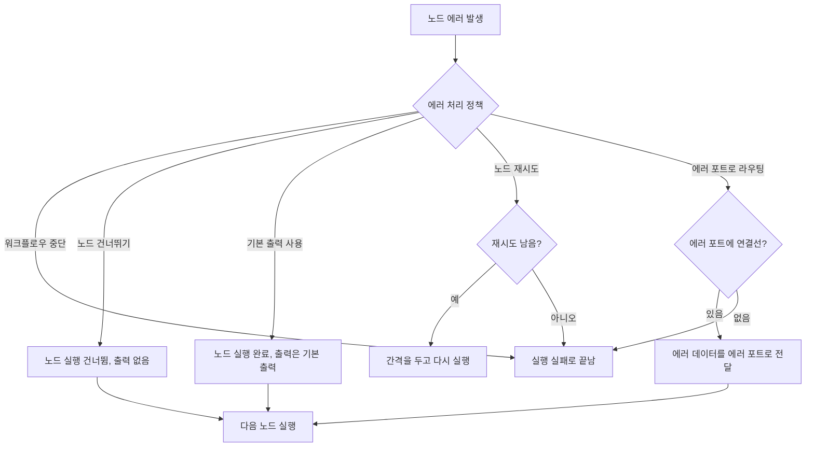

> 구현 상태: 부분 구현(재시도 간격 상한·워크플로우 수준 자동 재시도·동적 에러 포트는 미구현) · 원문: `spec/5-system/3-error-handling.md` (§3, §4) · 용어: [용어 사전](../CLE-GLOSSARY.md)

## 개요

이 문서는 노드가 실패했을 때 엔진이 어떻게 동작하는지 정한다. 노드마다 고르는 에러 처리 정책(Error Handling, `config.errorHandling.policy`) 다섯 가지의 실행 동작, 에러 포트로 보내는 출력 형태, 노드 재시도(`retryConfig`) 설정, 그리고 워크플로우 수준 자동 재시도를 다룬다.

설정 이름이 비슷한 두 층을 구분한다.

| 설정 | 키 | 쓰는 노드 | 다루는 것 |
| --- | --- | --- | --- |
| 에러 처리 정책 | `config.errorHandling = { policy, retryConfig?, defaultOutput? }` | 모든 노드 | 노드 자체가 실패했을 때의 동작. 이 문서가 정한다. |
| 항목 에러 정책(item error policy) | `config.errorPolicy` | ForEach·Map(`stop`, `skip`, `continue`), Parallel(`stop`, `continue`, `cancel-others-on-fail`) | 반복 항목이나 병렬 분기 하나가 실패했을 때의 동작. [Logic 노드 공통](../CLE-NODE-LOGIC/CLE-NODE-LOGIC-COMMON.md)이 정한다. |

두 설정은 서로 다른 층이다. 한 노드에서 두 키를 같은 뜻으로 섞어 쓰지 않는다. ForEach·Map·Parallel 에는 두 키가 함께 있을 수 있다. Logic 노드도 다른 노드처럼 에러 처리 정책 다섯 가지를 모두 쓸 수 있다([Logic 노드 공통](../CLE-NODE-LOGIC/CLE-NODE-LOGIC-COMMON.md#항목-에러-정책)). 두 키가 함께 있는 노드의 동작은 다음과 같다.

1. ForEach·Map·Parallel 노드의 `config.errorHandling` 은 그 노드의 핸들러 호출이 실패할 때 적용한다.
2. 본문 노드나 병렬 분기 안의 노드가 실패하면 그 노드 자신의 `config.errorHandling` 을 먼저 적용한다.
3. 그 결과 반복 항목이나 병렬 분기 하나가 실패하면 ForEach·Map·Parallel 노드의 `config.errorPolicy` 를 적용한다.
4. 반복 회차나 병렬 분기를 실행하는 단계에서 ForEach·Map·Parallel 노드 자신이 실패해도 그 노드의 `config.errorHandling` 은 적용하지 않는다. `config.errorPolicy` 가 `stop` 이라 노드가 실패한 경우와 메시지가 `CONTAINER_MISSING_EMIT: ` 나 `CONTAINER_MULTIPLE_EMIT: ` 로 시작하는 에러로 실패한 경우가 여기에 든다.
5. Parallel 은 `config.errorPolicy` 가 비었을 때만 `config.errorHandling.policy` 를 읽어 항목 에러 정책 값으로 바꿔 쓴다. 대응 규칙은 [Parallel 노드](../CLE-NODE-LOGIC/CLE-NODE-PARALLEL.md)가 정한다. 이 예외를 둔 이유는 [두 키가 함께 있는 이유](#두-키가-함께-있는-이유)에 있다.

레거시 평면 키 `config.errorPolicy` 의 단축값(`stop`, `skip`, `default_output`, `retry`, `error_port`)은 ForEach·Map·Parallel 이 아닌 노드에서만 에러 처리 정책으로 옮긴다. 설정 패널은 `config.errorHandling.policy` 가 없는 노드를 불러올 때 이 값을 대응하는 `policy`(`stop_workflow`, `skip_node`, `use_default_output`, `retry`, `route_to_error_port`)로 읽는다. 저장할 때는 `config.errorPolicy` 를 지운다. ForEach·Map·Parallel 에서는 이 키가 현행 항목 에러 정책이다. 그래서 설정 패널은 이 세 노드의 `config.errorPolicy` 를 에러 처리 정책으로 옮기지 않고 저장할 때 지우지도 않는다. 결정 근거는 [레거시 평면 키 이전 범위를 좁힌 이유](#레거시-평면-키-이전-범위를-좁힌-이유)에 있다.

이 문서가 다루지 않는 것은 다음과 같다.

- 설정 패널의 정책 선택 화면, 기본 출력 입력 UI, 저장 형태: [노드 포트와 설정 패널](../CLE-WF/CLE-WF-NODEPANEL.md)
- 노드 출력 안의 `output.error` 표준 형태, 사전 검증 에러와 런타임 에러의 분류, 고정 에러 포트가 있는 노드 목록: [노드 출력 규약 Principle 3](CLE-NODE-OUTPUT.md#principle-3-에러-계약)
- 에러 코드 전체 카탈로그와 명명 규칙: [에러 코드 규약과 카탈로그](../CLE-API/CLE-API-ERRCODES.md)
- 노드 실행 실패를 REST 로 감싸는 실행 에러 응답 형식: [에러 응답과 클라이언트 처리](../CLE-API/CLE-API-ERROR.md)
- 엔진이 핸들러를 부르고 재시도하는 구현 계약: [노드 핸들러 계약](../CLE-EXEC/CLE-EXEC-HANDLER.md)
- 노드 취소(`AbortError`, `ExecutionCancelledError`)의 기록과 전파: [노드 취소](../CLE-EXEC/CLE-EXEC-CANCEL.md)

## 규칙

### 1. 에러 처리 정책 다섯 가지

노드 설정에서 아래 다섯 정책 가운데 하나를 고른다. 화면 라벨은 "오류 처리" 다.

| enum | 화면 라벨 | 본문 표기 |
| --- | --- | --- |
| `stop_workflow` | 워크플로우 중단 | 워크플로우 중단(기본) |
| `skip_node` | 노드 건너뛰기 | 노드 건너뛰기 |
| `use_default_output` | 기본 출력 사용 | 기본 출력 사용 |
| `retry` | 재시도 | 노드 재시도 |
| `route_to_error_port` | 에러 포트로 라우팅 | 에러 포트로 라우팅 |

노드에서 에러가 나면 엔진은 정책에 따라 다르게 진행한다.



1. 워크플로우 중단(`stop_workflow`)이 기본이다.
   - 실행 상태(`Execution.status`)를 `failed` 로 바꾼다.
   - 에러가 난 노드를 캔버스에 강조한다.
   - 뒤의 노드는 실행하지 않는다.
2. 노드 건너뛰기(`skip_node`)
   - 노드 실행 상태(`NodeExecution.status`)를 `skipped` 로 둔다.
   - 에러 정보는 `NodeExecution.error = { message: "..." }` 에 남긴다.
   - 엔진은 이 노드의 출력을 실행 캐시에 쓰지 않는다. 다음 노드는 이 노드에서 오는 입력이 빈 값(`undefined`)인 채로 실행한다.
   - 고른 포트가 없으므로 이 노드의 출력 연결선은 포트와 상관없이 모두 활성화된다.
   - [Parallel 노드](../CLE-NODE-LOGIC/CLE-NODE-PARALLEL.md#병렬-분기의-노드-집합과-위상-순서) 의 병렬 분기 안에서 건너뛴 노드는 출력을 쓰지 않으므로 그 병렬 분기의 결과 노드 후보가 아니다(REQ-PARALLEL-030).
3. 기본 출력 사용(`use_default_output`)
   - 노드 실행 상태를 `completed` 로 둔다. 경고를 함께 남긴다.
   - 출력은 미리 설정한 기본 출력(`config.errorHandling.defaultOutput`)이다. 다음 노드는 이 값으로 실행한다.
   - 기본 출력을 비워 두면 `null` 을 낸다(`defaultOutput ?? null`). 기본 출력 입력 UI, 원래 에러 기록, 캔버스 경고 표시는 [노드 포트와 설정 패널](../CLE-WF/CLE-WF-NODEPANEL.md)이 정한다.
4. 노드 재시도(`retry`)
   - `maxRetries`, `retryInterval` 에 따라 다시 실행한다. 설정 값은 [3. 노드 재시도 설정](#3-노드-재시도-설정)에 있다.
   - 모든 재시도가 실패하면 워크플로우 중단으로 끝난다.
5. 에러 포트로 라우팅(`route_to_error_port`)
   - 에러 데이터를 `error` 포트로 보낸다. 연결된 다음 노드가 에러 데이터를 입력으로 받아 실행한다.
   - `error` 포트에 연결선이 없으면 워크플로우 중단으로 대신 처리한다.
   - 자세한 규칙은 [2. 에러 포트로 라우팅](#2-에러-포트로-라우팅)에 있다.

노드 취소에는 에러 처리 정책을 적용하지 않는다. 엔진은 `AbortError` 와 `ExecutionCancelledError` 를 실패로 보지 않는다. 노드 실행 상태를 `cancelled` 로 기록하고 에러를 다시 던진다(`execution-engine.service.ts` 의 `executeNode`). 노드 재시도도 이 두 에러는 다시 실행하지 않는다. 취소 흐름은 [노드 취소](../CLE-EXEC/CLE-EXEC-CANCEL.md)가 정한다.

핸들러가 런타임 실패를 throw 하지 않고 `port: 'error'` 출력으로 돌려주면 엔진은 그 실패에 에러 처리 정책을 적용하지 않는다. 노드 재시도도 하지 않는다. 엔진은 핸들러가 throw 한 실패에만 정책을 건다(`execution-engine.service.ts` 의 `executeNode`). 그 출력이 어디로 가는지는 [2. 에러 포트로 라우팅](#2-에러-포트로-라우팅) 규칙을 따른다.

정책은 `config.errorHandling = { policy, retryConfig?, defaultOutput? }` 에 저장한다. `policy` enum 은 엔진의 `error-policy.handler.ts` 와 같다.

### 2. 에러 포트로 라우팅

에러 포트는 두 가지다.

- 고정 에러 포트: 노드 정의에 원래 있는 `error` 포트. 어떤 노드에 있는지는 [노드 출력 규약 Principle 3](CLE-NODE-OUTPUT.md#principle-3-에러-계약)의 3.3 이 정한다.
- 동적 에러 포트: 에러 처리 정책을 "에러 포트로 라우팅" 으로 고를 때 노드에 생기는 `error` 포트. 설정 패널 동작은 [노드 포트와 설정 패널](../CLE-WF/CLE-WF-NODEPANEL.md)이 정한다.

동적 에러 포트는 아직 구현되지 않았다. 지금은 노드 정의에 고정 `error` 포트를 둔 노드만 이 정책으로 에러 연결선을 이을 수 있다.

노드 핸들러가 런타임 실패를 `port: 'error'` 로 보낼 때 노드 출력은 아래 형태다([노드 출력 규약 Principle 3](CLE-NODE-OUTPUT.md#principle-3-에러-계약)의 3.2 와 같다).

```json
{
  "config": { /* 원본 설정 에코. 자격 증명은 싣지 않는다 */ },
  "output": {
    "error": {
      "code": "HTTP_5XX",
      "message": "HTTP 502 Bad Gateway",
      "details": { "statusCode": 502, "url": "https://api.example.com/data", "method": "GET" }
    }
  },
  "meta": { "durationMs": 812, "statusCode": 502 },
  "port": "error"
}
```

`output.error` 의 필드(`code`, `message`, `details`)는 [노드 출력 규약 3.2](CLE-NODE-OUTPUT.md#32-outputerror-표준-형태)가 정한다. `details` 의 공통 표준 필드는 [노드 출력 규약 3.2.1](CLE-NODE-OUTPUT.md#321-details-의-공통-표준-필드), 노드별 선택 스키마는 [노드 출력 규약 3.2.2](CLE-NODE-OUTPUT.md#322-details-의-노드별-선택-스키마)가 정한다.

동작 규칙은 다음과 같다.

1. 사전 검증 에러(설정 오류)는 이 형태로 감싸지 않는다. 그대로 throw 해서 실행 전체를 `failed` 로 바꾼다.
2. `error` 포트에 연결선이 있으면 `output.error` 를 포함한 `output` 전체를 그 연결선으로 보내고 다음 노드를 실행한다.
3. `error` 포트에 연결선이 없으면 `ERROR_PORT_FALLBACK` 에러를 로그에 남기고 워크플로우 중단으로 대신 처리한다.
4. 에러 포트로 보낸 노드의 노드 실행 상태는 `failed` 로 기록한다. 실행은 계속 진행한다.
5. 다음 노드는 `$node["X"].output.error?.code` 로 분기하거나 `$node["X"].port === 'error'` 로 판단한다.
6. 멀티턴 AI 노드가 `max_retries` 같은 사유로 에러 종료하면 `output.error` 와 `output.result` 가 함께 있을 수 있다. 에러 여부는 `output.error` 가 있는지로 판단하고 부분 수집한 결과는 `output.result` 에서 읽는다.

핸들러가 실패를 throw 하고 이 정책이 걸리면 엔진이 출력을 만든다(`error-policy.handler.ts`). `output` 은 `{ error: { code, message } }` 이고 `details` 는 싣지 않는다. 엔진은 이 출력에 `error` 포트를 고르므로 위 규칙 2 · 3 · 4 가 `port: 'error'` 출력과 똑같이 걸린다.

- `message` 는 던진 Error 의 `message` 다. Error 가 아닌 값을 던지면 문자열로 바꾼 값이다.
- `code` 는 ForEach · Map · Parallel 이 실패한 회차의 `error.code` 를 고르는 규칙(`resolveIterationErrorCode`)과 같다([Logic 노드 공통](../CLE-NODE-LOGIC/CLE-NODE-LOGIC-COMMON.md#반복-결과-출력-구조) 4번). 던진 Error 가 백엔드가 직접 싣는 카탈로그 코드(예: `CAFE24_RATE_LIMITED` · `INTEGRATION_NOT_CONNECTED`)를 문자열 `code` 로 실으면 그 값이다. 그 밖은 `UNKNOWN_ERROR` 다. `code` 가 없는 평범한 `Error` · `TypeError`, Error 가 아닌 값, Node 런타임 · DB 드라이버가 싣는 `ECONNREFUSED` 같은 `code` 가 여기에 든다.
- 취소(`AbortError` · `ExecutionCancelledError`)에는 정책을 적용하지 않으므로([1. 에러 처리 정책 다섯 가지](#1-에러-처리-정책-다섯-가지)) 이 출력이 생기지 않는다.
- `error` 연결선만 활성화한다. `out` 같은 다른 출력 포트의 연결선은 열리지 않는다. `error` 연결선이 없으면 `ERROR_PORT_FALLBACK` 으로 워크플로우를 중단한다.
- 노드 실행 기록에는 이 출력과 `error.code` · `error.message` 가 남고 노드 실패 이벤트(`NODE_FAILED`)도 낸다. 마감은 `port: 'error'` 출력과 같은 함수(`execution-engine.service.ts` 의 `finalizeErrorPortNode`)가 맡는다. 이렇게 맞춘 이유는 [throw 한 실패도 `error` 포트를 고른다](#throw-한-실패도-error-포트를-고른다-2026-11-14) 에 있다.

`code` 를 이 규칙으로 고른 이유는 [throw 한 실패의 `error.code` 를 반복 결과와 같은 규칙으로 고른다](#throw-한-실패의-errorcode-를-반복-결과와-같은-규칙으로-고른다-2026-11-13) 에 있다.

노드 카테고리별 대표 에러 코드는 아래와 같다. 전체 목록은 [에러 코드 규약과 카탈로그](../CLE-API/CLE-API-ERRCODES.md)에 있다.

| 노드 카테고리 | 코드 |
| --- | --- |
| HTTP | `HTTP_TRANSPORT_FAILED`, `HTTP_4XX`, `HTTP_5XX`, `HTTP_TIMEOUT`(발행하지 않음), `HTTP_BLOCKED` |
| Database | `DB_QUERY_FAILED`, `DB_CONNECTION_ERROR`, `DB_CONSTRAINT_VIOLATION`, `DB_PERMISSION_DENIED`, `DB_HOST_BLOCKED` |
| Email | `EMAIL_SEND_FAILED`, `EMAIL_HOST_BLOCKED`, `EMAIL_NO_RECIPIENTS` |
| LLM | `LLM_CALL_FAILED`, `LLM_RATE_LIMIT`, `LLM_RESPONSE_INVALID`, `LLM_TIMEOUT`(발행하지 않음), `MAX_COLLECTION_RETRIES_EXCEEDED` |
| Code | `CODE_EXECUTION_FAILED`, `CODE_TIMEOUT`, `CODE_MEMORY_LIMIT` |
| 서브 워크플로우 | `SUB_WORKFLOW_FAILED`, `SUB_WORKFLOW_NOT_FOUND`, `SUB_WORKFLOW_TIMEOUT`, `SUB_WORKFLOW_QUEUE_FAILED`, `WORKFLOW_FORBIDDEN_WORKSPACE`. 어떤 실패가 어떤 코드인지는 [워크플로우 호출 노드](../CLE-NODE-FLOW/CLE-NODE-SUBWF.md)가 정한다. |

### 3. 노드 재시도 설정

| 필드 | 타입 | 기본값 | 설명 |
| --- | --- | --- | --- |
| `maxRetries` | Integer | 3 | 최대 재시도 횟수 |
| `retryInterval` | Integer | 1000 | 재시도 간격(ms) |
| `backoffMultiplier` | Float | 2.0 | 지수 백오프 배수 |
| `maxInterval` | Integer | 30000 | 최대 재시도 간격(ms). 미구현. 현재 `RetryConfig`(`execution-engine/error/error-policy.handler.ts`)에는 이 필드가 없고 간격에 상한이 없다. |

1. 설정은 `config.errorHandling.retryConfig.*` 에 저장한다.
2. 기본 정책은 워크플로우 중단이다. 노드 재시도는 사용자가 정책으로 고를 때만 적용한다.
3. 노드 카테고리별 기본 재시도는 두지 않는다. 모든 노드가 같은 `maxRetries` 기본값 3 을 쓴다(`error-policy.handler.ts`). Logic 노드의 재시도도 막지 않는다. 이유는 [Rationale](#rationale) 에 있다.
4. 재시도 간격은 `interval = retryInterval × backoffMultiplier^attempt` 로 계산한다. 현재 구현은 상한 없이 늘어난다. `error-policy.handler.ts` 와 `execution-engine.service.ts` 의 재시도 경로가 모두 그렇다.
5. `maxInterval` 로 간격을 자르는 것(`min(..., maxInterval)`)은 계획이다(미구현).

### 4. 워크플로우 수준 자동 재시도

트리거나 스케줄로 자동 실행한 워크플로우가 실패하면 워크플로우 전체를 다시 실행한다.

| 항목 | 설명 |
| --- | --- |
| 적용 대상 | 트리거·스케줄로 시작한 자동 실행만. 수동 실행은 제외한다. |
| 재시도 횟수 | 워크플로우 설정에서 정한다. 기본 0, 최대 5. |
| 재시도 간격 | 고정 또는 지수 백오프 |
| 재시도 대상 에러 | 시스템 에러, 통합 에러, 타임아웃만 재시도한다. 유효성 에러는 재시도하지 않는다. |

이 기능의 구현 여부는 확인이 필요하다. [미결 사항](#미결-사항) 참조.

## 미결 사항

- **워크플로우 수준 자동 재시도의 구현 상태**: 이 문서 4절은 트리거·스케줄 자동 실행에 워크플로우 설정 재시도(기본 0, 최대 5)를 약속하고, [비기능 요구사항](../CLE-PLAT/CLE-PLAT-NFR.md)의 자동 재시도 요구는 구현 완료로 표시돼 있다. 반면 워크플로우 설정(`Workflow.settings`)에는 재시도 키가 없고([워크플로우 데이터와 저장 흐름](../CLE-WF/CLE-WF-DATA.md)), 시작 큐(`execution-run`)는 `attempts:1` 로 애플리케이션 재시도를 하지 않는다([큐 워커와 동시 실행 제한](../CLE-EXEC/CLE-EXEC-WORKER.md)). 코드에서 워크플로우 수준 재시도 구현을 찾지 못했다. 결정 필요: 4절을 미구현으로 표시하고 비기능 요구사항을 노드 재시도 기준으로 다시 쓸지, 기능을 구현할지.
- **되돌아가는 연결선으로 다시 실행한 노드를 건너뛸 때 남는 앞 출력** (info): 노드 건너뛰기는 출력을 쓰지 않으므로 그 노드가 같은 실행에서 앞서 쓴 출력이 실행 캐시에 남는다. 다음 노드의 입력, 연결선 활성화, [서브 워크플로우의 최종 노드 출력](../CLE-NODE-FLOW/CLE-NODE-SUBWF.md#최종-노드-출력) 이 모두 그 앞 출력을 따른다. 건너뛸 때 앞 출력을 지울지 결정 필요.

## 구현 위치

- `codebase/backend/src/modules/execution-engine/error/error-policy.handler.ts`: 에러 처리 정책과 재시도
- `codebase/backend/src/nodes/core/error-codes.ts`: `ErrorCode` enum
- `codebase/backend/src/modules/execution-engine/execution-engine.service.ts`: 재시도 경로, 노드 핸들러 호출 실패에 에러 처리 정책 적용(`executeNode`), 에러 포트로 보낸 노드의 마감(`finalizeErrorPortNode`)
- `codebase/frontend/src/components/editor/settings-panel/node-settings-panel.tsx`: 에러 처리 정책 저장과 레거시 평면 키 이전(`LEGACY_POLICY_MAP`, 이전에서 뺄 노드 유형 `ITEM_ERROR_POLICY_NODE_TYPES`)

코드 식별자 `*ErrorPolicy*` 는 두 계열이다. `error-policy.handler.ts` 의 `ErrorPolicy` · `ErrorPolicyConfig` · `ErrorPolicyHandler` 는 에러 처리 정책(`config.errorHandling`)이다. `ContainerErrorPolicy`(`execution-engine/utils/coerce-container-param.ts`) · `ForEachErrorPolicy`(`execution-engine/containers/foreach-executor.ts`) · `ParallelErrorPolicy`(`execution-engine/containers/parallel-executor.ts`)와 설정 키 `config.errorPolicy` 는 항목 에러 정책이다.

## Rationale

### 설정 이름을 "에러 처리 정책" 과 "항목 에러 정책" 으로 나눈 이유

컨테이너와 Parallel 에는 이미 `config.errorPolicy` 라는 항목 단위 정책이 있다. 노드 전체에 거는 정책을 사용자 가이드 용어집처럼 "에러 정책" 으로 부르면 이 키와 이름이 부딪힌다. 그래서 노드 정책은 "에러 처리 정책", 컨테이너 정책은 "항목 에러 정책" 으로 부른다. 결정 경위는 [용어 사전](../CLE-GLOSSARY.md)의 Rationale 에 있다.

### 런타임 에러만 에러 포트로 보내는 이유

통합 노드의 사설망 차단과 자격 증명 해석 실패를 런타임 에러 포트로 보내기로 한 결정(D4)의 근거는 [노드 출력 규약](CLE-NODE-OUTPUT.md#rationale)에 있다. 사용자가 `error` 포트로 분기해 복구할 수 있게 하려는 결정이다.

### 두 키가 함께 있는 이유

`config.errorHandling` 과 `config.errorPolicy` 는 서로 다른 단계의 실패를 다룬다. `config.errorHandling` 은 노드 핸들러 호출이 실패할 때의 동작이다. `config.errorPolicy` 는 반복 회차나 병렬 분기를 실행하는 단계의 실패에 적용하는 동작이다. 두 키가 맡는 단계가 다르므로 한 노드의 한 실패에 두 키가 함께 적용되지 않는다. 그래서 ForEach·Map·Parallel 에 두 키를 함께 둔다.

Parallel 이 `config.errorPolicy` 가 비었을 때 `config.errorHandling.policy` 를 읽는 규칙([Parallel 노드](../CLE-NODE-LOGIC/CLE-NODE-PARALLEL.md)의 REQ-PARALLEL-016)은 이 구분의 예외다. 예전 설정과 호환하려고 남긴 규칙이다(`execution-engine.service.ts` 의 Parallel 항목 에러 정책 결정).

### 레거시 평면 키 이전 범위를 좁힌 이유

`config.errorPolicy` 는 두 뜻으로 적혀 있었다. [Logic 노드 공통](../CLE-NODE-LOGIC/CLE-NODE-LOGIC-COMMON.md)과 ForEach·Map·Parallel 문서는 이 키를 현행 항목 에러 정책으로 썼다. [노드 포트와 설정 패널](../CLE-WF/CLE-WF-NODEPANEL.md)은 같은 키를 `config.errorHandling.policy` 로 옮길 레거시 평면 키로 보고 노드 유형을 가리지 않고 옮긴다고 적었다. 설정 패널(`node-settings-panel.tsx`)도 노드 유형을 가리지 않고 옮겼다. 그래서 세 노드에서 고른 항목 에러 정책이 설정 패널에서 저장할 때 사라졌다. 이 문서의 이전 판은 이전 범위의 정의가 갈린다고만 적고 결정을 미결 사항으로 남겼다.

2026-10-10 에 레거시 키 이전과 삭제를 ForEach·Map·Parallel 이 아닌 노드로 한정하기로 정했다(NERV Task `CLE-T-V0JAG1`). 세 노드에서 이 키는 레거시 키가 아니고 현행 설정이다. 이 안은 설정 패널 한 곳만 고치면 된다. 저장된 워크플로우와 승인된 문서의 키 이름은 그대로 둔다.

기각한 대안은 항목 에러 정책 키를 `itemErrorPolicy` 같은 새 이름으로 바꾸고 저장된 워크플로우를 마이그레이션하는 안이다. 기각한 이유는 세 가지다.

- 승인된 문서 여러 개가 쓰는 키를 바꿔야 한다. [ForEach 노드](../CLE-NODE-LOGIC/CLE-NODE-FOREACH.md), [Map 노드](../CLE-NODE-LOGIC/CLE-NODE-MAP.md), [Parallel 노드](../CLE-NODE-LOGIC/CLE-NODE-PARALLEL.md), [컨테이너 실행](../CLE-EXEC/CLE-EXEC-CONTAINER.md), [노드 취소](../CLE-EXEC/CLE-EXEC-CANCEL.md), [용어 사전](../CLE-GLOSSARY.md)이 이 키를 쓴다.
- [용어 사전 — 노드](../CLE-GLOSSARY-NODE.md)의 「항목 에러 정책」 행과 [용어 사전 — 결정이 필요한 표기](../CLE-GLOSSARY-OPEN.md)의 「에러·오류와 에러 처리 정책 이름이 갈린다」 항목(D09)이 가리키는 키 표기를 함께 고쳐야 한다.
- 저장된 워크플로우의 노드 설정을 옮기는 데이터 마이그레이션이 필요하다.

### 노드 카테고리별 기본 재시도를 두지 않는다 (2026-10-24)

엔진 원문은 노드 카테고리마다 기본 재시도를 달리 두었다. 이 문서 3절과 [노드 포트와 설정 패널](../CLE-WF/CLE-WF-NODEPANEL.md) 은 모든 노드의 기본 정책을 워크플로우 중단으로 두고, 재시도는 사용자가 고를 때만 `maxRetries` 기본값 3 으로 적용한다. 현재 구현도 그렇다. 그래서 현행을 계약으로 정했다(NERV Task `CLE-T-3HJ8MM`). 원문 표의 내용과 옮기지 않은 이유는 [노드 핸들러 계약](../CLE-EXEC/CLE-EXEC-HANDLER.md#노드-카테고리별-기본-재시도-표를-옮기지-않는다) 에 있다.

기각한 대안은 Logic 노드에서 재시도를 막는 안이다. Logic 노드도 다섯 정책을 모두 고를 수 있게 둔 결정([Logic 노드 공통](../CLE-NODE-LOGIC/CLE-NODE-LOGIC-COMMON.md#rationale))과 맞지 않고, 설정 패널과 엔진에 카테고리 검사를 새로 넣어야 한다.

### `error` 포트로 돌려준 실패에 정책을 걸지 않는다 (2026-11-01)

엔진은 전부터 핸들러가 throw 한 실패에만 에러 처리 정책을 걸었다. 하지만 이 규칙을 적은 문서가 없었다. AI 에이전트 단일 턴의 LLM 호출 실패를 `error` 포트로 옮기면서(NERV Task `CLE-T-ZHBMAC`) 이 차이가 사용자에게 보이게 됐다. 단일 턴 에이전트에 `retry` 같은 정책을 건 워크플로우는 이제 LLM 호출 실패에 그 정책을 쓰지 않는다.

[노드 카테고리별 기본 재시도를 두지 않는다](#노드-카테고리별-기본-재시도를-두지-않는다-2026-10-24)는 결정(2026-10-24)은 카테고리마다 기본 재시도를 두지 않고 재시도는 작성자가 노드마다 고를 때만 적용한다고 정했다. 카테고리별 기본 재시도를 두지 않는 그 결정은 그대로다. 이 규칙은 작성자가 고른 정책이 걸리는 범위를 핸들러가 throw 한 실패로 정할 뿐이다.

기존 워크플로우에는 영향이 있다. AI 에이전트 단일 턴에 `retry` · `skip_node` · `use_default_output` 을 걸어 둔 워크플로우는 LLM 호출이 실패해도 그 정책이 걸리지 않는다. `error` 연결선이 없으면 엔진은 `ERROR_PORT_FALLBACK` 을 남기고 워크플로우 중단으로 처리한다. 같은 처리가 필요하면 `error` 포트에 에이전트를 다시 실행하거나 기본값을 내는 분기를 잇는다. [노드 포트와 설정 패널 §에러 처리 정책 설정](../CLE-WF/CLE-WF-NODEPANEL.md#에러-처리-정책-설정)의 정책 설명에 이 단서를 더하는 일은 NERV Task `CLE-T-KPDDKB` 가 맡는다.

기각한 대안은 두 가지다.

- 엔진이 `error` 포트 출력에도 `retry` 정책을 적용하는 안. [정보 추출기 노드](../CLE-NODE-AI/CLE-NODE-EXTRACTOR.md)와 [텍스트 분류기 노드](../CLE-NODE-AI/CLE-NODE-CLASSIFIER.md)처럼 이미 `error` 포트를 쓰는 노드의 동작까지 바뀐다. 작성자가 `error` 연결선으로 고른 처리와 엔진 재시도가 겹친다.
- `error` 포트를 쓰는 노드에서 정책 선택 UI 를 막는 안. AI 에이전트에는 아직 throw 경로가 남아 있다. 단일 턴의 노드 LLM 설정(`llmConfigId`) 조회 실패가 그렇다(NERV Task `CLE-T-T8FVCG`). 이 실패에는 지금도 정책이 걸린다. 롤링 요약 호출 실패와 요약 모델 설정 조회 실패는 2026-11-05 에 `error` 포트로 옮겼다(NERV Task `CLE-T-Q38K9F`).

### 노드 건너뛰기는 출력을 쓰지 않는다 (2026-11-06)

이 문서는 노드 건너뛰기(`skip_node`)의 출력을 `null` 로 적었지만 엔진은 건너뛴 노드의 출력을 실행 캐시에 쓰지 않는다. [Parallel 노드](../CLE-NODE-LOGIC/CLE-NODE-PARALLEL.md#병렬-분기의-노드-집합과-위상-순서) 의 2026-11-02 개정이 이 차이를 짚었고 이번에 문서를 엔진 동작에 맞췄다(NERV Task `CLE-T-HW2GKD`). 다음 노드가 받는 값은 `null` 이 아니라 빈 값(`undefined`)이다. 표현식에서 `null` 과 비교하면 둘이 다르게 보일 수 있다. 고른 포트도 없으므로 엔진은 이 노드의 출력 연결선을 포트와 상관없이 모두 활성화한다. 이 문장도 엔진의 지금 동작을 그대로 적은 것이다.

기각한 대안은 엔진이 `null` 을 쓰게 바꾸는 안이다. 출력을 쓰면 Parallel 결과 노드 판정(REQ-PARALLEL-030)이 건너뛴 노드를 후보로 보게 되고 실행 캐시를 읽는 다른 규칙도 함께 바뀐다. 이번 정리는 문서를 동작에 맞추는 범위라 동작은 바꾸지 않았다.

**기존 워크플로우 영향**: 엔진 동작은 바꾸지 않았으므로 실행 결과는 그대로다. 다만 옛 서술을 믿고 건너뛴 노드의 출력을 `null` 로 보고 짠 표현식은 처음부터 빈 값(`undefined`)을 받아 왔다. 그런 표현식이 `null` 과 엄격하게 비교하면 문서가 말한 결과와 다르게 나왔을 수 있으니 빈 값도 함께 검사하도록 고쳐야 한다. 같은 날 [노드 설정 패널](../CLE-WF/CLE-WF-NODEPANEL.md#에러-처리-정책-설정) 의 정책 표도 고쳤고 사용자 가이드의 같은 설명은 NERV Task `CLE-T-1JZFZW` 가 고친다.

### throw 한 실패의 `error.code` 를 반복 결과와 같은 규칙으로 고른다 (2026-11-13)

**결정**: 핸들러가 throw 한 실패에 `route_to_error_port` 가 걸릴 때 `output.error.code` 를 [Logic 노드 공통](../CLE-NODE-LOGIC/CLE-NODE-LOGIC-COMMON.md#반복-결과-출력-구조) 4번 규칙(`resolveIterationErrorCode`)으로 고른다. 카탈로그 코드는 그대로 내고 그 밖은 `UNKNOWN_ERROR` 다. 사람이 정했다(NERV 질문 `01a1d2f4-3808-72c5-b859-5a6c7b295c9d`, NERV Task `CLE-T-KXARNK`).

**근거**: 전에는 던진 Error 의 `name` 을 그대로 실었다. 값은 대부분 `Error` · `TypeError` 였고 일부는 `IntegrationError` · `MakeshopRateLimitedError` 같은 클래스 이름이었다. Error 가 아닌 값을 던져도 `Error` 였다. 이 값은 [에러 코드 규약과 카탈로그](../CLE-API/CLE-API-ERRCODES.md#규칙) 규칙 2(`UPPER_SNAKE_CASE`)와 규칙 8(발행하는 코드는 카탈로그에 둔다)을 따르지 않았다. ForEach · Map · Parallel 의 실패 회차도 같은 문제가 있었고 2026-11-05 에 이 함수로 고쳤다(NERV Task `CLE-T-REC4X3`). 같은 실패가 반복 결과와 에러 포트에서 다른 코드를 내지 않도록 같은 함수를 쓴다. `UNKNOWN_ERROR` 는 이미 카탈로그 §6.6 에 있어서 새 코드는 만들지 않았다. §6.6 의 설명은 아직 반복 · 병렬 결과만 적는다. 이 경로를 더하는 일은 NERV Task `CLE-T-14VQC2` 가 맡는다.

**기존 워크플로우 영향**: 이 값은 실행 캐시에만 있어서 다음 노드의 입력과 표현식으로만 보인다. `$node["X"].output.error.code == "Error"` 처럼 옛 값으로 나누던 표현식은 `UNKNOWN_ERROR` 와 비교하도록 고쳐야 한다. 옛 값을 따로 남기는 장치는 두지 않았고 사용자 가이드에 바뀐 값과 비교법을 안내했다.

**기각한 대안** (2026-11-13 사용자 선택):

- 원래 클래스 이름을 `error.details.name` 에 함께 남긴다: 옛 분기를 옮기기는 쉽다. 하지만 [노드 출력 규약 3.2.1](CLE-NODE-OUTPUT.md#321-details-의-공통-표준-필드) 에 없는 공통 필드를 새로 만들어야 한다. 지금 이 값을 읽는 길은 표현식 하나뿐이라 그 비용이 얻는 값보다 크다고 봤다.
- 바꾸지 않고 `error.name` 을 예외로 둔다: 카탈로그 밖 값이 계속 나가고 반복 결과와 값이 갈린다.
- 카탈로그에 없는 실패에 이 정책 전용 새 코드를 쓴다: 카탈로그 등재를 먼저 해야 하고, 같은 실패가 반복 결과(`UNKNOWN_ERROR`)와 다른 코드를 낸다. 질문에 예로 든 `NODE_EXECUTION_FAILED` 는 [에러 코드 규약과 카탈로그](../CLE-API/CLE-API-ERRCODES.md) §6.6 이 노드 출력에 더 이상 쓰지 않는다고 적은 옛 코드라 그대로 쓸 수도 없다.

### throw 한 실패도 `error` 포트를 고른다 (2026-11-14)

**결정**: 핸들러가 throw 한 실패에 `route_to_error_port` 가 걸리면 엔진은 출력에 `error` 포트를 고르고 `port: 'error'` 출력과 같은 마감(`finalizeErrorPortNode`)을 쓴다. `error` 연결선만 활성화하고 연결선이 없으면 `ERROR_PORT_FALLBACK` 으로 중단한다. 노드 실행 기록에 출력과 `error.code` 를 남기고 `NODE_FAILED` 를 낸다. 사람이 정했다(NERV 질문 `01a1d82a-3276-741c-a192-1e10ec498e81`, NERV Task `CLE-T-0R8F99`).

**근거**: [1. 에러 처리 정책 다섯 가지](#1-에러-처리-정책-다섯-가지) 5번과 [Logic 노드 공통](../CLE-NODE-LOGIC/CLE-NODE-LOGIC-COMMON.md#항목-에러-정책) 규칙 5 는 연결선이 없으면 워크플로우를 중단한다고 적었다. 그런데 엔진은 throw 경로에서 포트를 고르지 않았다. 그래서 출력 연결선이 포트와 상관없이 모두 활성화돼 정상 경로의 다음 노드가 `{ error }` 를 입력으로 받아 실행됐다. 고정 `error` 포트가 있는 노드는 정상 분기와 에러 분기가 함께 실행됐다. 같은 정책이 실패를 throw 했는지 `error` 포트로 돌려줬는지에 따라 다르게 동작하지 않도록 두 경로를 맞췄다.

**기존 워크플로우 영향**: 고정 `error` 포트가 있는 노드([노드 출력 규약 Principle 3](CLE-NODE-OUTPUT.md#principle-3-에러-계약)의 3.3)에 이 정책을 건 워크플로우는 이제 에러 분기만 실행한다. 고정 `error` 포트가 없는 노드는 동적 에러 포트가 생기기 전까지 에러 연결선을 이을 수 없다. 그래서 그런 노드에 이 정책을 건 워크플로우는 throw 한 실패에서 늘 `ERROR_PORT_FALLBACK` 으로 중단한다. 전에는 다음 노드가 실행됐다. 2026-11-13 결정의 «이 값은 실행 캐시에만 있다» 는 서술도 더 맞지 않는다. 이제 노드 실행 기록에도 출력과 `error.code` 가 남는다. 바뀐 동작은 사용자 가이드(에러 처리)에 안내했다.

**기각한 대안** (2026-11-14 사용자 선택):

- 문서를 지금 동작에 맞춘다: 정상 분기와 에러 분기가 함께 실행되는 동작이 규칙으로 남는다.
- 고정 `error` 포트가 있는 노드만 고친다: 고정 포트가 없는 노드는 연결선이 없어도 다음 노드가 실행되는 동작이 남고 문서에 예외를 하나 더 적어야 한다.
- 동적 에러 포트를 구현할 때까지 미룬다: 그동안 고정 포트가 있는 노드에서 두 분기가 함께 실행된다.
