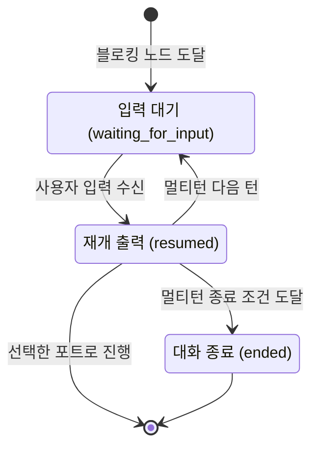

## 개요

이 문서는 [노드 출력 규약](CLE-NODE-OUTPUT.md) 의 하위 문서로 노드 출력의 흐름 필드(`port` · `status`)와 에러를 다룬다. 에러 계약(Principle 3), 블로킹 · 재개 계약(Principle 4), 출력 포트 선택 모델(Principle 5), 동적 포트 ID 이름(Principle 6)을 정한다. 다섯 필드의 뜻과 나머지 Principle 은 부모 문서가 정한다. 입력 대기 · 재개의 상태 전이와 park · rehydration 은 [실행 상태 머신과 대기·재개](../CLE-EXEC/CLE-EXEC-STATE.md), 실패 시 정책은 [노드 에러 처리 정책](CLE-NODE-ERROR.md)이 정한다.

## Principle 3. 에러 계약

### 3.1 분류

| 종류 | 처리 방식 |
| --- | --- |
| 사전 검증 에러(pre-flight error): 설정 오류, 스키마 검증 실패 등 | `throw`. 엔진이 노드 실행을 실패로 표시한다. |
| 런타임 에러(runtime error): 외부 API 실패, 쿼리 실패, 사설망 차단(SSRF), 통합 자격 증명 해석 실패 등 | `port: 'error'` 와 `output.error` |
| 예상 가능한 비즈니스 실패: 매칭 없음, 빈 결과 등 | 정상 `port` 를 유지하고 결과가 비었음을 드러낸다. |

통합 노드(HTTP Request·Database Query·Send Email)의 사설망 차단(`HTTP_BLOCKED`)과 자격 증명 해석 실패(`INTEGRATION_INCOMPLETE` 등)는 사전 검증 throw 가 아니라 런타임 에러 포트로 보낸다([Rationale](#사설망-차단과-자격-증명-해석-실패를-에러-포트로-보낸다-2026-05-17)). 설정 형식 자체의 오류(`handler.validate` 실패)만 throw 로 남는다. 자세한 규칙은 [HTTP Request 노드](../CLE-NODE-INT/CLE-NODE-HTTP.md)에 있다.

### 3.2 `output.error` 표준 형태

```json
{
  "output": {
    "error": {
      "code": "HTTP_5XX" | "DB_QUERY_FAILED" | "LLM_TIMEOUT" | ...,
      "message": "사람이 읽는 메시지",
      "details": { /* 3.2.1 공통 표준 필드 + 3.2.2 노드별 필드 */ }
    }
  },
  "port": "error"
}
```

1. `code` 는 `UPPER_SNAKE_CASE` 로 쓴다. 노드 취소로 끝난 경우의 `AbortError` 는 웹 표준 이름을 그대로 쓰는 예외다. 예외 목록과 근거는 [에러 코드 규약과 카탈로그](../CLE-API/CLE-API-ERRCODES.md), 취소 규약은 [노드 취소](../CLE-EXEC/CLE-EXEC-CANCEL.md)에 있다.
2. `message` 는 영문 원문이다. 로그와 디버깅의 기준이다. 사용자에게 보이는 곳의 한국어 표시는 프론트엔드가 `code` 를 키로 `ERROR_KO` 매핑을 적용한다. 코드 기반 현지화 정책과 적용 범위는 [다국어와 화면 문구](../CLE-UI/CLE-UI-I18N.md)의 Principle 3-C 가 정한다. `ErrorCode` enum 전체에 강제하지 않고, 매핑이 없으면 영문을 그대로 보인다.
3. `details` 는 두 층이다. 3.2.1 공통 표준 필드(AI 노드만 필수)와 3.2.2 노드별 선택 스키마다.

### 3.2.1 `details` 의 공통 표준 필드

| 필드 | 타입 | 노드별 의무 | 뜻 |
| --- | --- | --- | --- |
| `retryable` | `boolean` | AI 노드(`ai_agent`, `text_classifier`, `information_extractor`)는 필수. 다른 노드는 선택(점진 채택). | 이 에러가 일시적이라 같은 호출을 다시 하면 성공할 수 있는지. `true` 는 HTTP 429, 5xx, 네트워크 타임아웃 같은 일시 장애다. `false` 는 인증 실패, 스키마 치명 오류, 사용자 취소 같은 근본 원인이다. AI 노드마다 분류가 갈린다. [미결 사항](#미결-사항) 참조. |
| `retryAfterSec` | `number` | 선택(AI 노드와 그 밖의 노드 모두) | 프로바이더가 `Retry-After` 헤더나 같은 신호를 준 경우의 권장 대기 시간(초). `retryable === true` 일 때만 채울 수 있다. `false` 와 함께 채우면 규약 위반이다. 이 불변식의 기준은 이 절이다. |

`retryable=true` 인 노드는 화면에 인라인 `[다시 시도]` 버튼과 `retryAfterSec` 카운트다운이 보인다. 예를 들어 AI 에이전트 멀티턴 대화 스레드의 `system_error` 항목이다([대화 미리보기](../CLE-EXEC/CLE-EXEC-PREVIEW.md)). 버튼은 마지막 턴 재시도 상태(`_retryState`)가 있는 멀티턴 AI 에이전트에만 보인다. AI 에이전트 단일 턴은 LLM 호출 실패에도 `retryable` 을 채우지만 `_retryState` 를 남기지 않아 버튼이 보이지 않는다.

### 3.2.2 `details` 의 노드별 선택 스키마

3.2.1 공통 필드 밖의 추가 메타는 각 노드 문서의 `output.error.details` 표가 정한다.

- AI 에이전트: `provider`, `statusCode` 등. LLM 에러 객체의 `details` 에 있을 때만 들어간다([AI 에이전트 노드 출력과 디버그](../CLE-NODE-AI/CLE-NODE-AGENT-OUTPUT.md))
- HTTP Request: `statusCode`·`statusText`·`url`·`method`. 응답이 없는 에러는 `url`·`method` 만([HTTP Request 노드](../CLE-NODE-INT/CLE-NODE-HTTP.md#에러-코드))
- Database Query: `driverCode`. 드라이버가 에러 코드를 줄 때만 들어간다([Database Query 노드](../CLE-NODE-INT/CLE-NODE-DBQUERY.md))

AI 노드가 아닌 노드에서 `retryable`·`retryAfterSec` 는 선택이다. 쓰는 경우 이 절의 뜻을 따른다.

### 3.3 에러 포트가 있는 노드

1. 다음 노드에는 고정 에러 포트(`error`)가 반드시 있다: `http_request`, `database_query`, `send_email`, `cafe24`, `makeshop`, `ai_agent`, `information_extractor`, `text_classifier`, `code`, `workflow`(서브 워크플로우 실패 시).
2. `transform`, `if_else`, `switch` 같은 노드는 설정 검증만 하고 실패하면 throw 한다. 런타임 에러 포트가 없다.
3. 이 가운데 AI 노드(`ai_agent`, `text_classifier`, `information_extractor`)는 에러로 끝날 때 `output.error.details.retryable` 을 분류할 의무가 있다. 기준은 [3.2.1](#321-details-의-공통-표준-필드)이다.
4. 포트 구성의 기준은 각 노드 문서의 포트 절이다. 에러 처리 정책으로 생기는 동적 에러 포트는 [노드 에러 처리 정책](CLE-NODE-ERROR.md)이 다룬다.
5. 노드 정의에 포트 ID 가 `error` 인 포트가 이미 있는 노드(1번의 노드)에는 동적 에러 포트를 따로 만들지 않는다. 에러 처리 정책을 「에러 포트로 라우팅」으로 골라도 그 포트를 쓴다. 그래서 한 노드에 `error` 포트는 하나다([Rationale](#error-포트-id-를-한-노드에-하나만-둔다-2026-11-14)).

## Principle 4. 블로킹과 재개 계약

### 4.1 상태 전이

블로킹 노드(Form 노드, 버튼이 있는 Presentation 노드, 멀티턴 AI 노드)는 아래처럼 흐름 지시 상태를 바꾼다.



1. 블로킹 노드에 도달하면 `status: "waiting_for_input"` 을 돌려주고 엔진이 실행을 멈춘다. `output` 에는 이 시점에 계산한 런타임 값만 둔다([Principle 1.1](CLE-NODE-OUTPUT.md#principle-11-설정과-출력-값은-겹치지-않는다), [4.3](#43-입력-대기-상태의-출력-값-노드별)).
2. 사용자 입력을 받으면 `status: "resumed"` 로 통일한다. `output` 은 입력 대기 시점 값을 그대로 두고 `interaction` 을 더한다. `interaction` 은 `type`(`form_submitted`, `button_click`, `button_continue`, `message_received`), `data`(type 별 형태), `receivedAt`(ISO 8601)이다. AI 대화 노드(`ai_agent`, `information_extractor` 멀티턴)의 재개 출력은 두 가지가 다르다. 사용자 메시지로 재개하면 그 메시지를 `output.result.messages` 끝에 더한다. `meta` 는 직전 대기 출력의 값을 이어받아 `interactionType` 을 `ai_conversation`, `durationMs` 를 `0` 으로 두고 `contextInjection` 은 뺀다. AI 에이전트가 `render_form` 폼 제출로 재개할 때(`interaction.type` 은 `form_submitted`)도 이 `meta` 규칙을 따른다. 형태와 시점은 [AI 에이전트 노드 출력과 디버그](../CLE-NODE-AI/CLE-NODE-AGENT-OUTPUT.md) 의 멀티턴 재개 절이 정한다.
3. 멀티턴 AI 노드가 종료 조건에 닿으면 `status: "ended"` 를 돌려준다. `port` 는 조건 ID 이거나 시스템 포트(`user_ended`·`max_turns`·`error`, 정보 추출기는 `completed` 도)다. `output` 은 `{ result: {...} }` 또는 `{ error: {...} }` 다. 멀티턴 AI 에이전트에는 `out` 포트가 없다. AI 에이전트 단일 턴도 끝날 때 `status: "ended"` 를 돌려준다. 포트는 정상 완료면 `out`, 조건 분기면 조건 ID, LLM 호출 실패 · 도구 정의 크기 예산 초과면 `error` 다. 노드별 종료 포트는 [AI 에이전트 노드](../CLE-NODE-AI/CLE-NODE-AGENT.md)와 [정보 추출기 노드](../CLE-NODE-AI/CLE-NODE-EXTRACTOR.md)의 포트 절이 정한다.
4. 상태가 바뀌는 시점과 엔진이 하는 일(park, 저장, 재구성)은 [실행 상태 머신과 대기·재개](../CLE-EXEC/CLE-EXEC-STATE.md)가 정한다.

### 4.2 폐기할 필드 / 구조

- `_multiTurnState` 는 `_resumeState` 로 바꿨다. 노출하지 않는 내부 필드다.
- Form 의 `output.submittedData` 는 `output.interaction.data` 로 옮긴다.
- Carousel·Chart·Table·Template 의 `output.previousOutput` 은 없앤다. 이전 표시 정보는 `config` 와 `output` 의 런타임 필드를 조합해 다시 만들 수 있다([Principle 1.1](CLE-NODE-OUTPUT.md#principle-11-설정과-출력-값은-겹치지-않는다)). 과도기 예외가 하나 있다. Presentation 재개 경로(`ButtonInteractionService`)는 재개 출력에 `previousOutput`(중첩 체인은 걷어 낸 것)을 과도기 레거시 필드로 남긴다. Phase 3 정리 때 없앤다. 기준은 코드 주석이다.
- 초안의 `output.view` 감싸기 객체와 `output.view.type` 판별자는 폐기했다([1.1.4](CLE-NODE-OUTPUT.md#114-outputview-판별자는-쓰지-않는다)). 런타임 값은 `output` 최상위에 바로 둔다. 노드 유형은 워크플로우 정의에서 안다.
- Presentation 노드의 `output.type: 'carousel' | 'table' | ...` 판별자는 폐기했다. 이유는 같다.
- Carousel·Table·Chart 의 `output.rendered`(HTML·SVG 스냅샷)는 폐기했다. 화면이 `output` 런타임 필드와 `config` 로 직접 그린다([Table 노드](../CLE-NODE-PRES/CLE-NODE-TABLE.md), [Chart 노드](../CLE-NODE-PRES/CLE-NODE-CHART.md)). Template 의 `output.rendered` 는 표현식을 평가한 결과라 남는다([1.1.3](CLE-NODE-OUTPUT.md#113-적용-예)).

### 4.2.1 보존 예외 — `_resumeCheckpoint` / `_retryState`

`_resumeState` 전체는 DB 에 저장할 때 `stripControlFields()` 가 반드시 지운다. 그 자격 증명 제외 부분집합인 `_resumeCheckpoint` 와 `_retryState` 는 지우지 않고 `NodeExecution.outputData` 안에 남긴다.

| 필드 | 제거 정책 | 저장 위치 |
| --- | --- | --- |
| `_resumeState` | DB 저장 때 반드시 지운다. 자격 증명·원본 설정·턴 디버그를 담을 수 있다. | 한 턴을 처리하는 세그먼트 안에서만 메모리에 있다. 입력 대기에 들어가면 세그먼트가 끝나므로 턴 사이에는 남지 않는다. 다음 턴은 `_resumeCheckpoint` 에서 다시 만든다. |
| `_resumeCheckpoint` | 입력 대기에 들어갈 때와 매 턴 저장할 때 남긴다. `_resumeState` 의 자격 증명 제외 부분집합이다. | `NodeExecution.outputData._resumeCheckpoint`(DB JSONB) |
| `_retryState` | 재시도 가능 에러로 끝날 때 남긴다. `output.error.details.retryable === true` 일 때만 `buildMultiTurnFinalOutput` 이 싣는다. | `NodeExecution.outputData._retryState`(DB JSONB). 아래 주석 참고. |

`_retryState` 의 저장 위치는 원본 행 기준이다. 마지막 턴 재시도(`retry_last_turn`)가 새로 만드는 재진입 행에는 같은 키가 `inputData._retryState` 로 들어간다. 이 값은 보존 대상이 아니라 중복 배달을 막는 표시다. `applyRetryLastTurn` 이 조건부 UPDATE 로 이 키를 원자적으로 소비하고, 소비하면 곧 사라진다. 그래서 "`_retryState` 는 `outputData` 에만 있다" 는 말은 원본 행에만 맞다. 소비 절차는 [실행 상태 머신과 대기·재개](../CLE-EXEC/CLE-EXEC-STATE.md)에 있다.

`_resumeCheckpoint` 의 규칙은 다음과 같다.

1. 서버가 다시 시작되거나 다른 인스턴스에서 재개할 때(rehydration) 쓰도록 항상 저장한다. 적용 노드와 필드 합집합은 [실행 상태 머신과 대기·재개](../CLE-EXEC/CLE-EXEC-STATE.md)에 있다.
2. `_retryState` 와 같은 부분집합, 같은 마스킹 정책을 쓴다. 다만 `expiresAt`(TTL)과 `lastUserMessage` 가 없다. 재개는 도착한 사용자 메시지를 그대로 처리하고, 오래 쉰 뒤에도 가능하다.
3. 스키마가 바뀔 때를 대비해 `schemaVersion`(정수)을 함께 싣는다. 재개할 때 이 값이 현재 코드가 지원하는 버전보다 크면 안전하게 초기화한다.
4. 값이 없거나 손상됐거나 미래 버전이면 안전하게 초기화한다(`RESUME_INCOMPATIBLE_STATE`). 다시 만들 때 핵심 필드가 비어 있으면 기본값으로 채운다.
5. 재구성 로직(`buildRetryReentryState`)은 `_retryState` 와 함께 쓴다.

`_retryState` 의 규칙은 다음과 같다.

1. 필드는 `_resumeState` 와 같은 형태(messages, turnCount, model, temperature, maxTokens, knowledgeBases, RAG, MCP, pendingFormToolCall? 등)에 세 필드를 더한다.
   - `expiresAt`: ISO 8601. TTL 기본 60분.
   - `lastUserMessage?`: 실패한 턴의 사용자 메시지 원문. `truncateForErrorDetails(500)` 로 자른다. 재진입할 때 다시 보내는 데 쓴다. `_resumeState.messages` 는 턴 직전 스냅샷이라 실패한 메시지를 담지 않으므로 따로 둔다.
   - `lastUserMessageSource?`: `'ai_message'` 또는 `'form_submitted'`. 다시 보낼 메시지의 출처다.
2. 자격 증명은 `_resumeState` 와 같은 방식으로 뺀다. 옮길 키를 `buildRetryState`·`buildResumeState` 가 나열하는 allow-list 방식이라 처음부터 들어가지 않는다.
3. 표현식 해석기와 자동완성에 노출하지 않는다.
4. `lastUserMessage` 가 없으면(옛 페이로드) 다시 보내지 않고 대기 루프에 들어간다.
5. 소비: WebSocket 명령 `execution.retry_last_turn`([WebSocket 이벤트와 명령](../CLE-API/CLE-API-WS-EVENTS.md))이 `nodeExecutionId` 로 `_retryState` 를 찾는다. `expiresAt` 을 확인하고 새 노드 실행 행을 만들어 멀티턴 루프에 다시 들어간다. TTL 이 지났거나 이미 소비한 `_retryState` 는 `RETRY_STATE_NOT_FOUND` 로 응답한다.

자세한 흐름은 [AI 에이전트 노드 출력과 디버그](../CLE-NODE-AI/CLE-NODE-AGENT-OUTPUT.md)와 [실행 상태 머신과 대기·재개](../CLE-EXEC/CLE-EXEC-STATE.md)에 있다.

### 4.3 입력 대기 상태의 출력 값 (노드별)

`output` 에는 이 실행 시점에 계산한 런타임 값만 둔다. 리터럴 설정 필드는 다시 싣지 않는다([Principle 1.1](CLE-NODE-OUTPUT.md#principle-11-설정과-출력-값은-겹치지-않는다)).

| 노드 | 입력 대기 `output` | 런타임 필드 설명 |
| --- | --- | --- |
| `form` | `{}` | 폼을 그리는 데 계산할 값이 없다. fields, title, submitLabel 은 모두 `config` 에서 읽는다. |
| `carousel`(정적 모드) | `{}` | `items` 가 리터럴 설정이다. 다음 노드는 `config.items` 를 읽는다. |
| `carousel`(동적 모드) | `{ items }` | `source` 표현식을 해석하고 `titleField`·`descriptionField`·`imageField` 로 매핑해 실행 중에 만든 배열. `config.items` 와 별개다. |
| `table` | `{ rows, totalRows, columns? }` | `rows` 는 정적 모드면 `columns[*].field` 기준으로 걸러 낸 행, 동적 모드면 `dataSource` 항목마다 평가한 행이다. `totalRows` 는 출력 크기 한도를 적용하기 전 데이터셋 크기(pageSize·정렬 적용 후)다. `columns` 는 동적 모드에서 `label` 표현식을 평가한 컬럼이다. 기준은 [Table 노드](../CLE-NODE-PRES/CLE-NODE-TABLE.md)다. |
| `chart` | `{ data }` | 입력을 xAxis 기준으로 실행 중에 집계한 `{ x, y?, series? }[]`. `groupBy` 를 쓰는 bar·line·area 는 X 값과 시리즈를 함께 기준으로 집계한다. `series` 는 포인트마다 붙는 시리즈 이름 문자열이고 `groupBy` 를 쓸 때만 있다. chartType, title, colors 는 `config` 에 있다. 기준은 [Chart 노드](../CLE-NODE-PRES/CLE-NODE-CHART.md#출력-구조)다. |
| `template` | `{ rendered }` | 템플릿 문자열을 엔진의 표현식 해석기로 평가한 결과. `content`, `format` 은 `config` 에 있다. |
| `ai_agent`(멀티턴) | `{ result: { messages, message, turnCount } }` | 도메인 결과는 `output.result.*` 아래에 모은다. `messages` 는 대화 누적, `turnCount` 는 지금까지 진행한 턴 수다. `maxTurns` 는 설정 전용이라 싣지 않는다. 진행률은 화면이 `config.maxTurns` 를 직접 읽는다. |
| `information_extractor`(멀티턴) | `{ result: { messages, message, turnCount }, partial? }` | 위와 같고, 부분 수집한 추출 필드가 있으면 `output.partial.*` 에 둔다. `maxTurns` 는 싣지 않는다. |

### 4.4 재개 출력의 출력 값

입력 대기 시점의 `output` 을 그대로 두고 `output.interaction` 을 더한다.

```json
{
  "output": {
    "...": "입력 대기 시점과 같은 런타임 필드",
    "interaction": {
      "type": "form_submitted" | "button_click" | "button_continue" | "message_received",
      "data": { /* interaction type 별 형태, 4.5 참조 */ },
      "receivedAt": "2026-04-19T12:34:56.789Z"
    }
  },
  "status": "resumed",
  "port": "<선택된 포트>"
}
```

### 4.5 `interaction.data` 형태

| `interaction.type` | `data` 형태 | 적용 노드 |
| --- | --- | --- |
| `form_submitted` | `{ [fieldName]: value, via?: 'ai_render' }`. 제출한 필드 값이다. `via: 'ai_render'` 표시는 AI 에이전트의 `render_form` 도구 응답일 때만 붙는다([AI 에이전트 노드](../CLE-NODE-AI/CLE-NODE-AGENT.md)). | `form`, `ai_agent`(`render_form`) |
| `button_click` | `{ buttonId, buttonLabel, selectedItem? }` | `carousel`, `table`, `chart`, `template` |
| `button_continue` | `{ buttonId, buttonLabel, url?, selectedItem? }`. `url` 은 링크 버튼 URL 이 있을 때, `selectedItem` 은 Carousel 항목 버튼일 때만 싣는다(`ButtonInteractionService`). | Presentation 노드 링크 버튼의 계속 포트 |
| `message_received` | `{ content, role: "user" }` | `ai_agent`, `information_extractor` 멀티턴. 재개 스냅샷은 다음 턴 LLM 호출 전에 한 번 내고 노드 실행 행에도 저장한다. 기준은 [AI 에이전트 노드 출력과 디버그](../CLE-NODE-AI/CLE-NODE-AGENT-OUTPUT.md)다. |

이 `interaction` 은 [대화 스레드](../CLE-IX/CLE-IX-THREAD.md)에 자동으로 쌓인다. 뒤에 오는 AI 에이전트 노드는 대화 맥락 설정(`contextScope`)으로 이것을 자동으로 받아 쓸 수 있다.

## Principle 5. 출력 포트 선택 모델

| 형태 | 뜻 | 쓰는 노드 |
| --- | --- | --- |
| `port: undefined` | 기본 단일 출력. 노드 정의상 출력이 1개다. | `transform`, `manual_trigger` |
| `port: string` | 여러 출력 가운데 하나를 고른다. | `if_else`, `switch`, `http_request`, `database_query`, `send_email`, `ai_agent`, `parallel`(완료 시점 `'done'`) 등 |
| `port: string[]` | 여러 출력을 동시에 활성화한다(fan-out). | `parallel`(핸들러), `text_classifier`(다중 레이블) |

엔진 덮어쓰기 대상 노드 가운데 노드 출력에 `port` 를 직접 싣는 것은 Parallel 뿐이다. 시작 시점은 `string[]`(fan-out)이고 완료 시점은 `'done'` 문자열이다([Parallel 노드](../CLE-NODE-LOGIC/CLE-NODE-PARALLEL.md#완료-출력-port-는-done-문자열이다-2026-11-01)). Loop · ForEach · Map 의 완료 시점 `port` 는 [컨테이너 출력과 빈 입력의 미결 사항](CLE-NODE-OUTPUT-CONTAINER.md#미결-사항)에서 다룬다.

`port` 에는 출력 포트 ID 만 쓴다. 예를 들어 `ai_agent` 가 `output.port` 로 조건 ID 를 고르던 방식은 [Principle 8](CLE-NODE-OUTPUT.md#principle-8-불필요한-중첩을-없앤다)과 함께 없앤다.

## Principle 6. 동적 포트 ID 이름

1. 전역 버튼은 `config.buttons[i].id` 를 그대로 쓴다. 사용자가 설정한 ID 다.
2. 항목 버튼(Carousel 정적 모드 등)은 `${buttonId}__item_${index}` 를 쓴다. Carousel 이 쓰던 접미사를 공식 규칙으로 올린 것이다. 엔진은 `__item_\d+$` 부분을 떼어 원래 포트로 보낸다.
3. 시스템 포트 예약어는 `out`, `error`, `default`, `done`, `user_ended`, `max_turns`, `completed`, `fallback`, `continue` 다. 사용자가 설정한 ID 가 이 값과 겹치면 거부한다. `error` 를 뺀 예약어의 집합과 거부하는 계층은 노드마다 다르게 적혀 있다. [미결 사항](#미결-사항) 참조.
4. `error` 는 모든 노드에서 예약한다. Switch 케이스, 텍스트 분류기 카테고리, AI 에이전트 조건, Presentation 버튼(전역 버튼과 항목 버튼)의 ID 가 `error` 와 정확히 같으면 노드 설정 검증(`validateConfig`)이 거부한다. 이 검증은 실행 직전 검사(`INVALID_NODE_CONFIG`)와 AI 어시스턴트 검증에서 돈다. 워크플로우 저장 API 와 가져오기는 검사하지 않는다. AI 어시스턴트가 빈 버튼 id 를 label 로 채울 때(`normalizeNodeButtonIds`)도 `error` 를 만들지 않는다. 텍스트 분류기는 지금처럼 대소문자를 가리지 않고 거부한다.
   - Presentation 버튼 검증(`validateButtons`)과 `normalizeNodeButtonIds` 는 아직 `error` 를 막지 않는다(미구현).
   - 이미 저장된 버튼 id `error` 는 일회성 이전 스크립트로 바꾼다. 노드 출력 재설계 때의 `migrate-node-output-refs.ts` 와 같은 방식이다. 새 id 는 `error_1` 부터 시작하고 같은 노드에 이미 있으면 번호를 올린다. 그 버튼에 붙은 연결선의 `sourcePort` 도 함께 바꾼다(미구현).
5. 설정 항목이 있는 동적 포트(Switch 케이스, 분류 카테고리, 조건, 버튼)는 항목이 가진 고정 ID(slug)를 포트 ID 로 쓴다. 형식이 맞지 않을 때만 `<prefix>_<index>` 형태의 인덱스 fallback(`case_0`, `class_0` 등)으로 떨어진다. Parallel 분기 포트는 `branch_0`, `branch_1` 처럼 `<prefix>_<index>` 형식이다. 생성과 검증 규칙은 [노드 시스템 구조와 카탈로그](CLE-NODE-ARCH.md#포트-정의-portdef)가 정한다.

## 미결 사항

- **AI 노드의 인증 실패 재시도 가능 분류(Principle 3.2.1)**: 이 규약과 [AI 에이전트 노드](../CLE-NODE-AI/CLE-NODE-AGENT.md), [텍스트 분류기 노드](../CLE-NODE-AI/CLE-NODE-CLASSIFIER.md) 문서는 인증 실패(401·403)를 `retryable: false` 로 정한다. [정보 추출기 노드](../CLE-NODE-AI/CLE-NODE-EXTRACTOR.md) 문서는 `LLM_CALL_FAILED` 면 무조건 `true` 로 둔다. 현재 구현은 정보 추출기 핸들러가 코드 기반이라 항상 `true` 를 채우고, 텍스트 분류기 핸들러도 자기 문서와 달리 `LLM_CALL_FAILED` 를 항상 `true` 로 채운다. 같은 인증 실패에서 노드마다 `[다시 시도]` 버튼이 보이기도 하고 안 보이기도 한다. 또 정보 추출기는 멀티턴 실패를 `retryable=true` 로 내지만 마지막 턴 재시도를 지원하지 않아 `_retryState` 를 만들지 않는다. 화면이 노드 유형으로 버튼을 막지 않으면 버튼을 눌러도 `RETRY_STATE_NOT_FOUND` 가 난다. 결정 필요: HTTP 상태 기반 분류로 통일할지, 정보 추출기의 코드 기반 예외를 규약에 적을지, 재시도 버튼 노출 조건을 어디에 둘지.
- **시스템 포트 예약어 집합과 거부 계층(Principle 6)**: 이 규약은 예약어 9개를 두지만 거부 계층은 정하지 않았다. [Switch 노드](../CLE-NODE-LOGIC/CLE-NODE-SWITCH.md)는 이 원칙을 인용하면서 `default`, `out`, `error` 3개만 백엔드 `validateSwitchConfig` 에서 거부한다. [텍스트 분류기 노드](../CLE-NODE-AI/CLE-NODE-CLASSIFIER.md)는 9개를 백엔드 스키마(`RESERVED_PORT_WORDS`)에서 거부한다. [AI 에이전트 노드](../CLE-NODE-AI/CLE-NODE-AGENT.md) 조건 검증은 `out`, `in`, `error`, `user_ended`, `max_turns` 를 막는다. 케이스 ID `done` 의 허용 여부가 노드마다 다르다. Presentation 노드의 버튼 id 는 `validateButtons`(`button.types.ts`)가 `__item_` 포함과 중복만 거부하고 예약어는 검사하지 않아 `out`·`continue` 같은 고정 포트 ID 를 저장할 수 있다. `error` 는 2026-11-14 에 모든 노드에서 예약하기로 정했고 거부 계층은 `validateConfig` 다(Principle 6 의 4번). 결정 필요: 나머지 예약어에 공통 상수 하나와 거부 계층을 정할지, 노드별 허용 범위를 적을지. 정해지면 Presentation 버튼 검증에도 적용한다. 워크플로우 저장 API · 가져오기에서도 포트 ID 를 검사할지(저장 시점 거부)도 함께 정한다.
- **출력 포트가 둘인데 `port` 를 비우는 노드(Principle 5)**: `port: undefined` 는 출력이 하나인 노드용이고 여러 포트 동시 활성화는 `string[]` 로 나타낸다. [Filter 노드](../CLE-NODE-LOGIC/CLE-NODE-FILTER.md)는 출력이 둘(`match`, `unmatched`)인데 `port` 를 돌려주지 않고 두 포트를 모두 활성화한다. 결정 필요: "모든 출력 포트 활성화" 형태를 이 원칙에 더할지, Filter 가 `port: ['match', 'unmatched']` 를 돌려주게 할지.

## Rationale

### 사설망 차단과 자격 증명 해석 실패를 에러 포트로 보낸다 (2026-05-17)

통합 노드의 사설망 차단과 자격 증명 해석 실패를 사전 검증 throw 가 아니라 런타임 에러 포트로 보낸다. 사용자가 `error` 포트로 분기해 복구할 수 있게 하려는 것이다. 설정 형식 오류만 throw 로 남긴다.

### `_resumeState` · `_retryState` 의 자격 증명 제외 방식 (2026-08-24)

예전 서술은 `maskSensitiveFields` 경계로 가린다고 했지만 그 경계는 없어졌다([설정 에코](CLE-NODE-OUTPUT-ECHO.md#설정을-원문으로-저장하고-나가는-곳에서만-가린다-2026-08-24)). 지금은 `buildRetryState`·`buildResumeState` 가 옮길 키를 나열하므로 자격 증명이 처음부터 들어가지 않는다. 이 배제는 경계 제거와 관계없다.

### 에러 `details` 예를 구현에 맞춘다 (2026-11-13)

서술만 고쳤고 동작은 바뀌지 않는다.

- 3.1 의 작업 레이블 표기를 지우고 해당 Rationale 절을 링크로 가리킨다. 한 작업 안에서 쓰던 레이블이라 다른 문서에서는 뜻을 알 수 없다.
- 3.2.2 의 HTTP Request 예를 핸들러(`http-request.handler.ts`)가 싣는 필드에 맞췄다. 응답을 받은 에러는 `statusCode`·`statusText`·`url`·`method` 를 싣고 응답이 없는 에러는 `url`·`method` 만 싣는다. 옛 예에 있던 응답 헤더와 응답 본문은 `details` 가 아니라 `output.responseHeaders` 와 `output.response` 에 있다. 짝이 되는 개정은 [HTTP Request 노드](../CLE-NODE-INT/CLE-NODE-HTTP.md#rationale) Rationale 의 2026-11-13 항목에 있다.
- 3.2.2 의 Database Query 예를 핸들러(`database-query.handler.ts` 의 `mapDbError`)에 맞췄다. `details` 에는 드라이버가 준 에러 코드 `driverCode` 하나만 있다. 드라이버가 코드를 주지 않으면 `details` 를 싣지 않는다. 옛 예의 `pgErrorCode` · `query` 는 구현이 싣지 않는 필드였다.

### `error` 포트 ID 를 한 노드에 하나만 둔다 (2026-11-14)

**문제**: 엔진은 포트를 문자열로 고른다. 버튼을 누르면 `_selectedPort` 에 버튼 id 를 넣고, 에러 포트는 `_selectedPort === 'error'` 로, 연결선은 `sourcePort === 'error'` 로 판정한다. 그래서 같은 노드에 id 가 `error` 인 버튼과 에러 포트가 함께 있으면 두 연결선을 구분할 수 없다. Switch · 텍스트 분류기 · AI 에이전트는 `error` 를 이미 거부했지만 Presentation 버튼은 어디서도 막지 않았다. AI 어시스턴트는 빈 버튼 id 를 label slug 로 채워서 label 이 "Error" 인 버튼의 id 가 `error` 가 됐다. 에러 처리 정책의 동적 에러 포트를 구현하면 고정 `error` 포트가 있는 노드에 같은 ID 의 포트가 둘 생길 수도 있었다.

**결정**(사람 결정 2026-11-14, 질문 `01a1d93e-312b-7176-89a0-cb1f3d34458c`, NERV Task `CLE-T-QGRX9B`):

- 사용자 정의 동적 포트 ID 에서 `error` 를 정확 일치로 예약한다(Principle 6 의 4번). 엔진 비교가 정확 일치라서 대소문자 변형까지 막지는 않는다. 거부 계층은 다른 노드와 같은 `validateConfig` 다.
- 이미 저장된 버튼 id `error` 는 일회성 이전으로 바꾼다. 화면에서는 버튼 id 를 고칠 수 없어서 검증이 거부하기만 하면 그 워크플로우를 실행할 수 없게 된다.
- 고정 `error` 포트가 있는 노드는 「에러 포트로 라우팅」을 골라도 동적 에러 포트를 만들지 않는다(3.3 의 5번).
- 나머지 예약어의 집합과 거부 계층은 [미결 사항](#미결-사항)으로 남긴다.

**기각한 대안**:

- 고정 포트 규칙만 정하기: 버튼 · 케이스 id `error` 와 에러 포트의 충돌이 남는다.
- 예약만 정하기: 고정 포트가 있는 노드에 고정 · 동적 `error` 포트가 함께 그려질 수 있다.
- 저장 시점에도 거부하기(저장 API 에 노드별 포트 ID 검증 추가): 범위가 커서 따로 정한다.

### AI 대화 노드의 재개 출력을 규약에 올린다 (2026-11-12)

AI 대화 경로가 재개 스냅샷을 내고 노드 실행 행에 저장하게 됐다(NERV Task `CLE-T-TBJ863`). 그래서 4.5 의 `message_received` 행에서 미구현 문장을 지우고 4.1 의 재개 규칙에 AI 대화 노드가 다른 점 두 가지를 적었다. 사용자 메시지를 `output.result.messages` 에 더하면 저장된 스냅샷만 보고도 이번 턴에 받은 발화를 알 수 있다. `meta.interactionType` 을 고정하는 것은 읽기 쪽 대기 판정이 이 값으로 form · buttons 의 `resumed` 와 AI 재개 스냅샷을 가르기 때문이다([실행 상태 머신과 대기·재개](../CLE-EXEC/CLE-EXEC-STATE.md#rationale) Rationale 의 2026-11-12 항목). 결정과 기각한 대안은 [AI 에이전트 노드 출력과 디버그](../CLE-NODE-AI/CLE-NODE-AGENT-OUTPUT.md#rationale) Rationale 의 2026-11-12 항목에 있다.
