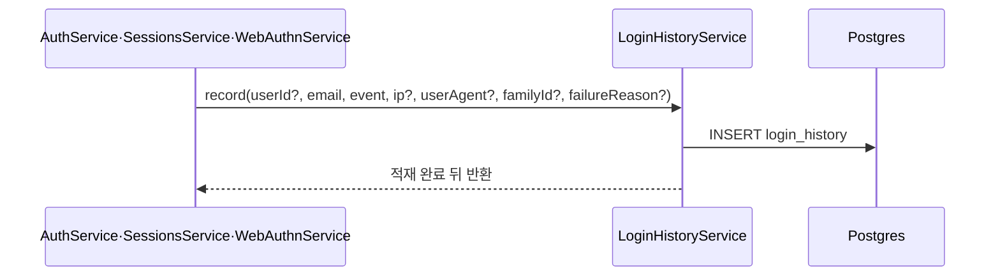

> 구현 상태: 구현됨 · 상위: [감사 로그](CLE-OBS-AUDIT.md) · 원문: `spec/5-system/1-auth.md` (§4), `spec/data-flow/1-audit.md` · 용어: [용어 사전](../CLE-GLOSSARY.md)

## 개요

이 문서는 [감사 로그](CLE-OBS-AUDIT.md) 의 하위 문서로 로그인 이력(`login_history`)의 이벤트, 기록 계약, 조회 API, 보존 배치를 정한다. 컬럼과 CHECK 제약 정의는 [계정과 워크스페이스 데이터 흐름](../CLE-ACCT/CLE-ACCT-DATA.md) 에, 화면(활성 세션 화면의 로그인 이력 탭)은 [세션과 토큰](../CLE-ACCT/CLE-ACCT-SESSION.md) 에 있다. 코드 경로는 따로 적지 않으면 `codebase/backend/src/modules/` 아래 경로다.

## 이벤트

`event` 는 7종이다. 코드의 `LoginHistoryEvent` union(`auth/entities/login-history.entity.ts`)과 DB CHECK 제약 `chk_login_history_event` 가 함께 이 목록을 강제한다.

| 이벤트 | 기록 위치 | 뜻 |
| --- | --- | --- |
| `login_success` | `auth/auth.service.ts` | 비밀번호 또는 OAuth 로그인 성공 |
| `login_failed` | 〃 | 비밀번호 불일치·계정 잠금·이메일 미인증 같은 로그인 실패 |
| `totp_failed` | 〃 | 2단계 인증 TOTP 코드 검증 실패 |
| `webauthn_failed` | `auth/webauthn/webauthn.service.ts` | 2단계 인증 WebAuthn 검증 실패. `failure_reason` 으로 `WEBAUTHN_INVALID`·`WEBAUTHN_COUNTER_REGRESSION` 을 구분한다 |
| `logout` | `auth/auth.service.ts` | 사용자가 `/auth/logout` 을 부름. 부른 기기의 로그인 세션 전체를 무효로 한다 |
| `session_revoked` | `auth/sessions.service.ts` | 활성 세션 목록에서 다른 로그인 세션을 하나씩 강제 종료, `revoke-others` 일괄 종료, 비밀번호 변경·이메일 변경 확정 때의 전체 무효화(일괄, `familyId=null`). 모두 `SessionsService` 를 거친다. 기존 enum 값을 다시 써서 CHECK 제약과 마이그레이션이 필요 없다 |
| `token_reuse_detected` | `auth/auth.service.ts` | 무효가 된 refresh token 의 재사용을 감지함. 그 로그인 세션 전체를 무효로 한다 |

`webauthn_failed` 는 V058 에서 CHECK 제약을 지웠다가 다시 만드는 방식으로 더했다.

## 기록 계약

- 기록하는 쪽은 인증 도메인의 세 서비스(`AuthService`·`SessionsService`·`WebAuthnService`)뿐이다.
- 기기 라벨(`deviceLabel`)은 인자로 받지 않는다. 서비스 안에서 `userAgent` 로 만든다(`deriveDeviceLabel`, `auth/utils/device-label.ts`). 외부 라이브러리 없이 정규식만 쓴다. 알아보지 못하면 UA 원문을 64자로 줄여 쓴다.
- 호출하는 쪽은 반드시 `await` 한다. `void` 로 던져 두면 바로 뒤의 HTTP 요청(예: 로그인 이력 조회)의 SELECT 가 INSERT 보다 먼저 실행되는 읽기 경쟁이 생긴다. 커넥션 풀이 읽기와 쓰기를 다른 커넥션에 실을 때 일어난다. `auth/login-history.service.ts` 의 `record` 주석에 적힌 계약이고 현재 호출부는 모두 `await` 한다.
- 적재가 실패하면 예외를 흡수하고 `Logger.error` 만 남긴다. 감사 로그와 달리 카운터가 없다. 이 차이는 [Rationale](CLE-OBS-AUDIT.md#적재-실패-관측이-감사-로그와-로그인-이력에서-다르다) 에 있다.

## 조회 API

`GET /api/users/me/login-history`(`auth/sessions.controller.ts` → `LoginHistoryService.findForUser`)가 로그인 이력을 돌려준다.

| 항목 | 규칙 |
| --- | --- |
| 범위 | JWT 의 본인 `userId` 행만. 워크스페이스 관리자에게도 다른 사용자의 이력은 보이지 않는다 |
| 페이지네이션 | 커서 방식. 커서는 `<iso>\|<id>` 로 인코딩한다. `created_at` 이 같은 밀리초인 행을 가르려고 `id` 를 함께 묶는다 |
| 손상된 커서 | 무시하고 첫 페이지부터 돌려준다 |
| 페이지 크기 | `limit` 기본 50, 상한 100. `limit + 1` 행을 읽어 `hasMore` 를 판정하고 `nextCursor` 를 돌려준다 |

## 보존 배치

보존 기간은 [감사 로그 「보존」](CLE-OBS-AUDIT.md#보존) 이 정한다. 보존 배치는 `auth/jobs/login-history-pruner.service.ts` 다.

- BullMQ 반복 작업이다. 큐는 `login-history-pruner`, cron 은 `0 3 * * *` 이고 시간대를 Asia/Seoul 로 명시한다. 서버 로컬 시간대가 바뀌어도 실행 시각이 흔들리지 않는다.
- 서버 인스턴스가 여럿이어도 전역에서 한 번만 돈다. `upsertJobScheduler` 는 멱등이라 Redis 중앙 스케줄에 항목 하나만 남긴다. 워커는 Redis 락을 잡은 쪽만 작업을 가져간다.
- 삭제는 `LoginHistoryService.pruneOlderThanRetention` 이 배치 루프로 한다. 한 번 호출에 `PRUNE_BATCH`(1000행) × 최대 `PRUNE_MAX_BATCHES`(50) 까지만 지운다. 잠금 경합과 WAL 팽창을 줄이려는 것이고 남은 행은 다음 실행에 넘긴다.
- 삭제 실패도 예외를 흡수하고 로그만 남긴다.
- 배치는 `created_at < cutoff` 로 훑는다. 이 스캔 전용 인덱스 `(created_at)` 을 V040 에서 만들었다.

## 구현 위치

- `codebase/backend/src/modules/auth/login-history.service.ts` (`record`, `findForUser`, `pruneOlderThanRetention`)
- `codebase/backend/src/modules/auth/jobs/login-history-pruner.service.ts`
- `codebase/backend/src/modules/auth/sessions.controller.ts` (로그인 이력 조회)
