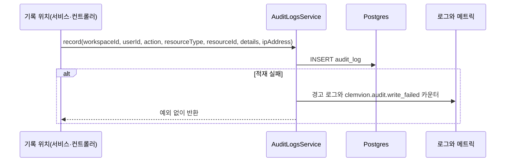

> 구현 상태: 구현됨 · 상위: [감사 로그](CLE-OBS-AUDIT.md) · 원문: `spec/data-flow/1-audit.md`, `spec/1-data-model.md` (§2.18), `spec/5-system/1-auth.md` (§4) · 용어: [용어 사전](../CLE-GLOSSARY.md)

## 개요

이 문서는 [감사 로그](CLE-OBS-AUDIT.md) 의 하위 문서로 감사 로그의 기록 계약, 워크스페이스 귀속, 조회 API 와 읽는 쪽 계약, `AuditLog` 데이터를 정한다. 감사 액션 목록은 [감사 로그 — 감사 액션 카탈로그](CLE-OBS-AUDIT-CATALOG.md) 에 있다. 코드 경로는 따로 적지 않으면 `codebase/backend/src/modules/` 아래 경로다.

## 기록 계약

도메인 서비스와 컨트롤러가 `AuditLogsService.record` 를 불러 한 행을 남긴다.

- 인자는 `{ workspaceId, userId, action, resourceType, resourceId, details?, ipAddress? }` 다.
- `action` 은 `AuditAction` union(`audit-logs/audit-action.const.ts` 의 `AUDIT_ACTIONS`)으로 타입이 좁혀져 있다. union 에 없는 문자열은 컴파일되지 않는다.
- 적재가 실패해도 예외를 흡수한다. 감사 기록이 실패했다고 리소스 변경이 실패하면 안 된다는 계약이다. 호출부가 `await` 해도 예외가 올라오지 않는다.
- 트리거 생성은 감사 행을 생성 트랜잭션(트리거 INSERT 와 첫 알림 서명 시크릿 · 트리거 단위 토큰 발급, [시크릿 저장소](../CLE-INT/CLE-INT-SECRET.md) 의 R14)이 커밋된 직후 트랜잭션 밖에서 남긴다. 생성이 롤백되면 `trigger.created` 행도 남지 않는다. 커밋과 감사 기록 사이에 프로세스가 멈추면 감사 행이 없는 트리거가 남을 수 있다. 트리거 수정(PATCH)과 같은 받아들인 위험이다([Rationale](#트리거-생성의-감사-행은-커밋-직후-트랜잭션-밖에서-남긴다)).
- 흡수한 실패는 경고 로그와 카운터 `clemvion.audit.write_failed{resource_type}` 로 드러난다. 로그만으로는 비율·추세로 경보를 걸 수 없어 카운터를 둔다. 로그 메시지에는 무엇이 유실됐는지(`action`·`resourceType`·`resourceId`·`workspaceId`)를 싣는다. 유실 사실만 알고 대상을 모르면 조사도 복구도 시작할 수 없다. 관측 호출 자체의 실패도 흡수한다. 메트릭 정의는 [로깅과 헬스 체크](CLE-OBS-LOGGING.md) 에 있다.
- 기록 위치는 12곳이다. 9개 서비스 모듈과 3개 컨트롤러(`users`·`auth`·`webauthn`)다(2026-09-01 실측). 12는 파일 수다. `resource_type` 의 서로 다른 값은 10종(`user`·`trigger`·`workflow`·`schedule`·`member`·`workspace`·`integration`·`model_config`·`auth_config`·`execution`)이라 두 수치가 다르다.
- 인증 설정 계열과 `user.*` 계열 감사 액션은 모두 `ipAddress` 를 함께 넘긴다. 포렌식과 사후 감사 목적이다. IP 는 `extractClientIp`(`auth/utils/client-ip.ts`)로 뽑는다. `CF-Connecting-IP` 신뢰 정책(`TRUST_CF_CONNECTING_IP`)은 [세션과 토큰](../CLE-ACCT/CLE-ACCT-SESSION.md) 이 정한다. 뽑을 수 없으면 `undefined` 로 빼고 남긴다.

## 워크스페이스 귀속

`audit_log.workspace_id` 는 NULL 을 허용하지 않는다. 감사 로그에는 현재 워크스페이스가 정해진 동작만 남는다.

- 워크스페이스 리소스(통합·워크플로우·트리거·스케줄·인증 설정·모델 설정·실행·워크스페이스·멤버)의 변경은 그 리소스가 속한 워크스페이스에 귀속한다.
- 로그인한 세션에서 일어나는 사용자 보안 동작(`user.password_changed`, `user.2fa_enabled`, `user.2fa_disabled`, `user.email_changed`)은 **행위자의 현재 워크스페이스**(인증 요청 JWT 의 워크스페이스)에 귀속한다. 이 동작들은 모두 로그인한 세션에서만 일어난다(`POST /users/me/change-password`, TOTP `verifyAndEnable`·`disable`, WebAuthn 등록·삭제, 이메일 변경 확인). 그래서 항상 현재 워크스페이스가 있고 스키마를 바꾸지 않아도 NOT NULL 제약을 채운다. `resourceType` 은 `'user'`, `resourceId` 는 사용자 ID 다. 기록은 현재 워크스페이스를 알 수 있는 컨트롤러 경계(`users.controller`·`auth.controller`·`webauthn.controller`)에서 한다.
- 워크스페이스 없이 일어나는 인증 이벤트(로그인, 로그아웃, 로그인 실패 등)는 감사 로그가 아니라 [로그인 이력](CLE-OBS-AUDIT-LOGIN.md) 에 남는다.
- 로그인 없이 토큰으로 하는 비밀번호 재설정(`POST /auth/reset-password`)은 현재 워크스페이스가 없어 `user.password_changed` 감사 대상이 아니다. 재설정 완료를 따로 남길지는 로그인 이력 이벤트 신설과 `chk_login_history_event` CHECK 마이그레이션이 따르는 별개 결정이며 이 문서 범위 밖이다.
- 비밀번호 변경은 모든 로그인 세션 무효화와 현재 기기 재발급을 함께 한다([세션과 토큰](../CLE-ACCT/CLE-ACCT-SESSION.md)). 그래서 감사 행 `user.password_changed` 와 함께 로그인 이력 `session_revoked`(일괄, `familyId=null`) 한 행이 남는다. 이메일 변경 확인도 같다.

## 감사 로그 조회

`GET /api/audit-logs`(`audit-logs/audit-logs.controller.ts` → `AuditLogsService.findAll`)가 감사 로그를 돌려준다.

| 항목 | 규칙 |
| --- | --- |
| 권한 | `@Roles('admin')`. 전역 `RolesGuard` 가 워크스페이스 멤버십과 역할을 함께 검사한다. 관리자 이상만 조회한다. 멤버가 아닌 사용자가 `X-Workspace-Id` 를 바꿔 넣어 다른 워크스페이스를 보는 것도 막는다 |
| 범위 | `@WorkspaceId()` 로 정해진 현재 워크스페이스의 행만 |
| 필터 | `action`(완전 일치), `resourceType`, `userId`(행위자), `startDate`·`endDate`(`created_at` 범위) |
| 페이지네이션 | offset 방식. `page` 기본 1, `limit` 기본 20 |
| 정렬 | 허용 목록 `created_at`·`action`·`resource_type`. 기본 `created_at DESC` |
| 응답 | 행위자 `user` 를 join 해 싣는다 |

**읽는 쪽 계약: `action` 은 닫힌 enum 이 아니다.** 쓰는 쪽은 `AUDIT_ACTIONS` union 으로 막지만 `AuditLog.action` 컬럼 자체는 DB 에서 자유 문자열이다. 감사 기록은 바꾸지 않는다는 원칙에 따라 과거 행에는 지금 union 밖의 레거시 값이 남아 있을 수 있다. 예를 들어 `execution.re_run` 의 옛 표기 `re_run_initiated` 행은 그대로 있다. 그래서 조회 응답(`AuditLogDto.action`)을 쓰는 쪽은 `action` 을 닫힌 enum 으로 단정하지 말고 모르는 값도 처리해야 한다. `AuditLogDto.action` 의 OpenAPI 설명에도 같은 계약을 적는다.

## 데이터

### AuditLog

| 필드 | 타입 | 설명 |
| --- | --- | --- |
| id | UUID | PK |
| workspace_id | UUID | FK → Workspace (CASCADE) |
| user_id | UUID | FK → User (NO ACTION). 행위자 |
| action | String | 감사 액션(`VARCHAR(100) NOT NULL`). DB CHECK 가 없다 |
| resource_type | String | 대상 리소스 종류 |
| resource_id | UUID | 대상 리소스 ID |
| details | JSONB | 변경 상세. 감사 액션마다 형식이 다르다 |
| ip_address | String? | 요청 IP. IP 를 알 수 없거나 시스템 내부 동작이면 없다 |
| created_at | Timestamp | 발생 시각 |

- 테이블은 V001 에서 만들었다. 인덱스는 V002 의 `idx_audit_log_workspace_created (workspace_id, created_at DESC)` 다.
- `AuditLog.details` 는 에러 응답의 `details` 와 이름만 같은 다른 필드다([에러 응답과 클라이언트 처리](../CLE-API/CLE-API-ERROR.md)).

## 구현 위치

- `codebase/backend/src/modules/audit-logs/audit-logs.service.ts` (`record`, `findAll`)
- `codebase/backend/src/modules/audit-logs/audit-action.const.ts` (`AUDIT_ACTIONS`)
- `codebase/backend/src/modules/audit-logs/audit-logs.controller.ts` (`GET /api/audit-logs`)
- `codebase/backend/src/modules/auth/utils/client-ip.ts` (`extractClientIp`)

## Rationale

### 사용자 보안 감사 액션을 현재 워크스페이스에 귀속한다

`user.password_changed`·`user.2fa_enabled`·`user.2fa_disabled` 를 NOT NULL 인 `audit_log.workspaceId` 에 어떻게 귀속할지 정해야 했다. 행위자의 현재 워크스페이스(인증 요청 JWT 의 워크스페이스)로 정했다.

이 동작들은 모두 로그인한 세션에서만 일어난다(`POST /users/me/change-password`, TOTP, WebAuthn 모두 JwtAuthGuard 뒤에 있다). 인증 요청은 항상 JWT 로 워크스페이스를 싣고 오므로 그 워크스페이스에 귀속하면 스키마를 바꾸지 않고 제약을 채운다. 이는 카탈로그의 "인증(현재 워크스페이스가 있는 동작)" 분류를 구체화한 것이다. 로그인·로그아웃·로그인 실패(워크스페이스 없음)는 로그인 이력으로 간다는 규칙은 그대로다.

- **WebAuthn 추가 등록도 `user.2fa_enabled` 다.** 이미 2단계 인증이 켜진 상태에서 두 번째 이후 인증기를 등록하는 것은 "2단계 인증 활성화" 사건은 아니다. 하지만 계정 보안 속성(인증 수단)을 더하는 일이라 추적한다. 새 감사 액션을 만들기보다 `details.firstCredential=false` 로 구분하는 편이 조회·집계에 단순하다. `webauthn.controller` 는 복구 코드를 발급했는지로 `firstCredential` 을 판정한다.
- **OAuth 로만 가입한 사용자의 마지막 2단계 인증 끄기는 별개 결정이다.** 비밀번호가 없는 계정이 유일한 2단계 인증 수단을 끌 때 계정 잠김 위험을 어떻게 막을지는 감사 귀속과 무관하다. 2단계 인증 강제 정책·계정 복구 흐름과 함께 다룰 일이다. TOTP 끄기는 비밀번호를 먼저 확인하므로 비밀번호가 없는 계정은 `PASSWORD_REQUIRED` 로 막힌다. Passkey 삭제에는 막는 로직이 없다([가입과 로그인 「2단계 인증 설정 화면」](../CLE-ACCT/CLE-ACCT-SIGNIN.md#2단계-인증-설정-화면)). 2026-11-14 부터는 Passkey 삭제도 비밀번호를 먼저 확인해 같은 코드로 막힌다([Passkey 기능과 등록 「Passkey 삭제」](../CLE-ACCT/CLE-ACCT-SIGNIN-PASSKEY.md#passkey-삭제)).

기각한 대안:

- **`audit_log.workspaceId` 를 NULL 허용으로 바꾸기**(사용자 단위 이벤트는 NULL): 스키마 마이그레이션이 필요하다. 워크스페이스로 거르는 모든 쿼리·인덱스·조회 권한(`@WorkspaceId()` 범위)이 NULL 을 따로 처리해야 해 영향이 크다. 인증 이벤트는 항상 현재 워크스페이스가 있으므로 NULL 이 필요 없다.
- **사용자·개인 단위 감사 범위를 따로 만들기**: `audit_log` 는 본래 워크스페이스 범위의 팀 기능이고 사용자 단위 인증 이벤트는 이미 `login_history` 가 맡는다. 저장소를 둘로 만들 이유가 없다.

### 트리거 생성의 감사 행은 커밋 직후 트랜잭션 밖에서 남긴다

2026-10-17 에 정했다. 트리거 생성은 INSERT · 첫 발급 · 시크릿 저장소 쓰기 · `config` 쓰기를 트리거 설정 잠금을 쥔 한 트랜잭션으로 묶는다([시크릿 저장소](../CLE-INT/CLE-INT-SECRET.md) 의 R14). `trigger.created` 감사 행은 그 트랜잭션이 커밋된 직후 트랜잭션 밖에서 남긴다. 그래서 생성이 롤백되면 `trigger.created` 행도 남지 않는다. 완료된 변경만 남긴다는 기록 요구와 맞는다. 감사 적재 실패를 흡수하는 계약도 그대로다.

전의 동작과는 감사와 발급의 순서가 반대다. 이제는 첫 발급까지 커밋한 뒤에 감사 행을 남긴다. 그래서 발급이 실패한 반쪽 트리거의 생성 기록이 남지 않는다.

받아들인 위험이 하나 있다. 커밋과 감사 기록 사이에 프로세스가 멈추면 감사 행이 없는 트리거가 남을 수 있다. 트리거 수정(PATCH)도 커밋 직후에 감사 행을 남기므로 같은 위험이 이미 있다.

기각한 대안:

- **감사도 생성 트랜잭션 안에서 남긴다**(`record` 에 매니저 인자를 더하고 savepoint 로 감싼다). 초안이 처음 택한 안이고 구현을 검토하며 뒤집었다. `AuditLogsService.record` 는 매니저를 받지 않고 적재 실패를 삼킨다. 트랜잭션 안에서 감사 INSERT 가 실패하면 Postgres 트랜잭션 전체가 중단된다. 그러면 적재 실패 흡수 계약을 지키려고 감사 INSERT 를 savepoint 로 감싸야 하고 기록 API 도 바뀐다. 얻는 것은 커밋과 감사 사이의 짧은 창을 닫는 것뿐이다. PATCH 경로와도 달라진다.
- **감사 행을 먼저 남기고 첫 발급을 커밋 뒤에 따로 한다**(전의 동작). 감사 행을 남긴 뒤 첫 발급이 실패하면 반쪽 트리거와 그 생성 기록이 함께 남았다. 호출자가 다시 시도하면 같은 트리거의 생성 기록이 두 번 남거나 충돌이 났다.

### 레거시 감사 액션 행은 고치지 않는다

예전 `re_run_initiated` 는 resource 접두 없이 적재돼 과거분사형 통합 감사 액션과 섞였다. `execution.re_run` 으로 고쳤지만 새 행부터 적용했고 기존 행은 감사 기록 불변 원칙에 따라 그대로 둔다. 모델 설정 통합 전의 `llm_config.*`·`rerank_config.*` 행도 같다. 이 때문에 조회 응답의 `action` 은 닫힌 enum 이 아니다.
