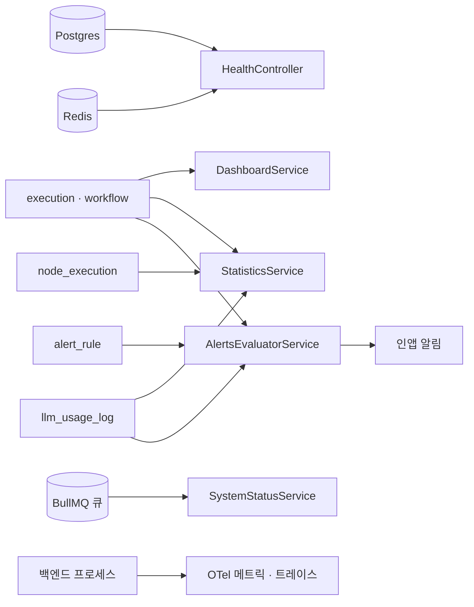
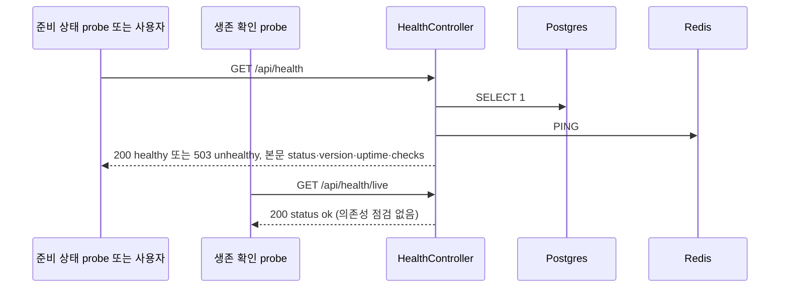

> 구현 상태: 부분 구현 · 원문: `spec/5-system/3-error-handling.md` (§6 로깅 정책, §7 헬스 체크, Rationale 의 `Error.cause` 항목), `spec/data-flow/9-observability.md`, `spec/5-system/_product-overview.md` (§5 관측성) · 용어: [용어 사전](../CLE-GLOSSARY.md)

## 개요

이 문서는 서버가 운영 상태를 드러내는 방법을 정한다. 다루는 것은 다음과 같다.

- 서버 로그의 레벨·형식·마스킹, 에러를 감쌀 때 `Error.cause` 를 붙이는 기준
- 부수 기록(감사 로그, 로그인 이력, 알림 이메일 등)이 실패했을 때 주 동작을 막지 않는 방식
- 헬스 체크(health check): 준비 상태 API `/api/health` 와 생존 확인 API `/api/health/live`
- OTel 메트릭·트레이싱과 비즈니스 메트릭 카탈로그는 하위 문서 [메트릭과 트레이싱](CLE-OBS-LOGGING-METRICS.md) 가 맡는다
- 관측 영역 전체의 데이터 흐름(헬스 체크, 대시보드, 통계, 알림 규칙 평가, 시스템 상태)

범위 밖:

- 관측성 요구사항 목록(REQ-NFR-026, REQ-NFR-029~036): [비기능 요구사항](../CLE-PLAT/CLE-PLAT-NFR.md)
- 에러 응답 봉투와 클라이언트 처리: [에러 응답과 클라이언트 처리](../CLE-API/CLE-API-ERROR.md)
- 에러 코드 카탈로그: [에러 코드 규약과 카탈로그](../CLE-API/CLE-API-ERRCODES.md)
- 응답 데이터 안의 자격 증명 마스킹: [응답 자격 증명 마스킹](../CLE-API/CLE-API-EGRESS.md)
- 큐 적체 상태 화면과 API: [시스템 상태](CLE-OBS-STATUS.md)
- 대시보드와 통계 화면: [대시보드](CLE-OBS-DASHBOARD.md), [통계](CLE-OBS-STATS.md)
- 알림 규칙과 그 평가: [알림](CLE-OBS-NOTIFY.md)
- 감사 로그와 로그인 이력의 적재: [감사 로그](CLE-OBS-AUDIT.md)

## 하위 문서

- [로깅과 헬스 체크 — 메트릭과 트레이싱](CLE-OBS-LOGGING-METRICS.md): OTel 메트릭 · 트레이싱 수집(`OTEL_ENABLED`, Prometheus 수집 주소, OTLP 엔드포인트), 비즈니스 메트릭 카탈로그와 라벨을 닫는 방법, Redis fail-open 라벨, 통계 API 와의 역할 구분과 그 Rationale. 맡는 요구사항: REQ-NFR-030(「수집」 `OTEL_ENABLED`), REQ-NFR-031(「트레이싱」), REQ-NFR-036(「비즈니스 메트릭 카탈로그」)([비기능 요구사항](../CLE-PLAT/CLE-PLAT-NFR.md) 소유)

## 관측 영역의 데이터 흐름

관측 영역은 모두 읽기 위주다. 새 행을 만드는 쪽은 다른 도메인이고 관측 영역은 그 행을 집계·평가·노출한다. 헬스 체크와 시스템 상태는 테이블을 쓰지 않는다. 알림 규칙 평가만 알림 행과 `alert_rule.last_triggered_at` 을 쓴다.



| 구성 요소 | 하는 일 | 기준 문서 |
| --- | --- | --- |
| 헬스 체크 | 의존성(DB·Redis) 점검. 준비 상태 API 와 생존 확인 API 를 나눈다 | 이 문서 [헬스 체크](#헬스-체크) |
| 대시보드 | 워크스페이스 첫 화면의 요약 지표(`dashboard.service.ts`) | [대시보드](CLE-OBS-DASHBOARD.md) |
| 통계 | 기간·워크플로우 필터 집계 API(`statistics.controller.ts`) | [통계](CLE-OBS-STATS.md) |
| 알림 규칙 평가 | `alert_rule` 을 5분마다 평가해 인앱 알림을 보낸다(`alerts-evaluator.service.ts`) | [알림](CLE-OBS-NOTIFY.md) |
| 시스템 상태 | BullMQ 큐 적체 집계 | [시스템 상태](CLE-OBS-STATUS.md) |
| OTel 메트릭·트레이스 | Prometheus 수집 엔드포인트와 OTLP 트레이스 | [메트릭과 트레이싱](CLE-OBS-LOGGING-METRICS.md) |

## 로그 레벨

| 레벨 | 용도 |
| --- | --- |
| ERROR | 시스템 에러, 처리되지 않은 예외 |
| WARN | 비정상이지만 복구할 수 있는 상황(재시도, 대체 동작) |
| INFO | 주요 비즈니스 이벤트(실행 시작·완료, 로그인) |
| DEBUG | 상세 디버깅(요청·응답 데이터, 쿼리) |

## 로그 형식

목표는 서버 로그를 JSON 으로 구조화해 남기는 것이다(REQ-NFR-029). **아직 구현하지 않았다.** 지금 서버는 NestJS 기본 `Logger` 로 한 줄 텍스트를 남기고 요청 로그(`LoggingInterceptor`)는 `METHOD URL status Nms` 형식이다. 구현은 NERV Task `CLE-T-J1YA0X` 가 맡는다. 목표 형식의 예:

```json
{
  "timestamp": "2026-03-26T12:00:00.000Z",
  "level": "ERROR",
  "service": "execution-engine",
  "message": "Node execution failed",
  "requestId": "f3b6d2e0-9d4a-4b77-9d19-7a0f8f4c1e2b",
  "userId": "uuid",
  "workspaceId": "uuid",
  "context": {
    "workflowId": "uuid",
    "executionId": "uuid",
    "nodeId": "uuid",
    "error": "Connection timeout"
  }
}
```

목표 형식의 `requestId` 는 에러 응답의 요청 ID 와 같은 값이라 에러 응답과 서버 로그를 잇는다([에러 응답과 클라이언트 처리](../CLE-API/CLE-API-ERROR.md)). 이것도 아직 구현하지 않았다. 지금 `GlobalExceptionFilter` 는 요청 ID 를 응답 봉투에만 싣고 로그 줄에는 넣지 않아 응답의 `requestId` 로 서버 로그를 찾을 수 없다.

## 로그 마스킹

목표는 로그에 다음 정보가 남지 않도록 로거가 자동으로 가리는 것이다. **아직 구현하지 않았다.** 지금은 로거 층에 마스킹이 없어 로그를 남기는 모듈이 민감 정보를 직접 빼고 남긴다. 응답 sanitizer 의 누출 패턴(`SECRET_LEAK_PATTERNS`)은 응답에만 쓰고 로그에는 쓰지 않는다. 구현은 로그 형식과 함께 `CLE-T-J1YA0X` 가 맡는다.

- API Key, Bearer Token, 비밀번호
- OAuth 토큰
- 개인 식별 정보. 이메일은 일부만 가린다(`g***@example.com`)

로거 마스킹을 구현해도 시크릿 저장소에서 푼 평문(봇 토큰 등)은 로거가 가리지 못한다. 그 값을 쓴 외부 API 호출의 실패 문장은 호출한 모듈이 로그에 남기기 전에 지운다. 대상과 의무는 [시크릿 저장소 「규칙」](../CLE-INT/CLE-INT-SECRET.md#규칙) 14 가 정한다.

## 에러를 감쌀 때 `Error.cause` 를 붙이는 기준

이 절은 로그가 아니라 **에러 객체 자체의 구성**을 다룬다. 노드 에러는 Activity API 로 사용자에게 보이므로 "서버에만 남으니 안전하다" 가 성립하지 않는다. 여기서 `cause` 는 JS `Error` 의 `cause` 프로퍼티다.

REST 표준 응답 경로에서는 [에러 응답과 클라이언트 처리](../CLE-API/CLE-API-ERROR.md) 의 에러 응답 형식 규칙을 먼저 본다. 그쪽은 내부 구현 원문을 응답에 싣는 것을 조건 없이 금지하므로 "원문을 이미 담은 message" 라는 아래 전제 자체가 REST 경로에서는 규칙 위반이다. 이 절은 그 적법성을 판정하지 않는다.

`catch` 한 에러를 새 에러로 감쌀 때 `{ cause: err }` 는 아래 **두 조건을 모두** 만족할 때만 붙인다.

| # | 조건 | 이유 |
| --- | --- | --- |
| C1 | 감싼 `message` 가 원본 `err.message` 를 **이미 담고 있다** | 담고 있다면 `cause` 가 message 쪽에서 새 정보를 더하지 않는다. 담고 있지 않다면 그 비노출이 **의도**이므로 `cause` 를 붙이면 그 의도가 깨진다 |
| C2 | `err` 가 message·name 밖의 민감 정보를 속성으로 들고 있지 않다 | `cause` 는 문자열이 아니라 **객체 전체**를 붙인다. pg 드라이버의 `detail`·`hint`·`where`, HTTP 응답 헤더, 커넥션 문자열 같은 것이 따라오면 C1 이 참이어도 새 정보가 샌다 |

붙이지 않을 때는 `eslint-disable-next-line preserve-caught-error -- <사유>` 로 규칙을 끄고 **무엇을 왜 감추는지** 주석에 남긴다. 원본 상세는 `logger` 로만 남겨 운영 가시성을 지킨다. 기준 사례는 `SecretResolverService.resolve` 다. 복호화에 실패하면 `ref` 와 `workspaceId` 만 기록하고 평문과 암호화 상세는 기록하지 않는다. 근거는 [시크릿 저장소 「규칙」](../CLE-INT/CLE-INT-SECRET.md#규칙) 18 이다.

## 부수 기록 실패 흡수

부수 기록 실패 흡수(best-effort)는 주 동작에 딸린 기록이 실패해도 주 동작을 막지 않는 방식이다. 기록 쪽에서 예외를 흡수하고 로그나 메트릭으로만 드러낸다.

| 기록 | 실패할 때 | 드러나는 방법 | 기준 문서 |
| --- | --- | --- | --- |
| 감사 로그 적재 | 예외를 흡수하고 주 동작을 계속한다 | 경고 로그(유실된 행의 식별자 포함)와 `clemvion.audit.write_failed` 카운터 | [감사 로그](CLE-OBS-AUDIT.md) |
| 로그인 이력 적재 | 예외를 흡수한다 | 에러 로그만. 카운터가 없다 | [감사 로그](CLE-OBS-AUDIT.md) |
| 로그인 이력 보존 배치 | 예외를 흡수한다 | 로그 | [감사 로그](CLE-OBS-AUDIT.md) |
| 알림 이메일 발송 | 재시도하지 않는다 | 경고 로그. `email_sent_at` 이 NULL 로 남는다 | [알림](CLE-OBS-NOTIFY.md) |
| 알림 WebSocket 전송 | 실패해도 알림 저장은 유지된다 | 없음 | [알림](CLE-OBS-NOTIFY.md) |
| LLM 사용량 기록(`llm_usage_log` 적재, `clemvion.llm.tokens` 계측) | 둘을 따로 흡수하고 LLM 호출 결과를 그대로 돌려준다. 계측이 실패해도 적재는 한다 | 경고 로그만. 카운터가 없다 | [LLM 사용량 기록](../CLE-AI/CLE-AI-USAGE.md) |
| EIA 멱등 캐시의 Redis 조회·저장 | 요청을 살리고 캐시 없이 진행한다(fail-open) | 경고 로그와 `clemvion.redis.fail_open` 카운터(`component=idempotency`) | [External Interaction API](../CLE-IX/CLE-EIA.md) |
| 그 밖의 Redis 의존 기능(rate limit · quota · 대화 상태 · 잠금 · 토큰 blacklist · pub/sub 버스 등) | Redis 명령이 실패하면 그 기능 없이 진행한다(fail-open). 무엇을 잃는지는 기능마다 다르다 | 경고 로그와 `clemvion.redis.fail_open` 카운터 | [Redis fail-open 라벨](CLE-OBS-LOGGING-METRICS.md#redis-fail-open-라벨) |

- 관측 호출(로그·메트릭) 자체가 실패해도 흡수한다. 관측이 새 실패 경로가 되면 흡수 계약을 거스르게 된다.
- 흡수해도 호출은 기다릴 수 있다. 로그인 이력처럼 바로 뒤 조회와의 읽기 경쟁을 막아야 하면 `await` 한다. 흡수는 에러 전파를 막을 뿐 순서 보장과 별개다.
- 로그만으로는 비율과 추세로 경보를 걸 수 없다. 그래서 신뢰에 직접 걸린 기록(감사 로그, Redis fail-open)에는 카운터를 둔다.

## 헬스 체크

### 엔드포인트

| 경로 | 용도 | 점검 | HTTP 상태 |
| --- | --- | --- | --- |
| `GET /api/health` | 준비 상태(readiness) probe 전용. 사용자가 직접 불러도 된다 | `database`(SELECT 1), `redis`(PING) | 전체 `status` 가 `healthy` 면 200, 그 밖(`unhealthy`, Redis 미설정 `unconfigured` 포함)은 503 |
| `GET /api/health/live` | 생존 확인(liveness) probe 전용 | 없음. 프로세스가 살아 있는지만 본다 | 항상 200, 본문 `{ "data": { "status": "ok" } }` |



헬스 체크는 DB 에 아무것도 쓰지 않는다. 호출마다 독립적이다. 헬스 체크 대상은 백엔드뿐이다. 프런트엔드 헬스 체크는 외부 의존성을 점검하지 않아 나눌 필요가 없다.

### `/api/health` 응답

```json
{
  "data": {
    "status": "healthy",
    "version": "1.0.0",
    "uptime": 86400,
    "checks": {
      "database": { "status": "healthy", "latency": 5 },
      "redis": { "status": "healthy", "latency": 2 }
    }
  }
}
```

성공 응답을 감싸는 전역 `TransformInterceptor` 가 이 응답도 `{ data }` 로 감싼다([HTTP API 규약](../CLE-API/CLE-API-CONV.md)). 503 도 같다. 아래에서 `status` · `checks` 라고 쓰는 것은 `data` 안의 필드다.

현재 구현(`health.service.ts` 의 `HealthService.check()`)은 `database` 와 `redis` 두 항목만 점검한다. 전체 `status` 는 두 값(`healthy`·`unhealthy`) 중 하나다.

| 전체 상태 | 조건 |
| --- | --- |
| `healthy` | `database`·`redis` 가 모두 `healthy` |
| `unhealthy` | `database` 나 `redis` 가 비정상. Redis 설정이 없으면 `redis` 는 `unconfigured` 로 표시하고 전체는 `unhealthy` 로 내린다. 외부 모니터가 미설정 상태를 알아채게 하려는 것이다 |

- 준비 상태 probe(httpGet)는 2xx 만 성공으로 본다. 의존성 장애 때 503 을 받으면 Pod 가 Service endpoint 에서 빠지고 의존성이 돌아오면 200 으로 다시 들어간다.
- 503 응답 본문도 정상일 때와 같은 `{ data: { status, version, uptime, checks } }` 구조다. 예외를 던지지 않고 응답 상태 코드만 바꾸므로 전역 예외 필터의 에러 응답 봉투(`{ error: { code, message, requestId } }`)로 바뀌지 않는다. 이 503 은 에러 응답 봉투 규칙의 예외이고 [에러 응답과 클라이언트 처리](../CLE-API/CLE-API-ERROR.md) 규칙 1 에 등록돼 있다. 본문 `status` 어휘는 두 값 그대로다.

### `/api/health/live`

의존성(DB·Redis)을 점검하지 않고 프로세스가 살아 있는지만 확인한다. 항상 200 과 `{ "data": { "status": "ok" } }` 를 돌려준다. 생존 확인이 외부 의존성을 보면 안 되는 이유는 [Rationale](#준비-상태와-생존-확인-probe-를-나눈다) 에 있다.

### 로그 게이팅

probe 는 자주 불린다(준비 상태 10초, 생존 확인 30초). 성공 로그가 많이 쌓이므로 `LoggingInterceptor` 는 헬스 체크 경로(`/api/health`, `/api/health/live`)만 따로 다룬다.

| 경우 | 로그 |
| --- | --- |
| 성공(HTTP < 400) | `HEALTH_CHECK_LOG === true` 일 때만 INFO 로 남긴다 |
| 실패(HTTP ≥ 400, 준비 상태 503) | 항상 WARN 으로 남긴다 |
| 헬스 체크가 아닌 경로 | 기존대로 항상 INFO |

`HEALTH_CHECK_LOG` 기본값은 `false` 다. 기본은 실패만 남겨 소음을 줄이고 켜면 성공과 실패를 모두 남긴다.

### 예정 항목

아래는 아직 구현하지 않았다.

| 항목 | 내용 |
| --- | --- |
| 파일 저장소(S3) ping | 추가한다면 준비 상태 API(`/api/health`)에 넣는다. 생존 확인 API 는 의존성을 점검하지 않는다. 외부 네트워크 의존이 커서 헬스 체크가 느려질 수 있으므로 짧은 timeout 을 권한다 |
| `vectorDb` 점검 항목 | 벡터 DB 점검 |
| 세 번째 전체 상태 | 필수가 아닌 점검 일부가 실패했을 때의 상태. 지금은 필수 점검(`database`·`redis`)만 보는 두 값 판정이다. 이름은 정하지 않았다. 큐 건강도와 발송 건강도가 `degraded` 를 다른 뜻으로 쓰므로 그 이름은 피한다(아래 「헬스 어휘」) |

### 헬스 어휘

"건강도(health)" 값 집합은 표면마다 다르다. 섞어 쓰지 않는다.

| 표면 | 값 | 용어 | 기준 문서 |
| --- | --- | --- | --- |
| 헬스 체크 `status` | `healthy`, `unhealthy`(Redis 미설정 `unconfigured` 포함) | 헬스 체크 | 이 문서 |
| 생존 확인 `status` | `ok` 하나 | 생존 확인 | 이 문서 |
| 큐 건강도 `health` | `healthy`, `degraded`, `down` | 큐 건강도 | [시스템 상태](CLE-OBS-STATUS.md) |
| EIA 알림 웹훅의 발송 건강도, 채팅 채널의 채널 건강도 | `unknown`, `healthy`, `degraded` | 발송 건강도, 채널 건강도 | [EIA 알림 웹훅](../CLE-IX/CLE-EIA-NOTIFY.md), [채팅 채널](../CLE-CHAT/CLE-CHAT-CORE.md) |

큐 건강도가 `unhealthy` 를 `degraded`·`down` 두 단계로 나눈 이유는 [시스템 상태](CLE-OBS-STATUS.md) 에 있다.

## 구현 위치

모두 `codebase/backend/src/` 아래다.

- `modules/health/health.controller.ts` (준비 상태 · 생존 확인 엔드포인트, 503 상태 코드 설정)
- `modules/health/health.service.ts` (`HealthService.check()`: `database` · `redis` 점검)
- `common/interceptors/logging.interceptor.ts` (요청 로그와 헬스 체크 로그 게이팅, `HEALTH_CHECK_LOG`)
- `common/interceptors/transform.interceptor.ts` (성공 응답과 헬스 체크 503 의 `{ data }` 래핑)
- `modules/audit-logs/audit-logs.service.ts` (감사 로그 적재 실패 흡수)
- `modules/auth/login-history.service.ts` (로그인 이력 적재 실패 흡수)
- `modules/llm/llm-usage-log.service.ts` (LLM 사용량 기록 실패 흡수)

## Rationale

### 준비 상태와 생존 확인 probe 를 나눈다

처음에는 `/api/health` 하나를 readinessProbe 와 livenessProbe 가 모두 불렀다. 문제가 둘 있었다. `/api/health` 는 의존성 장애 때도 HTTP 200 을 돌려주고 본문 `status` 로만 `unhealthy` 를 알려 준비 상태 probe 가 무력했다(Pod 가 Service 에서 빠지지 않았다). 그렇다고 503 을 돌려주게 바꾸면 DB 장애 한 번에 모든 replica 의 생존 확인이 동시에 실패해 kubelet 이 모든 Pod 를 동시에 재시작하는 크래시 루프가 생길 위험이 있었다.

그래서 이렇게 바꿨다.

- `/api/health` 는 준비 상태 probe 전용이다. 503 은 "이 Pod 는 지금 트래픽을 받을 준비가 안 됐다" 는 뜻이고 의존성이 돌아오면 저절로 200 으로 돌아온다.
- `/api/health/live` 는 생존 확인 probe 전용이다. 생존 확인은 "프로세스가 살아 응답하는가" 만 답해야 한다. 외부 의존성을 보면 외부 장애가 Pod 재시작으로 번져 상황이 더 나빠지고, 재시작으로 외부 DB 를 고칠 수 없다. 이를 구조적으로 막는다.
- 503 도 예외를 던지지 않고 상태 코드만 바꿔 정상 응답과 같은 `{ data }` 본문을 지킨다. probe 와 외부 모니터는 상태 코드로 판정하고 운영자는 본문의 `checks` 로 어느 의존성이 비정상인지 본다. 이 예외는 [에러 응답과 클라이언트 처리](../CLE-API/CLE-API-ERROR.md) 규칙 1 에 적었다(2026-11-12).

### 파일 저장소 ping 은 아직 넣지 않았다

S3 ping 은 외부 네트워크에 크게 기대 헬스 체크가 느려질 수 있다. 넣는다면 위 분리에 따라 준비 상태 probe 단계에 짧은 timeout 으로 넣는다(「예정 항목」).

### `Error.cause` 부착 기준을 에러 객체의 성질에 건다

eslint 10 상향(`#1219`)이 켠 `preserve-caught-error` 규칙에 대응하면서 처분이 갈렸다. `expression-resolver`·`code.handler` 는 `cause` 를 붙였고 `SecretResolverService.resolve` 는 붙이지 않았다. 그 기준을 정리한 것이 `Error.cause` 부착 기준 절이다(2026-08-29).

기각한 기준은 "지금 `.cause` 가 클라이언트로 직렬화되는가" 다. 그때 직렬화 경로는 0곳이었다(`GlobalExceptionFilter` 등. 로그 전용으로 풀어 보는 `describeFetchError` 는 별개다). 하지만 그 기준은 소비하는 쪽이 바뀌면 무너진다. 누가 `.cause` 를 응답 봉투에 실으면 과거의 모든 부착이 한꺼번에 노출된다. SSRF 에러 메시지 일반화(`#814`)가 그 함정이었다. "서버 로그니까 안전하다" 는 전제가 Activity API 노출로 반증됐다. 그래서 기준을 소비하는 쪽과 무관한 에러 객체 자신의 성질(C1 message 포함 여부, C2 부가 속성 유무)에 걸었다.

C2 는 나중에 더했다. 초안은 C1 만 두었는데 `cause` 는 `err` 객체 전체를 붙이므로 pg 의 `detail`·`hint`·`where` 처럼 message 밖 속성이 따라오면 C1 이 참이어도 새 정보가 샌다. `#814` 가 세운 "필드가 아니라 원문 내용이 판단 기준" 을 message 텍스트 하나로 어림한 것이 초안의 결함이었다.
