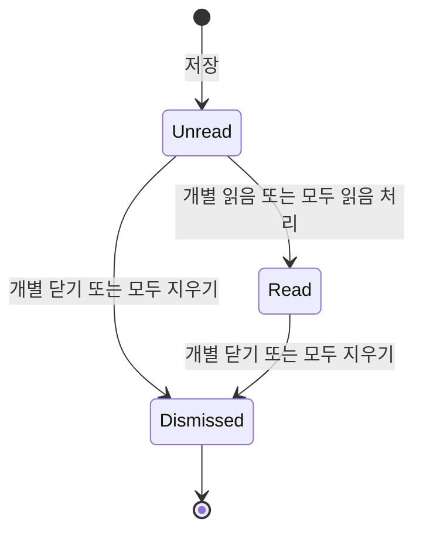

## 개요

이 문서는 [알림](CLE-OBS-NOTIFY.md) 의 하위 문서로 사이드바 알림 벨과 팝오버, 딥링크, 읽음과 알림 닫기(dismiss, `dismissed_at`), 알림 API, `Notification` 엔티티와 알림 도메인의 외부 의존을 정한다. 알림 유형과 저장·전달은 [알림](CLE-OBS-NOTIFY.md), `AlertRule` 엔티티는 [알림 — 알림 규칙](CLE-OBS-NOTIFY-RULES.md#alertrule) 이 정한다.

## 알림 벨과 팝오버

### 알림 벨

- 사이드바 하단 사용자 영역 옆이나 사이드바 하단에 둔다.
- 배지에는 보이는 알림 가운데 읽지 않은 수(`is_read=false AND dismissed_at IS NULL`)를 보인다. 99 를 넘으면 "99+" 다.
- 벨을 누르면 팝오버가 열린다.

### 팝오버

| 영역 | 들어가는 요소 | 동작 |
| --- | --- | --- |
| 머리 | 제목, 오른쪽 메뉴의 "모두 읽음 처리"·"모두 지우기" | "모두 읽음 처리" 는 `POST /api/notifications/mark-all-read`, "모두 지우기" 는 `POST /api/notifications/dismiss-all`. 두 동작은 서로 독립이며 한쪽이 다른 쪽을 포함하지 않는다 |
| 필터 칩 | `all`(전체), `general`(일반), `integration-action-required`(통합 액션 필요) | 칩을 고르면 목록을 거른다 |
| 알림 목록 | 알림마다 제목과 상대 시간 | 마우스를 올리면 오른쪽에 ✓(개별 읽음)·✕(개별 닫기). 본문을 누르면 읽음 처리 뒤 딥링크로 이동 |
| 전체 보기 링크 | "View all notifications →" | 전체 알림 페이지로 이동. 미구현이며 정의가 갈린다. [미결 사항](CLE-OBS-NOTIFY.md#미결-사항) 참조 |

- `general` 은 `integration_action_required` 를 뺀 모든 알림이다. 만료 7일 전 안내 같은 수동적 알림인 `integration_expired` 와 유형이 비어 있는 옛 행도 `general` 로 분류한다(`codebase/frontend/src/lib/notifications/filter.ts`).
- 현재 구현은 팝오버가 최근 알림 10건(`GET /api/notifications?limit=10`)을 불러오고 칩 필터를 그 10건 안에서 적용한다.

### 딥링크

알림을 누르면 유형별로 아래 경로로 이동한다(`codebase/frontend/src/lib/notifications/href.ts`). `resource_id` 는 허용 패턴 `/^[a-zA-Z0-9_-]{1,128}$/` 을 통과해야 한다. 경로 조작과 URL 삽입을 막기 위해서다. 맞지 않거나 없으면 목록 경로로 대신 간다.

| 알림 유형 | 이동 경로 | `resource_id` 가 없거나 맞지 않을 때 |
| --- | --- | --- |
| `integration_action_required`, `integration_expired` | `/integrations/<resource_id>` | `/integrations` |
| `execution_failed`, `background_failed`, `schedule_failed` | `/workflows/<resource_id>`(워크플로우 ID) | `/workflows` |
| `team_invite` | `/profile`(ID 불필요) | — |
| 그 밖, 유형 없음 | 이동하지 않음 | — |

`href.ts` 가 돌려주는 경로에는 워크스페이스 슬러그가 없다. 누르면 흡수 라우트(`(main)/[...rest]`)가 현재 워크스페이스의 `/w/<slug>/…`(`/workflows/<id>` 는 `/w/<slug>/workflows/<id>`)로 바꾼다. 알림은 늘 발사 시점의 워크스페이스 범위라 이 변환이 안전하다([레이아웃과 내비게이션](../CLE-UI/CLE-UI-LAYOUT.md)).

## 읽음과 닫기

읽음(`is_read`)과 닫기(`dismissed_at`)는 서로 다른 두 축이다.

그림은 읽음 축만 단순하게 그렸다. `Dismissed` 는 `dismissed_at IS NOT NULL` 인 상태를 통틀어 부른다. 닫을 때의 `is_read` 값은 그대로 남는다. 닫기가 읽음을 뜻하지 않는다.

| 축 | 컬럼 | 뜻 | 목록 표시 | 읽지 않은 수 |
| --- | --- | --- | --- | --- |
| 읽음 | `is_read` | 사용자가 내용을 알았다 | 영향 없음(보이는 동안 표시) | 빠진다 |
| 닫기 | `dismissed_at` | 사용자가 더는 보고 싶지 않다(NULL 은 보임, 값이 있으면 닫힘) | 닫히면 빠진다 | 닫히면 빠진다 |

두 축을 합치면 네 상태가 된다(`visible` 은 `dismissed_at IS NULL`).

- (읽지 않음, 보임): 방금 만든 알림. 목록에 보이고 수에 든다.
- (읽음, 보임): 읽음 표시만 한 알림. 목록에 보이고 수에 들지 않는다.
- (읽지 않음, 닫힘): 읽지 않고 닫은 알림. 목록과 수 모두에서 빠진다.
- (읽음, 닫힘): 읽고 닫은 알림. 목록과 수 모두에서 빠진다. 가장 흔한 끝 상태다.

닫기 축의 활성 상태는 `visible` 로 부른다. "active" 는 `Workflow.is_active` 같은 켜짐·꺼짐 뜻으로 이미 쓰이고 있어서다([Rationale](#보임과-닫힘이라는-어휘)).

### 닫기 엔드포인트

| 엔드포인트 | 동작 | 권한 |
| --- | --- | --- |
| `POST /api/notifications/:id/dismiss` | 한 건 닫기. `UPDATE notification SET dismissed_at=now() WHERE id=:id AND user_id=:uid AND dismissed_at IS NULL`. 멱등이다. 본인 알림이면 이미 닫혀 있어도 성공한다 | 본인 알림만. 다른 사용자의 ID 는 404 |
| `POST /api/notifications/dismiss-all` | 모두 닫기. `UPDATE notification SET dismissed_at=now() WHERE workspace_id=:ws AND user_id=:uid AND dismissed_at IS NULL`. 응답 `{ data: { affected: number } }` | 본인 알림 가운데 현재 워크스페이스 것만 |

응답 형식은 [OpenAPI 문서화](../CLE-API/CLE-API-SWAGGER.md) 의 응답 DTO 규약을 따른다.

- 한 건: `200 OK`, `ApiOkWrappedResponse(DismissNotificationResponseDto)`. 형태는 `{ id: string; dismissedAt: string }` 이다. `dismissedAt` 은 늘 채워진다. 멱등 호출이면 기존 값을 돌려준다. 클라이언트가 낙관적 갱신을 고치지 않고 그대로 반영할 수 있다.
- 모두: `200 OK`, `ApiOkWrappedResponse(DismissAllNotificationsResponseDto)`. 형태는 `{ affected: number }` 로 `POST /api/notifications/mark-all-read` 의 `MarkAllReadResultDto` 와 같다. 모양이 같아도 뜻이 달라 클래스를 따로 둔다.
- DTO 파일: `codebase/backend/src/modules/notifications/dto/responses/dismiss-notification-response.dto.ts`, `dismiss-all-notifications-response.dto.ts`.

### 목록과 수에 미치는 영향

`GET /api/notifications` 와 `GET /api/notifications/unread-count` 는 **항상** `dismissed_at IS NULL` 로 거른다. 벨 배지도 같은 정의를 따른다(`is_read=false AND dismissed_at IS NULL`). 닫힌 알림을 보고 싶다는 요구는 아직 없어 조회 옵션을 두지 않는다. 필요해지면 그때 `?includeDismissed=true` 를 더한다.

### 보존

닫힌 알림 행은 바로 지우지 않는다. 닫힌 뒤 N일이 지난 행을 지우는 배치나 분석용 닫기 이벤트 집계는 나중에 들일 수 있지만 지금 범위 밖이다. 지금은 행이 그대로 쌓이며 정리가 필요해지면 따로 계획한다.

### 기기 사이 동기화

지금은 같은 기기의 React Query 캐시를 무효화해 팝오버가 바로 바뀐다. 같은 사용자의 다른 기기·탭 사이에서 읽음과 닫기를 맞추는 기능(한 탭에서 닫은 알림이 다른 탭에서도 바로 사라짐)은 아직 없다. `notification.read`, `notification.dismissed` 이벤트를 새로 만들면 가능하며 후속 단계에서 검토한다. 이벤트 이름은 기존 `notification.new` 접두와 맞춘다.

## 알림 API

모든 경로는 로그인한 본인의 알림만 다룬다.

| 메서드 | 경로 | 설명 |
| --- | --- | --- |
| GET | `/api/notifications` | 알림 목록. 쿼리 `type`, `is_read`, `page`, `limit`. 닫힌 알림은 빠진다 |
| GET | `/api/notifications/unread-count` | 읽지 않은 알림 수. 닫힌 알림은 빠진다 |
| PATCH | `/api/notifications/:id/read` | 알림 한 건 읽음 처리 |
| POST | `/api/notifications/mark-all-read` | 모두 읽음 처리 |
| POST | `/api/notifications/dismiss-all` | 모두 닫기. `mark-all-read` 와 독립이다 |
| POST | `/api/notifications/:id/dismiss` | 알림 한 건 닫기. 멱등이다 |
| GET | `/api/notifications/settings` | 알림 이메일 토글 조회. 없는 키는 기본값으로 채운다([알림 설정과 이메일](CLE-OBS-NOTIFY-SETTINGS.md)) |
| PATCH | `/api/notifications/settings` | 알림 이메일 토글 부분 수정. 보낸 키만 합친다 |

알림 규칙 API 는 [알림 — 알림 규칙](CLE-OBS-NOTIFY-RULES.md) 에 있다.

## 데이터

### Notification

| 필드 | 타입 | 설명 |
| --- | --- | --- |
| id | UUID | PK |
| workspace_id | UUID | FK → Workspace (CASCADE) |
| user_id | UUID | FK → User (NO ACTION). 수신자 |
| type | Enum | 알림 유형. 값은 [알림 「알림 유형」](CLE-OBS-NOTIFY.md#알림-유형) 의 열 가지 |
| title | String | 알림 제목 |
| message | String | 알림 내용 |
| resource_type | String? | 관련 리소스 종류. 딥링크 라우팅 키(`workflow`, `integration`, `workspace_invitation` 등) |
| resource_id | UUID? | 관련 리소스 ID. 딥링크 대상. 실패류 알림은 워크플로우 ID |
| background_run_id | UUID? | `background_failed` 알림의 본문 실행 귀속 전용 키(V107). 딥링크(`resource_type`·`resource_id`=워크플로우)와 분리했다. Background 본문 모니터링 API 만 읽는다. REST 에 싣지 않는다(`select: false`) |
| is_read | Boolean | 읽음 여부. 기본 false |
| channel | Enum | 알림 채널. `in_app` / `email` / `both` |
| email_sent_at | Timestamp? | 이메일 발송 시각. NULL 이면 보내지 않았거나 실패 |
| dismissed_at | Timestamp? | 사용자가 닫은 시각. NULL 이면 보임. 목록과 읽지 않은 수에서 빠진다 |
| created_at | Timestamp | 생성 시각 |

- 테이블은 V001, `dismissed_at` 은 V055, 부분 인덱스 전환은 V056, `background_run_id` 는 V107 에서 더했다.
- 인덱스:
  - `(user_id, is_read, created_at DESC) WHERE dismissed_at IS NULL`: 사용자별 읽지 않은 알림 조회(벨 배지, 팝오버). 보이는 알림만 보므로 부분 인덱스다.
  - `(workspace_id, created_at DESC)`: 워크스페이스 단위 조회. 앞으로 관리자·감사 조회가 닫힌 알림까지 볼 여지를 두려고 부분 인덱스로 바꾸지 않았다.
  - `background_run_id WHERE background_run_id IS NOT NULL`(V107): 본문 실행 귀속 조회(`NotificationsService.findByBackgroundRun`, `created_at ASC`). Background 본문 모니터링 API(`background-runs.service.ts`)가 관련 `background_failed` 알림을 자기 응답에 함께 싣는 데 쓴다.
- 쓰기:
  - 저장: `INSERT workspace_id, user_id, type, title, message, resource_type?, resource_id?, background_run_id?, is_read=false, channel, email_sent_at?, dismissed_at=NULL`
  - 읽음: `UPDATE is_read=true`
  - 한 건 닫기 · 모두 닫기: [닫기 엔드포인트](#닫기-엔드포인트) 의 `UPDATE`
  - 알림 규칙 발사: `createMany` 로 `type=alert_<type>`, `resource_type='alert_rule'` 행 저장

### 외부 의존

| 의존 | 방향 | 내용 |
| --- | --- | --- |
| WebSocket | 내부 전송 | `WebsocketService` 하나로 보낸다 |
| SMTP | 내부에서 외부로 | `MailService` |
| 사용자 설정 | 발사원이 읽음 | `user.notification_preferences`([알림 — 알림 설정과 이메일](CLE-OBS-NOTIFY-SETTINGS.md#알림-설정-저장)) |

## 구현 위치

- `codebase/backend/src/modules/notifications/notifications.controller.ts`
- `codebase/frontend/src/components/layout/sidebar.tsx` (알림 벨과 팝오버)
- `codebase/frontend/src/lib/notifications/*.ts` (필터와 딥링크)

## Rationale

### 닫기는 행을 지우지 않고 `dismissed_at` 을 채운다

팝오버에 "닫기(✕)" 를 넣으면서 행 삭제 대신 `dismissed_at TIMESTAMPTZ NULL` 컬럼을 채우는 방식을 골랐다.

1. **추적 기록 보존**: 어떤 알림이 사용자에게 닿았고 사용자가 어떻게 처리했는지는 장애 뒤 조사에 쓸모가 있다. 예를 들어 `integration_action_required` 를 사용자가 실제로 보고 조치했는지, 닫고 넘겼는지 알 수 있다.
2. **분석 데이터**: 유형별 읽음 비율과 닫기 비율은 나중에 어떤 유형을 이메일로 올릴지, 어떤 임계를 바꿀지 정하는 근거가 된다.
3. **되살리기 여지**: 실수로 닫은 알림을 복구하는 기능을 나중에 넣을 수 있다. 행을 지우면 불가능하다.
4. **중복 방지 유지**: `hasRecentByResource` 는 닫힌 행도 세야 과도한 알림을 막는다. 행을 지우면 닫는 순간 24시간 가드가 풀려 같은 장애 알림이 되풀이될 수 있다([알림 「중복 방지에 닫힌 알림도 센다」](CLE-OBS-NOTIFY.md#중복-방지에-닫힌-알림도-센다)).

`is_deleted BOOLEAN` 대신 `dismissed_at` 을 고른 이유는 시각도 함께 남아 정보가 더 많고 "닫힌 뒤 N일" 같은 보존·분석 정책에도 시각 컬럼이 자연스러워서다. 별도 `notification_dismissals` 테이블은 두지 않는다. `is_read` 와 같은 행을 한 트랜잭션에서 고치는 일관성 이점이 사라지고 JOIN 비용이 생긴다. 닫기는 행마다 0~1번 일어나는 1:1 관계라 테이블을 따로 둘 가치가 없다.

`(user_id, is_read, created_at DESC)` 인덱스는 부분 인덱스(`WHERE dismissed_at IS NULL`)로 바꿔 목록과 읽지 않은 수 조회에 그대로 쓴다. 보이는 알림이 닫힌 알림보다 대개 훨씬 적어 인덱스가 작아지는 이점도 있다. V056 은 `executeInTransaction=false` 로 `CREATE INDEX CONCURRENTLY ... WHERE dismissed_at IS NULL` 을 먼저 만들고 옛 인덱스를 `DROP INDEX CONCURRENTLY` 로 지웠다. V056 에는 `CREATE` 앞의 잔재 정리 단계가 없다. 지금 규약은 `CREATE` 앞에 `DROP INDEX CONCURRENTLY IF EXISTS <새 인덱스 이름>` 을 두어 새 인덱스 이름의 invalid 잔재를 먼저 지운다([DB 마이그레이션 규약](../CLE-ENG/CLE-ENG-MIGRATION.md) 규칙 13, `codebase/backend/migrations/README.md` §5). `CREATE INDEX CONCURRENTLY IF NOT EXISTS` 는 이름만 보고 `indisvalid` 를 보지 않는다. 그래서 빌드가 실패해 invalid 잔재가 남은 뒤 정리 없이 다시 돌리면 `CREATE` 는 건너뛰고 옛 인덱스만 지워져 쓸 수 있는 인덱스가 0개가 된다. V056 자체는 append-only 라 고치지 않는다.

### 보임과 닫힘이라는 어휘

`dismissed_at IS NULL` 상태를 부를 이름으로 `active`, `live`, `visible`, `undismissed` 가 후보였다. `active` 는 `Workflow.is_active`·`Trigger.is_active`·`Schedule.is_active` 의 켜짐·꺼짐 뜻으로 이미 쓰여 명세를 검색할 때 헷갈린다. `live` 는 실시간 스트림 뜻과 섞인다. `undismissed` 는 부정형이라 읽기 어렵다.

`visible` 을 골랐다. 팝오버에서 사용자에게 보이는 상태라는 사용자 관점의 말이고 DB 컬럼 `dismissed_at` 과 반대 뜻이 바로 읽힌다. DB 컬럼 이름은 `dismissed_at` 그대로 두고 명세 본문·API 문서·화면 표시에서만 `visible` 을 쓴다. 화면에서도 `Active`·`Inactive` 배지 표현은 일부러 쓰지 않는다.

### 닫기 엔드포인트는 `POST /:id/dismiss` 로 둔다

`DELETE /notifications/:id`·`DELETE /notifications` 도 후보였다. 기존 `POST /notifications/mark-all-read` 와 짝이 맞는 `POST` 동작 엔드포인트를 골랐다.

1. **코드베이스 관례상 `DELETE` 는 행 삭제다.** 행을 지우지 않는 `dismissed_at` 갱신에 같은 동사를 쓰면 API 를 쓰는 쪽이 "알림이 사라졌다 = 행이 사라졌다" 로 오해할 수 있다.
2. **`DELETE` 응답 본문 호환성**: 일부 HTTP 클라이언트와 API 게이트웨이는 `DELETE` 응답 본문을 무시하거나 없앤다. 닫기 응답에는 `dismissedAt` 이나 `affected` 가 있어야 클라이언트가 낙관적 갱신을 고치지 않고 반영할 수 있다.
3. **API 계약 정합성**: 읽음 경로 `PATCH /api/notifications/:id/read` 는 [HTTP API 규약](../CLE-API/CLE-API-CONV.md) §12.1 의 예외이고, 닫기 · 모두 닫기 · 모두 읽음은 같은 규약 §2.2 의 `POST` 동작으로 정리했다(2026-10-24). 닫기에 `DELETE` 를 들이면 알림 모듈의 동사 정책이 이 정리와 어긋난다.
4. **`mark-all-read` 와 동사를 맞춘다**: 모두 닫기도 `POST /notifications/dismiss-all` 로 맞추면 클라이언트 SDK 가 두 동작을 같은 방식으로 부른다. 맞춘 것은 `POST` 동사다. 두 일괄 경로의 이름은 [HTTP API 규약](../CLE-API/CLE-API-CONV.md) §2.2 가 선례로 삼지 않는 예외로 적었다.

`PATCH /notifications/:id` + 본문 `{ dismissed: true }` 도 쓰지 않는다. 읽음 처리(`PATCH /:id/read`)와 차원이 다른 동작을 한 엔드포인트에 묶어 의도가 흐려지고 본문의 부분 수정 뜻과 동작 뜻이 섞인다.

### 모두 읽음은 `POST /notifications/mark-all-read` 다

모두 읽음은 `POST /notifications/mark-all-read`(`NotificationsController.markAllRead`, `@Post('mark-all-read')`)다. 여러 건을 읽음으로 바꾸는 멱등 상태 변경이라 `PATCH`·`POST` 모두 가능했다. 일관된 `POST /동작-동사` 형태가 NestJS 컨트롤러 구현 관례와 잘 맞아 골랐다. 경로 이름이 §2.2 의 예외인 점은 위와 같다(2026-10-24).

### WebSocket 이벤트는 `notification.new` 와 `notifications:<userId>` 로 적는다

1. **프로토콜 기준**: 정식 정의인 [WebSocket 이벤트와 명령](../CLE-API/CLE-API-WS-EVENTS.md) 이 구독 채널 `notifications:{userId}`, 점 표기 이벤트 `notification.new` 를 쓴다. 다른 이벤트(`execution.started` 등)도 점 표기다.
2. **게이트웨이 코드와 맞춘다**: `WebsocketGateway.VALID_CHANNEL_PREFIXES` 에 등록된 접두는 `user:` 가 아니라 `notifications:` 다.
3. **후속 이벤트와 맞춘다**: 기기 사이 동기화 후속으로 계획한 `notification.read`·`notification.dismissed` 도 점 표기다.

### 딥링크와 본문 실행 귀속을 다른 컬럼에 둔다 (V107)

`background_failed` 알림은 소비처 두 곳이 서로 다른 리소스 키를 요구한다.

1. **팝오버 딥링크**(`href.ts`)는 `background_failed` 를 `/workflows/<resource_id>` 로 보내므로 `resource_id` 가 **워크플로우 ID** 여야 한다(`execution_failed`·`schedule_failed` 와 같은 계약).
2. **Background 본문 모니터링 API**(`background-runs.service.findByBackgroundRun`)는 특정 본문 실행에 관련된 알림만 정확히 골라야 하므로 **본문 실행 단위** 키(`backgroundRunId`)가 필요하다. 워크플로우 ID 로는 같은 워크플로우의 여러 본문 실행을 가를 수 없다.

(`resource_type`, `resource_id`) 한 쌍으로 두 요구를 함께 채울 수 없다. 그래서 딥링크는 `resource_type`·`resource_id`(워크플로우)가 맡고 귀속은 새 NULL 허용 컬럼 `background_run_id`(V107, 부분 인덱스, REST 에 싣지 않음)가 맡도록 나눴다.

"`href.ts` 가 본문 실행으로 라우팅하게 바꾸기" 는 기각했다. 본문 실행은 (`executionId`, `backgroundRunId`) 쌍으로만 주소를 정할 수 있다. `href.ts` 는 `resource_id` 하나만 갖고 있어 `backgroundRunId` 만으로는 URL 을 만들 수 없다. 딥링크 계약 자체를 바꿔야 해 더 무겁다. 예전의 `resource_type='background_run'`·`resource_id=backgroundRunId` 는 누르면 404 가 나던 결함이었고 이 분리로 해소됐다. 배포 전에 저장된 `background_failed` 행은 소급해 채우지 않는다. 지난 알림은 이미 소비됐고 소급 표시의 가치가 낮아 의도적으로 감수한다.

컬럼 이름 `background_run_id` 는 V047 의 `node_execution` JSONB 경로 인덱스(`idx_node_execution_background_run_id`, `meta.backgroundRunId`)와 비슷해 보이지만 테이블도 목적도 전혀 다르다.
