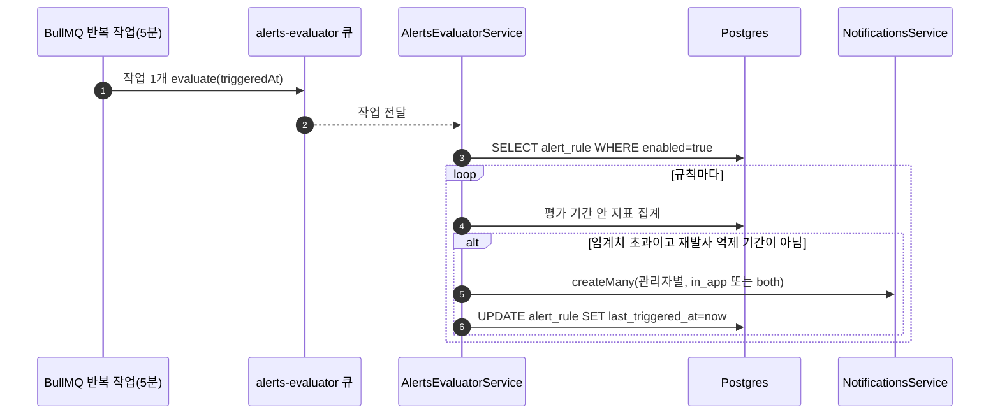

## 개요

이 문서는 [알림](CLE-OBS-NOTIFY.md) 의 하위 문서로 알림 규칙(Alert Rule, `AlertRule`)의 화면, API, 평가, 엔티티를 정한다. 알림 규칙은 워크스페이스 단위 규칙이다. 실패율·평균 실행 시간·LLM 비용이 임계치를 넘으면 인앱 알림을 보낸다. [알림 설정](CLE-OBS-NOTIFY-SETTINGS.md) 의 이메일 토글과는 별개다(NF-OB-05).

## 알림 규칙

### 화면 (`/profile/alerts`)

| 항목 | 내용 |
| --- | --- |
| 규칙 목록 | 현재 워크스페이스의 모든 규칙. 유형(실패율·실행 시간·LLM 비용), 임계치, 평가 기간, 활성 상태 열. 멤버 누구나 볼 수 있다 |
| 생성 폼 | 관리자 이상에게만 보인다(`useHasRole("admin")`). 유형 선택, 임계치 숫자 입력, 평가 기간(ISO 8601 기간, 폼 기본값 `PT1H`) |
| 활성 토글·삭제 | 관리자 이상 전용 행 동작. 관리자 미만에게는 활성 상태를 읽기 전용 배지로만 보인다 |

### API

`codebase/backend/src/modules/alerts/` 가 제공한다.

| 메서드 | 경로 | 권한 | 설명 |
| --- | --- | --- | --- |
| GET | `/api/alerts` | 멤버 | 현재 워크스페이스의 알림 규칙 목록 |
| POST | `/api/alerts` | 관리자 이상 | 규칙 생성. 본문: `type`(`failure_rate` 실패율 %, `duration` 평균 실행 시간 ms, `llm_cost` 누적 LLM 비용 USD), `threshold`(number, 0 이상, 단위는 유형별), `window?`(ISO 8601 기간, 예 `PT1H`. 없으면 모듈 기본값), `channel?`(`in_app` 또는 `email`, 기본 `in_app`), `workflowId?`(UUID. 없으면 워크스페이스 전체 감시), `enabled?`(기본 `true`). `workflowId` 가 같은 워크스페이스의 워크플로우가 아니면 400 `VALIDATION_ERROR`(`details[].field='workflowId'`, `details[].code='INVALID_FIELD'`)다([참조의 소속](../CLE-PLAT/CLE-PLAT-DATA.md#참조의-소속)) |
| PATCH | `/api/alerts/:id` | 관리자 이상 | 부분 수정(`threshold`·`window`·`channel`·`enabled`). 현재 워크스페이스에 없으면 404 `ALERT_RULE_NOT_FOUND` |
| DELETE | `/api/alerts/:id` | 관리자 이상 | 영구 삭제(204 No Content). 현재 워크스페이스에 없으면 404 `ALERT_RULE_NOT_FOUND` |

- `ALERT_RULE_NOT_FOUND` 는 `where: { id, workspaceId }` 로 찾으므로 다른 워크스페이스의 규칙에 접근해도 같은 404 다([에러 코드 규약과 카탈로그](../CLE-API/CLE-API-ERRCODES.md)).
- DTO 의 `window` 는 `@IsString` 만 검사한다. 그래서 아무 문자열이나 저장될 수 있다. 그때는 평가의 1시간 대체값이 실제 동작을 정한다(아래).
- 응답의 `threshold` 는 문자열이다. 쓰기는 `number` 로 받는다([AlertRule](#alertrule)).

### 알림 규칙 평가

- `onModuleInit` 이 `queue.upsertJobScheduler` 로 반복 작업 **하나**를 등록한다. 이름은 `'alerts-evaluator-5min'`, 작업 이름은 `'evaluate'`, payload 는 `{ triggeredAt }` 이다. 주기는 `*/5 * * * *`(UTC)다. 규칙마다 큐에 넣지 않는다. 처리기의 `run()` 이 `enabled=true` 규칙 전체를 직접 읽어 차례로 평가한다(`alerts-evaluator.service.ts`). 큐 등록 정보는 [비동기 큐와 Redis 키 목록](../CLE-PLAT/CLE-PLAT-QUEUE.md) 에 있다.
- 지표는 `execution`(실패율, 평균 실행 시간)과 `llm_usage_log`(LLM 비용)에서 집계한다. 수신자인 워크스페이스 관리자는 워크스페이스 멤버에서 찾는다.
- 발사하면 알림 저장(`notificationsService.createMany`, `type=alert_<type>`, `resource_type='alert_rule'`)과 `last_triggered_at` 갱신만 한다. 감사 로그는 남기지 않는다(`dispatchBreach`).

평가와 발사의 세부 규칙:

- **최소 표본**: `failure_rate` 는 평가 기간 안 전체 실행이 **5건 미만**이면 평가하지 않는다(`computeFailureRate` 에서 `total < 5` 면 `null`). 1건 중 1건 실패가 50% 규칙을 울리지 않게 한다. 사용자에게는 "알림이 안 온다" 로 보일 수 있다.
- **초과 판정은 엄격하다**: `observed <= threshold` 면 보내지 않는다(`evaluateRule`). 임계치와 정확히 같은 관측값은 알림을 보내지 않는다.
- **평가 기간 해석**: `rule.window` 는 자체 최소 정규식 파서(`parseIso8601Duration`)로 해석한다. `P?D` 와 `PT?H?M?S` 조합을 지원한다. 해석할 수 없는 문자열이면 알리지 않고 1시간(`PT1H`)으로 평가한다.
- **채널 매핑**: 규칙의 `channel='email'` 은 발사 때 알림 채널 `both`(인앱 + 이메일)가 된다. 이메일만 보내는 경로는 없다.
- **재발사 억제**: 규칙의 `last_triggered_at` 이 평가 기간 안이면 다시 보내지 않는다(`isInCooldown`). 규칙에 상태 머신은 없고 `enabled` 토글만 있다.

## AlertRule

워크스페이스 단위 알림 규칙이다(V016).

| 필드 | 타입 | 설명 |
| --- | --- | --- |
| id | UUID | PK |
| workspace_id | UUID | FK → Workspace (CASCADE) |
| workflow_id | UUID? | FK → Workflow (CASCADE, 같은 워크스페이스). **NULL 이면 워크스페이스 전체 규칙**. 값이 있으면 같은 워크스페이스의 워크플로우만 가리킨다([데이터 모델 개요 §참조의 소속](../CLE-PLAT/CLE-PLAT-DATA.md#참조의-소속)) |
| type | Enum | `failure_rate` / `duration` / `llm_cost` |
| threshold | Numeric(12,4) | 임계치. **응답에는 문자열로 실린다.** 엔티티를 그대로 내보내는 경로라 TypeORM 의 numeric 표현이 그대로 나간다([OpenAPI 문서화](../CLE-API/CLE-API-SWAGGER.md)). 쓰기는 `number` 를 받는다 |
| window_iso | String | 평가 기간(window, ISO 8601 기간). 기본 `PT1H` |
| channel | Enum | `in_app` / `email`. 기본 `in_app`. **`Notification.channel` 과 값 범위가 다르다.** 그쪽은 `both` 를 포함한 세 값이라 그대로 대응하지 않는다 |
| enabled | Boolean | 평가 대상 여부. 기본 true |
| last_triggered_at | Timestamp? | 마지막 발사 시각. 재발사 억제에 쓴다 |
| created_by | UUID? | FK → User (**SET NULL**). 만든 사람이 지워져도 규칙은 남는다 |
| created_at | Timestamp | 생성 시각 |
| updated_at | Timestamp | 수정 시각 |

- 인덱스: `idx_alert_rule_workspace (workspace_id)`, `idx_alert_rule_enabled (enabled) WHERE enabled = true`. 평가가 켜진 규칙만 전부 읽으므로 부분 인덱스가 그 조회를 바로 받는다.
- 발사한 알림의 유형은 `alert_` + 이 표의 `type` 이다.

### 외부 의존

| 의존 | 방향 | 내용 |
| --- | --- | --- |
| 실행·LLM 사용량 | 알림 규칙 평가가 읽음 | `execution`, `llm_usage_log` |
| 워크스페이스 | 알림 규칙 평가가 읽음 | 수신자(관리자) 조회 |

## 구현 위치

- `codebase/backend/src/modules/alerts/alerts.service.ts` (알림 규칙 CRUD)
- `codebase/backend/src/modules/alerts/alerts-evaluator.service.ts` (알림 규칙 평가)
- `codebase/frontend/src/app/(main)/w/[slug]/profile/alerts/**` (알림 규칙 화면)

## Rationale

### 알림 규칙 컬럼 정의를 한 곳에 둔다 (2026-08-31)

V016 이 만든 `alert_rule` 의 컬럼 정의가 데이터 모델 문서에 없는데도 다른 문서는 거기 있다고 가리켰다. "컬럼이 어딘가에는 적혀 있다" 는 것은 기준이 아니고 링크만 지우는 것도 문제를 숨길 뿐이다. 그래서 엔티티 정의를 한 곳에 등재했다. 지금은 이 문서의 [AlertRule](#alertrule) 이 그 자리다.

같은 편집에서 `Notification.type` 의 닫힌 목록도 고쳤다. 평가가 실제로 넣는 `alert_failure_rate`·`alert_duration`·`alert_llm_cost` 세 값이 빠져 있어 "이 목록이 전부다" 라는 서술이 거짓이었다.

### 평가 기간을 ISO 8601 기간으로 둔다

`PT1H`, `PT15M`, `P1D` 처럼 직관적이고 시간대의 영향을 받지 않는다. 나중에 더 복잡한 기간(예: 업무 시간)이 필요해지면 표준 위에서 넓힐 수 있다. 다만 현재 구현은 외부 라이브러리가 아니라 자체 최소 정규식 파서(`parseIso8601Duration`)로 일·시·분·초 조합만 해석한다. 해석에 실패하면 `PT1H` 로 대신한다. 입력 DTO 에서 ISO 8601 형식을 검사할지는 따로 계획한다.

### `failure_rate` 에 최소 표본 5건을 둔다

평가 기간 안 실행이 아주 적으면 비율 지표는 흔들림이 크다. 1건 중 1건 실패(100%)가 50% 규칙을 울리면 알림을 믿을 수 없게 된다. 표본이 5건 미만이면 평가하지 않아 이런 흔들림을 누른다. 대가로 실행이 드문 워크플로우의 실패는 비율 규칙으로 잡히지 않을 수 있다.
