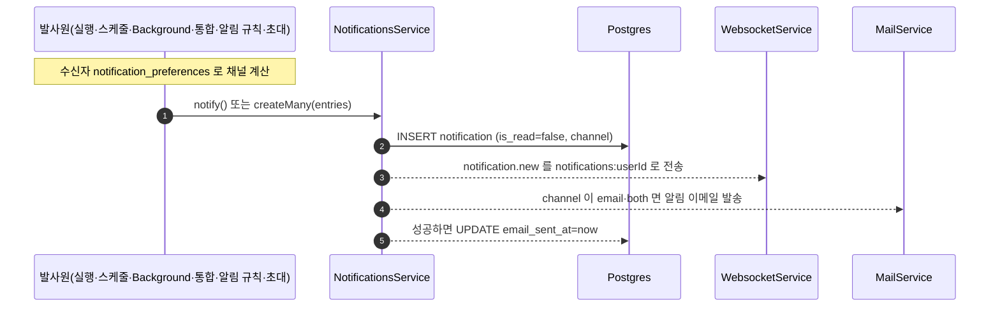

> 구현 상태: 부분 구현 · 원문: `spec/data-flow/8-notifications.md`, `spec/2-navigation/9-user-profile.md` (§5 알림 설정, §6.2 알림 API, §6.3 알림 규칙 API), `spec/2-navigation/_layout.md` (§3.1 알림 벨, §3.2 알림 설정 항목), `spec/data-flow/9-observability.md` (§1.3·§2.1·§3 알림 규칙 평가와 관련 Rationale), `spec/1-data-model.md` (§2.19, §2.25, Rationale "alert_rule 을 §2.25 로 등재") · 용어: [용어 사전](../CLE-GLOSSARY.md)

## 개요

인앱 알림(Notification, `notification`)은 사용자에게 비동기 사건을 알리는 기록이다. 발사원은 실행 실패, 통합 만료, 통합 조치 필요, Background 본문 실패, 알림 규칙 위반, 팀 초대처럼 다양하다. 하지만 모두 `notification` 행 하나를 저장하는 것으로 합쳐진다. 저장한 알림은 사이드바 알림 벨, 이메일, WebSocket 으로 전달된다. 이 문서에서 "알림" 은 인앱 알림을 뜻한다.

이 문서가 정하는 것: 알림 유형(`Notification.type`) 목록과 유형별 발사원·수신자·알림 채널(`Notification.channel`)·딥링크 대상, 저장과 전달 흐름, 채널 계산 책임, 중복 방지 헬퍼, 요구사항 전체. 벨과 팝오버·읽음과 닫기(dismiss, `dismissed_at`)·알림 API, 알림 설정(notification preferences, `notification_preferences`), 알림 규칙(Alert Rule, `AlertRule`), 데이터는 [하위 문서](#하위-문서) 가 맡는다.

범위 밖:

- 통합 만료 알림(`integration_expired`)과 조치 필요 알림(`integration_action_required`)의 발사 조건·제목·문구·수신자·임계별 중복 방지: [통합 상태와 만료 알림](../CLE-INT/CLE-INT-STATUS.md)
- Background 본문 실패 알림을 보내는 쪽과 본문 모니터링 API: [Background 노드](../CLE-NODE-LOGIC/CLE-NODE-BACKGROUND.md)
- 팀 초대 흐름과 초대 링크 이메일: [워크스페이스와 멤버](../CLE-ACCT/CLE-ACCT-WS.md)
- WebSocket 이벤트 `notification.new` 의 정의: [WebSocket 이벤트와 명령](../CLE-API/CLE-API-WS-EVENTS.md)
- 외부 URL 로 실행 이벤트를 보내는 EIA 알림 웹훅은 이름만 비슷한 다른 기능이다: [EIA 알림 웹훅](../CLE-IX/CLE-EIA-NOTIFY.md)
- `User.notification_preferences` 컬럼: [계정과 워크스페이스 데이터 흐름](../CLE-ACCT/CLE-ACCT-DATA.md)
- 사이드바 사용자 영역과 아바타 팝업 메뉴: [내 프로필](../CLE-ACCT/CLE-ACCT-PROFILE.md)
- 알림 규칙 평가 큐의 등록 정보: [비동기 큐와 Redis 키 목록](../CLE-PLAT/CLE-PLAT-QUEUE.md)

## 요구사항

- REQ-NOTIFY-001 WHEN 발사원이 알림을 보내면 THE SYSTEM SHALL `notification` 행을 `is_read=false` 와 발사원이 정한 알림 채널로 저장한다. (원본: data-flow/8 §1)
- REQ-NOTIFY-002 WHEN 알림 행을 저장하면 THE SYSTEM SHALL 수신자의 `notifications:<userId>` 구독 채널로 `notification.new` 이벤트를 보낸다. (원본: data-flow/8 §2.2)
- REQ-NOTIFY-003 WHEN 알림 채널이 `email` 이나 `both` 인 알림을 저장하면 THE SYSTEM SHALL 단일 범용 템플릿으로 알림 이메일을 보내고 성공하면 `email_sent_at` 을 채운다. (원본: data-flow/8 §2.2)
- REQ-NOTIFY-004 IF 알림 이메일 발송이 실패하면 THE SYSTEM SHALL 재시도하지 않고 경고 로그를 남기며 `email_sent_at` 을 NULL 로 둔다. (원본: data-flow/8 §3)
- REQ-NOTIFY-005 WHEN 발사원이 알림을 보내면 THE SYSTEM SHALL 수신자의 알림 설정을 발사원 쪽에서 읽어 알림 채널을 계산한다. (원본: data-flow/8 §1)
- REQ-NOTIFY-006 WHEN 최상위 실행이 실패로 끝나면 THE SYSTEM SHALL 워크플로우 소유자와 실행자에게 `execution_failed` 알림을 보낸다. (원본: data-flow/8 §1.1)
- REQ-NOTIFY-007 IF 실패한 실행이 Background 본문이나 서브 워크플로우 같은 하위 실행이면 THE SYSTEM SHALL `execution_failed` 알림을 보내지 않는다. (원본: data-flow/8 §1.1)
- REQ-NOTIFY-008 WHEN 스케줄이 실행을 시작하지 못하면 THE SYSTEM SHALL 워크플로우 소유자에게 `schedule_failed` 알림을 보낸다(예외: REQ-NOTIFY-009 · 052). (원본: data-flow/8 §1.1)
- REQ-NOTIFY-009 IF 스케줄 대상 워크플로우에 소유자(`createdBy`)가 없으면 THE SYSTEM SHALL `schedule_failed` 알림을 건너뛴다. (원본: data-flow/8 §1.1)
- REQ-NOTIFY-010 WHEN `notifyOnFailure` 가 켜진 Background 본문이 실패하면 THE SYSTEM SHALL 워크스페이스 관리자 전원에게 `background_failed` 알림을 보낸다. (원본: data-flow/8 §1.1)
- REQ-NOTIFY-011 WHEN 이미 가입한 비멤버를 워크스페이스에 초대하면 THE SYSTEM SHALL 그 사용자에게 인앱 채널로만 `team_invite` 알림을 보낸다. (원본: data-flow/8 §1.1)
- REQ-NOTIFY-012 WHEN 설치한 마켓플레이스 템플릿이나 에이전트에 새 버전이 나오면 THE SYSTEM SHALL `marketplace_update` 알림을 보낸다. (원본: data-flow/8 §1.1) (미구현)
- REQ-NOTIFY-013 WHEN 실행 실패·스케줄 실패·Background 본문 실패 알림을 저장하면 THE SYSTEM SHALL `resource_type='workflow'` 와 워크플로우 ID 를 `resource_id` 로 채운다. (원본: data-flow/8 §1.1)
- REQ-NOTIFY-014 WHEN `background_failed` 알림을 저장하면 THE SYSTEM SHALL 본문 실행 ID 를 `background_run_id` 에 담고 REST 응답에는 싣지 않는다. (원본: 1-data-model §2.19)
- REQ-NOTIFY-015 WHEN 발사원이 `hasRecentByResource` 로 최근 발사를 검사하면 THE SYSTEM SHALL 닫힌 알림과 읽은 알림도 센다. (원본: data-flow/8 §4.4)
- REQ-NOTIFY-016 WHEN 사이드바를 보이면 THE SYSTEM SHALL 알림 벨에 읽지 않았고 닫지 않은 알림 수를 배지로 보인다. (원본: _layout §3.1)
- REQ-NOTIFY-017 IF 읽지 않은 알림 수가 99 를 넘으면 THE SYSTEM SHALL 배지를 "99+" 로 보인다. (원본: 9-user-profile §5.2)
- REQ-NOTIFY-018 WHEN 사용자가 알림 벨을 누르면 THE SYSTEM SHALL 최근 알림 목록 팝오버를 연다. (원본: _layout §3.1)
- REQ-NOTIFY-019 WHEN 사용자가 팝오버의 필터 칩을 고르면 THE SYSTEM SHALL 전체·일반·통합 액션 필요 기준으로 목록을 거른다. (원본: _layout §3.1)
- REQ-NOTIFY-020 WHEN 사용자가 알림 항목 본문을 누르면 THE SYSTEM SHALL 그 알림을 읽음으로 바꾸고 알림 유형별 경로로 이동한다. (원본: _layout §3.1)
- REQ-NOTIFY-021 IF 딥링크에 쓸 `resource_id` 가 없거나 허용 패턴에 맞지 않으면 THE SYSTEM SHALL 그 유형의 목록 경로로 이동한다. (원본: _layout §3.1)
- REQ-NOTIFY-022 IF 알림 유형이 딥링크 매핑에 없거나 비어 있으면 THE SYSTEM SHALL 알림을 눌러도 이동하지 않는다. (원본: _layout §3.1)
- REQ-NOTIFY-023 WHEN 사용자가 팝오버 항목에 마우스를 올리면 THE SYSTEM SHALL 개별 읽음(✓)과 개별 닫기(✕) 버튼을 보인다. (원본: _layout §3.1)
- REQ-NOTIFY-024 WHEN 사용자가 "모두 읽음 처리" 를 고르면 THE SYSTEM SHALL 본인 알림을 모두 읽음으로 바꾼다. (원본: _layout §3.1)
- REQ-NOTIFY-025 WHEN 사용자가 "모두 지우기" 를 고르면 THE SYSTEM SHALL 현재 워크스페이스의 본인 알림을 모두 닫는다. (원본: data-flow/8 §4.2)
- REQ-NOTIFY-026 WHEN 사용자가 전체 알림 보기 링크를 누르면 THE SYSTEM SHALL 유형·읽음 필터와 페이지네이션이 있는 전체 알림 페이지를 연다. (원본: 9-user-profile §5.2) (미구현)
- REQ-NOTIFY-027 WHEN 사용자가 알림을 닫으면 THE SYSTEM SHALL 행을 지우지 않고 `dismissed_at` 을 채운다. (원본: data-flow/8 §4)
- REQ-NOTIFY-028 WHEN 사용자가 알림을 닫으면 THE SYSTEM SHALL 그 알림의 읽음 상태를 바꾸지 않는다. (원본: data-flow/8 §3)
- REQ-NOTIFY-029 WHEN 알림 목록이나 읽지 않은 알림 수를 조회하면 THE SYSTEM SHALL 닫힌 알림을 뺀다. (원본: data-flow/8 §4.3)
- REQ-NOTIFY-030 WHEN 이미 닫힌 본인 알림을 다시 닫으면 THE SYSTEM SHALL 기존 `dismissedAt` 을 돌려주며 성공으로 처리한다. (원본: data-flow/8 §4.2)
- REQ-NOTIFY-031 IF 다른 사용자의 알림 ID 로 닫기를 요청하면 THE SYSTEM SHALL 404 로 거부한다. (원본: data-flow/8 §4.2)
- REQ-NOTIFY-032 WHEN 사용자가 알림 설정을 조회하면 THE SYSTEM SHALL 저장값이 없는 키에 기본값을 채워 돌려준다. (원본: 9-user-profile §6.2)
- REQ-NOTIFY-033 WHEN 사용자가 알림 설정을 수정하면 THE SYSTEM SHALL 보낸 키만 기존 설정에 합친다. (원본: 9-user-profile §6.2)
- REQ-NOTIFY-034 IF 수신자가 실행 실패나 스케줄 실패 이메일 키를 껐으면 THE SYSTEM SHALL 그 알림을 인앱 채널로만 보낸다. (원본: 9-user-profile §5.1)
- REQ-NOTIFY-035 WHEN 사용자가 알림 유형의 인앱 채널을 끄면 THE SYSTEM SHALL 그 유형의 알림을 벨에 보이지 않는다. (원본: 9-user-profile §5.1) (미구현)
- REQ-NOTIFY-036 WHEN 사용자가 알림 설정 화면을 열면 THE SYSTEM SHALL 알림 유형별 이메일 수신 토글을 보인다. (원본: 9-user-profile §5.1) (미구현)
- REQ-NOTIFY-037 WHEN 하루가 끝나면 THE SYSTEM SHALL 그날의 실패 요약 이메일을 보낸다. (원본: 9-user-profile §5.3) (미구현)
- REQ-NOTIFY-038 WHEN 알림 이메일을 보내면 THE SYSTEM SHALL 이메일 하단에 수신 거부 링크를 넣는다. (원본: 9-user-profile §5.3) (미구현)
- REQ-NOTIFY-039 WHEN 사용자가 알림 규칙 화면(`/profile/alerts`)을 열면 THE SYSTEM SHALL 현재 워크스페이스의 모든 알림 규칙을 멤버 누구에게나 보인다. (원본: 9-user-profile §5.4)
- REQ-NOTIFY-040 WHEN 관리자 미만이 알림 규칙 화면을 보면 THE SYSTEM SHALL 생성 폼과 활성 토글·삭제 버튼을 숨기고 활성 상태를 읽기 전용 배지로 보인다. (원본: 9-user-profile §5.4)
- REQ-NOTIFY-041 IF 관리자 미만이 알림 규칙을 만들거나 고치거나 지우려 하면 THE SYSTEM SHALL 거부한다. (원본: 9-user-profile §6.3)
- REQ-NOTIFY-042 IF 수정·삭제할 알림 규칙이 현재 워크스페이스에 없으면 THE SYSTEM SHALL 404 `ALERT_RULE_NOT_FOUND` 로 거부한다. (원본: 9-user-profile §6.3)
- REQ-NOTIFY-043 WHEN 알림 규칙에 워크플로우를 지정하지 않으면 THE SYSTEM SHALL 워크스페이스 전체를 감시한다. (원본: 9-user-profile §6.3)
- REQ-NOTIFY-044 WHEN 5분 주기가 돌아오면 THE SYSTEM SHALL 켜진 알림 규칙 전체를 한 번에 평가한다. (원본: NF-OB-05, data-flow/9 §1.3)
- REQ-NOTIFY-045 WHILE 서버 인스턴스가 여럿인 동안 THE SYSTEM SHALL 알림 규칙 평가 반복 작업을 하나만 등록해 전역에서 한 번 실행한다. (원본: data-flow/9 §1.3)
- REQ-NOTIFY-046 WHEN 규칙의 관측값이 임계치보다 크면 THE SYSTEM SHALL 워크스페이스 관리자에게 `alert_<type>` 알림을 보내고 `last_triggered_at` 을 갱신한다. (원본: data-flow/9 §1.3)
- REQ-NOTIFY-047 IF 관측값이 임계치와 같거나 작으면 THE SYSTEM SHALL 알림을 보내지 않는다. (원본: data-flow/9 §1.3)
- REQ-NOTIFY-048 WHILE 규칙이 마지막 발사 뒤 평가 기간 안에 있는 동안 THE SYSTEM SHALL 그 규칙의 알림을 다시 보내지 않는다. (원본: data-flow/9 §3)
- REQ-NOTIFY-049 IF `failure_rate` 규칙의 평가 기간 안 실행이 5건 미만이면 THE SYSTEM SHALL 그 규칙의 평가를 건너뛴다. (원본: data-flow/9 §1.3)
- REQ-NOTIFY-050 IF 규칙의 평가 기간 문자열을 해석할 수 없으면 THE SYSTEM SHALL 1시간(`PT1H`)으로 평가한다. (원본: data-flow/9 §1.3)
- REQ-NOTIFY-051 WHEN 알림 채널이 `email` 인 규칙이 발사하면 THE SYSTEM SHALL 알림을 채널 `both` 로 저장한다. (원본: data-flow/9 §1.3)
- REQ-NOTIFY-052 IF 스케줄의 연결 트리거가 가리키는 워크플로우가 스케줄의 워크스페이스에 없어 Cron 발사를 건너뛰면 THE SYSTEM SHALL REQ-NOTIFY-008 의 `schedule_failed` 알림을 보내지 않는다.

## 하위 문서

| 문서 | 맡는 내용 | 요구사항 |
| --- | --- | --- |
| [알림 — 벨 · 읽음과 닫기 · API · 데이터](CLE-OBS-NOTIFY-INBOX.md) | 벨과 팝오버, 딥링크, 읽음과 닫기, 알림 API, `Notification` 엔티티, 외부 의존 | REQ-NOTIFY-013, 014, 016 ~ 031 |
| [알림 — 알림 설정과 이메일](CLE-OBS-NOTIFY-SETTINGS.md) | 유형별 이메일 수신 토글, 이메일 알림, 팀 초대 이메일의 책임 | REQ-NOTIFY-011, 032 ~ 038 |
| [알림 — 알림 규칙](CLE-OBS-NOTIFY-RULES.md) | 화면·API·평가와 `AlertRule` 엔티티 | REQ-NOTIFY-039 ~ 051 |

## 알림 유형

`Notification.type` 은 아래 열 가지 값이다. DB CHECK 제약은 V052 에서 만들었고 V070 이 `alert_*` 세 값을 넣어 열 개로 다시 정의했다. 상태 "구현됨" 은 코드가 실제로 그 유형의 행을 저장한다는 뜻이다. "미구현" 은 CHECK 제약에는 있지만 아직 어떤 코드도 저장하지 않는 유형이다.

| 유형 | 상태 | 발사원 | 발사 조건 | 수신자 | 알림 채널 | 딥링크 대상 |
| --- | --- | --- | --- | --- | --- | --- |
| `execution_failed` | 구현됨 | `ExecutionEngineService.dispatchExecutionFailedNotification` | 최상위 실행(`!parentExecutionId`)이 `failed` 로 끝남. 초기 세그먼트(`runExecution` 의 catch)와 재개 세그먼트(`finalizeResumedExecutionOutcome`) 양쪽에서 보낸다. 대부분의 실행은 재개 세그먼트에서 끝나므로 두 경로 모두 보내야 빠지지 않는다. Background 본문·서브 워크플로우 같은 하위 실행은 `background_failed` 와 겹치지 않게 뺀다 | 워크플로우 소유자와 실행자(`executedBy`). 겹치면 한 번만 | 기본 `both`. 수신자의 `executionFailedEmail === false` 면 `in_app` | `workflow` / 워크플로우 ID. 실행 단위 딥링크는 없다 |
| `schedule_failed` | 구현됨 | `ScheduleRunnerService.dispatchScheduleFailedNotification` | 스케줄이 실행을 **시작하지 못함**(파라미터 해석·큐 등록 실패). 시작된 실행의 이후 실패는 `execution_failed` 가 맡는다. 워크플로우가 스케줄의 워크스페이스에 없어 건너뛴 발사는 보내지 않는다(REQ-NOTIFY-052). 수신자인 워크플로우 소유자가 다른 워크스페이스 사람이기 때문이다([스케줄 「다른 워크스페이스의 워크플로우」](../CLE-TRIG/CLE-TRIG-SCHEDULE.md#다른-워크스페이스의-워크플로우)) | 워크플로우 소유자(`createdBy`). 없으면 건너뛴다 | 기본 `both`. `scheduleFailedEmail === false` 면 `in_app` | `workflow` / 워크플로우 ID |
| `background_failed` | 구현됨 | `BackgroundExecutionProcessor`(`background-execution.processor.ts`) | `config.notifyOnFailure=true` 인 Background 본문 실패([Background 노드](../CLE-NODE-LOGIC/CLE-NODE-BACKGROUND.md)) | 워크스페이스 관리자 전원(`findAdminUserIds`) | `in_app` | `workflow` / 워크플로우 ID. 본문 실행 귀속은 `background_run_id` 에 따로 담는다([데이터](CLE-OBS-NOTIFY-INBOX.md#notification)) |
| `integration_expired` | 구현됨 | `IntegrationExpiryScanner`(`integration-expiry-scanner.service.ts`) | refresh token 이 없는 통합의 토큰 만료 7일·3일·당일 임계. 조건과 문구는 [통합 상태와 만료 알림](../CLE-INT/CLE-INT-STATUS.md) | [통합 상태와 만료 알림](../CLE-INT/CLE-INT-STATUS.md) | `integrationExpiryEmail` 이 켜져 있으면 `both`, 아니면 `in_app` | `integration` / 통합 ID |
| `integration_action_required` | 구현됨 | `IntegrationActionRequiredNotifierService.notify`(`integration-action-required-notifier.service.ts`) | 토큰 갱신 실패(`auth_failed`), transport 3회 연속 실패(`network`), 권한 범위 부족(`insufficient_scope`). 조건과 문구는 [통합 상태와 만료 알림](../CLE-INT/CLE-INT-STATUS.md) | [통합 상태와 만료 알림](../CLE-INT/CLE-INT-STATUS.md) | 같은 `integrationExpiryEmail` 토글로 계산(전용 토글 없음) | `integration` / 통합 ID |
| `alert_failure_rate`, `alert_duration`, `alert_llm_cost` | 구현됨 | `AlertsEvaluatorService.dispatchBreach` | 알림 규칙 위반. 유형 값은 `alert_` + `AlertRule.type` 이다(`` `alert_${rule.type}` ``) | 워크스페이스 관리자 | 규칙 채널이 `email` 이면 `both`, 아니면 `in_app` | `resource_type='alert_rule'`. 딥링크 매핑이 없어 누르면 이동하지 않는다 |
| `team_invite` | 구현됨 | `WorkspaceInvitationsService.dispatchTeamInviteNotification` | 초대 대상 이메일이 이미 가입한 비멤버일 때 | 초대받은 사용자 | `in_app`. 이메일은 초대 링크 이메일이 맡는다([Rationale](CLE-OBS-NOTIFY-SETTINGS.md#팀-초대-알림은-인앱-채널로만-보낸다)) | `resource_id` 는 초대 ID. 누르면 `/profile` 로 이동 |
| `marketplace_update` | 미구현 | (도입하면) 마켓플레이스 모듈 | 설치한 템플릿·에이전트의 새 버전([마켓플레이스 (구상)](../CLE-UI/CLE-UI-MARKET.md)) | — | 기본 인앱. 이메일은 도입할 때 opt-in 으로 둔다 | — |

통합 알림 두 유형은 성격으로 나눈다. `integration_expired` 는 토큰 만료가 다가오거나 닥쳤음을 알리는 수동적 안내다. `integration_action_required` 는 운영 중 생긴 장애라 사용자가 바로 손봐야 하는 능동적 경보다. 설치 대기가 만료되는 `install_timeout` 에는 알림을 보내지 않는다. 자세한 기준은 [통합 상태와 만료 알림](../CLE-INT/CLE-INT-STATUS.md) 에 있다.

## 저장과 전달

발사원이 수신자의 알림 설정을 읽어 알림 채널을 계산하고 `NotificationsService` 로 저장한다. 서비스는 이어서 WebSocket 이벤트를 보내고 채널이 `email`·`both` 면 이메일을 보낸다.

- 저장 진입점은 둘이다. 한 건을 저장하는 `notify()` 와 여러 수신자에게 한꺼번에 저장하는 `createMany(entries[])` 다. 둘 다 저장 뒤에 WebSocket 전송과 이메일 발송을 한다.
- **알림 채널은 발사원이 계산한다.** `notify()`·`createMany` 저장 경로는 알림 설정을 보지 않는다. 통합 노티파이어는 안에서 직접 계산하고 실행 실패·스케줄 실패는 `NotificationsService.resolveOptOutEmailChannels` 헬퍼로 계산한다. 이 헬퍼는 조회만 하고 저장 경로에 끼어들지 않는다.
- **WebSocket**: `emitNew` 가 `WebsocketService.emitNotificationEvent(userId, { id, type, title, message, resourceType, resourceId })` 를 부른다. 모든 알림에 대해 바로 보내며 실패해도 저장은 유지된다. 구독 채널은 `notifications:<userId>` 이고 `WebsocketGateway.VALID_CHANNEL_PREFIXES` 에 `notifications:` 접두가 등록돼 있다. 이벤트 정의의 기준은 [WebSocket 이벤트와 명령](../CLE-API/CLE-API-WS-EVENTS.md) 이고 이름을 정한 근거는 [벨 · 읽음과 닫기 · API · 데이터의 Rationale](CLE-OBS-NOTIFY-INBOX.md#websocket-이벤트는-notificationnew-와-notificationsuserid-로-적는다) 에 있다.
- **이메일**: `dispatchEmails` 가 `MailService.sendNotificationEmail` 로 보낸다. 제목은 알림 `title`, 본문은 `message` 와 버튼 링크(CTA)다. 유형별 시각 템플릿 대신 범용 템플릿 하나만 쓴다. 성공하면 `email_sent_at` 을 채운다. 실패하면 재시도 없이 경고 로그만 남기고 `email_sent_at` 을 NULL 로 둔다. 부수 기록 실패를 다루는 공통 방식은 [로깅과 헬스 체크](CLE-OBS-LOGGING.md) 에 있다.

## 중복 방지

- `hasRecentByResource(workspaceId, type, resourceId, title, withinMs)` 는 같은 (워크스페이스, 유형, 리소스 ID, 제목) 알림이 최근 `withinMs` 안에 있는지 본다. 있으면 발사원이 보내지 않는다.
- 이 헬퍼는 닫힌 알림(`dismissed_at` 채워짐)과 읽은 알림도 센다. 표시 상태(`is_read`, `dismissed_at`)는 다시 보내는 빈도에 영향을 주지 않는다([Rationale](#중복-방지에-닫힌-알림도-센다)).
- 창이 지나면 같은 알림이 다시 나간다. 장애가 풀리지 않았으면 주기적인 재알림이 되는 셈이다.
- `integration_action_required` 는 현재 구현이 24시간 창을 쓴다. 이 유형의 중복 방지 규칙은 정의가 갈린다. [통합 상태와 만료 알림 §미결 사항](../CLE-INT/CLE-INT-STATUS.md#미결-사항) 참조.
- `integration_expired` 는 이 헬퍼가 아니라 임계별 선점 테이블 `integration_expiry_dispatch` 로 중복을 막는다([통합 상태와 만료 알림](../CLE-INT/CLE-INT-STATUS.md)).
- 알림 규칙은 규칙별 재발사 억제(`last_triggered_at`)를 쓴다([알림 규칙 평가](CLE-OBS-NOTIFY-RULES.md#알림-규칙-평가)).

## 알림 규칙

→ [알림 — 알림 규칙](CLE-OBS-NOTIFY-RULES.md)

### 알림 규칙 평가

→ [알림 — 알림 규칙](CLE-OBS-NOTIFY-RULES.md#알림-규칙-평가)

## 미결 사항

- **알림 설정 화면의 구현 여부**: 원문 알림 설정 절(9-user-profile §5.1)과 요구사항 NAV-UP-02 는 이메일 채널 켜고 끄기·사용자 메뉴의 "알림 설정" 을 구현 완료로 적고, 원문 레이아웃(§3.2)은 알림 기본 설정 화면이 아직 없다(Planned)고 적는다. 현재 구현은 백엔드 API(`GET`·`PATCH /api/notifications/settings`)만 있고 프런트엔드에는 이 API 를 부르는 곳이 없다. 설정 화면을 만들지, API 만 있는 상태로 요구사항을 고칠지 결정이 필요하다(관련: [내 프로필](../CLE-ACCT/CLE-ACCT-PROFILE.md)).
- **이메일 수신 거부 링크**: 원문 이메일 알림 절(9-user-profile §5.3)은 이메일 하단에 수신 거부 링크를 둔다고 적고 미구현 표시가 없다. 원문 데이터 흐름은 알림 이메일을 제목·본문·버튼 링크로 된 범용 템플릿 하나로만 적는다. 현재 구현의 메일·알림 모듈에는 수신 거부 처리가 없다. 수신 거부 링크를 구현할지, 요구에서 뺄지 결정이 필요하다.
- **이메일 설정 키의 기본 방향**: 원문 알림 설정 절과 현재 구현은 키마다 방향이 다르다. `integrationExpiryEmail` 은 켜야 받는 opt-in(기본 꺼짐)이고 `executionFailedEmail`·`scheduleFailedEmail` 은 꺼야 안 받는 opt-out(기본 켜짐)이다. 원문 데이터 흐름의 Rationale 은 키 하나(`integrationExpiryEmail`)·opt-in 하나만 있는 것처럼 읽힌다. 새 키를 더할 때 기본 방향을 무엇으로 정할지(유형마다 정할지, 공통 규칙을 둘지) 규칙이 없다. 결정이 필요하다.
- **전체 알림 페이지와 팝오버 구성**: 원문 알림 센터 절(9-user-profile §5.2)은 벨 드롭다운의 최근 알림 최대 10개와 "View all" 링크, 유형·읽음 필터와 페이지네이션이 있는 전체 알림 페이지를 적는다. 원문 레이아웃(§3.1)은 팝오버만 정의하고 전체 알림 페이지를 말하지 않는다. 현재 구현에는 전체 알림 페이지 라우트가 없다. 전체 알림 페이지를 만들지, 요구에서 뺄지 결정이 필요하다.

## 구현 위치

- `codebase/backend/src/modules/notifications/notifications.service.ts` (`notify`, `createMany`, `emitNew`, `dispatchEmails`, `hasRecentByResource`, `findByBackgroundRun`, `resolveOptOutEmailChannels`)
- `codebase/backend/src/modules/mail/mail.service.ts` (`sendNotificationEmail`)
- `codebase/backend/src/modules/websocket/websocket.service.ts` (`emitNotificationEvent`)
- 컨트롤러와 프런트엔드 벨·팝오버: [벨 · 읽음과 닫기 · API · 데이터](CLE-OBS-NOTIFY-INBOX.md#구현-위치). 알림 규칙: [알림 규칙](CLE-OBS-NOTIFY-RULES.md#구현-위치)

## Rationale

### 이메일 실패는 경고만 남기고 재시도하지 않는다

SMTP 실패는 대개 일시적이다. 하지만 알림 도메인이 자체 재시도 큐를 운영하면 복잡해진다. 발송 실패가 잦아지면 외부 SMTP 서비스(예: SES)를 들이면서 큐를 더하는 방향으로 계획한다. 그 전까지는 `email_sent_at` 이 NULL 인 행으로 운영자가 살핀다.

### 중복 방지에 닫힌 알림도 센다

`hasRecentByResource` 는 `dismissed_at IS NULL` 필터를 **걸지 않는다**. 닫힌 행을 빼면 사용자가 알림을 닫을 때마다 24시간 가드가 풀린다. 그러면 같은 장애(`integration_action_required` 등)에 대해 닫을 때마다 알림이 다시 나가 지나치게 시끄러워진다.

- 닫기는 **표시에 관한 결정**(이 사용자가 더는 팝오버에서 보고 싶지 않다)이다. 중복 방지는 **발사원에 관한 결정**(같은 사건을 짧은 간격으로 다시 보내지 않는다)이다. 의도가 다르므로 한 컬럼이 두 결정에 함께 영향을 주면 안 된다.
- 운영 중 장애(`auth_failed`, `network`)가 24시간 안에 저절로 풀리지 않으면 사용자에게는 여전히 조치가 필요하다. 그래도 같은 행이 창 안에 살아 있는 동안에는(사용자가 닫았더라도) 새 알림이 나가지 않는다. 24시간이 지나 그 행의 `created_at` 이 기준을 넘으면 새 알림이 나간다. 자연스러운 주기적 재알림이다.

헬퍼가 `is_read` 를 무시하는 것과 같은 원리로 두 표시 축(`is_read`, `dismissed_at`) 모두 중복 방지에 영향을 주지 않는다. 앞으로 별도 옵션으로 나누지 않는다.

### 교차 행 스케줄의 건너뛴 발사에는 `schedule_failed` 를 보내지 않는다 (2026-10-05)

스케줄의 연결 트리거가 다른 워크스페이스의 워크플로우를 가리키면(저장 경계 이전의 교차 행) Cron 발사를 건너뛴다([데이터 모델 개요 「저장된 교차 행 점검」](../CLE-PLAT/CLE-PLAT-DATA.md#저장된-교차-행-점검)). 이때 `schedule_failed` 의 수신자인 워크플로우 소유자는 다른 워크스페이스 사람이다. 보내면 그 사람이 남의 스케줄 실패를 받고 알림의 `workspaceId` 는 스케줄의 워크스페이스라 맞지 않는다. 재시도해도 결과가 같아 발사마다 같은 알림이 쌓인다.

스케줄 워크스페이스의 관리자 전원에게 보내는 안(REQ-NOTIFY-010 의 `background_failed` 수신자 방식)은 택하지 않았다. 교차 행은 저장 경계 이전에 남은 일회성 데이터라 운영 점검으로 찾아 정리하는 것이 맞다. 새 수신자 규칙을 두면 그 행이 사라진 뒤에도 규칙이 남는다. 그래서 연결된 워크플로우가 없을 때처럼 알림 없이 건너뛰고 서버 에러 로그를 남긴다. 연결된 워크플로우가 없을 때의 로그는 경고 등급이다. 운영 점검은 2026-10-05 에 0 행이어서 걷었고([데이터 모델 개요](../CLE-PLAT/CLE-PLAT-DATA.md#저장된-교차-행은-실행-때-한-번-더-막고-운영-점검으로-찾는다-2026-10-05)) 건너뛴 스케줄은 서버 에러 로그로만 보인다. 복합 FK 검증(V147) 뒤로 새 교차 행은 FK 를 우회한 쓰기에서만 생겨 수신자 규칙을 둘 만큼 자주 나오지 않으므로 알림을 보내지 않는 결정은 유지한다.
