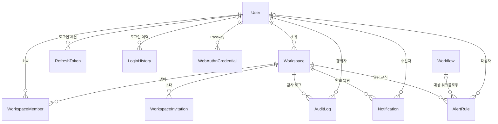
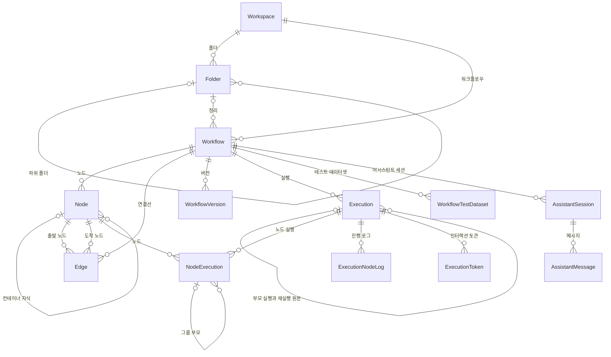
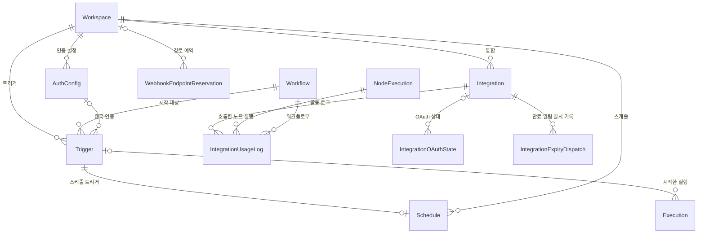
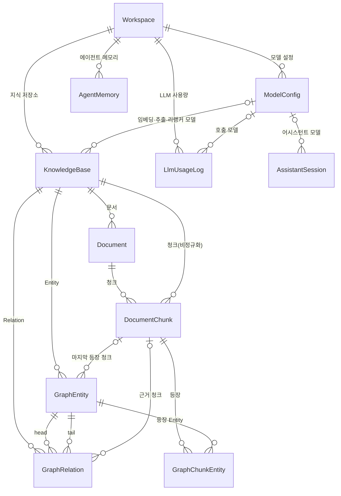

> 구현 상태: 구현됨 · 원문: `spec/1-data-model.md` (§1 엔티티 관계 개요, §1.1 참조의 소속, §2 FK 표기, §3 인덱스 전략, Rationale «`code:` 에 전용 e2e 가드 셋» · «§2 FK 삭제 동작 · 빠진 컬럼» · «쓸 인덱스가 없는 FK 서른하나의 처분»), `spec/data-flow/0-overview.md` (§3.3, §5 벡터 인덱스), `spec/data-flow/12-workspace.md` (Rationale «본문 참조 id 도 저장 전에 소속을 본다») · 용어: [용어 사전](../CLE-GLOSSARY.md)

## 개요

이 문서는 Clemvion 데이터베이스의 전체 지도다. 엔티티 사이의 관계, 공통 컬럼 규칙, 조회 조건의 null · undefined 규칙을 정한다. 참조의 소속과 저장된 교차 행, 노드의 통합 참조, 외래 키(FK)와 삭제 동작, 인덱스 전략은 [하위 문서](#하위-문서) 가 정한다.

엔티티마다의 컬럼 상세는 이 문서가 아니라 그 엔티티를 소유한 영역 데이터 문서가 정한다. 어느 문서가 어느 엔티티를 소유하는지는 [엔티티와 소유 문서](#엔티티와-소유-문서) 표에 있다. 데이터가 어느 API·큐를 거쳐 흐르는지는 [시스템 아키텍처](CLE-PLAT-ARCH.md) 와 각 영역 데이터 문서가 다룬다. 스키마를 바꾸는 절차는 [DB 마이그레이션 규약](../CLE-ENG/CLE-ENG-MIGRATION.md) 이 정한다.

## 엔티티 관계 지도

관계가 많아 네 그림으로 나눈다. 모든 그림의 뿌리는 사용자와 워크스페이스(Workspace, `workspace`)다. 한 그림에 없는 엔티티와의 관계는 다른 그림에서 다시 나온다. 선의 `|o` 는 부모가 없을 수 있는(nullable) FK 다.

### 계정·워크스페이스·관측

사용자는 워크스페이스를 소유하고 멤버로 여러 워크스페이스에 속한다. 로그인 세션·로그인 이력·Passkey 는 사용자에게, 감사 로그·인앱 알림·알림 규칙은 워크스페이스에 속한다.

### 워크플로우·실행·AI 어시스턴트

워크플로우는 노드와 연결선(Edge)으로 이루어지고, 실행(Execution)과 노드 실행(NodeExecution)을 남긴다. 노드·실행·노드 실행에는 자기 참조가 있다(컨테이너 자식, 서브 워크플로우 부모와 재실행 원본, 그룹 부모).

### 트리거·통합

트리거는 워크플로우를 시작시키는 진입점이고, 스케줄 트리거는 스케줄과 1:1 로 묶인다. 통합은 워크스페이스에 속하고 노드 실행마다 활동 로그를 남긴다.

### 지식 저장소·AI

지식 저장소(Knowledge Base, `KnowledgeBase`)는 문서와 청크를 갖고, Graph RAG 모드면 Entity 와 Relation 을 더 갖는다. 모델 설정(`ModelConfig`)은 지식 저장소·어시스턴트 세션·LLM 사용량 기록이 가리킨다.

그림에 없는 관계: LLM 사용량 기록은 워크플로우·실행·노드 실행을 nullable FK 로 가리킨다. 시크릿 저장소(`SecretStore`)는 `workspace_id` 를 갖지만 FK 가 없다. 소셜 로그인 상태(`auth_oauth_state`)와 OAuth 미리보기(`integration_oauth_preview`)는 10분 만료 일시 행이다.

## 엔티티와 소유 문서

컬럼 정의·제약·응답 노출 규칙은 "소유 문서" 열의 문서가 정한다.

| 엔티티 | 한 줄 설명 | 소유 문서 |
| --- | --- | --- |
| User | 로그인 계정 한 명 | [계정과 워크스페이스 데이터 흐름](../CLE-ACCT/CLE-ACCT-DATA.md) |
| Workspace | 리소스를 격리하는 단위(개인·팀) | [계정과 워크스페이스 데이터 흐름](../CLE-ACCT/CLE-ACCT-DATA.md) |
| WorkspaceMember | 워크스페이스 소속과 역할 | [계정과 워크스페이스 데이터 흐름](../CLE-ACCT/CLE-ACCT-DATA.md) |
| WorkspaceInvitation (`workspace_invitation`) | 팀 워크스페이스 초대 | [계정과 워크스페이스 데이터 흐름](../CLE-ACCT/CLE-ACCT-DATA.md) |
| RefreshToken | 리프레시 토큰. 같은 `family_id` 가 한 로그인 세션 | [계정과 워크스페이스 데이터 흐름](../CLE-ACCT/CLE-ACCT-DATA.md) |
| LoginHistory | 인증 이벤트의 사용자별 기록 | [계정과 워크스페이스 데이터 흐름](../CLE-ACCT/CLE-ACCT-DATA.md) |
| WebAuthnCredential | 등록한 Passkey·보안 키 | [계정과 워크스페이스 데이터 흐름](../CLE-ACCT/CLE-ACCT-DATA.md) |
| `auth_oauth_state` | 소셜 로그인 OAuth `state` 일시 행 | [계정과 워크스페이스 데이터 흐름](../CLE-ACCT/CLE-ACCT-DATA.md) |
| Workflow | 노드와 연결선으로 만든 자동화 단위. `folder_id` 는 범위 참조 | [워크플로우 데이터와 저장 흐름](../CLE-WF/CLE-WF-DATA.md) |
| Folder | 워크플로우를 묶는 계층 폴더. `parent_id` 는 범위 참조 | [워크플로우 데이터와 저장 흐름](../CLE-WF/CLE-WF-DATA.md) |
| Node | 워크플로우의 노드. `container_id`·`tool_owner_id`·새 노드 `id` 는 범위 참조 | [워크플로우 데이터와 저장 흐름](../CLE-WF/CLE-WF-DATA.md) |
| Edge | 두 노드 포트를 잇는 연결선. 끝점은 범위 참조 | [워크플로우 데이터와 저장 흐름](../CLE-WF/CLE-WF-DATA.md) |
| WorkflowVersion | 워크플로우 버전 스냅샷 | [워크플로우 데이터와 저장 흐름](../CLE-WF/CLE-WF-DATA.md) |
| Trigger | 워크플로우 시작 진입점(웹훅·스케줄·수동). `workflow_id`·`auth_config_id` 는 범위 참조 | [트리거 데이터와 흐름](../CLE-TRIG/CLE-TRIG-DATA.md) |
| WebhookEndpointReservation | 웹훅 경로의 영구 예약 | [트리거 데이터와 흐름](../CLE-TRIG/CLE-TRIG-DATA.md) |
| Schedule | Cron 스케줄. 스케줄 트리거와 1:1. 생성 요청 `workflowId` 는 범위 참조 | [트리거 데이터와 흐름](../CLE-TRIG/CLE-TRIG-DATA.md) |
| AuthConfig | 외부 호출용 인증 설정 | [트리거 데이터와 흐름](../CLE-TRIG/CLE-TRIG-DATA.md) |
| Integration | 외부 서비스 통합과 자격 증명 | [통합 데이터와 흐름](../CLE-INT/CLE-INT-DATA.md) |
| IntegrationUsageLog | 통합 활동 로그 | [통합 데이터와 흐름](../CLE-INT/CLE-INT-DATA.md) |
| `integration_oauth_state` | 통합 OAuth 시작·설치 상태 일시 행 | [통합 데이터와 흐름](../CLE-INT/CLE-INT-DATA.md) |
| `integration_oauth_preview` | OAuth 콜백 뒤 통합 생성 전 미리보기 일시 행 | [통합 데이터와 흐름](../CLE-INT/CLE-INT-DATA.md) |
| `integration_expiry_dispatch` | 만료 임계 알림의 1회 발사 기록 | [통합 데이터와 흐름](../CLE-INT/CLE-INT-DATA.md) |
| SecretStore | 비밀의 암호화 보관소(`secret://` 참조) | [통합 데이터와 흐름](../CLE-INT/CLE-INT-DATA.md) |
| KnowledgeBase | 지식 저장소. 모델 설정 참조 넷은 범위 참조 | [지식 저장소 데이터와 흐름](../CLE-KB/CLE-KB-DATA.md) |
| Document | 지식 저장소에 올린 문서 | [지식 저장소 데이터와 흐름](../CLE-KB/CLE-KB-DATA.md) |
| DocumentChunk | 문서 청크와 임베딩 | [지식 저장소 데이터와 흐름](../CLE-KB/CLE-KB-DATA.md) |
| Entity (`GraphEntity`) | Graph RAG Entity | [지식 저장소 데이터와 흐름](../CLE-KB/CLE-KB-DATA.md) |
| Relation (`GraphRelation`) | Graph RAG Entity 사이 Relation | [지식 저장소 데이터와 흐름](../CLE-KB/CLE-KB-DATA.md) |
| ChunkEntity (`GraphChunkEntity`) | 청크-Entity 매핑 | [지식 저장소 데이터와 흐름](../CLE-KB/CLE-KB-DATA.md) |
| Execution | 워크플로우 실행 1회 | [실행 데이터와 흐름](../CLE-EXEC/CLE-EXEC-DATA.md) |
| ExecutionNodeLog | 한 실행의 노드 진행 순서 | [실행 데이터와 흐름](../CLE-EXEC/CLE-EXEC-DATA.md) |
| WorkflowTestDataset | 에디터 테스트 입력 데이터셋. `workflow_id` 는 범위 참조(DB 제약만) | [실행 데이터와 흐름](../CLE-EXEC/CLE-EXEC-DATA.md) |
| NodeExecution | 노드 실행 1회 | [실행 데이터와 흐름](../CLE-EXEC/CLE-EXEC-DATA.md) |
| ExecutionToken (`execution_token`) | EIA 실행 단위 토큰의 jti 추적 | [EIA 데이터와 흐름](../CLE-IX/CLE-EIA-DATA.md) |
| ModelConfig | 채팅·임베딩·리랭크 모델 설정 | [LLM 사용량 기록](../CLE-AI/CLE-AI-USAGE.md) |
| LlmUsageLog | LLM 호출의 토큰 사용량 | [LLM 사용량 기록](../CLE-AI/CLE-AI-USAGE.md) |
| AgentMemory | 에이전트 메모리 | [에이전트 메모리](../CLE-AI/CLE-AI-MEMORY.md) |
| AuditLog | 감사 로그 | [감사 로그](../CLE-OBS/CLE-OBS-AUDIT.md) |
| Notification | 인앱 알림 | [알림](../CLE-OBS/CLE-OBS-NOTIFY.md) |
| AlertRule | 알림 규칙. `workflow_id` 는 범위 참조 | [알림](../CLE-OBS/CLE-OBS-NOTIFY.md) |
| AssistantSession (`workflow_assistant_session`) | AI 어시스턴트 대화 세션. `workflow_id` · `llm_config_id` 는 범위 참조 | [AI 어시스턴트 스트리밍과 세션 API](../CLE-WF/CLE-WF-ASSIST-PROTO.md) |
| AssistantMessage (`workflow_assistant_message`) | AI 어시스턴트 메시지 | [AI 어시스턴트 스트리밍과 세션 API](../CLE-WF/CLE-WF-ASSIST-PROTO.md) |

표의 «범위 참조» 가 가리킬 수 있는 행의 범위는 [참조의 소속](CLE-PLAT-DATA-REFSCOPE.md#참조의-소속) 이 정한다.

트리거의 일부 컬럼은 다른 문서가 정한다. 채팅 채널 컬럼(`chat_channel_*`, `config.chatChannel`)은 [채팅 채널 데이터와 흐름](../CLE-CHAT/CLE-CHAT-DATA.md), EIA 컬럼(`notification_*`, `config.notification`·`config.interaction`)은 [EIA 데이터와 흐름](../CLE-IX/CLE-EIA-DATA.md) 이 정한다.

## 공통 컬럼 규칙

1. **기본 키**: 엔티티는 대개 `id`(UUID)를 PK 로 둔다. 예외는 여섯이다.
   - ExecutionNodeLog: `id` 가 BIGSERIAL 이다. PostgreSQL sequence 가 부여한 순서가 곧 노드 실행 순서이고, 다중 인스턴스에서도 안전하다.
   - ExecutionToken: JWT `jti`(TEXT)가 PK 다.
   - SecretStore: `ref`(TEXT, `secret://<scope>/<resourceId>/<name>`)가 PK 다.
   - WebhookEndpointReservation: `endpoint_path` 가 PK 다. 예약하는 대상이 곧 경로라 별도 id 가 할 일이 없다.
   - ChunkEntity: `(chunk_id, entity_id)` 복합 PK 다.
   - 통합 OAuth 미리보기 토큰(`integration_oauth_preview`): `preview_token`(VARCHAR(64), `'tmp_'` + hex 32자)이 PK 다([통합 데이터와 흐름](../CLE-INT/CLE-INT-DATA.md)).
2. **시각 컬럼**: 생성 시각 `created_at` 과 수정 시각 `updated_at` 을 둔다. `updated_at` 은 DB 트리거 `update_updated_at_column`(V001)이 갱신한다.
3. **nullable 표기**: 컬럼 타입 뒤의 `?`(예: `String?`, `UUID?`)는 NULL 을 허용한다는 뜻이다.
4. **FK 표기**: FK 컬럼은 `FK → 부모 (삭제 동작)` 으로 적는다. 모든 FK 행에 삭제 동작을 적는다. 동작 목록은 [FK 삭제 동작](CLE-PLAT-DATA-FK.md#fk-삭제-동작) 에 있다. 범위 참조([범위 참조의 DB 제약](CLE-PLAT-DATA-FK.md#범위-참조의-db-제약))는 괄호에 범위를 덧붙인다. 예: `FK → Workflow (CASCADE, 같은 워크스페이스)`, `FK → Node (SET NULL, 같은 워크플로우)`. 이 표기의 SET NULL 은 참조 컬럼만 비운다.
5. **워크스페이스 소속**: 워크스페이스 리소스는 `workspace_id` 로 워크스페이스에 속하고, 워크스페이스를 지우면 CASCADE 로 함께 지워진다. 시크릿 저장소만 `workspace_id` 에 FK 가 없고 앱이 트리거 단위로 정리한다([시크릿 저장소](../CLE-INT/CLE-INT-SECRET.md)).
6. **비정규화 컬럼**: 조회를 빠르게 하려고 부모의 부모를 함께 적는 컬럼이 있다. 활동 로그의 `workflow_id`, 청크의 `knowledge_base_id`, 테스트 데이터셋의 `workspace_id` 가 그 예다. 테스트 데이터셋의 `workspace_id` 는 복합 외래 키(composite foreign key, 복합 FK)가 워크플로우의 워크스페이스와 같게 지킨다([범위 참조의 DB 제약](CLE-PLAT-DATA-FK.md#범위-참조의-db-제약)).
7. **스키마의 기준**: 스키마는 Flyway SQL 마이그레이션이 만들고 ORM(TypeORM)이 만들지 않는다(`synchronize: false`). 엔티티 파일(`*.entity.ts`)과 마이그레이션이 다르면 마이그레이션이 기준이다. 둘 사이의 drift 는 e2e 가드 `entity-schema-declarations` 가 잡는다. 인덱스와 제약은 선언에서 DB 한 방향으로, 컬럼 정의는 양방향으로 대조한다. 관계 FK 는 선언한 컬럼 그대로이거나, 선언한 단일 컬럼 뒤에 같은 범위 컬럼(`workspace_id` · `workflow_id`)을 자식 · 부모에 하나씩 덧붙인 복합 FK 면 같다고 본다. 그런 복합 FK 의 SET NULL 은 참조 컬럼만 비워야 한다([Rationale](CLE-PLAT-DATA-FK.md#워크스페이스-범위-참조를-복합-fk-로도-막는다-2026-10-05)).
8. **응답 노출**: 해시·토큰 같은 민감 컬럼을 API 응답에서 빼는 규칙은 엔티티 소유 문서가 정한다. 예: 사용자 민감 컬럼 7개는 [계정과 워크스페이스 데이터 흐름](../CLE-ACCT/CLE-ACCT-DATA.md).

## 하위 문서

- [데이터 모델 개요 — 참조의 소속](CLE-PLAT-DATA-REFSCOPE.md): 요청 본문 참조 id 의 소속 규칙, 거부 응답, 저장된 교차 행이 실행에 닿을 때의 동작. 교차 행의 진입 경로별 응답 기준은 REQ-WEBHOOK-047 · REQ-CHAT-059 · REQ-SCHED-034 · REQ-SCHED-035(각 소유 문서)다.
- [데이터 모델 개요 — 노드의 통합 참조](CLE-PLAT-DATA-INTREF.md): 노드 `config` 안 통합 참조의 위치 목록, 값 판정, 경로별 거절 · 비우기. 실행 시점 판정은 REQ-INTMGMT-058 · REQ-INTMGMT-059(통합 관리)를 따른다.
- [데이터 모델 개요 — 외래 키와 범위 제약](CLE-PLAT-DATA-FK.md): 범위 참조 열일곱의 복합 FK 와 부모별 FK 삭제 동작.
- [데이터 모델 개요 — 인덱스 전략](CLE-PLAT-DATA-INDEX.md): 인덱스 원칙, 벡터 인덱스, 영역별 인덱스 목록.

## 참조의 소속

→ [데이터 모델 개요 — 참조의 소속](CLE-PLAT-DATA-REFSCOPE.md#참조의-소속)

노드 `config` 안 통합 참조의 위치 목록과 경로별 거절 · 비우기(「통합 참조」 목록과 «비울 때»)는 [데이터 모델 개요 — 노드의 통합 참조](CLE-PLAT-DATA-INTREF.md#통합-참조) 에 있다.

## 저장된 교차 행 점검

→ [데이터 모델 개요 — 참조의 소속](CLE-PLAT-DATA-REFSCOPE.md#저장된-교차-행-점검)

## 조회 조건의 null · undefined

TypeORM 의 find 계열(`find` · `findOne` · `findBy` · `findOneBy` · `exists` · `count` 등)과 `update` · `delete` 의 where 조건에 값이 null 이나 undefined 인 키를 넣으면 예외(`TypeORMError`)다. 조건을 빼고 조회하지 않는다. 설정은 앱 루트와 eval CLI 의 DataSource 가 명시한다(`invalidWhereValuesBehavior`, `codebase/backend/src/database/typeorm-options.ts` 의 `INVALID_WHERE_VALUES_BEHAVIOR`). 그 밖의 DataSource(일회성 스크립트, e2e)는 명시하지 않고 같은 값인 라이브러리 기본값을 따른다.

- SQL 의 NULL 비교는 `IsNull()` 로 쓴다. 예: 수락되지 않은 초대는 `acceptedAt: IsNull()` 이다.
- QueryBuilder 의 `.where()` · `.andWhere()`(객체형 조건 포함)와 raw SQL 은 이 설정의 대상이 아니다. 그쪽은 파라미터 바인딩으로 값을 넘긴다. raw SQL 결과 읽기는 [raw SQL 결과 읽기 규약](../CLE-ENG/CLE-ENG-RAWQUERY.md) 이 정한다.
- 리터럴 `null` · `undefined` 를 `never` · `any` · `unknown` 으로 단언하는 캐스트(`null as never` 등)는 백엔드 프로덕션 소스(`codebase/backend/src` 의 비-spec `.ts`)에 두지 않는다. 그 캐스트는 where 의 null 을 타입 검사에서 숨긴다. 가드 `nullable-type-lie-cast` 가 이 형태 하나를 막는다. 식 전체를 단언하는 형태(`(x ?? null) as never`, `{ … } as FindOptionsWhere<…>`)는 가드가 보지 않는다.
- 영속 데이터에서 꺼낸 id 처럼 타입이 보장하지 않는 값은 실패를 분류해야 하는 자리에서 조회 전에 확인한다. 확인하지 않은 자리는 위 예외가 마지막 방어선이다. 지금 확인하는 곳은 호출 스택(`resume_call_stack`)의 frame 하나다. `workflowId` · `invokerNodeId` 가 비면 조회하지 않고 `RESUME_CHECKPOINT_MISSING` 으로 마감한다([장애 복구와 안전 종료](../CLE-EXEC/CLE-EXEC-RECOVERY.md)).

근거는 [Rationale](#where-의-null--undefined-를-예외로-막는다-2026-10-04) 에 있다.

## FK 삭제 동작

→ [데이터 모델 개요 — 외래 키와 범위 제약](CLE-PLAT-DATA-FK.md#fk-삭제-동작)

## 인덱스 전략

### 원칙

→ [데이터 모델 개요 — 인덱스 전략](CLE-PLAT-DATA-INDEX.md#원칙)

### 벡터 인덱스

→ [데이터 모델 개요 — 인덱스 전략](CLE-PLAT-DATA-INDEX.md#벡터-인덱스)

### 인덱스 목록

→ [데이터 모델 개요 — 인덱스 전략](CLE-PLAT-DATA-INDEX.md#인덱스-목록)

## 구현 위치

- `codebase/backend/src/modules/**/entities/*.entity.ts`
- `codebase/backend/migrations/V*.sql`
- `codebase/backend/src/database/typeorm-options.ts`, `codebase/backend/src/modules/knowledge-base/eval/eval-cli.module.ts` (조회 조건의 null · undefined 를 예외로)
- 노드 `config` 의 통합 참조 코드: [노드의 통합 참조](CLE-PLAT-DATA-INTREF.md#구현-위치)
- 이 문서의 사실을 지키는 전용 e2e:
  - `codebase/backend/test/deletion-cascade-indexes.e2e-spec.ts` (FK 인덱스)
  - `codebase/backend/test/trigger-endpoint-path-dedupe.e2e-spec.ts` (웹훅 경로 중복 정리 V131)
  - `codebase/backend/test/entity-schema-declarations.e2e-spec.ts` (엔티티 선언과 DB 대조)
  - `codebase/backend/test/webhook-endpoint-reservation.e2e-spec.ts` (웹훅 경로 예약 V133)
  - `codebase/backend/test/stored-cross-workspace-workflow-refs.e2e-spec.ts` (저장된 교차 행의 실행 시점 방어선)
  - `codebase/backend/test/composite-fk-scope.e2e-spec.ts` (범위 참조의 복합 FK V134~V147)
  - `codebase/backend/test/integration-personal-use.e2e-spec.ts` (통합 참조의 경로별 거절 · 비우기)
- 조회 조건 규칙을 지키는 가드: `codebase/backend/src/repo-guards/__tests__/nullable-type-lie-cast*.ts`, `codebase/backend/src/common/__test-utils__/source-scan.ts` (`countNullishEscapeCasts`, nullish 를 타입 밖으로 빼는 캐스트)
- 요청 본문 참조 id 의 소속 검사 호출을 지키는 가드: [참조의 소속](CLE-PLAT-DATA-REFSCOPE.md#구현-위치)

## Rationale

### 노드의 통합 참조는 저장할 때 보고 복제·가져오기·복원은 비운다 (2026-10-24)

→ [데이터 모델 개요 — 노드의 통합 참조](CLE-PLAT-DATA-INTREF.md#노드의-통합-참조는-저장할-때-보고-복제가져오기복원은-비운다-2026-10-24)

### where 의 null · undefined 를 예외로 막는다 (2026-10-04)

TypeORM 0.3 은 where 의 null · undefined 키를 조용히 빼고 조회했다. 그래서 `{ id, workspaceId }` 의 `workspaceId` 가 undefined 면 워크스페이스 조건 없이 조회돼 범위가 넓어졌다. [참조의 소속](CLE-PLAT-DATA-REFSCOPE.md#참조의-소속) 이 저장 때 막는 것과 같은 종류의 경계 침범이 조회 조건에서도 값 하나로 생기는 구조다. 이것은 조회 조건 하나하나를 방어선으로 삼는다는 뜻이 아니다. 경계는 여전히 저장 때 지키고, 조회 조건은 그 경계를 넓히지 않아야 한다는 뜻이다. 트리거 · 스케줄의 워크플로우 참조에 대한 두 번째 방어선은 실행 엔진 진입 한 곳에 둔다(2026-10-05 보완, [저장된 교차 행 점검](CLE-PLAT-DATA-REFSCOPE.md#저장된-교차-행-점검)). TypeORM 1 은 이 경우를 예외로 막는 것이 기본값이고, 1.x 상향에서 그 기본값을 따르기로 했다(사람 결정). 앱 루트와 eval CLI 에는 같은 값을 명시해 라이브러리 기본값이 바뀌어도 동작이 그대로이게 했다.

0.3 동작(조건을 빼고 조회)으로 되돌리지 않은 이유는 그 동작이 실제 결함을 숨기고 있었기 때문이다. 상향하며 where 를 전수 감사했는데 초대 서비스 세 곳이 `acceptedAt: null as never` 로 "수락되지 않은 초대" 를 고르고 있었다. 0.3 은 그 조건을 빼서 수락된 초대까지 다뤘고 타입 검사는 캐스트 때문에 몰랐다. e2e 에서 초대가 500 으로 실패하며 드러났다. 세 곳은 `IsNull()` 로 고쳤고 형태는 가드가 막는다.

타입이 `string` 이어도 런타임에 비는 값(영속 데이터에서 꺼낸 id 등)은 정적으로 가려낼 수 없다. DataSource 옵션 파일과 단위 가드를 구현 위치에 넣은 것은 그 둘이 이 규칙의 시행 지점이라서다. 풀 설정 변경도 이 문서와 대조되는 비용은 받아들인다. 그런 자리에서 예외는 조회 범위가 넓어지는 대신 실패로 드러나는 쪽이다. 실행 재개의 call-stack frame 은 일반 예외 대신 체크포인트 결손으로 분류하도록 조회 전에 확인한다.

### 전용 e2e 가드를 구현 위치에 나열한 이유 (2026-09-19)

이 문서의 사실을 기계적으로 지키는 e2e 를 구현 위치에 넣었다(사용자 결정). `deletion-cascade-indexes` 는 FK 인덱스를, `trigger-endpoint-path-dedupe` 는 웹훅 경로 중복 정리(V131)를, `entity-schema-declarations` 는 엔티티 선언과 DB 를 지킨다. 인덱스와 제약은 선언에서 DB 한 방향으로, 컬럼 정의는 양방향으로 본다. `webhook-endpoint-reservation` 은 웹훅 경로 예약(V133 백필과 DB 트리거)을 지킨다([트리거 데이터와 흐름](../CLE-TRIG/CLE-TRIG-DATA.md) «지우거나 바꾼 웹훅 경로를 영구 예약하는 결정»). `composite-fk-scope` 는 범위 참조의 복합 FK 와 V134 사전 점검을 지킨다(2026-10-05). 구현 위치에 넣은 목적은 이 파일을 고치는 변경도 이 문서와 대조하는 것이다. 가드를 약하게 고치는 변경이 코드 리뷰만 거치고 지나가지 않게 하려는 것이다.

지금은 일관성 검토의 `--impl-done` 을 돌리면 구현 위치가 바뀐 파일을 덮는 문서가 검토 대상에 든다. 이 실행을 강제하는 것은 없다(처음 이 대조를 강제하던 push 리뷰 가드는 NERV 정본 전환 때 없어졌다). NERV done 게이트는 Task 에 묶인 consistency 라운드가 있고 통과했는지만 보고 그 라운드가 이 문서를 대상으로 했는지는 보지 않는다.

- **넣지 않은 것**: 자기 기능의 인덱스나 컬럼을 곁들여 확인하는 기능 e2e(`background-monitoring`, `notifications-dismiss`, `terminal-duration-sql`, `webhook-trigger`). 넣으면 그 기능 e2e 를 고친 모든 작업의 구현 완료 검토가 이 문서를 대상으로 끌어들여, 이 문서가 무관한 기능 변경의 관문이 된다. 당시 백엔드 e2e 58개 가운데 어떤 스펙의 구현 위치에 걸린 것은 7개라, 기능 e2e 를 넣지 않는 쪽이 이 저장소의 정상이다.
- **glob 이 아니라 나열한 이유**: 이 가드들은 이름으로 묶을 공통 접두가 없고, 새 전용 가드는 드물게 생긴다. 그 가드를 만드는 변경이 여기에 더한다.

### 엔티티 정의를 소유 문서로 나눈 이유

옛 데이터 모델 문서는 모든 엔티티의 컬럼을 한 문서에 두었다. 그런데 그 문서에 없는 테이블 다섯(`workspace_invitation`, `auth_oauth_state`, `integration_oauth_state`, `integration_oauth_preview`, `integration_expiry_dispatch`)은 데이터 흐름 문서에만 컬럼이 있었다. 데이터 흐름 문서는 엔티티 정의가 데이터 모델 문서에 있다고 선언하면서도 실제로는 일부 정의를 스스로 들고 있었다. 이 문서는 엔티티 목록과 소유 문서만 두고, 컬럼 정의는 흐름과 함께 읽히는 영역 데이터 문서가 온전히 갖는다. 다섯 테이블도 각자의 소유 문서가 컬럼을 정한다.

### 워크스페이스 범위 참조를 복합 FK 로도 막는다 (2026-10-05)

→ [데이터 모델 개요 — 외래 키와 범위 제약](CLE-PLAT-DATA-FK.md#워크스페이스-범위-참조를-복합-fk-로도-막는다-2026-10-05)

### 저장된 교차 행은 실행 때 한 번 더 막고 운영 점검으로 찾는다 (2026-10-05)

→ [데이터 모델 개요 — 참조의 소속](CLE-PLAT-DATA-REFSCOPE.md#저장된-교차-행은-실행-때-한-번-더-막고-운영-점검으로-찾는다-2026-10-05)

### 본문 참조 id 도 저장 전에 소속을 본다 (2026-09-27)

→ [데이터 모델 개요 — 참조의 소속](CLE-PLAT-DATA-REFSCOPE.md#본문-참조-id-도-저장-전에-소속을-본다-2026-09-27)

### 모든 FK 행에 삭제 동작을 적는 이유 (2026-09-19)

→ [데이터 모델 개요 — 외래 키와 범위 제약](CLE-PLAT-DATA-FK.md#모든-fk-행에-삭제-동작을-적는-이유-2026-09-19)

### 쓸 인덱스가 없는 FK 서른하나의 처분 (2026-09-18)

→ [데이터 모델 개요 — 인덱스 전략](CLE-PLAT-DATA-INDEX.md#쓸-인덱스가-없는-fk-서른하나의-처분-2026-09-18)
