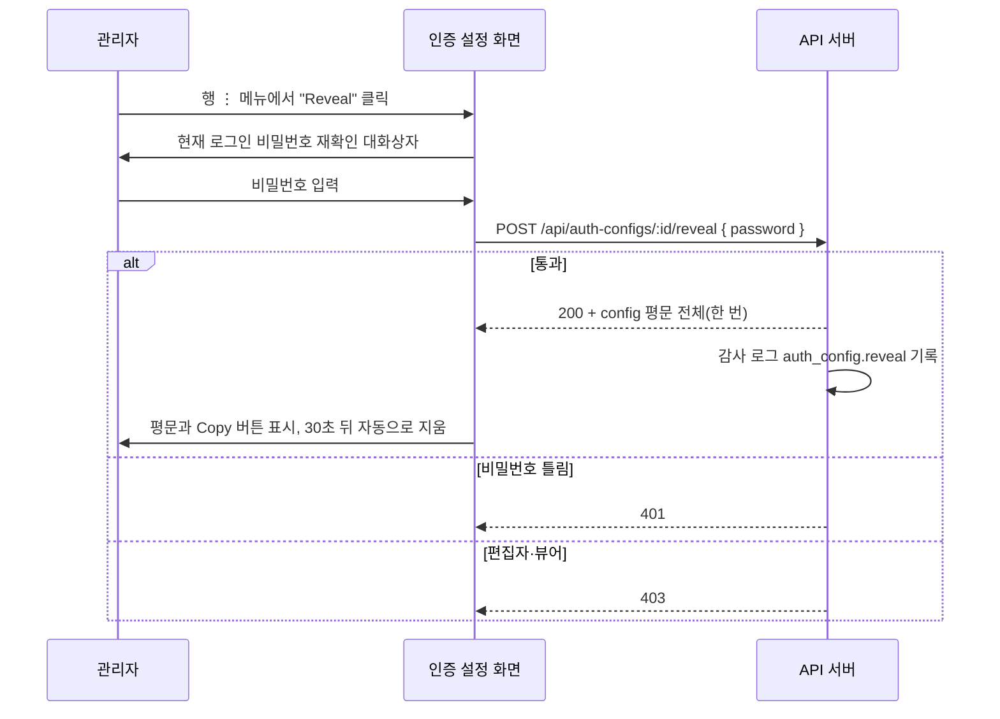

## 개요

이 문서는 [외부 호출 인증 설정](CLE-TRIG-AUTHCFG.md) 의 하위 문서로 인증 설정 응답의 필드 마스킹, 평문이 나가는 경로, 평문 보기(Reveal) 흐름과 자동 숨김, 복호화 불가 표식의 응답을 정한다. 재생성과 편집의 동작은 [입력 항목 · 편집 · 재생성](CLE-TRIG-AUTHCFG-EDIT.md) 이 정한다.

## 마스킹 규칙

이 절이 인증 설정 마스킹 정책의 단일 기준이다.

- API 응답에서 `config.key` / `config.token` / `config.secret` / `config.password` 는 항상 `***<last4>` 형태로 가린다(예: `wft_***c8a1`). 끝 네 글자가 모자라면 `***` 다.
- `config.username` / `config.header` / `config.headerName` / `config.algorithm` 은 평문으로 싣는다. 식별과 검증을 돕는 메타이고 비밀이 아니다.
- 평문은 다음 세 경로에서만 나간다.
  - `POST /api/auth-configs`(생성): 자동 발급한 값을 한 번 응답한다.
  - `POST /api/auth-configs/:id/regenerate`: 새로 발급한 값을 한 번 응답한다. API Key·Bearer Token·HMAC 만 해당하고 Basic Auth 는 400 이다([재생성](CLE-TRIG-AUTHCFG-EDIT.md#재생성)).
  - `POST /api/auth-configs/:id/reveal`: 현재 로그인 비밀번호를 다시 확인한 뒤 평문을 한 번 응답한다(관리자 이상, 감사 로그 `auth_config.reveal`).
- 사용자가 입력해 저장한 비밀(Basic Auth 비밀번호)을 다시 읽는 길은 평문 보기 하나다. 생성 응답에 실리는 비밀번호는 같은 요청이 보낸 입력이다.
- 복호화하지 못한 인증 설정은 복호화 불가 표식으로 읽힌다. 이 표식에는 원래 저장값이 함께 담길 수 있다. 목록·상세·편집·평문 보기 어느 응답에도 원래 저장값은 싣지 않는다. 표식(`__unreadable: true`)은 응답 `config` 에 남긴다. 그래서 이런 설정의 응답 `config` 는 `{ "__unreadable": true }` 이고 평문 보기 응답도 같다. 재생성 응답은 표식 대신 새로 만든 config 를 싣는다. 표식은 [통합 데이터와 흐름 「암호화」](../CLE-INT/CLE-INT-DATA.md#암호화) 가 정한다.
- 화면은 응답 `config` 의 표식을 보고 행에 «읽을 수 없음» 표시를 붙인다.

채팅 채널 봇 토큰처럼 평문 보기로 읽을 수 없는 입력 전용 필드에는 이 마스킹 규칙을 쓰지 않는다([트리거 관리](CLE-TRIG-MANAGE.md)).

## 평문 보기 흐름

1. 행의 ⋮ 메뉴에서 "Reveal" 을 누른다. 이 항목은 관리자 이상에게만 보인다.
2. 현재 로그인 비밀번호를 다시 확인하는 대화상자가 뜬다.
3. `POST /api/auth-configs/:id/reveal { password }` 를 보낸다. 통과하면 200 과 config 평문 전체를 한 번 받는다. 비밀번호가 틀리면 401, 편집자·뷰어는 403 이다.
4. 화면은 평문과 "Copy" 버튼을 보이고 30초 뒤 자동으로 숨긴다.
5. 감사 로그에 `action='auth_config.reveal'` 을 남긴다.

평문 자동 숨김은 생성·재생성 직후의 한 번 노출에도 똑같이 적용한다. 생성·재생성 직후 표시된 평문도 30초 뒤 자동으로 비운다. 컴포넌트가 사라질 때 타이머를 정리한다.

## Rationale

### 평문 30초 자동 숨김을 세 경로에 똑같이 적용하는 이유

평문이 드러나는 세 경로(생성·재생성·평문 보기)는 같은 보안 자산이므로 노출 시간 제한 정책을 하나로 맞춘다. 전에는 평문 보기만 자동으로 숨기고 생성·재생성 표시는 사용자가 닫을 때까지 남았다. 이 비대칭을 없애 화면을 방치했을 때 어깨너머 보기나 세션 탈취로 평문이 노출되는 창을 30초로 줄인다. 클라이언트 타이머는 `useEffect` cleanup 으로 컴포넌트가 사라지거나 다시 표시될 때 정리해 누수와 늦은 지우기를 막는다.

### 복호화 불가 표식을 응답에 그대로 둔다 (2026-11-05)

복호화 불가 설정의 응답 `config` 는 표식 `{ "__unreadable": true }` 그대로다. 통합처럼 `credentialsStatus` 같은 상태 필드로 바꾸지 않는다. 화면은 표식을 보고 행에 «읽을 수 없음» 표시를 붙인다. 전에는 화면이 표식을 처리하지 않아 빈 설정처럼 보였다.

상태 필드로 바꾸면 응답 DTO 에 필드가 늘고 [통합 데이터와 흐름 「암호화」](../CLE-INT/CLE-INT-DATA.md#암호화) 의 `auth_config.config` 행과 [용어 사전](../CLE-GLOSSARY.md) 「복호화 불가 표식」 이 저장 층과 응답 층을 따로 적어야 한다. 응답 `config` 를 읽어 그리는 화면은 인증 설정 화면 하나다(트리거 화면의 인증 설정 선택은 이름과 유형만 쓴다). 표식이 있으면 config 의 다른 키는 없다. 그래서 표식 하나로 «읽지 못한 설정» 을 알리는 데 모자람이 없다. 응답 DTO 의 설명은 표식 모양을 적는다.

### 복호화 불가 인증 설정의 응답에서 원래 저장값을 뺀다 (2026-10-31)

복호화하지 못한 인증 설정의 표식에는 원래 저장값(코드의 `__original_ciphertext`)이 함께 담길 수 있다. 다시 저장할 때 행을 그대로 쓰려고 붙인 값이다. 전에는 응답에서 `key`·`token`·`secret`·`password` 만 가려서 이 값이 목록(`GET /api/auth-configs`)과 상세(`GET /api/auth-configs/:id`) 응답에 그대로 실렸다. 두 API 는 뷰어도 부른다. 원래 저장값이 암호문이면 옛 키가 공개 예시 값이던 배포에서 풀 수 있다. 원래 저장값이 평문이면 그대로 읽힌다. 그러면 평문 보기 권한이 없는 뷰어도 비밀 값을 얻는다. 편집·재생성·평문 보기 응답에도 같은 값이 실렸다.

그래서 목록·상세·편집·재생성·평문 보기 다섯 응답 모두에서 원래 저장값을 뺐다. 2026-11-05 부터 재생성은 표식 대신 새로 만든 config 를 응답하므로([복호화 불가 인증 설정은 재생성으로 새로 만든다](CLE-TRIG-AUTHCFG-EDIT.md#복호화-불가-인증-설정은-재생성으로-새로-만든다-2026-11-05)) [외부 호출 인증 설정 「요구사항」](CLE-TRIG-AUTHCFG.md#요구사항)의 복호화 불가 응답 요구(목록·상세·편집·평문 보기 응답의 `config` 에서 원래 저장값을 빼는 요구)는 재생성을 뺀 나머지 네 응답을 정한다.

빼는 곳은 응답을 만드는 경계다. `AuthConfigsService.toResponseConfig` 는 표식이면 원래 저장값을 뺀 복제본을 돌려주고 표식이 아니면 입력을 그대로 돌려준다. 목록·상세·편집 응답은 그 결과를 필드 마스킹해 싣는다. 재생성·평문 보기 응답은 그 결과를 그대로 싣는다. 엔티티와 transformer 는 바꾸지 않는다. 원래 저장값을 담은 표식은 다시 저장해도 원래 저장값이 그대로 저장된다. 그래서 키를 바꿔 읽지 못한 설정은 원래 키를 되돌리면 다시 읽힌다.

원래 저장값을 보존하는 목적은 이름 변경 같은 무관한 재저장에서 행을 원래 모습대로 다시 쓰는 것이다. 새 값을 쓰려는 저장은 따로 풀었다. 재생성은 표식을 버리고 새 config 를 만들고, config 편집은 표식에 병합하지 않는다([복호화 불가 인증 설정의 편집은 config 를 병합하지 않는다](CLE-TRIG-AUTHCFG-EDIT.md#복호화-불가-인증-설정의-편집은-config-를-병합하지-않는다-2026-11-05)).

웹훅 수신 헤더는 저장할 때 가린다([웹훅 「수신 헤더 마스킹을 저장 시점에 하는 이유」](CLE-TRIG-WEBHOOK.md#수신-헤더-마스킹을-저장-시점에-하는-이유-2026-07-07)). 그 원칙은 복구에 쓰지 않는 값에 적용한다. 원래 저장값은 키를 복구할 때 필요하다. 그래서 저장해 두고 응답 경계에서 뺀다.

이 선택은 기존 규약과 같은 방향이다. [시크릿 저장소 「규칙」](../CLE-INT/CLE-INT-SECRET.md#규칙) 의 규칙 4 는 저장소 밖에 사는 비밀을 응답에 싣지 않게 한다. 규칙 6 은 엔티티를 그대로 반환하는 경로에서 그 값을 응답 경계에서 지우게 한다. [OpenAPI 문서화 「5-1. 응답 DTO 위치」](../CLE-API/CLE-API-SWAGGER.md#5-1-응답-dto-위치) 도 응답의 비밀값을 가리거나 빼게 한다.

다음 세 방법은 견주고 접었다.

- transformer 가 표식을 만들 때 원래 저장값을 버린다: 그 설정을 다시 저장하면 표식 자체가 저장된다. 그러면 원래 키를 되돌려도 설정이 복구되지 않는다.
- 엔티티의 `config` 컬럼을 응답에서 통째로 숨긴다: 정상 행의 마스킹 표시(`***<last4>`)까지 사라진다.
- 원래 저장값의 키를 비밀 마스킹 대상 키에 넣어 `***<last4>` 로 가린다: 끝 네 글자가 응답에 남는다. 복구용으로 보관하는 내부 값이 사용자 비밀 값의 마스킹 규칙에 섞인다.

표식은 응답 `config` 에 남긴다. 인증 설정 응답에는 통합의 `credentialsStatus` 같은 상태 표시가 없다. 그래서 표식이 «읽지 못한 설정» 을 알리는 유일한 신호다. 표식을 상태 표시로 바꾸지 않기로 한 결정은 [복호화 불가 표식을 응답에 그대로 둔다](#복호화-불가-표식을-응답에-그대로-둔다-2026-11-05) 에 있다.
