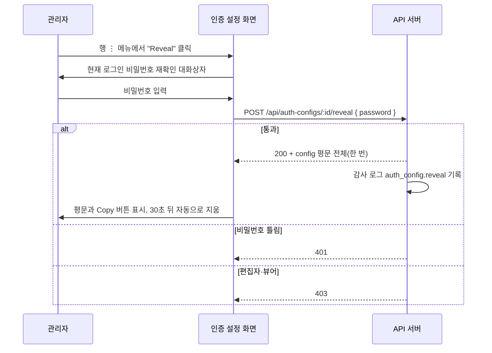

> 구현 상태: 구현됨 · 원문: `spec/2-navigation/6-config.md` (Overview, Part A, §3 Authentication API, Rationale R-2·R-6), `spec/2-navigation/_product-overview.md` (§3.6 Authentication), `spec/1-data-model.md` (§2.17.2 마스킹·노출 정책) · 용어: [용어 사전](../CLE-GLOSSARY.md)

## 개요

인증 설정(AuthConfig, `auth_config`)은 외부 시스템이 이 제품의 트리거를 부를 때 쓰는 워크스페이스 단위 인증 자격 증명이다. 워크플로우를 편집할 때마다 자격 증명을 입력하는 대신, 여기서 한 번 만든 인증 설정을 여러 웹훅 트리거가 연결해 쓴다. 현재 인증 설정이 연결되는 곳은 웹훅 수신 인증이다. 로그인 인증이나 통합 자격 증명과는 다른 개념이다.

인증 설정 화면은 사이드바 최상위 메뉴 "Authentication"(경로 `/authentication`)이다. 옛 원문은 이 화면과 모델 설정 화면을 "설정(Config)" 으로 묶어 적었지만 그 묶음은 분류용이고 실제 메뉴는 둘 다 최상위에 있다. 두 메뉴를 나중에 Config 그룹으로 다시 묶을 수는 있다.

이 문서는 인증 설정 목록 화면, 인증 방식(인증 설정 유형, `AuthConfig.type`)별 입력 항목, 편집, 재생성, 사용 내역(usage), 필드 마스킹(`***<last4>`)과 평문 보기(Reveal), 권한, 인증 설정 API 를 정한다.

범위 밖 주제는 다음 문서가 정한다.

- 엔티티 컬럼, 유형별 `config` JSONB 스키마, 자동 발급 값의 접두사: [트리거 데이터와 흐름](CLE-TRIG-DATA.md)
- 웹훅 요청을 인증 설정으로 검증하는 방식: [웹훅](CLE-TRIG-WEBHOOK.md)
- 트리거에 인증 설정을 연결하는 화면과 API: [트리거 관리](CLE-TRIG-MANAGE.md)
- 역할별 권한 매트릭스: [워크스페이스와 멤버](../CLE-ACCT/CLE-ACCT-WS.md). 감사 action: [감사 로그](../CLE-OBS/CLE-OBS-AUDIT.md)
- 같은 원문에 있던 모델 설정(Chat·Embedding·Rerank) 화면과 API: [모델 설정](../CLE-AI/CLE-AI-MODELS.md)

## 요구사항

- REQ-AUTHCFG-001 WHEN 관리자 이상이 인증 설정을 만들면 THE SYSTEM SHALL 외부 호출자가 트리거를 부를 때 쓸 인증 방식(API Key·Bearer Token·Basic Auth·HMAC)을 저장한다. (원본: NAV-CA-01)
- REQ-AUTHCFG-002 WHEN API Key 유형을 만들면 THE SYSTEM SHALL `wfk_<hex24>` 키를 자동으로 발급한다. (원본: NAV-CA-02)
- REQ-AUTHCFG-003 WHEN Bearer Token 유형을 만들면 THE SYSTEM SHALL `wft_<hex32>` 토큰을 자동으로 발급하고 사용자가 입력한 토큰은 받지 않는다. (원본: NAV-CA-03)
- REQ-AUTHCFG-004 WHEN Basic Auth 유형을 만들면 THE SYSTEM SHALL 사용자 이름과 비밀번호를 필수 사용자 입력으로 받는다. (원본: NAV-CA-04)
- REQ-AUTHCFG-005 WHEN HMAC 유형을 만들면 THE SYSTEM SHALL `whs_<hex32>` 시크릿을 자동으로 발급하고 서명 헤더 이름과 알고리즘(`sha256`·`sha512`)을 받는다.
- REQ-AUTHCFG-006 WHEN 사용자가 IP Whitelist 를 입력하면 THE SYSTEM SHALL 모든 유형에서 한 줄에 IP 나 CIDR 하나씩 받아 저장한다. (원본: NAV-CA-05)
- REQ-AUTHCFG-007 IF IP Whitelist 항목이 단일 IP 나 CIDR(IPv4·IPv6) 형식이 아니면 THE SYSTEM SHALL 생성·수정을 400 으로 거부한다.
- REQ-AUTHCFG-008 WHEN 사용자가 인증 설정 행을 누르면 THE SYSTEM SHALL 최근 호출 시각·총 호출 수·기간별 호출 수·최근 20건 호출 이력을 사용 내역으로 보여 준다. (원본: NAV-CA-06)
- REQ-AUTHCFG-009 WHEN 기간별 호출 수를 계산하면 THE SYSTEM SHALL 최근 24시간·7일·30일 롤링 윈도로 세고 막대 차트로 표시한다.
- REQ-AUTHCFG-010 WHEN 사용 내역의 호출 이력을 그리면 THE SYSTEM SHALL 소스 IP 가 없으면 `—` 를, 응답 코드가 없으면 실행 상태 값을 대신 표시한다.
- REQ-AUTHCFG-011 WHEN 인증 설정을 응답하면 THE SYSTEM SHALL `config.key`·`config.token`·`config.secret`·`config.password` 를 `***<last4>` 로 가리고 `username`·`header`·`headerName`·`algorithm` 은 평문으로 싣는다.
- REQ-AUTHCFG-012 IF 가릴 값이 네 글자보다 짧으면 THE SYSTEM SHALL `***` 만 싣는다.
- REQ-AUTHCFG-013 WHEN 인증 설정을 만들거나 재생성하면 THE SYSTEM SHALL 발급한 평문을 그 응답에 한 번만 싣는다.
- REQ-AUTHCFG-014 WHEN 관리자 이상이 평문 보기를 요청하면 THE SYSTEM SHALL 현재 로그인 비밀번호를 다시 확인한 뒤 평문 config 전체를 한 번 응답하고 감사 로그에 `auth_config.reveal` 을 남긴다.
- REQ-AUTHCFG-015 IF 평문 보기 요청의 비밀번호가 틀리면 THE SYSTEM SHALL 401 로 거부한다.
- REQ-AUTHCFG-016 WHEN 화면이 생성·재생성·평문 보기로 받은 평문을 표시하면 THE SYSTEM SHALL 30초 뒤 자동으로 지우고 컴포넌트가 사라질 때 타이머를 정리한다.
- REQ-AUTHCFG-017 WHEN 사용자가 키·토큰 복사 버튼을 누르면 THE SYSTEM SHALL 마스킹된 문자열을 복사한다.
- REQ-AUTHCFG-018 WHEN 관리자 이상이 편집 폼을 저장하면 THE SYSTEM SHALL 이름·IP Whitelist·비밀이 아닌 config(`headerName`·`header`·`algorithm`·`username`)만 바꾼다.
- REQ-AUTHCFG-019 WHEN 편집 PATCH 가 config 를 받으면 THE SYSTEM SHALL 기존 config 에 shallow-merge 하고 되돌아온 마스킹 값(`***<last4>`)은 무시해 저장된 비밀을 지킨다.
- REQ-AUTHCFG-020 IF 편집 PATCH 가 유형(`type`)이나 비밀 값(`key`·`token`·`secret`·`password`)을 실으면 THE SYSTEM SHALL 그 값을 무시하고 저장된 유형과 비밀 값을 그대로 둔다.
- REQ-AUTHCFG-021 WHEN 관리자 이상이 재생성을 확인하면 THE SYSTEM SHALL 기존 키·토큰·시크릿을 폐기하고 새 값을 발급한다.
- REQ-AUTHCFG-022 IF 편집자나 뷰어가 인증 설정 생성·수정·활성 토글·재생성·평문 보기·삭제 API 를 부르면 THE SYSTEM SHALL 403 `ADMIN_REQUIRED` 로 거부한다.
- REQ-AUTHCFG-023 WHILE 사용자가 편집자나 뷰어인 동안 THE SYSTEM SHALL 변경 액션 버튼(Add Config·활성 토글·Reveal·Edit·Regenerate·Delete)을 노출하지 않는다.
- REQ-AUTHCFG-024 WHEN 뷰어 이상이 목록·상세·사용 내역을 조회하면 THE SYSTEM SHALL 비밀 값을 가린 채 응답한다.
- REQ-AUTHCFG-025 WHEN `GET /api/auth-configs/:id/usage` 가 호출되면 THE SYSTEM SHALL `totalCalls`·`lastUsedAt`·`periodCounts`·`recentCalls`(최근 20건)를 돌려준다.
- REQ-AUTHCFG-026 WHEN 인증 설정이 복호화 불가 표식으로 읽히면 THE SYSTEM SHALL 목록·상세·편집·평문 보기 응답의 `config` 에서 원래 저장값을 빼고 표식은 남긴다.
- REQ-AUTHCFG-027 IF Basic Auth 유형 생성 요청의 `config.username` 이나 `config.password` 가 없거나 문자열이 아니거나 빈 문자열이면 THE SYSTEM SHALL 생성을 400 `VALIDATION_ERROR` 로 거부한다.
- REQ-AUTHCFG-028 IF Basic Auth 인증 설정의 편집 PATCH 가 `config.username` 을 싣고 그 값이 문자열이 아니거나 빈 문자열이면 THE SYSTEM SHALL 수정을 400 `VALIDATION_ERROR` 로 거부한다.
- REQ-AUTHCFG-029 IF Basic Auth 인증 설정에 재생성을 요청하면 THE SYSTEM SHALL 설정을 저장하지 않고 감사 로그도 남기지 않은 채 400 `AUTH_CONFIG_REGENERATE_UNSUPPORTED` 로 거부한다.
- REQ-AUTHCFG-030 WHEN 복호화 불가 표식으로 읽히는 API Key·Bearer Token·HMAC 인증 설정에 재생성을 요청하면 THE SYSTEM SHALL 표식을 버리고 생성 때와 같은 기본값으로 새 config 를 만들어 저장한 뒤 새 값을 한 번 평문으로 응답한다.
- REQ-AUTHCFG-031 WHILE 인증 설정이 복호화 불가 표식으로 읽히는 동안 THE SYSTEM SHALL 편집 PATCH 의 `config` 를 병합하지 않고 이름·IP Whitelist·활성 상태만 바꾼다.
- REQ-AUTHCFG-032 IF 생성 요청이나 편집 PATCH 의 `config` 최상위 키 중 `__` 로 시작하는 키가 있으면 THE SYSTEM SHALL 요청을 400 `VALIDATION_ERROR` 로 거부한다.
- REQ-AUTHCFG-033 WHILE 인증 설정의 유형이 Basic Auth 인 동안 THE SYSTEM SHALL 그 행의 ⋮ 메뉴에 Regenerate 를 노출하지 않는다.
- REQ-AUTHCFG-034 WHEN 화면이 복호화 불가 표식으로 읽히는 인증 설정 행을 그리면 THE SYSTEM SHALL 행에 «읽을 수 없음» 표시를 붙이고 재생성 확인 대화상자에 새 값과 기본 헤더·알고리즘으로 다시 만든다는 안내를 싣는다.

## 화면 구조

인증 설정 화면은 헤더와 인증 설정 목록으로 이루어진다. 행을 누르면 사용 내역 드로어가 열린다.

| 영역 | 위치 | 들어가는 요소 | 동작 |
|------|------|---------------|------|
| 헤더 | 맨 위 | 제목 "Authentication", "+ Add Auth Method" 버튼 | 버튼은 관리자 이상에게만 보인다. 누르면 생성 폼이 열린다 |
| 인증 설정 목록 | 본문 | 행마다 이름, 유형, 활성 상태, 최근 사용 시각, 더보기(⋮). 복호화 불가 표식으로 읽히는 행에는 «읽을 수 없음» 표시 | 행을 누르면 [사용 내역](#사용-내역) 드로어가 열린다(모든 역할). ⋮ 메뉴의 변경 액션은 관리자 이상에게만 보인다. Basic Auth 행에는 Regenerate 가 없다 |

목록 행 예시는 다음과 같다.

| 이름 | 유형 | 상태 | 둘째 줄 |
|------|------|------|---------|
| 🔑 Production API Key | API Key | Active | Last used: 2 hours ago |
| 🔑 Staging Token | Bearer | Active | Last used: 1 day ago |
| 🔑 Legacy Basic Auth | Basic Auth | Inactive | Last used: 30 days ago |

## 인증 방식별 입력 항목

유형별 `config` 스키마와 자동 발급 규칙의 단일 기준은 [트리거 데이터와 흐름](CLE-TRIG-DATA.md) 이다. IP Whitelist 는 모든 유형에 공통인 선택 필드다. 생성 폼은 IP Whitelist 입력(한 줄에 IP 나 CIDR 하나)과 유형별 추가 입력을 모두 보여 준다.

### API Key

| 필드 | 설명 |
|------|------|
| 이름 | 인증 설정 이름 |
| API Key | 자동 생성(`wfk_<hex24>`), 표시는 마스킹. 복사 버튼은 마스킹 문자열을 복사한다. 평문은 생성 직후 한 번 또는 평문 보기로만 복사한다 |
| Header 이름 | 검증에 쓸 헤더 이름(기본 `X-API-Key`) |
| Key 재생성 | 기존 키를 폐기하고 새 키를 만든다(확인 필요) |
| IP Whitelist | 허용 IP 목록(선택) |

### Bearer Token

| 필드 | 설명 |
|------|------|
| 이름 | 인증 설정 이름 |
| Token | 자동 생성(`wft_<hex32>`), 표시는 마스킹. 사용자 입력은 받지 않는다 |
| Token 재생성 | 기존 토큰을 폐기하고 새 토큰을 만든다(확인 필요) |
| IP Whitelist | 허용 IP 목록(선택) |

### Basic Auth

| 필드 | 설명 |
|------|------|
| 이름 | 인증 설정 이름 |
| Username | 사용자 이름(사용자 입력). 식별을 돕는 값이라 응답에 평문으로 나간다 |
| Password | 비밀번호(사용자 입력, 가린 입력창). 저장 뒤 응답은 `***<last4>` 로 가린다. 평문 재확인은 평문 보기로만 한다 |
| IP Whitelist | 허용 IP 목록(선택) |

사용자 이름과 비밀번호는 필수다. 생성 요청에서 둘 중 하나라도 없거나 문자열이 아니거나 빈 문자열이면 400 `VALIDATION_ERROR` 로 거부한다(REQ-AUTHCFG-027). 편집에서 사용자 이름을 비우는 요청도 400 이다([편집](#편집)). 공백만 있는 값은 거부하지 않는다. 화면의 생성·편집 폼은 사용자 이름의 앞뒤 공백을 지워 보내고 사용자 이름이나 생성 때의 비밀번호가 비면 저장하지 않는다.

REQ-AUTHCFG-027·028 의 저장 때 검증이 들어오기 전에 빈 값으로 저장된 설정은 그대로 남는다. 사용자 이름이나 비밀번호가 비어 있는 설정으로 받은 웹훅 요청은 인증 단계에서 늘 401 `AUTH_FAILED` 로 거부된다. 이 요구는 [웹훅 「인증」](CLE-TRIG-WEBHOOK.md#인증) 이 정한다.

Basic Auth 에는 재생성이 없다. 사용자 이름과 비밀번호는 제품이 발급하는 값이 아니라 사용자가 입력한 값이기 때문이다. 재생성 요청은 400 `AUTH_CONFIG_REGENERATE_UNSUPPORTED` 로 거부한다([재생성](#재생성)). 비밀번호를 바꾸려면 설정을 지우고 다시 만든다.

### HMAC

| 필드 | 설명 |
|------|------|
| 이름 | 인증 설정 이름 |
| Secret | 자동 생성(`whs_<hex32>`), 표시는 마스킹, 재생성 가능 |
| Header | 서명을 담는 헤더 이름(기본 `X-Hub-Signature-256`). 외부 provider 에 맞춘다(GitHub `X-Hub-Signature-256`, Stripe `Stripe-Signature` 등) |
| Algorithm | 선택: `sha256` / `sha512`. 다른 값은 보안상 지원하지 않는다 |
| IP Whitelist | 허용 IP 목록(선택) |

### IP Whitelist

각 항목은 단일 IP 나 CIDR 이다(예: `10.0.0.0/8`, `2001:db8::/32`). 단일 IP 는 `/32`·`/128` 호스트로 취급한다. 생성·수정 때 항목마다 형식을 검증하고 단일 IP·CIDR(IPv4·IPv6)이 아니면 400 으로 거부한다. 웹훅 수신 때 이 목록을 시행하는 규칙은 [웹훅](CLE-TRIG-WEBHOOK.md) 이 정한다.

## 편집

같은 화면에서 행별 편집 버튼을 누르면 `PATCH /api/auth-configs/:id` 로 다음 값을 고친다.

- 이름
- IP Whitelist
- 비밀이 아닌 config: API Key 의 `headerName`, HMAC 의 `header`·`algorithm`, Basic Auth 의 `username`

유형과 비밀 값은 편집할 수 없다. 제품이 발급하는 비밀(API Key·Bearer Token·HMAC)을 바꾸는 것은 재생성 하나로 모은다. 사용자가 입력한 Basic Auth 비밀번호는 재생성이 없으므로 설정을 지우고 다시 만들어 바꾼다. 편집 PATCH 는 config 를 통째로 바꾸지 않고 shallow-merge 해 암호화된 비밀 값을 보존한다. 마스킹 값(`***<last4>`)이 되돌아와도 무시한다.

Basic Auth 설정에 `config.username` 을 빈 문자열이나 문자열이 아닌 값으로 보내면 400 `VALIDATION_ERROR` 로 거부한다(REQ-AUTHCFG-028). `password` 는 편집 PATCH 가 무시하므로 이 검증 대상이 아니다. `config.username` 을 싣지 않은 요청은 저장된 사용자 이름을 검사하지 않는다. 그래서 빈 값으로 저장된 옛 설정도 이름·IP Whitelist·활성 상태를 고칠 수 있다.

생성 요청과 편집 PATCH 의 `config` 최상위 키 중 `__` 로 시작하는 키가 있으면 400 `VALIDATION_ERROR` 로 거부한다(REQ-AUTHCFG-032). `__` 로 시작하는 키는 복호화 불가 표식이 쓰는 자리다. 표식 판정이 최상위 키만 보므로 중첩된 객체 안의 키는 검사하지 않는다. 이 키를 받아 저장하면 저장 때 암호화를 건너뛸 수 있다. 사용자 이름 검증과 이 검증은 함께 돌고, 틀린 필드를 한 응답에 모두 싣는다.

복호화 불가 표식으로 읽히는 설정에 편집 PATCH 를 보내면 `config` 를 병합하지 않는다(REQ-AUTHCFG-031). 이름·IP Whitelist·활성 상태는 바뀐다. 응답 `config` 에는 표식만 남는다. 표식에 비밀이 아닌 config 를 병합해도 다시 저장할 때 원래 저장값이 그대로 저장되므로 그 값은 남지 않기 때문이다. 이런 설정을 다시 쓰려면 원래 키를 되돌리거나 재생성한다([재생성](#재생성)). 위의 입력 검증(사용자 이름, `__` 키)은 표식 여부와 상관없이 먼저 돈다. 그래서 화면은 이런 설정을 편집할 때 `config` 를 싣지 않는다. 실으면 편집 폼이 채운 빈 사용자 이름이 검증에 걸려 이름 · IP Whitelist 편집도 400 이 된다.

## 재생성

`POST /api/auth-configs/:id/regenerate` 는 제품이 발급하는 비밀을 새로 발급한다. 재생성할 수 있는 유형은 API Key·Bearer Token·HMAC 이다.

| 유형 | 정상 설정 | 복호화 불가 표식으로 읽히는 설정 |
|------|-----------|-----------------------------------|
| API Key | `key` 만 새 값(`wfk_<hex24>`)으로 바꾼다. `headerName` 은 그대로다 | 표식을 버리고 `{ key }` 로 새로 만든다. 헤더 이름은 기본값 `X-API-Key` 로 돌아간다 |
| Bearer Token | `token` 만 새 값(`wft_<hex32>`)으로 바꾼다 | 표식을 버리고 `{ token }` 으로 새로 만든다 |
| HMAC | `secret` 만 새 값(`whs_<hex32>`)으로 바꾼다. `header`·`algorithm` 은 그대로다 | 표식을 버리고 `{ secret, header: 'X-Hub-Signature-256', algorithm: 'sha256' }` 으로 새로 만든다 |
| Basic Auth | 400 `AUTH_CONFIG_REGENERATE_UNSUPPORTED` | 400 `AUTH_CONFIG_REGENERATE_UNSUPPORTED` |

- 재생성은 기존 값을 폐기하고 새 값을 저장한 뒤 그 값을 한 번 평문으로 응답한다(REQ-AUTHCFG-013·021). 감사 로그에 `auth_config.regenerate` 를 남긴다.
- 복호화 불가 표식으로 읽히는 설정은 생성 때와 같은 기본값으로 새 config 를 만든다(REQ-AUTHCFG-030). 표식이 가진 원래 저장값은 이때 버린다. 그래서 원래 키를 되돌려도 재생성 전의 값으로는 돌아가지 않는다. 이 설정을 쓰는 트리거는 그대로 연결되어 있으므로 외부 호출자에게 새 값만 알리면 된다. 비밀이 아닌 메타(`headerName`·`header`·`algorithm`)는 기본값으로 돌아가므로 필요하면 편집으로 다시 맞춘다.
- Basic Auth 재생성은 저장과 감사 기록 전에 거부한다(REQ-AUTHCFG-029). 화면은 Basic Auth 행에 Regenerate 를 보이지 않는다(REQ-AUTHCFG-033).
- 화면의 재생성 확인 대화상자는 복호화 불가 표식으로 읽히는 행이면 새 값과 기본 헤더·알고리즘으로 다시 만든다고 안내한다(REQ-AUTHCFG-034).

## 사용 내역

인증 설정 행을 누르면 그 인증 설정을 쓴 호출의 사용 내역을 보여 준다. 트리거 화면의 호출 이력과는 다른 화면이다([트리거 관리](CLE-TRIG-MANAGE.md)).

| 항목 | 설명 |
|------|------|
| 최근 호출 시각 | 마지막 사용 시각(`lastUsedAt`). 웹훅 인증이 성공하면 갱신한다 |
| 총 호출 수 | 이 인증 설정에 연결된 트리거의 누적 실행 수(`totalCalls`) |
| 기간별 호출 수 | 최근 24시간·7일·30일 롤링 윈도 기준 호출 수(`periodCounts { last24h, last7d, last30d }`). `Execution.started_at` 을 한 쿼리 안에서 조건부 집계(`COUNT(*) FILTER`)한다. 화면은 막대 차트(recharts BarChart)로 그린다. 일·주·월 경계로 나누는 캘린더 버킷이 아니라 호출 시점 기준 롤링 윈도다 |
| 호출 이력 테이블 | 최근 20건. 대상 트리거 이름, 상태, 소스 IP, 응답 코드, 시각(`recentCalls` 의 `triggerName` / `status` / `sourceIp` / `responseCode` / `startedAt`). 소스 IP 가 없는(HTTP 가 아닌 트리거) 행은 `—` 로, 응답 코드가 없는 행은 워크플로우 실행 `status` 값으로 대신 표시한다 |

소스 IP(`Execution.source_ip`)와 응답 코드(`Execution.response_code`)를 어떻게 잡아 저장하는지는 [실행 데이터와 흐름](../CLE-EXEC/CLE-EXEC-DATA.md) 이 정한다. 집계는 `Execution.trigger_id → Trigger.auth_config_id` 조인으로 한다.

## 필드 마스킹과 평문 보기

### 마스킹 규칙

이 절이 인증 설정 마스킹 정책의 단일 기준이다.

- API 응답에서 `config.key` / `config.token` / `config.secret` / `config.password` 는 항상 `***<last4>` 형태로 가린다(예: `wft_***c8a1`). 끝 네 글자가 모자라면 `***` 다.
- `config.username` / `config.header` / `config.headerName` / `config.algorithm` 은 평문으로 싣는다. 식별과 검증을 돕는 메타이고 비밀이 아니다.
- 평문은 다음 세 경로에서만 나간다.
  - `POST /api/auth-configs`(생성): 자동 발급한 값을 한 번 응답한다.
  - `POST /api/auth-configs/:id/regenerate`: 새로 발급한 값을 한 번 응답한다. API Key·Bearer Token·HMAC 만 해당하고 Basic Auth 는 400 이다([재생성](#재생성)).
  - `POST /api/auth-configs/:id/reveal`: 현재 로그인 비밀번호를 다시 확인한 뒤 평문을 한 번 응답한다(관리자 이상, 감사 로그 `auth_config.reveal`).
- 사용자가 입력해 저장한 비밀(Basic Auth 비밀번호)을 다시 읽는 길은 평문 보기 하나다. 생성 응답에 실리는 비밀번호는 같은 요청이 보낸 입력이다.
- 복호화하지 못한 인증 설정은 복호화 불가 표식으로 읽힌다. 이 표식에는 원래 저장값이 함께 담길 수 있다. 목록·상세·편집·평문 보기 어느 응답에도 원래 저장값은 싣지 않는다. 표식(`__unreadable: true`)은 응답 `config` 에 남긴다. 그래서 이런 설정의 응답 `config` 는 `{ "__unreadable": true }` 이고 평문 보기 응답도 같다. 재생성 응답은 표식 대신 새로 만든 config 를 싣는다. 표식은 [통합 데이터와 흐름 「암호화」](../CLE-INT/CLE-INT-DATA.md#암호화) 가 정한다.
- 화면은 응답 `config` 의 표식을 보고 행에 «읽을 수 없음» 표시를 붙인다(REQ-AUTHCFG-034).

채팅 채널 봇 토큰처럼 평문 보기로 읽을 수 없는 입력 전용 필드에는 이 마스킹 규칙을 쓰지 않는다([트리거 관리](CLE-TRIG-MANAGE.md)).

### 평문 보기 흐름

1. 행의 ⋮ 메뉴에서 "Reveal" 을 누른다. 이 항목은 관리자 이상에게만 보인다.
2. 현재 로그인 비밀번호를 다시 확인하는 대화상자가 뜬다.
3. `POST /api/auth-configs/:id/reveal { password }` 를 보낸다. 통과하면 200 과 config 평문 전체를 한 번 받는다. 비밀번호가 틀리면 401, 편집자·뷰어는 403 이다.
4. 화면은 평문과 "Copy" 버튼을 보이고 30초 뒤 자동으로 숨긴다.
5. 감사 로그에 `action='auth_config.reveal'` 을 남긴다.

평문 자동 숨김은 생성·재생성 직후의 한 번 노출에도 똑같이 적용한다. 생성·재생성 직후 표시된 평문도 30초 뒤 자동으로 비운다. 컴포넌트가 사라질 때 타이머를 정리한다.

## 권한

목록의 모든 변경 액션 버튼(헤더의 Add Config, 활성 토글(Activate/Deactivate), Reveal, Edit, Regenerate, Delete)은 관리자 이상에게만 보인다. 편집자와 뷰어는 마스킹된 목록·상세·사용 내역(읽기)만 본다. 목록 행 클릭(사용 내역 드로어 = 읽기)은 모든 역할에게 허용해 가드하지 않는다.

편집자나 뷰어가 변경 API 를 직접 부르면 403 `ADMIN_REQUIRED` 다(`RolesGuard` 의 `@Roles('admin')`). 근거는 [워크스페이스와 멤버](../CLE-ACCT/CLE-ACCT-WS.md) 의 권한 매트릭스다(인증 설정: 소유자·관리자 = CRUD, 편집자·뷰어 = 읽기). 화면 가드는 일관성과 403 혼란 방지용이고 실제 인가는 백엔드 `@Roles('admin')` 가 fail-closed 로 강제한다(이중 방어). `useHasRole("admin")` 은 `ROLE_LEVEL` 이상 비교라 소유자도 포함한다.

## API

변경(POST / PATCH / DELETE / regenerate / reveal)은 관리자 이상, 조회(GET 목록·상세·usage)는 뷰어 이상이다. 목록 응답 형식은 [HTTP API 규약](../CLE-API/CLE-API-CONV.md) 의 목록 응답 규칙을 따른다.

| 메서드 | 경로 | 설명 |
|--------|------|------|
| GET | `/api/auth-configs` | 인증 설정 목록. 쿼리: `page`, `limit`, `sort`, `order`, `search` |
| POST | `/api/auth-configs` | 인증 설정 생성(관리자 이상). 자동 발급한 값을 한 번 평문으로 응답한다 |
| GET | `/api/auth-configs/:id` | 상세 |
| PATCH | `/api/auth-configs/:id` | 수정: 이름·IP Whitelist·비밀이 아닌 config·활성 토글(관리자 이상) |
| POST | `/api/auth-configs/:id/regenerate` | 키·토큰·시크릿 재생성. 새 값을 한 번 평문으로 응답한다(관리자 이상). Basic Auth 는 400 `AUTH_CONFIG_REGENERATE_UNSUPPORTED` 다 |
| POST | `/api/auth-configs/:id/reveal` | 평문 config 한 번 노출. `:id` 는 UUID, 본문 `{ password }`. 관리자 이상. 감사 로그 기록 |
| DELETE | `/api/auth-configs/:id` | 삭제(관리자 이상) |
| GET | `/api/auth-configs/:id/usage` | 사용 내역. 응답 `data`: `{ totalCalls, lastUsedAt, periodCounts: { last24h, last7d, last30d }, recentCalls: [{ id, triggerName, status, sourceIp, responseCode, startedAt }] }`(최근 20건) |

인증 설정을 지우면 연결된 트리거의 `auth_config_id` 는 FK SET NULL 로 끊긴다([트리거 데이터와 흐름](CLE-TRIG-DATA.md)).

생성·수정의 입력 검증 실패는 400 `VALIDATION_ERROR` 이고 `details` 는 배열 `[{ field, message, code: 'INVALID_FIELD' }]` 다([에러 응답과 클라이언트 처리](../CLE-API/CLE-API-ERROR.md)). 요청 형식 검증(IP Whitelist 형식 등)과 서비스가 하는 검증(Basic Auth 빈 값, `__` 키)의 `details` 가 같은 모양이다. Basic Auth 빈 값의 `field` 는 `config.username`·`config.password` 이고 `__` 키의 `field` 는 `config.<키>` 다. 틀린 필드가 여럿이면 모두 싣는다.

## 미결 사항

현재 없다.

## 구현 위치

- `codebase/frontend/src/app/(main)/w/[slug]/authentication/**`
- `codebase/backend/src/modules/auth-configs/**`

## Rationale

### 인증 설정을 웹훅 수신 인증에 연결한 결정

인증 메뉴의 인증 설정은 웹훅 수신 인증에 연결된다. 트리거 인라인 인증 경로를 없애고 인증 설정 하나로 모은 근거는 [웹훅](CLE-TRIG-WEBHOOK.md) 의 "인라인 인증 경로 폐지" 결정에 있다. 이 결정에 딸린 인증 설정 쪽 결정은 다음과 같다.

- HMAC 유형: API Key·Bearer·Basic Auth 에 더해 `hmac` 을 지원한다. 웹훅 HMAC 서명 검증을 트리거 인라인 `config.secret` 대신 인증 설정이 맡는다.
- Bearer Token 만료 필드를 v1 에서 뺐다: 토큰 만료와 자동 회전을 다루지 않는다. JSONB 스키마 `{ token }` 과 맞춘 것이다. 만료나 회전이 필요해지면 후속 결정으로 다시 들인다.
- 항상 마스킹하고 평문 보기 엔드포인트를 둔다: API 응답에서 비밀 값은 늘 `***<last4>` 다. 평문은 생성·재생성·평문 보기 세 경로에서만 나간다. 평문 보기는 관리자 이상, 비밀번호 재확인, 감사 기록을 요구한다.

### Bearer Token 을 자동 발급만 허용하는 이유

예전에는 Bearer Token 을 "자동 생성 또는 사용자 입력" 으로 받았다. 사용자 입력을 없애고 자동 발급(`wft_<hex32>`)만 허용한다. 외부 호출자에게 발급하는 토큰은 제품이 충분한 엔트로피로 만드는 편이 일관되고 사용자 입력 토큰의 형식·엔트로피를 검증할 부담도 사라진다.

### 평문 30초 자동 숨김을 세 경로에 똑같이 적용하는 이유

평문이 드러나는 세 경로(생성·재생성·평문 보기)는 같은 보안 자산이므로 노출 시간 제한 정책을 하나로 맞춘다. 전에는 평문 보기만 자동으로 숨기고 생성·재생성 표시는 사용자가 닫을 때까지 남았다. 이 비대칭을 없애 화면을 방치했을 때 어깨너머 보기나 세션 탈취로 평문이 노출되는 창을 30초로 줄인다. 클라이언트 타이머는 `useEffect` cleanup 으로 컴포넌트가 사라지거나 다시 표시될 때 정리해 누수와 늦은 지우기를 막는다.

### 편집 폼에서 비밀을 다시 입력받지 않는 이유

편집(`PATCH`)은 이름·IP·비밀이 아닌 config 만 바꾸고 비밀 값을 다시 입력받지 않는다. 제품이 발급하는 비밀의 변경은 재생성 하나로 모은다. 사용자가 입력한 Basic Auth 비밀번호는 재생성이 없어 지우고 다시 만든다([Basic Auth 재생성을 거부한다](#basic-auth-재생성을-거부한다-2026-11-05)). 백엔드 `update` 는 `config` 를 통째로 바꾸지 않고 shallow-merge 하며 마스킹된 비밀 값(`***<last4>`)이 되돌아와도 무시해 실제 비밀이 망가지지 않게 한다. 유형 변경도 편집 폼에서 막는다. 유형을 바꾸면 비밀을 다시 발급해야 하므로 지우고 다시 만든다.

### 변경 액션 버튼을 모두 관리자 이상으로 가드하는 이유

전에는 Reveal 만 관리자 이상으로 가드했다. 이 비대칭을 없애 Add Config·활성 토글·Edit·Regenerate·Delete 까지 모든 변경 버튼을 관리자 이상에게만 보인다. 권한 매트릭스가 인증 설정을 소유자·관리자 = CRUD, 편집자·뷰어 = 읽기로 정하므로 활성 토글도 수정에 해당해 관리자 이상이다. "활성/비활성 전환은 단순 상태라 편집자도 된다" 로 새지 않게 적어 둔다. 실제 인가는 백엔드 `@Roles('admin')` 가 fail-closed 로 강제한다. 화면 가드는 권한 상승 방지가 아니라, 관리자가 아닌 사용자에게 403 이 날 버튼을 감춰 혼란을 없애는 일관성 장치다. `useHasRole("admin")` 의 `ROLE_LEVEL` 이상 비교로 소유자도 자동으로 포함된다.

### 사용 내역을 실행 행에 저장하는 이유

사용 내역의 소스 IP·응답 코드·기간별 호출 수는 다음 결정으로 구현했다.

- 저장 위치는 실행(`Execution`) 행에 컬럼을 더하는 것이고(V096) 전용 호출 로그 엔티티는 두지 않는다. 인증 설정 사용 집계는 이미 `Execution.trigger_id → Trigger.auth_config_id` 조인으로 `totalCalls`/`recentCalls` 를 냈다. 같은 행에 `source_ip VARCHAR(45)`·`response_code VARCHAR(10)`(둘 다 nullable)을 더하면 조인 한 번으로 끝나 가장 단순하다. 통합은 전용 `IntegrationUsageLog` 를 두지만 인증 설정은 호출이 곧 워크플로우 실행이라 실행 행을 단일 기준으로 다시 쓴다. 별도 로그를 두면 이중 기록과 정합 부담이 생긴다.
- 응답 코드는 두 가지를 함께 쓴다. 웹훅과 채팅 채널 inbound 는 호출이 받은 실제 HTTP 코드를 저장한다. 실행 생성에 성공한 경로는 `202 Accepted` 다. 다만 채팅 채널의 인터랙션 요청(Discord 슬래시 명령·컴포넌트·모달 제출, Slack Interactivity)에는 3초 안에 `200` 인터랙션 응답으로 답하므로 `200` 을 저장한다. 이 응답 계약은 [채팅 채널 공통](../CLE-CHAT/CLE-CHAT-CORE.md#인바운드-http-응답-계약) 이 정한다. 인증 401·검증 400·비활성 410 은 `execute` 전에 던져져 실행 행이 생기지 않는다. 스케줄 같은 HTTP 가 아닌 트리거는 HTTP 코드가 없어 `response_code` 가 NULL 이고 `getUsage` 가 워크플로우 실행 `status` 값으로 대신 표시한다. 이렇게 WH-MG-05 의 "응답 코드 확인" 을 이행한다. 이 요구를 어느 화면이 이행하는지는 [웹훅](CLE-TRIG-WEBHOOK.md) 의 미결 사항에 적는다.
- 기간별 호출 수는 롤링 윈도(24h·7d·30d)와 막대 차트로 한다. 사용 내역 화면의 목적은 최근 활동량 파악이고 캘린더 버킷의 경계 정렬(시간대, 주 시작 요일) 모호성도 피한다. `Execution.started_at` 을 한 쿼리에서 조건부 집계(`COUNT(*) FILTER (WHERE started_at >= now()-window)`)해 왕복 한 번으로 세 값을 구한다.
- 소스 IP 는 `hooks.service` 가 웹훅 진입 때 `extractClientIpFromHeaders` 로 뽑은 값을 인증 IP whitelist 검증과 호출 기록에 함께 쓴다. `CF-Connecting-IP` 를 신뢰하도록 설정했으면 그 값, 아니면 `X-Forwarded-For` 첫 IP 를 쓰고 헤더 기반이라 `req.ip` 폴백은 없다([세션과 토큰](../CLE-ACCT/CLE-ACCT-SESSION.md) 의 클라이언트 IP 항목). 뽑지 못하면 NULL 이다.

### Basic Auth 의 빈 값은 인증 때 거부한다 (2026-10-31)

Basic Auth 의 사용자 이름과 비밀번호는 사용자가 입력하는 값이다. 이 절을 쓴 때(v2~v4)는 생성 API 가 빈 값을 막지 않았다. 서비스에 검증이 없었고 API 설명(`create-auth-config.dto.ts`)에는 «사용자 입력 필수» 라고만 적혀 있었다. 빈 값을 막는 곳은 웹훅 인증이다. 사용자 이름이나 비밀번호가 비어 있는 설정으로 받은 요청은 인증 단계에서 늘 401 `AUTH_FAILED` 다. 전에는 빈 기대값끼리 비교해서 `Authorization: Basic Og==` 가 통과했다.

인증 시점 거부는 빈 기대값이 생기는 경로를 모두 막는다. 생성 때 들어온 빈 입력, 편집(`PATCH`)으로 `username` 을 비운 설정, 이미 빈 값으로 저장된 옛 행, 키를 바꾼 뒤 복호화하지 못해 표식이 담긴 설정 등이 그런 경로다. 그때는 생성 시점 검증이 없었고 편집 `PATCH` 도 `username` 값을 검사하지 않았다. 둘 다 NERV Task `CLE-T-KQ37NJ` 에서 코드로 확인했다. 지금은 앞의 두 경로를 저장 때 400 으로 막는다([아래 절](#basic-auth-의-빈-값은-생성과-편집에서도-거부한다-2026-10-31)). 뒤의 두 경로는 여전히 인증 단계 거부만 막는다.

인증 시점 거부는 2026-10-10 NERV Task `CLE-T-2V7SBC` 가 넣었다(PR #1521, main 커밋 `6cbf22acb`). 커밋 메시지에 적힌 동기는 키 교체다. 키를 바꾸면 `auth_config.config` 가 복호화 불가 표식으로 읽힌다. 그러면 Basic Auth 와 HMAC 이 빈 기대값으로 비교돼 열린다. 빈 기대값을 받아들이던 동작은 그 전부터 있던 결함이고 이 커밋에서 함께 막았다. 생성 시점 검증과 견주고 접은 기록은 없다. 같은 때 HMAC 의 빈 secret 도 거부하게 됐다. API Key 와 Bearer Token 은 그 전부터 빈 기대값을 거부했다.

그래서 그때는 REQ-AUTHCFG-004 에 두 값을 «필수» 로 쓰지 않고 사용자 입력으로 받는다고만 썼다. 빈 값을 인증 때 거부하는 요구는 웹훅 문서 한 곳에 두고 이 문서 본문은 그 요구를 가리킨다. 한 동작을 두 요구에 적으면 한쪽만 고쳤을 때 어긋나기 때문이다. 웹훅 인증의 요구사항은 [웹훅 「인증」](CLE-TRIG-WEBHOOK.md#인증) 이 정한다.

### Basic Auth 의 빈 값은 생성과 편집에서도 거부한다 (2026-10-31)

생성 요청의 빈 사용자 이름·비밀번호와 편집 `PATCH` 의 빈 사용자 이름을 400 `VALIDATION_ERROR` 로 거부한다(REQ-AUTHCFG-027·028). 인증 단계 거부([웹훅 「인증」](CLE-TRIG-WEBHOOK.md#인증))는 그대로 둔다. 이미 빈 값으로 저장된 설정과 키를 바꿔 복호화하지 못한 설정은 저장 때 검사로 막을 수 없기 때문이다. 그래서 REQ-AUTHCFG-004 에 «필수» 를 넣었다. REQ-AUTHCFG-004 는 두 입력이 필수라는 것을 정하고 REQ-AUTHCFG-027·028 은 그 규칙을 어긴 요청을 어떻게 거부하는지 정한다.

빈 값 설정은 어느 웹훅 요청도 통과시키지 못한다. 저장을 받아 주면 잘못된 설정이 웹훅을 부를 때의 401 로만 드러난다. 그 401 은 자격 증명이 틀린 요청과 구분되지 않아서 원인을 찾기 어렵다. 저장 때 거부하면 설정을 만드는 관리자가 바로 알 수 있다. API 설명은 이미 두 값을 «사용자 입력 필수» 로 적었다. 화면의 폼도 빈 사용자 이름과 생성 때의 빈 비밀번호를 저장하지 않았다. 그래서 빈 값은 API 를 직접 부른 경우에만 들어갔다. 같은 생성·수정 API 는 IP Whitelist 형식도 저장 때 400 으로 거부한다(REQ-AUTHCFG-007). 잘못된 값이 웹훅을 부를 때에야 드러나 원인을 찾기 어렵다는 같은 이유다([트리거 데이터와 흐름 「인증 설정 도메인 결정」](CLE-TRIG-DATA.md#인증-설정-도메인-결정)).

값이 없거나 빈 문자열이면 비었다고 본다. 인증 단계가 빈 기대값을 401 로 거부하는 기준과 같다. 저장 때는 여기에 더해 문자열이 아닌 값도 거부한다. 인증 단계는 기대값을 문자열로 비교하므로 그런 값으로는 어떤 요청도 인증되지 않는다. 이미 저장된 그런 기대값은 인증 단계가 빈 기대값과 같이 401 `AUTH_FAILED` 로 거부한다([웹훅 「인증」](CLE-TRIG-WEBHOOK.md#인증)). 이 응답은 2026-11-05 NERV Task `CLE-T-0Q768N` 이 정했다. 그 전에는 비교 도중 오류가 나 500 이 나갔다. 공백만 있는 값은 받는다. 인증 단계가 같은 공백 값을 보낸 요청을 통과시키므로 동작하는 설정이다. 화면이 사용자 이름의 앞뒤 공백을 지우는 것은 입력 실수를 막는 폼의 처리이고 API 계약과는 따로다.

편집에서는 `password` 를 검사하지 않는다. 편집 `PATCH` 는 비밀 값을 무시하므로(REQ-AUTHCFG-020) 편집으로 비밀번호가 비는 경로가 없다. `config.username` 을 싣지 않은 편집도 저장된 값을 검사하지 않는다. 빈 값으로 저장된 옛 설정의 이름·IP Whitelist·활성 상태를 고치는 요청까지 막지 않으려는 것이다. 옛 설정을 고치는 데이터 이전은 하지 않는다. 그런 설정은 인증 단계에서 이미 401 로 막혀 있고 빈 값을 무엇으로 채울지는 설정을 만든 관리자만 정할 수 있다.

편집 요구 REQ-AUTHCFG-020 의 동사는 «허용하지 않는다» 에서 «무시하고 그대로 둔다» 로 바꿨다. 편집 `PATCH` 는 유효한 유형 값과 비밀 값을 거부하지 않고 무시해 왔다. 마스킹 값이 되돌아와도 실제 비밀을 지키는 규칙([편집 폼에서 비밀을 다시 입력받지 않는 이유](#편집-폼에서-비밀을-다시-입력받지-않는-이유))과 같은 방향이라 문서를 코드에 맞췄다. 유형 목록에 없는 `type` 값과 요청 본문에 정의되지 않은 최상위 키는 이와 따로 요청 형식 검증에서 400 이다. 편집이 비밀 값을 무시하고 재생성은 Basic Auth 를 거부하므로(REQ-AUTHCFG-029) Basic Auth 비밀번호를 바꾸려면 설정을 지우고 다시 만든다.

검사는 서비스(`AuthConfigsService` 의 생성·수정)가 한다. 편집은 저장된 유형을 읽어야 Basic Auth 인지 알 수 있다. 거부 응답은 요청 형식 검증과 같은 `details` 배열이다. 한 요청에서 두 필드가 함께 틀릴 수 있고 같은 API 의 다른 400 과 같은 방식으로 읽힌다.

접은 선택지는 빈 값을 계속 받고 API 설명만 고치는 것이다. v4 까지의 상태이고 이 결정을 맡은 NERV Task `CLE-T-ATVH78` 이 함께 견준 길이다. 빈 값 설정을 받아 둘 쓸모가 없어서 접었다.

이 결정은 NERV Task `CLE-T-ATVH78` 이 내렸다. 계기는 NERV Task `CLE-T-KQ37NJ` 의 consistency finding `01a19169-d131-72ec-a93c-719c88c7ca40` 이다. 생성·수정이 두 값을 검사하지 않아 동작하지 않는 설정이 저장된다는 지적이었다.

### 복호화 불가 인증 설정은 재생성으로 새로 만든다 (2026-11-05)

키를 바꿔 복호화하지 못한 API Key·Bearer Token·HMAC 설정에 재생성을 요청하면 표식을 버리고 생성 때와 같은 기본값으로 새 config 를 만들어 저장한다(REQ-AUTHCFG-030). 정상 설정의 재생성은 바꾸지 않는다. 비밀 값 하나만 새 값으로 바꾸고 `headerName`·`header`·`algorithm` 은 그대로 둔다.

v4·v5 에는 이 동작이 알려진 결함으로 [미결 사항](#미결-사항) 에 있었다(절 제목 «복호화 불가 인증 설정은 재생성으로 복구되지 않는다 (2026-10-31)»). 그때 재생성은 표식 객체에 새 값을 넣어 저장했다. 키를 바꿔 생긴 표식에는 원래 저장값이 담겨 있고, 표식을 저장하면 원래 저장값이 그대로 다시 저장된다. 그래서 응답에는 새 값이 실렸지만 저장되지 않았고 사용자는 동작하지 않는 키를 받았다. 저장값이 바뀌지 않는 것은 NERV Task `CLE-T-SAMVX8` 이 단위 테스트로 재현했다. 그때 요구사항 문장(REQ-AUTHCFG-013·021)은 고친 뒤의 동작을 정하므로 바꾸지 않았고, 이번에 REQ-AUTHCFG-030 으로 표식 설정의 동작을 따로 적었다.

재생성은 원래 저장값을 버린다. 그래서 원래 키를 되돌려도 재생성 전의 값으로는 돌아가지 않는다. 재생성은 정의상 옛 비밀을 폐기하는 동작이므로(REQ-AUTHCFG-021) 정상 설정과 같은 결과다. 표식에서는 비밀이 아닌 메타(`headerName`·`header`·`algorithm`)를 읽을 수 없어서 생성 때의 기본값으로 돌아간다. 응답에 새 config 가 그대로 실리므로 관리자가 바로 확인하고 편집으로 다시 맞출 수 있다. 화면의 재생성 확인 대화상자도 이 점을 알린다(REQ-AUTHCFG-034).

transformer 는 바꾸지 않는다. 재생성이 표식 객체를 고치지 않고 새 객체로 바꾸므로 저장할 때 평소처럼 암호화된다. 원래 저장값을 지키는 transformer 의 동작은 이름 변경 같은 무관한 재저장을 위한 것이고 그대로 둔다([복호화 불가 인증 설정의 응답에서 원래 저장값을 뺀다](#복호화-불가-인증-설정의-응답에서-원래-저장값을-뺀다-2026-10-31)).

접은 선택지는 재생성을 거부하고 «설정을 새로 만들라» 는 오류를 내는 것이다. 그러면 그 설정을 쓰는 트리거를 모두 새 설정에 다시 연결해야 한다. 키 교체 사고는 워크스페이스의 모든 설정을 한꺼번에 읽지 못하게 만들므로 다시 연결할 트리거도 많다. 통합도 읽지 못한 자격 증명을 다시 연결해 같은 행에서 복구한다([통합 데이터와 흐름 「암호화」](../CLE-INT/CLE-INT-DATA.md#암호화)). 거부하면 REQ-AUTHCFG-021 에 «복호화 불가 설정은 빼고» 라는 예외도 붙는다.

Basic Auth 는 표식 여부와 상관없이 재생성을 거부한다([아래 절](#basic-auth-재생성을-거부한다-2026-11-05)). 표식으로 읽히는 Basic Auth 설정은 지우고 다시 만든다.

### Basic Auth 재생성을 거부한다 (2026-11-05)

Basic Auth 설정에 재생성을 요청하면 저장과 감사 기록 전에 400 `AUTH_CONFIG_REGENERATE_UNSUPPORTED` 로 거부한다(REQ-AUTHCFG-029). 화면은 Basic Auth 행에 Regenerate 를 보이지 않는다(REQ-AUTHCFG-033).

전에는 재생성이 Basic Auth 에 발급할 값이 없는데도 설정을 그대로 저장하고 감사 로그 `auth_config.regenerate` 를 남긴 뒤 저장된 사용자 이름과 비밀번호를 평문으로 응답했다. 관리자는 같은 비밀번호를 평문 보기의 비밀번호 재확인(REQ-AUTHCFG-015)과 `auth_config.reveal` 감사 없이 읽을 수 있었다. 화면도 이 비밀번호를 «새로 발급한 값» 으로 보여 주었다. v5 [미결 사항](#미결-사항) 에 적혀 있던 결함이고 NERV Task `CLE-T-SCDNDC` 가 정했다.

이 결정으로 원칙 하나를 세운다. 사용자가 입력해 저장한 비밀을 다시 읽는 길은 평문 보기 하나다([마스킹 규칙](#마스킹-규칙)). 생성 응답에 실리는 비밀번호는 같은 요청이 보낸 입력이라 이 원칙에 어긋나지 않는다.

재생성 가능한 유형을 API Key·Bearer Token·HMAC 으로 명시하고 나머지는 거부한다. 유형이 늘어도 발급 규칙을 정하기 전에는 재생성이 저장된 값을 그대로 응답하지 않는다.

거부 코드는 새로 둔다. 요청 본문에 틀린 필드가 없으므로 `details` 로 필드를 가리키는 `VALIDATION_ERROR` 와 뜻이 다르다. 유형은 바꿀 수 없으므로 상태가 바뀌면 풀리는 409 와도 다르다. 400 을 고른 것은 같은 요청을 다시 보내도 결과가 같은 클라이언트 오류이기 때문이다. 코드 카탈로그는 [에러 코드 규약과 카탈로그](../CLE-API/CLE-API-ERRCODES.md) 가 정한다.

접은 선택지는 재생성 응답의 비밀번호를 가리는 것이다. 평문 노출은 막지만 저장할 것이 없는 요청이 성공 응답과 `auth_config.regenerate` 감사를 남긴다. 화면도 «재생성됨» 을 알리게 되어 관리자가 비밀번호가 바뀌었다고 오해할 수 있다.

### 복호화 불가 인증 설정의 편집은 config 를 병합하지 않는다 (2026-11-05)

복호화 불가 표식으로 읽히는 설정에 편집 PATCH 를 보내면 `config` 를 병합하지 않고 이름·IP Whitelist·활성 상태만 바꾼다(REQ-AUTHCFG-031). v5 까지는 비밀이 아닌 config 를 표식에 병합했다. 원래 저장값을 담은 표식이면 다시 저장할 때 원래 저장값이 그대로 저장되므로 병합한 값은 응답에만 보이고 저장되지 않았다. 원래 저장값이 없는 표식이면 병합한 값이 든 표식 자체가 저장됐다. 어느 쪽이든 관리자가 고친 값은 동작하지 않는다.

병합하지 않으면 응답과 저장이 어긋나지 않는다. 편집 PATCH 가 비밀 값과 유형을 무시하는 규칙(REQ-AUTHCFG-020)과 같은 방식이다. 이런 설정을 다시 쓰려면 원래 키를 되돌리거나 재생성한다.

접은 선택지는 표식 설정의 편집 PATCH 를 409 로 거부하는 것이다. 화면의 편집 폼은 이름만 고쳐도 늘 `config` 를 싣는다. 그래서 거부하면 표식 설정의 이름·IP Whitelist·활성 상태도 고칠 수 없다. 새 에러 코드도 필요하다.

### `__` 로 시작하는 config 키를 거부한다 (2026-11-05)

생성 요청과 편집 PATCH 의 `config` 최상위 키 중 `__` 로 시작하는 키가 있으면 400 `VALIDATION_ERROR` 로 거부한다(REQ-AUTHCFG-032). 복호화 불가 표식은 `__unreadable` 과 원래 저장값 키를 쓴다. 이 키를 요청으로 받아 저장하면 저장 때 transformer 가 표식으로 보고 원래 저장값 자리의 문자열을 암호화하지 않고 그대로 쓴다. 관리자 이상만 부를 수 있어 권한이 넘어가지는 않지만 저장 때 암호화를 건너뛸 수 있다. NERV Task `CLE-T-3G8XZ3` 의 코드 리뷰에서 security 리뷰어가 코드 읽기로 지적했다.

조용히 버리지 않고 거부한다. 같은 API 가 틀린 입력을 400 으로 알리는 방식(REQ-AUTHCFG-007·027·028)과 맞춘다. 화면의 폼은 이런 키를 보내지 않으므로 API 를 직접 부른 경우에만 걸린다. 표식 키 두 개만 막지 않고 `__` 접두사 전체를 막는 것은 표식이 나중에 키를 더해도 같은 구멍이 생기지 않게 하려는 것이다.

### 복호화 불가 표식을 응답에 그대로 둔다 (2026-11-05)

복호화 불가 설정의 응답 `config` 는 표식 `{ "__unreadable": true }` 그대로다(REQ-AUTHCFG-026). 통합처럼 `credentialsStatus` 같은 상태 필드로 바꾸지 않는다. 화면은 표식을 보고 행에 «읽을 수 없음» 표시를 붙인다(REQ-AUTHCFG-034). v5 까지 화면은 표식을 처리하지 않아 빈 설정처럼 보였다.

상태 필드로 바꾸면 응답 DTO 에 필드가 늘고 [통합 데이터와 흐름 「암호화」](../CLE-INT/CLE-INT-DATA.md#암호화) 의 `auth_config.config` 행과 [용어 사전](../CLE-GLOSSARY.md) 「복호화 불가 표식」 이 저장 층과 응답 층을 따로 적어야 한다. 응답 `config` 를 읽어 그리는 화면은 인증 설정 화면 하나다(트리거 화면의 인증 설정 선택은 이름과 유형만 쓴다). 표식이 있으면 config 의 다른 키는 없다. 그래서 표식 하나로 «읽지 못한 설정» 을 알리는 데 모자람이 없다. 응답 DTO 의 설명은 표식 모양을 적는다.

### 복호화 불가 인증 설정의 응답에서 원래 저장값을 뺀다 (2026-10-31)

복호화하지 못한 인증 설정의 표식에는 원래 저장값(코드의 `__original_ciphertext`)이 함께 담길 수 있다. 다시 저장할 때 행을 그대로 쓰려고 붙인 값이다. 전에는 응답에서 `key`·`token`·`secret`·`password` 만 가렸다. 그래서 이 값이 목록(`GET /api/auth-configs`)과 상세(`GET /api/auth-configs/:id`) 응답에 그대로 실렸다. 두 API 는 뷰어도 부른다. 원래 저장값이 암호문이면 옛 키가 공개 예시 값이던 배포에서 풀 수 있다. 원래 저장값이 평문이면 그대로 읽힌다. 그러면 평문 보기 권한이 없는 뷰어도 비밀 값을 얻는다. 편집·재생성·평문 보기 응답에도 같은 값이 실렸다.

그래서 목록·상세·편집·재생성·평문 보기 다섯 응답 모두에서 원래 저장값을 뺐다. 2026-11-05 부터 재생성은 표식 대신 새로 만든 config 를 응답하므로([복호화 불가 인증 설정은 재생성으로 새로 만든다](#복호화-불가-인증-설정은-재생성으로-새로-만든다-2026-11-05)) REQ-AUTHCFG-026 은 나머지 네 응답을 정한다.

빼는 곳은 응답을 만드는 경계다. `AuthConfigsService.toResponseConfig` 는 표식이면 원래 저장값을 뺀 복제본을 돌려주고 표식이 아니면 입력을 그대로 돌려준다. 목록·상세·편집 응답은 그 결과를 필드 마스킹해 싣는다. 재생성·평문 보기 응답은 그 결과를 그대로 싣는다. 엔티티와 transformer 는 바꾸지 않는다. 원래 저장값을 담은 표식은 다시 저장해도 원래 저장값이 그대로 저장된다. 그래서 키를 바꿔 읽지 못한 설정은 원래 키를 되돌리면 다시 읽힌다.

원래 저장값을 보존하는 목적은 이름 변경 같은 무관한 재저장에서 행을 원래 모습대로 다시 쓰는 것이다. 새 값을 쓰려는 저장은 NERV Task `CLE-T-SAMVX8` 이 따로 풀었다. 재생성은 표식을 버리고 새 config 를 만들고([복호화 불가 인증 설정은 재생성으로 새로 만든다](#복호화-불가-인증-설정은-재생성으로-새로-만든다-2026-11-05)), config 편집은 표식에 병합하지 않는다([복호화 불가 인증 설정의 편집은 config 를 병합하지 않는다](#복호화-불가-인증-설정의-편집은-config-를-병합하지-않는다-2026-11-05)).

웹훅 수신 헤더는 저장할 때 가린다([웹훅 「수신 헤더 마스킹을 저장 시점에 하는 이유」](CLE-TRIG-WEBHOOK.md#수신-헤더-마스킹을-저장-시점에-하는-이유-2026-07-07)). 그 원칙은 복구에 쓰지 않는 값에 적용한다. 원래 저장값은 키를 복구할 때 필요하다. 그래서 저장해 두고 응답 경계에서 뺀다.

이 선택은 기존 규약과 같은 방향이다. [시크릿 저장소 「규칙」](../CLE-INT/CLE-INT-SECRET.md#규칙) 의 규칙 4 는 저장소 밖에 사는 비밀을 응답에 싣지 않게 한다. 규칙 6 은 엔티티를 그대로 반환하는 경로에서 그 값을 응답 경계에서 지우게 한다. [OpenAPI 문서화 「5-1. 응답 DTO 위치」](../CLE-API/CLE-API-SWAGGER.md#5-1-응답-dto-위치) 도 응답의 비밀값을 가리거나 빼게 한다.

다음 세 방법은 견주고 접었다.

- transformer 가 표식을 만들 때 원래 저장값을 버린다: 그 설정을 다시 저장하면 표식 자체가 저장된다. 그러면 원래 키를 되돌려도 설정이 복구되지 않는다.
- 엔티티의 `config` 컬럼을 응답에서 통째로 숨긴다: 정상 행의 마스킹 표시(`***<last4>`)까지 사라진다.
- 원래 저장값의 키를 비밀 마스킹 대상 키에 넣어 `***<last4>` 로 가린다: 끝 네 글자가 응답에 남는다. 복구용으로 보관하는 내부 값이 사용자 비밀 값의 마스킹 규칙에 섞인다.

표식은 응답 `config` 에 남긴다. 인증 설정 응답에는 통합의 `credentialsStatus` 같은 상태 표시가 없다. 그래서 표식이 «읽지 못한 설정» 을 알리는 유일한 신호다. 표식을 상태 표시로 바꾸지 않기로 한 결정은 [복호화 불가 표식을 응답에 그대로 둔다](#복호화-불가-표식을-응답에-그대로-둔다-2026-11-05) 에 있다.

이 변경은 NERV Task `CLE-T-3G8XZ3` 이 구현했다. NERV Task `CLE-T-KQ37NJ` 의 코드 리뷰 라운드에서 security 리뷰어가 경고로 올린 발견(finding `01a1916a-d521-709c-a4c5-bca13d882e09`)이 계기다.
