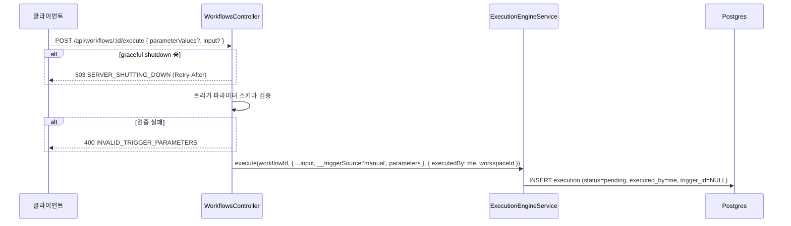
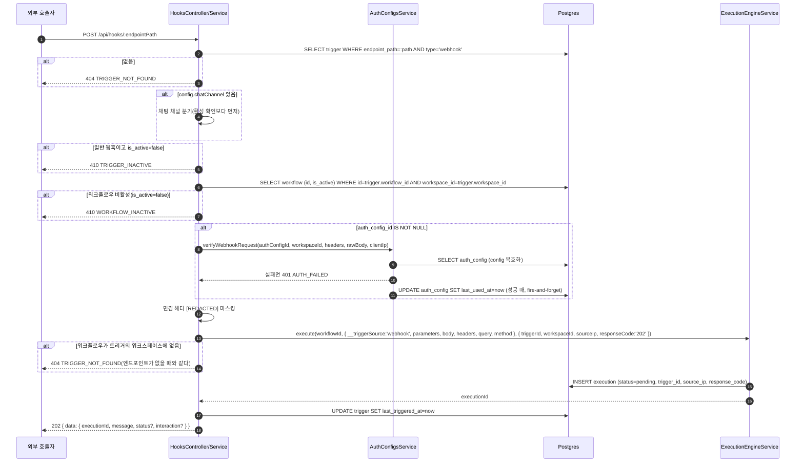
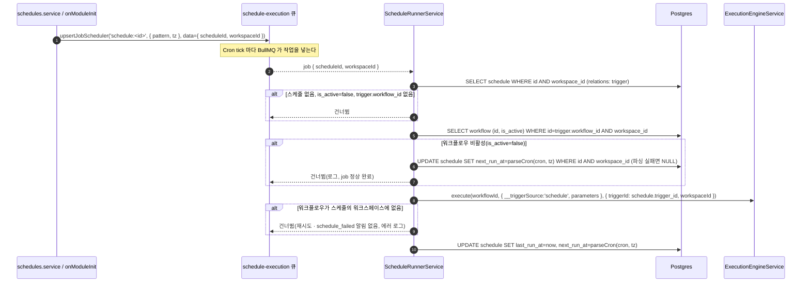
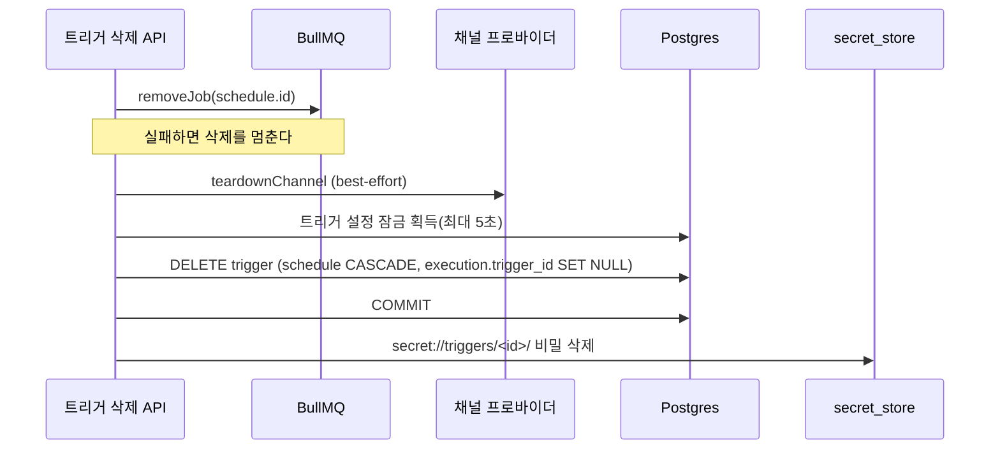
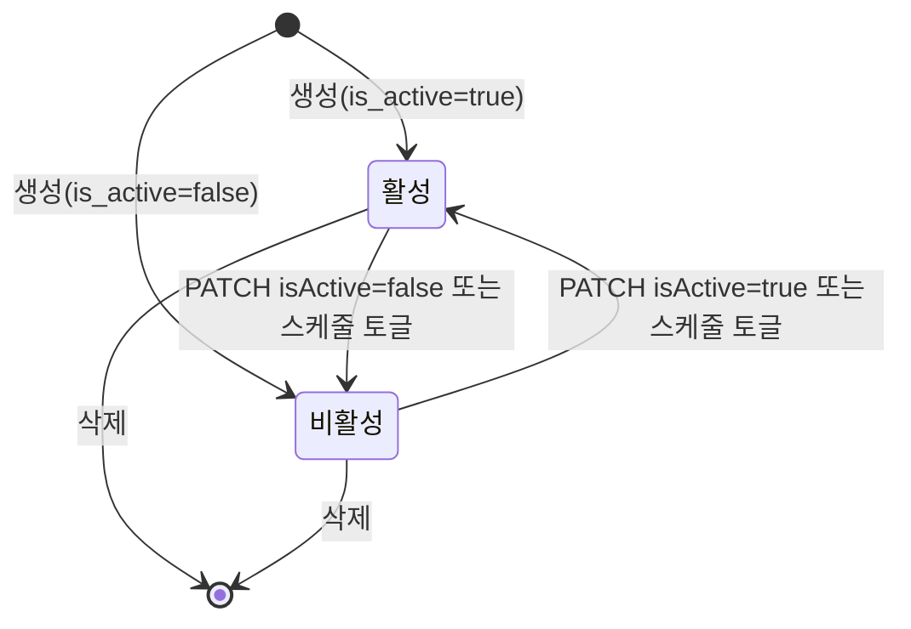

## 개요

이 문서는 [트리거 데이터와 흐름](CLE-TRIG-DATA.md) 의 하위 문서로 수동 · 웹훅 · 스케줄 · 채팅 채널 진입 흐름, 트리거 삭제 때의 자원 해제 순서, 저장소 매핑, 상태 전이를 정한다. 코드 위치는 부모 문서의 [구현 위치](CLE-TRIG-DATA.md#구현-위치) 에 모아 둔다.

## 진입 흐름

### 수동 실행

컨트롤러는 `WorkflowsController`(`@Post(':id/execute')`)다. 웹훅과 같이 `__triggerSource:'manual'` 마커와 검증한 `parameters` 를 입력에 찍는다. SIGTERM 을 받은 뒤의 503 은 [장애 복구와 안전 종료](../CLE-EXEC/CLE-EXEC-RECOVERY.md) 가 정한다. 같은 `INVALID_TRIGGER_PARAMETERS` 검증을 저장 경로(`POST /:id/save`, `WorkflowsService.validateManualTrigger` → `validateTriggerParameterSchema`)도 같은 헬퍼로 해 잘못된 파라미터 스키마를 저장 때 미리 막는다. 복원 경로 `restoreVersion` 은 예외다([수동 트리거 노드](../CLE-NODE-TRIG/CLE-NODE-MANUAL.md)).

### 웹훅 진입

웹훅 수신의 단계 순서와 각 단계의 규칙은 [웹훅](CLE-TRIG-WEBHOOK.md) 이 정한다. 아래 그림은 그 흐름에서 저장소를 읽고 쓰는 지점만 보여 준다.

트리거가 활성이어도 워크플로우가 비활성이면 `410 WORKFLOW_INACTIVE` 다. 확인 자리, 조회 범위, 남지 않는 기록은 [워크플로우 활성 관문](CLE-TRIG-DATA.md#워크플로우-활성-관문) 이 정한다.

202 응답 본문의 모양은 [웹훅 「수신 API」](CLE-TRIG-WEBHOOK.md#수신-api) 가 정한다. 트리거의 `config.interaction.enabled` 가 참이면 `HooksService` 가 결과에 `status` 와 `interaction` 을 더한다. `HooksController` 는 `HooksService` 가 돌려준 결과에 `message` 를 더한다. 전역 `TransformInterceptor` 가 그 결과를 `{ data }` 로 감싼다. 실행 단위 토큰의 발급과 저장은 [EIA 데이터와 흐름](../CLE-IX/CLE-EIA-DATA.md#토큰-발급) 이 정한다. 채팅 채널 분기의 Slack challenge · Discord PING 응답, 인터랙션 요청의 기본 인터랙션 응답, 네이티브 모달 응답은 감싸지 않고 그대로 보낸다([채팅 채널 분기](#채팅-채널-분기)). 이 문서와 부모 문서에 적은 `{ executionId: 'ignored' }` 는 `data` 감싸기와 `message` 를 뺀 줄임 표기다.

진입 앞단에서 `PublicWebhookThrottleGuard` 가 공개 웹훅에 IP 단위 요청 빈도 제한과 본문 32KB 제한을 먼저 적용한다. 채팅 채널 트리거는 `auth_config_id` 가 없어도 이 가드의 대상이 아니다([웹훅 「요청 제한과 남용 방어」](CLE-TRIG-WEBHOOK.md#요청-제한과-남용-방어)). 카운터는 Redis fixed-window 다([저장소 매핑](#저장소-매핑)). 같은 라우트의 두 번째 공개 엔드포인트 `GET /api/hooks/:endpointPath/embed-config`(웹채팅 위젯 임베드 설정 조회, [웹채팅 보안](../CLE-WEBCHAT/CLE-WEBCHAT-SECURITY.md))는 실행을 시작하지 않는다.

### 스케줄 발사

스케줄은 BullMQ job scheduler 로 발사한다. DB polling 이나 sweep 은 없다. 스케줄 생성·수정 때와 서버 부팅 때 `queue.upsertJobScheduler('schedule:<id>', { pattern: cron, tz: timezone })` 로 등록하고 BullMQ 가 Cron tick 마다 작업을 직접 넣는다.

- 큐 payload 는 `{ scheduleId, workspaceId }` 이고 processor 는 두 키로 스케줄을 조회한다.
- 마지막 UPDATE 는 `execute()` 가 `executionId` 를 돌려준 뒤에만 한다. 스케줄이 없거나 비활성이거나 워크플로우가 연결되지 않아 건너뛸 때와 실행을 시작하지 못했을 때는 `last_run_at` · `next_run_at` 을 바꾸지 않는다. 워크플로우가 비활성이라 건너뛸 때는 `next_run_at` 만 다음 Cron 발화 시각으로 옮긴다([워크플로우 활성 관문](CLE-TRIG-DATA.md#워크플로우-활성-관문)).
- `next_run_at` 은 발사를 일으키지 않는다. 발사는 BullMQ job scheduler 가 전부 맡고 `next_run_at` 은 processor 가 화면 표시용으로 다시 계산해 저장하는 정보성 컬럼이다([다음 실행 계산](#다음-실행-계산)).
- processor 는 `trigger.is_active` 를 직접 보지 않고 `schedule.is_active` 만 확인한다. 양방향 동기화가 트리거 쪽 토글도 `schedule.is_active` 에 반영하므로 어느 화면에서 토글해도 발사가 일관되게 제어된다.
- processor 는 그다음 워크플로우 활성 상태를 확인하고 비활성이면 실행을 만들지 않는다. 건너뛸 때의 처리(`next_run_at` 갱신, 재시도와 알림 없음, 다음 발화의 재확인)는 [워크플로우 활성 관문](CLE-TRIG-DATA.md#워크플로우-활성-관문) 이 정한다.
- `trigger_id` 를 넘겨야 실행 내역 화면이 출처를 `schedule` 로 분류한다([스케줄](CLE-TRIG-SCHEDULE.md)).

### 채팅 채널 분기

`trigger.config.chatChannel` 이 있으면 웹훅 진입은 `handleChatChannelWebhook` 로 가서 일반 흐름의 `is_active` 410 관문, 인증 설정 인증, 트리거 파라미터 스키마 검증을 거치지 않는다. 대신 채널 프로바이더별 인바운드 서명으로 검증한다(Telegram `X-Telegram-Bot-Api-Secret-Token`, Slack `X-Slack-Signature`, Discord `X-Signature-Ed25519`). 비활성 트리거도 서명 검증을 먼저 한다(실패하면 401). 통과하면 update 를 조용히 무시하고 `202` 와 `{ executionId: 'ignored' }` 로 답한다. 인터랙션 요청이면 `200` 과 기본 인터랙션 응답이다(아래 문단). 비활성 트리거는 수신 확인을 포함해 프로바이더 API 를 부르지 않는다. 워크플로우가 비활성이면 새 실행을 시작하는 자리에서만 같은 응답으로 답한다. handshake 와 진행 중인 대화는 워크플로우가 비활성이어도 처리한다(아래 표).

인터랙션 요청은 프로바이더가 3초 안에 `200` 과 정해진 본문을 받아야 하는 요청이다. Discord 컴포넌트(type 3) · 모달 제출(type 5) · 슬래시 명령(type 2)과 Slack Interactivity(`block_actions` · `view_submission` 등)가 해당한다. 서명 검증 직후 채널 어댑터 훅 `defaultInteractionResponse` 가 요청 본문만 보고 기본 인터랙션 응답을 정한다. Discord 컴포넌트 · 모달 제출은 `{ type: 6 }`, Discord 슬래시 명령은 본인에게만 보이는 수신 문구나 도움말을 담은 `{ type: 4 }`, Slack Interactivity 는 빈 본문이다. 인터랙션 요청에는 `202` 대신 `200` 으로 답한다. 트리거가 비활성일 때와 update 무시, 대기 실행에 전달, 새 실행, 워크플로우 없음, 워크플로우 비활성, 중복 update, 한도 초과 가운데 어느 경로로 끝나도 같다. 처리 경로가 따로 정한 응답이 있으면 그것을 먼저 쓴다. 모달을 열 때는 `{ type: 9 }`, Form 모달 제출 결과는 `{ type: 4 }` 다. 그래서 이 문서에서 채팅 채널이 `202` 와 `{ executionId: 'ignored' }` 로 답한다고 적은 곳도 인터랙션 요청이면 `200` 과 기본 인터랙션 응답이다. 인터랙션 요청으로 새 실행을 시작하면 실행 행의 `response_code` 는 실제 응답 코드인 `'200'` 이다. Discord PING 과 자동 완성, Slack `url_verification` · Events API 메시지 · 슬래시 명령, Telegram update 는 인터랙션 요청이 아니어서 `202` 나 handshake 응답으로 답한다. 응답 계약의 기준은 [채팅 채널 「인바운드 HTTP 응답 계약」](../CLE-CHAT/CLE-CHAT-CORE.md#인바운드-http-응답-계약) 이고 프로바이더별 본문은 [Discord 어댑터 「인바운드 응답」](../CLE-CHAT/CLE-CHAT-DISCORD.md#인바운드-응답) 과 [Slack 어댑터 「인바운드 응답」](../CLE-CHAT/CLE-CHAT-SLACK.md#인바운드-응답) 이 정한다.

| 단계 | 처리(`hooks.service.ts` `handleChatChannelWebhook`) |
|------|----------------------------------------------------|
| 채널 어댑터 조회 | `channelAdapterRegistry.get(config.provider)`. 지원하지 않으면 400 |
| 인바운드 인증 | `chatChannelInboundAuthenticator.verify(trigger.id, config, headers, rawBody)`(채널 프로바이더별 서명) |
| 기본 인터랙션 응답 | `adapter.defaultInteractionResponse(body, config)`. 인터랙션 요청이면 기본 인터랙션 응답을 내고 아니면 없다. 외부 호출 없이 본문만 본다. 아래 단계가 어디서 끝나도 이 값이 있으면 결과에 덧씌워 `200` 으로 답한다(`withDefaultInteractionResponse`). 처리 경로가 따로 정한 응답이 있으면 그것이 먼저다 |
| 트리거 활성 확인 | 트리거가 비활성이면 `{ executionId: 'ignored' }`. 인터랙션 요청이면 기본 인터랙션 응답이다. handshake 를 포함해 아래 단계를 하나도 하지 않고 프로바이더 API 도 부르지 않는다 |
| handshake | Slack `url_verification` 은 challenge 응답, Discord PING(type=1)은 `{ type: 1 }` 응답. 둘 다 실행 없이 바로 돌려준다 |
| `parseUpdate` 가 null | 그룹·봇·지원하지 않는 update. `maybeNotifyIgnored` 로 안내한 뒤 무시(`{ executionId: 'ignored' }`) |
| native modal | `open_form_modal` / `form_submission` 이면 어댑터가 modal 응답 JSON 을 돌려준다(`interactionHttpResponse`, 컨트롤러가 `res.json`) |
| 진행 중인 실행 + 인터랙션 | `interactionService.interact` 로 같은 프로세스 안에서 전달(`text_message` → submit_message, `button_callback` → click_button) |
| 워크플로우 활성 확인 | 새 실행을 시작하기 직전에 확인한다. 워크플로우가 비활성이면 `{ executionId: 'ignored' }` 로 답하고 실행을 만들지 않는다. `/start` 의 기존 실행 취소보다 앞이다. 막는 update 와 응답은 [워크플로우 활성 관문](CLE-TRIG-DATA.md#워크플로우-활성-관문) 이 정한다 |
| 새 대화 | `execute(workflowId, { __triggerSource:'webhook', chatChannel:{ provider, conversationKey, channelUserKey }, ... }, { triggerId, workspaceId, ..., responseCode })` 와 `ChannelConversation` upsert. `responseCode` 는 인터랙션 요청이면 `'200'` 이고 그 밖에는 `'202'` 다. 활성 실행이 있을 때 온 `/start` 면 기존 실행을 먼저 취소한다([채팅 채널](../CLE-CHAT/CLE-CHAT-CORE.md)). 워크플로우가 트리거의 워크스페이스에 없으면 실행 없이 `{ executionId: 'ignored' }` 와 `degraded`([채팅 채널 「인바운드 HTTP 응답 계약」](../CLE-CHAT/CLE-CHAT-CORE.md#인바운드-http-응답-계약)) |

채팅 채널 인바운드 단계 전체의 순서는 [채팅 채널 「인바운드 관문 순서」](../CLE-CHAT/CLE-CHAT-CORE.md#인바운드-관문-순서) 가 정한다. 위 표의 행도 그 순서를 따르고 `/help` · `/cancel` 같은 단계는 적지 않았다. 이 경로의 응답 JSON·서명 검증·form modal 세부는 [채팅 채널](../CLE-CHAT/CLE-CHAT-CORE.md) 과 [채팅 채널 어댑터 규약](../CLE-CHAT/CLE-CHAT-ADAPTER.md) 이 정한다. 이 문서는 웹훅 진입이 `chatChannel` 유무로 두 갈래로 나뉜다는 라우팅 사실만 정한다.

## 트리거 삭제와 자원 해제

트리거 행을 없애는 모든 경로(트리거 화면 삭제, 스케줄 화면 삭제, 워크플로우 삭제, 워크스페이스 삭제)는 그 트리거의 자원을 정리한다. 무엇을 정리하고 실패하면 어떻게 하는지는 [트리거 관리 「자원 정리」](CLE-TRIG-MANAGE.md#자원-정리) 가 정한다. 이 절은 정리 순서와 그 이유를 정한다.

| 자원 | 시점 | 이유 |
|------|------|------|
| 외부 자원: 스케줄 BullMQ 작업, 채널 프로바이더 등록(해제는 best-effort), listener 레지스트리 | 행 삭제 전, DB 트랜잭션 밖 | 채팅 채널 해제는 `secret_store` 의 봇 토큰을 읽는다(Telegram·Discord). 외부 호출은 트리거 설정 잠금 안에 두지 않는다 |
| 다른 서버 인스턴스의 listener 레지스트리 항목(Redis `chat-channel:listener` 변경 메시지) | 행 삭제 전 외부 해제 단계에서 자기 서버 인스턴스의 항목을 뺀 뒤, best-effort. 응답은 최대 2초까지 기다린다 | listener 레지스트리는 서버 인스턴스마다 따로 있다. 해제 대상은 [채팅 채널 「R8 트리거 단위 listener 정책」](../CLE-CHAT/CLE-CHAT-CORE.md#r8-트리거-단위-listener-정책) 이 정한다. 실패 정책의 근거는 [채팅 채널 「R-CC-30 트리거 단위 listener 레지스트리의 변경을 Redis pub/sub 로 모든 서버 인스턴스에 알린다」](../CLE-CHAT/CLE-CHAT-CORE.md#r-cc-30-트리거-단위-listener-레지스트리의-변경을-redis-pubsub-로-모든-서버-인스턴스에-알린다) 에 있다 |
| 트리거 단위 토큰(`itk_*`)으로 연 SSE 스트림(모든 서버 인스턴스, `eia:sse:close`) | 행 삭제가 커밋된 뒤, best-effort | 트리거가 사라지면 그 토큰도 무효가 된다. 네 삭제 경로 모두 같다. 닫을 트리거는 비밀 삭제가 쓰는 열거를 그대로 쓰고 새 조회를 더하지 않는다. 닫는 방식은 [EIA 데이터와 흐름 「트리거 단위 토큰」](../CLE-IX/CLE-EIA-DATA.md#트리거-단위-토큰) 이 정한다 |
| `secret_store` 의 `secret://triggers/<id>/` 비밀 | 행 삭제가 커밋된 뒤 | 삭제와 겹친 쓰기가 비밀을 고아로 남기지 않게 한다. 쓰기 쪽의 "쓰지 못했으면 되돌린다" 보상과 짝이다 |

트리거 화면에서 스케줄 유형 트리거를 지우는 순서는 다음과 같다. 이 그림은 순서만 보인다. 정리 대상은 위 표가 기준이다.

워크플로우·워크스페이스 삭제는 비밀을 지울 트리거를 부모 행을 잠근 뒤 같은 트랜잭션 안에서 열거한다. 잠근 뒤에는 그 부모를 참조하는 트리거 INSERT 가 FK 검사에서 막히므로 열거에서 빠지는 트리거가 없다.

정리가 닿지 않는 창은 외부 자원 쪽에 남는다.

- 외부 해제용 열거 뒤에 새로 생긴 트리거.
- 해제한 뒤 행을 지우기 전에 동시 요청이 다시 만든 채널 프로바이더 등록이나 스케줄 작업.
- listener 레지스트리 해제를 다른 서버 인스턴스에 알린 뒤 행 삭제가 실패한 경우. 그 트리거는 모든 서버 인스턴스의 레지스트리에서 빠진다. 트리거가 활성이면 다음 구독 재확립이나 재시작 때의 일괄 등록이 다시 넣는다([채팅 채널 「R-CC-30 트리거 단위 listener 레지스트리의 변경을 Redis pub/sub 로 모든 서버 인스턴스에 알린다」](../CLE-CHAT/CLE-CHAT-CORE.md#r-cc-30-트리거-단위-listener-레지스트리의-변경을-redis-pubsub-로-모든-서버-인스턴스에-알린다)).
- listener 레지스트리를 해제한 뒤 행을 지우기 전에 그 트리거를 켜는 PATCH 가 커밋된 경우. 항목이 모든 서버 인스턴스에 다시 생긴다. 그 항목은 행을 지운 뒤에도 남는다. dispatcher 가 DB 에서 트리거를 찾지 못해 건너뛰므로 메시지가 잘못 나가지는 않는다.
- 워크스페이스 삭제의 권한 선검사와 잠금 안 재검사 사이에 역할이 바뀌어 재검사가 거부한 경우. 워크스페이스는 남지만 외부 해제는 이미 끝났다. 서버 error 로그로 드러난다.
- 행 삭제 커밋과 `secret_store` 비밀 삭제 사이에 프로세스가 죽으면 비밀이 남는다.

## 저장소 매핑

### Postgres

| 테이블 | 흐름 | 읽고 쓰는 컬럼 | 인덱스·제약 |
|--------|------|---------------|-------------|
| `trigger` | 생성 | INSERT `workspace_id, workflow_id, type, name, is_active, config, endpoint_path?, auth_config_id?` | [Trigger 제약과 인덱스](CLE-TRIG-DATA-MODEL.md#제약과-인덱스) |
| `webhook_endpoint_reservation` | 트리거 생성·경로 변경(DB 트리거) | INSERT `endpoint_path, workspace_id` … `ON CONFLICT DO NOTHING`. 지우지 않는다 | PK `(endpoint_path)`. 주인이 다르면 `unique_violation`(라벨 `webhook_endpoint_reservation_owner`) → 409. `(workspace_id)` 부분 인덱스(V133) |
| `trigger` | 발사 | UPDATE `last_triggered_at` | 없음 |
| `workflow` | 웹훅 · 채팅 채널 · 스케줄 진입(워크플로우 활성 관문) | SELECT `id, is_active` WHERE `id` 와 `workspace_id`(실행을 시작하는 쪽의 워크스페이스) | PK `(id)` |
| `schedule` | 생성 | INSERT `workspace_id, trigger_id, cron_expression, timezone, is_active, next_run_at, parameter_values={}` | 복합 FK `(trigger_id, workspace_id)` CASCADE |
| `schedule` | 발사 뒤 | UPDATE `last_run_at, next_run_at`(정보성 재계산, 발사를 일으키지 않음) | `(workspace_id, next_run_at)`(V110) |
| `schedule` | 비활성 워크플로우로 발화를 건너뜀 | UPDATE `next_run_at` 만, WHERE `id` 와 `workspace_id`. Cron 을 해석하지 못하면 NULL | `(workspace_id, next_run_at)`(V110) |
| `auth_config` | 웹훅 인증(읽기) | SELECT `type, config(복호화), ip_whitelist, is_active` | 복합 FK from `trigger (auth_config_id, workspace_id)` |
| `auth_config` | 인증 성공(쓰기) | UPDATE `last_used_at`(fire-and-forget, 트랜잭션 밖) | 없음 |
| `execution` | 진입 | INSERT([실행 데이터와 흐름](../CLE-EXEC/CLE-EXEC-DATA.md)) | `trigger_id` FK SET NULL(트리거를 지워도 실행 기록 보존) |

### Redis

| 큐·키 | 생산자 | 소비자 | payload |
|-------|--------|--------|---------|
| BullMQ `schedule-execution` | BullMQ job scheduler(`upsertJobScheduler`, Cron pattern 과 tz). 서버 sweep 이 아니다 | `ScheduleRunnerService`(`@Processor`) | `{ scheduleId, workspaceId }` |
| BullMQ `execution-run` | `ExecutionEngineService.execute()`. 세 트리거 모두 pending 행을 INSERT 한 뒤 발행한다. 트리거 유형이 작업 우선순위를 정한다(manual=1 > webhook=2 > schedule=3). 호출부가 `ExecuteOptions.triggerType`(`Trigger.type`)을 넘기고 `execute()` 는 `executedBy` 를 먼저 판정하며 넘기지 않은 트리거는 webhook 으로 간주한다 | `execution-run` 워커(work-stealing) | `{ executionId, input }`(jobId=executionId 로 중복 제거). 기준은 [큐 워커와 동시 실행 제한](../CLE-EXEC/CLE-EXEC-WORKER.md) |
| 공개 웹훅 IP 카운터 `wh:rl:min:<ip>`·`wh:rl:hour:<ip>` | `PublicWebhookQuotaService`(INCR+EXPIRE pipeline) | 같은 서비스 | fixed-window 카운터. 키 정의는 [웹훅](CLE-TRIG-WEBHOOK.md) |

큐와 키의 전체 목록은 [비동기 큐와 Redis 키 목록](../CLE-PLAT/CLE-PLAT-QUEUE.md) 에 있다.

### 외부

| 대상 | 흐름 |
|------|------|
| HTTP 호출자 | 웹훅 진입 |
| 채널 프로바이더 | 트리거 삭제 때 등록 해제(best-effort) |

## 상태 전이

### 트리거 활성 상태

| 상태 | 뜻 |
|------|----|
| `true` | 웹훅 라우팅이 켜져 있다. 스케줄은 BullMQ job scheduler 에 등록돼 있다. 채팅 채널 트리거를 켜는 PATCH 는 커밋 뒤 그 트리거를 트리거 단위 listener 레지스트리에 등록한다([채팅 채널 「R8 트리거 단위 listener 정책」](../CLE-CHAT/CLE-CHAT-CORE.md#r8-트리거-단위-listener-정책)) |
| `false` | 일반 웹훅 호출은 `410 Gone`(`TRIGGER_INACTIVE`)이다. 없는 트리거의 404 와 구분된다. 채팅 채널 트리거는 410 이 아니라 inbound 서명 검증 뒤 `202` 와 `{ executionId: 'ignored' }` 다. 인터랙션 요청이면 `200` 과 기본 인터랙션 응답이다([채팅 채널 분기](#채팅-채널-분기)). 스케줄은 스케줄 API 나 트리거 API 로 토글하면 `removeJob` 으로 BullMQ 작업을 해제한다 |

스케줄과의 활성 상태 동기화는 양방향이다([트리거와 스케줄 동기화](CLE-TRIG-DATA-MODEL.md#트리거와-스케줄-동기화)). 워크플로우 활성 상태(`workflow.is_active`)는 이 값과 따로 본다. 트리거가 활성이어도 워크플로우가 비활성이면 웹훅 · 채팅 채널 · 스케줄로 새 실행이 생기지 않는다. 워크플로우를 비활성으로 바꿔도 트리거와 스케줄의 `is_active` 는 바뀌지 않는다([워크플로우 활성 관문](CLE-TRIG-DATA.md#워크플로우-활성-관문)).

### 다음 실행 계산

`cron-parser`(`CronExpressionParser.parse`)로 `cron_expression + timezone` 을 해석한다. 실제 발사 시각은 BullMQ job scheduler 가 정하고 `next_run_at` 은 화면 표시용 정보성 컬럼이다. 다시 계산해 저장하는 때는 세 가지다. 스케줄 생성·수정 때(`computeNextRuns`), processor 가 실행을 시작한 직후, 워크플로우가 비활성이라 발화를 건너뛴 직후다. 뒤의 둘은 `now` 기준 다음 Cron tick 이다(`schedule-runner` `nextRunAtAfter`).

Cron 파싱이 실패하면 `next_run_at` 은 NULL 이다. processor 의 재계산(실행 직후, 건너뛴 직후)에서 파서가 던지거나(`schedule-runner`), Cron·시간대 수정 때 다음 발생 시각을 구하지 못하면(`computeNextRuns` 가 빈 결과) NULL 로 저장한다. 건너뛴 직후의 UPDATE 는 NULL 을 값으로 넣는다. 값을 비워 두면 그 컬럼이 SET 에서 빠져 지난 시각이 남기 때문이다. 정보성 컬럼이므로 NULL 이어도 발사에는 영향이 없다. 발사는 BullMQ job scheduler 가 하고 이 컬럼을 읽지 않는다.

## Rationale

### 웹훅 202 응답 모양의 기준은 웹훅 문서에 있다 (2026-10-09)

이 문서는 웹훅 202 응답을 `message` 없이 `{ executionId }` 와 인터랙션 블록으로 적어 코드와 달랐다. 응답 모양은 지금 코드에 맞춘다. 사용자에게 묻지 않고 기본값으로 정해 알렸다(NERV Task `CLE-T-M6PERB`).

모양과 그 근거의 기준은 [웹훅](CLE-TRIG-WEBHOOK.md#웹훅-202-응답-모양을-지금-코드에-맞춘다-2026-10-09) 의 「웹훅 202 응답 모양을 지금 코드에 맞춘다」 다. 이 문서는 `message` 를 더하는 곳과 `{ data }` 로 감싸는 곳만 적는다. 같은 모양을 여러 문서에 자세히 적으면 저마다 두 번째 기준이 된다.
