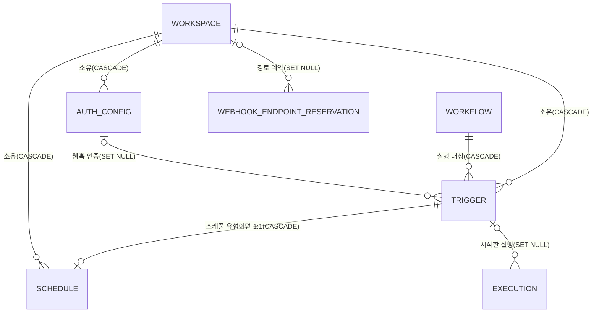

> 구현 상태: 구현됨 · 원문: `spec/data-flow/10-triggers.md`, `spec/1-data-model.md` (§2.8 Trigger, §2.8.1 WebhookEndpointReservation, §2.9 Schedule, §2.9.1 동기화 규칙, §2.17 AuthConfig, Rationale 네 절), `spec/2-navigation/2-trigger-list.md` (§4.3 자원 정리의 순서) · 용어: [용어 사전](../CLE-GLOSSARY.md)

## 개요

이 문서는 트리거 영역의 엔티티 네 개(트리거 `Trigger`, 엔드포인트 경로 예약 `WebhookEndpointReservation`, 스케줄 `Schedule`, 인증 설정 `AuthConfig`)의 컬럼과 제약, 그리고 트리거가 워크플로우 실행을 시작하기까지의 데이터 흐름을 정한다.

워크플로우 실행을 시작하는 진입점은 세 가지다.

- 수동: 사용자가 화면의 Run 버튼으로 바로 실행한다(`POST /api/workflows/:id/execute`).
- 웹훅: 외부 HTTP 호출이 `/api/hooks/:endpointPath` 로 들어온다. 일반 웹훅과 채팅 채널 inbound(Telegram·Slack·Discord) 두 갈래로 나뉜다.
- 스케줄: BullMQ job scheduler 가 Cron 표현식에 따라 직접 발사한다. DB polling 이나 sweep 은 없다.

세 진입점은 모두 `ExecutionEngineService.execute(workflowId, inputData, options)` 로 모인다. 세 번째 인자는 `ExecuteOptions` 객체다. 트리거 경로는 `{ triggerId }`(웹훅은 `sourceIp`·`responseCode` 를 더한다), 수동 실행은 `{ executedBy }` 를 넘기고 호출부가 `triggerType` 을 함께 넘긴다. 모든 경로가 실행을 시작하는 워크스페이스 `workspaceId` 도 넘긴다([실행 컨텍스트](../CLE-EXEC/CLE-EXEC-CONTEXT.md#트리거-입력-파라미터-싣기)). `execute()` 는 실행 행을 `status=pending` 으로 INSERT 한 뒤 BullMQ 시작 큐(`execution-run`)에 작업을 발행하고 곧바로 `executionId` 를 돌려준다. 트리거 유형이 작업 우선순위를 정한다([큐 워커와 동시 실행 제한](../CLE-EXEC/CLE-EXEC-WORKER.md)).

웹훅과 스케줄 진입점은 `execute()` 를 부르기 전에 워크플로우 활성 상태를 확인하고 비활성 워크플로우로는 새 실행을 만들지 않는다. 채팅 채널의 진행 중인 대화는 이어지고 수동 실행은 비활성 워크플로우도 실행한다. 자세한 규칙은 [워크플로우 활성 관문](#워크플로우-활성-관문) 이 정한다.

범위 밖 주제는 다음 문서가 정한다.

- 트리거 화면·API·삭제 정책·동시 쓰기 직렬화: [트리거 관리](CLE-TRIG-MANAGE.md)
- 스케줄 화면·API: [스케줄](CLE-TRIG-SCHEDULE.md)
- 웹훅 수신 단계 순서·인증 검증·남용 방어: [웹훅](CLE-TRIG-WEBHOOK.md)
- 인증 설정 화면·필드 마스킹·평문 보기: [외부 호출 인증 설정](CLE-TRIG-AUTHCFG.md)
- 실행 엔티티와 실행 데이터 흐름: [실행 데이터와 흐름](../CLE-EXEC/CLE-EXEC-DATA.md)
- 트리거의 EIA 컬럼: [EIA 데이터와 흐름](../CLE-IX/CLE-EIA-DATA.md). 트리거의 채팅 채널 컬럼: [채팅 채널 데이터와 흐름](../CLE-CHAT/CLE-CHAT-DATA.md)
- `secret://` 비밀 저장: [시크릿 저장소](../CLE-INT/CLE-INT-SECRET.md)
- 전체 엔티티 지도와 FK 규칙: [데이터 모델 개요](../CLE-PLAT/CLE-PLAT-DATA.md)

## 엔티티 관계

트리거는 워크스페이스와 워크플로우에 속하고 둘 중 하나가 지워지면 함께 지워진다. 웹훅 트리거는 인증 설정을 하나 연결할 수 있다. 스케줄 유형 트리거에는 스케줄 행이 정확히 하나 붙는다. 엔드포인트 경로 예약은 트리거가 아니라 워크스페이스를 가리키므로 트리거가 지워져도 남는다. 실행은 트리거를 가리키고 트리거가 지워지면 그 칸만 NULL 이 된다.

## 하위 문서

이 문서에는 요구사항 줄이 없다. 그래서 하위 문서가 맡는 요구사항 번호도 없다.

- [트리거 데이터와 흐름 — 엔티티](CLE-TRIG-DATA-MODEL.md): 트리거 · 스케줄 · 인증 설정의 컬럼, `config` 서브 필드, 제약과 인덱스, 트리거와 스케줄 동기화, 인증 설정 `config` 스키마와 그 결정. 맡는 요구사항: 없음
- [트리거 데이터와 흐름 — 웹훅 경로 예약](CLE-TRIG-DATA-ENDPOINT.md): 엔드포인트 경로의 전역 유일성과 지우거나 바꾼 경로의 영구 예약. 맡는 요구사항: 없음
- [트리거 데이터와 흐름 — 진입 흐름과 저장소](CLE-TRIG-DATA-FLOW.md): 수동 · 웹훅 · 스케줄 · 채팅 채널 진입 흐름, 트리거 삭제 때의 자원 해제 순서, 저장소 매핑(Postgres · Redis · 외부), 트리거 활성 상태와 다음 실행 계산. 맡는 요구사항: 없음

워크플로우 활성 관문은 세 진입 경로에 걸치므로 이 문서에 둔다.

## 워크플로우 활성 관문

워크플로우가 비활성이면(`workflow.is_active=false`) 웹훅 · 채팅 채널 · 스케줄 이벤트로 새 실행이 생기지 않는다. 이 규칙의 기준은 이 절이다. 경로별 응답, 확인 위치, 조회 범위, 관문을 거치지 않는 경로를 여기서 정한다. [웹훅](CLE-TRIG-WEBHOOK.md) · [스케줄](CLE-TRIG-SCHEDULE.md) · [채팅 채널](../CLE-CHAT/CLE-CHAT-CORE.md) 은 자기 경로에만 있는 차이를 적고 나머지는 이 절을 가리킨다. 응답은 트리거가 비활성일 때와 같은 규칙을 따른다. 채팅 채널의 인터랙션 요청은 두 경우 모두 `200` 과 기본 인터랙션 응답이다([채팅 채널 분기](CLE-TRIG-DATA-FLOW.md#채팅-채널-분기)). 세 경로는 공용 함수 `isWorkflowInactive(repo, workflowId, workspaceId)` 로 확인한다. 결정의 배경은 [Rationale](#꺼진-워크플로우를-실행-관문으로-둔-결정-2026-10-10) 에 있다.

| 경로 | 확인 위치 | 트리거가 비활성일 때 | 워크플로우가 비활성일 때 |
|------|-----------|----------------------|--------------------------|
| 일반 웹훅 | 트리거 활성 확인 바로 뒤. 인증 설정 인증 · IP 화이트리스트 · 파라미터 검증 · 실행 생성보다 앞 | `410 Gone`, `TRIGGER_INACTIVE` | `410 Gone`, `WORKFLOW_INACTIVE`(메시지 `Workflow of this webhook trigger is inactive`) |
| 채팅 채널 인입 | 새 실행을 시작하기 직전. `/start` 의 기존 실행 취소보다 앞 | 서명 검증 직후 `202` 와 `{ executionId: 'ignored' }`. 인터랙션 요청이면 `200` 과 기본 인터랙션 응답. handshake 를 포함해 모든 update 를 무시하므로 진행 중인 대화도 끊긴다. 프로바이더 API 는 부르지 않는다 | 새 실행만 막는다. 활성 실행이 없을 때 온 첫 메시지와 `/start` 는 `202` 와 `{ executionId: 'ignored' }`. 인터랙션 요청이면 `200` 과 기본 인터랙션 응답([채팅 채널 분기](CLE-TRIG-DATA-FLOW.md#채팅-채널-분기)). handshake 에 답하고 진행 중인 대화는 이어진다 |
| 스케줄 발사 | 스케줄 비활성 확인 · 워크플로우 미연결 확인 다음. `execute()` 보다 앞 | 토글이 job scheduler 를 해제한다. 이미 들어온 작업은 `schedule.is_active=false` 로 건너뛴다 | 건너뛴다. `next_run_at` 만 다음 Cron 발화 시각으로 옮기고 로그를 남긴 뒤 job 을 정상 완료한다 |

채팅 채널 인입의 단계 전체 순서는 [채팅 채널 「인바운드 관문 순서」](../CLE-CHAT/CLE-CHAT-CORE.md#인바운드-관문-순서) 를 따른다.

- 비활성일 때 남지 않는 것: 실행 행, `trigger.last_triggered_at` 갱신, 호출 이력, 스케줄 `last_run_at` 갱신, `schedule_failed` 알림. 일반 웹훅은 인증 전에 답하므로 인증 설정 `last_used_at` 도 바뀌지 않는다.
- 채팅 채널은 새 실행을 시작하는 경우만 막는다. 막히는 것은 활성 실행이 없을 때 온 첫 메시지와 `/start` 다. 활성 실행이 있을 때 온 `/start` 도 ignored 이고 기존 실행은 취소하지 않는다. 확인이 기존 실행 취소보다 앞이기 때문이다.
- 진행 중인 대화는 워크플로우가 비활성이어도 이어진다. handshake(Slack `url_verification` challenge, Discord PING type 1), update 파싱, `/help`, 대화 조회와 `/cancel`, 폼 모달, 입력 전달은 워크플로우가 활성일 때와 같다. 입력을 기다리는 실행에는 답장 · 버튼 · 폼 제출이 그대로 전달된다.
- 비활성 트리거는 다르다. 서명 검증 직후 모든 update 를 무시하므로 handshake 에 답하지 않고 진행 중인 대화도 끊긴다. 입력을 기다리는 실행이 있어도 메시지를 전달하지 않는다. 이 순서를 바꿀지는 [미결 사항](#미결-사항)에 있다.
- 스케줄: 건너뛸 때 `next_run_at` 만 다음 Cron 발화 시각으로 옮긴다. Cron 을 해석하지 못하면 NULL 로 둔다. UPDATE 는 그 컬럼 하나만 쓰므로 그사이 사용자가 고친 다른 컬럼을 덮어쓰지 않는다. `last_run_at` 은 바꾸지 않는다. 스케줄 목록의 「다음 실행」 칸에 지난 시각이 남지 않게 하려는 것이다([스케줄](CLE-TRIG-SCHEDULE.md)).
- 스케줄: 재시도하지 않고 `schedule_failed` 알림도 보내지 않는다. 스케줄 행의 활성 상태와 BullMQ job scheduler 는 그대로 둔다. 다음 Cron tick 에 다시 확인하므로 워크플로우를 활성으로 바꾸면 다음 발화부터 실행된다. 비활성인 동안 건너뛴 발화는 보충하지 않는다.
- 조회 범위: 실행을 시작하는 쪽(트리거 · 스케줄)의 워크스페이스 안에서만 워크플로우를 찾는다. `execute()` 에 넘기는 워크스페이스와 같은 값이다. 그 워크스페이스에 없으면 관문은 통과시키고 뒤의 `execute()` 가 기존 응답으로 거부한다. 일반 웹훅은 404 `TRIGGER_NOT_FOUND`, 채팅 채널은 `202` ignored 와 `degraded`, 스케줄은 에러 로그를 남기고 건너뛴다. 채팅 채널의 인터랙션 요청은 `202` 대신 `200` 과 기본 인터랙션 응답으로 답한다([채팅 채널 분기](CLE-TRIG-DATA-FLOW.md#채팅-채널-분기)).
- 빈 `workspaceId`: 값은 트리거 · 스케줄 행의 `workspace_id`(NOT NULL)에서 온다. 빈 문자열이 오면 맞는 워크플로우가 없으므로 관문은 통과하고 `execute()` 의 워크스페이스 대조가 거부한다. 엔진 대조와 같은 쪽(거부)으로 닫힌다.
- 관문을 거치지 않는 경로: 에디터 수동 실행(`POST /api/workflows/:id/execute`), 재실행, 스케줄 "지금 실행"(`POST /api/schedules/:id/run-now`), 워크플로우 호출 노드의 서브 워크플로우 실행([워크플로우 호출 노드](../CLE-NODE-FLOW/CLE-NODE-SUBWF.md)), External Interaction API 의 진행 중 실행 명령, 채팅 채널의 진행 중인 대화. 이미 진행 중인 실행은 워크플로우를 비활성으로 바꿔도 취소하지 않는다.
- 새 진입 경로: 실행을 시작하는 진입 경로를 새로 만들면 두 목록 가운데 한쪽에 더한다. 관문을 거치는 경로는 이 절의 경로 표와 `isWorkflowInactive` JSDoc 의 호출 지점 목록에 함께 더하고 거치지 않는 경로는 위 「관문을 거치지 않는 경로」 에 더한다. 빠뜨려도 자동으로 잡는 테스트는 없다([Rationale](#꺼진-워크플로우를-실행-관문으로-둔-결정-2026-10-10) 「왜 엔진이 아니라 호출부에서 확인하는가」).
- 워크플로우는 비활성 상태로 만들어진다([워크플로우 데이터와 저장 흐름](../CLE-WF/CLE-WF-DATA.md)). 웹훅 · 채팅 채널 · 스케줄로 돌리려면 워크플로우를 활성으로 바꿔야 한다.

## Trigger

→ [트리거 데이터와 흐름 — 엔티티](CLE-TRIG-DATA-MODEL.md#trigger)

### config 서브 필드

→ [트리거 데이터와 흐름 — 엔티티](CLE-TRIG-DATA-MODEL.md#config-서브-필드)

## AuthConfig

→ [트리거 데이터와 흐름 — 엔티티](CLE-TRIG-DATA-MODEL.md#authconfig)

## 진입 흐름

### 웹훅 진입

→ [트리거 데이터와 흐름 — 진입 흐름과 저장소](CLE-TRIG-DATA-FLOW.md#웹훅-진입)

## 트리거 삭제와 자원 해제

→ [트리거 데이터와 흐름 — 진입 흐름과 저장소](CLE-TRIG-DATA-FLOW.md#트리거-삭제와-자원-해제)

## 외부 의존

| 의존 | 방향 | 내용 |
|------|------|------|
| 실행 도메인 | 교차 참조 | 모든 트리거가 마지막에 들어가는 곳([실행 데이터와 흐름](../CLE-EXEC/CLE-EXEC-DATA.md)) |
| 인증 설정 | 웹훅 인증 | API Key / Bearer / Basic / HMAC. 운영 환경에서 새로 쓰는 자격 증명은 AES-256-GCM 으로 암호화한다([통합 데이터와 흐름 「암호화」](../CLE-INT/CLE-INT-DATA.md#암호화)). 인증 성공 때 `last_used_at` 갱신 |
| 시크릿 저장소 | 트리거 비밀 | `secret://triggers/<id>/` 아래 채팅 채널 비밀과 알림 서명 시크릿. 트리거 삭제 커밋 뒤 정리([시크릿 저장소](../CLE-INT/CLE-INT-SECRET.md)) |

## 미결 사항

- **비활성 트리거의 handshake**: 비활성 트리거는 서명 검증 직후 모든 update 를 무시한다. Slack `url_verification` 과 Discord PING 에도 handshake 응답 대신 `202` ignored 로 답한다. 비활성 워크플로우에서 handshake 에 답하는 이유(프로바이더가 맞는 답을 받지 못하면 URL 등록이 실패하고 Discord 는 등록 뒤에도 PING 을 보낸다)는 비활성 트리거에도 같다. 2026-11-12 결정(NERV 질문 `01a1d025-8baf-773f-95fd-201820c7cd5f`)은 비활성 트리거의 인터랙션 요청 응답만 `200` 으로 바꾸고 handshake 는 `202` 로 남겼다([Rationale](#꺼진-트리거도-인터랙션-요청에는-200-으로-답한다-2026-11-12)). 비활성 트리거도 handshake 에 답하도록 순서를 바꿀지 정해야 한다. 바꾸면 [채팅 채널 「인바운드 HTTP 응답 계약」](../CLE-CHAT/CLE-CHAT-CORE.md#인바운드-http-응답-계약) 도 함께 고친다.

## 구현 위치

- `codebase/backend/src/modules/triggers/triggers.service.ts` (트리거 CRUD, `syncScheduleActivation()`, 삭제 전 `removeJob`)
- `codebase/backend/src/modules/schedules/schedules.service.ts` (스케줄 CRUD)
- `codebase/backend/src/modules/schedules/schedule-runner.service.ts` (`SCHEDULE_QUEUE = 'schedule-execution'` 생산자와 processor. processor `process()` 의 워크플로우 활성 관문과 건너뛸 때의 `next_run_at` 재계산 `nextRunAtAfter()`)
- `codebase/backend/src/modules/hooks/hooks.controller.ts` (`/api/hooks/:endpointPath` 진입. 채팅 채널의 handshake 와 인터랙션 요청 응답은 `200` 으로 직접 보내고 그 밖에는 `202` 와 `{ data }` 봉투로 보낸다)
- `codebase/backend/src/modules/hooks/hooks.service.ts` (일반 웹훅 `handleWebhook` 과 채팅 채널 `handleChatChannelWebhook` 의 워크플로우 활성 관문. 채팅 채널은 새 실행을 시작하기 직전에 확인한다. 기본 인터랙션 응답은 서명 검증 뒤 채널 어댑터의 `defaultInteractionResponse` 로 구해 비활성 트리거 응답과 처리 결과에 덧씌운다(`withDefaultInteractionResponse`))
- `codebase/backend/src/modules/chat-channel/types.ts` (채널 어댑터 훅 `defaultInteractionResponse` 의 계약)
- `codebase/backend/src/modules/execution-engine/utils/is-workflow-inactive.ts` (워크플로우 활성 관문 `isWorkflowInactive(repo, workflowId, workspaceId)`. 부르는 곳은 일반 웹훅, 채팅 채널, 스케줄 processor 세 곳이다. 호출 규칙과 호출 지점 목록이 JSDoc 에 있다)
- `codebase/backend/src/modules/triggers/entities/trigger.entity.ts`, `codebase/backend/src/modules/triggers/entities/webhook-endpoint-reservation.entity.ts`, `codebase/backend/src/modules/schedules/entities/schedule.entity.ts`, `codebase/backend/src/modules/auth-configs/entities/auth-config.entity.ts` (엔티티 네 개)
- 트리거 테이블 마이그레이션(`codebase/backend/migrations/`): V001(세 테이블 생성), V002, V059, V061, V062, V066, V102, V103, V111, V126, V131, V132, V133(엔드포인트 경로 예약 테이블과 DB 트리거), V139, V141, V142, V145, V147
- 스케줄 테이블 마이그레이션(`codebase/backend/migrations/`): V011, V106, V110
- 인증 설정 테이블 마이그레이션(`codebase/backend/migrations/`): V065, V127, V136
- `codebase/backend/test/trigger-endpoint-path-dedupe.e2e-spec.ts` (V131 중복 정리)
- `codebase/backend/test/webhook-endpoint-reservation.e2e-spec.ts` (V133 을 임시 스키마에서 파일 그대로 돌려 백필과 DB 트리거를 확인)
- `codebase/backend/test/trigger-deletion-releases-resources.e2e-spec.ts` (삭제 경로별 자원 정리와 보상 합성)
- 워크플로우 활성 관문 테스트: `codebase/backend/src/modules/execution-engine/utils/is-workflow-inactive.spec.ts`, `codebase/backend/src/modules/hooks/hooks.service.spec.ts`, `codebase/backend/src/modules/schedules/schedule-runner.service.spec.ts` (건너뛸 때 `next_run_at` 만 옮기고 Cron 을 해석하지 못하면 NULL 로 둔다), `codebase/backend/test/workflow-inactive-gate.e2e-spec.ts` (일반 웹훅 410, 채팅 채널 202 ignored, 워크플로우가 비활성일 때의 Discord PING 응답, 스케줄 건너뜀. 활성으로 바꾸면 다시 실행된다)
- 인터랙션 요청 응답 테스트: `codebase/backend/src/modules/hooks/hooks.service.spec.ts`, `codebase/backend/src/modules/hooks/hooks.controller.spec.ts`, `codebase/backend/test/chat-channel-discord.e2e-spec.ts`, `codebase/backend/test/chat-channel-slack.e2e-spec.ts` (비활성 트리거의 인터랙션 요청은 `200` 이고 실행이 없다. 비활성 트리거의 Discord PING 과 Slack Events API 메시지는 `202` 다)

## Rationale

### 꺼진 워크플로우를 실행 관문으로 둔 결정 (2026-10-10)

`workflow.is_active` 의 뜻을 문서마다 다르게 적었다. [워크플로우 데이터와 저장 흐름](../CLE-WF/CLE-WF-DATA.md) 의 상태 전이와 [워크플로우 목록과 폴더](../CLE-WF/CLE-WF-LIST.md) 는 워크플로우를 끄면 웹훅 · 스케줄이 멈춘다고 적었다. 이 문서의 흐름과 구현은 트리거 · 스케줄 플래그만 봤다. 제품 안내 문서(UI 둘러보기)도 "비활성 상태에서는 트리거가 들어와도 실행되지 않아요" 라고 적는다. [대시보드](../CLE-OBS/CLE-OBS-DASHBOARD.md) 는 활성 워크플로우 수를 셀 뿐이고 이 결정을 이 문서에 맡긴다. 결정은 NERV Task `CLE-T-XRWFMJ` 에서 했다. 제목의 「꺼진」 은 다른 문서의 링크 앵커를 지키려고 남겼다.

결정(2026-10-10 사용자):

- 워크플로우 활성 상태를 실행 관문으로 둔다. 비활성 워크플로우는 웹훅 · 채팅 채널 · 스케줄 이벤트로 새 실행을 만들지 않는다. 응답은 트리거가 비활성일 때와 같은 규칙을 따른다. 일반 웹훅은 `410 Gone`, 채팅 채널은 `202` ignored, 스케줄은 건너뜀이다. 채팅 채널은 새 실행을 시작하는 자리에서만 막는다(아래 "진행 중인 대화를 막지 않는 이유"). 채팅 채널의 Discord 컴포넌트 · 모달 제출은 이 결정 뒤에 `200` 과 `{ type: 6 }` 으로 답하도록 바뀌었다. 2026-11-12 에는 Discord 슬래시 명령과 Slack Interactivity 를 포함한 인터랙션 요청 전체가 트리거 활성 여부와 상관없이 `200` 과 기본 인터랙션 응답으로 답하게 됐다([채팅 채널 분기](CLE-TRIG-DATA-FLOW.md#채팅-채널-분기)).
- 일반 웹훅의 코드는 `TRIGGER_INACTIVE` 를 다시 쓰지 않고 새로 둔 `WORKFLOW_INACTIVE` 다. 호출자와 운영자가 트리거와 워크플로우 가운데 무엇을 활성으로 바꿔야 하는지 응답만 보고 안다.
- 기각한 대안: 워크플로우 활성 상태를 표시용 플래그로 보고 워크플로우 쪽 문서의 약속만 고치는 안. 구현을 바꾸지 않아도 되지만 화면 문구대로 사용자는 워크플로우를 비활성으로 바꾸면 실행이 멈춘다고 생각한다. 그 상태로 두면 사용자가 비활성으로 바꾼 워크플로우가 외부 호출과 스케줄로 계속 돈다.
- 영향: 워크플로우는 비활성 상태로 만들어진다. 그래서 비활성인 채 외부 호출이나 스케줄로 돌던 워크플로우는 배포 뒤 멈춘다. 사용자 공지는 배포 PR 본문에 싣는다.

handshake 에 답하는 이유(2026-10-10 사용자 결정): 채팅 채널에서 워크플로우 확인은 Slack `url_verification` 과 Discord PING 응답 다음이다. 워크플로우는 비활성 상태로 만들어지므로 활성으로 바꾸기 전에 채널을 연결하는 일이 흔하다. 프로바이더는 URL 을 등록할 때 이 handshake 를 보내고(Discord 는 그 뒤에도 주기적으로 보낸다) 맞는 답을 받지 못하면 URL 등록이 실패한다. handshake 는 실행을 만들지 않으므로 답해도 관문의 목적에 어긋나지 않는다. 비활성 트리거의 순서는 이번 결정으로 바꾸지 않았다. 같은 사정이 비활성 트리거에도 있어 [미결 사항](#미결-사항)에 올렸다.

진행 중인 대화를 막지 않는 이유(2026-10-10 코드 리뷰 뒤): 처음 구현은 handshake 응답 바로 뒤에서 확인해 입력을 기다리는 실행으로의 전달까지 막았고, 이는 NERV Task `CLE-T-XRWFMJ` 의 범위 "이미 진행 중인 실행은 취소하지 않는다" 와 어긋났다. 그래서 확인 자리를 새 실행을 시작하는 곳으로 옮겼다. 입력을 기다리는 실행은 사용자 입력을 받아야 다음 단계로 넘어간다. 입력을 버리면 그 실행은 timeout 까지 멈춰 있으므로 사실상 취소와 같다. 일반 웹훅으로 시작한 실행도 External Interaction API 로 입력을 받고 그 경로는 관문을 거치지 않는다. 채팅 채널만 진행 중인 실행을 막으면 두 경로의 동작이 달라진다. 그래서 막는 것은 관문의 목표대로 새 실행이 생기는 경우뿐이다. 활성 실행이 있을 때 온 `/start` 도 새 실행을 시작하는 명령이라 막는다. 관문이 기존 실행 취소보다 앞이라 기존 실행은 그대로 남는다. 기각한 대안: handshake 바로 뒤에서 막아 비활성 트리거와 똑같이 처리하는 안. 확인 자리가 하나로 단순하지만 위 이유로 진행 중인 실행이 멈춘다. 비활성 트리거의 순서는 이번 결정의 범위 밖이라 바꾸지 않았다. 그래서 비활성 트리거는 지금처럼 진행 중인 대화도 끊는다.

워크스페이스 안에서만 찾는 이유: 관문은 실행을 시작하는 쪽(트리거 · 스케줄)의 워크스페이스 안에서만 워크플로우를 찾는다. 저장 경계 이전에 남은 교차 행은 트리거와 워크플로우의 워크스페이스가 다르다([데이터 모델 개요 「저장된 교차 행 점검」](../CLE-PLAT/CLE-PLAT-DATA.md#저장된-교차-행-점검)). 워크스페이스를 가리지 않고 찾으면 그런 행에서 다른 워크스페이스 워크플로우의 활성 상태가 응답으로 샌다. 비활성이면 410, 활성이면 404 로 갈리기 때문이다. 그래서 그 워크스페이스에 없으면 관문을 통과시키고 뒤의 `execute()` 가 기존 응답으로 거부한다(NERV Task `CLE-T-XYR067`). `execute()` 에 넘기는 워크스페이스와 같은 값이라 두 확인의 범위가 어긋나지 않는다.

관문 밖에 둔 것: 이미 진행 중인 실행은 취소하지 않는다. 채팅 채널의 진행 중인 대화도 이어진다. 사용자가 직접 시작하는 실행(에디터 수동 실행, 재실행, 스케줄 "지금 실행")과 External Interaction API 의 진행 중 실행 명령은 관문을 거치지 않는다. 수동 실행이 비활성 워크플로우도 실행하는 동작은 이 결정 전부터 있었고 그대로 둔다. 워크플로우 호출 노드의 서브 워크플로우 실행도 관문을 거치지 않는다(지금 동작). 호출은 이미 시작된 부모 실행의 한 단계이고 관문은 외부 이벤트로 새 실행이 생기는 것만 막는다.

왜 엔진이 아니라 호출부에서 확인하는가: 관문은 엔진 `execute()` 안에 두지 않았다. 진입점 세 곳이 각자 공용 함수 `isWorkflowInactive` 를 부른다. [실행 컨텍스트](../CLE-EXEC/CLE-EXEC-CONTEXT.md#실행을-시작하는-워크스페이스를-진입-api-의-필수-옵션으로-둔다-2026-10-05) 의 「실행을 시작하는 워크스페이스를 진입 API 의 필수 옵션으로 둔다」 는 워크스페이스 대조를 엔진 한 곳에 두었다. 진입 경로마다 대조하면 새 경로가 대조를 빠뜨려도 막을 수단이 없다는 이유였다(그 절의 「엔진 한 곳에서 본다」). 이 관문을 엔진에 두지 않은 이유는 막아야 하는 자리다. 두 경로는 `execute()` 보다 앞에서 막아야 한다.

- 일반 웹훅은 인증보다 먼저 답한다. 비활성 트리거의 410 과 같은 자리에 두어 인증 설정 `last_used_at` 이 바뀌지 않게 했다. 엔진은 인증과 파라미터 검증 뒤에 불리므로 이 자리를 지킬 수 없다.
- 채팅 채널은 update 마다 갈린다. 진행 중인 대화의 update 는 통과시키고 새 실행을 시작하는 update 만 막는다. 또 `/start` 의 기존 실행 취소보다 앞에서 막아야 한다. 엔진에서 막으면 기존 실행을 취소한 뒤에 새 실행이 거부돼 그 대화에 실행이 하나도 남지 않는다.

관문을 거치지 않는 경로는 엔진에서도 가를 수 있다. [실행 컨텍스트 「트리거 입력 파라미터 싣기」](../CLE-EXEC/CLE-EXEC-CONTEXT.md#트리거-입력-파라미터-싣기) 의 진입 경로 표대로 트리거 경로는 `triggerId` 를 넘기고 에디터 수동 실행 · 재실행 · 스케줄 "지금 실행" 은 `executedBy` 를 넘긴다. 엔진에 확인을 두더라도 호출자를 가르는 인자를 새로 더할 필요는 없다. 서브 워크플로우 실행은 `execute()` 가 아니라 `executeInline` · `executeSync` · `executeAsync` 로 만들어지므로 `execute()` 에 둔 확인과 상관이 없다.

기각한 대안: 호출부 관문에 더해 엔진 `execute()` 에도 백스톱을 두는 안. 새 진입 경로가 관문을 빠뜨려도 엔진이 막는다. 기각한 이유는 순서다. 일반 웹훅은 인증보다 먼저, 채팅 채널은 `/start` 의 기존 실행 취소보다 먼저 막아야 하는데 `execute()` 는 둘 다 지난 뒤에 불린다. 그 자리에서 막으면 늦어서 관문이 정한 응답과 남지 않는 기록을 지킬 수 없다.

새 진입 경로가 관문을 빠뜨릴 위험은 실행 컨텍스트의 「엔진 한 곳에서 본다」 에 적은 문제와 같다. 대비는 두 가지다. 하나는 세 경로가 같은 공용 함수 `isWorkflowInactive` 를 부르는 것이다. 다른 하나는 [워크플로우 활성 관문](#워크플로우-활성-관문) 의 경로 표와 「관문을 거치지 않는 경로」 목록이다. 실행을 시작하는 진입 경로를 새로 만들면 두 목록 가운데 한쪽에 더하고 관문을 거치는 경로면 `isWorkflowInactive` JSDoc 의 호출 지점 목록도 함께 고친다. 이를 자동으로 확인하는 테스트는 없다. 지금 세 경로는 경로마다 단위 테스트가 있고 e2e(`codebase/backend/test/workflow-inactive-gate.e2e-spec.ts`)도 세 경로를 확인한다. 이 테스트는 이미 있는 경로만 지킨다. 새 경로의 누락은 잡지 못한다.

### 꺼진 트리거도 인터랙션 요청에는 200 으로 답한다 (2026-11-12)

채팅 채널 트리거가 비활성이어도 서명 검증을 통과한 인터랙션 요청에는 `200` 과 기본 인터랙션 응답으로 답하고 실행은 시작하지 않는다. 사람 결정 Q2(NERV 질문 `01a1d025-8baf-773f-95fd-201820c7cd5f`, 2026-11-12)이고 구현은 NERV Task `CLE-T-TSEP9G` · `CLE-T-FCBG91` 이 했다. 근거와 기각한 대안은 [웹훅 「꺼진 트리거도 인터랙션 요청에는 200 으로 답한다」](CLE-TRIG-WEBHOOK.md#꺼진-트리거도-인터랙션-요청에는-200-으로-답한다-2026-11-12) 가 기준이고 응답 계약은 [채팅 채널 「인바운드 HTTP 응답 계약」](../CLE-CHAT/CLE-CHAT-CORE.md#인바운드-http-응답-계약) 이 정한다. 이 문서에는 데이터 흐름에 닿는 것만 적는다.

- 비활성 트리거와 비활성 워크플로우의 응답 차이가 사라졌다. 전에는 Discord 컴포넌트 · 모달 제출에 워크플로우가 비활성이면 `200` 으로 답하고 트리거가 비활성이면 `202` 로 답했다. 지금은 인터랙션 요청이면 두 경우 모두 `200` 과 기본 인터랙션 응답이다([워크플로우 활성 관문](#워크플로우-활성-관문)).
- 실행 행의 `response_code` 에는 실제 응답 코드가 남는다. Discord 슬래시 명령으로 새 실행을 시작하면 `'200'` 이다.
- 비활성 트리거가 handshake 를 포함해 뒤 단계를 하나도 하지 않는 순서는 그대로다. handshake 는 인터랙션 요청이 아니어서 `202` 로 남았고 [미결 사항](#미결-사항)도 열려 있다.

### 인증 설정 도메인 결정

→ [트리거 데이터와 흐름 — 엔티티](CLE-TRIG-DATA-MODEL.md#인증-설정-도메인-결정)
