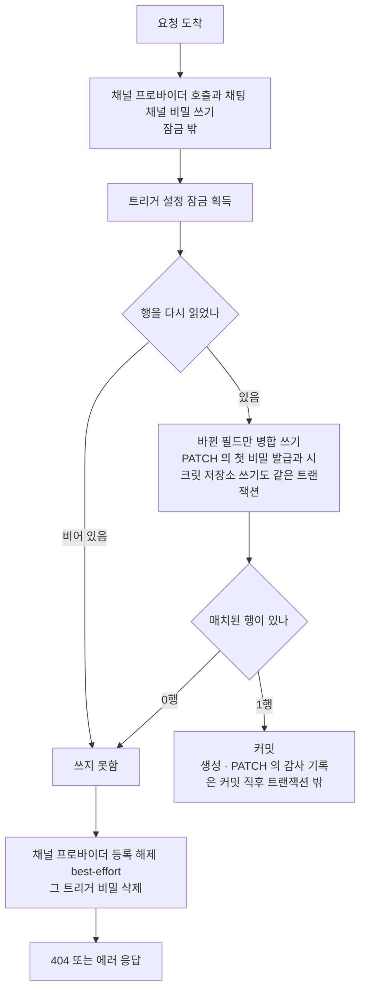

## 개요

이 문서는 [트리거 관리](CLE-TRIG-MANAGE.md) 의 하위 문서로 트리거 `config` 를 다시 쓰는 모든 경로가 따르는 동시 쓰기 직렬화 규칙과 생성 트랜잭션을 정한다. 이 규칙을 쓰는 곳이 채팅 채널 · EIA · 스케줄에 흩어져 있어 트리거 PATCH · DELETE 계약을 정하는 트리거 관리 문서 묶음이 기준이 된다. 서버가 발급하는 알림 서명 시크릿과 트리거 단위 토큰의 결정 근거도 여기에 둔다. 요청 본문 계약은 [트리거 관리 — API 와 PATCH 계약](CLE-TRIG-MANAGE-API.md#patch-본문-계약) 이 정한다.

## 동시 쓰기 직렬화

트리거 `config` 는 트리거 단위 잠금 안에서 다시 읽고 쓴다. `config` JSONB 를 다시 쓰는 경로는 PATCH, 채팅 채널 setup, 봇 토큰 재발급, 알림 서명 시크릿 정규화·승격, 트리거 단위 토큰 재발급이다. 이 경로들은 Postgres advisory lock `pg_advisory_xact_lock(hashtext('trigger-config:<triggerId>'))` 을 잡은 뒤 행을 다시 읽고 그 위에 병합한다. 시크릿 교체(`rotate-secret`)는 `config` 를 쓰지 않지만 같은 잠금을 잡는다(아래). 트리거 생성도 행을 INSERT 한 트랜잭션 안에서 같은 잠금을 잡는다(아래). 요청 시작 시점의 스냅샷으로 통째로 되쓰면 그사이 커밋된 키가 되돌아간다. 되돌아가는 키가 `chatChannel.inboundSigningRef` 면 인바운드 서명 검증이 fail-open 된다.

- 외부 서비스 호출은 잠금 밖에서 한다. 잠금 안에서는 다시 읽기와 쓰기만 한다. Cafe24 토큰 갱신이 같은 잠금을 기각한 이유(잠금을 쥔 채 HTTP 요청을 하면 DB 커넥션 점유가 길어진다)가 이 설계의 제약이다([OAuth 연결과 토큰 갱신 「여러 인스턴스의 갱신 경쟁은 BullMQ `jobId` 중복 제거로 푼다」](../CLE-INT/CLE-INT-OAUTH.md#여러-인스턴스의-갱신-경쟁은-bullmq-jobid-중복-제거로-푼다)).
- 예외로 세 경로는 잠금 안에서 시크릿 저장소에 쓴다. 생성의 첫 알림 서명 시크릿 발급, PATCH 의 첫 알림 서명 시크릿 발급 · 옮기기, 시크릿 승격이다. 세 경로는 잠금을 쥔 트랜잭션의 매니저로 쓴다. 그래서 풀 연결을 하나 더 쓰지 않고 그 트랜잭션이 롤백되면 시크릿 저장소 쓰기도 함께 롤백된다. 지금 시크릿 저장소 백엔드는 같은 DB 의 `secret_store` 테이블이라 이 쓰기에 HTTP 호출이 없다. 외부 백엔드를 들이면 이 경로를 다시 설계한다([시크릿 저장소 「다른 백엔드로 바꾸기」](../CLE-INT/CLE-INT-SECRET.md#다른-백엔드로-바꾸기)).
- 생성은 행 INSERT · 시크릿 저장소 쓰기 · `config` 쓰기 · 첫 비밀 발급을 한 트랜잭션에서 한다. 본문에 `notification` 이나 `interaction` 이 있으면 이 트랜잭션은 INSERT 한 트리거의 설정 잠금을 잡는다. 첫 알림 서명 시크릿은 잠금을 쥔 이 트랜잭션의 매니저로 시크릿 저장소에 쓴다. 트리거 단위 토큰은 같은 트랜잭션에서 `config.interaction.triggerToken` 에 쓴다. 어느 단계든 실패하면 트랜잭션 전체가 롤백되어 행도 비밀도 남지 않는다. 그래서 호출자가 같은 요청을 다시 보내도 `endpointPath` UNIQUE 충돌이나 중복 트리거가 생기지 않는다. 감사 기록(`trigger.created`)은 이 트랜잭션에 넣지 않고 커밋 직후 트랜잭션 밖에서 남긴다. PATCH 의 `trigger.updated` 도 커밋 직후에 남긴다. 그래서 롤백된 생성은 감사에 남지 않는다([Rationale](#rationale) «생성을 한 트랜잭션으로 묶는다»). 채팅 채널 setup 은 커밋과 감사 기록 뒤에 하고 위의 다시 읽기 · 병합 규칙을 따른다.
- 잠금 대기 상한은 삭제에만 있다(5초, [트리거 관리 — 삭제 「결과와 에러」](CLE-TRIG-MANAGE-DELETE.md#결과와-에러)).
- `config` 를 건드리지 않는 컬럼 한정 갱신은 이 잠금을 잡지 않는다. 예: 웹훅 수신의 `lastTriggeredAt`, 스케줄 편집의 `name`·`isActive` 동기화.
- 예외는 시크릿 교체(`rotate-secret`)다. `notification_secret_v2` · `notification_rotated_at` 컬럼만 쓰지만 같은 잠금을 잡는다. 승격이 잠금 안에서 같은 컬럼을 비우기 때문이다. 승격이 v2 를 비우는 조건과 유예 중 재교체 규칙은 [EIA 알림 웹훅 「시크릿 교체」](../CLE-IX/CLE-EIA-NOTIFY.md#시크릿-교체) 가 정한다. 상태 전이는 [EIA 데이터와 흐름](../CLE-IX/CLE-EIA-DATA.md) 이 정한다.
- 잠금으로 막을 수 없는 삭제 경로가 있다. 워크플로우·워크스페이스 삭제의 FK CASCADE 다. 그래서 잠금 안에서도 행이 있는지 판정한다. 다시 읽은 결과가 비면 쓰지 않는다. 쓰기가 0행에 매치되면 쓰지 못한 것으로 본다. `rotate-bot-token`·`interaction/revoke-token`·`notification/rotate-secret` 은 이때 404 `RESOURCE_NOT_FOUND` 로 응답하고 저장하지 못한 새 비밀을 응답에 싣지 않는다.
- 쓰지 못했으면 만든 것을 되돌린다. 잠금 밖에서 `secret_store` 에 비밀을 쓰거나 채널 프로바이더에 등록한 뒤 위 판정으로 쓰지 못한 요청은 채널 프로바이더 등록을 해제(best-effort)한 뒤 그 트리거의 비밀(`secret://triggers/<id>/`)을 지운다. 잠금 안의 쓰기 가운데 따로 되돌리는 것은 승격뿐이다. 승격은 비밀을 쓴 뒤 `config` 쓰기가 0행에 매치돼도 트랜잭션이 오류 없이 커밋되므로 그때 쓴 비밀을 지운다. 생성과 PATCH 의 잠금 안 쓰기는 저장하지 못하면 트랜잭션과 함께 롤백되어 남지 않는다. 트리거 설정 잠금은 advisory lock 이라 워크플로우 · 워크스페이스 삭제의 FK CASCADE 를 막지 못한다. 그래서 잠금 안에서 쓴 승격도 행을 잃을 수 있다([시크릿 저장소](../CLE-INT/CLE-INT-SECRET.md) 규칙 9). 이 되돌리기는 삭제 쪽이 행을 지운 뒤에 비밀을 지우는 것과 짝을 이룬다. 그래서 삭제와 겹친 쓰기가 비밀을 고아로 남기지 않는다.

PATCH 는 그 요청이 바꾸는 필드만 저장한다. 엔티티를 통째로 저장하면 다시 읽은 뒤 잠금 밖에서 커밋된 컬럼(웹훅 수신의 `lastTriggeredAt`, 스케줄 편집의 `name`·`isActive` 등)이 다시 읽은 시점 값으로 되써진다. "컬럼 한정 갱신은 잠금을 잡지 않는다" 가 성립하려면 PATCH 가 그 컬럼을 싣지 않아야 한다.

PATCH 에서 트리거가 사라지는 경우는 두 창으로 갈린다.

- 잠금 안에서 다시 읽은 결과가 비면 404 다.
- 다시 읽은 뒤 저장 직전에 FK CASCADE 가 끼어들면 저장이 실패하고 롤백된다. 트리거는 되살아나지 않는다. 이 경우는 전용 에러 코드가 없어 일반 500 `INTERNAL_ERROR` 로 나간다.

두 동작(부분 저장의 보존, CASCADE 창의 롤백)은 실제 Postgres·TypeORM 에서 재현해 테스트로 고정했다. 워크플로우 삭제로 쟀고 워크스페이스 삭제는 FK 구조가 같아 같을 것으로 보지만 따로 재지 않았다.

## 구현 위치

- `codebase/backend/src/modules/triggers/trigger-config-lock.ts` (동시 쓰기 직렬화의 트리거 단위 advisory lock)
- `codebase/backend/src/modules/triggers/notification-signing-secret.service.ts` (`NotificationSigningSecretService`. 알림 서명 시크릿(`wsk_*`)의 판정 · 시크릿 저장소 쓰기 · 보상을 맡는다. 이름이 비슷한 `NotificationSecretRotatorService` 는 교체 유예가 끝난 시크릿을 승격하는 스케줄러로 따로 있다. `settle` 은 생성과 `notification` 이 실린 PATCH 가 잡은 잠금 안에서 부른다. `migrateLegacyPlaintext`(저장된 옛 평문의 정규화. PATCH 를 저장한 뒤 부른다) · `writeRotation`(`rotate-secret`) · `promoteRotated`(승격과 그 되돌리기)는 스스로 잠금을 잡는다)
- `codebase/backend/src/modules/triggers/notification-signing-secret.ts` (첫 알림 서명 시크릿의 발급 판정 `decideNotificationSigning` 과 서명 참조 얹기. 이름이 비슷한 `notification-signing-secret-ref.ts` 는 트리거 id 로 참조를 만드는 `notificationSigningSecretRef` 하나만 둔다)
- `codebase/backend/src/modules/external-interaction/interaction-stream-closer.ts` (트리거 단위 토큰으로 연 SSE 스트림을 닫는 포트. 트리거 쪽 재발급 · PATCH · 삭제가 이 포트로 닫기를 요청한다), `codebase/backend/src/modules/external-interaction/interaction-stream-closer.wiring.spec.ts` (포트가 실제 모듈에서 해석되는지)
- `codebase/backend/test/trigger-update-save-window.e2e-spec.ts` (PATCH 부분 저장과 CASCADE 창 롤백의 특성 테스트)

## Rationale

### 서버가 만든 EIA 값의 발급 · 보존 · 교체 잠금 (2026-10-09)

사용자가 2026-10-09 에 답해 아래 네 가지를 정했다. 사용자에게 묻지 않고 기본값으로 정해 알린 뒤 진행한 부분은 각 항목에 «기본값» 으로 밝혔다.

- **PATCH 에서 서버가 만든 값은 서버가 정한다.** 트리거 단위 토큰(`interaction.triggerToken`)과 알림 서명 시크릿 참조(`notification.signing.secretRef`)는 서버가 만든다. top-level `interaction` · `notification` 에는 이 필드가 없어서 «통째로 교체하니 전체 객체를 다시 보내라» 는 계약을 호출자가 지킬 수 없었고 구현은 교체할 때 두 값을 지웠다. 트리거 단위 토큰이 지워지면 한 번만 보여 준 토큰이 조용히 무효가 된다. 알림 서명 시크릿 참조가 지워지면 다음 발송에서 서명할 시크릿을 찾지 못해 발송하지 않고 발송 건강도가 `degraded` 가 된다. 그래서 시크릿 참조는 늘 보존한다. 트리거 단위 토큰은 PATCH 결과의 전략이 `per_trigger` 일 때만 이어받는다. 가드는 전략이 `per_trigger` 일 때만 저장된 토큰과 비교한다. 다른 전략으로 바꾼 동안 토큰을 남겨 두면 `per_trigger` 로 되돌릴 때 이미 폐기했다고 여긴 영구 토큰이 재발급 없이 다시 유효해진다. 이를 막으려고 전략을 바꾸면 토큰을 지우고 되돌릴 때는 새 토큰을 받는다(2026-10-17 부터는 그 PATCH 가 발급한다, 아래). [PATCH 본문 계약](CLE-TRIG-MANAGE-API.md#patch-본문-계약) 의 `botTokenRef` 보존과 목적이 같다. 함께 제시한 «지워지는 것이 의도라고 스펙에 적기» 와 «남겨 두고 되살아남을 명시» 는 택하지 않았다. 시크릿 참조를 보존하는 방식은 기본값이다. 다시 읽은 행에 참조가 있으면 그 값을 복사하지 않고 트리거 id 로 다시 만든다. 저장 경계가 막기 전에 원시 `config` 로 저장된 행에는 다른 트리거를 가리키는 참조가 있을 수 있어서다. 그러면 `botTokenRef` 와 보존 방식이 같아지고 [시크릿 저장소](../CLE-INT/CLE-INT-SECRET.md) 규칙 24 와도 맞는다.
- **첫 알림 서명 시크릿은 서버가 발급한다.** [External Interaction API](../CLE-IX/CLE-EIA.md) 의 요구사항은 트리거를 만들 때 알림 서명 시크릿(`wsk_*`)을 생성 응답에서 한 번 평문으로 보여 준다고 정한다. 구현은 생성 때 발급하지 않아 호출자가 시크릿을 보내지 않으면 주 시크릿이 없었다. 사용자는 그 요구사항을 따르기로 했다. 발급 시점은 트리거를 만들 때와 PATCH 가 EIA 알림 웹훅 설정을 처음 붙일 때(다시 읽은 행에 `signing.secretRef` 가 없을 때) 둘이다. 생성 때만 발급하면 나중에 붙인 트리거는 주 시크릿이 없어 발송할 때마다 `degraded` 가 된다. 평문은 발급한 그 응답의 `data.secrets.notificationSigningSecret` 에만 싣는다. 함께 제시한 «그 요구사항을 현재 동작으로 고치기» · «생성 때만» · «발급하지 않음(지금 동작을 스펙으로)» 은 택하지 않았다. PATCH 의 «없음» 판정은 기본값으로 정했다. 판정 기준은 [시크릿 저장소](../CLE-INT/CLE-INT-SECRET.md) 규칙 24 이고 발송도 같은 기준으로 참조를 읽는다. 두 판정이 갈리면 발급하지 않은 채 `degraded` 로 남을 수 있어서다. 판정 뒤의 분기(다시 만들기 · 옮기기 · 발급)는 [EIA 알림 웹훅 「시크릿 교체」](../CLE-IX/CLE-EIA-NOTIFY.md#시크릿-교체) 가 정한다. 판정과 시크릿 저장소 쓰기는 같은 트리거 설정 잠금 안에서 한다. 판정을 잠금 밖에서 하면 동시에 온 두 PATCH 가 모두 «없음» 으로 보고 각자 발급해 한쪽 응답의 평문이 쓸모없어진다. 참조가 없는 행에 옛 평문 `signing.secret` 이 남아 있으면 발급하지 않고 그 평문을 옮긴다(기본값). 통째 교체로 그 평문이 사라지면 수신 측이 쓰던 시크릿이 유예 없이 바뀌기 때문이다. PATCH 가 시크릿 저장소에 쓰는 것은 [채팅 채널 「R-CC-21 PATCH 는 비밀을 쓰지 않는다」](../CLE-CHAT/CLE-CHAT-CORE.md#r-cc-21-patch-는-비밀을-쓰지-않는다) 와 부딪치지 않는다. 그 결정의 비밀은 요청자가 입력한 값이고 서버가 만든 첫 값과 저장된 값의 이전은 요청 본문을 쓰지 않는다. 이후 바꾸는 길은 `rotate-secret` 하나다. 이 결정 당시에는 호출자가 원시 `config` 로 평문 `signing.secret` 을 보내면 그 값을 쓰고 발급하지 않았다. 2026-10-31 부터 원시 `config` 는 타입 키를 받지 않으므로 그 갈래는 없다([원시 `config` 계약 (2026-10-31)](CLE-TRIG-MANAGE-API.md#원시-config-계약-2026-10-31)).
- **시크릿 교체도 트리거 설정 잠금을 잡는다.** 승격은 잠금 안에서 `notification_secret_v2` 를 비우는데 교체는 잠금 없이 같은 컬럼을 썼다. 승격이 v2 를 고른 뒤 교체가 새 값을 쓰면 응답으로 이미 나간 새 시크릿을 승격이 지울 수 있었다. 그래서 두 경로가 같은 잠금을 잡고 승격은 고른 값이 그대로일 때만 비운다. 24시간 유예 중 다시 교체하면 앞의 새 시크릿을 덮고 유예 시간을 다시 시작한다. 승격 조건은 [EIA 알림 웹훅 「시크릿 교체」](../CLE-IX/CLE-EIA-NOTIFY.md#시크릿-교체) 한 곳에 둔다. 트리거 관리의 요구사항은 교체도 같은 잠금을 잡는다는 것만 정한다. 같은 조건을 두 문서의 요구사항에 적으면 한쪽만 고쳐질 수 있어서다. 함께 제시한 «유예 중 재교체 거부(409)» 는 택하지 않았다.
- **트리거 단위 토큰이 무효가 되면 그 토큰으로 연 SSE 스트림을 닫는다.** 처음에 사용자는 토큰을 재발급하거나 토큰이 만료돼도 이미 열린 SSE 스트림을 그 실행이 끝날 때까지 두기로 했다(바뀌기 전에 시작한 실행이라서). 그 뒤 «실행이 끝날 때까지» 라는 상한이 늘 성립하지 않는다는 지적이 나왔다. 입력 대기 중인 실행은 기한 없이 멈춰 있을 수 있어 재발급으로 폐기한 영구 토큰으로 연 스트림이 끝없이 남는다. 처음 물었을 때 함께 제시한 «문서화하고 후속 Task 로» 와 «이번에 막기(SSE 스트림을 토큰 수명에 묶기)» 는 택하지 않았다. 다시 물었을 때 사용자는 재발급하면 옛 토큰으로 연 스트림을 닫는 쪽을 골랐다. 그때 함께 제시한 «유지하고 위험을 적기»(추천으로 제시) 와 «위험만 적고 후속 Task» 는 택하지 않았다. 전략을 바꾸는 PATCH 가 저장된 토큰을 지울 때와 트리거를 지울 때도 같은 이유로 그 토큰으로 연 스트림을 닫는다. 인터랙션을 끄는 PATCH 는 토큰 값을 남기고 그 토큰으로 연 스트림만 닫는다(같은 날 구현 코드 리뷰 질문에 사용자가 답해 정했다). 인터랙션 끄기는 토큰 폐기가 아니라 중지라서 다시 켜면 같은 토큰이 통한다. 근거 전문은 [EIA 데이터와 흐름 「트리거 단위 토큰을 생성과 PATCH 에서 발급한다 (2026-10-17)」](../CLE-IX/CLE-EIA-DATA.md#트리거-단위-토큰을-생성과-patch-에서-발급한다-2026-10-17) 에 있다. 실행 단위 토큰(`iext_*`)이 만료되거나 갱신될 때는 닫지 않는다. PATCH · 삭제 때 닫는 것과 실행 단위 토큰을 닫지 않는 것은 기본값이다. 실행 단위 토큰은 수명이 짧고 실행 하나에 묶이며 그 스트림은 실행의 종료 이벤트에서 끝난다. 다만 입력 대기에서는 그 스트림에도 상한이 없고 이때의 대응은 실행 취소다(종료 이벤트 `execution.cancelled` 로 스트림이 닫힌다). WebSocket 은 소켓 수명을 토큰 수명에 묶는다([WebSocket 연결과 채널 구독](../CLE-API/CLE-API-WS.md#소켓-수명을-토큰-수명에-묶는다-2026-09-02)). 무효가 된 영구 토큰의 스트림을 끊는 것은 그 원칙과 같은 방향이다. 실행 단위 토큰은 WebSocket 이 택하지 않은 인가 틈(알리기만 하고 끊지 않음)을 의도적으로 받아들이는 예외다. 처음에는 닫는 대상이 같은 서버 인스턴스의 구독자뿐이었다(SSE 버퍼가 서버 인스턴스 하나를 전제로 했다). 2026-10-17 에 모든 서버 인스턴스로 넓혔다. 닫기를 시작한 서버 인스턴스는 자기 구독자를 닫고 전역 채널 `eia:sse:close` 로 닫기 신호를 보내며 다른 서버 인스턴스는 그 신호를 받아 자기 구독자를 닫는다. 닫는 방식과 WebSocket 원칙과의 관계는 [EIA 데이터와 흐름 「재검토에서 갈린 EIA 동작을 정한다 (2026-10-09)」](../CLE-IX/CLE-EIA-DATA.md#재검토에서-갈린-eia-동작을-정한다-2026-10-09) 에 있다.

### 트리거 단위 토큰을 생성과 첫 PATCH 에서 발급한다 (2026-10-17)

사용자가 2026-10-17 에 정했다([External Interaction API](../CLE-IX/CLE-EIA.md#미결-사항) 의 미결). 인터랙션이 켜져 있고 전략이 `per_trigger` 인 트리거를 만들면 서버가 트리거 단위 토큰(`itk_*`)을 발급해 생성 응답의 `data.secrets.interactionToken` 에 한 번 싣는다. PATCH 의 결과가 인터랙션이 켜진 `per_trigger` 인데 저장된 토큰이 없을 때도 발급한다. 처음 켤 때와 다른 전략에서 `per_trigger` 로 돌아올 때가 이 경우다. 저장된 토큰이 있으면 발급하지 않는다. 그래서 인터랙션을 껐다 다시 켜면 같은 토큰을 쓴다.

- 전에는 생성 때 토큰을 발급하지 않아 `per_trigger` 트리거를 만든 호출자는 `revoke-token` 을 부르기 전까지 쓸 토큰이 없었다. 그런데 [웹훅](CLE-TRIG-WEBHOOK.md#수신-api) 의 202 응답은 `per_trigger` 호출자에게 토큰이 이미 있다고 보고 토큰을 싣지 않는다. 알림 서명 시크릿(`wsk_*`)은 생성과 첫 PATCH 에서 발급하는데 이 토큰만 달랐다.
- 응답 자리는 첫 알림 서명 시크릿과 같은 `data.secrets` 다. 같은 묶음(`TriggerIssuedSecretsDto`)의 선택 필드로 두어 생성 · PATCH 응답의 일회성 평문을 한곳에 모은다. 저장 위치는 그대로 `config.interaction.triggerToken` 이고 응답에서는 뺀다.
- 결정 당시에는 원시 `config` 로 `per_trigger` 를 켠 PATCH 에도 같게 발급했다. 2026-10-31 부터 원시 `config` 는 타입 키를 받지 않아 PATCH 의 발급은 최상위 필드 `interaction` 이 실린 PATCH 에만 남는다.
- 기각한 대안: 생성 때 발급하지 않고 `revoke-token` 으로만 받게 두기(옛 동작). 엔드포인트 이름은 폐기인데 첫 발급에 써야 하고 위 202 응답의 전제가 성립하지 않는다.
- 기각한 대안: 최상위 `interaction` 이 실린 PATCH 에서만 발급하기. 당시에는 원시 `config` 로 `per_trigger` 를 켠 트리거가 `revoke-token` 을 따로 불러야 첫 토큰이 생겼다. 2026-10-31 이후 그 경로가 없어져 이 기각 이유는 더는 생기지 않는다.
- 기각한 대안: 인터랙션을 다시 켤 때마다 새로 발급하기. 이미 외부 시스템에 배포한 토큰이 사용자가 모르는 사이에 바뀐다. 발급된 토큰을 바꾸는 길은 `revoke-token` 하나로 둔다.
- 감사는 새 action 을 만들지 않는다(사용자 결정). 생성 · PATCH 가 첫 비밀을 발급하면 그 요청의 `trigger.created` · `trigger.updated` 기록에 `details.issuedSecrets`(발급한 종류 이름 배열)를 더한다. 평문은 싣지 않고 발급하지 않은 요청에는 키를 넣지 않는다. 일회성 평문을 낸 요청을 감사 기록에서 가려낼 수 없다는 지적에서 나왔다. 기각한 대안은 발급만 따로 남기는 새 action 이다. 발급은 생성 · 수정 요청의 일부라 action 을 나누면 한 요청이 감사 기록 두 줄로 갈린다. `rotate-secret` · `revoke-token` 은 그 동작만의 요청이라 지금처럼 따로 action 이 있다.

### 원시 `config` 로 트리거 단위 토큰을 다루지 못하게 한다 (2026-10-17)

원시 `config` 경로에는 두 틈이 있었다. `interaction` 을 바꿔 토큰이 사라져도 그 토큰으로 연 SSE 스트림을 닫지 않았고, `config.interaction.triggerToken` 에 호출자가 고른 값을 심을 수 있었다. 그래서 원시 `config` 의 `interaction.triggerToken` 은 시크릿 참조와 같이 거부하기로 했다.

- 기각한 대안: 원시 `config` 계약 전체를 정할 때까지 미루기. 그동안 위 「서버가 만든 EIA 값의 발급 · 보존 · 교체 잠금」 이 정한 두 원칙(서버가 만든 값은 서버가 정한다, 무효가 된 토큰의 스트림을 닫는다)을 원시 `config` 로 우회할 수 있다.

2026-10-31 부터 원시 `config` 는 타입 키를 받지 않는다([원시 `config` 계약 (2026-10-31)](CLE-TRIG-MANAGE-API.md#원시-config-계약-2026-10-31)). 원시 `config` 로 `interaction` 을 바꾸는 길이 없어져 이 항목이 함께 정했던 스트림 닫기와 발급은 대상이 없다. `interaction.triggerToken` 거부는 내부 필드 거부로 남아 타입 키 거부보다 먼저 검사한다.

### 생성을 한 트랜잭션으로 묶는다 (2026-10-17)

전에는 행 INSERT 와 감사 기록이 커밋된 뒤 첫 알림 서명 시크릿을 따로 정했다. 그 사이 실패하면 `notification` 은 있는데 `signing.secretRef` 는 없는 행이 남았다. 호출자는 일회성 평문을 받지 못했고 같은 요청을 다시 보내면 `endpointPath` UNIQUE 충돌이나 중복 트리거가 생겼다.

- 이제 행 INSERT · 시크릿 저장소 쓰기 · `config` 쓰기 · 첫 비밀 발급을 한 트랜잭션에서 한다. 시크릿 저장소 쓰기는 잠금을 쥔 그 트랜잭션의 매니저로 하므로 함께 롤백된다.
- 그래서 생성은 잠금 안에서 시크릿 저장소에 쓰는 예외 목록에 들어가고 «쓰지 못했으면 되돌린다» 의 대상에서는 빠진다. 따로 되돌리는 잠금 안 쓰기는 승격만 남는다.
- 감사 기록(`trigger.created`)은 이 트랜잭션에 넣지 않고 커밋 직후 트랜잭션 밖에서 남긴다. 감사 기록 함수 `AuditLogsService.record` 는 트랜잭션 매니저를 받지 않고 자기 연결로 쓴다. 그래서 트랜잭션 안에서 부르면 생성이 롤백돼도 감사 행은 남는다. 이 함수는 적재 실패를 삼키고 주 동작을 계속한다([감사 로그](../CLE-OBS/CLE-OBS-AUDIT.md#요구사항) 의 적재 실패 요구사항). 커밋 뒤에 남기면 롤백된 생성은 감사에 남지 않는다. 잃을 수 있는 것은 커밋된 생성의 감사 행 하나이고 그 유실은 감사 로그 요구사항이 이미 받아들인 범위다. PATCH 의 `trigger.updated` 도 커밋 직후에 남긴다.
- 기각한 대안: 커밋 뒤 단계가 실패하면 만든 행을 지우는 보상. 보상도 실패할 수 있고 보상이 끝나기 전까지 반쪽 행이 목록에 보인다.
- 기각한 대안: `record` 가 매니저를 받아 생성 트랜잭션 안에서 쓰고 savepoint 로 감사 INSERT 의 실패만 되돌리기. 롤백된 생성이 감사에서도 빠지는 장점은 있다. 그러나 모든 모듈이 쓰는 감사 기록 함수의 계약이 바뀐다. savepoint 없이 매니저만 넘기면 감사 INSERT 가 실패할 때 Postgres 트랜잭션 전체가 중단돼 생성까지 실패하고 감사 로그의 적재 실패 요구사항과 어긋난다. 커밋 뒤 기록에 남는 틈(커밋된 생성의 감사 행 유실)은 다른 감사 기록에도 똑같이 있는 틈이라 이 경로만 따로 막을 까닭이 적다.
