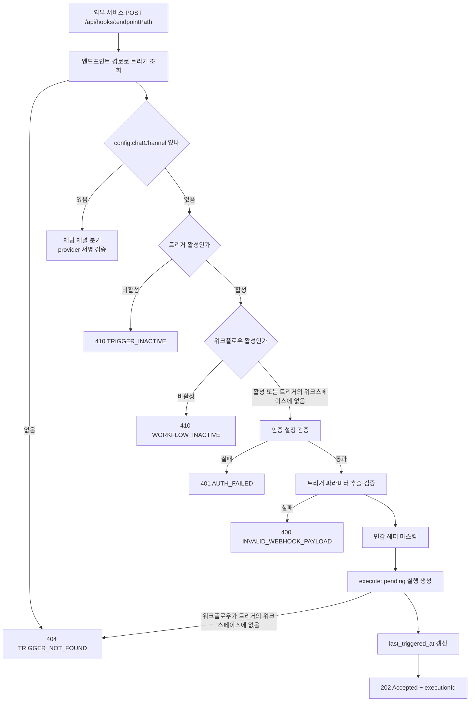

> 구현 상태: 구현됨 · 원문: `spec/5-system/12-webhook.md` · 용어: [용어 사전](../CLE-GLOSSARY.md)

## 개요

웹훅(Webhook)은 외부 서비스(GitHub, Stripe 등)나 사용자 시스템이 HTTP 요청을 보내 워크플로우를 실행하는 트리거다. 이벤트 기반 자동화의 핵심 진입점으로, 외부 이벤트가 생기면 바로 워크플로우를 시작한다.

이 문서는 웹훅 수신 엔드포인트(`POST /api/hooks/:endpointPath`)와 웹훅 URL 형식, 엔드포인트 경로(endpoint path, `endpointPath`)의 비밀성, 인증 검증 방식, 워크플로우에 넘기는 입력 구조, 공개 웹훅(public webhook, `auth_config_id IS NULL`)의 남용 방어, 수신 처리 흐름을 정한다. 이 문서는 "외부에서 워크플로우를 시작하는" 트리거 진입점에 한정한다. 이 문서는 입구로서 요구사항과 처리 구조를 두고 세부는 [하위 문서](#하위-문서)가 정한다.

| 사용 시나리오 | 설명 |
|---------------|------|
| GitHub PR 이벤트 | PR 생성·머지 때 코드 리뷰 워크플로우 실행 |
| 이메일 수신 | 특정 메일을 받으면 AI 에이전트 워크플로우 실행 |
| Stripe 결제 이벤트 | 결제 완료·실패 때 알림 워크플로우 실행 |
| 폼 제출 | 외부 웹 폼 제출 때 데이터 처리 워크플로우 실행 |
| IoT 데이터 수신 | 센서 데이터가 도착하면 분석 워크플로우 실행 |

범위 밖 주제는 다음 문서가 정한다.

- 트리거 목록·생성·수정·삭제와 트리거 API: [트리거 관리](CLE-TRIG-MANAGE.md)
- 인증 설정(AuthConfig, `auth_config`) 발급·필드 마스킹·평문 보기: [외부 호출 인증 설정](CLE-TRIG-AUTHCFG.md)
- 트리거·인증 설정 엔티티 컬럼, 엔드포인트 경로의 전역 유일과 영구 예약: [트리거 데이터와 흐름](CLE-TRIG-DATA.md)
- 채팅 채널 분기 뒤의 처리(update 파싱, 대화 조회, 인터랙션 전달, provider 응답 계약): [채팅 채널](../CLE-CHAT/CLE-CHAT-CORE.md)
- 웹훅 응답의 인터랙션 블록을 받은 뒤의 호출, 트리거의 `notification`·`interaction` 설정: [External Interaction API](../CLE-IX/CLE-EIA.md)
- 트리거 파라미터 공통 계약: [트리거 노드 공통](../CLE-NODE-TRIG/CLE-NODE-TRIG-COMMON.md). 수동 트리거 노드의 출력 모양: [수동 트리거 노드](../CLE-NODE-TRIG/CLE-NODE-MANUAL.md)
- 전역 rate limit 수치와 응답 봉투: [HTTP API 규약](../CLE-API/CLE-API-CONV.md). 에러 코드 카탈로그: [에러 코드 규약과 카탈로그](../CLE-API/CLE-API-ERRCODES.md)

## 요구사항

- REQ-WEBHOOK-001 WHEN 웹훅 트리거를 만들면 THE SYSTEM SHALL 트리거마다 고유한 웹훅 URL 을 준다. (원본: WH-EP-01)
- REQ-WEBHOOK-002 WHEN 웹훅 URL 을 표시하면 THE SYSTEM SHALL `{base_url}/api/hooks/{endpoint_path}` 형식을 쓰고 `base_url` 은 웹훅을 받는 백엔드 origin 으로 한다. (원본: WH-EP-02)
- REQ-WEBHOOK-003 IF 웹훅 엔드포인트에 POST 가 아닌 메서드가 오면 THE SYSTEM SHALL `405 Method Not Allowed` 로 응답한다. (원본: WH-EP-03)
- REQ-WEBHOOK-004 WHEN 웹훅 요청이 오면 THE SYSTEM SHALL JSON 과 form-urlencoded 본문을 받는다. (원본: WH-EP-04)
- REQ-WEBHOOK-005 WHEN 웹훅이 실행을 시작하면 THE SYSTEM SHALL 요청 본문 전체를 워크플로우 입력의 `body` 로 넘긴다. (원본: WH-EP-05)
- REQ-WEBHOOK-006 WHEN 수동 트리거 노드가 `parameters` 스키마를 선언했으면 THE SYSTEM SHALL body 에서 파라미터를 추출·검증해 `$input.parameters`·`$params` 로 제공한다. (원본: WH-EP-05-1)
- REQ-WEBHOOK-007 IF required 파라미터가 없거나 타입 강제 변환이 실패하면 THE SYSTEM SHALL 실행을 만들지 않고 `400 INVALID_WEBHOOK_PAYLOAD` 로 응답하며 필드별 사유를 `error.details[]` 에 싣는다. (원본: WH-EP-05-2)
- REQ-WEBHOOK-008 WHEN 웹훅이 실행을 시작하면 THE SYSTEM SHALL `headers`·`method`·`query` 를 메타데이터로 넘기고 민감 헤더 값은 저장 전에 `[REDACTED]` 로 가린다. (원본: WH-EP-06)
- REQ-WEBHOOK-009 IF 비활성 트리거로 요청이 오면 THE SYSTEM SHALL `410 Gone`(`TRIGGER_INACTIVE`)으로 응답한다. (원본: WH-EP-07)
- REQ-WEBHOOK-010 IF 채팅 채널이 설정된 트리거가 비활성이면 THE SYSTEM SHALL provider inbound 서명 검증을 먼저 하고 통과한 요청으로는 실행을 시작하지 않는다. 응답은 인터랙션 요청(Discord 컴포넌트 · 모달 제출 · 슬래시 명령, Slack Interactivity · 슬래시 명령)이면 `200 OK` 와 기본 인터랙션 응답이고 그 밖의 요청(Discord PING, Slack `url_verification` · Events API 메시지, Telegram update)이면 `202 Accepted` 와 `{ executionId: 'ignored' }` 다. 버린 버튼 클릭의 수신 확인을 포함해 프로바이더 API 는 부르지 않는다([채팅 채널 분기](#채팅-채널-분기)). (원본: WH-EP-07)
- REQ-WEBHOOK-048 IF 채팅 채널이 아닌 웹훅 트리거의 워크플로우가 비활성이면(`workflow.is_active=false`) THE SYSTEM SHALL 인증과 파라미터 검증 전에 `410 Gone`(`WORKFLOW_INACTIVE`)으로 응답하고 실행 행을 만들지 않으며 `last_triggered_at` 을 갱신하지 않는다.
- REQ-WEBHOOK-049 IF 채팅 채널이 설정된 트리거의 워크플로우가 비활성일 때 새 실행을 시작할 update 가 오면 THE SYSTEM SHALL 일반 웹훅의 `410 Gone`(`WORKFLOW_INACTIVE`) 대신 `202 Accepted` 와 `{ executionId: 'ignored' }` 로 응답하고 새 실행을 만들지 않는다. 인터랙션 요청이면 `202` 대신 `200 OK` 와 기본 인터랙션 응답으로 응답한다([채팅 채널 분기](#채팅-채널-분기)). 막는 update 는 [트리거 데이터와 흐름 「워크플로우 활성 관문」](CLE-TRIG-DATA.md#워크플로우-활성-관문) 이 정하고 확인 순서는 [채팅 채널 「인바운드 관문 순서」](../CLE-CHAT/CLE-CHAT-CORE.md#인바운드-관문-순서) 가 정한다.
- REQ-WEBHOOK-050 WHEN 활성 채팅 채널 트리거로 Slack `url_verification` 이나 Discord PING(type 1) handshake 가 오면 THE SYSTEM SHALL 워크플로우가 비활성이어도 서명 검증 뒤 handshake 에 답한다.
- REQ-WEBHOOK-051 WHEN 워크플로우 활성 상태를 확인하면 THE SYSTEM SHALL 트리거의 워크스페이스 안에서만 워크플로우를 찾고 거기에 없으면 확인을 통과시켜 워크플로우가 그 워크스페이스에 없을 때의 응답(REQ-WEBHOOK-047, 채팅 채널은 `202` ignored)을 따른다. 채팅 채널의 인터랙션 요청이면 그 응답은 `200 OK` 와 기본 인터랙션 응답이다([채팅 채널 분기](#채팅-채널-분기)).
- REQ-WEBHOOK-052 WHILE 활성 채팅 채널 트리거의 워크플로우가 비활성인 동안 THE SYSTEM SHALL 진행 중인 대화의 update 를 워크플로우가 활성일 때와 같이 처리하고 일반 웹훅의 `410 Gone`(`WORKFLOW_INACTIVE`)이나 새 실행을 막을 때 쓰는 `202` ignored 로 응답하지 않는다. 대상 update 는 [트리거 데이터와 흐름 「워크플로우 활성 관문」](CLE-TRIG-DATA.md#워크플로우-활성-관문) 이 정한다.
- REQ-WEBHOOK-011 WHEN 트리거에 인증 설정이 연결되지 않았으면 THE SYSTEM SHALL 인증 없이 요청을 받는다. (원본: WH-SC-01)
- REQ-WEBHOOK-012 WHEN 클라이언트가 엔드포인트 경로를 만들면 THE SYSTEM SHALL CSPRNG 로 발급한 v4 UUID(`crypto.randomUUID()`)를 쓰고 약한 난수나 고정값을 쓰지 않는다. (원본: WH-SC-01)
- REQ-WEBHOOK-013 IF 다른 트리거가 이미 쓰는 엔드포인트 경로로 등록하려 하면 THE SYSTEM SHALL 워크스페이스와 상관없이 409 로 거부한다. (원본: WH-SC-01)
- REQ-WEBHOOK-014 WHEN 인증 설정 유형이 `hmac` 이면 THE SYSTEM SHALL `config.header`(기본 `X-Hub-Signature-256`) 헤더의 서명을 `config.secret` 으로 계산한 HMAC 과 비교한다. (원본: WH-SC-02)
- REQ-WEBHOOK-015 IF HMAC `config.algorithm` 이 `sha256`·`sha512` 가 아니면 THE SYSTEM SHALL 인증 실패로 처리한다.
- REQ-WEBHOOK-016 WHEN 인증 설정 유형이 `bearer_token` 이면 THE SYSTEM SHALL `Authorization: Bearer <token>` 값을 `config.token` 과 비교한다. (원본: WH-SC-03)
- REQ-WEBHOOK-017 IF 인증이 실패하면 THE SYSTEM SHALL 유형과 사유를 가리지 않고 `401 AUTH_FAILED` 하나로 응답하고 진단은 서버 로그에만 남긴다. (원본: WH-SC-04)
- REQ-WEBHOOK-018 WHEN 웹훅 요청이 오면 THE SYSTEM SHALL 서명 참조(`config.chatChannel.inboundSigningRef`)가 있는 채팅 채널 트리거의 요청만 빼고 전역 throttler 로 분당 100건을 넘는 요청을 막는다. 채팅 채널이 아닌 트리거와 서명 참조가 없는 채팅 채널 트리거의 요청은 이 한도를 받는다. (원본: WH-SC-05)
- REQ-WEBHOOK-019 WHEN 채팅 채널 트리거가 아닌 공개 웹훅에 요청이 오면 THE SYSTEM SHALL 클라이언트 IP 단위로 분당 시작 10건과 시간당 누적 신규 20건(기본값)을 넘는 요청을 429 로 막는다. (원본: WH-SC-05)
- REQ-WEBHOOK-020 IF 공개 웹훅 요청의 클라이언트 IP 를 헤더에서 알 수 없으면 THE SYSTEM SHALL 그런 요청을 하나의 공유 버킷으로 묶어 같은 한도를 건다. (원본: WH-SC-05)
- REQ-WEBHOOK-021 WHEN 인증 설정 유형이 `api_key` 이면 THE SYSTEM SHALL `config.headerName`(기본 `X-API-Key`) 헤더 값을 `config.key` 와 비교한다. (원본: WH-SC-06)
- REQ-WEBHOOK-022 WHEN 인증 설정 유형이 `basic_auth` 이면 THE SYSTEM SHALL `Authorization: Basic` 을 디코드한 사용자 이름과 비밀번호를 `config.username`·`config.password` 와 비교한다. (원본: WH-SC-07)
- REQ-WEBHOOK-023 WHEN 인증 자료를 비교하면 THE SYSTEM SHALL `crypto.timingSafeEqual` 기반 상수 시간 비교를 쓴다.
- REQ-WEBHOOK-024 WHEN 인증이 성공하면 THE SYSTEM SHALL 트랜잭션 밖에서 `AuthConfig.last_used_at` 을 fire-and-forget 으로 갱신하고 실패하면 갱신하지 않는다. (원본: WH-SC-08)
- REQ-WEBHOOK-025 IF 인증 설정에 `ip_whitelist` 가 있는데 클라이언트 IP 가 목록에 없거나 IP 를 알 수 없으면 THE SYSTEM SHALL `401 AUTH_FAILED` 로 거부한다. (원본: WH-SC-09)
- REQ-WEBHOOK-026 IF 연결된 인증 설정이 비활성(`is_active=false`)이면 THE SYSTEM SHALL 곧바로 `401 AUTH_FAILED` 로 거부한다.
- REQ-WEBHOOK-053 WHEN 연결된 인증 설정의 기대값(`api_key` 의 `config.key`, `bearer_token` 의 `config.token`, `basic_auth` 의 `config.username`·`config.password`, `hmac` 의 `config.secret`)이 비었거나 문자열이 아니거나, 헤더 이름(`api_key` 의 `config.headerName`, `hmac` 의 `config.header`)이 있는데 문자열이 아니거나, 인증 설정이 복호화 불가 표식으로 읽히면 THE SYSTEM SHALL 요청 값과 상관없이 `401 AUTH_FAILED` 로 거부한다. 복호화 불가 표식은 [통합 데이터와 흐름 「암호화」](../CLE-INT/CLE-INT-DATA.md#암호화) 가 정한다.
- REQ-WEBHOOK-027 WHEN 웹훅 요청이 실행을 시작하면 THE SYSTEM SHALL 실행을 기다리지 않고 `202 Accepted` 와 `executionId` 를 응답한다. 채팅 채널의 인터랙션 요청이면 `200 OK` 와 기본 인터랙션 응답이다([채팅 채널 분기](#채팅-채널-분기)). (원본: WH-RS-01)
- REQ-WEBHOOK-028 IF 엔드포인트 경로에 맞는 웹훅 트리거가 없으면 THE SYSTEM SHALL `404 TRIGGER_NOT_FOUND` 로 응답한다. (원본: WH-RS-02)
- REQ-WEBHOOK-029 IF 요청 본문 파싱이 실패하면 THE SYSTEM SHALL `400 Bad Request` 로 응답한다. (원본: WH-RS-03)
- REQ-WEBHOOK-030 WHEN 트리거가 `config.interaction.enabled=true` 이면 THE SYSTEM SHALL 202 응답에 `status: "pending"` 과 `interaction.endpoints` 를 싣고 `tokenStrategy="per_execution"` 이면 `interaction.token`·`interaction.expiresAt` 도 함께 싣는다. `tokenStrategy="per_trigger"` 면 토큰을 싣지 않는다. 싣지 않는 `token`·`expiresAt` 은 `null` 없이 키를 생략한다([HTTP API 규약 §5.5](../CLE-API/CLE-API-CONV.md#55-부재-표현-null-과-키-생략) 기준 (b)). (원본: WH-RS-04)
- REQ-WEBHOOK-031 WHEN 사용자가 웹훅 트리거를 만들면 THE SYSTEM SHALL 워크플로우 에디터와 트리거 화면 두 곳에서 같은 `POST /api/triggers` 로 만들게 한다. (원본: WH-MG-01)
- REQ-WEBHOOK-032 WHEN 웹훅 트리거를 만들거나 경로를 바꾸면 THE SYSTEM SHALL 생성·수정 DTO 에서 v4 UUID 형식(`@IsUUID('4')`)의 엔드포인트 경로만 받는다. (원본: WH-MG-02)
- REQ-WEBHOOK-033 WHILE 사용자가 트리거를 비활성으로 둔 동안 THE SYSTEM SHALL 웹훅 수신으로 실행을 시작하지 않는다. (원본: WH-MG-04)
- REQ-WEBHOOK-034 IF EIA 알림 웹훅이나 채팅 채널의 상태가 `degraded` 가 되면 THE SYSTEM SHALL 트리거를 자동으로 비활성화하지 않는다. (원본: WH-MG-04, WH-MG-07, WH-MG-09)
- REQ-WEBHOOK-035 WHEN 사용자가 호출 이력을 보면 THE SYSTEM SHALL 요청 시각·상태·응답 코드를 보여 준다. (부분 구현) (원본: WH-MG-05)
- REQ-WEBHOOK-036 WHEN 트리거 생성·수정 요청이 `notification`·`interaction` 을 담으면 THE SYSTEM SHALL EIA 알림 웹훅과 외부 인터랙션 설정으로 저장한다. (원본: WH-MG-06)
- REQ-WEBHOOK-037 WHEN 트리거 상세 화면을 그리면 THE SYSTEM SHALL `notificationHealth`(unknown / healthy / degraded)를 표시한다. (원본: WH-MG-07)
- REQ-WEBHOOK-038 WHEN 트리거 생성 요청이 `chatChannel` 을 담으면 THE SYSTEM SHALL 외부 채팅 플랫폼 어댑터를 연결하고 없으면 일반 웹훅 트리거로 동작한다. (원본: WH-MG-08)
- REQ-WEBHOOK-039 WHEN 트리거 상세 화면을 그리면 THE SYSTEM SHALL `chatChannelHealth` 를 `notificationHealth` 배지와 같은 영역·같은 형식으로 나란히 표시한다. (원본: WH-MG-09)
- REQ-WEBHOOK-040 WHEN 웹훅 요청을 받으면 THE SYSTEM SHALL 200ms 안에 응답하고 실행은 비동기로 한다. (원본: WH-NF-01)
- REQ-WEBHOOK-041 IF 채팅 채널 트리거가 아닌 공개 웹훅의 요청 본문이 32KB 를 넘으면 THE SYSTEM SHALL `413 PUBLIC_WEBHOOK_BODY_TOO_LARGE` 로 응답한다. (원본: WH-NF-02)
- REQ-WEBHOOK-042 IF 인증 웹훅 요청 본문이 1MB(기본값)를 넘으면 THE SYSTEM SHALL `413 PAYLOAD_TOO_LARGE` 로 응답한다. (원본: WH-NF-02)
- REQ-WEBHOOK-043 WHEN 웹훅 요청이 동시에 여러 건 오면 THE SYSTEM SHALL 요청마다 독립된 실행을 만들어 병렬로 처리한다. (원본: WH-NF-03)
- REQ-WEBHOOK-044 IF 공개 웹훅 가드가 트리거 조회에 실패하거나 Redis 를 쓸 수 없으면 THE SYSTEM SHALL 요청을 통과시키고 조회 실패는 `error` 레벨로 로그를 남긴다.
- REQ-WEBHOOK-045 WHEN 요청이 `/api/hooks/*` 로 오면 THE SYSTEM SHALL JWT 인증을 요구하지 않는다.
- REQ-WEBHOOK-046 WHEN 웹훅이 실행을 시작하면 THE SYSTEM SHALL 실행에 `trigger_id`·`source_ip`·`response_code`(실제 응답 코드. 일반 웹훅은 `'202'`)를 기록하고 트리거의 `last_triggered_at` 을 갱신한다. 채팅 채널의 인터랙션 요청(Discord 슬래시 명령의 `start` 등)으로 시작한 실행이면 `response_code` 는 `'200'` 이다([채팅 채널 분기](#채팅-채널-분기)).
- REQ-WEBHOOK-047 IF 채팅 채널이 아닌 웹훅 트리거의 워크플로우가 트리거의 워크스페이스에 없으면 THE SYSTEM SHALL 실행을 만들지 않고 엔드포인트 경로에 맞는 트리거가 없을 때와 같은 `404 TRIGGER_NOT_FOUND` 로 응답한다.

## 하위 문서

| 문서 | 맡는 내용 | 요구사항 |
|------|----------|----------|
| [웹훅 — 엔드포인트와 수신 API](CLE-TRIG-WEBHOOK-API.md) | 트리거 필드와 `config`, URL 형식 · 엔드포인트 경로의 비밀성과 변경, 수신 API 의 202 응답과 에러 표, 화면 연동 | REQ-WEBHOOK-001 · 002 · 003 · 004 · 012 · 013 · 027 · 028 · 029 · 030 · 031 · 032 · 035 · 036 · 037 · 038 · 039 · 045 |
| [웹훅 — 인증과 워크플로우 입력](CLE-TRIG-WEBHOOK-AUTH.md) | 인증 설정 유형별 검증 · `ip_whitelist` · `last_used_at`, 워크플로우 입력 구조 · 파라미터 추출 · 400 응답 형식, 수신 헤더 마스킹, 보안 고려사항 | REQ-WEBHOOK-005 · 006 · 007 · 008 · 011 · 014 · 015 · 016 · 017 · 021 · 022 · 023 · 024 · 025 · 026 · 053 |
| [웹훅 — 요청 제한과 남용 방어](CLE-TRIG-WEBHOOK-LIMIT.md) | 공개 웹훅과 채팅 채널 트리거의 한도 적용 범위, 본문 크기, 호출 빈도 제한, Redis 키 | REQ-WEBHOOK-018 · 019 · 020 · 041 · 042 · 044 |
| [웹훅 — 처리 흐름](CLE-TRIG-WEBHOOK-FLOW.md) | 수신 처리 단계, 채팅 채널 분기, 에러 처리, 트리거 · 워크플로우 비활성 응답 | REQ-WEBHOOK-009 · 010 · 033 · 034 · 040 · 043 · 046 · 047 · 048 · 049 · 050 · 051 · 052 |

## 처리 구조

일반 웹훅 요청은 트리거 조회, 트리거 활성 확인, 워크플로우 활성 확인, 인증, 파라미터 검증, 헤더 마스킹, 실행 생성 순서로 처리된다. `execute()` 는 실행 행을 `pending` 으로 만들고 곧바로 `executionId` 를 돌려준다. 202 응답은 그 `executionId` 를 담아 보낸다. 워크플로우 실행 자체는 큐 워커가 비동기로 한다.

채팅 채널 트리거는 활성 확인보다 채팅 채널 분기가 먼저다. 이 분기는 인증 설정이 아니라 provider 별 inbound 서명으로 인증한다. 이 분기는 워크플로우가 비활성이어도 진행 중인 대화를 처리하고 새 실행을 시작하기 직전에만 워크플로우 활성 상태를 확인한다. 자세한 순서는 [웹훅 — 처리 흐름](CLE-TRIG-WEBHOOK-FLOW.md#처리-흐름)에 적는다.

## 트리거 필드와 config

→ [웹훅 — 엔드포인트와 수신 API](CLE-TRIG-WEBHOOK-API.md#트리거-필드와-config)

## 엔드포인트 경로

### URL 형식

→ [웹훅 — 엔드포인트와 수신 API](CLE-TRIG-WEBHOOK-API.md#url-형식)

### 비밀성

→ [웹훅 — 엔드포인트와 수신 API](CLE-TRIG-WEBHOOK-API.md#비밀성)

## 수신 API

→ [웹훅 — 엔드포인트와 수신 API](CLE-TRIG-WEBHOOK-API.md#수신-api)

## 인증

→ [웹훅 — 인증과 워크플로우 입력](CLE-TRIG-WEBHOOK-AUTH.md#인증)

## 요청 제한과 남용 방어

→ [웹훅 — 요청 제한과 남용 방어](CLE-TRIG-WEBHOOK-LIMIT.md#요청-제한과-남용-방어)

### 본문 크기

→ [웹훅 — 요청 제한과 남용 방어](CLE-TRIG-WEBHOOK-LIMIT.md#본문-크기)

## 처리 흐름

→ [웹훅 — 처리 흐름](CLE-TRIG-WEBHOOK-FLOW.md#처리-흐름)

### 채팅 채널 분기

→ [웹훅 — 처리 흐름](CLE-TRIG-WEBHOOK-FLOW.md#채팅-채널-분기)

## 에러 처리

→ [웹훅 — 처리 흐름](CLE-TRIG-WEBHOOK-FLOW.md#에러-처리)

## 미결 사항

- **WH-MG-05 가 말하는 호출 이력 화면**: WH-MG-05 는 호출 이력에서 요청 시각·상태·응답 코드를 본다고 요구한다. 트리거 화면의 호출 이력 대화상자는 시각과 상태만 보여 준다([트리거 관리](CLE-TRIG-MANAGE.md)). 응답 코드는 인증 설정 사용 내역에만 있다([외부 호출 인증 설정](CLE-TRIG-AUTHCFG.md)). 그래서 공개 웹훅(인증 설정 없음)은 응답 코드를 볼 화면이 없다. 인증 실패(401)·검증 실패(400)·비활성(410)처럼 실행 전에 끝난 호출은 실행 행이 생기지 않아 어느 화면에도 남지 않는다. WH-MG-05 를 이행할 화면과 실패 호출 기록이 필요한지 결정해야 한다.
- **채팅 채널 경로의 트리거 파라미터 처리**: [트리거 노드 공통](../CLE-NODE-TRIG/CLE-NODE-TRIG-COMMON.md) 은 웹훅이면 body 에서 파라미터를 추출·검증하고 누락되면 400 이라고 정한다. 현재 채팅 채널 분기는 `resolveTriggerParameters` 를 거치지 않고 `parameters: {}` 와 `chatChannel` 키를 넣어 실행한다. 그래서 required 파라미터가 있는 워크플로우도 채널 경로에서는 검증 없이 빈 값으로 시작한다. 채널 경로의 파라미터 정책(무시, 기본값 적용, 거부)을 정해 트리거 공통 계약에 적어야 한다.
- **웹채팅 경로 공개와 경로 노출 정책**: 이 문서는 인증 없는 일반 웹훅의 엔드포인트 경로를 사실상 비밀 키로 본다. 웹채팅 문서([웹채팅 SDK](../CLE-WEBCHAT/CLE-WEBCHAT-SDK.md), [웹채팅 운영 콘솔](../CLE-WEBCHAT/CLE-WEBCHAT-CONSOLE.md))는 같은 값을 "비밀 아님" 으로 보고 그 근거로 뷰어에게 설치 스크립트 전체를 보여 준다. 웹채팅 트리거의 경로가 공개된다는 사실은 [비밀성](CLE-TRIG-WEBHOOK-API.md#비밀성)에 적었다. WH-SC-01(REQ-WEBHOOK-011·012)에 «웹채팅(공개 설치 스크립트) 트리거의 경로는 공개된다» 는 예외를 명시할지, 뷰어에게 경로를 보여 주는 정책이 일반 웹훅에도 번지는지 결정해야 한다. 같은 미결이 [웹채팅 세션](../CLE-WEBCHAT/CLE-WEBCHAT-SESSION.md#미결-사항) 에 있어 함께 정한다.
- **채팅 채널 트리거의 서명 검증 전 본문 상한**: 채팅 채널 트리거는 공개 웹훅의 32KB 를 받지 않아 서명 검증 전에 hooks 파서 상한(1MB)까지 본문을 받는다. 프로바이더 update 크기에 맞춘 전용 상한을 둘지는 정하지 않았다. 배경은 [본문 크기를 공개와 인증으로 나눈 이유](CLE-TRIG-WEBHOOK-LIMIT.md#본문-크기를-공개와-인증으로-나눈-이유) 의 채팅 채널 트리거 항목이다.

## 구현 위치

구현 위치는 하위 문서마다 그 문서가 맡는 코드를 적는다.

## Rationale

### 외부 인터랙션 채널을 별도 문서로 나눈 이유

이 문서는 외부에서 워크플로우를 시작하는 트리거 진입점만 맡는다. 트리거가 시작한 워크플로우가 중간에 `waiting_for_input` 으로 멈추거나 끝날 때 외부 시스템과 턴을 주고받는 채널은 [External Interaction API](../CLE-IX/CLE-EIA.md) 가 단일 기준으로 다룬다. 이 문서는 그쪽으로 링크만 둔다. 다만 웹훅 202 응답의 모양은 이 문서가 기준이다. EIA 는 그 응답 뒤에 주고받는 채널을 맡는다([웹훅 202 응답 모양을 지금 코드에 맞춘다](CLE-TRIG-WEBHOOK-API.md#웹훅-202-응답-모양을-지금-코드에-맞춘다-2026-10-09)).

### 채팅 채널 어댑터를 별도 문서로 나눈 이유

채팅 채널은 웹훅 트리거의 `config.chatChannel` 한 갈래로 동작하지만 어댑터 설계와 provider 별 정의가 따로 떨어지는 별도 층이라 [채팅 채널](../CLE-CHAT/CLE-CHAT-CORE.md) 로 나눴다. 이 문서는 `chatChannel` config 의 위치, WH-MG-08/09 관리 요구사항, 처리 흐름의 분기점만 정한다. 어댑터 인터페이스, provider 별 정의, EIA 와의 관계는 모두 채팅 채널 문서가 정한다. 트리거 유형 목록(수동·웹훅·스케줄 세 가지)은 그대로다.

### 수신 헤더 마스킹을 저장 시점에 하는 이유 (2026-07-07)

→ [웹훅 — 인증과 워크플로우 입력](CLE-TRIG-WEBHOOK-AUTH.md#수신-헤더-마스킹을-저장-시점에-하는-이유-2026-07-07)

### 본문 크기를 공개와 인증으로 나눈 이유

→ [웹훅 — 요청 제한과 남용 방어](CLE-TRIG-WEBHOOK-LIMIT.md#본문-크기를-공개와-인증으로-나눈-이유)

### 웹훅 202 응답 모양을 지금 코드에 맞춘다 (2026-10-09)

→ [웹훅 — 엔드포인트와 수신 API](CLE-TRIG-WEBHOOK-API.md#웹훅-202-응답-모양을-지금-코드에-맞춘다-2026-10-09)

### 문자열이 아닌 기대값과 헤더 이름도 401 로 거부한다 (2026-11-05)

→ [웹훅 — 인증과 워크플로우 입력](CLE-TRIG-WEBHOOK-AUTH.md#문자열이-아닌-기대값과-헤더-이름도-401-로-거부한다-2026-11-05)

### 꺼진 트리거도 인터랙션 요청에는 200 으로 답한다 (2026-11-12)

→ [웹훅 — 처리 흐름](CLE-TRIG-WEBHOOK-FLOW.md#꺼진-트리거도-인터랙션-요청에는-200-으로-답한다-2026-11-12)
