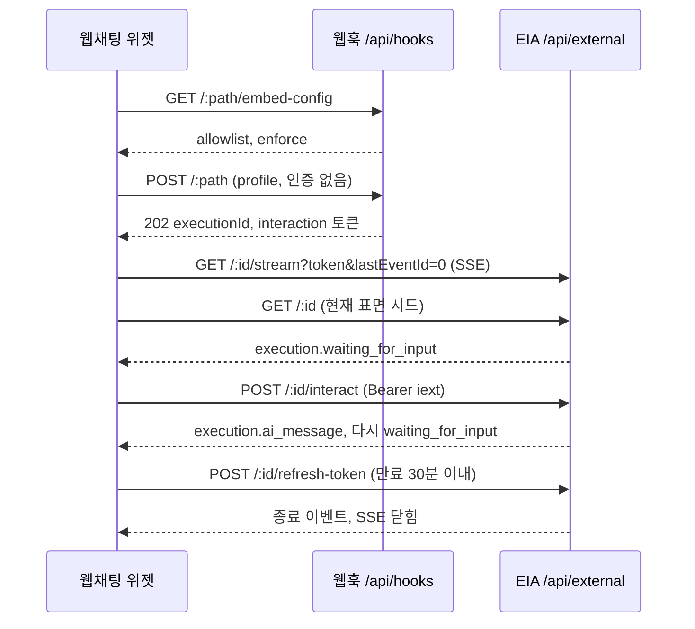

> 구현 상태: 구현됨 · 원문: `spec/7-channel-web-chat/3-auth-session.md`, `spec/7-channel-web-chat/5-admin-console.md` (§6 첫 노드 race 보정) · 용어: [용어 사전](../CLE-GLOSSARY.md)

## 개요

이 문서는 공개 임베드 위젯의 인증과 세션 모델을 정한다. 위젯이 붙는 트리거는 인증 없는 공개 웹훅(public webhook, `auth_config_id IS NULL`)이다. 대화는 웹훅 `202` 응답에 함께 오는 실행 단위 토큰(per_execution token, `iext_*`)으로만 진행하고 클라이언트에 오래 사는 비밀을 두지 않는다.

다루는 것은 세션 시퀀스(부팅 → 시작 → SSE → 명령 → 갱신 → 종료), 첫 노드를 놓치지 않는 시작 보정, 위젯 세션(widget session)을 sessionStorage 에 두고 새로고침 때 복원하는 절차, 버려진 실행의 유휴 실행 회수다. 이 문서는 시퀀스와 공통 규칙을 두고, 재로드 복원 · 토큰 갱신 · 명령 실패 처리의 세부와 그 근거, 위젯 세션 저장소 선택(sessionStorage, localStorage 기각) · 표면 되감기 방어 · 위젯 세션의 발급 주소(`apiBase`) 바인딩의 근거는 하위 문서가 정한다. 실행 단위 토큰 채택과 응답 봉투 처리의 근거는 이 문서의 Rationale 에 있다.

토큰 발급·검증·갱신·폐기의 서버 규칙은 [External Interaction API](../CLE-IX/CLE-EIA.md), 명령·SSE·상태 조회·토큰 갱신 엔드포인트 계약은 [EIA 수신 API와 SSE](../CLE-IX/CLE-EIA-INBOUND.md)가 정한다. 이 문서는 위젯이 그 계약을 어떤 순서로 쓰는지만 정한다. 위젯 대화 상태와 대화 종료·새 대화는 [웹채팅 위젯](CLE-WEBCHAT-WIDGET.md), 임베드 검증과 남용 방어는 [웹채팅 보안](CLE-WEBCHAT-SECURITY.md)에 있다.

## 요구사항

- REQ-WCSESS-001 WHEN 웹채팅 위젯이 붙는 트리거를 두면 THE SYSTEM SHALL 웹훅 인증을 두지 않는다(`auth_config_id IS NULL`).
- REQ-WCSESS-002 WHEN 위젯이 대화를 진행하면 THE SYSTEM SHALL 실행 단위 토큰(`iext_*`)만 쓴다.
- REQ-WCSESS-003 WHEN 위젯 인증 방식을 정하면 THE SYSTEM SHALL 트리거 단위 토큰(`itk_*`)을 지원하지 않는다.
- REQ-WCSESS-004 WHEN 위젯이 부팅되면 THE SYSTEM SHALL 대화를 시작하기 전에 `GET /api/hooks/:path/embed-config` 로 임베드 검증을 한다.
- REQ-WCSESS-005 WHEN 패널이 열리면 THE SYSTEM SHALL `POST /api/hooks/:path { profile }` 를 인증 없이 보낸다.
- REQ-WCSESS-006 WHEN 웹훅 시작·상태 조회·토큰 갱신 응답을 받으면 THE SYSTEM SHALL 응답 봉투의 `data` 를 벗겨 읽는다.
- REQ-WCSESS-007 IF REST 응답에 `data` 키가 없으면 THE SYSTEM SHALL 본문을 그대로 쓴다.
- REQ-WCSESS-008 WHEN 웹훅이 `202` 로 실행 ID 와 토큰을 주면 THE SYSTEM SHALL `GET .../:id/stream?token=iext_*` 로 SSE 를 연다.
- REQ-WCSESS-009 WHEN 시작 직후 처음 SSE 를 열면 THE SYSTEM SHALL `lastEventId=0` 으로 열어 SSE 재전송 버퍼의 seq 1 이상 이벤트를 모두 다시 받는다.
- REQ-WCSESS-010 WHEN 시작이나 복원 직후면 THE SYSTEM SHALL `GET /api/external/executions/:id` 로 현재 표면을 시드한다.
- REQ-WCSESS-011 WHEN 사용자가 입력하거나 선택하면 THE SYSTEM SHALL `Authorization: Bearer iext_*` 헤더로 `POST .../:id/interact` 를 보낸다.
- REQ-WCSESS-012 WHILE 대화가 살아 있고 토큰 만료가 30분 이내인 동안 THE SYSTEM SHALL `POST .../:id/refresh-token` 으로 토큰을 갱신한다.
- REQ-WCSESS-013 IF 주기 토큰 갱신이 `401`·`410` 이 아닌 이유(네트워크 에러 · 그 밖의 응답)로 실패하면 THE SYSTEM SHALL 지수 백오프로 다시 시도한다.
- REQ-WCSESS-014 WHEN 실행이 끝나면 THE SYSTEM SHALL SSE 를 닫고 `[ended]` 로 바꾼다.
- REQ-WCSESS-015 WHEN 실행 ID 와 토큰을 받으면 THE SYSTEM SHALL `{executionId, token, expiresAt, endpoints, apiBase}` 를 iframe origin 의 sessionStorage 에 위젯 세션으로 저장한다.
- REQ-WCSESS-016 WHEN 위젯이 다시 로드되면 THE SYSTEM SHALL sessionStorage 의 위젯 세션을 읽고 없으면 새로 시작(`collapsed`)한다.
- REQ-WCSESS-017 IF 저장된 위젯 세션의 `apiBase` 가 현재 `apiBase` 와 다르거나 기록돼 있지 않으면 THE SYSTEM SHALL 그 세션을 버리고 새로 시작한다.
- REQ-WCSESS-018 WHEN 위젯 세션의 `apiBase` 를 비교하면 THE SYSTEM SHALL 끝의 슬래시만 정규화하고 경로는 보존한다.
- REQ-WCSESS-019 WHEN 재로드 상태 조회가 `200` 과 진행 중 상태를 돌려주면 THE SYSTEM SHALL SSE 를 `Last-Event-Id` 로 다시 연결해 복원한다.
- REQ-WCSESS-020 WHEN 재로드 상태 조회 결과가 `waiting_for_input` 이면 THE SYSTEM SHALL `context` 로 현재 표면을, `context.conversationThread` 로 과거 대화 전체를 시드한다.
- REQ-WCSESS-021 WHEN 재로드 상태 조회가 `200` 과 종료 상태(`completed`·`failed`·`cancelled`)를 돌려주면 THE SYSTEM SHALL 위젯 세션을 지우고 `[ended]` 로 바꾸며 호스트에 `conversationEnded` 를 알린다.
- REQ-WCSESS-022 IF 재로드 상태 조회로 종료가 확정되면 THE SYSTEM SHALL SSE 를 다시 열지 않고 토큰 갱신도 예약하지 않는다.
- REQ-WCSESS-023 WHEN 재로드 상태 조회가 `404 EXECUTION_NOT_FOUND` 면 THE SYSTEM SHALL 위젯 세션을 지우고 `[ended]` 로 바꾼다.
- REQ-WCSESS-024 WHEN 재로드 상태 조회가 `401` 이면 THE SYSTEM SHALL `POST .../refresh-token` 을 한 번 시도한다.
- REQ-WCSESS-025 WHEN 그 한 번의 갱신이 성공하면 THE SYSTEM SHALL SSE 를 다시 연결해 복원한다.
- REQ-WCSESS-026 IF 그 한 번의 갱신이 다시 `401` 이나 `410` 이면 THE SYSTEM SHALL 종료로 확정하고 위젯 세션을 지운다.
- REQ-WCSESS-027 IF 그 한 번의 갱신이 `401`·`410` 이 아닌 응답(`400`·`403`·`429`·5xx)이나 네트워크 에러로 실패하면 THE SYSTEM SHALL 위젯 세션을 유지하고 SSE 는 열지 않는다.
- REQ-WCSESS-028 WHILE SSE 를 미뤄 둔 동안 THE SYSTEM SHALL 주기 토큰 갱신이 성공하는 때에 SSE 를 연다.
- REQ-WCSESS-029 IF 재로드 상태 조회가 그 밖의 상태나 에러로 끝나면 THE SYSTEM SHALL 경고만 남기고 SSE 로 진행한다.
- REQ-WCSESS-030 WHEN 명령 응답이 `410 Gone` 이면 THE SYSTEM SHALL 위젯 세션을 바로 지운다.
- REQ-WCSESS-031 WHEN SSE 가 이미 열린 뒤에 상태 조회 스냅샷이 도착하면 THE SYSTEM SHALL 스냅샷으로 표면을 되감지 않는다.
- REQ-WCSESS-032 IF 대체된 부팅 시도가 종료를 발견하면 THE SYSTEM SHALL 그 종료를 버리지 않고 확정한다.
- REQ-WCSESS-033 WHEN 스트림을 열려 하면 THE SYSTEM SHALL 이미 열린 스트림이 있는지 다시 확인하고 있으면 새 연결을 만들지 않는다.
- REQ-WCSESS-034 WHEN 버퍼 만료나 명령 `409` 로 자기 스트림의 표면을 다시 맞추면 THE SYSTEM SHALL 스트림이 열려 있어도 표면을 다시 그린다.
- REQ-WCSESS-035 WHEN 주기 토큰 갱신과 `401` 복구가 같은 토큰을 갱신하려 하면 THE SYSTEM SHALL refresh 요청을 하나만 보내고 두 경로가 그 결과를 함께 쓴다.
- REQ-WCSESS-036 IF 갱신하려는 토큰이 이미 같은 실행의 새 토큰으로 바뀌었으면 THE SYSTEM SHALL refresh 를 보내지 않고 바뀐 토큰을 쓴다.
- REQ-WCSESS-037 IF 명령이 `410`·`401` 이 아닌 응답이나 네트워크 에러로 실패하면 THE SYSTEM SHALL 위젯 세션과 SSE 를 그대로 두고 대화를 끝내지 않는다.
- REQ-WCSESS-038 WHEN 명령 응답이 `401` 이면 THE SYSTEM SHALL 주기 갱신과 같은 refresh 진입점으로 토큰 갱신을 한 번 시도하고 명령은 다시 보내지 않는다.
- REQ-WCSESS-039 IF 명령 `401` 뒤의 갱신이 `401` 이나 `410` 으로 거부되면 THE SYSTEM SHALL 종료로 확정하고 위젯 세션을 지운다.
- REQ-WCSESS-040 IF 명령 `401` 뒤의 갱신이 `401`·`410` 이 아닌 응답(`400`·`403`·`429`·5xx)이나 네트워크 에러로 실패하면 THE SYSTEM SHALL 위젯 세션을 유지하고 주기 토큰 갱신의 재시도에 맡긴다.

## 하위 문서

- [웹채팅 인증과 세션 — 재로드 복원과 실패 처리](CLE-WEBCHAT-SESSION-RESTORE.md): 위젯 세션 저장과 발급 주소 바인딩, 재로드 상태 조회 분기, 위젯 세션 정리 책임, 공용 refresh 진입점, 명령 실패 처리, 표면 되감기 방어와 그 근거. 요구사항 REQ-WCSESS-015 ~ REQ-WCSESS-040.

## 공개 웹훅

위젯이 붙는 트리거는 누구나 부를 수 있는 공개 챗봇이다. 그래서 `POST /api/hooks/:endpointPath` 트리거를 인증 없음(`auth_config_id IS NULL`)으로 둔다([웹훅](../CLE-TRIG/CLE-TRIG-WEBHOOK.md)). 인증은 인증 설정(AuthConfig) FK 모델로 정하며 예전의 inline `authType` 필드는 없다.

웹채팅 트리거의 경로(UUID)는 설치 스크립트에 그대로 들어가 호스트 페이지에 공개된다. 경로 값 자체는 추측할 수 없는 CSPRNG v4 UUID 로 만든다([웹훅](../CLE-TRIG/CLE-TRIG-WEBHOOK.md)). 이 공개가 일반 공개 웹훅에서 경로를 비밀 키로 다루는 규칙과 어떤 관계인지는 정의가 갈린다. [미결 사항](#미결-사항) 참조.

남용 방어는 인증이 아니라 호출 수 제한, origin 검증, 워크플로우 쪽 가드로 한다([웹채팅 보안](CLE-WEBCHAT-SECURITY.md)).

## 토큰 전략

- 위젯은 실행 단위 토큰만 쓴다. 웹훅 `202` 응답이 단명 `iext_*` 토큰을 함께 주므로([External Interaction API](../CLE-IX/CLE-EIA.md)) 위젯은 공개 경로만 알면 되고 클라이언트에 오래 사는 비밀을 넣지 않는다. 대화가 끝나면 토큰이 자동으로 무효가 된다.
- 트리거 단위 토큰(`itk_*`, 영구)은 지원하지 않는다. 영구 토큰을 설치 스크립트나 번들에 드러내지 않기 위해서다. 부팅 설정에 인증 토큰 필드를 두지 않는다([웹채팅 SDK](CLE-WEBCHAT-SDK.md)).
- (향후) 사용자별 여러 대화 목록: 실행 단위 토큰은 "대화 하나 = 실행 하나" 모델이라 여러 대화를 목록으로 보이려면 따로 설계해야 한다. 사용자 식별과 사용자별 실행·대화 목록 조회 API 가 먼저 있어야 하는데 지금 EIA 에는 없다. v1 비목표다.

## 세션 시퀀스

위젯이 EIA 를 쓰는 순서다. 표면별 매핑은 [웹채팅 구조](CLE-WEBCHAT-ARCH.md)에 있다.

0. (부팅) 위젯이 `GET /api/hooks/:path/embed-config` 로 `{ data: { allowlist, enforce } }` 를 조회하고 `data` 를 벗겨 호스트 origin 을 비교한다. 맞지 않으면 위젯은 `[blocked]` 가 되고 시작하지 않는다. 허용 목록이 비었거나 `enforce=false` 면 통과한다(fail-open). 자세한 규칙은 [웹채팅 보안](CLE-WEBCHAT-SECURITY.md).
1. 패널이 열리면(런처 클릭) 위젯이 `POST /api/hooks/:path { profile }` 를 보낸다. 인증이 없고 `firstMessage` 를 싣지 않는다([웹채팅 위젯](CLE-WEBCHAT-WIDGET.md)).
2. API 가 `202 { data: { executionId, message, status: "pending", interaction: { token: iext_*, expiresAt, endpoints } } }` 로 응답한다. 전역 `TransformInterceptor` 가 모든 성공 응답을 `{ data }` 응답 봉투로 감싸므로 위젯은 `data` 를 벗겨 읽는다. `message` 는 웹훅 202 본문에 늘 들어가는 안내 문장이고 위젯은 이 키를 쓰지 않는다. 202 본문 모양은 [웹훅 「수신 API」](../CLE-TRIG/CLE-TRIG-WEBHOOK.md#수신-api) 가 기준이다.
3. 위젯이 `GET .../:id/stream?token=iext_*` 로 SSE 를 연다. 이어서 아래 [첫 노드 보정](#첫-노드-보정)을 한다.
4. SSE `execution.waiting_for_input` 이 오면 `interactionType` 별로 첫 표면을 그린다. `ai_conversation` 이면 입력창, `buttons`·carousel 이면 선택지, `form` 이면 폼이다.
5. 사용자가 입력하거나 선택하면 `POST .../:id/interact { command: submit_message|click_button|submit_form, ... }` 를 `Authorization: Bearer iext_*` 로 보낸다.
6. SSE `execution.ai_message`(+ `presentations`)가 오면 말풍선을 그리고 다시 `waiting_for_input` 을 기다린다.
7. 만료가 30분 이내이고 대화가 살아 있으면 `POST .../:id/refresh-token` 으로 토큰을 갱신한다. 갱신이 `401`·`410` 이 아닌 이유로 실패하면 지수 백오프로 다시 시도한다. `401`·`410` 이면 그 토큰으로 다시 시도하지 않는다. 상태 조회 `401` 뒤의 복구도 같은 갱신 진입점을 쓴다. 같은 토큰의 refresh 는 한 번만 나간다([refresh 는 진입점 하나로 보낸다](CLE-WEBCHAT-SESSION-RESTORE.md#refresh-는-진입점-하나로-보낸다-같은-토큰은-한-번만)).
8. 종료나 `completed` 가 오면 SSE 를 닫는다. 토큰은 무효가 되고 위젯은 `[ended]` 가 된다.

새로고침 뒤에도 대화를 잇도록 실행 ID 와 단명 토큰을 iframe origin 의 sessionStorage 에 둔다. 같은 탭의 새로고침은 유지되고 탭을 닫으면 자동으로 지워진다. 절차는 [재로드 복원](#재로드-복원)에 있다. v1 사용자는 익명이다.

### 첫 노드 보정

시작(`POST /api/hooks`, `202` 뒤 비동기 실행) 직후 빠른 첫 노드(buttons·carousel)의 `waiting_for_input` 이 위젯의 SSE 구독보다 먼저 나올 수 있다. 첫 노드가 바로 도달하면 거의 항상 그렇다. 위젯은 두 가지로 보정한다.

1. 처음 여는 스트림을 `lastEventId=0` 으로 열어 SSE 재전송 버퍼(5분)에서 놓친 이벤트(seq 1 이상)를 모두 다시 받는다([EIA 수신 API와 SSE](../CLE-IX/CLE-EIA-INBOUND.md)).
2. 시작이나 복원 직후 `GET /api/external/executions/:id` 로 현재 표면을 시드한다. 상태 조회의 `context` 는 SSE wire 형식과 같아서 위젯이 `parseWaitingForInput` 을 그대로 쓴다.

보정하지 않으면 SSE 가 heartbeat 만 받아 첫 노드(캐러셀 버튼)가 그려지지 않는다. 이 보정은 모든 고객 임베드에 적용된다.

## 재로드 복원

→ [웹채팅 인증과 세션 — 재로드 복원과 실패 처리](CLE-WEBCHAT-SESSION-RESTORE.md#재로드-복원)

## 유휴 실행 회수

유휴 실행 회수(`WEBCHAT_IDLE_TIMEOUT`)는 버려진 공개 위젯 실행을 서버가 거두는 장치다. 사용자가 명시 종료 없이 떠나면(탭 닫기, "닫기") 그 실행은 입력 대기로 남는다. 위젯의 새 대화 전 `cancel`([웹채팅 위젯](CLE-WEBCHAT-WIDGET.md))은 정상 경로만 즉시 닫으므로 놓친 경로에 남은 실행을 서버가 거둔다.

- 대상: 공개 웹훅(`auth_config_id IS NULL`) 트리거가 시작하고 실행 단위 토큰으로만 접근하는 입력 대기 실행.
- 판정: 그 실행의 인터랙션 토큰 행이 하나 이상 있고 그 토큰이 모두 만료되고(`execution_token.exp_at` 이 모두 `< now`) 유예 시간(env `WEBCHAT_IDLE_REAP_GRACE_MS`, 기본 1시간)이 지남. 토큰 행이 하나도 없는 실행은 회수하지 않는다([External Interaction API](../CLE-IX/CLE-EIA.md) REQ-EIA-030).
- 결과: `cancelled`(`cancelledBy='timeout'`, `error.code='WEBCHAT_IDLE_TIMEOUT'`). hard-delete 가 아니라 취소 전이와 토큰 일괄 폐기이며 기록과 상태 조회는 남는다.
- 구현: `WebChatIdleReaperService`, BullMQ repeatable 분 단위(구현됨).

판정 신호·메커니즘·기각 대안은 [External Interaction API](../CLE-IX/CLE-EIA.md)가 정한다(원본: EIA-RL-07). 클라이언트 토큰 만료는 클라이언트 쪽 잔존만 정리하고 서버의 입력 대기 실행 행은 이 회수가 거둔다.

## 미결 사항

- **종료된 실행에 대한 명령 응답 코드**: 이 문서는 명령 응답 `410 Gone`(원본: EIA-IN-12)만 바로 종료 신호로 다루고 [웹채팅 SDK](CLE-WEBCHAT-SDK.md)의 `conversationEnded.reason` 에도 `gone` = 410 만 있다. EIA 는 실행이 끝나면 토큰을 바로 폐기하고(원본: EIA-AU-04) Guard 가 폐기된 토큰을 핸들러 전에 `401 TOKEN_REVOKED` 로 거부한다. 그러면 정상 경로에서 종료된 실행에 대한 명령은 `410` 이 아니라 `401` 을 받고 `410` 은 폐기가 빠졌을 때만 나온다. EIA 안에서도 EIA-IN-12 와 토큰 폐기+Guard 가 다른 코드를 예고한다. 위젯의 명령 `401` 처리는 정했다. 갱신을 한 번 시도하고 그 갱신도 `401`·`410` 이면 종료로 확정해 위젯 세션을 지운다(REQ-WCSESS-038~040). 종료된 실행의 토큰은 이미 폐기됐으므로 이 갱신도 `401` 을 받아 `[ended]` 로 간다. 남은 것은 EIA 쪽에서 정상 응답 코드를 하나로 정하는 일이다. 정해지면 두 경로가 호스트에 보내는 `conversationEnded.reason` 을 맞출지 함께 본다. 결정 필요([EIA 수신 API와 SSE](../CLE-IX/CLE-EIA-INBOUND.md)).
- **웹채팅 트리거 경로의 비밀성**: [웹훅](../CLE-TRIG/CLE-TRIG-WEBHOOK.md)과 [트리거 관리](../CLE-TRIG/CLE-TRIG-MANAGE.md)는 인증 없는 웹훅의 `endpointPath` UUID 를 사실상 비밀 키(capability token)로 보고 CSPRNG 발급을 요구한다. [웹채팅 SDK](CLE-WEBCHAT-SDK.md)와 [웹채팅 운영 콘솔](CLE-WEBCHAT-CONSOLE.md)은 웹채팅 트리거의 경로를 "비밀 아님" 으로 보고 이를 근거로 뷰어에게 설치 스크립트 전체를 보인다. 이 문서의 원문은 "사실상 비밀 키이며 스니펫에 노출돼도 무방" 이라고 둘을 함께 적는다. 웹채팅 트리거는 설치 스크립트로 경로가 공개되므로 실제로 비밀이 아니지만 일반 웹훅 규칙과의 예외 관계가 어디에도 적혀 있지 않다. 웹훅 문서에 "웹채팅(공개 설치 스크립트) 트리거의 경로는 공개된다" 는 예외를 둘지, 뷰어 공개 정책이 일반 웹훅에도 번지는지 확인 필요.

## 구현 위치

- `codebase/channel-web-chat/src/lib/eia-client.ts` (EIA 호출, 응답 봉투 벗기기)
- `codebase/channel-web-chat/src/widget/use-widget.ts` (시퀀스·재로드 복원·명령 실패 처리 소비처)
- 위젯 세션 저장 · `apiBase` 정규화 · 부팅 시도 판정 · refresh 진입점은 [하위 문서](CLE-WEBCHAT-SESSION-RESTORE.md#구현-위치)에 있다.

## Rationale

### 실행 단위 토큰만 쓴다 (트리거 단위 토큰 기각)

"새 자격 증명을 들이지 않고 기존 토큰을 재사용 + 웹훅 인증 없음" 이라는 요건을 실행 단위 토큰이 모두 채운다. 기존 EIA 토큰 메커니즘이라 새 자격 증명이 없고 웹훅 `202` 가 단명 토큰을 발급하므로 위젯은 공개 경로만 알면 된다. 트리거 단위 토큰(영구 `itk_*`)은 공개 사이트의 설치 스크립트나 번들에 영구 토큰이 박혀 드러나고 origin 허용 목록으로만 막아야 하므로 뺐다. 실행 단위 토큰은 클라이언트에 오래 사는 비밀이 없고 끝나면 자동으로 무효가 되며 범위가 실행 하나로 좁다.

새로고침 사이의 연속성은 토큰 재사용이 아니라 실행 ID 와 단명 토큰을 클라이언트에 저장했다가 복원하는 방식으로 푼다. 노출 면을 늘리지 않는다. EIA 의 "기본값은 실행 단위(안전)" 원칙과 맞는다. EIA 는 트리거 단위 토큰을 "사용자가 변환층을 직접 구현하는 고급 봇" 에만 두는데 공개 브라우저 위젯은 그 조건이 아니므로 노출하지 않는 것이 EIA 의도와 맞다.

### REST 응답 봉투를 벗기고 없으면 그대로 쓴다

백엔드의 모든 REST 성공 응답은 전역 `TransformInterceptor` 가 `{ data }` 응답 봉투로 감싼다([웹훅](../CLE-TRIG/CLE-TRIG-WEBHOOK.md)과 [HTTP API 규약](../CLE-API/CLE-API-CONV.md)이 정하는 횡단 규약이라 이 영역이 바꿀 수 없다). 그래서 위젯 `eia-client` 는 웹훅 시작·상태 조회·토큰 갱신 응답에서 `res.data` 를 벗겨 읽는다. SSE 프레임은 인터셉터를 거치지 않아 봉투가 없으므로 벗기지 않는다.

벗기는 헬퍼는 `data` 키가 없으면 본문을 그대로 돌려준다. (a) 단위 테스트가 봉투 없는 fixture 로 메서드 로직을 따로 검증할 수 있고 (b) 인터셉터를 거치지 않는 경로(향후 감싸지 않는 응답)를 막아 준다. 운영 서버는 늘 `{ data }` 를 돌려주므로 정상 흐름에서는 이 분기가 쓰이지 않는다. 모든 표면에서 봉투가 보장되면 지워도 된다.

`interact` 는 EIA 에서 `InteractAckDto`(`{ executionId, accepted, currentStatus }`)를 `{ data }` 봉투에 담아 `202` 로 돌려준다([EIA 수신 API와 SSE](../CLE-IX/CLE-EIA-INBOUND.md)). 하지만 위젯 `eia-client` 는 그 ack 본문을 쓰지 않고 뒤 상태를 SSE 로 받으므로 벗길 대상이 아니다. 봉투를 벗기지 않아 `interaction` 을 못 읽고 SSE 가 열리지 않던 회귀를 고친 것이 이 규칙의 배경이다.

