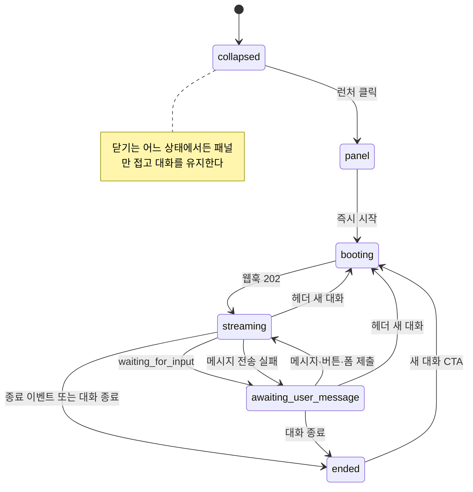

## 개요

이 문서는 [웹채팅 위젯](CLE-WEBCHAT-WIDGET.md) 의 하위 문서로 위젯 대화 상태(widget state) 전이를 정한다. 즉시 시작, 대화 종료 · 새 대화, 안 읽음, 새로고침 복원, 명령 실패, SSE 재연결, 가시성 · profile 갱신 · 차단을 다룬다.

## 위젯 대화 상태

위젯 대화 상태는 패널을 펼치는 축(`collapsed`↔패널)을 따라 움직인다. 위젯 가시성(`show`·`hide`)과 정책 차단(`blocked`)은 이 축과 따로 움직인다([가시성·profile 갱신·차단](#가시성profile-갱신차단)).

이 도표는 패널을 펼쳐 대화를 시작하는 라이브 경로만 그린다. 그리지 않은 경로가 둘 있다. 시작 직후 상태 조회가 이미 종료를 돌려주면 웹훅 `202` 로 `streaming` 이 된 직후 `[ended]` 로 간다. 새로고침 복원은 `panel`·`booting` 을 거치지 않고 `collapsed` 에서 바로 `streaming` 으로 간다. 그 뒤 상태 조회가 종료를 돌려주면 `[ended]` 로 끝난다. 두 경로의 종료 판정은 [웹채팅 인증과 세션](CLE-WEBCHAT-SESSION.md#재로드-복원) 「재로드 복원」의 `200` + 종료 행과 같다. 복원 중 화면은 [새로고침 복원 화면](#새로고침-복원-화면)에 있다.

- **시작 시점**: 패널을 처음 펼칠 때(런처 클릭) 워크플로우를 시작한다. 정적 환영 메시지와 추천 질문을 바로 그리면서 동시에 실행을 시작한다(`POST /api/hooks/:path { profile }`). 첫 `waiting_for_input` 의 `interactionType` 에 따라 첫 표면을 그대로 그린다. `ai_conversation` 이면 입력창과 환영 메시지, `buttons`·carousel 이면 선택지, `form` 이면 폼이다. 그래서 첫 노드가 AI 가 아닌 워크플로우(예: 카테고리 선택 캐러셀)도 패널을 열자마자 그 표면이 보인다. 위젯은 시작 전에 첫 노드 타입을 알 수 없으므로 표면을 보여 주려면 실행을 먼저 시작해야 한다.
- **토큰 낭비 없음**: AI 에이전트 노드의 멀티턴(`multi_turn`)은 첫 사용자 메시지 전에는 LLM 을 부르지 않고 바로 입력 대기로 들어간다([AI 에이전트 노드](../CLE-NODE-AI/CLE-NODE-AGENT.md)). 패널을 열기만 해서 생기는 비용은 입력 대기 실행 행 하나뿐이다(LLM 토큰 0).
- **`firstMessage` 미사용**: 웹훅 페이로드에는 `profile` 만 싣는다. 첫 사용자 텍스트도 일반 `submit_message` 로 보내 AI 의 첫 턴이 된다. 멀티턴은 트리거 입력을 첫 턴으로 쓰지 않기 때문이다.
- **다시 열기**: 닫은 뒤 다시 열면 새 실행을 시작하지 않는다. 위젯 세션(실행 ID + 토큰)을 복원해 기존 대화를 잇는다.
- **헤더 대화 컨트롤**: 대화가 확립된 뒤(`streaming`·`awaiting_user_message`) 사용자는 "대화 종료" 로 `[ended]` 로 가거나 "새 대화" 로 현재 대화를 버리고 `[booting]` 부터 다시 시작할 수 있다. 둘 다 가벼운 확인을 거치고 `booting` 에서는 숨긴다(중복 웹훅과 보내지 못한 `cancel` 방지). 그림의 새 대화 화살표는 `[ended]` CTA 와 헤더 컨트롤 양쪽에서 나온다. 동작의 기준은 아래 표다.

### 대화 종료·새 대화·위젯 세션 유지

| 동작 | 트리거 | EIA 처리 | 위젯 상태 |
|---|---|---|---|
| 닫기(접기) | 헤더 닫기, 런처 토글 | 실행의 입력 대기를 유지한다. SSE 연결도 유지한다 | 패널만 숨긴다. 닫힌 동안 도착한 메시지(예: AI 응답)는 버퍼에 담아 안 읽음 배지로 알리고 다시 열 때 그린다. 다시 열면 그대로다 |
| 대화 종료 | 헤더 "대화 종료"(대화 확립 후, 가벼운 확인) 또는 `completed` | AI 대화 대기(`awaiting_user_message` + `ai_conversation` + 대기 노드 ID 확정)면 `end_conversation` 을 보낸다. 워크플로우는 이어서 완료된다. 그 밖(응답을 기다리는 `streaming`, `buttons`·`form` 대기, `ai_conversation` 이라도 대기 노드 ID 미확정)이면 `cancel` 로 실행을 끝낸다. 둘 다 실행이 끝나고 토큰이 무효가 된다. 위젯은 SSE 를 먼저 닫고 위젯 세션을 정리해 `[ended]` 로 바꾼 뒤 종료 명령을 best-effort 로 보낸다. 명령이 실패하거나 거부돼도(`410 Gone`·`409 STATE_MISMATCH`·네트워크) 로컬 종료 상태를 유지한다. 컨트롤은 대화 확립 후에만 보이므로 종료할 때 위젯 세션과 토큰이 항상 있다. 근거는 [Rationale](#헤더-대화-컨트롤은-대화-확립-후에만-보이고-종료-명령은-대기-표면에-따라-고른다) | `[ended]`. 대화 내용은 읽기 전용이 되고 "새 대화 시작" CTA 를 보인다 |
| 새 대화 | `[ended]` CTA, 헤더 "새 대화"(가벼운 확인), 호스트 `resetSession` | 위젯 세션과 스트림을 정리한 뒤 새 `POST /api/hooks/:path` 로 새 실행 ID 와 토큰을 받는다. 확립된 대화에서 시작했으면 새 시작 전에 이전 실행에 best-effort `cancel`([EIA 수신 API와 SSE](../CLE-IX/CLE-EIA-INBOUND.md))을 보내 서버에 고아 실행이 남지 않게 한다. 실패하거나 거부돼도 로컬 재시작을 되돌리지 않는다. `booting` 중 호스트 `resetSession` 은 진행 중인 시작에 합쳐 두 번째 웹훅 요청과 두 번째 실행을 만들지 않는다. 명시 취소를 보내지 못한 이탈(탭 닫기, "닫기")은 서버의 유휴 실행 회수(`WebChatIdleReaperService`, [웹채팅 인증과 세션](CLE-WEBCHAT-SESSION.md))가 처리한다 | 대화 내용을 비우고(구분선) `[booting]` |
| 토큰 만료·서버 회수 | 재로드 때 상태 조회가 `401` 이고 토큰 갱신도 실패한 경우. 명령이 `401` 을 받고 그 뒤 갱신이 `401`·`410` 으로 거부된 경우도 같다([명령 실패](#명령-실패)). 유휴 실행 회수 뒤의 재로드도 위젯이 가진 토큰이 모두 만료된 상태라 이 경로로 끝난다. `410 Gone` 은 명령 응답에만 나오고 상태 조회에는 나오지 않는다. 재로드 분기의 기준은 [웹채팅 인증과 세션](CLE-WEBCHAT-SESSION.md) | 없음 | `[ended]` + "대화 종료, 새로 시작" 안내 |
| 페이지 새로고침·이동 | 호스트 페이지 새로고침 → iframe 재로드 | 없음 | 복원한다. 실행 ID 와 토큰을 iframe origin 의 sessionStorage 에 둔다(같은 탭 새로고침은 유지, 탭을 닫으면 지워짐). 상태 조회(`GET /:id`) 결과가 입력 대기면 영속 `conversationThread` 가 함께 오므로 SSE 재전송 버퍼나 서버 재시작과 상관없이 전체 기록을 복원한다([EIA 수신 API와 SSE](../CLE-IX/CLE-EIA-INBOUND.md)). 대화 스레드에 저장되지 않는 표시 전용 Presentation 노드의 표시물은 예외다. 그다음 SSE(`Last-Event-Id`)를 다시 연결한다. 복구할 수 없으면 `[ended]` 다. 절차는 [웹채팅 인증과 세션](CLE-WEBCHAT-SESSION.md) |

- 봇이 먼저 말을 거는 프로액티브 메시지는 비목표다. 진행 중인 대화에서 도착하는 메시지는 위처럼 안 읽음으로 잡는다.
- 사용자별 여러 대화 목록은 비목표다. 사용자 식별(추후)과 사용자별 실행 목록 API 가 먼저 있어야 한다.
- 새 대화의 명령 순서와 종료 이벤트 경합은 [미결 사항](CLE-WEBCHAT-WIDGET.md#미결-사항) 참조.

### 새로고침 복원 화면

재로드 절차와 판정은 [웹채팅 인증과 세션](CLE-WEBCHAT-SESSION.md#재로드-복원) 「재로드 복원」이 정하고 이 문서는 그 결과를 화면에 그리는 부분만 다룬다.

- 복원은 패널을 열지 않는다. 런처가 그대로 보이고 사용자가 누르면 패널이 열린다. 이때 새 실행을 시작하지 않는다.
- 위젯 대화 상태는 `collapsed` 에서 바로 `streaming` 으로 가고 대기 표면을 받거나 종료가 확정될 때까지 그대로다.
- 그동안 패널을 열면 전송 버튼에 스피너가 보이고 입력창은 꺼진다. 위젯 세션이 이미 있으므로 헤더의 "새 대화"·"대화 종료" 도 보인다.
- 상태 조회가 대기 표면을 주면 그 표면과 과거 대화를 그린다.
- 세션을 복원할 때 스냅샷이 이미 종료 상태면 대화 표면 대신 `[ended]` 화면을 보인다. 그 판정과 SSE · 토큰 갱신 처리는 [웹채팅 인증과 세션](CLE-WEBCHAT-SESSION.md#재로드-복원)을 따른다.

### 명령 실패

입력·선택·제출 명령(`interact`)이 실패해도 그 실패로 종료가 확정되지 않으면 대화를 끝내지 않는다. 위젯 세션과 SSE 를 그대로 두고 현재 표면에서 다시 보내게 한다. 종료로 보지 않는 이유는 [웹채팅 인증과 세션](CLE-WEBCHAT-SESSION.md) Rationale 「`410` 이 아닌 명령 실패는 종료가 아니다」에 있다.

| 응답 | 동작 |
|---|---|
| `410 Gone` | 종료로 확정한다. 위젯 세션을 지우고 `[ended]` 로 바꾼다([웹채팅 인증과 세션 요구사항](CLE-WEBCHAT-SESSION.md#요구사항)의 명령 `410` 규칙) |
| `401` | 주기 갱신과 같은 refresh 진입점으로 갱신을 한 번 시도한다. 갱신이 `401`·`410` 으로 거부되면 종료로 확정한다. 갱신에 성공하거나 그 밖의 이유(`400`·`403`·`429`·5xx·네트워크 에러)로 실패하면 아래 공통 처리를 한다. 명령은 다시 보내지 않는다([웹채팅 인증과 세션 요구사항](CLE-WEBCHAT-SESSION.md#요구사항)의 명령 `401` 규칙) |
| `409 STATE_MISMATCH` | 공통 처리를 하고 상태 조회 스냅샷으로 현재 표면을 다시 맞춘다. 버퍼 만료 재동기화처럼 스트림이 열려 있어도 다시 그린다. 조회가 뜬 사이 다음 명령을 보냈을 때의 처리는 [SSE 재연결](#sse-재연결)과 같다. 스냅샷이 종료 상태면 종료로 확정한다 |
| `400 VALIDATION_ERROR`(`submit_form`) | Form 과 입력값을 그대로 두고 `details[].message` 를 그 `field` 의 입력 칸에 표시한다. `details[]` 가 없으면 공통 처리를 한다 |
| 그 밖(`400`·`429`·5xx·`503 EXECUTION_ENQUEUE_FAILED`·네트워크 에러) | 공통 처리 |

공통 처리는 다음과 같다.

- `[ended]` 로 가지 않는다. 위젯 세션과 SSE 를 유지한다.
- 버튼·Form 표면은 그대로 남는다. 메시지 전송이 실패하면 낙관적으로 그린 사용자 말풍선을 거두고 보낸 글을 입력창에 되돌려 `awaiting_user_message` 로 돌아간다. 그 사이 SSE 로 새 응답이나 대기 표면이 왔으면 서버가 명령을 처리한 것이므로 되돌리지 않는다.
- 명령 실패 안내(catalog `error.commandFailed`)를 보인다. 서버 원문은 보이지 않는다([웹채팅 보안](CLE-WEBCHAT-SECURITY.md)). 다음 명령을 보내거나 새 대기 표면을 받으면 지운다.
- 자동으로 다시 보내지 않는다.

`details[].message` 는 EIA 가 사용자에게 보이려고 만든 필드 검증 문구다. 백엔드 페이로드라 번역하지 않고 받은 그대로 그린다. 위젯 `locale` 을 따르지 않으므로 영어 위젯에도 서버가 정한 언어(지금은 한국어) 문구가 보일 수 있다(알려진 한계). 서버 원문을 보이지 않는다는 [웹채팅 보안 요구사항](CLE-WEBCHAT-SECURITY.md#요구사항)의 일반화 문구 규칙에 대한 예외이기도 하다. 예외로 두는 이유는 이 문구가 폼 노드의 검증 규칙에서 만든 문장이라 사용자가 넣은 값을 싣지 않기 때문이다. 문장에 들어가는 값은 폼 설정의 한도(최소 길이 · 최댓값 · 파일 크기 등)뿐이다.

### SSE 재연결

iframe 이 일시 중지되거나 네트워크가 잠깐 끊겨 SSE 가 끊기면 위젯은 마지막으로 받은 이벤트의 `Last-Event-Id` 로 다시 연결한다. EIA 의 SSE 재전송 버퍼(5분)가 `seq > Last-Event-Id` 인 이벤트를 다시 보내므로 끊긴 동안 도착한 `ai_message` 도 되찾아 안 읽음 배지와 타임라인에 반영한다. 다만 버퍼는 서버 메모리에 있어 서버 프로세스가 다시 시작되면 사라지고 재시작 직후에는 만료 신호(`execution.replay_unavailable`)도 못 보낼 수 있다. 이 한계는 [EIA 수신 API와 SSE](../CLE-IX/CLE-EIA-INBOUND.md)가 정한다.

버퍼(5분)가 만료된 뒤에는 놓친 이벤트를 다시 받을 수 없다. 서버는 버퍼가 요청 범위를 채우지 못하면 `execution.replay_unavailable` 을 보내고 위젯은 이 이벤트를 받으면 상태 조회 `GET /api/external/executions/:id` 의 스냅샷(현재 `conversationThread`)으로 현재 표면을 다시 맞춘다(`use-widget.ts` `handleEiaEvent` → `seedWaitingFromStatus`). 이 신호는 종료를 뜻하지 않으므로 스트림과 위젯 세션을 유지하고 이후 이벤트를 그대로 처리한다.

재동기화 상태 조회가 뜬 사이 사용자가 다음 명령을 보냈으면 그 스냅샷으로 표면을 다시 그리지 않는다. 늦게 온 스냅샷이 방금 보낸 입력과 말풍선을 덮지 않게 하려는 것이다. 스냅샷이 종료 상태면 그대로 종료로 확정한다. 명령을 보냈는지는 조회를 시작할 때와 응답을 받을 때의 명령 순번(`use-widget.ts` `commandSeqRef`)을 비교해 판정한다. 명령 `409` 뒤의 재동기화도 같다.

재동기화 상태 조회가 `401` 을 받으면 재로드와 같은 복구를 한다([웹채팅 인증과 세션 요구사항](CLE-WEBCHAT-SESSION.md#요구사항)의 재로드 `401` 규칙, 절차는 [재로드 복원](CLE-WEBCHAT-SESSION.md#재로드-복원)). 복구로 토큰이 바뀌었으면 새 토큰으로 상태를 한 번 더 조회한다. 그 왕복에서는 표면을 그리지 못했는데, 재로드 · 시작 경로와 달리 이 경로는 스트림이 이미 열려 있고 버퍼도 비어 있어 `waiting_for_input` 을 다시 받을 길이 없기 때문이다. 두 번째 조회도 `401` 이면 그 안의 복구가 새 토큰으로 refresh 를 보내고, 그것도 `401`·`410` 으로 거부되면 종료로 확정한다. 더 반복하지 않는다. 한 번 더 조회할지는 위젯 세션의 토큰이 바뀌었는지로만 판정한다. 첫 조회가 성공한 사이 주기 갱신이 회전을 마친 드문 경우에도 한 번 더 조회하지만 같은 스냅샷을 다시 그릴 뿐이다. 복구가 refresh 를 따로 보내지 않고 주기 갱신과 진입점 하나를 함께 쓰는 이유는 [웹채팅 인증과 세션](CLE-WEBCHAT-SESSION.md) Rationale 「refresh 는 진입점 하나로 보낸다」에 있다.

> **스냅샷이 이미 종료 상태면 종료로 확정한다.** 버퍼 공백 동안 실행이 `completed`·`failed`·`cancelled` 로 바뀌었다면 그 종료 이벤트도 버퍼와 함께 사라져 다시 오지 않는다. 서버는 신호를 보낸 뒤 연결만 유지하고 재전송하지 않는다. 이 경우 위젯은 표면을 시드하지 않고 위젯 세션을 정리해 `[ended]` 로 바꾸며 호스트에 `conversationEnded` 를 알린다. 이 예외가 없으면 위젯이 `streaming`("AI 응답 중")에 계속 멈춘다. 사용자 조작이 없는 구간이라 명령 `410` 으로 뒤늦게 알아챌 길도 없다. 세션을 복원할 때 스냅샷이 이미 종료 상태인 경우는 [새로고침 복원 화면](#새로고침-복원-화면)에 있다. 회귀 테스트는 `use-widget-eager-start.test.ts` 의 "버퍼 만료 재동기화" 와 "복원된 세션이 이미 terminal" 이다.

### 가시성·profile 갱신·차단

호스트 제어 명령(`wc:command`, [웹채팅 SDK](CLE-WEBCHAT-SDK.md))에 대응하는 위젯 상태다. 셋은 서로 다른 층이다. 가시성과 패널 펼침은 UI 상태, `blocked` 는 보안 정책 결과, `updateProfile` 은 다음 시작 페이로드의 변경이다. 가시성과 패널은 서로 독립인 두 축으로 나눈다. 공개 계약 타입의 기준은 [웹채팅 SDK](CLE-WEBCHAT-SDK.md)의 제어 인스턴스(`ChatInstance`)다.

| 축 | 상태 | 호스트 명령 | 뜻 |
|---|---|---|---|
| 위젯 가시성 | `visible`(기본) / `hidden` | `show` / `hide` | `hidden` 은 런처와 패널을 모두 그리지 않는다(페이지에서 위젯 자체를 숨김). 대화와 SSE 는 유지한다 |
| 패널 펼침 | `collapsed` / `open` | `open` / `close` | 위 상태 그림의 접힘↔패널 축 |

- 두 축은 독립이다. `hide` 뒤의 `open` 은 효과가 없다. 먼저 `show` 해야 한다.
- `blocked`(임베드 불허, [웹채팅 보안](CLE-WEBCHAT-SECURITY.md))는 두 축과 무관한 정책 거부 상태이고 복구할 수 없다. 호스트 `show` 로도 풀리지 않는다. 호스트가 되돌릴 수 있는 `hidden` 과 다르다.
- `updateProfile(profile)` 은 부팅 `profile` 에 얕게(shallow) 합쳐져 다음 워크플로우 시작(패널 열기·새 대화)의 웹훅 페이로드 `profile` 에 반영된다. 진행 중인 실행에 이미 보낸 profile 은 바꾸지 않는다. 웹훅 페이로드는 시작할 때 한 번만 보내고 EIA 에 다시 보내는 표면이 없다. 시작 전 빈 세션에서 갱신하면 첫 시작에 그대로 반영된다.
- 호스트 `sendMessage` 의 위젯 쪽 처리는 [미결 사항](CLE-WEBCHAT-WIDGET.md#미결-사항) 참조.

## Rationale

### 가시성과 패널을 두 축으로 나누고 updateProfile 은 소급하지 않는다

런처 가시성(`show`·`hide`)과 패널 펼침(`open`·`close`)을 독립인 두 축으로 둔 것은 [웹채팅 SDK](CLE-WEBCHAT-SDK.md)에서 합의한 결정을 위젯 쪽에 반영한 것이다. 호스트가 "위젯을 페이지에서 완전히 숨김" 과 "런처는 두고 패널만 접음" 을 따로 제어해야 하기 때문이다. `updateProfile` 을 다음 시작에만 반영하고 진행 중 실행에 소급하지 않는 것은 웹훅 페이로드가 시작 때 한 번이라는 EIA 표면 제약을 따른 것이다. 진행 중 실행의 profile 을 고치려면 EIA 표면을 넓혀야 해서 이 영역 밖으로 뺐다. `blocked` 는 두 축과 무관한 복구 불가 상태로 따로 두어 호스트 제어(`hidden`)와 섞이지 않게 했다.

### 패널을 열 때 워크플로우를 시작한다 (첫 입력 때 시작 기각, 결정 2026-06-06)

**처음 결정(기각)**: 패널을 열기만 해서는 시작하지 않고 첫 사용자 텍스트 입력 때 시작하며 웹훅에 `firstMessage` 를 함께 싣는 방식이었다. 빈 패널만 열고 떠나는 사용자 때문에 실행이 낭비되는 것을 피하려 했다. 이 방식은 AI 텍스트가 먼저인 워크플로우만 가정했고 두 결함이 드러났다.

1. **AI 가 아닌 첫 노드(캐러셀·버튼·폼)를 보일 수 없다.** 첫 표면을 그리려면 실행을 시작해 첫 `waiting_for_input` 을 받아야 하는데 위젯은 시작 전에 첫 노드 타입을 모른다. 첫 입력 때 시작하면 "패널을 열자마자 카테고리 선택 캐러셀 보이기" 가 구조적으로 불가능하다.
2. **`firstMessage` 가 사라진다.** 멀티턴 AI 에이전트는 설계상 트리거·웹훅 입력을 첫 턴으로 쓰지 않고 첫 사용자 채팅 입력만 첫 턴으로 삼는다([AI 에이전트 노드](../CLE-NODE-AI/CLE-NODE-AGENT.md)). 그래서 웹훅에만 실린 `firstMessage` 는 어느 노드에도 닿지 않아 사용자의 첫 메시지가 사라졌다.

**바꾼 결정(채택)**: 패널을 열면 바로 실행을 시작한다. 첫 `waiting_for_input` 타입대로 첫 표면을 그리고 첫 사용자 텍스트도 일반 `submit_message` 로 보낸다. `firstMessage` 는 없앤다. 기각했던 방식의 유일한 이점(낭비 방지)은 다시 따져 보니 비용이 작다. 멀티턴은 입력 전에 LLM 을 부르지 않으므로 패널 한 번 열 때 비용은 입력 대기 실행 행 하나(LLM 토큰 0)다. 패널을 여는 것은 사실상 대화 의도이고 버려진 대화는 토큰 만료로 정리된다. 위젯 토큰뿐 아니라 서버의 입력 대기 실행 행도 유휴 실행 회수([External Interaction API](../CLE-IX/CLE-EIA.md))가 토큰이 모두 만료되고 유예 시간이 지나면 거둔다. 즉시 시작은 두 결함을 함께 없애고 모든 첫 노드 타입을 똑같이 지원한다. 대부분의 임베드형 채팅 위젯도 패널을 열 때 대화를 시작한다. 정적 환영 메시지는 그대로 바로 그려 AI 가 먼저 인사하는 경험도 유지한다.

**따라오는 규칙(런처 버블 큐 게이팅)**: 런처 버블로 큐에 담은 텍스트는 첫 `awaiting_user_message` 표면이 `ai_conversation` 일 때만 보낸다. 첫 표면이 `buttons`·`form` 이면 자유 텍스트를 제출할 수 없으므로 큐를 버려 엉뚱한 표면에 제출되지 않게 하고 입력창도 같은 조건으로 끈다.

### 헤더 대화 컨트롤은 대화 확립 후에만 보이고 종료 명령은 대기 표면에 따라 고른다

**booting 에서 숨기는 이유**: `booting` 은 웹훅 요청이 진행 중이라 위젯 세션(실행 ID·토큰)이 아직 없다. 이때 컨트롤을 보이면 (a) "대화 종료" 가 보낼 서버 취소 명령의 대상이 없어 명령이 나가지 않고(로컬만 끝나고 서버에 입력 대기 실행이 남음), (b) "새 대화" 를 다시 누르면 진행 중인 `start()` 와 겹쳐 웹훅이 중복으로 나간다. 시작 전(`collapsed`·`panel`)과 `[ended]` 도 같은 이유로 숨긴다. 판정 기준은 `isActiveConversationPhase`(booting 제외)다. 호스트 `resetSession` 은 위젯 UI 를 거치지 않으므로 이 게이트를 지나지 않는다. 그 경로의 booting 중복은 UI 게이트가 아니라 single-flight 합치기(아래)로 막는다.

**`end_conversation` 과 `cancel` 을 고르는 이유**: 두 명령은 위젯이 새로 만든 구분이 아니라 EIA 가 이미 따로 정의한 명령이다([EIA 수신 API와 SSE](../CLE-IX/CLE-EIA-INBOUND.md)). `end_conversation` 은 특정 `nodeId` 의 멀티턴 대기를 정상 종료하고 `cancel` 은 실행 전체를 멈춘다. 위젯은 현재 대기 표면에 따라 기존 계약을 고를 뿐이다. AI 대화 대기면 `end_conversation` 으로 워크플로우가 이어서 완료되게 한다(뒤 노드와 집계가 정상으로 돈다). 그 밖은 `end_conversation` 이 대상 노드를 가질 수 없어 `cancel` 로 실행을 끝낸다.

**로컬 먼저 종료하는 이유**: SSE 를 먼저 닫으면 종료 이벤트가 종료 처리와 겹쳐 두 번 전이하는 일이 없다. 명령이 실패하거나 거부돼도 사용자 의도(종료)를 앞세워 로컬 종료를 되돌리지 않는다. 서버 상태는 실행 무기한 보존 불변식([장애 복구와 안전 종료](../CLE-EXEC/CLE-EXEC-RECOVERY.md))과 토큰 만료로 정리된다. 종료 명령이 사라진 경우에도 공개 위젯에 남은 입력 대기 실행은 유휴 실행 회수가 토큰 만료와 유예 시간 뒤에 거둔다.

### 서버에 남는 실행을 없애는 두 장치: single-flight 합치기와 새 대화 전 cancel

헤더 대화 컨트롤 게이트와 맞물리는 두 결함의 결정 근거다.

**booting 중 호스트 `resetSession` 의 중복 웹훅은 single-flight 합치기로 막는다(서버 멱등이 아니다).** 원인은 공유 웹훅 표면에 멱등이 없어서가 아니라 클라이언트 동시성 결함이다. `resetSession` 이 진행 중인 `start()` 를 기다리지 않고 새 `start()` 를 보냈다. 위젯은 동시에 진행 중인 `POST /api/hooks/:path` 를 최대 1개, 살아 있는 실행을 최대 1개로 두는 single-flight 게이트를 유지한다. 모든 시작 진입점(패널 열기 즉시 시작, `[ended]` CTA, 헤더 "새 대화", 호스트 `resetSession`)이 이 게이트를 지난다. `booting` 중 도착한 `resetSession` 은 두 번째 요청을 보내지 않고 진행 중인 시작에 합친다. `booting` 은 대화가 확립되기 전(메시지 0, 위젯 세션 저장 전)이라 "새 대화" 요구가 진행 중인 시작으로 이미 채워지고 합쳐진 시작이 그대로 위젯 세션이 된다. 그래서 중복 웹훅, 중복 실행, 첫 노드 부수효과 2회가 구조적으로 0 이 된다.

- 기각 (a): 공유 `POST /api/hooks/:path` 에 `Idempotency-Key` 를 붙이는 방식. 새 대화는 새 대화 의도라 다른 키를 쓰게 되므로 실행 두 개가 그대로 생겨 이 경합을 원리적으로 막지 못한다. 모든 웹훅 통합이 쓰는 공유 표면을 넓게 바꾸게 된다.
- 기각 (b): 기다린 뒤 취소하고 다시 시작하는 방식. `booting` 실행을 확립시킨 뒤 취소하므로 첫 노드 부수효과가 1회 더 생기고 취소될 실행을 만든다.

합치기는 두 번째 실행 자체를 만들지 않아 부수효과와 고아 실행이 모두 0 이다. 호스트는 실행 ID 를 관측하지 않으므로("항상 새 ID" 라는 호스트 계약 없음) 관측할 수 있는 차이가 없다.

**확립된 대화의 "새 대화" 는 이전 실행에 best-effort `cancel` 을 보낸 뒤 다시 시작한다.** "대화 종료" 와 대칭이며 폐기이므로 `end_conversation` 이 아니라 `cancel` 이다. 명시 종료가 없으면 서버에 고아 실행이 남는다. 즉시 처리(새 대화 전 cancel)와 토큰 만료 뒤 처리(유휴 실행 회수)의 이중 장치다. 서버 쪽 유휴 대기 시간 정책과 불변식은 [External Interaction API](../CLE-IX/CLE-EIA.md)와 [실행 상태 머신과 대기·재개](../CLE-EXEC/CLE-EXEC-STATE.md)가 정한다. 실행 상태 전이표가 입력 대기 → 취소됨의 사유로 미리 둔 "타임아웃" 의 구현이다.

### 명령이 실패하면 보낸 입력을 되돌리고 사용자가 다시 보낸다

명령 실패를 종료로 보지 않는 이유는 [웹채팅 인증과 세션](CLE-WEBCHAT-SESSION.md) Rationale 「`410` 이 아닌 명령 실패는 종료가 아니다」에 있다. 이 절은 실패를 화면에 어떻게 보이는지의 근거다([명령 실패](#명령-실패)).

- **낙관적으로 그린 말풍선을 거둔다**: `400`·`409`·`429`·`503` 같은 거부 응답은 서버가 그 입력을 받지 않았다는 뜻이다. 말풍선을 남기면 대화 기록에 없는 메시지가 화면에만 남고 사용자는 다시 보내야 하는지 알 수 없다. 보낸 글은 입력창에 되돌려 다시 입력하지 않고 보낼 수 있게 한다. 네트워크 에러처럼 처리 여부를 알 수 없는 실패도 같이 거둔다. 실패 전에 SSE 로 새 응답이나 대기 표면이 왔으면 서버가 처리한 것이므로 거두지 않는다.
- **자동으로 다시 보내지 않는다**: 위젯은 명령에 `Idempotency-Key` 를 붙이지 않는다. 네트워크 에러나 5xx 만으로는 서버가 명령을 처리했는지 알 수 없어서 자동 재전송은 같은 입력을 두 번 넣을 수 있다. 다시 보낼지는 화면을 본 사용자가 정한다.
- **Form 검증 실패는 입력값을 남긴다**: `400 VALIDATION_ERROR` 뒤에도 실행은 입력 대기로 남는다([EIA 수신 API와 SSE](../CLE-IX/CLE-EIA-INBOUND.md)). 값을 지우면 사용자가 처음부터 다시 채워야 한다.

Form 검증 실패 문구(`details[].message`)는 서버 원문을 보이지 않는다는 원칙의 예외로 두고 받은 그대로 보인다. 2026-11-12 사람 결정(NERV 질문 `01a1d025-512d-70ef-9fcf-94334d80d79e`)이다. 기각한 대안은 `details[].code` 로 catalog 문구를 고르는 것이다. 서버는 검증 규칙마다 다른 문장을 보내지만 `details[].code` 는 늘 `INVALID_FIELD` 하나다. 그래서 이 대안을 쓰면 "입력값을 확인해 주세요" 같은 일반 문구 하나만 남아 어떤 규칙에 걸렸는지와 문장에 적힌 한도를 잃는다.
