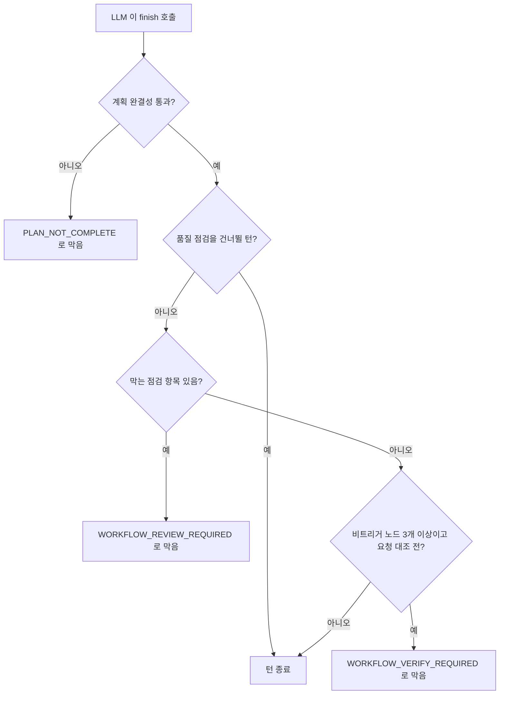

## 개요

이 문서는 [워크플로우 AI 어시스턴트](CLE-WF-ASSIST.md) 의 하위 문서로 대화 루프(탐색 · 계획 · 편집 단계와 계획 카드 진행)와 턴의 성능 · 비용 가드(호출 타임아웃, 도구 호출 한도, 라운드 이어가기, 자동 이어서 진행, 종료 가드)를 정한다. 도구 정의는 [AI 어시스턴트 도구](CLE-WF-ASSIST-TOOLS.md), 에러 코드와 에러 버블은 [에러 처리와 모델 설정](CLE-WF-ASSIST-ERROR.md#에러-처리)에 있다.

## 대화 루프

AI 어시스턴트는 세 단계를 자유롭게 오간다. 단계는 상태 기계로 강제하지 않고 프롬프트 지침과 도구 접근으로 유도한다.

| 단계 | 목적 | 쓰는 도구 | 캔버스 변경 |
|------|------|-----------|-------------|
| ① 탐색(Clarify) | 요청이 모호할 때 조회와 질문으로 구체화 | 읽기 전용 탐색 도구 | 없음 |
| ② 계획(Plan) | 계획 카드를 제시하고 승인을 요청 | `propose_plan` | 없음 |
| ③ 편집(Execute) | 승인된 계획대로 노드·연결선 편집 | 편집 도구 | 즉시 반영, 되돌리기 가능 |

### 단계 판단 기준

| 요청 성격 | 권장 경로 |
|-----------|-----------|
| 단일 필드·단일 노드 수정 | ① → ③ (계획 카드 생략 가능) |
| 노드 2개 이상 신규 또는 도메인 판단 포함 | ① → ② → (사용자 승인) → ③ |
| 불확실하거나 판단이 어려움 | 보수적으로 ②까지 가고 사용자 승인을 기다림 |

③ 편집 중 예상 못 한 판단이 필요해지면 `finish` 로 턴을 끝내고 ①이나 ②로 돌아갈 수 있다.

### 계획 카드 진행

- ② 단계에서 `propose_plan.steps` 가 체크박스 목록으로 그려진다.
- ③ 단계에서 편집 도구 호출이 도착하면 인자 `planStepId`(단일, 옛 단축형)나 `planStepIds`(배열)와 맞춰 해당 단계를 ✓ 처리한다. 호출 하나가 여러 단계를 한꺼번에 해결할 수 있다. 예를 들어 `add_node` 가 `config` 에 버튼까지 넣어 `update_node` 단계를 대신했다면 `planStepIds: ["s1","s3"]` 로 두 단계를 함께 체크한다.
- 단계 ID 가 없거나 맞는 단계가 없으면 순서상 다음 대기 단계를 ✓ 처리한다.
- 사용자는 진행도(예: 3/7 완료)를 실시간으로 본다.
- **차례대로 진행한다.** LLM 은 단계를 적힌 순서대로 진행한다. 가운데 단계를 건너뛰고 뒤 단계를 먼저 `[x]` 처리하지 않는다. 앞선 호출로 이미 해결된 단계가 있으면 `propose_plan` 을 다시 불러 그 단계를 `{action: 'note'}` 로 표시하거나 합친 새 계획으로 바꾼다. 활성 계획은 새 계획으로 대체된다. 체크하지 않은 채 조용히 남겨 두는 것은 금지다. 사용자가 체크되지 않은 칸을 버그로 오해한다.
- `propose_plan.openQuestions` 가 있으면 계획 카드 안에 질문 목록만 보여 주고 "아래 메시지 입력창에 답변을 적어 보내요." 안내를 함께 표시한다. 답은 아래쪽 일반 입력창으로 받고 LLM 이 이어서 진행한다. 입력창을 두 군데 두지 않기 위한 결정이다.

### 활성 계획 컨텍스트

활성 계획은 서버가 매 턴 대화 기록에서 뽑아 시스템 프롬프트의 `## Active plan context` 절로 넣는다. 사용자의 원 요청, 승인 여부, 단계 체크박스, 미답변 질문 목록이 들어 있어 LLM 이 중간 턴에서도 계획을 잊지 않는다. 상태는 세 가지다.

| 상태 | 뜻 | 프롬프트와 가드 |
|------|----|-----------------|
| `active` | 진행 중(대기 단계나 미답변 질문이 있다) | 상세를 넣고 종료 가드가 발동한다 |
| `cleared` | `clear_plan` 으로 해제됐다 | 다음 턴부터 프롬프트와 가드에서 뺀다 |
| `completed` | 실행 가능한 단계가 모두 끝났고 미답변 질문이 없다 | 짧은 완료 요약 한 줄만 남겨 뒤 대화의 맥락으로 쓴다. 가드는 발동하지 않는다 |

### 승인

| 계기 | 동작 |
|------|------|
| 계획 카드 아래 "계획대로 진행"(Approve & execute) 버튼 | "계획대로 진행해 주세요." 사용자 메시지가 자동으로 전송되고 다음 턴에서 ③으로 들어간다 |
| 자연어 승인(예: "좋아", "진행해줘", "그대로 해줘") | LLM 이 프롬프트 지침에 따라 바로 ③으로 들어간다 |
| 거절이나 수정 요청 | 질문이나 새 정보를 반영해 다시 ②로 돌아간다 |

### 계획 전용 턴

`propose_plan` 을 부른 턴은 계획 발행만으로 끝나야 한다. 같은 턴에 편집 도구를 부르면 서버가 `PLAN_AWAITING_APPROVAL` 로 거부한다([AI 어시스턴트 도구](CLE-WF-ASSIST-TOOLS.md#shadow-검증-규칙)). 그래서 LLM 은 `propose_plan` 직후 따로 문장을 쓰지 않고 바로 `finish` 를 불러 턴을 끝낸다. 계획 카드의 "계획대로 진행" 버튼만으로 사용자 행동을 충분히 이끌 수 있어 한국어 문장을 덧붙이면 오히려 잡음이 된다. 실제 편집은 사용자의 승인 메시지로 시작하는 다음 턴에서 한다. 이 강제로 "계획 제시 → 사용자 승인 → 편집" 흐름이 깨지지 않는다.

`openQuestions` 가 있는 계획은 계획 카드 안에 답변 입력 안내가 따로 보인다. 이때 LLM 은 한국어 문장으로 질문을 다시 묻고 `finish` 를 부르지 않은 채 턴을 끝낸다.

## 성능과 비용 가드

### LLM 호출 타임아웃

어시스턴트는 스트리밍 호출(`chatStream`)만 쓰고 앱 타임아웃을 걸지 않는다. 턴이나 호출마다 거는 120초 한도는 없다(2026-10-10 결정, [AI 노드 공통](../CLE-NODE-AI/CLE-NODE-AI-COMMON.md) 의 NF-AI-01).

- 프로바이더 SDK 의 요청 타임아웃과 재전송은 [LLM 클라이언트](../CLE-AI/CLE-AI-LLM.md#호출-신뢰성-계약) 가 정한다. SDK 요청 타임아웃이 나면 턴은 [에러 처리](CLE-WF-ASSIST-ERROR.md#에러-처리) 표의 스트림 실패 코드로 끝난다. 어느 코드가 오는지는 프로바이더에 따라 다르다.
- 응답 헤더가 온 뒤 토큰이 멈추면 서버가 잡지 못한다. 사용자가 중지(Stop)로 턴을 끊는다. 유휴 감지를 둘지는 [AI 노드 공통](../CLE-NODE-AI/CLE-NODE-AI-COMMON.md#미결-사항) 의 미결이다.
- `LLM_TIMEOUT` 코드는 내지 않는다.

### 어시스턴트 도구 호출 한도

한 턴에서 부를 수 있는 도구 호출 수의 상한(어시스턴트 도구 호출 한도, `toolCallsBudget`)은 활성 계획 크기에 맞춰 `computeToolCallsBudget` 이 동적으로 정한다.

| 경우 | 한도 |
|------|------|
| 활성 계획 없음 | 48 |
| 활성 계획 있음 | 실행 가능한 단계 수 × 3 + 8 (`note` 단계 제외) |
| 상한 | 200 (폭주 방어용 고정 상한) |

- 같은 턴에 새 `propose_plan` 이 나오면 한도를 늘려 다시 계산한다.
- LLM 라운드 수에는 별도 상한 `MAX_TOOL_LOOP_ROUNDS` = 50 이 있다.
- 넘으면 `ASSISTANT_TOO_MANY_TOOL_CALLS` 에러 이벤트로 턴을 끝낸다. 서버 `message` 는 한도 숫자가 든 고정 영문이다. 에러 버블에는 `assistant.errorTooManyToolCalls` 문구와 "이어서 진행" 버튼이 보인다. 사용자는 다음 턴에서 남은 단계를 이어 할 수 있다.
- 이 한도는 AI 노드의 도구 호출 한도와 다르다.

### 라운드 이어가기

LLM 스트림이 한 라운드를 끝내면 서버가 다음 라운드를 열지 정한다.

- 도구 결과가 있고 프로바이더가 `finishReason: 'tool_calls'` 로 끝냈으면 이어 간다.
- 도구 결과가 있고 `finish` 가 아직 해결되지 않았고 이번 라운드에 편집이 실제로 성공했으면 `finishReason: 'stop'` 이어도 이어 간다. `propose_plan` 이나 탐색만 있던 라운드는 그대로 끝낸다.
- 이번 턴에 제안한 계획이 아직 승인되지 않았으면 라운드를 이어 가지 않고 `finishReason` 을 `'stop'` 으로 덮어써 한 라운드로 끝낸다. 클라이언트는 승인 대기 화면으로 바뀐다. LLM 이 규칙을 어겨도 서버가 계획 전용 턴을 강제한다.

### 자동 이어서 진행

LLM 이 도구 호출 없이 텍스트만 내고 `finishReason: 'stop'` 으로 끝냈는데 활성 계획에 실행 가능한 대기 단계가 남았으면 서버가 "이어서 진행해줘." 를 사용자 역할 메시지로 넣고 라운드를 하나 더 연다(자동 이어서 진행, `auto_resume`). LLM 은 다음 라운드에서 활성 계획 컨텍스트와 이 메시지를 보고 `[ ]` 대기 단계부터 이어 간다.

발동 조건은 모두 참이어야 한다.

- 이번 턴에 제안한 계획이 승인 대기 중이 아니다.
- `finish` 가 이미 성공하지 않았다.
- 이번 라운드의 도구 결과가 없다(있으면 [라운드 이어가기](#라운드-이어가기)가 다룬다).
- 활성 계획이 `active` 상태이고 `note` 가 아닌 미완료 단계가 있다.

횟수와 저장 규칙은 이렇다.

- 연속 `MAX_STALL_ROUNDS = 2` 번까지 허용한다. 연속 두 번 멈추면 정말 막힌 것으로 보고 턴을 끝낸다. `MAX_TOOL_LOOP_ROUNDS` 에 이르기 전에 빠져나간다.
- 진척이 있는 라운드에서는 `consecutiveStallRounds` 를 0 으로 되돌린다.
- 이어서 진행으로 라운드를 시작할 때 서버는 지금까지의 텍스트를 별도 메시지 행으로 저장하고 `auto_resume` 이벤트를 보낸다. 뒤 라운드의 텍스트는 새 행에 쌓여 한 턴이 여러 버블로 나뉜다. 저장 규칙은 [AI 어시스턴트 스트리밍과 세션 API](CLE-WF-ASSIST-PROTO.md#턴-저장-규칙)에 있다.

### 종료 가드

LLM 이 `finish` 를 부르면 서버는 계획 완결성, 품질 점검, 요청 대조를 차례로 확인한다(종료 가드, finish guard). 어느 단계에서 막히면 `finish` 는 실패 결과를 돌려주고 루프가 이어진다.

**1) 계획 완결성 (`PLAN_NOT_COMPLETE`)**

- 활성 계획(이번 턴의 `propose_plan` 또는 기록의 최근 계획)에 `note` 가 아닌 대기 단계가 남았거나 `openQuestions` 가 비어 있지 않으면 `{ok: false, error: 'PLAN_NOT_COMPLETE', pendingSteps, openQuestions}` 로 막는다.
- 진척을 따진다. 막힌 뒤 LLM 이 편집·계획 도구를 더 성공시키면 가드가 다시 발동해 계획이 끝날 때까지 끌고 간다.
- 막힌 뒤 아무 진척 없이 바로 다시 `finish` 를 부르면 정말 막힌 것으로 보고 안전하게 빠져나가게 한다(`finishReason: 'stop'`).
- 이번 턴에 새로 제안한 미승인 계획이 있으면 가드를 끈다. 편집은 `PLAN_AWAITING_APPROVAL` 로 모두 거부되므로 가드를 켜 두면 승인 전에 편집·`finish` 핑퐁 루프에 빠진다.
- 이번 턴의 편집이 모두 `ok:false` 로 실패했으면 편집이 없었던 것으로 보고 가드를 끈다.
- `planForTurn` 이 없고 이번 턴 편집이 기록 계획의 단계와 맞지 않는 단발성 편집이면 가드가 발동하지 않는다.
- 같은 턴에 `clear_plan` 을 먼저 불렀으면 화제 전환으로 보고 가드가 발동하지 않는다.
- 무한 루프는 어시스턴트 도구 호출 한도와 `MAX_TOOL_LOOP_ROUNDS` 가 막는다.

**2) 품질 점검 (`WORKFLOW_REVIEW_REQUIRED`)**

계획 완결성을 통과한 뒤 편집 턴(성공한 편집이 1건 이상)에 한해 워크플로우 품질을 점검한다. 막는 항목이 있으면 LLM 이 고친 뒤 `finish` 를 다시 부르게 한다. 응답에는 턴 끝 시점의 권위 있는 `currentWorkflow` 스냅샷(redact 적용, `get_current_workflow` 와 같은 직렬화)을 함께 실어 LLM 이 추가 조회 없이 비교하고 고칠 수 있게 한다. 같은 턴에 최대 2회(`reviewRoundCount`)까지 발동하고 그 뒤로는 자동 통과한다.

다음 가운데 하나라도 참이면 점검하지 않는다(`shouldSkipReview`).

- `state.reviewCompleted`
- `state.reviewRoundCount >= 2`
- `state.planClearedThisTurn` (화제 전환)
- 이번 턴 성공 편집이 0건 (편집 턴이 아님)
- 비트리거 노드가 1개 이하 (계획 유무와 상관없는 사소한 편집)

`finishBlockCount > 0` 은 건너뛰는 조건이 아니다. 계획 완결성과 품질 점검은 독립된 층이라 계획 가드가 발동한 뒤에도 품질 점검은 발동한다. 이 조건은 시스템 프롬프트의 자기 검토 절 설명과 반드시 같아야 한다. 어긋나면 LLM 이 혼란스러워한다.

점검 항목(`review-workflow.ts`)은 아래 표와 같다.

| 항목 | 막음 여부 | 판정 |
|------|-----------|------|
| `UNRESOLVED_FAILED_CALLS` | 막음 | `kind === 'edit'` 실패 가운데 같은 라벨(`add_node`), 같은 ID(`update_node`·`remove_node`), 같은 source·target·포트 묶음(`add_edge`, camelCase 인자 포함)으로 뒤에 성공한 흔적이 없는 것. `finish` 와 탐색 계열은 뺀다. 점검 피드백이나 `REDUNDANT_SCHEMA_LOOKUP` 은 실패가 아니다 |
| `ORPHAN_NODES` | 막음 | 트리거 카테고리 노드에서 BFS 로 닿지 않고 컨테이너 `emit` 되돌아오기로 이어진 조상도 닿지 않는 노드. `byId` Map 은 `collectOrphans` 에서 한 번만 만들어 넘긴다(O(N²) → O(N+E)) |
| `DANGLING_OUTPUT_PORTS` | 막음 | `resolveEffectiveOutputPorts` 가 주는 `isUserConfigured=true` 포트 가운데 나가는 연결선이 없는 것. `ORPHAN_NODES` 가 입력 방향 도달성이라면 이 항목은 출력 방향 연결성이다. weak 포트(`error`, `default`, `fallback`, `continue`, 정적 `out` 하나)는 뺀다. 끝 노드는 정상이기 때문이다. `BuildReviewChecklistInput` 으로 `nodeDefs` 가 들어와야 동작하고 빈 배열이면 아무것도 하지 않는다. 상한 `MAX_DANGLING_PORTS=20` |
| `FAKE_STEP_COMPLETION` | 막음 | `planStepId`·`planStepIds` 로 단계에 연결된 호출이 모두 `ok: false` 인 단계 |
| `PENDING_USER_CONFIG_UNMENTIONED` | 막음 | `pendingUserConfig` 가 있는 노드의 라벨이 어시스턴트 텍스트에 없는 경우. 후보가 0개인 항목에만 발동한다. detail 문자열에 노드 라벨과 빠진 선택기 목록을 넣어 LLM 이 다음 라운드 한국어 마무리 메시지를 바로 쓰게 한다. 예: "SendEmail (Integration); AIAgent (LLM Config). In the next round, emit a Korean summary that names each listed node label verbatim..." |
| `REQUEST_COVERAGE_LOW` | 경고만 | 원 요청의 의미 토큰과 노드 라벨이 겹치는 비율이 30% 미만 |

**3) 요청 대조 (`WORKFLOW_VERIFY_REQUIRED`)**

품질 점검의 막는 항목이 모두 통과했어도 비트리거 노드가 `MIN_NONTRIGGER_NODES_FOR_VERIFY`(3개) 이상인 턴이면 `finish` 를 한 번 더 막는다. LLM 이 "사용자 원 요청 ↔ 실제 캔버스" 를 하나씩 대조하게 하기 위해서다. 막는 항목은 비어 있고 `REQUEST_COVERAGE_LOW` 같은 경고 항목만 실릴 수 있다.

- LLM 은 캔버스가 요청을 충실히 반영하면 짧은 "검토 완료" 메시지 뒤 `finish` 를 다시 불러 통과한다. 빠진 것이 있으면 보강한 뒤 `finish` 를 다시 부른다.
- 더 정밀하게 하려면 `verify_workflow` 도구로 검토한 노드·연결선 ID 를 보고한다. 전부 들어 있으면 `ok:true` 가 `reviewCompleted` 를 켠다([AI 어시스턴트 도구](CLE-WF-ASSIST-TOOLS.md#탐색-도구)).
- 한 턴에 한 번만 발동한다(`verifyFiredOnce`).
- 품질 점검·요청 대조·`verify_workflow` 는 `state.reviewCompleted` 플래그를 함께 쓴다. 점검과 대조가 한 번 끝나면 두 번째 `finish` 는 둘 다 건너뛰고 통과한다. 그래서 LLM 이 사용자에게 다음 턴 후속 지시를 받을 기회가 남는다.

화면 영향: `tool-call-badge.tsx` 는 `kind === 'edit' | 'explore'` 만 구독하므로 `finish` 의 실패 결과(`WORKFLOW_REVIEW_REQUIRED` 등)는 빨간 배지로 새지 않는다. 사용자에게는 점검 라운드 중 LLM 이 더 부른 `get_current_workflow`·수정 편집 배지와 한국어 "검토 완료" 문장만 보인다.

### 그 밖의 한도

| 항목 | 기준 |
|------|------|
| 메시지 기록 크기 | 최근 30턴만 LLM 에 넘긴다. 그 이전은 서버에 저장되지만 프롬프트에서 뺀다 |
| 스트리밍 지연 | 첫 텍스트 조각까지 3초 이내를 권장한다. 연결 유지 ping 은 [AI 어시스턴트 스트리밍과 세션 API](CLE-WF-ASSIST-PROTO.md#메시지-스트림-엔드포인트)에 있다 |
| 동시 활성 세션 | 사용자당 제한 없음. 워크플로우당 활성 스트리밍 1건 제한(중복 요청 시 409)은 계획이며 미구현이다. 지금 서버는 동시 스트리밍을 막는 잠금이나 409 가드를 두지 않는다 |

## 스트리밍 프로바이더

| 프로바이더 | v1 스트리밍 |
|------------|-------------|
| OpenAI | ✅ 필수 |
| Anthropic | ✅ 필수 |
| Google (Gemini) | ✅ 필수 |
| Azure OpenAI | ✅ 필수 (`AzureOpenAIClient` 가 OpenAI 스트리밍 경로를 이어받는다) |
| Local (Ollama, vLLM) | ✅ 필수 (OpenAI 호환 엔드포인트. Ollama 11434 와 vLLM OpenAI 호환 모드에서 스트리밍 검증 완료) |

프로바이더별 스트리밍 구현과 인터페이스는 [LLM 클라이언트](../CLE-AI/CLE-AI-LLM.md)가 정한다.

## 구현 위치

- `codebase/backend/src/modules/workflow-assistant/workflow-assistant-stream.service.ts` (턴 루프, 라운드 이어가기, 자동 이어서 진행)
- `codebase/backend/src/modules/workflow-assistant/tools/assistant-finish-guard.service.ts` (종료 가드)
- `codebase/backend/src/modules/workflow-assistant/tools/review-workflow.ts` (품질 점검 항목)
- `codebase/backend/src/modules/workflow-assistant/tools/active-plan-context.ts` (활성 계획 컨텍스트)

## Rationale

### 스트림 서비스 나누기

`WorkflowAssistantStreamService.streamMessage` 에 섞여 있던 책임을 단계별 상태 없는 협력 객체로 나눴다. 나눈 뒤 `streamMessage` 는 SSE 조립, 도구 루프, 턴 범위 상태(`assistantText`, `pendingToolCalls`, 멈춤 카운터)만 맡고 나머지는 세 협력 객체에 맡긴다.

| 협력 객체 (`tools/`) | 책임 |
|----------------------|------|
| `AssistantToolRouter` | 도구 이름 → kind 분류(`classifyKind`)와 탐색 dispatch |
| `AssistantFinishGuard` | 종료·품질 점검·요청 대조 판정(`evaluateFinishGuard`, `evaluateReviewGuard`, `shouldSkipReview`). `FinishGuardState` 는 호출하는 쪽이 들고 가드는 판정만 한다 |
| `AssistantTurnPersistenceService` | 세션·메시지 저장(`persistUserTurn`, `persistAssistantTurn`)과 `makeResumeMeta` |

셋 모두 `@Injectable` 상태 없는 싱글턴이며 메서드를 그대로 옮기고 생성자로 주입했다. 나누는 경계를 종료 가드 단계와 맞춰, 진척에 따른 재발동·점검 최대 2회·대조 턴당 1회·계획 전용 턴 빠른 경로 같은 세부 의미를 협력 객체 단위 테스트로 직접 덮는다. 가드 발동 조건·횟수, SSE 이벤트, 상태 전이, 사용량·재개 메타 적재 같은 행위 계약은 바뀌지 않은 순수 구조 리팩터링이다.

### 2단계 종료 검사 도입

설문조사 같은 복합 워크플로우를 만든 뒤 자체 점검을 하게 하려고 `finish` 뒤에 품질 점검을 넣었다. 계획 완결성만으로는 결과 워크플로우의 품질을 보장하지 못한다.

- **요청 대조를 한 턴에 한 번만 하는 이유.** 막는 항목이 없어 고치라고 강제할 의미가 약하고 반복하면 무한 루프가 된다.
- **`verify_workflow` 를 더한 이유.** 요청 대조는 문장만으로 통과할 수 있어 LLM 이 실제로 모든 노드·연결선을 훑었는지 서버가 확인할 수단이 없었다. `verify_workflow` 는 검토한 ID 를 보고하게 해 누락을 구조적으로 잡는다. 스냅샷은 응답에 싣지 않는다. `WORKFLOW_VERIFY_REQUIRED` 페이로드에 이미 `currentWorkflow` 가 있기 때문이다.
- **원 요청을 200자로 자르는 이유.** 전체 원문은 시스템 프롬프트의 활성 계획 컨텍스트에 XML 울타리로 이미 중화되어 들어가므로 점검 쪽에는 요약만 싣는다.

### 품질 점검은 계획 가드와 따로 발동한다

처음에는 `finishBlockCount > 0` 이면 품질 점검을 건너뛰어 `PLAN_NOT_COMPLETE` 가 한 번 발동한 뒤에는 점검이 돌지 않았다. 복잡한 워크플로우에서 계획 가드를 통과한 뒤에도 고립 노드나 선택 필드 미안내 문제가 남는다는 사용자 보고가 있었다.

그래서 `shouldSkipReview` 에서 그 조건을 지우고 두 가드를 독립된 층으로 운영한다. `PLAN_NOT_COMPLETE` 는 계획 체크박스 충족(단계 ↔ 도구 호출 매핑)을, `WORKFLOW_REVIEW_REQUIRED` 는 워크플로우 품질(고립 노드, 해결 안 된 실패, 선택 필드 안내, 거짓 단계 완료)을 본다. 계획 가드가 발동했다는 것은 LLM 이 한 번 보정했다는 뜻일 뿐 결과 품질을 보장하지 않는다. 두 가드가 모두 발동하는 3~4 라운드가 현실적인 정상 경로다. 남은 건너뛰기 조건은 최소 안전망이다. 사소한 편집(비트리거 노드 1개 이하)을 건너뛰는 것은 효과가 낮기 때문이다.

`PENDING_USER_CONFIG_UNMENTIONED` 를 후보 0개 항목으로 좁힌 것은 후보 선택기가 들어와 후보가 있으면 선택기가 흐름을 끝내기 때문이다.

### 프로바이더 이상동작 대응

**도구 호출 뒤 `finishReason=stop` (gpt-oss-120b).** 오픈소스 서빙 모델이 편집 도구를 부른 뒤에도 `finish` 를 부르지 않고 `finishReason: 'stop'` 으로 라운드를 끝냈다. 텍스트에는 "다음 단계 진행 중" 같은 서술을 남겨 사용자는 멈춘 것으로 느꼈다. 그래서 편집이 실제로 성공한 라운드에서만 라운드를 이어 가게 했다. 계획이나 탐색만 있는 라운드는 이어 가도 얻을 것이 없어 그대로 끝낸다. 프롬프트의 턴 마무리 절에는 과거형 서술만 허용하고(실제로 새어 나온 패턴을 금지 목록에 넣었다) `finish` 를 반드시 부르게 했다.

**harmony 제어 토큰 누출 (gpt-oss).** gpt-oss-120b 가 `<|channel|>final<|message|>...` 같은 내부 제어 토큰을 응답에 드러냈다. OpenAI SDK 의 SSE 파서가 이를 파싱하다 "Failed to parse input at pos 0: ..." 로 예외를 던져 사용자에게 원시 `LLM_CONNECTION_ERROR` 가 보였다. `openai.client.ts` 에서 두 층으로 막았다([LLM 클라이언트](../CLE-AI/CLE-AI-LLM.md)).

1. 스트리밍 중에 `delta.content` 와 tool_call 인자에서 제어 토큰을 지운다(`HARMONY_CHANNEL_PREAMBLE_REGEX` · `HARMONY_STANDALONE_TOKEN_REGEX`. 정규식은 [LLM 클라이언트](../CLE-AI/CLE-AI-LLM.md) 가 정본이다).
2. catch 블록에서 에러 메시지가 harmony 패턴과 맞으면 `LLM_OUTPUT_MALFORMED` 로 분류한다. `openai.client.ts` 가 쓰는 안내문은 서버 로그에만 남고 SSE `error` 의 `message` 는 고정 영문이다. 화면에는 사전 키 `assistant.errorOutputMalformed` 의 ko/en 문구가 보인다. 처음에는 한국어 안내를 화면에 그대로 보냈다. 이 방식을 버린 이유는 [에러 버블 문구는 `assistant.*` 사전 키로 고른다](CLE-WF-ASSIST-ERROR.md#에러-버블-문구는-assistant-사전-키로-고른다-2026-10-24) 의 허용 목록 항목에 있다.

**계획 전용 턴의 핑퐁 루프 (gemini-3-flash-preview).** 복합 설문조사 요청에서 gemini-3-flash-preview 가 `propose_plan` 직후 `finish` 를 부르지 않고 같은 턴에 편집 수십 개를 연달아 쐈다. 프로바이더가 `finishReason: 'tool_calls'` 로 끝내 서버가 라운드를 이었고 LLM 은 `PLAN_AWAITING_APPROVAL` 피드백을 보고도 편집을 다시 시도했다. `MAX_TOOL_LOOP_ROUNDS`(50)에 이르자 화면에 "진행이 중단됐어요" 와 빨간 배지 수십 개가 남았다. 그래서 계획을 제안했는데 아직 승인되지 않았으면 서버가 라운드를 잇지 않고 `finishReason` 을 `'stop'` 으로 덮어쓰게 했다. 프롬프트의 계획 전용 턴 규칙을 서버가 실제로 강제하므로 LLM 이 규칙을 어겨도 핑퐁 루프가 생기지 않는다.

정상 경로(`propose_plan` → `finish` 가 한 라운드 안)는 이미 `finishResolved=true`, `finishReason='stop'` 이라 결과가 같다. `clear_plan` 뒤 편집만 하는 턴과 기록에서 불러온 승인된 계획을 실행하는 턴은 `planForTurn=null` 이라 가드가 발동하지 않는다. 회귀 테스트 `stream.service.spec.ts` "does NOT round-trip when a plan was proposed and is pending approval, even if the provider reports finishReason=tool_calls (Gemini-3-flash pattern)" 가 `chatStream` 호출 1회, `finishReason=stop`, 에러 이벤트 없음을 함께 고정한다.

**자동 이어서 진행 (gpt-oss-120b 임의 중단).** gpt-oss-120b 가 대기 단계가 남은 계획 편집 턴에서 도구를 부르지 않고 텍스트만 낸 뒤 `finishReason: 'stop'` 으로 끝냈다. "편집이 성공한 라운드만 이어 가기" 규칙으로는 덮지 못해 턴이 조용히 끝났다. 프론트엔드가 멈춤 안내를 띄워도 사용자가 후속 메시지를 직접 입력해야 했다. 그래서 서버가 "이어서 진행해줘." 를 넣어 자동으로 잇게 했다. 승인 대기 중인 계획 전용 턴, 이미 `finish` 가 성공한 턴, 대기 단계가 없는 턴, 도구 결과가 있는 라운드는 [자동 이어서 진행](#자동-이어서-진행)의 발동 조건에서 빠진다. 회귀 테스트는 `stream.service.spec.ts` "auto-continue on stall with pending plan" 묶음의 세 테스트("auto-nudges LLM when a round ends text-only + stop + plan has pending steps", "gives up after MAX_STALL_ROUNDS (2) consecutive text-only stalls to prevent runaway loops", "does NOT auto-continue when plan has no pending actionable steps")다.

### 어시스턴트 턴에 120초 타임아웃을 두지 않는다 (2026-10-10)

원문은 단일 턴 타임아웃을 "LLM 클라이언트 §6 에 따라 120초" 로 적고 `LLM_TIMEOUT` 에러와 안내 문구를 두었다. 원본 ED-AI-32 도 NF-AI-01 을 들어 120초로 적었다. 그런데 NF-AI-01 은 스트리밍을 뺐고 어시스턴트는 스트리밍만 쓴다. LLM 클라이언트에도 120초 규정이 없고 어시스턴트 모듈에도 그런 타임아웃이 구현된 적이 없다.

2026-10-10 에 사람이 문서를 코드에 맞추기로 정했다. 120초와 `LLM_TIMEOUT` 약속을 거두고 스트림 실패 요구사항을 다시 적었다(그때 적은 «사유» 는 2026-10-23 에 코드별 안내 문구로 바꿨다). 스트리밍 턴에 앱 타임아웃을 두는 안은 기각했다. 턴 전체에 한도를 걸면 길지만 정상인 응답도 끊긴다. 토큰이 멈춘 것만 잡는 유휴 감지는 [AI 노드 공통](../CLE-NODE-AI/CLE-NODE-AI-COMMON.md#미결-사항) 의 «앱 타임아웃이 없는 호출의 상한» 에서 함께 정한다. 공통 결정은 [AI 노드 공통](../CLE-NODE-AI/CLE-NODE-AI-COMMON.md) 의 Rationale 에 있다.

### 유지보수 점검

- 품질 점검 건너뛰기 조건을 바꾸면 `prompts/system-prompt.ts` 의 Self-review 절 문구를 함께 고친다. `system-prompt.spec.ts` "teaches the 2-stage finish self-review routine..." 이 고정한다.
- `stripHarmonyTokens` 가 새 제어 토큰을 만나면 `HARMONY_STANDALONE_TOKEN_REGEX` union 에 더한다.
- 계획 전용 가드(`planProposedPendingApproval`)의 조건을 바꾸면 위 세 경우가 회귀 테스트로 고정돼 있는지 확인한다. `finishReason=stop` 을 기대하는 기존 계획 관련 테스트가 이 가드에 영향받지 않아야 한다.
- `MAX_STALL_ROUNDS` 나 멈춤 가드 조건을 바꾸면 "auto-continue on stall with pending plan" 묶음의 세 테스트와 행 분리·`auto_resume` 이벤트 단언을 함께 고친다.
