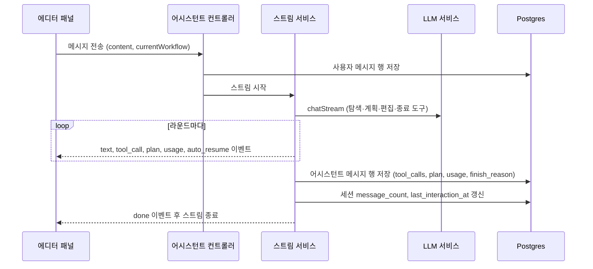

> 구현 상태: 구현됨 · 원문: `spec/3-workflow-editor/4-ai-assistant.md` (§5, §6, Rationale 의 채팅 히스토리 서버 영속화·Stall 자동 복구 UX 메시지 분리), `spec/1-data-model.md` (§2.20, §2.22), `spec/data-flow/11-workflow.md` (§1.3, §2.1, §3.2, §3.3, Rationale 의 Assistant message usage JSONB) · 용어: [용어 사전](../CLE-GLOSSARY.md)

## 개요

[워크플로우 AI 어시스턴트](CLE-WF-ASSIST.md)의 클라이언트·서버 계약을 정한다. 사용자 메시지를 보내고 응답을 SSE(Server-Sent Events)로 받는 스트림 엔드포인트, 세션과 메시지를 다루는 REST API, 대화를 서버에 남기는 두 엔티티가 대상이다.

어시스턴트 세션(`AssistantSession`, `workflow_assistant_session`)은 워크플로우 하나에 묶인 사용자별 대화이고, 어시스턴트 메시지(`AssistantMessage`, `workflow_assistant_message`)는 그 세션의 사용자·어시스턴트 메시지 행이며 도구 호출·계획·사용량 정보가 붙는다. 대화 기록을 서버에 두므로 페이지를 새로 고치거나 다시 접속해도 대화를 이어 갈 수 있다.

이 문서가 다루지 않는 내용은 다음과 같다.

- 도구의 인자와 반환 형태는 [AI 어시스턴트 도구](CLE-WF-ASSIST-TOOLS.md)가 정한다.
- 에러 코드의 사용자 안내, 자동 이어서 진행·종료 가드의 발동 조건, 패널 화면은 [워크플로우 AI 어시스턴트](CLE-WF-ASSIST.md)가 정한다.
- LLM 스트리밍 인터페이스와 모델 프로바이더별 구현은 [LLM 클라이언트](../CLE-AI/CLE-AI-LLM.md), 사용량 로그 적재는 [LLM 사용량 기록](../CLE-AI/CLE-AI-USAGE.md)이 정한다.
- 워크플로우·노드·연결선 저장 흐름은 [워크플로우 데이터와 저장 흐름](CLE-WF-DATA.md)이 정한다.

## 메시지 스트림 엔드포인트

| 항목 | 값 |
|------|-----|
| Method | `POST` |
| Path | `/api/workflow-assistant/sessions/{sessionId}/messages` |
| Content-Type | 요청 `application/json`, 응답 `text/event-stream` |
| Auth | JWT (`Authorization: Bearer`) |
| Role | 편집자(`editor`) 이상 |

컨트롤러(`WorkflowAssistantController`)가 HTTP 응답에 `event: …` 를 직접 써서 보낸다. WebSocket 채널은 쓰지 않는다. 연결 유지를 위해 15초마다 `: ping\n\n` 주석 줄을 보낸다.

### 요청 본문

```typescript
interface AssistantMessageRequest {
  content: string;                 // 사용자 메시지
  currentWorkflow: {               // 현재 에디터 스냅샷 (저장하지 않은 변경 포함)
    nodes: Array<{
      id, type, label, position,
      width?: number,              // React Flow 가 잰 폭(px). 처음 그리기 전에는 생략
      height?: number,             // React Flow 가 잰 높이(px). 처음 그리기 전에는 생략
      config, containerId?, toolOwnerId?,
    }>;
    edges: Array<{id, sourceNodeId, sourcePort, targetNodeId, targetPort, type}>;
  };
  llmConfigId?: UUID;              // 생략하면 세션에 저장된 값, 그것도 없으면 워크스페이스 기본 설정
}
```

`currentWorkflow` 는 시스템 프롬프트의 현재 워크플로우 스냅샷으로 들어간다. `width`·`height` 는 시스템 프롬프트의 배치 지침이 쓴다([워크플로우 AI 어시스턴트 §시스템 프롬프트](CLE-WF-ASSIST.md#시스템-프롬프트)).

### 한 턴의 흐름

사용자 메시지를 받으면 서버는 먼저 사용자 행을 저장하고 LLM 스트림을 연다. LLM 이 부른 도구는 서버가 처리하고 결과를 SSE 로 흘려보낸다. 도구 결과는 LLM 컨텍스트 안에서만 다시 조립하고 별도 `tool` 행으로 저장하지 않는다. 턴이 끝나면 어시스턴트 행을 저장하고 세션의 집계 값을 고친 뒤 `done` 을 보낸다.



자동 이어서 진행이 일어나면 어시스턴트 행이 턴 안에서 여러 개로 나뉜다([턴 저장 규칙](CLE-WF-ASSIST-PROTO-STORE.md#턴-저장-규칙)).

## SSE 이벤트

탐색·편집 도구 호출은 모두 `tool_call` 이벤트 하나로 발행한다. 프론트엔드는 `data.kind`(`explore` 또는 `edit`)로 후처리를 나눈다. `propose_plan` 만은 화면 카드 전용이라 `plan` 이벤트로 따로 발행한다.

```text
event: config_fallback
data: {"requestedConfigId": "...", "configId": "...", "configName": "Default GPT"}

event: text
data: {"delta": "안녕하세요..."}

event: tool_call
data: {"id": "call_1", "name": "list_integrations", "arguments": {...}, "result": {...}, "kind": "explore"}

event: tool_call
data: {"id": "call_2", "name": "get_current_workflow", "arguments": {}, "result": {"ok": true, "nodes": [...], "edges": [...]}, "kind": "explore"}

event: plan
data: {"id": "call_3", "planId": "...", "title": "...", "steps": [...]}

event: tool_call
data: {"id": "call_4", "name": "add_node", "arguments": {...}, "result": {"ok": true, "id": "..."}, "kind": "edit", "planStepId": "s1"}

event: auto_resume
data: {"reason": "stall_pending_steps", "attempt": 1, "max": 2}

event: usage
data: {"inputTokens": 1200, "outputTokens": 340, "totalTokens": 1540, "thinkingTokens": 0, "model": "gpt-4o"}

event: done
data: {"finishReason": "stop"}

event: error
data: {"code": "LLM_RATE_LIMIT", "message": "The LLM provider rate limit was reached. Please retry in a moment."}
```

| 이벤트 | 뜻 | 프론트엔드 동작 |
|--------|----|-----------------|
| `config_fallback` | 요청이나 세션이 지정한 모델 설정을 찾지 못해(삭제됐거나 워크스페이스 밖이거나 Chat 종류가 아님) 워크스페이스 기본 설정으로 대신했다는 알림(REQ-ASSIST-009). 데이터는 `{requestedConfigId, configId, configName}`. 대신했을 때만 턴의 첫 이벤트로 한 번 온다 | `assistant.configFallbackToast` 토스트에 `configName` 을 넣어 알리고 선택한 모델 설정 값을 비운다. 다음 턴부터 기본 설정을 쓴다([워크플로우 AI 어시스턴트 §모델 설정](CLE-WF-ASSIST.md#모델-설정)) |
| `text` | 어시스턴트 텍스트 조각(delta) | 현재 어시스턴트 버블에 덧붙인다 |
| `tool_call` | 탐색·편집 도구 호출 결과. `data.kind` 로 후처리를 나눈다 | [`data.kind` 별 동작](#tool_call-데이터) |
| `plan` | `propose_plan` 결과 | 메시지에 계획 카드를 더한다 |
| `auto_resume` | 서버가 자동 이어서 진행에 들어갔다는 알림 | 현재 버블을 `streaming=false` 로 확정하고 `autoResume={reason, attempt, max}` 메타를 단 새 어시스턴트 버블을 추가한다. 뒤이은 `text`·`tool_call` 은 새 버블로 가고 새 버블 앞에 구분선을 그린다 |
| `usage` | 토큰 사용량. 데이터는 `{inputTokens, outputTokens, totalTokens, thinkingTokens?, model}` 이고 메시지 행의 `usage` 와 모양이 같다 | 화면 표시는 선택 |
| `done` | 어시스턴트 턴 종료 | 스트리밍 표시를 끝내고 입력창을 다시 쓸 수 있게 한다 |
| `error` | 실패. 데이터는 `{code, message}` 다. `message` 는 코드별 고정 영문이고 한도 숫자처럼 값이 들어가는 자리만 바뀐다. `ASSISTANT_TOO_MANY_TOOL_CALLS` 는 문구 갈래가 둘(라운드 상한, 도구 호출 한도)이라 소비자는 `message` 가 아니라 `code` 로 분기한다. 모든 `message` 는 백엔드 `workflow-assistant-stream-errors.ts` 한 곳에서 정한다. 모델 프로바이더 · 라이브러리 예외 원문과 LLM 클라이언트 스트림 `error` 의 `message`(진단 문구)는 싣지 않고 서버 로그에만 남긴다. `LLM_STREAMING_UNSUPPORTED` 는 LLM 클라이언트 스트림 `error` 가 아니라 `LlmService.chatStream` 이 스트림을 열기 전에 던진 예외에서 온다. 이 코드의 `message` 도 그 파일의 고정 영문이다. 코드 목록은 [에러 코드 규약과 카탈로그 §6.25](../CLE-API/CLE-API-ERRCODES.md#625-ai-어시스턴트-스트림-도메인-문서-참조) 에 있다 | 에러 코드로 사전 문구를 골라 에러 버블에 보인다. 문구가 없는 코드는 `message` 로 폴백한다. 코드별 안내는 [워크플로우 AI 어시스턴트 §에러 처리](CLE-WF-ASSIST.md#에러-처리)가 정한다. 코드로 사전 키를 고르는 규칙은 [다국어와 화면 문구](../CLE-UI/CLE-UI-I18N.md#규칙) 규칙 5 를 따른다 |

### `tool_call` 데이터

| 필드 | 타입 | 설명 |
|------|------|------|
| `id` | `string` | LLM 이 만든 tool_call ID. 세션을 다시 불러올 때와 계획 단계 매칭에 쓴다 |
| `name` | `string` | 도구 이름 |
| `arguments` | `object` | LLM 이 만든 인자(파싱을 마친 JSON 객체) |
| `result` | `unknown` | 도구 실행 결과. 편집 도구는 `{ok, id?, ports?, error?, pendingUserConfig?, ...}` 이다. 탐색 도구는 도구마다 모양이 다르다([AI 어시스턴트 도구](CLE-WF-ASSIST-TOOLS.md)) |
| `kind` | `'explore' \| 'edit'` | 후처리를 가르는 값 |
| `planStepId` | `string?` | `kind='edit'` 일 때 LLM 이 맞춘 계획 단계 ID (단일, 옛 단축형) |
| `planStepIds` | `string[]?` | 호출 하나가 여러 계획 단계를 해결할 때 쓴다. 소비자는 `planStepId` 와 `planStepIds` 의 합집합으로 완료 처리해야 한다 |

| `data.kind` | 포함 도구 | 프론트엔드 동작 |
|-------------|-----------|-----------------|
| `explore` | `get_node_schema`, `list_integrations`, `list_workflows`, `get_workflow`, `get_current_workflow`, `list_knowledge_bases`, `get_workflow_executions`, `get_execution_details`, `verify_workflow` | 메시지에 탐색 배지를 더한다 |
| `edit` | `add_node`, `update_node`, `remove_node`, `add_edge`, `remove_edge` | 에디터 스토어에 바로 반영하고 편집 배지를 더한다. `planStepId`·`planStepIds` 가 있으면 그 단계를 체크한다. 없거나 맞는 단계가 없으면 순서상 다음 대기 단계를 체크한다 |

- `finish` 와 `clear_plan` 은 서버 내부 상태만 바꾸고 SSE 로 발행하지 않는다. 프론트엔드는 `clear_plan` 직후 계획 카드를 바로 지우지 않고 다음 턴 스트림에 계획 이벤트가 오지 않는 것으로 해제를 알아챈다.
- SSE 의 `kind` 는 `explore`·`edit` 두 값뿐이다. 메시지 행의 `tool_calls[].kind` 는 `plan` 을 더한 값 집합을 쓴다([어시스턴트 메시지](CLE-WF-ASSIST-PROTO-STORE.md#어시스턴트-메시지)).

### `auto_resume` 데이터

| 필드 | 타입 | 설명 |
|------|------|------|
| `reason` | `'stall_pending_steps'` | 발동 사유. 지금은 "활성 계획에 대기 중인 실행 가능 단계가 남았는데 LLM 이 도구 호출 없이 `finishReason: 'stop'` 으로 끝낸 경우" 한 가지이고 나중에 늘릴 수 있게 union 으로 둔다 |
| `attempt` | `number` | 이번 턴 안의 자동 이어서 진행 순번(1부터). `MAX_STALL_ROUNDS` 까지 늘고 넘으면 포기하고 턴을 끝낸다 |
| `max` | `number` | 허용 최대 횟수(현재 2). 프론트엔드가 "N/M" 진행도를 표시한다 |

프론트엔드 처리는 위 이벤트 표의 `auto_resume` 행을 따른다. 세션을 다시 불러올 때도 `autoResumed=true` 행 앞에 구분선을 그리지만 저장된 행에는 `max` 가 없어 순번만 보인다([메시지 응답 필드](#메시지-응답-필드)).

### 응답 중단

| 동작 | 처리 |
|------|------|
| 사용자가 응답 중단(Stop) 버튼을 누른다 | 클라이언트가 `AbortController.abort()` 를 부른다. 백엔드는 요청 종료를 알아채 LLM 스트림을 끊고 `done` 이벤트(`finishReason: 'aborted'`)를 보낸다 |
| 브라우저 탭을 닫는다 | 서버 쪽 LLM 호출은 끝까지 갈 수 있다. 사용량은 사용량 로그에 정상 기록된다 |

## 세션 REST API

| Method | Path | 설명 |
|--------|------|------|
| `GET` | `/api/workflow-assistant/sessions/latest?workflowId={id}` | 패널을 열 때 기본 세션을 고르는 조회. 그 워크플로우에서 요청자의 가장 최근 상호작용 `active` 세션을 돌려주고 없으면 `null` 이다 |
| `GET` | `/api/workflow-assistant/sessions?workflowId={id}` | 요청자의 그 워크플로우 세션 목록. 최근 상호작용 순, 최대 50건 |
| `POST` | `/api/workflow-assistant/sessions` | 세션 생성. 본문 `{workflowId, title?, llmConfigId?}`, 응답은 세션 엔티티 |
| `GET` | `/api/workflow-assistant/sessions/{id}` | 세션 메타데이터와 메시지 전체 |
| `PATCH` | `/api/workflow-assistant/sessions/{id}` | `{title?, llmConfigId?, status?}` 수정. `status: 'archived'` 로 세션을 보관한다 |
| `DELETE` | `/api/workflow-assistant/sessions/{id}` | 세션 삭제. 메시지는 cascade 로 함께 지워진다 |
| `POST` | `/api/workflow-assistant/sessions/{id}/messages` | SSE 스트림. 사용자 메시지를 보내고 응답을 받는다([메시지 스트림 엔드포인트](#메시지-스트림-엔드포인트)) |

- 쓰기(세션 생성 · 수정 · 삭제와 메시지 스트림)는 편집자(`editor`) 이상, 조회(`GET /sessions` · `GET /sessions/latest` · `GET /sessions/{id}`)는 워크스페이스 멤버면 된다. 조회해도 요청자 자신의 세션만 나온다(아래 403 · 404). `workspace_id` 는 JWT 에서 넣는다.
- 세션이 없거나 요청의 워크스페이스 세션이 아니면 404 `ASSISTANT_SESSION_NOT_FOUND`, 같은 워크스페이스의 다른 사용자 세션이면 403 `ASSISTANT_SESSION_NOT_YOURS` 다. 다른 워크스페이스의 세션을 없는 세션과 구분하지 않는다. 사용자 안내는 [워크플로우 AI 어시스턴트 §에러 처리](CLE-WF-ASSIST.md#에러-처리), 오류 응답의 `message` 는 [에러 응답과 클라이언트 처리](../CLE-API/CLE-API-ERROR.md) 가 정한다.
- 보관 전용 `/archive` 엔드포인트는 없다. 보관은 일반 세션 수정으로 `status` 를 바꾼다.
- 생성 본문의 `workflowId` 와 목록 조회(`GET /sessions?workflowId`)의 `workflowId` 는 같은 워크스페이스의 워크플로우만 받는다. 아니면 404 `WORKFLOW_NOT_FOUND` 다. 없는 id 와 다른 워크스페이스의 id 를 구분하지 않는다([데이터 모델 개요 §참조의 소속](../CLE-PLAT/CLE-PLAT-DATA.md#참조의-소속) 의 예외 3). `GET /sessions/latest` 는 이 검사 없이 요청의 워크스페이스로 세션을 찾으므로 다른 워크스페이스의 워크플로우면 세션이 없을 때와 같은 `null` 이다.
- 생성·수정 본문의 `llmConfigId` 는 같은 워크스페이스의 `kind=chat` 모델 설정만 받는다. 아니면 404 `MODEL_CONFIG_NOT_FOUND` 다. 없는 id 와 다른 워크스페이스의 id 를 구분하지 않는다([데이터 모델 개요 §참조의 소속](../CLE-PLAT/CLE-PLAT-DATA.md#참조의-소속)).

### 세션 자동 선택

패널을 처음 열거나 워크플로우를 다시 불러오면 `GET /sessions/latest` 로 그 워크플로우의 `status='active'` 세션 가운데 가장 최근에 상호작용한 세션을 고른다. 없으면 패널을 빈 상태로 보여 주고 사용자가 첫 메시지를 보낼 때 세션을 자동으로 만든다.

### 세션 제목 자동 설정

첫 사용자 메시지의 응답이 끝나면 서버가 첫 메시지를 40자 이내로 잘라 세션 `title` 에 저장한다(LLM 을 부르지 않는다). 사용자는 `PATCH` 로 제목을 고칠 수 있다.

### 메시지 응답 필드

`GET /api/workflow-assistant/sessions/{id}` 응답의 `messages[*]` 는 어시스턴트 메시지 엔티티를 그대로 직렬화한다. 다음 필드가 자동 이어서 진행 이력을 남긴다.

| 필드 | 타입 | 뜻 |
|------|------|----|
| `autoResumed` | `boolean` | 자동 이어서 진행으로 새로 시작된 어시스턴트 행이면 `true`, 그 밖(보통 턴의 행, 이어서 진행 직전까지의 행)은 기본값 `false` |
| `autoResumeReason` | `string \| null` | `autoResumed=true` 행에만 있다. 현재 `'stall_pending_steps'` 한 가지 |
| `autoResumeAttempt` | `number \| null` | 같은 턴 안의 이어서 진행 순번. 1부터 `MAX_STALL_ROUNDS`(현재 2)까지 |
| `finishReason` | `string \| null` | 값 목록은 [어시스턴트 메시지](CLE-WF-ASSIST-PROTO-STORE.md#어시스턴트-메시지)의 `finish_reason` 을 따른다. 이어서 진행 경계에서 먼저 저장한 중간 행은 `'auto_resume_pending'` 이다 |

- 이 필드들이 생기기 전(마이그레이션 전)의 행은 `autoResumed=false`, 나머지 `null` 로 읽혀 호환된다.
- **후보 선택기 복원**: `tool_calls[*].result.pendingUserConfig` 가 서버 응답째로 저장된다. 프론트엔드는 세션을 다시 불러오면 이것으로 편집 버블 아래 후보 선택기를 다시 그린다. 대상 노드의 현재 캔버스 값(`field`)이 채워져 있으면 "✓ 설정됨" 읽기 전용, 비어 있으면 고를 수 있는 선택기다. 판정은 에디터 스토어의 노드 `config` 에서 `field` 를 dot-path 로 읽어 하며 서버를 다시 부르지 않는다.

## 하위 문서

- [AI 어시스턴트 스트리밍과 세션 API — 저장 엔티티와 턴 저장 규칙](CLE-WF-ASSIST-PROTO-STORE.md): 어시스턴트 세션 · 메시지 엔티티, 삭제 연쇄, 자동 이어서 진행 때의 턴 저장 규칙과 그 Rationale. 맡는 요구사항 번호: 없음(이 문서는 요구사항 줄을 두지 않는다).

## 어시스턴트 세션

→ [AI 어시스턴트 스트리밍과 세션 API — 저장 엔티티와 턴 저장 규칙](CLE-WF-ASSIST-PROTO-STORE.md#어시스턴트-세션)

## 턴 저장 규칙

→ [AI 어시스턴트 스트리밍과 세션 API — 저장 엔티티와 턴 저장 규칙](CLE-WF-ASSIST-PROTO-STORE.md#턴-저장-규칙)

## 구현 위치

- `codebase/backend/src/modules/workflow-assistant/workflow-assistant.controller.ts` (REST·SSE 엔드포인트)
- `codebase/backend/src/modules/workflow-assistant/workflow-assistant-session.service.ts` (세션·메시지 CRUD. 저장 규칙은 [하위 문서](CLE-WF-ASSIST-PROTO-STORE.md#구현-위치))
- `codebase/backend/src/modules/workflow-assistant/workflow-assistant-stream.service.ts` (SSE 이벤트 발행)
- `codebase/backend/src/modules/workflow-assistant/workflow-assistant-stream-errors.ts` (SSE `error` 이벤트 `message` 의 단일 출처)
- `codebase/backend/src/modules/workflow-assistant/dto/**/*.ts` (요청·응답 DTO)
- `codebase/frontend/src/lib/api/assistant.ts` (클라이언트, `AssistantSseEvent`)
- `codebase/frontend/src/lib/stores/assistant-store.ts` (SSE 처리, 세션 다시 불러오기 `hydrateMessage`)
- `codebase/frontend/src/components/editor/assistant-panel/assistant-message.tsx` (`error` 이벤트의 에러 버블, 코드별 사전 키 `ERROR_MESSAGE_KEYS`)

## Rationale

### 채팅 기록을 서버에 저장한다

사용자와 합의한 결정이다. 엔티티 두 개(`AssistantSession`, `AssistantMessage`, 마이그레이션 V019)를 두고 서버에 저장해 페이지를 새로 고치거나 다시 접속해도 대화를 이어 가게 한다. 스트리밍은 SSE 와 `LLMClient.stream()` 으로 한다([LLM 클라이언트](../CLE-AI/CLE-AI-LLM.md)). 대화 컨텍스트는 최근 30턴만 프롬프트에 넣는다. 프론트엔드 `assistant-store.ts` 는 서버 세션 ID 를 들고 패널을 열면 기존 세션을 불러온다.

보관 기간과 자동 보관 정책은 정하지 않았다. 지금은 "직접 지울 때까지 남긴다" 이며 나중에 워크스페이스별 용량 제한과 묶을 수 있다.

### `error` 이벤트에 예외 원문을 싣지 않는다 (2026-10-24)

`error` 이벤트의 `message` 는 코드별 고정 영문이고 예외 원문과 LLM 클라이언트 안내문은 서버 로그에만 남긴다. 원문을 싣지 않는 근거는 [워크플로우 AI 어시스턴트 §에러 버블에 프로바이더 원문을 싣지 않는다 (2026-10-23)](CLE-WF-ASSIST.md#에러-버블에-프로바이더-원문을-싣지-않는다-2026-10-23) 에 있다. 문구를 고르는 방식은 [워크플로우 AI 어시스턴트 §에러 버블 문구는 `assistant.*` 사전 키로 고른다 (2026-10-24)](CLE-WF-ASSIST.md#에러-버블-문구는-assistant-사전-키로-고른다-2026-10-24) 에 있다.

- **근거 규칙.** [에러 응답과 클라이언트 처리](../CLE-API/CLE-API-ERROR.md) 규칙 2 는 HTTP 에러 응답에 라이브러리 예외 원문을 싣지 않는다고 정한다. SSE 이벤트는 그 층이 아니지만 막으려는 노출(CWE-209)이 같다. [다국어와 화면 문구](../CLE-UI/CLE-UI-I18N.md) 규칙 3 은 백엔드 응답을 영문 원문으로 두고 한국어를 넣지 않는다고 정한다.
- **기각: `message` 필드를 뺀다.** 사전 문구가 없는 코드의 폴백이 사라진다.
- **기각: LLM 클라이언트가 쓴 안내문을 코드별 허용 목록으로 통과시킨다.** 허용 목록이 `LLM_OUTPUT_MALFORMED` 의 한국어 안내문을 그대로 내보내 규칙 3 과 어긋났다.
- 지금 LLM 클라이언트는 `LLM_OUTPUT_MALFORMED` 에도 고정 영문 진단 문장을 싣고([LLM 클라이언트](../CLE-AI/CLE-AI-LLM.md)), 어시스턴트 SSE 는 그 문장도 서버 로그에만 남긴다.

### `error` 이벤트 데이터를 HTTP 에러 봉투로 감싸지 않는다 (2026-11-13)

SSE `error` 이벤트의 데이터는 `{code, message}` 평면 객체다. HTTP 에러 응답 봉투(`{error: {code, message, requestId, details}}`)와 모양이 다르다. 봉투는 [에러 응답과 클라이언트 처리](../CLE-API/CLE-API-ERROR.md) 가 HTTP 에러 응답에 정한 형식이고 `error` 이벤트는 열린 스트림 안의 이벤트라 그 층이 아니다. 선례인 [EIA 수신 API와 SSE](../CLE-IX/CLE-EIA-INBOUND.md#이벤트-종류) 도 SSE 이벤트는 봉투 없는 평면 객체로 보낸다. 이 스트림의 다른 이벤트도 모두 평면 객체라 소비자는 `data` 를 같은 방식으로 읽는다.

- **기각: 봉투를 그대로 싣는다.** 이벤트 이름이 이미 `error` 인데 데이터 안에 `error` 키로 한 번 더 감싸게 된다. 소비자가 이 이벤트만 다르게 풀어야 한다.
- **`requestId` · `details` 는 지금 두지 않는다.** 세부 사유를 실어야 하는 코드가 없다. 필요해지면 더하며 더해도 소비자는 깨지지 않는다.

### 모델 설정 대체를 `config_fallback` 이벤트로 알린다 (2026-11-13)

지정한 모델 설정을 찾지 못해 기본 설정으로 대신할 때 턴을 끝내지 않고 이벤트 하나로 알린다. 근거와 기각한 대안(별도 에러 코드, 알리지 않는 대체)은 [워크플로우 AI 어시스턴트 「모델 설정을 찾지 못하면 기본 설정으로 대신한다 (2026-11-13)」](CLE-WF-ASSIST.md#모델-설정을-찾지-못하면-기본-설정으로-대신한다-2026-11-13) 에 있다. 이 문서는 이벤트 계약만 정한다. `requestedConfigId` 는 어느 설정을 찾지 못했는지 알리려고 싣는다. 지금 프론트엔드는 이 값을 쓰지 않고 `configName` 만 토스트 문구에 넣는다.

### 유지보수 점검

- `auto_resume` 이벤트 형태를 바꾸면 backend `AssistantStreamEvent` union 과 frontend `AssistantSseEvent` union 을 함께 고친다. 컨트롤러는 `JSON.stringify` 만 하므로 별도 DTO 가 없다. i18n `assistant.autoResumedHint` 의 자리표시자(`{{attempt}}/{{max}}`)가 페이로드 키 이름에 묶여 있어 키 이름을 바꾸면 함께 고친다.
- `config_fallback` 이벤트 형태를 바꾸면 backend `AssistantStreamEvent` union, frontend `AssistantSseEvent` union, `assistant.configFallbackToast` 의 자리표시자(`{{name}}`)를 함께 고친다.
