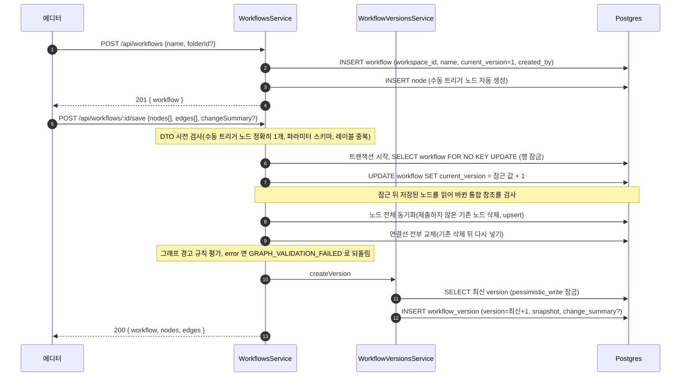

## 개요

이 문서는 [워크플로우 데이터와 저장 흐름](CLE-WF-DATA.md) 의 하위 문서로 워크플로우 생성, 캔버스 저장과 버전 스냅샷 생성, 개별 노드 생성·수정의 행 잠금과 통합 참조 검사, AI 어시스턴트 편집의 저장 경로, 복제·내보내기·가져오기의 데이터 흐름을 정한다. 테이블별 쓰기 컬럼은 부모 문서의 [Postgres 쓰기 매핑](CLE-WF-DATA.md#postgres-쓰기-매핑) 에 있다.

## 생성과 저장 흐름

에디터의 주 편집 경로는 캔버스 전체를 한 번에 맞추는 저장(`POST /:id/save`)이다. 개별 노드·연결선 CRUD 엔드포인트(`POST /:id/nodes`, `POST /:id/edges` 등)도 있다. 노드 생성·수정의 `containerId`·`toolOwnerId` 와 연결선 생성의 `sourceNodeId`·`targetNodeId` 도 같은 워크플로우의 노드만 받는다. 아니면 400 `VALIDATION_ERROR` 다([참조의 소속](../CLE-PLAT/CLE-PLAT-DATA.md#참조의-소속)). 노드 생성·수정의 `config` 통합 참조도 캔버스 저장과 같은 검사를 받는다. 이 두 경로도 한 트랜잭션에서 먼저 워크플로우 행을 잠근 뒤(아래 3단계와 같은 `SELECT … FOR NO KEY UPDATE`) 저장된 노드를 읽고 검사한다. 노드 생성은 참조가 모두 새 참조다. 노드 수정은 `config` 를 보낸 요청만 검사한다. 서버 쪽 저장은 사용자의 수동 저장과 실행 직전 저장 두 경로로만 일어난다([워크플로우 에디터와 캔버스](CLE-WF-EDITOR.md)).

1. 워크플로우를 만들면 `current_version=1` 로 넣고 수동 트리거 노드를 자동으로 만든다. 버전 행은 만들지 않는다.
2. 저장 요청은 먼저 DTO 단계에서 검사한다.
   - 수동 트리거 노드가 정확히 하나여야 한다. 없거나 둘 이상이면 400 이다.
   - 수동 트리거 노드 파라미터 스키마를 어기면 400 `INVALID_TRIGGER_PARAMETERS` 다. 버전 복원 경로는 `skipLegacyDataGates` 로 이 검사를 건너뛴다.
   - 노드 레이블이 겹치면 거부한다(`DUPLICATE_NODE_LABEL`).
   - `containerId`·`toolOwnerId`·연결선 끝점이 이번 페이로드에 없는 노드를 가리키면 400 `VALIDATION_ERROR` 다. `details[]` 마다 `field`(예: `nodes[2].containerId`)와 `code`(`INVALID_FIELD`)를 싣는다. 버전 복원 경로도 이 검사는 건너뛰지 않는다.
3. 트랜잭션 안에서 워크플로우 행을 잠그고 `current_version` 을 1 올린다. 이어서 통합 참조를 검사하고, 노드 전체를 동기화하고, 연결선을 전부 교체한다. 노드를 동기화할 때 이 워크플로우에 없는 노드 id 는 새 노드로 본다. 그 id 를 다른 행이 이미 쓰면 400 `VALIDATION_ERROR`(`details[].field` 예: `nodes[1].id`)로 거부하고 그 행을 덮어쓰지 않는다([참조의 소속](../CLE-PLAT/CLE-PLAT-DATA.md#참조의-소속)). 이 단계가 거부하는 400 `VALIDATION_ERROR` 는 `details[]` 마다 `field` 와 `code='INVALID_FIELD'` 를 싣는다.
   - 워크플로우 행 잠금은 트랜잭션의 첫 문장이다. 이 워크스페이스의 워크플로우 행을 `SELECT … FOR NO KEY UPDATE` 로 잠그고(`lockWorkflowInWorkspace`) 잠근 행의 값에 1 을 더해 `current_version` 을 쓴다. 값을 잠근 뒤에 읽으므로 이 UPDATE 는 늘 나간다. 잠근 행이 없으면(그 사이 지워졌거나 다른 워크스페이스) 404 `RESOURCE_NOT_FOUND` 다.
   - 통합 참조 검사는 이 잠금 뒤에 한다. 잠근 뒤 저장된 노드를 읽고 같은 id 의 노드와 비교해 새로 넣거나 바꾼 참조만 가린다. 그 참조가 워크스페이스에 없는 통합이거나 저장자 또는 워크플로우 작성자가 통합 소유자가 아닌 개인 통합이면 400 `VALIDATION_ERROR`(`details[].field` 예: `nodes[3].config.integrationId`)로 트랜잭션을 되돌린다. 참조 값이 표현식이면 판정하지 않는다. 고르지 않은 자리가 아닌데 문자열도 아닌 값은 없는 통합과 같이 거절한다. 어떤 값이 참조인지는 [참조의 소속](../CLE-PLAT/CLE-PLAT-DATA.md#참조의-소속) 의 「통합 참조」 가 정한다.
   - 잠금을 쥔 동안의 읽기는 좁게 한다. 바뀐 참조가 없으면 통합을 조회하지 않는다. 바뀐 참조의 통합은 한 번에 읽고(`WHERE id = ANY($1) AND workspace_id = $2`) 읽는 컬럼은 `id`·`scope`·`created_by` 다. UUID 모양이 아닌 값은 조회하지 않고 없는 통합으로 본다. 버전 복원은 읽은 통합 가운데 개인 통합이 있으면 그 소유자가 지금 워크스페이스 멤버인지 보려고 `workspace_member` 를 한 번 더 읽는다(`loadWorkspaceMemberIds`). 자격 증명 컬럼은 읽지 않는다. 잠금을 쥔 동안 외부 호출을 하지 않는다.
   - 버전 복원은 캔버스 저장과 같은 쓰기 경로(`writeCanvas`)를 쓰므로 같은 자리에서 검사한다. 복원은 거절하지 않고 실행 시점 판정을 통과하지 못하는 참조만 비운다([버전 기록](CLE-WF-VERSION.md) 의 복원 요구사항). 판정은 [통합 관리 「개인 통합 사용 판정」](../CLE-INT/CLE-INT-MANAGE.md#개인-통합-사용-판정), 참조 자리와 비우는 방법은 [참조의 소속](../CLE-PLAT/CLE-PLAT-DATA.md#참조의-소속) 의 「통합 참조」 가 정한다.
4. 노드 사이 그래프 경고 규칙을 평가한다. 심각도 `error` 가 있으면 `GRAPH_VALIDATION_FAILED` 를 던져 트랜잭션을 되돌린다(저장 차단). 규칙은 [그래프 경고 규칙](CLE-WF-WARN.md) 이 정한다.
5. `createVersion` 이 최신 버전 번호를 `pessimistic_write` 잠금으로 읽고(`ORDER BY version DESC`) 다음 번호로 `workflow_version` 을 넣는다. 같은 워크플로우의 동시 저장은 3단계의 행 잠금에서 이미 줄을 서고 이 잠금은 버전 번호가 겹치지 않게 한다([Rationale](#통합-참조-검사는-워크플로우-행을-잠근-뒤에-한다-2026-10-25)). 스냅샷 구성은 [WorkflowVersion](CLE-WF-DATA-MODEL.md#workflowversion) 이 정한다. 원문은 이 단계를 "같은 트랜잭션 안" 이라고 적어 버전 기록 원문과 정의가 갈린다. [미결 사항](CLE-WF-DATA.md#미결-사항) 참조.

버전 행을 만드는 전용 API(`POST /api/workflows/:id/versions`)는 없다. 버전 조회 API 와 복원 흐름(`POST /:id/versions/:versionId/restore` 가 스냅샷을 검사한 뒤 캔버스 저장과 같은 쓰기 경로로 `Restored from vN` 새 버전을 만듦)은 [버전 기록](CLE-WF-VERSION.md) 이 정한다.

저장과 별개로 `GET /api/workflows/:id/graph-warnings` 는 같은 그래프 경고 규칙 평가를 저장 없이 돌려준다. 프론트엔드는 이 API 대신 500ms debounce 로 로컬 평가를 한다([그래프 경고 규칙](CLE-WF-WARN.md)).

## 어시스턴트 편집의 저장 경로

AI 어시스턴트의 편집 도구 호출은 **DB 를 직접 건드리지 않는다**. `workflow-assistant` 모듈은 `NodesService`·`EdgesService` 를 import 하지 않는다. 대신 메모리 복제본인 `ShadowWorkflow`(`codebase/backend/src/modules/workflow-assistant/tools/shadow-workflow.ts`)가 도구 호출을 검사하고 순서를 정한다. 성공한 도구 호출은 프론트엔드 에디터 store 가 먼저 적용하고, Postgres 저장은 사용자가 손으로 편집한 변경과 같은 경로(수동 저장, 실행 직전 저장)로만 일어난다([워크플로우 에디터와 캔버스 §저장](CLE-WF-EDITOR.md#저장)). 타이머 자동 저장은 없고, 에디터의 500ms debounce 는 저장이 아니라 그래프 경고 사전 평가용이다.

그래서 어시스턴트가 노드에 넣은 통합 참조도 캔버스 저장의 통합 참조 검사를 받는다. 저장자는 저장을 누른 사용자다. 남의 개인 통합이나 워크플로우 작성자가 통합 소유자가 아닌 개인 통합을 넣은 편집은 저장에서 거절된다. 그래서 어시스턴트가 내놓는 통합 후보도 이 검사를 통과할 것으로 좁힌다([AI 어시스턴트 도구 §위젯별 후보 조회 범위](CLE-WF-ASSIST-TOOLS.md#위젯별-후보-조회-범위)). 변경 결과는 어시스턴트 메시지의 `tool_calls[].result` 에 줄여 저장해 대화 기록에서 다시 볼 수 있다([워크플로우 AI 어시스턴트](CLE-WF-ASSIST.md)).

어시스턴트 세션·메시지 행(`workflow_assistant_session`, `workflow_assistant_message`)을 쓰는 흐름, SSE 이벤트, 세션 상태, 메시지 역할 순서는 [AI 어시스턴트 스트리밍과 세션 API](CLE-WF-ASSIST-PROTO.md) 가 정한다.

## 복제·내보내기·가져오기

| 엔드포인트 | 데이터 흐름 |
| --- | --- |
| `POST /api/workflows/:id/duplicate` | 메타와 **노드·연결선 전체**를 한 트랜잭션으로 복제한다. 이름 끝에 `" (Copy)"` 를 붙이고 `is_active=false` 로 두며 description·tags·folder_id·settings 는 물려받는다. 노드는 새 UUID 로 다시 발급하고 노드 사이 참조(`container_id`, `tool_owner_id`, 연결선 양 끝)도 새 UUID 로 바꾼다. AI 노드의 `llmConfigId` 는 같은 워크스페이스 안 복사라 원래 값을 그대로 둔다(가져오기와 달리 기본 모델 설정을 채우지 않는다). 노드 `config` 의 통합 참조 가운데 요청 사용자가 쓸 수 없는 것은 비우고 응답 `data.clearedIntegrationRefs` 로 알린다. 비우는 것은 없는 통합, 고르지 않은 자리가 아닌데 문자열도 아닌 값, 요청 사용자가 통합 소유자가 아닌 개인 통합이다. 규칙은 [참조의 소속](../CLE-PLAT/CLE-PLAT-DATA.md#참조의-소속) 의 「통합 참조」 가 정한다. 복제는 실패하지 않는다. **복제하지 않는 것**: 버전 기록(`workflow_version`, 사본은 `current_version=1` 로 새로 시작), 트리거(`trigger`, 웹훅·스케줄), 테스트 데이터셋(`workflow_test_dataset`), 실행 내역. 내보내기·가져오기와 같은 경계다. |
| `GET /api/workflows/:id/export` | 워크플로우 메타(name, description, tags, settings)와 노드·연결선 전체를 JSON 으로 직렬화한다. 노드 사이 참조(`container_id`, `tool_owner_id`, 연결선 양 끝)는 UUID 대신 **nodes 배열 인덱스**로 바꿔 다른 환경으로 옮길 수 있게 한다. |
| `POST /api/workflows/import` | 내보낸 JSON 을 받아 새 워크플로우·노드·연결선을 한 트랜잭션으로 만든다. 인덱스 참조를 새 UUID 로 바꾸고, AI 노드에 `llmConfigId` 가 없으면 워크스페이스 기본 모델 설정을 채운다. 페이로드 안에 노드 레이블이 겹치면 409(`DUPLICATE_NODE_LABEL`)다. 노드 `config` 의 통합 참조는 복제와 같은 규칙으로 비우고 응답 `data.clearedIntegrationRefs` 로 알린다. 다른 워크스페이스에서 내보낸 파일의 통합과 지워진 통합은 이 워크스페이스에 없는 통합이라 비운다. |

파일 형식과 가져오기 검사 순서는 [워크플로우 목록과 폴더](CLE-WF-LIST.md) 가 정한다.

## Rationale

### 통합 참조 검사는 워크플로우 행을 잠근 뒤에 한다 (2026-10-25)

처음 승인본은 통합 참조 검사를 저장 흐름 2단계(DTO 사전 검사)에 두었다(NERV Task `CLE-T-MG0EQZ` 코드 리뷰가 짚음). 이 검사는 같은 id 로 저장된 노드와 비교해 바뀐 참조만 본다. 같은 워크플로우의 동시 저장을 줄 세우는 지점은 3단계의 워크플로우 행 잠금이다. 2단계에서 읽은 저장된 노드는 잠금 밖의 값이라 낡을 수 있다.

- 예: 워크플로우 작성자가 노드의 참조를 X 에서 Y 로 바꿔 저장하는 사이에 다른 사용자가 X 가 든 낡은 캔버스를 저장한다. 그 사용자의 검사는 낡은 기준선과 비교해 «바뀌지 않음» 으로 건너뛰고 3단계가 노드를 X 로 되돌려 쓴다. 저장자 조건([통합 관리](../CLE-INT/CLE-INT-MANAGE.md))을 거치지 않은 쓰기가 된다. 반대로 멀쩡한 참조가 새 참조로 보여 400 으로 거절될 수도 있다.
- 저장 검사는 통합 참조의 저장 쪽 유일한 방어선이다([참조의 소속](../CLE-PLAT/CLE-PLAT-DATA.md#참조의-소속)). 그래서 기준선 읽기와 통합 조회를 쓰기와 같은 잠금 안에 둔다. 버전 복원도 지금 노드와 비교하므로 같은 자리로 옮겼다.
- 개별 노드 생성·수정도 같은 워크플로우 행을 잠근다. 노드 행만 잠그면 캔버스 저장이 그 노드를 잠그기 전의 값으로 기준선을 읽어 위 예와 같은 경합이 남는다. 이 결정을 내릴 때 `NodesService.update` 는 트랜잭션 없이 노드를 읽고 저장했다. 지금은 트랜잭션 안에서 워크플로우 행을 잠근 뒤 노드를 다시 읽는다(NERV Task `CLE-T-1BQZ10`).
- 5단계 `createVersion` 의 `pessimistic_write` 잠금은 3단계 행 잠금(`SELECT … FOR NO KEY UPDATE`)이 워크플로우 행을 잠근 뒤에 잡힌다. 이 행 잠금은 트랜잭션 끝까지 남아 같은 워크플로우의 저장이 3단계에서 이미 줄을 서므로 검사 위치를 3단계 잠금 기준으로 정했다.
- 잠금은 조건 없이 잡혀야 한다. 2026-10-25 승인본은 «`current_version` UPDATE 가 행을 잠근다» 고만 적었는데, 그때 `saveCanvas` 는 트랜잭션 밖에서 읽은 값으로 엔티티를 저장해 값이 이미 같으면 UPDATE 를 내지 않았다. 그래서 DB 가 값을 올리는 UPDATE 나 행을 잠그는 SELECT 를 트랜잭션의 첫 문장으로 정했다. 노드 생성·수정(`nodes.service.ts` 의 `create`·`update`)도 같은 행 잠금을 먼저 잡게 했다. 구현은 행을 잠그는 SELECT 를 골랐고 잠근 값에 1 을 더해 `current_version` 을 쓴다(`lockWorkflowInWorkspace`). SELECT 를 고른 것은 한 문장으로 워크스페이스 범위 확인(행이 없으면 404)과 잠근 행 읽기를 함께 얻기 때문이다. 잠근 행의 `created_by` 는 통합 참조 검사의 워크플로우 작성자로 쓴다.
- 행 잠금은 `FOR UPDATE` 가 아닌 `FOR NO KEY UPDATE` 다(2026-10-25 구현). `FOR UPDATE` 는 이 워크플로우를 가리키는 자식 행 INSERT 의 FK 검사가 거는 `FOR KEY SHARE` 와 충돌해 저장이 끝날 때까지 실행 생성과 트리거 쓰기를 세운다. `FOR NO KEY UPDATE` 는 `FOR KEY SHARE` 를 막지 않고 같은 잠금끼리는 충돌하므로 같은 워크플로우의 저장끼리만 줄을 세운다. 워크플로우 삭제는 자식 행 INSERT 의 FK 검사와 일부러 충돌시켜 트리거를 빠짐없이 모으므로 `FOR UPDATE`(`pessimistic_write`)를 그대로 쓴다.
- 잠금 안의 읽기를 좁게 정한 것은 같은 워크플로우의 저장이 그동안 기다리기 때문이다. 바뀐 참조가 없는 저장(대부분의 저장)은 통합을 읽지 않는다. 버전 복원은 읽은 통합 가운데 개인 통합이 있을 때만 멤버십을 한 번 더 읽는다(`loadWorkspaceMemberIds`).
- 받아들인 잔여: 이 잠금은 같은 워크플로우를 쓰는 경로만 줄 세운다. 통합 삭제나 공개 범위 전환은 워크플로우 행을 잠그지 않으므로 검사를 통과한 직후 바뀔 수 있다. 그 경합은 실행 시점 판정이 받는다. 피해는 그 노드가 실행에서 없는 통합과 같이 실패하는 데서 그친다.
- `codebase/backend/test/integration-personal-use.e2e-spec.ts` 의 「동시 저장」 경우가 이 결정을 지킨다. 잠금을 기다린 저장은 그 사이 커밋된 참조를 기준선으로 보므로 서로의 참조 검사를 우회하지 못한다. 복제 · 가져오기 · 버전 복원의 비우기도 같은 파일이 확인한다.

### 복제는 캔버스 전체를 복사한다

데이터 흐름 문서는 한때 복제를 "워크플로우 메타 행만 복제하고 노드·연결선은 복제하지 않는다" 고 적었다. 그 문장은 제품 결정이 아니었다. 명세·코드 전수 상호 감사 때 **당시 구현을 보고 그대로 받아 적은 동기화 결과물**이었다. 그 구현(`WorkflowsService.duplicate()`)은 초기 골격 뒤로 손대지 않은 미완성 상태였다. 그래서 복제본은 노드가 하나도 없는 **빈 워크플로우**였다. `create()` 가 자동으로 만드는 수동 트리거 노드조차 없어 뒤이은 캔버스 저장이 "수동 트리거 노드 정확히 1개" 사전 검사에 걸렸다.

같은 저장소의 사용자 관점 기준은 한결같이 반대를 말했다. 요구사항 NAV-WF-04 와 워크플로우 목록 화면 명세는 "복사본" 을 약속한다. 테스트 데이터셋 복제 설계도 복제를 선례로 들지만, 그것은 "복제한 뒤 자기 소유" 라는 **소유권 방식**의 선례일 뿐 노드 내용 복사를 직접 말하지는 않는다. 두 서술이 부딪히면 사용자 가치를 적은 쪽을 따르므로 명세를 코드에 맞추지 않고 코드를 고쳤다.

기각한 대안: **명세를 코드에 맞춰 "메타만 복제" 로 확정**. 위 반대 근거가 이미 반대를 말하고 있어 이쪽을 고르면 정합성이 오히려 나빠진다. 무엇보다 사용자에게는 "복제를 눌렀는데 빈 워크플로우가 나온다" 는 결함이 그대로 남는다.

### 복제는 내보내기·가져오기를 다시 쓰지 않는다

`exportWorkflow` 다음 `importWorkflow` 를 안에서 부르면 UUID → 인덱스 → UUID 왕복 직렬화가 낭비다. 무엇보다 가져오기 전용 관문(레이블 중복 409, 예약 변수명 검사, 워크스페이스 기본 모델 설정 채우기, `applyConfigDefaults`)이 사본에 적용돼 **원본과 다른 사본**이 나온다. 특히 기본 모델 설정 채우기는 원본이 일부러 비워 둔 `llmConfigId` 를 채워 복제가 설정을 바꾸게 만든다. 원본은 이미 그 관문을 통과해 저장된 데이터라 다시 검사할 필요도 없다. 그래서 UUID 를 바꿔 넣는 공통 알고리즘만 같은 모양으로 쓰고 관문은 공유하지 않는다.

### 복제는 버전 기록·트리거·테스트 데이터셋을 물려받지 않는다

`workflow_version` 은 "이 워크플로우가 어떻게 바뀌어 왔는가" 의 기록이다. 사본은 복제 시점에 태어난 새 워크플로우다. 원본의 편집 이력을 물려받으면 사본의 v1 스냅샷이 사실은 원본의 과거가 되어 `restoreVersion` 이 사본에 있었던 적 없는 상태를 복원하게 된다. 트리거(웹훅·스케줄)를 물려받으면 같은 이벤트가 두 워크플로우를 동시에 시작시켜 사용자가 뜻하지 않은 중복 실행이 생긴다. 사본이 `is_active=false` 로 시작하는 것과 같은 방향의 안전한 선택이다. `workflow_test_dataset` 은 사용자에게 속한 자원이라 소유권 축이 다르다([에디터 실행과 디버깅](../CLE-EXEC/CLE-EXEC-RUN.md)). 셋 다 가져오기 경로가 만들지 않는 것과 같은 경계라 일관된 선택이다.

기각한 대안: **복제본에도 수동 트리거 노드를 자동 생성**(`create()` 처럼). 원본에 이미 수동 트리거 노드가 있으므로 중복이 되어 "정확히 1개" 불변식을 깬다. 원본이 비어 있을 때만 뜻이 있는데 그 경우는 원본 자체가 비정상이다.

### 복제·가져오기는 쓸 수 없는 통합 참조를 비우고 성공한다 (2026-10-24)

[복제는 캔버스 전체를 복사한다](#복제는-캔버스-전체를-복사한다) 는 노드 내용을 그대로 옮기는 결정이다. 2026-10-24 에 개인 통합은 통합 소유자가 작성한 워크플로우에서만 쓰도록 정했다([통합 관리](../CLE-INT/CLE-INT-MANAGE.md) Rationale). 그래서 남의 워크플로우를 복제하면 원본 워크플로우 작성자의 개인 통합 참조는 사본에서 실행될 수 없다. 그대로 두면 사본은 실행할 때마다 실패한다. 복제를 거절하면 사용자가 원본을 고칠 방법이 없다. 그래서 그 참조만 비우고 복제는 성공시킨다(NERV Task `CLE-T-MG0EQZ`, 2026-10-24 사용자 결정). 그래서 사본의 노드 내용은 원본과 다를 수 있다(「캔버스 전체를 복사한다」 의 의도한 예외). 가져오기도 같은 이유로 같은 규칙을 따른다. 비우는 범위와 응답 모양, 없는 통합까지 비우는 이유는 [플랫폼 데이터 모델](../CLE-PLAT/CLE-PLAT-DATA.md) Rationale 이 정한다. 노드 사이 참조를 새 UUID 로 바꾸는 공통 알고리즘을 공유하고 관문은 공유하지 않는다는 결정([복제는 내보내기·가져오기를 다시 쓰지 않는다](#복제는-내보내기가져오기를-다시-쓰지-않는다))은 그대로다. 통합 참조 비우기는 두 경로가 각자 부르는 같은 규칙이다.
