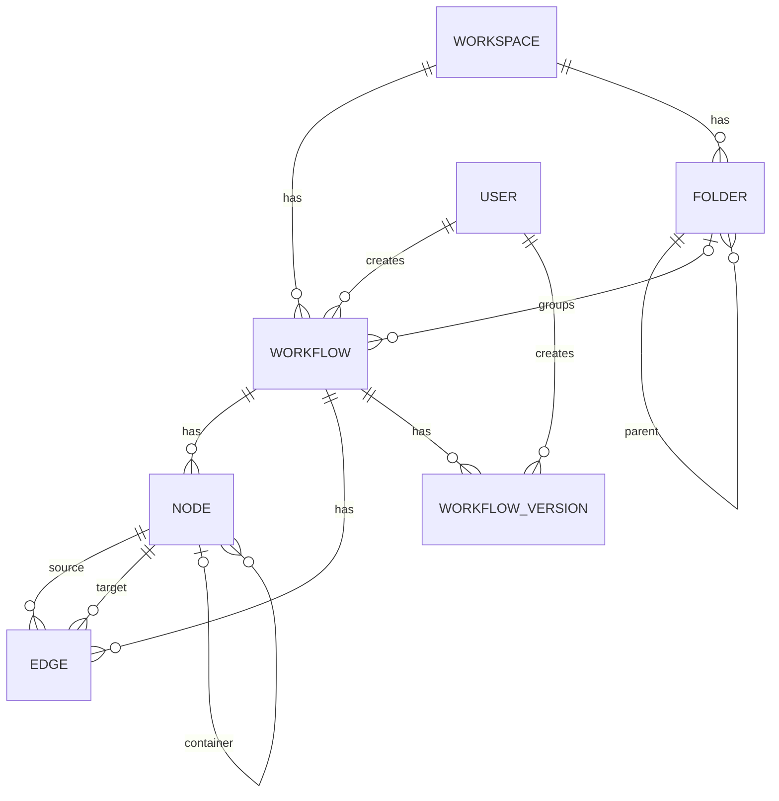
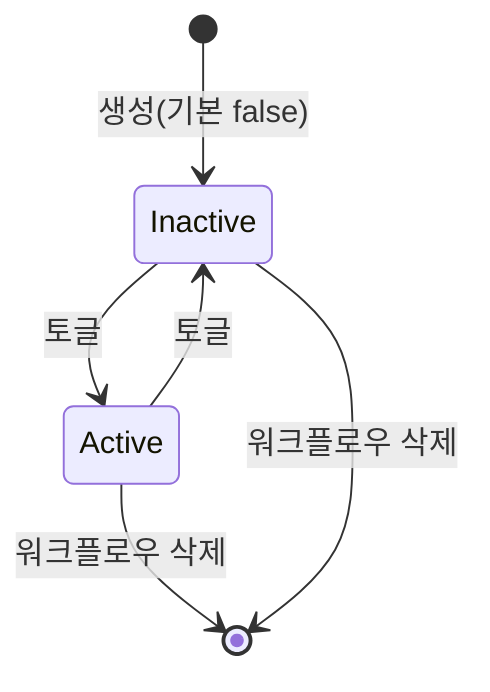

> 구현 상태: 구현됨 · 원문: `spec/data-flow/11-workflow.md`, `spec/1-data-model.md` (§2.4 Workflow, §2.5 Folder, §2.6 Node, §2.7 Edge, §2.15 WorkflowVersion, Rationale "WorkflowVersion.snapshot 구성 서술 정정") · 용어: [용어 사전](../CLE-GLOSSARY.md)

## 개요

워크플로우(Workflow, `workflow`)는 워크스페이스 안에서 사용자가 눈으로 보며 편집하는 자동화 단위다. 노드·연결선·메타 설정·버전 스냅샷을 묶어 한곳에서 관리한다. 이 문서는 워크플로우 작성 영역의 엔티티(Workflow, Folder, Node, Edge, WorkflowVersion)와 **편집 시점**의 데이터 흐름을 정한다. 워크플로우 생성, 캔버스 저장과 버전 스냅샷 생성, 컨테이너 소속 컬럼, 복제·내보내기·가져오기, 활성 상태 전이, 삭제 때의 FK 파급을 다룬다. 이 문서는 입구이고 엔티티와 저장 흐름 · 복제의 상세는 [하위 문서](#하위-문서) 가 맡는다.

범위 밖:

- 실행 데이터와 실행 흐름은 [실행 데이터와 흐름](../CLE-EXEC/CLE-EXEC-DATA.md) 이 정한다.
- AI 어시스턴트 세션·메시지 엔티티와 저장 흐름은 [AI 어시스턴트 스트리밍과 세션 API](CLE-WF-ASSIST-PROTO.md) 가 정한다.
- 공통 컬럼 규칙, FK 삭제 동작 전체 지도, 인덱스 전략은 [데이터 모델 개요](../CLE-PLAT/CLE-PLAT-DATA.md) 가 정한다.
- 화면 동작은 [워크플로우 목록과 폴더](CLE-WF-LIST.md), [워크플로우 에디터와 캔버스](CLE-WF-EDITOR.md), [버전 기록](CLE-WF-VERSION.md) 이 정한다.
- 트리거 삭제 때 정리하는 자원은 [트리거 관리](../CLE-TRIG/CLE-TRIG-MANAGE.md) 가 정한다. 정리 순서는 [트리거 데이터와 흐름 「트리거 삭제와 자원 해제」](../CLE-TRIG/CLE-TRIG-DATA.md#트리거-삭제와-자원-해제) 가 정한다.

## 하위 문서

이 문서에는 요구사항 줄이 없어 하위 문서가 맡는 요구사항 번호도 없다.

- [워크플로우 데이터 — 엔티티와 제약](CLE-WF-DATA-MODEL.md): Workflow · Folder · Node(노드 유형 목록) · Edge · WorkflowVersion 필드와 제약, 컨테이너 소속과 도구 영역 컬럼의 검사 위치, 노드 배치 두 축과 버전 스냅샷 구성의 근거.
- [워크플로우 데이터 — 저장 흐름과 복제](CLE-WF-DATA-SAVE.md): 워크플로우 생성, 캔버스 저장 단계(DTO 검사 · 워크플로우 행 잠금 · 통합 참조 검사 · 그래프 경고 · 버전 생성), 개별 노드 생성·수정의 잠금, 어시스턴트 편집의 저장 경로, 복제 · 내보내기 · 가져오기와 통합 참조 비우기, 잠금 뒤 검사와 복제 범위의 근거. 다른 문서의 요구사항 가운데 버전 복원의 참조 비우기(REQ-WFVER-026)와 개인 통합 저장자 조건(REQ-INTMGMT-054)을 이 흐름이 따른다.

## 엔티티 관계

워크스페이스 하나에 워크플로우와 폴더가 여럿 있다. 워크플로우는 폴더 하나에 들 수 있고, 노드·연결선·버전을 여럿 가진다. 연결선은 같은 워크플로우의 두 노드를 잇는다. 노드는 컨테이너 노드를 `container_id` 로 가리킬 수 있다. 필드와 제약은 [엔티티와 제약](CLE-WF-DATA-MODEL.md) 이 정한다.

## 생성과 저장 흐름

→ [생성과 저장 흐름](CLE-WF-DATA-SAVE.md#생성과-저장-흐름)

## Postgres 쓰기 매핑

| 테이블 | 흐름 | 읽고 쓰는 컬럼 | 인덱스·제약 |
| --- | --- | --- | --- |
| `workflow` | 생성 | INSERT `workspace_id, name, description?, is_active=false, tags='{}', folder_id?, settings={}, current_version=1, created_by` | `folder_id` 는 같은 워크스페이스 폴더만(저장 전 거부). FK `workspace_id`(CASCADE), 복합 FK `(folder_id, workspace_id)`(SET NULL, `folder_id` 만 비운다). V123 `(folder_id)` partial(폴더 삭제 때 FK SET NULL 용) |
| `workflow` | 복제 | INSERT. 생성과 같은 컬럼. `name` 은 원본 + `" (Copy)"`, `is_active=false`, `current_version=1` 고정, description·tags·folder_id·settings 는 원본 값, `created_by` 는 **요청한 사용자** | 같음 |
| `workflow` | 활성 토글 | UPDATE `is_active, updated_at` | 없음 |
| `workflow` | 저장(버전 커밋) | UPDATE `current_version, updated_at` | 없음 |
| `workflow` | 삭제 | DELETE. 자식 행 FK 파급은 [상태 전이](#상태-전이) 참조. 트리거 자원 정리: 외부 자원을 트랜잭션 **전에** 풀고, 트랜잭션 첫 호출로 잠금 대기 상한(5초)을 건 뒤 `workflow` 행을 먼저 잠그고(`pessimistic_write`) 트리거 id 를 모은 다음 지운다. 커밋 **뒤** 그 트리거들의 `secret_store` 비밀을 지우고 트리거 단위 토큰(`itk_*`)으로 연 SSE 스트림을 모든 서버 인스턴스에서 닫는다(best-effort). 정리하는 자원은 [트리거 관리](../CLE-TRIG/CLE-TRIG-MANAGE.md), 순서와 이유는 [트리거 데이터와 흐름 「트리거 삭제와 자원 해제」](../CLE-TRIG/CLE-TRIG-DATA.md#트리거-삭제와-자원-해제) 가 정한다. | 행 잠금은 트리거 INSERT 의 FK 검사(`FOR KEY SHARE`)를 막아 모을 때 빠지는 트리거가 없게 한다. |
| `node` | 추가 | INSERT `workflow_id, type, category, label, position_x/y, config={}, container_id?, tool_owner_id?` | CHECK `chk_node_placement`(둘 다 설정 금지). `container_id`·`tool_owner_id` 는 같은 워크플로우 노드만(저장 전 거부, 복합 FK). 캔버스 저장이 새 노드로 싣는 `id` 가 다른 행의 id 면 거부(그 행을 덮어쓰지 않는다) |
| `node` | 복제 | INSERT. 추가와 같은 컬럼이다. `id` 를 새로 발급하고 `container_id`·`tool_owner_id` 를 사본 UUID 로 바꾼다. `config` 는 원본 그대로다(기본값 다시 채우기, 모델 설정 채우기 없음). | 같음. 원본이 이미 통과한 레이블 유일성은 다시 검사하지 않는다. |
| `node` | 이동·설정 변경 | UPDATE `position_x, position_y, config, label, is_disabled` | 없음 |
| `node` | 컨테이너·도구 영역 배치 | UPDATE `container_id` 또는 `tool_owner_id` | 같은 워크플로우 노드만. 저장 전 거부하고 복합 FK 도 막는다([참조의 소속](../CLE-PLAT/CLE-PLAT-DATA.md#참조의-소속)). 순환 검사는 실행 시와 AI 어시스턴트 Shadow 검증에서 한다(실행 때 에러 메시지 접두 `CONTAINER_CYCLE: `) |
| `edge` | 추가 | INSERT `workflow_id, source_node_id, source_port, target_node_id, target_port, type IN (data/error), condition?` | 끝점은 같은 워크플로우 노드만(저장 전 거부, 복합 FK). `(source_node_id, source_port, target_node_id, target_port)` UNIQUE, `chk_no_self_loop`, FK CASCADE. V121 `(target_node_id)`(노드 삭제 때 FK CASCADE 용) |
| `edge` | 복제 | INSERT. 추가와 같은 컬럼이다. `source_node_id`·`target_node_id` 를 사본 노드 UUID 로 바꾼다. | 같음 |
| `workflow_version` | 저장(버전 커밋) | INSERT `workflow_id, version, snapshot=JSONB, change_summary?, created_by, created_at` | `(workflow_id, version)` UNIQUE |

## Redis·파일 저장소·외부

| 대상 | 흐름 | 비고 |
| --- | --- | --- |
| Redis | 없음 | 이 영역은 큐에 직접 넣지 않는다. 실행을 시작하면 [실행 데이터와 흐름](../CLE-EXEC/CLE-EXEC-DATA.md) 의 큐로 들어간다. |
| 파일 저장소 | 없음 | 워크플로우 자체는 파일 저장소를 쓰지 않는다. Form 노드 첨부는 [파일 저장소](../CLE-PLAT/CLE-PLAT-STORAGE.md) 가 다룬다. |
| LLM 프로바이더·SSE | AI 어시스턴트 응답 스트리밍 | [AI 어시스턴트 스트리밍과 세션 API](CLE-WF-ASSIST-PROTO.md). 사용량은 `llm_usage_log` 에 쌓는다([LLM 사용량 기록](../CLE-AI/CLE-AI-USAGE.md)). |

## 상태 전이

### 워크플로우 활성 상태

워크플로우는 비활성으로 만들어지고 목록의 상태 스위치로 켜고 끈다. 비활성 워크플로우는 웹훅 · 채팅 채널 · 스케줄 이벤트로 새 실행이 시작되지 않는다. 진행 중인 실행은 그대로 이어지고 수동 실행 · 재실행 · 스케줄 "지금 실행" 은 비활성 워크플로우도 된다. 경로별 확인 위치와 응답은 [트리거 데이터와 흐름 「워크플로우 활성 관문」](../CLE-TRIG/CLE-TRIG-DATA.md#워크플로우-활성-관문) 이 정한다. 이 문서가 바뀐 이유는 [Rationale](#꺼진-워크플로우는-외부-이벤트로-실행하지-않는다-2026-10-10) 에 있다.

### 워크플로우 삭제의 FK 파급

마이그레이션의 `REFERENCES workflow` 를 **모두** 적었다. `trigger` · `alert_rule` · `workflow_assistant_session` · `workflow_test_dataset` 은 V141 부터 `REFERENCES workflow (id, workspace_id)` 복합 FK 다(삭제 동작은 같다). 직접 참조만 적고, 2차 파급은 트리거 동시성 설명이 기대는 `trigger → schedule` 하나만 적는다.

| 테이블 | `ON DELETE` | 마이그레이션 |
| --- | --- | --- |
| `node`, `edge`, `execution`, `workflow_version` | CASCADE | `V001__initial_schema.sql` |
| `trigger` | CASCADE. 이어서 `schedule`(`schedule.trigger_id` CASCADE)까지 2차로 지워진다. **DB 수준이라 트리거 단위 advisory lock 을 거치지 않는다.** 트리거가 쓰던 외부 등록·비밀의 정리와 트리거 단위 토큰으로 연 SSE 스트림 닫기는 이 CASCADE 앞뒤로 앱이 한다([트리거 관리](../CLE-TRIG/CLE-TRIG-MANAGE.md)). | `V001__initial_schema.sql` · `V141__composite_fk_scope_workflow_not_valid.sql`(복합 FK) |
| `integration_usage_log` | CASCADE | `V008__integration_usage_log_and_metadata.sql` |
| `llm_usage_log` | **SET NULL**. 사용량 이력은 남는다. | `V014__llm_usage_logs.sql` |
| `alert_rule` | CASCADE | `V016__alert_rules.sql` · `V141__composite_fk_scope_workflow_not_valid.sql`(복합 FK) |
| `workflow_assistant_session` | CASCADE | `V019__workflow_assistant.sql` · `V141__composite_fk_scope_workflow_not_valid.sql`(복합 FK) |
| `workflow_test_dataset` | CASCADE | `V097__workflow_test_dataset.sql` · `V141__composite_fk_scope_workflow_not_valid.sql`(복합 FK) |

## 외부 의존

| 의존 | 방향 | 참고 |
| --- | --- | --- |
| 계정·워크스페이스 | 역할 기반 권한 검사 | `editor` 이상이 CRUD 할 수 있다([워크스페이스와 멤버](../CLE-ACCT/CLE-ACCT-WS.md)). |
| 실행 | 워크플로우 실행 시작 | [실행 데이터와 흐름](../CLE-EXEC/CLE-EXEC-DATA.md) |
| LLM 사용량 | AI 어시스턴트 LLM 호출 | [LLM 사용량 기록](../CLE-AI/CLE-AI-USAGE.md) |
| SSE | AI 어시스턴트 스트리밍 | `WorkflowAssistantController` 의 `text/event-stream` HTTP 응답(WebSocket room 미사용). [AI 어시스턴트 스트리밍과 세션 API](CLE-WF-ASSIST-PROTO.md) |

## 미결 사항

- **저장과 버전 생성이 한 트랜잭션인가**: 이 문서의 원문(데이터 흐름)과 에디터 원문(저장과 버전의 관계)은 `createVersion` 을 캔버스 저장과 같은 트랜잭션 안에서 부른다고 적는다. [버전 기록](CLE-WF-VERSION.md) 의 원문은 캔버스 트랜잭션을 커밋한 직후 버전을 만들고, 버전 생성이 실패하면 캔버스는 저장된 채로 두고 다음 저장에서 따라잡는다고 적는다. 현재 구현(`workflows.service.ts` 의 `writeCanvas`, 캔버스 저장과 버전 복원이 함께 쓴다)은 같은 트랜잭션에서 `createVersion` 을 불러 둘 다 커밋하거나 둘 다 되돌린다. 버전 생성 실패 때 저장 전체를 되돌릴지 결정이 필요하다.
- **`current_version` 의 뜻**: 데이터 모델은 `current_version` 을 "현재 버전 번호" 라고 적는다. 그런데 워크플로우는 `current_version=1` 로 버전 행 없이 만들어지고, 저장할 때마다 `current_version` 과 `workflow_version.version`(최신+1)이 따로 오른다. 그래서 현재 구현에서 `current_version` 은 버전 기록의 최신 vN 보다 늘 1 크다(`workflows.service.ts`, `workflow-versions.service.ts`). [버전 기록](CLE-WF-VERSION.md) 은 `current_version` 을 언급하지 않는다. `current_version` 이 저장 횟수 + 1 인지 최신 버전 번호인지 정하고 여기에 적어야 한다.

## 구현 위치

- `codebase/backend/src/modules/workflows/workflows.service.ts` (Workflow CRUD, 캔버스 저장과 버전 복원이 함께 쓰는 `writeCanvas`, 복제·내보내기·가져오기)
- `codebase/backend/src/modules/workflows/workflow-ownership.util.ts` (워크플로우 행 잠금 `lockWorkflowInWorkspace`)
- `codebase/backend/src/modules/nodes/nodes.service.ts` (Node CRUD. 생성·수정의 행 잠금과 통합 참조 검사)
- `codebase/backend/src/modules/edges/edges.service.ts` (Edge CRUD)
- `codebase/backend/src/modules/workflow-versions/workflow-versions.service.ts` (버전 스냅샷)
- `codebase/backend/src/modules/folders/**` (Folder)
- `codebase/backend/src/modules/integrations/node-integration-refs.ts` (노드 `config` 의 통합 참조 자리, 바뀐 참조 가리기, 참조 비우기)
- `codebase/backend/src/modules/integrations/node-integration-ref-check.ts` (저장 검사의 거절과 복제·가져오기·복원의 비우기)
- `codebase/backend/src/modules/integrations/personal-integration-use.ts`, `codebase/backend/src/modules/integrations/personal-integration-use-facts.ts` (개인 통합 사용 판정과 잠금 안의 통합 · 멤버십 조회)
- `codebase/backend/src/repo-guards/__tests__/node-row-writers-guard.ts`, `codebase/backend/src/repo-guards/__tests__/node-row-writers.spec.ts` (노드 행을 쓰는 지점 허용 목록 가드)
- `codebase/backend/test/integration-personal-use.e2e-spec.ts` (노드 생성·수정 · 캔버스 저장 · 동시 저장 · 복제 · 가져오기 · 버전 복원의 통합 참조 e2e)
- `codebase/backend/src/modules/execution-engine/utils/is-workflow-inactive.ts` (워크플로우 활성 관문. 부르는 곳과 테스트는 [트리거 데이터와 흐름 「구현 위치」](../CLE-TRIG/CLE-TRIG-DATA.md#구현-위치) 에 있다)
- `codebase/backend/migrations/V001__initial_schema.sql` (테이블·CHECK 제약)
- `codebase/backend/migrations/V135__workflow_id_workspace_id_unique_index.sql`, `codebase/backend/migrations/V137__folder_id_workspace_id_unique_index.sql`, `codebase/backend/migrations/V140__node_id_workflow_id_unique_index.sql`, `codebase/backend/migrations/V141__composite_fk_scope_workflow_not_valid.sql`, `codebase/backend/migrations/V143__composite_fk_scope_folder_not_valid.sql`, `codebase/backend/migrations/V146__composite_fk_scope_node_not_valid.sql` (부모 UNIQUE 와 복합 FK)

## Rationale

### 꺼진 워크플로우는 외부 이벤트로 실행하지 않는다 (2026-10-10)

NERV Task `CLE-T-XRWFMJ` 에서 사람이 정한 결정이다.

이 문서와 [워크플로우 목록과 폴더](CLE-WF-LIST.md) 는 워크플로우를 끄면 스케줄 · 웹훅이 멈춘다고 적었다. 트리거 흐름과 구현은 `trigger.is_active` · `schedule.is_active` 만 보고 `workflow.is_active` 를 보지 않았다. 목록의 상태 스위치를 끈 사용자는 실행이 멈춘다고 생각한다. 그래서 문서를 거두지 않고 코드를 문서에 맞췄다.

- 관문의 규칙(경로별 응답, 채팅 채널의 handshake 와 진행 중인 대화, 조회 범위)과 그 근거는 [트리거 데이터와 흐름 「꺼진 워크플로우를 실행 관문으로 둔 결정」](../CLE-TRIG/CLE-TRIG-DATA.md#꺼진-워크플로우를-실행-관문으로-둔-결정-2026-10-10) 에 있다. 이 문서는 `workflow.is_active` 의 뜻만 적는다. 같은 규칙을 여러 문서에 자세히 적으면 문서마다 두 번째 기준이 생긴다.
- 수동 실행 · 재실행 · 스케줄 "지금 실행" 은 비활성 워크플로우도 된다는 이 문서의 기존 규칙을 그대로 둔다. 이미 진행 중인 실행도 취소하지 않는다.
- 워크플로우는 지금처럼 비활성으로 만들어진다. 그래서 꺼 둔 채 외부 호출로 돌던 워크플로우는 이 변경을 배포한 뒤 멈춘다. 다시 돌리려면 켜야 한다.

기각한 대안: **`workflow.is_active` 를 표시용 플래그로 두고 문서만 고치는 안**. 화면 문구대로 사용자는 워크플로우를 끄면 실행이 멈춘다고 생각한다. 이 안을 고르면 켜고 꺼도 실행에 아무 영향이 없는 스위치가 남는다.
