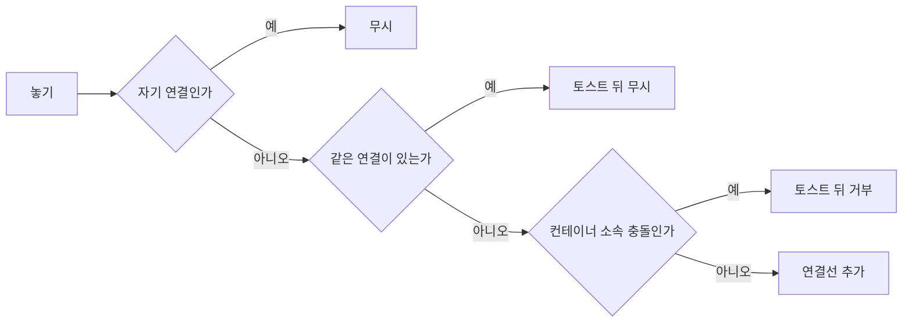

> 구현 상태: 부분 구현 · 원문: `spec/3-workflow-editor/2-edge.md`, `spec/3-workflow-editor/_product-overview.md` (§3.3 ED-EG-01~06) · 용어: [용어 사전](../CLE-GLOSSARY.md)

## 개요

연결선(Edge, `edge`)은 앞 노드의 출력 포트와 뒤 노드의 입력 포트를 잇는 선이다. `type` 값은 `data` 또는 `error` 다. 이 문서는 연결선 요구사항 전체와 연결 유효성 규칙, 컨테이너 연결선 규칙, 워크플로우를 불러올 때의 연결선 자동 정리(`dropStaleEdges`)를 정한다. 에디터에서 연결선을 만들고, 다시 잇고, 지우고, 나누는 조작과 시각 표현, 데이터 미리보기(Data Flow Preview)의 본문은 하위 문서 [연결선 — 편집 조작과 시각 표현](CLE-WF-EDGE-UI.md) 에 있다.

범위 밖:

- 포트 체계와 포트 색은 [노드 포트와 설정 패널](CLE-WF-NODEPANEL.md) 이 정한다. 노드별 포트 ID 는 각 노드 문서가 정한다.
- 컨테이너 소속(`containerId`)을 연결선으로 정하는 규칙과 컨테이너 삭제는 [워크플로우 에디터와 캔버스](CLE-WF-EDITOR.md) 가 정한다.
- `edge` 테이블 컬럼과 DB 제약은 [워크플로우 데이터와 저장 흐름](CLE-WF-DATA.md) 이 정한다.
- 탈출 불가 순환 경고를 포함한 그래프 경고 규칙의 등록과 평가 구조는 [그래프 경고 규칙](CLE-WF-WARN.md) 이 정한다.
- 순환 연결선을 따라 실행하는 방식과 컨테이너 본문 실행은 [실행 엔진 개요와 그래프 순회](../CLE-EXEC/CLE-EXEC-ENGINE.md) 와 [컨테이너 실행](../CLE-EXEC/CLE-EXEC-CONTAINER.md) 이 정한다.

## 요구사항

- REQ-EDGE-001 WHEN 사용자가 노드의 출력 포트를 끌어 다른 노드의 입력 포트에 놓으면 THE SYSTEM SHALL 두 포트를 잇는 연결선을 만든다. (원본: ED-EG-01)
- REQ-EDGE-002 WHILE 연결선을 그리는 동안 THE SYSTEM SHALL target 쪽 끝에 포트 색과 같은 색의 화살표 머리를 그려 데이터 흐름 방향을 보여 준다. (원본: ED-EG-02)
- REQ-EDGE-003 WHEN 사용자가 연결선을 누르면 THE SYSTEM SHALL 그 연결선을 선택한다. (원본: ED-EG-03)
- REQ-EDGE-004 WHEN 사용자가 연결선을 선택한 채 Delete·Backspace 를 누르면 THE SYSTEM SHALL 그 연결선을 지운다. (원본: ED-EG-03)
- REQ-EDGE-005 IF 사용자가 유효하지 않은 연결을 시도하면 THE SYSTEM SHALL 연결할 수 없음을 시각적으로 표시한다. (원본: ED-EG-04)
- REQ-EDGE-006 WHILE 연결선을 그리는 동안 THE SYSTEM SHALL 곡선(Bezier) 스타일로 그린다. (원본: ED-EG-05)
- REQ-EDGE-007 WHEN 실행이 끝난 뒤 사용자가 연결선에 마우스를 올리면 THE SYSTEM SHALL 그 연결선으로 흐른 데이터의 미리보기 툴팁을 보여 준다. (원본: ED-EG-06)
- REQ-EDGE-008 WHILE 사용자가 출력 포트를 끄는 동안 THE SYSTEM SHALL 커서를 따라가는 점선 임시 연결선을 그린다.
- REQ-EDGE-009 IF 사용자가 유효하지 않은 곳에 놓으면 THE SYSTEM SHALL 임시 연결선을 지우고 연결선을 만들지 않는다.
- REQ-EDGE-010 WHEN 사용자가 출력 포트에서 끈 연결선을 빈 영역에 놓으면 THE SYSTEM SHALL 노드 검색 팝업을 열고 고른 노드를 만든 뒤 출발 포트에서 새 노드의 첫 입력 포트로 연결한다.
- REQ-EDGE-011 IF 새 노드에 입력 포트가 없으면 THE SYSTEM SHALL 노드만 만들고 자동 연결을 건너뛴다.
- REQ-EDGE-012 WHEN 사용자가 빈 영역 놓기로 노드와 연결선을 함께 만든 뒤 Ctrl+Z 를 한 번 누르면 THE SYSTEM SHALL 노드와 연결선을 함께 되돌린다.
- REQ-EDGE-013 WHEN 사용자가 입력 포트에서 끌어 출력 포트에 놓으면 THE SYSTEM SHALL 출력에서 입력 방향의 연결선을 만든다.
- REQ-EDGE-014 WHEN 사용자가 기존 연결선의 끝점을 다른 포트로 끌어 놓으면 THE SYSTEM SHALL 연결선 id 를 유지한 채 다시 잇는다.
- REQ-EDGE-015 WHEN 사용자가 기존 연결선의 끝점을 빈 캔버스에 놓으면 THE SYSTEM SHALL 그 연결선을 지운다.
- REQ-EDGE-016 IF 사용자가 끝점을 연결할 수 없는 포트 위에 놓으면 THE SYSTEM SHALL 연결선을 원래대로 둔다.
- REQ-EDGE-017 IF 연결선의 출발 노드와 도착 노드가 같으면 THE SYSTEM SHALL 드래그 중 금지 커서를 보이고 연결선을 만들지 않는다.
- REQ-EDGE-018 IF 출력 포트끼리나 입력 포트끼리 이으려 하면 THE SYSTEM SHALL 금지 커서를 보이고 연결선을 만들지 않는다.
- REQ-EDGE-019 IF 같은 출발 노드·출발 포트·도착 노드·도착 포트의 연결선이 이미 있으면 THE SYSTEM SHALL "already connected" 토스트를 보이고 연결선을 만들지 않는다.
- REQ-EDGE-020 WHEN 사용자가 순환을 만드는 연결선을 그리면 THE SYSTEM SHALL 연결선 생성을 막지 않는다.
- REQ-EDGE-021 IF 되돌아가는 연결선의 출발 노드가 분기 노드가 아니면 THE SYSTEM SHALL 그 노드에 `graph:unescapable-cycle` 경고(`warning`, 노란 배지)를 붙인다.
- REQ-EDGE-022 WHILE 연결선을 그리는 동안 THE SYSTEM SHALL 출발 포트 종류에 따라 데이터는 초록, 에러는 빨강, 시스템은 파랑, 컨테이너 본문 진입은 보라로 칠한다.
- REQ-EDGE-023 WHILE 실행 중에 출발 노드가 완료되고 도착 노드가 실행 중인 동안 THE SYSTEM SHALL 연결선을 흐르는 점선 애니메이션으로 그린다.
- REQ-EDGE-024 WHEN 출발 노드와 도착 노드가 모두 완료되면 THE SYSTEM SHALL 연결선을 잠깐 초록으로 바꿨다가 원래 색으로 돌린다.
- REQ-EDGE-025 WHILE 연결선의 한쪽 노드가 비활성화돼 있는 동안 THE SYSTEM SHALL 연결선을 반투명 점선으로 그리고 실행 상태 스타일을 입히지 않는다.
- REQ-EDGE-026 WHEN 사용자가 노드에 마우스를 올리거나 노드를 고르면 THE SYSTEM SHALL 연결된 연결선을 강조하고 나머지 연결선을 흐리게 한다.
- REQ-EDGE-027 WHEN 사용자가 연결선에 마우스를 올리면 THE SYSTEM SHALL 그 연결선만 강조하고 양 끝 노드에 glow 효과를 준다.
- REQ-EDGE-028 WHEN 사용자가 팔레트의 노드를 연결선 위에 놓으면 THE SYSTEM SHALL 원래 연결선을 지우고 출발 노드에서 새 노드로, 새 노드에서 도착 노드로 가는 연결선 두 개를 만든다.
- REQ-EDGE-029 IF 놓은 노드에 입력 포트나 출력 포트가 없거나 그 노드가 컨테이너이면 THE SYSTEM SHALL 연결선을 나누지 않고 노드만 추가한다.
- REQ-EDGE-030 IF 노드를 놓은 연결선이 `body` 에서 나가거나 `emit` 으로 들어가는 컨테이너 경계 연결선이면 THE SYSTEM SHALL 연결선을 나누지 않고 노드만 추가한다.
- REQ-EDGE-031 WHEN 연결선 분할 뒤 사용자가 Ctrl+Z 를 한 번 누르면 THE SYSTEM SHALL 새 노드와 새 연결선 두 개를 지우고 원래 연결선을 되살린다.
- REQ-EDGE-032 WHEN 사용자가 데이터 미리보기 툴팁의 "전체 데이터 보기" 를 누르면 THE SYSTEM SHALL 줄이지 않은 전체 JSON 을 모달로 보여 준다.
- REQ-EDGE-033 IF 출발 노드에 실행 데이터가 없으면 THE SYSTEM SHALL 데이터 미리보기 툴팁을 그리지 않는다.
- REQ-EDGE-034 WHILE Loop·ForEach·Map 을 실행하는 동안 THE SYSTEM SHALL 본문 자식 가운데 정확히 하나가 컨테이너의 `emit` 포트에 연결돼 있기를 요구한다.
- REQ-EDGE-035 IF `emit` 연결선이 없거나 둘 이상이면 THE SYSTEM SHALL 실행 전에 메시지가 `CONTAINER_MISSING_EMIT: ` 또는 `CONTAINER_MULTIPLE_EMIT: ` 로 시작하는 에러로 실패시킨다.
- REQ-EDGE-036 WHEN 에디터가 워크플로우를 불러오면 THE SYSTEM SHALL 지금 노드 설정의 포트 집합에 없는 포트에 붙은 연결선을 지운다.
- REQ-EDGE-037 IF 불러올 때 연결선을 하나 이상 지웠으면 THE SYSTEM SHALL 지운 개수를 담은 경고 토스트를 보여 준다.
- REQ-EDGE-038 WHILE 자동 정리한 연결선을 저장하지 않은 동안 THE SYSTEM SHALL 데이터베이스의 연결선을 그대로 둔다.
- REQ-EDGE-039 WHEN 사용자가 연결선을 내부 노드와 외부 노드 사이로 직접 이으면 THE SYSTEM SHALL 연결을 막는다(정의가 갈린다, 미결 사항 참조). (부분 구현)

## 하위 문서

- [연결선 — 편집 조작과 시각 표현](CLE-WF-EDGE-UI.md): 끌어서 잇기 · 빈 영역 놓기 · 역방향 연결과 다시 잇기 · 연결선 조작과 분할, 포트 종류별 색 · 상태별 스타일 · 강조 효과 · 화살표, 데이터 미리보기. 요구사항: REQ-EDGE-001~004, REQ-EDGE-006~016, REQ-EDGE-022~033.

## 연결 유효성

### 허용하는 연결

| 규칙 | 설명 |
| --- | --- |
| 출력 → 입력 | 출력 포트에서 입력 포트 방향만 허용한다. |
| 같은 워크플로우 | 같은 워크플로우 안의 노드끼리만 잇는다. |
| 출력 포트 하나 → 입력 포트 여럿 | 출력 하나에서 여러 노드로 나눌 수 있다. |
| 출력 포트 여럿 → 입력 포트 하나 | 여러 노드의 출력이 입력 하나로 모일 수 있다. |

### 막는 연결

구조적으로 뜻이 없는 연결은 **완전히 막는다**. 연결선 자체가 생기지 않는다.

| 규칙 | 시각 피드백 | 구현 |
| --- | --- | --- |
| 자기 자신으로 연결(`source === target`) | 드래그 중 금지 커서(🚫) | 구현됨(`editor-store.ts` 의 `isValidConnection`) |
| 출력 → 출력 | 금지 커서 | 구현됨(React Flow 핸들 종류 강제) |
| 입력 → 입력 | 금지 커서 | 구현됨(React Flow 핸들 종류 강제) |
| 같은 연결 중복(같은 source·sourceHandle·target·targetHandle) | "already connected" 토스트. 영문이 기준이고 표시 계층에서 번역한다. | 구현됨(`editor-store.ts` 의 `onConnect`) |

`isValidConnection` 은 `<ReactFlow>` prop 으로 넘기고, 드래그 중 `source === target` 자기 연결을 `false` 로 판정해 금지 커서로 막는다. 출력에서 입력 방향과 출력↔출력·입력↔입력 금지는 React Flow 핸들 종류(source·target)가 강제한다. `onConnect` 는 놓는 순간 아래 순서로 검사한 뒤에만 `addEdge` 한다.

순수 판정 헬퍼(`isSelfConnection`, `isDuplicateConnection`)는 `edge-utils.ts` 에 있다. 컨테이너 소속 충돌 판정은 `detectContainerConflict` 다.

자기 연결과 같은 연결 중복은 **DB 제약과 같은 불변식**을 캔버스가 먼저 막는 이중 방어다. `edge` 테이블의 `source_node_id != target_node_id` 제약과 `(source_node_id, source_port, target_node_id, target_port)` UNIQUE 가 마지막 안전망이다([워크플로우 데이터와 저장 흐름](CLE-WF-DATA.md)).

### 순환은 경고만 하고 막지 않는다

캔버스는 순환을 만드는 연결선을 **막지 않는다**. 실행 엔진이 분기 노드(Switch, If/Else 등)의 포트 경로 선택을 통한 되돌아가는 연결선 순환(재시도·폴링 루프)을 정식으로 지원하기 때문이다([실행 엔진 개요와 그래프 순회](../CLE-EXEC/CLE-EXEC-ENGINE.md)). 대신 **탈출할 수 없다고 판정되는 위험한 순환만 경고 배지**로 드러낸다.

- 그래프 전체를 DFS 로 한 번 돌아 되돌아가는 연결선(back-edge)을 찾는다.
- 되돌아가는 연결선의 **출발 노드가 분기 노드가 아니면**(조건이나 케이스로 출력 포트를 고르지 못하는 통과형 노드) 그 순환은 정적으로 탈출할 수 없다고 보고 그 노드에 탈출 불가 순환 경고(`graph:unescapable-cycle`, 심각도 `warning`, 노란 배지)를 붙인다. 출발 노드가 분기 노드면 탈출할 수 있다고 보고 경고하지 않는다.
- **예외(순환으로 보지 않음)**: 컨테이너 반복 구조의 연결선. 컨테이너에서 자식으로 들어가는 연결선(`sourceHandle === 'body'`)과 자식에서 조상 컨테이너의 `emit` 포트로 모으는 연결선(`targetHandle === 'emit'`)은 노드 안의 반복이지 그래프 순환이 아니므로 검사에서 뺀다. 되돌아가는 방향의 기준은 백엔드 `shadow-workflow.ts` 의 `CONTAINER_LOOPBACK_PORTS = {'emit'}` 이다.

구현: 그래프 수준 규칙 `evaluateGraphCycleWarnings`(`@workflow/graph-warning-rules` 의 `rules/cycle.ts`)가 위 판정을 한다. 프론트엔드 캔버스는 `editor-store.ts` 의 `evaluateGraphWarningsLocal` 에서 노드 유형별 규칙 결과와 합쳐 배지로 보여 준다. 백엔드는 `GET /workflows/:id/graph-warnings` 응답(`workflows.service.ts` 의 `getGraphWarnings`)에 같은 결과를 넣어 두 쪽이 일치한다. 심각도가 `warning` 이라 저장을 막지 않는다. 분기 노드 판정은 실행 시 `_selectedPort` 를 정적으로 근사한 것(규칙 파일의 `BRANCH_NODE_TYPES` 집합)이다. 권고 경고라 근사가 조금 틀려도 치명적이지 않다. 규칙 등록과 심각도 정책은 [그래프 경고 규칙](CLE-WF-WARN.md) 에 있다.

## 컨테이너 연결선 규칙

컨테이너(Loop·ForEach·Map) 안 자식 노드 사이의 연결선에 적용하는 규칙이다. [Background 노드](../CLE-NODE-LOGIC/CLE-NODE-BACKGROUND.md)는 컨테이너 박스를 그리지 않고 `background` 포트 연결선으로 본문을 알아보는 평면 모델이다. 그래서 이 절의 컨테이너 규칙은 Background 에 적용하지 않는다.

### 진입과 결과 수집

| 규칙 | 설명 |
| --- | --- |
| 진입 | 컨테이너의 `body` 포트에서 컨테이너 안 첫 자식 노드로 잇는다. |
| 결과 수집(`emit` 포트) | Loop·ForEach·Map 은 본문 자식 가운데 **정확히 하나**가 컨테이너의 `emit` 입력 포트로 이어져야 한다. 반복마다 그 노드의 출력을 모은다. |
| 검사 | `emit` 이 없으면 메시지가 `CONTAINER_MISSING_EMIT: ` 로, 둘 이상이면 `CONTAINER_MULTIPLE_EMIT: ` 로 시작하는 에러다. 실행할 때 엔진이 먼저 검사한다. 메시지 전체는 [컨테이너 실행 「emit 수집 규칙」](../CLE-EXEC/CLE-EXEC-CONTAINER.md#emit-수집-규칙) 에 있다. |
| Loop·Map·ForEach | `emit` 출발 노드의 출력을 배열로 모아 `done` 포트로 보낸다. 항목 에러 정책(`errorPolicy`)이 `skip` · `continue` 일 때 실패 항목 자리(ForEach `output.items[i]` 는 `null` · 실패 정보 `output.skipped[]`, Map `output.mapped[i]` 는 `{ _skipped: true, error }`)는 [컨테이너 실행](../CLE-EXEC/CLE-EXEC-CONTAINER.md#foreach-와-map-실행) 이 정한다. |
| Background | 컨테이너 모델을 쓰지 않는다. `background` 포트로 본문 시작 노드를 가리키고 본문 노드는 메인 흐름과 같은 캔버스 평면에 놓인다. `emit` 모델도 쓰지 않는다([Background 노드](../CLE-NODE-LOGIC/CLE-NODE-BACKGROUND.md)). |

### 경계 규칙

| 규칙 | 설명 |
| --- | --- |
| 경계 불가침 | 연결선은 컨테이너 경계를 직접 넘을 수 없다. 데이터는 컨테이너의 입출력 포트로만 오간다. |
| 안 → 밖 | 금지. 안쪽 노드에서 바깥 노드로 직접 잇지 못한다. |
| 밖 → 안 | 금지. 바깥 노드에서 안쪽 노드로 직접 잇지 못한다. |
| 중첩 컨테이너 | 중첩된 컨테이너의 안쪽 연결선은 컨테이너 단계마다 따로 검사한다. |

경계 불가침은 원문끼리 정의가 갈린다([미결 사항](#미결-사항)). 컨테이너 반복 구조의 연결선을 순환 검사에서 빼는 규칙은 [순환은 경고만 하고 막지 않는다](#순환은-경고만-하고-막지-않는다) 에 있다.

## 도구 영역(제거됨)

AI 에이전트 노드 옆 도구 영역(Tool Area)에 노드를 놓아 도구로 등록하던 기능은 제거됐다. 그 기능의 연결선 규칙(도구 노드는 데이터 흐름 연결선으로 잇지 않음, 점선 테두리로 소속만 표시)도 더는 쓰지 않는다. 사유와 새 설계는 [AI 에이전트 노드](../CLE-NODE-AI/CLE-NODE-AGENT.md) 가 정한다.

## 불러올 때 연결선 자동 정리

에디터가 워크플로우를 불러올 때, 저장된 연결선의 핸들(출발·도착 포트)이 **지금 노드 설정의 포트 집합에 없으면** 그 연결선을 자동으로 지운다(`editor-loader.tsx` → `edge-utils.ts` 의 `dropStaleEdges`).

| 규칙 | 설명 |
| --- | --- |
| 생기는 경우 | 저장한 뒤 노드의 동적 포트 구성이 바뀐 경우. 예: AI 에이전트 노드를 `single_turn` 에서 `multi_turn` 으로 바꿔 `out` 포트가 사라짐, 정보 추출기 노드 모드 전환, Switch 케이스나 분류 카테고리 삭제 |
| 판정 | 출발 노드의 유효 출력 포트 집합(`resolveDynamicPorts` 결과)에 `sourceHandle` 이 없거나, 도착 노드의 유효 입력 포트 집합에 `targetHandle` 이 없으면 지운다. 노드 정의를 찾을 수 없는 노드는 검사를 건너뛴다. |
| 사용자 알림 | 하나 이상 지우면 경고 토스트(`editor.autoCleanedEdgesFull`, 지운 개수 포함)를 보여 준다. 조용히 지나가지 않게 하려는 것이다. |
| 영구 반영 시점 | 에디터 상태에 넣기 전에 지우고, **사용자가 저장(`Ctrl+S`·`Save`, 실행 직전 저장)할 때 서버에 확정**한다. 저장하지 않고 닫으면 DB 의 연결선은 그대로다. |

비슷한 예로 캔버스를 불러올 때 `containerId` 를 다시 계산하는 규칙이 [워크플로우 에디터와 캔버스](CLE-WF-EDITOR.md) 에 있다.

## 미결 사항

- **컨테이너 경계를 넘는 연결선을 허용하는가**: 이 문서의 원문과 [실행 엔진 개요와 그래프 순회](../CLE-EXEC/CLE-EXEC-ENGINE.md) 는 안쪽과 바깥쪽 노드 사이 연결선을 금지하거나 존재하지 않는다고 적는다. [워크플로우 에디터와 캔버스](CLE-WF-EDITOR.md) 의 체인 전파 규칙은 서로 다른 컨테이너 노드 사이 연결선을 거부하지 않고 소속만 바꾸지 않는다. 에디터의 연결 거부 분기도 `body`·`emit` 소속 충돌 두 가지뿐이라 지금 캔버스에서는 경계를 넘는 연결선을 만들 수 있다. 에디터에서 막을지, 허용하고 엔진이 어떻게 다룰지 결정이 필요하다.

## 구현 위치

편집 조작 · 시각 표현 · 데이터 미리보기의 구현 위치는 [하위 문서](CLE-WF-EDGE-UI.md#구현-위치) 에 있다.

- `codebase/frontend/src/components/editor/canvas/workflow-canvas.tsx`
- `codebase/frontend/src/lib/stores/editor-store.ts`
- `codebase/frontend/src/lib/utils/edge-utils.ts`
- `codebase/frontend/src/app/(editor)/w/[slug]/workflows/[id]/editor-loader.tsx`
- `codebase/backend/src/modules/edges/**`

## Rationale

### R-1. 불러올 때 낡은 연결선을 자동으로 지우고 알린다 (2026-06-10)

저장한 뒤 노드 설정이 바뀌어 포트가 사라진 연결선은 React Flow 가 `Couldn't create edge for source handle id` 경고를 찍고 끊어진 조각으로 그린다. 이를 불러올 때 `dropStaleEdges` 로 한꺼번에 정리한다. 다만 워크플로우를 **말없이 바꾸는** 동작이라 경고 토스트로 반드시 알리고, 영구 반영은 기존 저장 흐름(사용자가 저장할 때)에 맡긴다. 조용한 자동 수정 대신 "정리, 알림, 저장 때 확정" 을 고른 결정이다.

### R-2. 순환은 에디터에서 경고하고 AI 어시스턴트 도구에서 막는다 (2026-07-07)

처음에는 "연결선을 만들 때 DAG 인지 검사하고 순환이면 막는다" 를 계획했지만 구현하지 않은 상태였다. 그 사이 실행 엔진이 **분기 노드(Switch, If/Else 등)의 포트 경로 선택을 통한 되돌아가는 순환**(재시도·폴링 루프)을 정식 지원하게 됐다. 그러자 "모든 순환 차단" 은 정당한 워크플로우를 막게 되어 더는 맞지 않았다. 그래서 **에디터(사람이 그리는 캔버스)는 경고만 하고 막지 않기로** 확정했다. 순환 생성은 허용하고 **분기 노드로 탈출할 수 없는 순환**(통과형 노드에서 되돌아가는 연결선)만 `graph:unescapable-cycle` 경고 배지로 드러낸다.

반면 백엔드 `shadow-workflow.ts`(AI 어시스턴트의 LLM 도구)는 **여전히 순환을 에러로 막는다**. **표면마다 요구가 다르기 때문**이다. 사람은 분기 노드로 탈출하는 순환을 일부러 그릴 수 있어야 한다(그래서 경고). LLM 이 자동으로 만드는 도구 호출 순서는 결정적인 DAG 로 검사하고 순서를 정해야 안전하다(그래서 차단). 두 판정 모두 **컨테이너 반복의 되돌아오는 연결선(`targetHandle === 'emit'`)을 예외**로 두고 기준(`CONTAINER_LOOPBACK_PORTS = {'emit'}`)을 공유한다.

연결선 분할의 범위 결정은 [하위 문서](CLE-WF-EDGE-UI.md#rationale) 에 있다.
