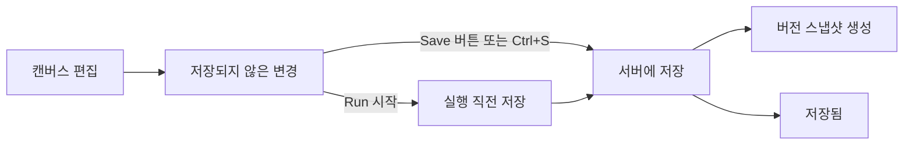

> 구현 상태: 부분 구현 (팔레트 Installed 섹션, AI 에이전트 · 정보 추출기 · 수동 트리거 노드의 설정 요약, Undo/Redo 를 줌 오버레이로 합치기는 미구현. 그리드 스냅은 미결 사항) · 원문: `spec/3-workflow-editor/_product-overview.md` (§1~§4, §6 ED-SV-01·02, §9), `spec/3-workflow-editor/0-canvas.md` · 용어: [용어 사전](../CLE-GLOSSARY.md)

## 개요

에디터(workflow editor)는 이 제품의 핵심 화면이다. 사용자는 캔버스(Canvas) 위에 노드를 놓고 연결선으로 이어 자동화 로직을 눈으로 보며 만든다. n8n 과 비슷한 노드 기반 편집 방식을 따르면서 AI 노드와 고급 로직 노드를 더 제공한다.

이 문서는 에디터 진입, 레이아웃과 헤더, 저장(save, `saveCanvas`) 모델을 정하고 에디터 전체의 요구사항을 모은다. 캔버스 인터랙션·노드 팔레트(Palette)·줌·미니맵·키보드 단축키, 노드의 시각 표현과 수동 트리거 노드의 편집 제약, 컨테이너(container, `containerId`) 편집 UX 는 [하위 문서](#하위-문서) 가 정한다.

범위 밖:

- 포트 체계와 설정 패널은 [노드 포트와 설정 패널](CLE-WF-NODEPANEL.md) 이 정한다.
- 연결선 생성·유효성·스타일은 [연결선](CLE-WF-EDGE.md) 이 정한다.
- 실행 버튼 동작, 실행 결과 드로어, 캔버스의 실행 진행 표시는 [에디터 실행과 디버깅](../CLE-EXEC/CLE-EXEC-RUN.md) 이 정한다.
- AI 어시스턴트 패널은 [워크플로우 AI 어시스턴트](CLE-WF-ASSIST.md) 가 정한다.
- 버전 기록 패널과 복원은 [버전 기록](CLE-WF-VERSION.md) 이, 저장 요청이 서버에서 처리되는 흐름은 [워크플로우 데이터와 저장 흐름](CLE-WF-DATA.md) 이 정한다.
- 노드 사이 관계를 보는 경고 규칙은 [그래프 경고 규칙](CLE-WF-WARN.md) 이 정한다.
- 컨테이너 본문의 실행 방식은 [컨테이너 실행](../CLE-EXEC/CLE-EXEC-CONTAINER.md) 이 정한다.

## 요구사항

- REQ-EDITOR-001 WHEN 사용자가 워크플로우 목록에서 항목을 누르면 THE SYSTEM SHALL 그 워크플로우의 에디터로 들어간다. (원본: ED-EN-01)
- REQ-EDITOR-002 WHEN 사용자가 새 워크플로우를 만들면 THE SYSTEM SHALL 수동 트리거 노드 하나만 있는 캔버스로 에디터에 들어간다. (원본: ED-EN-02)
- REQ-EDITOR-003 IF 저장하지 않은 변경이 있는 채로 에디터를 나가려 하면 THE SYSTEM SHALL 확인 다이얼로그를 표시한다. (원본: ED-EN-03)
- REQ-EDITOR-004 WHILE 에디터가 열려 있는 동안 THE SYSTEM SHALL 헤더에 워크플로우 이름과 저장·실행 버튼을 표시한다. (원본: ED-EN-04)
- REQ-EDITOR-005 WHILE 에디터가 열려 있는 동안 THE SYSTEM SHALL 크기 제한 없이 넓힐 수 있는 2D 캔버스를 제공한다. (원본: ED-CV-01)
- REQ-EDITOR-006 WHEN 사용자가 캔버스 빈 영역을 끌면 THE SYSTEM SHALL 시점을 옮긴다(패닝). (원본: ED-CV-02)
- REQ-EDITOR-007 WHEN 사용자가 스크롤·핀치·줌 버튼을 쓰면 THE SYSTEM SHALL 25%~200% 범위에서 캔버스를 확대·축소한다. (원본: ED-CV-03)
- REQ-EDITOR-008 WHEN 사용자가 Fit 을 누르면 THE SYSTEM SHALL 모든 노드가 보이도록 뷰포트를 맞춘다. (원본: ED-CV-04)
- REQ-EDITOR-009 WHILE 미니맵이 켜져 있는 동안 THE SYSTEM SHALL 캔버스 오른쪽 아래에 워크플로우 전체 조감도와 현재 뷰포트 사각형을 표시한다. (원본: ED-CV-05)
- REQ-EDITOR-010 WHEN 사용자가 노드를 끌어 옮기면 THE SYSTEM SHALL 노드를 그리드에 맞춰 놓는다(구현 여부가 갈린다, 미결 사항 참조). (원본: ED-CV-06)
- REQ-EDITOR-011 WHEN 사용자가 노드 팔레트의 노드를 캔버스로 끌어 놓으면 THE SYSTEM SHALL 놓은 위치에 새 노드를 추가한다. (원본: ED-ND-01)
- REQ-EDITOR-012 WHEN 사용자가 캔버스 빈 영역을 더블클릭하거나 우클릭 메뉴에서 노드 추가를 고르면 THE SYSTEM SHALL 노드 검색 팝업을 열고 고른 노드를 그 위치에 추가한다. (원본: ED-ND-02)
- REQ-EDITOR-013 WHEN 사용자가 노드를 누르면 THE SYSTEM SHALL 그 노드만 선택한다. (원본: ED-ND-03)
- REQ-EDITOR-014 WHEN 사용자가 Shift 를 누른 채 노드를 누르면 THE SYSTEM SHALL 그 노드를 기존 선택에 넣거나 뺀다. (원본: ED-ND-03)
- REQ-EDITOR-015 WHEN 사용자가 Shift 를 누른 채 빈 영역을 끌면 THE SYSTEM SHALL 영역 안의 노드를 모두 선택한다. (원본: ED-ND-03)
- REQ-EDITOR-016 WHEN 사용자가 선택한 노드를 끌면 THE SYSTEM SHALL 선택한 노드를 모두 함께 옮긴다. (원본: ED-ND-04)
- REQ-EDITOR-017 WHEN 사용자가 Ctrl+C 를 누르면 THE SYSTEM SHALL 선택한 노드와 양 끝이 모두 선택된 연결선을 앱 내부 클립보드에 복사한다. (원본: ED-ND-05)
- REQ-EDITOR-018 WHEN 사용자가 Ctrl+V 를 누르면 THE SYSTEM SHALL 복사한 노드를 원본 대비 (+40, +40) 위치에 겹치지 않는 레이블과 새 연결선 id 로 붙여 넣는다. (원본: ED-ND-05)
- REQ-EDITOR-019 WHEN 사용자가 Ctrl+D 를 누르면 THE SYSTEM SHALL 클립보드를 바꾸지 않고 선택한 노드를 바로 복제한다.
- REQ-EDITOR-020 WHEN 사용자가 Delete·Backspace 키나 우클릭 메뉴로 노드를 지우면 THE SYSTEM SHALL 노드와 그 노드에 연결된 연결선을 함께 지운다. (원본: ED-ND-06)
- REQ-EDITOR-021 WHEN 사용자가 노드를 누르면 THE SYSTEM SHALL 설정 패널을 연다. (원본: ED-ND-07)
- REQ-EDITOR-022 WHILE 노드가 실행 중이거나 성공·실패·건너뜀 상태인 동안 THE SYSTEM SHALL 캔버스의 노드에 그 상태를 시각적으로 표시한다. (원본: ED-ND-08)
- REQ-EDITOR-023 WHEN 사용자가 노드 비활성화를 켜면 THE SYSTEM SHALL 그 노드를 반투명·사선 패턴으로 그리고 실행할 때 건너뛴다. (원본: ED-ND-09)
- REQ-EDITOR-024 IF 노드의 필수 설정이 하나라도 비어 있으면 THE SYSTEM SHALL 노드 헤더에 경고 아이콘을 표시하고 툴팁에 구체적인 누락 항목을 보여 준다. (원본: ED-ND-10)
- REQ-EDITOR-025 WHILE 에디터가 열려 있는 동안 THE SYSTEM SHALL 노드 팔레트에 사용할 수 있는 노드를 카테고리별로 표시한다. (원본: ED-PL-01)
- REQ-EDITOR-026 WHEN 사용자가 노드 팔레트 검색창에 입력하면 THE SYSTEM SHALL 노드 이름으로 목록을 바로 거른다. (원본: ED-PL-02)
- REQ-EDITOR-027 WHEN 사용자가 노드 팔레트 토글 버튼을 누르면 THE SYSTEM SHALL 팔레트를 아이콘 레일로 접거나 다시 펼친다. (원본: ED-PL-03)
- REQ-EDITOR-028 WHILE 이번 편집 세션에서 노드를 추가한 적이 있는 동안 THE SYSTEM SHALL 팔레트 위쪽 Recent 섹션에 최근 쓴 노드 유형을 최대 5개 최신순으로 중복 없이 표시한다. (원본: ED-PL-04)
- REQ-EDITOR-029 WHILE 마켓플레이스에서 설치한 노드가 있는 동안 THE SYSTEM SHALL 팔레트의 Installed 섹션에 그 노드를 표시한다. (원본: ED-PL-05) (미구현)
- REQ-EDITOR-030 WHEN 사용자가 팔레트의 노드를 누르거나 포커스 뒤 Enter·Space 를 누르면 THE SYSTEM SHALL 현재 뷰포트 가운데에 노드를 추가한다.
- REQ-EDITOR-031 WHEN 사용자가 헤더 저장 버튼이나 Ctrl+S 를 누르면 THE SYSTEM SHALL 캔버스 내용을 바로 서버에 저장한다. (원본: ED-SV-01)
- REQ-EDITOR-032 IF 저장하지 않은 변경이 있는 채로 전체 실행·선택 노드부터 실행·단일 노드 실행을 시작하면 THE SYSTEM SHALL 실행 전에 먼저 저장한다. (원본: ED-SV-02)
- REQ-EDITOR-033 WHILE 에디터가 열려 있는 동안 THE SYSTEM SHALL 타이머로 자동 저장하지 않는다. (원본: ED-SV-02)
- REQ-EDITOR-034 IF 저장하지 않은 변경이 없거나 그래프 경고 규칙에 `error` 가 있으면 THE SYSTEM SHALL 저장 버튼을 비활성으로 둔다.
- REQ-EDITOR-035 WHILE 저장 상태가 바뀌는 동안 THE SYSTEM SHALL 헤더에 "저장 중...", "저장되지 않은 변경 사항", "저장됨" 가운데 하나를 표시한다.
- REQ-EDITOR-036 WHEN 사용자가 Ctrl+Z 나 Ctrl+Y(또는 Ctrl+Shift+Z)를 누르면 THE SYSTEM SHALL 마지막 편집을 되돌리거나 다시 적용한다.
- REQ-EDITOR-037 IF 워크플로우에 트리거 카테고리 노드 말고 다른 노드가 없으면 THE SYSTEM SHALL 캔버스 오른쪽 위에 시작 가이드 카드를 표시한다.
- REQ-EDITOR-038 WHEN 트리거가 아닌 첫 노드가 추가되면 THE SYSTEM SHALL 시작 가이드 카드를 300ms 동안 흐리게 하며 숨긴다.
- REQ-EDITOR-039 WHILE 줌이 50% 미만인 동안 THE SYSTEM SHALL 노드의 설정 요약 줄을 숨긴다.
- REQ-EDITOR-040 WHEN 노드 설정이 에디터 상태에 반영되면 THE SYSTEM SHALL 캔버스의 설정 요약을 바로 갱신한다.
- REQ-EDITOR-041 IF 노드가 가리키는 통합이 지워졌으면 THE SYSTEM SHALL 노드에 `⚠ Missing integration` 배지를 표시한다.
- REQ-EDITOR-042 IF 워크플로우 호출 노드가 가리키는 워크플로우가 지워졌으면 THE SYSTEM SHALL 노드에 `⚠ Missing workflow` 배지를 표시한다.
- REQ-EDITOR-043 WHILE 워크플로우가 실행 중인 동안 THE SYSTEM SHALL 노드 삭제 버튼을 숨긴다.
- REQ-EDITOR-044 WHEN 새 워크플로우를 만들면 THE SYSTEM SHALL 서버에서 수동 트리거 노드 하나를 (250, 300) 위치에 자동으로 만든다.
- REQ-EDITOR-045 IF 사용자가 수동 트리거 노드를 지우려 하면 THE SYSTEM SHALL 삭제를 막는다.
- REQ-EDITOR-046 IF 사용자가 팔레트에서 수동 트리거 노드를 하나 더 추가하려 하면 THE SYSTEM SHALL 그 동작을 무시한다.
- REQ-EDITOR-047 WHEN 컨테이너의 `body` 포트에서 노드로 연결선이 생기면 THE SYSTEM SHALL 그 노드의 `containerId` 를 그 컨테이너로 정한다.
- REQ-EDITOR-048 IF 새 `body` 또는 `emit` 연결선의 상대 노드가 이미 다른 컨테이너에 속해 있으면 THE SYSTEM SHALL 연결선을 만들지 않고 토스트 경고를 표시한다.
- REQ-EDITOR-049 WHEN 컨테이너 자식 노드에서 소속 없는 노드로 연결선이 생기면 THE SYSTEM SHALL 그 노드를 같은 컨테이너 소속으로 정한다.
- REQ-EDITOR-050 WHEN 소속을 만든 연결선이나 노드가 지워지면 THE SYSTEM SHALL 모든 노드의 `containerId` 를 다시 계산해 가리킬 곳이 없는 소속을 남기지 않는다.
- REQ-EDITOR-051 WHEN 워크플로우를 불러오면 THE SYSTEM SHALL `containerId` 를 연결선 기준으로 다시 계산하고 바뀐 값이 있으면 저장하지 않은 변경으로 표시한다.
- REQ-EDITOR-052 IF 자식 노드가 있는 컨테이너를 지우려 하면 THE SYSTEM SHALL 그룹 해제와 모두 삭제 가운데 하나를 고르는 확인 다이얼로그를 표시한다.
- REQ-EDITOR-053 IF 자식 노드가 없는 컨테이너를 지우면 THE SYSTEM SHALL 확인 없이 바로 지운다.
- REQ-EDITOR-054 WHEN 사용자가 컨테이너를 다른 컨테이너 안에 두면 THE SYSTEM SHALL 깊이 제한 없이 중첩을 허용한다.
- REQ-EDITOR-055 IF 트리거 카테고리 노드를 컨테이너 자식으로 만들려 하면 THE SYSTEM SHALL 소속 전파를 거부한다.
- REQ-EDITOR-056 WHEN 사용자가 노드를 추가하거나 붙여넣거나 복제하면 THE SYSTEM SHALL 클라이언트에서 새 UUID 를 노드 id 로 발급한다.
- REQ-EDITOR-057 IF 캔버스 저장이 새 노드로 싣는 id 를 다른 워크플로우의 노드가 이미 쓰고 있으면 THE SYSTEM SHALL 저장을 400 `VALIDATION_ERROR` 로 거부하고 그 노드 행을 덮어쓰지 않는다.
- REQ-EDITOR-058 IF 캔버스 저장의 `containerId`·`toolOwnerId`·연결선 끝점이 이번 페이로드에 없는 노드를 가리키면 THE SYSTEM SHALL 저장을 400 `VALIDATION_ERROR` 로 거부하고 틀린 필드를 모두 `details[]` 에 싣는다.
- REQ-EDITOR-059 WHEN 사용자가 노드를 붙여넣거나 복제하면 THE SYSTEM SHALL 지금 사용자가 그 워크플로우에서 고를 수 없는 통합 참조를 비우고 비운 노드를 경고로 알린다.

## 하위 문서

| 문서 | 맡는 내용 | 요구사항 |
| --- | --- | --- |
| [워크플로우 에디터 — 캔버스 조작과 팔레트](CLE-WF-EDITOR-CANVAS.md) | 뷰포트·선택·노드 조작(복사·붙여넣기·복제와 통합 참조 거르기)·컨텍스트 메뉴, 시작 가이드 카드, 노드 팔레트와 노드 검색 팝업, 줌 컨트롤과 Undo/Redo, 미니맵, 키보드 단축키 | REQ-EDITOR-005~021, REQ-EDITOR-025~030, REQ-EDITOR-036~038, REQ-EDITOR-056, REQ-EDITOR-059 |
| [워크플로우 에디터 — 노드 시각 표현](CLE-WF-EDITOR-NODE.md) | 노드 외형·상태 표시, 설정 요약, 미설정 경고와 경고 배지, `⚠ Missing` 배지, 삭제 버튼, 수동 트리거 노드의 편집 제약 | REQ-EDITOR-022~024, REQ-EDITOR-039~046 |
| [워크플로우 에디터 — 컨테이너 편집](CLE-WF-EDITOR-CONTAINER.md) | 컨테이너의 시각 표현, 소속(`containerId`) 자동 동기화, 제약, 컨테이너 삭제, 중첩, 제거된 도구 영역 | REQ-EDITOR-047~055, REQ-EDITOR-058 |

에디터 진입(REQ-EDITOR-001~004)과 저장(REQ-EDITOR-031~035, REQ-EDITOR-057)은 이 문서가 맡는다.

## 화면 레이아웃

| 영역 | 위치 | 들어가는 요소 | 동작 |
| --- | --- | --- | --- |
| 헤더 | 맨 위 | 뒤로가기(←), 브레드크럼 "Workflows / {이름}", AI 어시스턴트 버튼(🤖), Save, Run(드롭다운), Undo·Redo, 더보기(⋮) | [에디터 헤더](#에디터-헤더) 참조 |
| 노드 팔레트 | 왼쪽 | 검색, Recent, 카테고리별 노드 목록 | 끌어 놓거나 눌러 노드 추가 |
| 캔버스 | 가운데 | 노드, 연결선, 시작 가이드 카드(조건부) | 패닝·줌·선택·편집 |
| 오른쪽 패널 | 오른쪽 | 설정 패널 또는 AI 어시스턴트 패널 | 둘 중 하나만 연다. 자세한 내용은 [워크플로우 AI 어시스턴트](CLE-WF-ASSIST.md) |
| 줌 컨트롤 | 캔버스 왼쪽 아래 오버레이 | 줌아웃(−), 줌 슬라이더, 줌인(+), 현재 퍼센트, Fit | [줌 컨트롤과 Undo/Redo](CLE-WF-EDITOR-CANVAS.md#줌-컨트롤과-undoredo) 참조 |
| 미니맵 | 캔버스 오른쪽 아래 | 워크플로우 조감도, 뷰포트 사각형 | 누르거나 끌어 뷰포트 이동 |
| 실행 결과 드로어 | 캔버스 아래 | 실행 결과 탭(Table·Chart·Template 등) | 실행할 때만 나타난다. 자세한 내용은 [에디터 실행과 디버깅](../CLE-EXEC/CLE-EXEC-RUN.md) |

## 에디터 헤더

| 요소 | 설명 |
| --- | --- |
| 뒤로가기(←) | 워크플로우 목록으로 간다. 저장하지 않은 변경이 있으면 확인한다. |
| 브레드크럼 | "Workflows / {워크플로우 이름}" |
| 워크플로우 이름 | 누르면 텍스트 필드로 바뀌어 바로 고칠 수 있다. |
| AI 어시스턴트 버튼(🤖) | 오른쪽 AI 어시스턴트 패널을 켜고 끈다. 켜져 있으면 강조한다. 패널은 [워크플로우 AI 어시스턴트](CLE-WF-ASSIST.md) 가 정한다. |
| Save 버튼 | 수동 저장(Ctrl+S). 저장하지 않은 변경이 없으면 비활성이다. |
| Run 버튼 | 워크플로우를 실행한다. 드롭다운에서 전체 실행(Run), 입력과 함께 실행(Run with Input), 선택 노드부터 실행(Run from Selected)을 고른다. 각 방식은 [에디터 실행과 디버깅](../CLE-EXEC/CLE-EXEC-RUN.md) 이 정한다. |
| Undo·Redo | 실행 취소·다시 실행. [줌 컨트롤과 Undo/Redo](CLE-WF-EDITOR-CANVAS.md#줌-컨트롤과-undoredo) 참조 |
| 더보기(⋮) | 설정, 버전 기록, 실행 내역, 내보내기, 삭제. 버전 기록은 [버전 기록](CLE-WF-VERSION.md), 실행 내역 패널은 [에디터 실행과 디버깅](../CLE-EXEC/CLE-EXEC-RUN.md), 내보내기는 [워크플로우 목록과 폴더](CLE-WF-LIST.md) 가 정한다. 가져오기는 이 메뉴에 없고 목록 화면 헤더의 `⤓ Import` 에만 있다([Rationale](#rationale) R-6). |

## 저장

캔버스 변경은 에디터 상태(in-memory store)에만 쌓이고 `isDirty` 가 켜진다. 서버에 영구 저장되는 경로는 아래 두 가지뿐이다. 타이머로 주기적으로 저장하는 자동 저장은 없다.

| 항목 | 설명 |
| --- | --- |
| 수동 저장 | 헤더 `Save` 버튼 또는 `Ctrl+S`(Mac 은 `Cmd+S`). 바로 저장한다. 저장하지 않은 변경이 없거나 그래프 경고 규칙에 `error` 가 있으면(`hasError`) 버튼이 비활성이다. |
| 실행 직전 저장 | 전체 실행·선택 노드부터 실행·단일 노드 실행을 시작할 때 `isDirty` 면 실행 전에 먼저 저장한다. 그래서 실행은 항상 최신 캔버스로 한다. |
| 저장 표시 | 헤더 상태 텍스트 "저장 중..." / "저장되지 않은 변경 사항" / "저장됨"(`isSaving`·`isDirty` 기준) |
| 저장 API | store 액션 `saveWorkflow` 가 API client `saveCanvas`(`POST /workflows/:id/save`)를 불러 현재 노드·연결선 전체를 저장한다. 마지막 저장이 서버 상태가 된다. 새 노드 id 는 클라이언트가 발급한 UUID 다. 붙여넣기와 복제도 id 를 새로 발급한다. 다른 워크플로우의 노드가 쓰는 id 를 실으면 저장이 400 이다([데이터 모델 개요 §참조의 소속](../CLE-PLAT/CLE-PLAT-DATA.md#참조의-소속)). 새로 넣거나 바꾼 통합 참조가 저장자나 워크플로우 작성자가 쓸 수 없는 통합을 가리켜도 400 이다(같은 절의 「통합 참조」). 서버 처리 흐름은 [워크플로우 데이터와 저장 흐름](CLE-WF-DATA.md) 에 있다. |

설정 패널의 변경은 `변경 저장`·`JSON 적용` 을 눌러야 에디터 상태에 들어간다([노드 포트와 설정 패널](CLE-WF-NODEPANEL.md)). AI 어시스턴트의 편집도 에디터 상태에 바로 반영되고 위 두 경로로만 저장된다([워크플로우 AI 어시스턴트](CLE-WF-ASSIST.md)).

### 저장과 버전

서버에 저장할 때마다 서버가 버전 스냅샷(`workflow_version`)을 함께 만든다. 타이머 자동 저장이 없으므로 버전 없이 저장만 되는 경우는 없다. 저장과 버전 생성이 한 트랜잭션인지는 원문끼리 정의가 갈린다([버전 기록](CLE-WF-VERSION.md) 의 미결 사항 참조).

| 동작 | 서버 저장 | 버전 생성 |
| --- | --- | --- |
| 캔버스 변경(노드·연결선·설정) | 없음(에디터 상태, `isDirty`) | 없음 |
| 수동 저장(`Ctrl+S`·`Save`) | 있음 | 있음. 저장하지 않은 변경이 있을 때만 생긴다. |
| 실행 직전 저장(Run) | 있음 | 있음. 실행 직전 스냅샷 |
| 버전 복원 | 있음 | 있음. 변경 요약 `Restored from vN` |

버전의 변경 요약(`change_summary`)은 저장 요청이 보낸 값을 그대로 담는다. 에디터의 수동 저장과 실행 직전 저장은 이 값을 보내지 않아 비어 있다. 규칙은 [버전 기록](CLE-WF-VERSION.md) 이 정한다.

## 다른 문서로 옮긴 절

다른 문서가 이 문서의 아래 절을 링크하므로 제목만 남기고 옮긴 위치를 적는다.

### 노드 조작

캔버스의 노드 조작 → [워크플로우 에디터 — 캔버스 조작과 팔레트](CLE-WF-EDITOR-CANVAS.md#노드-조작)

### 설정 요약

노드 카드의 설정 요약 → [워크플로우 에디터 — 노드 시각 표현](CLE-WF-EDITOR-NODE.md#설정-요약)

### 미설정 경고와 경고 배지

노드의 미설정 경고와 경고 배지 → [워크플로우 에디터 — 노드 시각 표현](CLE-WF-EDITOR-NODE.md#미설정-경고와-경고-배지)

### 시각 표현

컨테이너와 자식 노드 소속 배지의 시각 표현 → [워크플로우 에디터 — 컨테이너 편집](CLE-WF-EDITOR-CONTAINER.md#시각-표현)

## UI/UX 원칙

- **직관성**: 개발자가 아닌 사용자도 5분 안에 기본 워크플로우를 만들 수 있어야 한다.
- **생산성**: 키보드 단축키, 빠른 노드 검색, 자동완성으로 개발자의 작업 속도를 높인다.
- **피드백**: 모든 사용자 동작에 바로 시각·인터랙션 피드백을 준다.
- **실수 방지**: Undo/Redo(Ctrl+Z/Y)를 지원하고, 유효하지 않은 연결을 막고, 저장하지 않은 변경을 경고한다.

## 미결 사항

- **그리드 스냅**: 원문 캔버스 명세는 노드를 끌 때 그리드 스냅을 적용한다고 적고 요구사항 ED-CV-06(권장)도 이를 요구한다. 현재 구현(`workflow-canvas.tsx`)에는 `snapToGrid`·`snapGrid` 설정이 없고 프론트엔드 어디에도 없다. 구현할지, 명세를 미구현으로 낮출지 결정이 필요하다.
- **전체 실행 단축키 Ctrl+Enter**: [에디터 실행과 디버깅](../CLE-EXEC/CLE-EXEC-RUN.md) 의 원문은 Run 버튼이나 Ctrl+Enter 로 전체 실행한다고 적는다. 전역 단축키의 기준인 [키보드 단축키](CLE-WF-EDITOR-CANVAS.md#키보드-단축키) 표에는 없고 현재 구현의 `resolveEditorShortcut` 에도 실행 동작이 없다. 결정은 [에디터 실행과 디버깅의 미결 사항](../CLE-EXEC/CLE-EXEC-RUN.md#미결-사항) 에서 하고 단축키 표는 그 결정을 따른다.

## 구현 위치

캔버스·팔레트·노드 렌더러 파일은 [캔버스 조작과 팔레트 §구현 위치](CLE-WF-EDITOR-CANVAS.md#구현-위치) 에 있다.

- `codebase/frontend/src/components/editor/workflow-editor.tsx` (에디터 루트와 전역 단축키)
- `codebase/frontend/src/components/editor/toolbar/editor-toolbar.tsx` (헤더 툴바, 저장 버튼, 더보기 메뉴)
- `codebase/frontend/src/lib/stores/editor-store.ts` (에디터 상태, `saveWorkflow`)

## Rationale

팔레트(R-1·R-2)와 붙여넣기·복제의 통합 참조 거르기(R-5)의 근거는 [캔버스 조작과 팔레트 §Rationale](CLE-WF-EDITOR-CANVAS.md#rationale) 에, 컨테이너 중첩(R-4)의 근거는 [컨테이너 편집 §Rationale](CLE-WF-EDITOR-CONTAINER.md#rationale) 에 있다.

### R-3. 저장은 수동 저장과 실행 직전 저장 두 경로만 둔다 (2026-07-08)

한때 명세는 "노드·연결선·설정 변경 뒤 2초 디바운스 자동 저장", "오프라인 로컬 스토리지 임시 저장", "동시 편집 충돌 감지" 를 약속했고, 설정 패널 요구사항 ED-SP-05 는 "설정 변경 즉시 반영(별도 저장 버튼 불필요)" 을 약속했다. 구현에는 셋 다 없었다. 저장은 수동(`Ctrl+S`·`Save`)과 실행 직전 저장 두 경로뿐이다(`saveWorkflow` 호출처는 툴바, `Ctrl+S` 핸들러, Run 직전 세 곳). 설정 패널은 `변경 저장`·`JSON 적용` 을 눌러야 에디터 상태에 반영한다(`node-settings-panel.tsx`, `key={selectedNodeId}` 로 다시 마운트해 저장하지 않은 편집을 버린다). `workflow-editor.tsx` 의 500ms 디바운스는 저장이 아니라 그래프 경고 평가(`evaluateGraphWarningsLocal`)용이다.

명시 저장과 실행 직전 저장은 `Save` 버튼, "저장되지 않은 변경 사항" 상태 텍스트, 실행 전 저장이 서로 맞물린 **의도된 설계**로 판단했다(사용자 확인, 2026-07-08). 그래서 구현을 옛 명세에 맞추지 않고 명세를 현재 동작으로 고쳤다. 사용자 가이드도 이미 현재 동작을 설명한다. 타이머 자동 저장이나 오프라인 초안 복원을 되살릴지는 별도 기획 판단으로 남긴다.

### R-6. 더보기(⋮) 메뉴에는 내보내기만 둔다 (2026-10-25)

이전 판은 에디터 헤더 더보기(⋮) 메뉴에 가져오기도 있다고 적었지만 구현에는 없다. `editor-toolbar.tsx` 의 더보기 메뉴에는 내보내기(`handleExport`)만 있고, 가져오기(`importWorkflow`)를 부르는 곳은 워크플로우 목록 화면(`page.tsx`) 하나뿐이다. 사용자 가이드도 가져오기를 목록 화면에서만 안내한다. 그래서 명세를 구현에 맞춰 더보기 메뉴에는 내보내기만 적고 가져오기는 목록 화면 헤더의 `⤓ Import` 에만 둔다.

가져오기는 늘 새 워크플로우를 만든다. 지금 열어 둔 워크플로우를 편집하는 에디터 문맥과 맞지 않아서 에디터의 가져오기는 만들지 않았다. 같은 판단이 [워크플로우 목록과 폴더](CLE-WF-LIST.md) 의 Rationale 7 「가져오기는 목록 화면에만 둔다」 에 있다.
