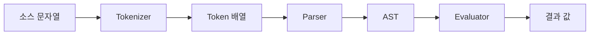

## 개요

이 문서는 [표현식 언어](CLE-WF-EXPR.md) 의 하위 문서로 에디터의 표현식 입력 · 자동완성과 실행 엔진이 노드 설정을 평가하는 구조(`$node` 레이블 매핑 · 표현식 제외 키)를 정한다. 요구사항과 미결 사항은 부모 문서에 있다.

## 에디터 지원

### 표현식 입력

노드 설정 패널의 텍스트 입력은 표현식을 아는 입력(`ExpressionInput`)으로 그린다. auto-form 에서는 `expression`·`kv-expression` 위젯이다([노드 포트와 설정 패널](CLE-WF-NODEPANEL.md)).

| 기능 | 설명 |
| --- | --- |
| 구문 강조 | `{{ }}` 블록 뒤에 배경 오버레이를 깐다. |
| 실시간 검증 | `validate()` 로 문법을 바로 검사한다. 문법 에러는 빨간 밑줄과 에러 메시지로, 접근할 수 없는 노드나 스코프 밖 변수 참조는 주황색 경고로 표시한다. |
| 노드 출력 스키마 | 앞 노드의 출력 구조를 트리로 보고 골라 넣는다. |
| 미리보기 | 마지막 실행 데이터로 표현식 결과를 미리 본다. |
| 모드 전환 | 필드마다 정적 값과 표현식 모드를 토글한다. |

### 자동완성

`{{` 를 입력하면 자동완성 팝업이 뜬다. 화살표 키로 옮기고 Enter·Tab 으로 고르고 Escape 로 닫는다.

| 계기 | 제안 내용 | 데이터 출처 |
| --- | --- | --- |
| `{{` 입력, 표현식 시작 | 최상위 내장 변수(`$input`, `$node`, `$var`, `$execution`, ...). Table 노드 맥락에서는 `$sourceItem`·`$sourceItemIndex`·`$dataSource` 를 더한다. | 내장 참조 변수 목록 |
| `$input.` 입력 | 직전 노드의 출력 필드 | 마지막 실행 결과의 출력 데이터 키 |
| `$params.` 입력 | 트리거 파라미터 이름. 트리거 바로 다음 노드에서만 제안한다. | `$input.parameters` |
| `$node["` 입력 | 노드 레이블 목록(노드 선택 드롭다운). 범위는 [미결 사항](CLE-WF-EXPR.md#미결-사항) 참조 | 에디터 store 의 노드 |
| `$node["Label"].output.` 입력 | 그 노드의 출력 필드 | 그 노드의 마지막 실행 결과 |
| `$var.` 입력 | 선언한 워크플로우 변수 | 변수 선언 노드의 설정 |
| `$sourceItem.` 입력 | **(Table 노드 한정)** 현재 행 항목 필드 | 실행 결과 행 샘플(`sourceItemSample`) |
| `$dataSource.` 입력 | **(Table 노드 한정)** 원본 배열 요소 필드 | 실행 결과 행 샘플(같음) |
| 함수 이름 일부 입력 | 맞는 내장 함수와 시그니처 | 함수 레지스트리(정적) |

- **컨테이너 스코프**: Loop·ForEach 본문 안에서만 `$loop`·`$item`·`$itemIndex`·`$itemIsFirst`·`$itemIsLast` 를 제안한다. Parallel 노드 안에서는 바깥 스코프를 차단한다.
- **Table 노드 한정 변수**: Table 노드 열 표현식을 편집할 때만 최상위 목록에 `$sourceItem`·`$sourceItemIndex`·`$dataSource` 를 보인다. 이것은 **에디터 자동완성 노출**이고, 실제 평가에서 쓸 수 있는 범위(`field` 와 `label` 의 차이 포함)는 [Table 노드](../CLE-NODE-PRES/CLE-NODE-TABLE.md) 를 따른다.
- **실행한 적 없는 워크플로우**: 함수 이름과 `$` 변수 종류만 제안하고, 필드 제안 자리에는 "(워크플로우를 먼저 실행하세요)" 힌트를 보여 준다.

**자동완성 데이터 출처**

| 출처 | 만드는 시점 |
| --- | --- |
| 노드 출력 스키마 | 마지막 실행 결과에서 추론한다. 실행하지 않았으면 노드 유형의 기본 스키마를 쓴다. |
| 설정 기반 스키마 보강(enricher) | 기본 스키마를 쓸 때 노드 인스턴스 설정에 선언한 사용자 필드를 정적 스키마에 넣는다(아래). |
| 변수 목록 | 워크플로우 안 변수 선언 노드에서 뽑는다. |
| 노드 목록 | 에디터 store 의 노드 레이블 |
| 함수 목록 | 내장 함수 레지스트리(정적) |

**자동완성 스키마 보강(enricher)**: 실행하지 않은 상태에서도 사용자가 설정으로 선언한 출력 필드를 힌트로 보여 주려고, 다섯 노드 유형은 노드 인스턴스 설정을 노드 유형의 정적 기본 스키마에 넣는다(`node-output-schema-enrichers.ts`). `$input` 스키마와 `$node["Label"].output` 드릴다운 양쪽에 적용한다(`use-expression-context.ts`).

| 노드 유형 | 넣는 규칙 |
| --- | --- |
| `information_extractor` | `config.outputSchema[].name` → `.output.result.extracted.<name>` |
| `form` | `config.fields[].name` → `.output.interaction.data.<field>` |
| `table` | `config.columns[].field` → `.output.rows[i].<field>` |
| `transform` | `set_field` 의 `field`, `rename_field` 의 `to` → `.output.<name>` |
| `manual_trigger` | `config.parameters[].name` → `.output.parameters.<name>`(파라미터 `type` 으로 매핑) |

안전장치: 위험한 키(`__proto__`, `constructor`, `prototype`, 식별자가 아닌 키)는 거부한다. 값에 표현식(`{{ }}`)이 든 키는 실행 전에는 키가 정해지지 않으므로 건너뛴다. 중첩 경로(`user.name`)도 건너뛴다. 기본 스키마 모양이 보강을 허용하지 않으면 조용히 기본 스키마로 돌아간다. 모두 UX 힌트일 뿐 실행 동작에는 영향이 없다.

## 구현 구조

### 파서와 평가기



| 단계 | 설명 |
| --- | --- |
| Tokenizer | 문자열을 토큰(숫자, 문자열, 연산자, 식별자 등)으로 나눈다. |
| Parser | 토큰 배열을 AST 로 바꾼다. 재귀 하강 파서다. |
| Evaluator | AST 를 돌며 컨텍스트에 바인딩한 값으로 결과를 계산한다. |

파서와 평가기는 JavaScript/TypeScript 로 구현해 프론트엔드(에디터 미리보기)와 백엔드(실행 엔진) 양쪽에서 쓴다. npm 패키지 `@workflow/expression-engine` 으로 분리해 공유한다.

### 실행 엔진 통합

백엔드 실행 엔진의 `ExpressionResolverService` 가 노드를 실행하기 전에 설정 객체의 표현식을 평가한다.

```
buildExpressionContext(input, executionContext, nodeMap) → resolveConfig(config, exprContext, nodeType) → (노드 핸들러 execute 로 전달)
```

- 문법 검사용 `validate()` 는 이 서비스가 아니라 공유 엔진 패키지(`@workflow/expression-engine`)가 제공한다.
- `resolveConfig` 의 세 번째 인자는 `nodeType`(문자열)이다. 이 값을 키로 `EXPRESSION_EXCLUSIONS` 에서 제외 키 집합을 찾는다.
- 설정 객체를 재귀로 돌며 문자열 값의 `{{ }}` 를 `evaluate()` 로 평가한다. 필드 전체 표현식의 타입 유지와 문자열 보간은 [문법](CLE-WF-EXPR-SYNTAX.md#기본-구조) 을 따른다. 비문자열 값 통과 · 재평가 금지 · 설정 깊이 10단계 제한은 [표현식 언어](CLE-WF-EXPR.md#요구사항) 의 요구사항이 정한다.

평가한 설정을 핸들러에 넘기는 단계와 원본 설정(`rawConfig`)과의 관계는 [노드 핸들러 계약](../CLE-EXEC/CLE-EXEC-HANDLER.md) 이 정한다.

### `$node` 레이블 매핑

`$node["Label"].output` 참조를 지원하려고 실행 시점에 노드 id → 노드 엔티티 맵(`nodeMap`)과 노드 id → 출력 캐시를 합쳐 레이블 키 맵을 만든다. 레이블이 겹치면 구분한 키를 쓰고(`buildDisambiguatedKeys`) 노드 UUID 로도 같은 항목을 등록한다. 각 항목에 싣는 노드 출력의 형태는 [노드 핸들러 계약](../CLE-EXEC/CLE-EXEC-HANDLER.md) 이 정한다. 항목은 `{ output }` 한 필드짜리 객체가 아니라 노드 출력(`NodeHandlerOutput`)의 `config`·`output`·`meta`·`port`·`status` 를 싣는다([노드 출력 규약](../CLE-NODE/CLE-NODE-OUTPUT.md)). 현재 구현(`expression-resolver.service.ts`)은 구조화한 출력 캐시(`structuredOutputCache`)에서 이 다섯 필드를 가져온다. 구조화한 항목이 없고 평평한 출력 캐시(`nodeOutputCache`)만 있을 때만 `{ output: 출력 }` 형태로 대신 싣는다. 코드 주석은 이 경로를 테스트 fixture 용으로 적는다.

- 위상 정렬 순서로 실행하므로 현재 노드가 참조하는 노드는 늘 이미 실행을 마친 상태다.
- **노드 레이블 유일 정책**: 워크플로우 안의 노드 레이블은 겹치면 안 된다. 노드를 만들거나 이름을 바꾸거나 캔버스를 저장할 때 중복을 막는다.
- **레이블 `#` 금지**: 레이블에 `#` 문자를 쓸 수 없다. 아래 `#N` 자동 구분 키와 부딪히지 않게 하려는 것이다. 노드 생성·수정 DTO 검사에서 거부한다(`@Matches(/^[^#]*$/)`, `create-node.dto.ts`, `update-node.dto.ts`).
- **중복 레이블 안전장치**: 같은 레이블이 있으면 실행 순서대로 `#N` 접미사로 자동 구분한다. 첫 노드는 원래 레이블, 다음 노드부터 `Label#2`, `Label#3` 이다.
- **UUID 대체 접근**: 모든 노드는 `$node["<nodeId>"]` 로도 읽을 수 있다. UUID 참조는 레이블이 바뀌어도 흔들리지 않는 안정된 참조 방식이다.

### 표현식 제외 키

엔진이 미리 평가하지 않는 노드별 설정 키(표현식 제외 키, `EXPRESSION_EXCLUSIONS`)다.

| 노드 | 제외 키 | 이유 |
| --- | --- | --- |
| `code` | `code` | 원시 JavaScript 코드다. 자체 런타임(`$input`, `$vars`, `$execution`)에서 실행한다. |
| `table` | `columns` | 셀(`field`)은 행(item)마다 따로 평가하고(`$sourceItem`, `$sourceItemIndex`, `$dataSource`), 라벨(`label`)은 dynamic 모드에서 `$dataSource` 컨텍스트로 한 번 평가한다. `TableHandler` 안에서 처리한다([Table 노드](../CLE-NODE-PRES/CLE-NODE-TABLE.md)). |
| `filter` | `conditions` | 조건은 표현식이 아니라 배열 항목마다 쓰는 필드 경로다. |
| `loop` | `breakCondition` | 반복마다 다시 평가해야 한다(`$loop`·`$var`·`$node[...]` 참조). 노드를 시작할 때 미리 평가하면 i=0 값으로 굳고, 첫 반복 전에는 `$loop` 가 `undefined` 라 에러가 난다. |

그 밖의 모든 노드의 설정 문자열 필드는 평가 대상이다. `template` 노드의 `template` 필드도 따로 제외하지 않는다. 제외 규칙의 기준은 `codebase/backend/src/modules/execution-engine/expression/expression-exclusions.ts` 의 `EXPRESSION_EXCLUSIONS` 다.

제외 키는 엔진이 미리 평가하지 않는다는 뜻일 뿐이고 설정 에코에서 빠지지 않는다. 핸들러는 이 키들의 원본 값도 `config` 에 싣는다([설정 에코 원칙](../CLE-NODE/CLE-NODE-OUTPUT-ECHO.md#principle-7-설정-에코-원칙)).

## 구현 위치

- `codebase/backend/src/modules/execution-engine/expression/expression-resolver.service.ts`
- `codebase/backend/src/modules/execution-engine/expression/expression-exclusions.ts`
- `codebase/frontend/src/components/editor/expression/*.ts`, `*.tsx` (`expression-input.tsx`, `use-expression-context.ts`, `node-output-schema-enrichers.ts` 등)
